# 陈旧数据训练的指标与实验对照

更新日期：2026-10-21。本文解释重要性采样（importance sampling，IS）的 p99、clipping、策略漂移和有效样本量等指标，整理 M2PO、AsyncOPD、Lightning OPD、Semi-OPD 的实验设置、原文图片和结果，并给出 MirrorOPD 的下一阶段实验建议。

证据分为三类：**论文报告**指指定版本正文或表格中的数值；**图上近似读数**仅用于判断量级，不冒充原始实验数据；**本项目分析**指基于公式、源码和已下载 W&B history 的解释或建议。所有模型效果数字只在各自实验内部比较。M2PO 是可验证奖励强化学习（RLVR），其结论不能自动推广到带 teacher token 信号的 OPD。

## 1. 当前最重要的判断

- p99 是分布尾部的一个位置，不能单独说明平均漂移、最极端异常或更新质量。
- 我们当前跨 rollout batch 的版本延迟为 0；同批四轮更新产生的是批内 0、1、2、3 次 optimizer update 的年龄。将总训练预算从 32 改为 200，不会增加这段延迟。
- M2PO 的 stale 单位是 optimizer update；AsyncOPD 扫描图的单位是 train-batch step。两篇设置中一个外层 step 都含四次更新，因此 M2PO 的 stale-256 与 AsyncOPD 的 stale-64 在更新次数上相近，但模型、目标、数据和具体缓存协议并不相同。
- 四组 E2–E5 在共同的前 120 次更新内训练动态接近。E2/E4 有末次验证；下载时 E3/E5 的云端 history 只到 step 30、缺少最终验证。不能据此排出四组效果名次。
- 要检验 stale 鲁棒性，应增加可控延迟并记录实际概率漂移；要检验最终效果，应增加验证检查点。两者是不同实验问题。

相关数学推导见[固定前缀下的优势估计与重要性采样](../../examples/mirroropd/docs/opd-objective/2026-10-21-固定前缀下的优势估计与重要性采样.md)，已有开关与计数实现见[优势与 IS 消融及更新计数实现方案](../../examples/mirroropd/docs/opd-objective/2026-10-21-优势与IS消融及更新计数实现方案.md)。

## 2. p99 是什么，应该与哪些指标一起看

### 2.1 先明确统计对象

对有效 response token，记生成时策略为 $\mu$、当前训练策略为 $\pi_\theta$，固定前缀为 $s_i$，采样 token 为 $a_i$：

$$
\rho_i=\frac{\pi_\theta(a_i\mid s_i)}{\mu(a_i\mid s_i)},\qquad
z_i=\log\rho_i=\ell_{\theta,i}-\ell_{\mu,i}.
$$

这里比较的是 **当前 student 与行为 student**。teacher/student 的 KL、teacher/student 的 top-k overlap，以及当前 student 与另一个 proximal policy 的比率，都不是同一个量。日志必须注明分子、分母、采样分布与测量时机。

### 2.2 p99 的定义与直觉

对 $N$ 个有效观测，定义经验分布函数和分位数：

$$
\widehat F(x)=\frac{1}{N}\sum_{i=1}^N\mathbf 1[\rho_i\le x],\qquad
q_p=\inf\{x:\widehat F(x)\ge p\}.
$$

本文的 p99 指 $q_{0.99}$。在上述最近秩定义下，将 10,000 个 ratio 排序，p99 对应第 9,900 个值。若 p99=2，大约 99% 的观测不超过 2；剩余约 1% 可以是 2.1，也可以包含远大于 2 的值。不同库可能在相邻顺序统计量间插值，复现时应固定分位数算法。

| 统计量 | 回答的问题 | 单独使用的盲点 |
| --- | --- | --- |
| p50 | 典型 token 的 ratio 在哪里 | 看不到尾部 |
| p01、p05 | 当前策略是否大幅压低某些行为 token 的概率 | 只看下尾，遗漏上尾 |
| p95、p99、p99.9 | 上尾增长到什么量级 | p99 看不到最极端的 1%；小样本的高分位数不稳定 |
| mean、std | 整体中心与离散程度 | 均值可能掩盖两侧变化；std 对极端值敏感 |
| max / min | 最坏观测是什么 | 很受有效 token 数和偶发异常影响 |
| 尾部权重占比 | 少量 token 是否承担大量 surrogate 权重 | 权重占比不等于真实梯度范数占比 |

**示意反例：** 10,000 个数中，前 9,900 个都是 1；剩余 100 个全为 2，或其中一个改成 $10^6$，最近秩 p99 都是 1。后者的均值与二阶矩却会剧烈变化。这是统计量演示，不是实测的策略比率数据。

### 2.3 三种“clip”必须分开

设 PPO 的上下阈值为 $1-\epsilon_l$ 和 $1+\epsilon_h$，优势已 detach：

$$
L_i=\max\left(-\rho_i A_i,-\operatorname{clip}(\rho_i,1-\epsilon_l,1+\epsilon_h)A_i\right).
$$

可以分别记录：

$$
f_{\mathrm{outside}}=\frac{1}{N}\sum_i\mathbf1[\rho_i<1-\epsilon_l\ \lor\ \rho_i>1+\epsilon_h],
$$

$$
f_{\mathrm{active}}=\frac{1}{N}\sum_i\mathbf1[(A_i>0\land\rho_i>1+\epsilon_h)\ \lor\ (A_i<0\land\rho_i<1-\epsilon_l)].
$$

前者是 **ratio 越界比例**，后者是 **PPO 裁剪项严格改变目标的比例**；$A_i=0$ 不计入后者。ratio=2 且 $A<0$ 时，普通 PPO 不会因为上界 1.2 而剪掉该方向的项。因此实际 clip 很少，并不推出所有 ratio 都在 $[0.8,1.2]$ 内。PPO 裁剪目标也不强制真实策略比率永远处于该区间。

另有两类不同指标：**advantage clipping** 限制 $A$ 的数值，**response length clipping** 记录回答达到长度上限的比例。数值保护 `clamp(log_ratio, -20, 20)` 又是第四种操作，不应叫作 PPO clip。

### 2.4 KL、log-ratio 二阶矩与 ESS

以下是诊断定义及其条件，不表示本项目已经全部实现。

| 名称 | 经验量 | 作用与限制 |
| --- | --- | --- |
| signed log-ratio KL 估计 | $\widehat K_1=-\frac1N\sum_i z_i$ | 在固定策略、行为采样和相应支持条件下估计 $\mathrm{KL}(\mu\Vert\pi_\theta)$；有限样本项可正可负，可能抵消 |
| 非负 KL 估计形式 | $\widehat K_3=\frac1N\sum_i(\rho_i-1-z_i)$ | 单项非负；要具有同一 KL 的期望还需 $\mathbb E_\mu[\rho]=1$ 等支持条件 |
| **log-ratio 二阶矩** | $\widehat M_{2,\log}=\frac1N\sum_i z_i^2$ | M2PO Eq. (4) 的量；既反映 log-ratio 均值偏移，也反映其方差 |
| ratio 二阶矩 | $\widehat M_{2,\rho}=\frac1N\sum_i\rho_i^2$ | 与大权重集中有关，**不是 M2PO Eq. (4)** |
| 归一化有效样本量 | $\mathrm{ESS}/N=\frac{(\sum_i\rho_i)^2}{N\sum_i\rho_i^2}$ | 描述这组 IS 权重的集中程度；不是相关 token 的真实独立样本数 |

当策略与采样条件允许时，$\mathbb E_\mu[\rho]=1$，且 $\mathbb E_\mu[\rho^2]=1+\chi^2(\pi_\theta\Vert\mu)$。有限缓存、重复利用训练样本、截断采样和不同 prefix 分布都可能破坏直接套用这些人口统计恒等式的条件，不能要求实测 ratio mean 必须恰好为 1。

对 log-ratio 有恒等分解：

$$
\mathbb E[z^2]=\operatorname{Var}(z)+(\mathbb E[z])^2.
$$

这解释了为什么 $-\mathbb E[z]$ 很小时，$\mathbb E[z^2]$ 仍可能很大。但 **log-ratio 二阶矩小，不构成无条件的 ratio 极端尾部保证**。M2PO 的定理额外假设 $1/R\le\rho\le R$，才有 $\chi^2\le R^2 M_{2,\log}$；不能省略 $R$ 有界的条件。[^m2po]

### 2.5 一套实用的观测顺序

| 层次 | 建议指标 | 判断目标 |
| --- | --- | --- |
| 最终任务质量 | 各数据集 avg@n / 单次成功率估计、初始验证、多个 checkpoint、重复种子 | 是否学得更好；avg@16 不等于 pass@16 |
| 训练是否正常 | optimizer attempts/steps/skips、非有限量、梯度范数、LR、长度触顶率 | 排除计数错误、数值失稳与大量截断 |
| 数据有多旧 | 生成版本、训练版本、optimizer-update age 分布 | 量化实际延迟，不能只记录配置中的队列深度 |
| 策略究竟漂了多少 | ratio 分位数与极值、$K_1/K_3$、$M_{2,\log}$、ESS/N | 区分版本年龄与概率漂移 |
| 哪些训练信号被改掉 | outside fraction、active clip fraction、M2PO mask fraction、优势符号及大小 | 判断 clipping 是否只处理少数尾部，或丢弃了重要方向 |
| 信号与 token 类型的关系 | 按 $|\rho-1|$、熵、位置、优势正负分桶 | 分析高漂移 token 是否集中在高熵或特定推理位置 |
| 成本 | 有效训练 token/s、验证耗时、GPU-hours、同预算准确率 | 判断收益是否抵得过生成和评分成本 |

熵应注明策略：$H_\theta(s)=-\sum_a\pi_\theta(a\mid s)\log\pi_\theta(a\mid s)$ 是完整分布熵；单个 token 的 $-\log\pi_\theta(a\mid s)$ 是 surprisal，不应混称为完整熵。评估多个 run 的差异时，应按题目聚类做配对统计或 bootstrap，并补充不同训练种子；不能把同一道题的 16 条回答简单当成 16 个独立题目。

## 3. 2510.01161：M2PO 实际做了什么分析

### 3.1 论文与实验口径

论文为 Zheng、Zhao、Chen 的 *Prosperity before Collapse: How Far Can Off-Policy RL Reach with Stale Data on LLMs?*，本文核对 **2510.01161v2**。任务是数学 RLVR，比较陈旧数据下的 GRPO、无 trust region 变体及 M2PO 等方法；没有 OPD teacher token 优势。[^m2po]

| 项目 | 原文设置：§3.2、§6.1、附录 B |
| --- | --- |
| 模型 | Qwen2.5-Math-7B、Llama-3.2-3B-Instruct、Qwen3-Base-1.7B/4B/8B、Qwen2.5-32B |
| 数据 | DeepScaleR math |
| Batch | 256 prompts × 每题 8 responses = 2048 条；mini-batch 512 条；每外层四次更新 |
| 训练 | 1000 个训练 step；AdamW、恒定 LR $10^{-6}$、wd 0.01、betas=(0.9,0.999) |
| stale 单位 | optimizer update；stale-0 实际批内年龄 0–3，stale-256 为 256–259 |
| 延迟补充实验 | $s=0,32,64,128,256$，Qwen2.5-Math-7B |
| 约束 | GRPO $\epsilon=0.2$；M2PO $\tau_{M_2}=0.04$；去除额外 KL penalty |
| 生成 | temperature=1；7B Math 模型上下文 4K，其余 16K |
| 评估 | 每 50 step；八个数学基准；AIME24/25 avg@16，其余 avg@4；temperature=1 |
| 选点 | 报告八基准平均成绩最好的 checkpoint，不是统一最终 checkpoint |

注意 mini-batch 512 大于 prompt batch 256 并不矛盾：前者按 response 条数，后者按 prompt 数；每题生成八条后共有 2048 条。

### 3.2 图与指标如何组成论证

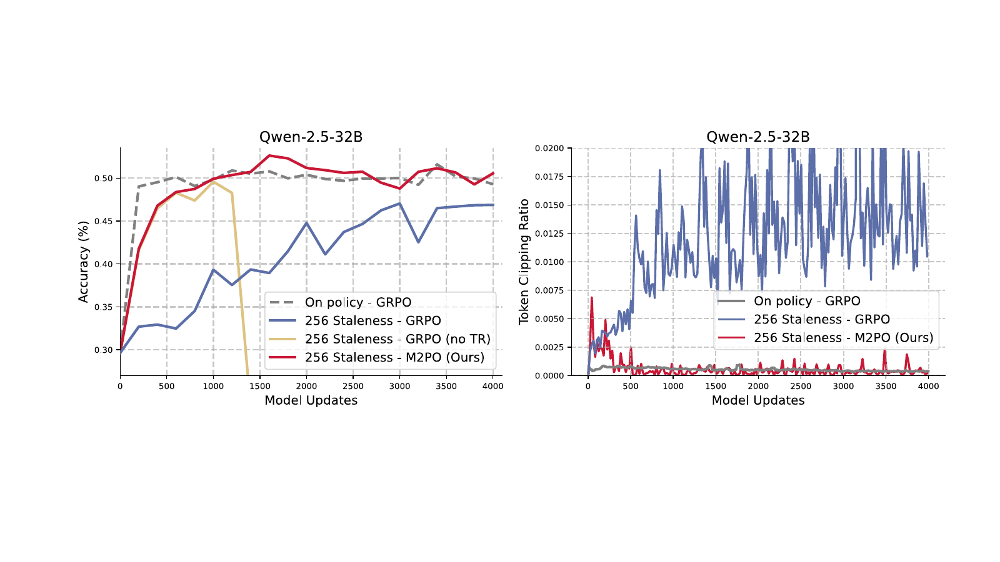

图 1：M2PO 原论文 Figure 1，来源源文件 `figs/fig1.pdf`，仅从原 PDF 渲染为 PNG，未重画曲线。它把准确率随更新演化与 clipping 放在一起：无 trust region 的 stale 训练可以先提高、再崩溃。只观察早期 reward 或准确率，不能判定长期稳定。原图左轴文字带有“%”，但刻度使用0.30–0.50这类比例值；本文准确率表以原文Table 1的百分数为准，不把0.50读作0.50%。[^m2po]

| 原图 | 测量内容 | 本项目应学到的观测方法 |
| --- | --- | --- |
| Fig. 1、3、5、6 | 准确率、训练 reward、崩溃位置 | 同时看学习效果与稳定性；不能只挑崩溃前峰值 |
| Fig. 4(a)、7 | clipping 随更新变化及训练期平均值 | 报告时间序列、分母与优势条件，不能只报一个最终比例 |
| Fig. 4(b) | $|\rho-1|$ 分桶后的平均 token entropy | 定位哪些 token 更容易被固定阈值处理 |
| Fig. 8 | $\tau_{M_2}$ 敏感性 | 约束太小和太大都可能出问题；论文默认值不是跨目标通用常数 |
| Fig. 9 | mask 前后 $M_{2,\log}$、不同方法的 KL 曲线 | 观察被平均 KL 掩盖的波动和 mask 的实际作用 |
| Fig. 10、11 | 常被裁剪的 token、不同 stale 的效果 | 结合 token 语义和延迟扫描，避免只凭单一数字解释训练 |

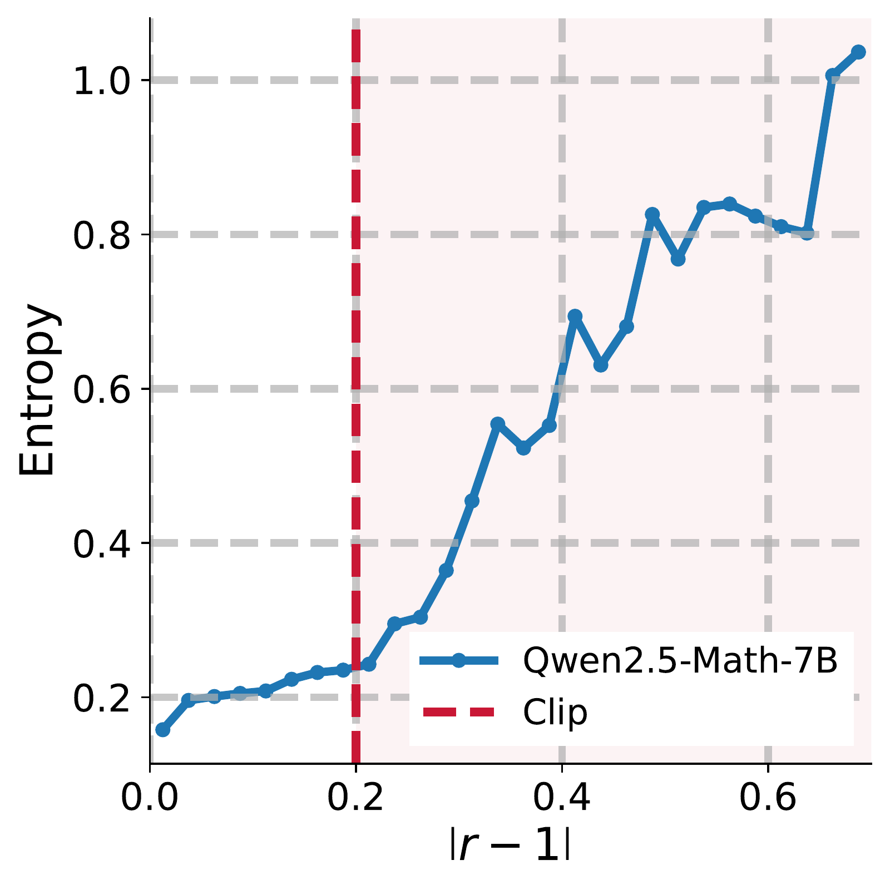

图 2：原论文 Figure 4(b)，`figs/entropy_vs_ratio-2.pdf`。原文在 Qwen2.5-Math-7B、stale-256 的 **800–1200 次模型更新**阶段采集约 **9000 万训练 token**，按 ratio 距离 1 的程度分析平均熵。原文报告相关性；这不是“高熵 token 必然带来正确推理”的因果证明。复现时还需固定熵对应的策略版本。[^m2po]

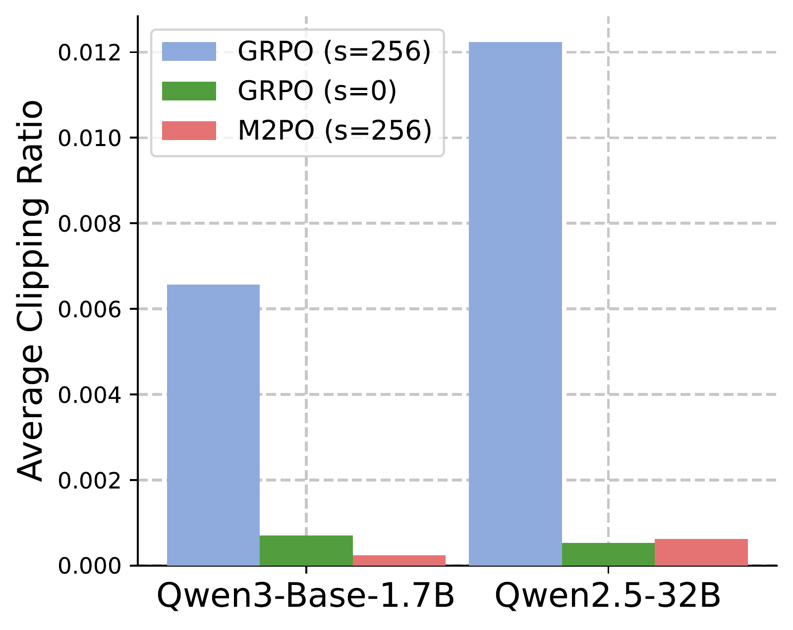

图 3：原论文 Figure 7(b)，`figs/clipping-bar.pdf`。图中比例反映各方法实际抑制的 token，M2PO 的 masking 与 PPO min-surrogate clipping 的规则不同。[^m2po]

| 模型 | GRPO，stale-0 | GRPO，stale-256 | M2PO，stale-256 |
| --- | ---: | ---: | ---: |
| Qwen3-Base-1.7B | 0.07% | 0.66% | 0.02% |
| Qwen2.5-32B | 0.05% | 1.22% | 0.06% |

表中数值是 §6.3 的训练期平均比例。这里的“1.22% 到 0.06%”是 **两种方法的比较**，不是同一个 run 从训练初期下降到末期。我们的 E3 平均实际 clipping 约 0.089%，与上述同步 GRPO 数字处于相近量级，但任务、模型、token 权重、聚合方式均不同，不能拿它作稳定性阈值。[^m2po]

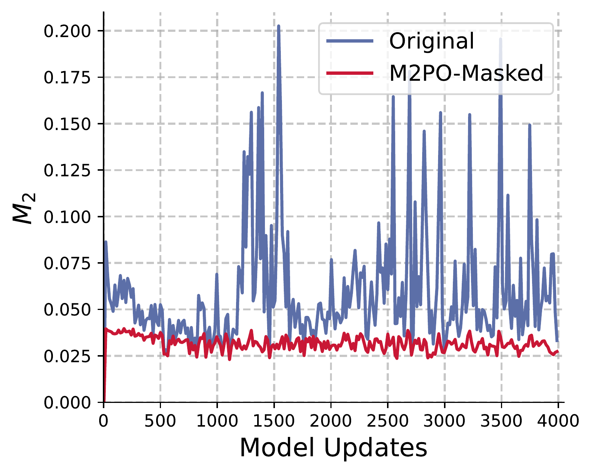

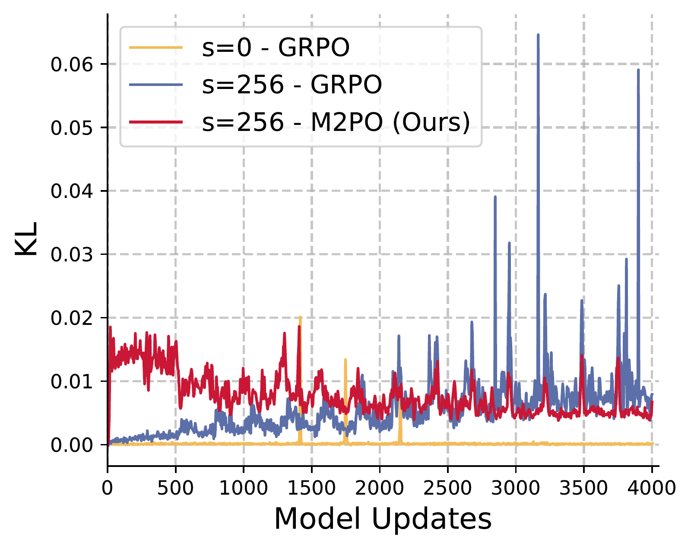

图 4–5：原论文 Figure 9(a)(b)，分别来自 `figs/m2-dynamics-32b.pdf`、`figs/kl-dynamics-32b.pdf`，均保留原坐标。用途是对照二阶矩波动与 KL，而非将两者的纵轴数值等同。[^m2po]

### 3.3 M2PO 的约束不是固定的 ratio 上限

M2PO 从有 trust-region 约束方向的 token 中，依次移除 $z_i^2$ 最大的 token，直到保留集合的平均值不超过 $\tau_{M_2}$。原文考虑的候选方向为 $A>0,\rho>1$ 或 $A<0,\rho<1$；这是 **候选约束集合**，不是普通 PPO 的完整 active-clip 条件。实际 PPO 还需跨过 $1\pm\epsilon$。[^m2po]

**本项目解释：** $\tau_{M_2}=0.04$ 对应保留集合的 log-ratio RMS 不超过 0.2，并不要求每个 $|z_i|\le0.2$，也不等于统一要求每个 ratio 处在 $[0.8,1.2]$。记录 M2 时须区分全部有效 token、候选约束集合、mask 后保留集合；否则“约束到 0.04”与日志的全体均值可能不是同一口径。

### 3.4 结果与转用边界

原论文 Table 1 中，Qwen3-Base-4B 的八基准平均成绩为：GRPO stale-0 **50.7%**、GRPO stale-256 **40.1%**、M2PO stale-256 **51.3%**。这是按其最优平均 checkpoint 选点的 RLVR 结果。[^m2po]

对 OPD 更直接的启发是“观察尾部、被裁剪 token 的性质，以及约束前后变化”。不能直接推出 OPD 应采用同一个 $0.04$ 阈值，或应该丢弃同样比例的 token。RLVR 的题目级优势与 OPD 的 teacher/student token 优势具有不同的符号、尺度和刷新机制。

## 4. AsyncOPD：直接对应优势与 clipping 消融

本文采用 **2606.24143v1**。其四格消融对应本项目 E1–E4，另有 MC/NoIS 对照。[^asyncopd]

| 项目 | 原文设置：附录 B 表3 |
| --- | --- |
| Student / teacher | Qwen3-4B-Base / Qwen3-30B-A3B-Instruct-2507 |
| 数据 | DeepMath，难度至少6，57,630题 |
| 训练 / mini-batch | 256 / 64；每外层四个不同 mini-batch 的 optimizer 更新 |
| 预算 / LR | 200外层 step，即800次更新；AdamW-style、constant $3\times10^{-6}$、wd 0.01 |
| 长度 / 采样 | prompt 2048、response 16384；temperature=1、top-p=1、无 top-k 截断 |
| stale 扫描 | $D=0,1,2,4,8,16,32,64,128$，单位为 train-batch step |
| PPO / M2PO预算 | PPO $\epsilon=0.2$；该论文的 M2PO budget=0.01，不同于 M2PO 原论文0.04 |
| 评估 | 最终 checkpoint Avg@32、temperature=1；AIME24每20 step，另两集仅最终评估 |

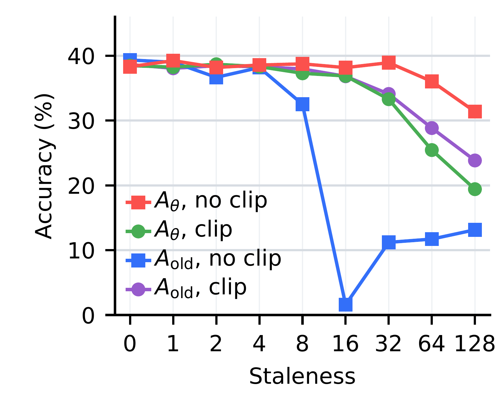

图 6：原论文 Figure 3(a)，`figures/mean_adv_clip_ablation_final.pdf`。横轴是缓存的 batch 延迟，不是训练时间或 PPO epochs。图用于比较随 stale 增加的退化，不代表 E4 在任何模型设置下都必然最好。[^asyncopd]

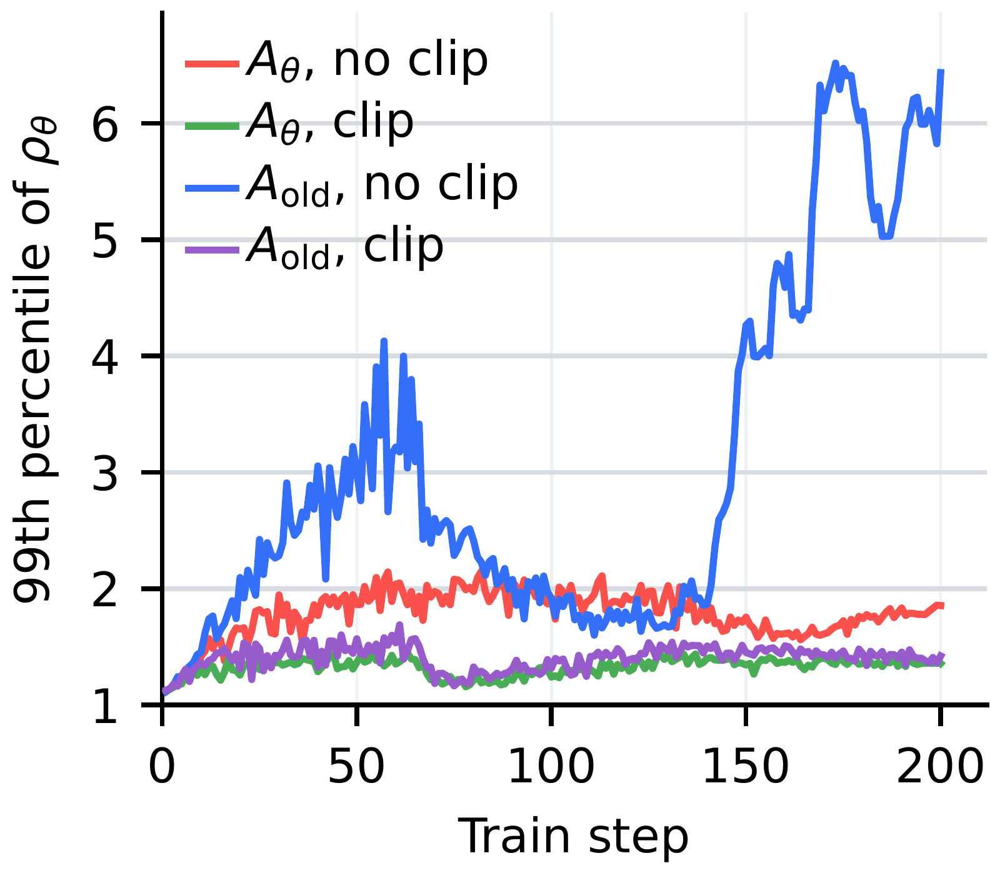

图 7：原论文 Figure 5，`figures/comparison.pdf`，固定 stale=64。**图上近似读数**：固定优势、不 clip 的 p99 后期约6–6.5；当前优势、不 clip 的曲线大部分阶段约1.5–2。论文并未在这张图给出 ratio 的全部分布或一个可直接对照的平均 clip 激活率。clip 组的真实 p99 仍可高于1.2，因为 PPO 不给策略本身施加逐 token 硬上限。[^asyncopd]

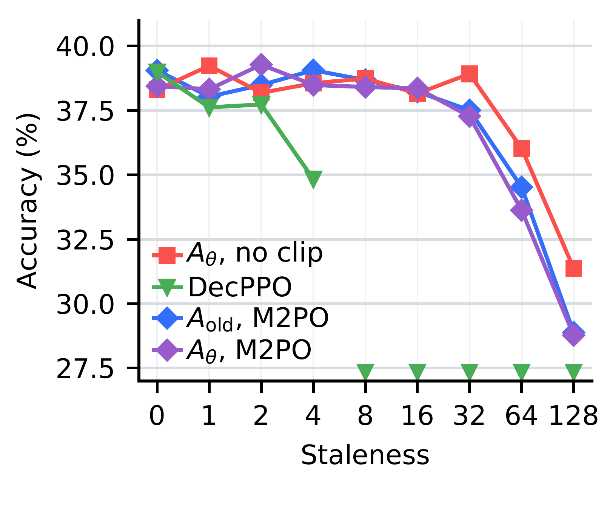

图 8：原论文 Figure 4(a)，`figures/mean_m2po_ablation_final.pdf`。原图把低于显示范围的DecPPO曲线截在底部，底部平台不代表那些点的真实准确率。原文没有发现 M2PO/DecPPO 一致优于“当前优势＋无 clip”的 OPD surrogate；不能从上一节 RLVR 的成功直接跨任务外推。[^asyncopd]

| AIME25 的 stale 敏感度 | E1：固定＋clip | E2：固定＋IS | E3：当前＋clip | E4：当前＋IS |
| --- | ---: | ---: | ---: | ---: |
| 原论文 Table 1(a) 的拟合斜率 | -1.42 | -3.69 | -1.88 | -0.38 |

该斜率拟合准确率对 $\log_2(D+1)$ 的变化，越接近0代表退化较慢；不是最终准确率，也不是每增加一次更新必然下降多少。[^asyncopd]

论文另有完全异步系统实验，使用100个外层 step、队列参数 $\tau=4$；其容量为 $(\tau+1)B$，不是每条样本实测延迟恒等于4。公开配方用很大的 `pg_clip_eps` 实现近似 no-clip，核心仍有 log-ratio 的 $[-20,20]$ 数值保护，因而需分别讨论 PPO clipping 与数值保护。[^asyncopd][^async-code]

## 5. Lightning OPD：年龄大，也可能漂移有限

本文采用 **2604.13010v3**。它先做 teacher-consistent SFT，再从 SFT student 一次性采集离线回答，后续 OPD 固定使用该行为来源。[^lightning]

| 项目 | 4B / 8B OPD阶段，附录 B 表6 |
| --- | --- |
| 总训练 / batch | 150 step / 256 |
| 优化 | constant LR $2\times10^{-6}$、wd 0.1、Adam betas=(0.9,0.98) |
| 训练生成 | response cap 4096、temperature=0.8、top-p=1 |
| clipping | advantage 限制为 $[-10,10]$，不是本文 PPO ratio 阈值 |
| stale 来源 | 整段 OPD 使用固定初始 SFT student 的离线 rollout；不设置固定延迟队列 |
| 关键前提 | SFT 与 OPD 使用一致的 teacher；与本项目直接从 R1-Distill 出发不同 |

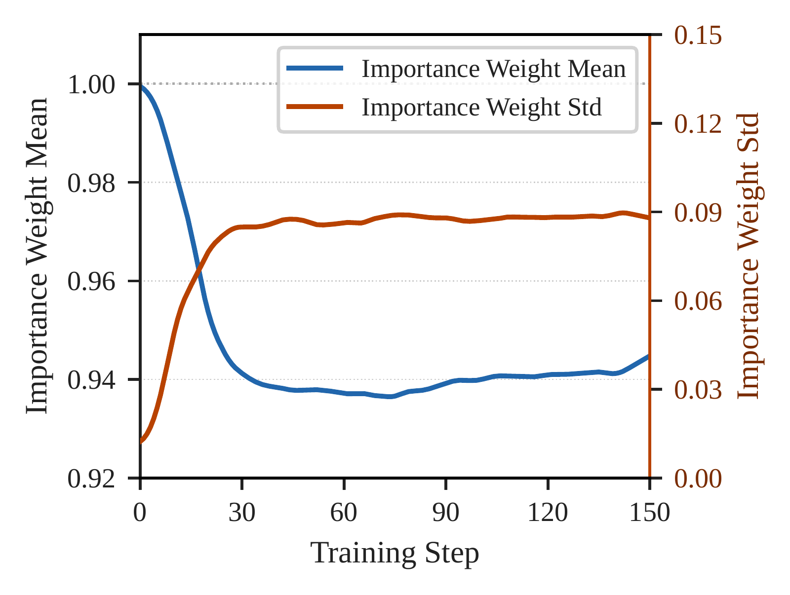

图 9：原论文 Figure 3(a)，`figures/importance_weights.pdf`。该 ratio 分母是固定 SFT reference。正文报告均值在前20 step 降到约 **0.94** 后稳定，标准差稳定在 **0.1以下**；这不是上界1.2，也不能推出所有 token 漂移都小。[^lightning]

从图上看，均值在约20–40步逐渐接近平台，不能把正文的“前20步”当成精确定位到单步的原始记录。

原文 Figure 3(b) 报告 Qwen3-4B-Base 的 AIME24 pass@1 从 SFT 的 **56.7%** 提高到 **68.1%**，大部分收益在前约50个 OPD step 获得。这里要学习的是“同时看策略漂移与效果曲线”，而不是照搬150 step；它的初始化、目标信号和数据都不同。[^lightning]

**本项目分析：** 固定初始策略意味着版本年龄随训练增加，但实测漂移是否增加必须测量。ratio 的均值接近1也不足以证明尾部安全，更不能把0.94当作所有离线OPD的标准值。

## 6. Semi-OPD：关注 teacher/student 对齐而非只看行为延迟

本文采用 **2610.11291v1**。Semi-OPD 从初始 student 一次采集回答，teacher 评分一次，训练时重算当前优势。Eq. (3) 使用 detached advantage 乘当前 log-prob，没有行为到当前策略的 IS 因子。[^semiopd]

| 项目 | 附录 A 表2及设置说明 |
| --- | --- |
| 模型范围 | 17个 teacher/student pair，包含 R1-Distill-1.5B ← JustRL-1.5B |
| 数据 / batch | DAPO-Math-17K 去重后14,116个英文 prompt；每步128题、每题1条；约110 step/epoch |
| 优化 | AdamW、constant LR $10^{-6}$、零warmup、wd0.01、梯度裁剪1 |
| 生成 | temperature=1、top-p=1；非thinking/long-CoT设置常用4K/16K训练cap，具体比较以原表为准 |
| 评估 | AIME24/25/26、HMMT Feb26，avg@32；评估长度32K，Nemotron为40K |
| 核心诊断 | 初始top-64 overlap、长度、正监督token比例、student/teacher熵、不同checkpoint的效果曲线 |

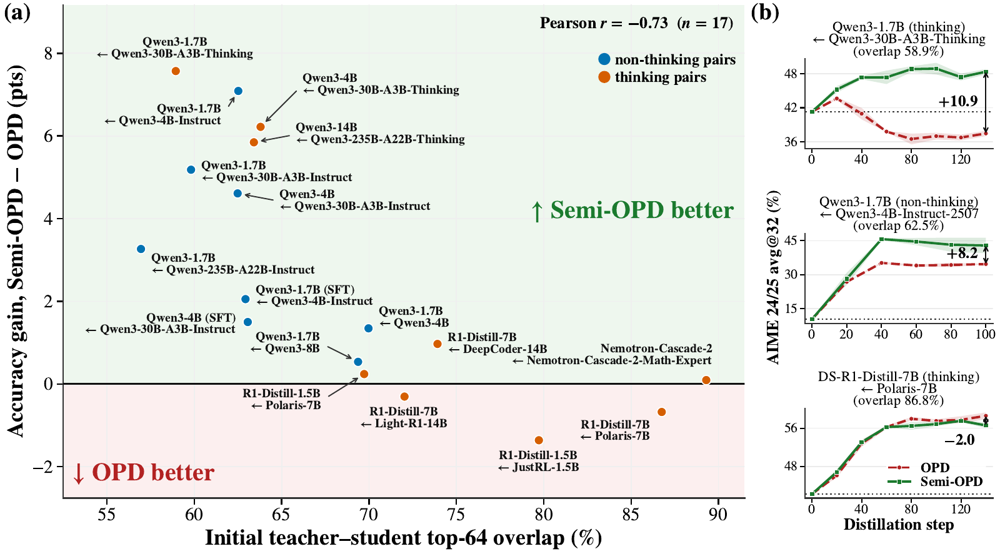

图 10：原论文 Figure 1 对应源图 `figures/fig_overlap_combo.pdf`。该 overlap 是 teacher 与初始 student 的 top-64 集合交集比例，**不是**当前 student 与行为 student 的 IS ratio。[^semiopd]

原文 Table 3 对本项目相同名称的 R1-Distill-1.5B ← JustRL-1.5B pair 报告初始 overlap **79.7%**，Semi-OPD 相对 OPD 的曲线面积平均增益 **-1.36个百分点**，共同末次评估差异 **+1.4个百分点**。平均过程收益与最后一个点可以方向不同；该表的跨基准聚合、训练cap和实现也不同于本项目。[^semiopd]

**本项目分析：** 若只盯 stale，就会忽略 teacher 信号本身的匹配程度。这篇研究提供的是另一条解释轴，不能用其 teacher/student overlap 代替行为策略漂移诊断，也不能据其离线结果声称我们 E5 已经优于 E4。

## 7. 跨论文比较必须统一的口径

| 比较项 | M2PO | AsyncOPD | Lightning OPD | Semi-OPD | 本项目 E2–E5 |
| --- | --- | --- | --- | --- | --- |
| 学习信号 | RLVR题目级奖励优势 | teacher token优势 | teacher token优势，SFT warm start | teacher token优势 | teacher token优势 |
| stale 单位 | optimizer updates | logical train batches | 固定初始行为策略 | 固定初始行为策略 | 跨batch=0；批内0–3次更新 |
| 一批数据的用法 | 2048回答分4份更新 | 256回答分4份更新 | 离线回答逐批训练 | 离线回答逐批训练 | 同64条回答重复4次 |
| LR | $10^{-6}$ | $3\times10^{-6}$ | $2\times10^{-6}$ | $10^{-6}$ | $10^{-6}$ |
| 主要漂移诊断 | log-ratio M2、KL、clipping与熵 | ratio p99、随stale退化 | ratio mean/std | teacher/student overlap、熵和长度 | active clip、sign flip、guard；尾部矩尚缺 |
| 模型选点 | 八基准平均最佳checkpoint | 最终checkpoint | 训练曲线与文中报告点 | 曲线面积、末次点及指定checkpoint平均 | 当前只有E2/E4的step32末次验证 |

来源分别为上述四篇论文及本项目配置。不要按原始 loss 标量给方法排序；不要跨表比较不同 benchmark 的“Avg.”；不要把多个基准的最好 checkpoint 与另一实验的最后 checkpoint 当作同一选点规则。

## 8. 我们现在的数据能说明什么

数据来自2026-10-21读取的 `wncfht/MirrorOPD-verl` 完整 history，关闭SDK history缓存。以下是**下载时的快照**，不是实时状态。已核对四组配置：除算法字段、实验名和输出目录外一致；均为batch64、mini-batch64、ppo_epochs4、LR=$10^{-6}$、单种子42、无初始验证。[^runs]

| 组别 | 云端外层step / 确认更新数 | MATH-500 avg@16 | AMC23 avg@16 | AIME25 avg@16 |
| --- | ---: | ---: | ---: | ---: |
| E2：固定优势＋IS | 32 / 128 | 84.9125% | 82.65625% | 32.08333% |
| E4：当前优势＋IS | 32 / 128 | 85.4000% | 82.81250% | 32.70833% |
| E3：当前优势＋PPO | 30 / 120 | 未同步 | 未同步 | 未同步 |
| E5：当前优势＋NoIS | 30 / 120 | 未同步 | 未同步 | 未同步 |

E3/E5的控制台日志到了step31，但云端history未包含最终验证；`finished`标签不能替代数据完整性检查。E4相对E2的三个差值约为+0.49、+0.16、+0.63个百分点。没有重复种子和逐题配对检验，不能把这些小差异归为稳定的算法优势。

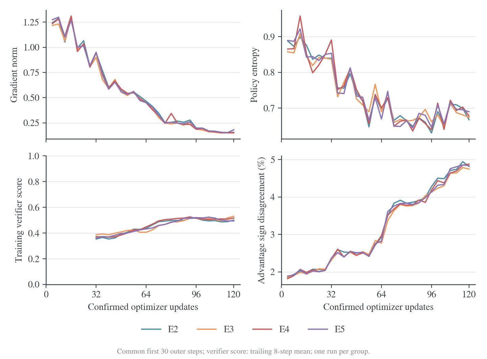

图 11：本项目 W&B 实测曲线，非论文图片。只比较共同的前30个外层step；训练verifier score使用尾随8个外层step的均值，其他面板是每外层日志值。每组一个run，没有画统计置信区间。该图来自上一轮已核对的分析产物。

- 四组记录到的 optimizer skipped updates 均为0；有IS的三组 log-ratio guard fraction均为0。
- E3的step平均实际clip比例为 **0.08927%**，最高 **0.21561%**。这是各外层step比例的算术平均，不冒充全程token加权比例。
- 四组前120次更新内的梯度范数、熵和训练评分形态接近；优势符号差异从约2%增加到约5%，但符号差异不反映优势大小。
- `rollout_corr/*`主要比较更新前重算的FSDP概率与生成概率，不能替代每次训练forward中当前策略对行为策略的ratio统计。
- 当前没有训练ratio p99、M2log、ESS，也没有高漂移token的熵分桶。因此“现在的概率漂移太小”是有迹象支持的假设，尚不是完整诊断。

### 8.1 为什么增加总 step 不等于增加 stale

若生成版本的optimizer累计计数为 $u_{\rm gen}$，某次训练forward前已完成更新数为 $u_{\rm train}$，应定义：

$$
\Delta_u=u_{\rm train}-u_{\rm gen}.
$$

我们每批生成后立即训练，批内四轮的 $\Delta_u$ 为0、1、2、3。下一批重新生成，再从0开始。这个计数不包含vLLM与FSDP的数值差异；后者可能使年龄0时的ratio也不严格等于1。

如果实现跨batch延迟 $D$，每个外层仍四次更新，则稳态训练入口的年龄约为 $4D$，批内再加0–3。例如 $D=4$ 对应16–19次更新，$D=16$ 对应64–67次，$D=64$ 对应256–259次。启动初始缓存时会有warmup，必须记录实际年龄分布。

### 8.2 下一轮最小实验与诊断

| 步骤 | 固定条件 | 增加的观测或干预 |
| --- | --- | --- |
| 补齐已有实验 | 保持E2–E5已有配置 | 同步E3/E5末次验证；检查checkpoint与计数 |
| 固定批诊断 | 固定轨迹、teacher分数、行为概率 | 每内部更新记录ratio分位数、M2log、ESS、outside/active比例、优势符号和大小 |
| 受控延迟扫描 | LR、batch、mini-batch、epochs、种子不同时改变 | 先 $D=0,4,16$；优先E2/E4，随后E1/E3与E5 |
| 效果延长 | 保持同组算法不变，按真实更新计数对齐 | 先看step64，再决定128/200；不能仅看train loss |
| 统计复验 | 同验证集与生成参数 | 逐题配对统计、多个训练种子；区分过程最好点和最终点 |

跨batch队列尚未在这份最小实现中落地。提高 `PPO_EPOCHS` 可以做低成本批内复用压力测试，但同时改变样本复用和更新预算，不能标成论文的跨batch延迟实验。32步预算也不足以覆盖 $D=64$ 的稳态。

### 8.3 指标聚合与实现口径

- 有效mask先应用于log-prob算术；pad、prompt、被剔除轨迹不进入token分母。空rank继续参与分布式通信。
- 每个内部optimizer更新有独立诊断，再明确如何汇总成外层记录。只记四轮平均值会隐藏第四轮的尾部。
- mean、M2、比例通过全局分子/分母或等价正确权重计算。全局p99通过全局样本、可合并分位数摘要或固定直方图估计；**不能平均各rank的p99**。
- 原始log-ratio和数值保护后的log-ratio分开记录。`guard_fraction=0`只说明未触及保护，不说明ratio集中在1附近。
- M2PO若作为后续候选，应同时记录mask前、mask后以及各自分母，不能用一个命名含糊的“M2”覆盖所有集合。
- 本项目目前的事件比例经过既有DP/mini-batch平均路径后再相除，公共因子可抵消；这些中间量不能解释为全局事件计数。
- 优势正负、长度位置及高熵token的分桶诊断优先使用受控probe批；完整词表熵的代价应另计，避免把可观测性开销误认为算法开销。

## 9. 图像与证据说明

图1–10从对应arXiv版本的LaTeX源包中提取独立图PDF，再用`pdftoppm`等比渲染PNG；没有修改数据、坐标、图例或曲线。每张PNG旁均保留同名PDF，便于放大检查。原图版权与许可归原作者及论文所列许可；这里作为有出处的研究讨论材料使用。

图11是本项目已有实测数据生成的对照图。原始下载、配置diff和绘图脚本保留在本机 `outputs/opd-ablation-analysis-20261021/`，该目录不随默认源码包传输；本文表格与图片提供可随源码阅读的快照，源run链接见脚注。

图上读取的AsyncOPD p99只报告区间量级；未把图像数字化结果冒充作者公开原始数据。本文没有将源码注释中的未发布表格纳入论文结果。

### 参考文献

[^m2po]: Haizhong Zheng, Jiawei Zhao, Beidi Chen. *Prosperity before Collapse: How Far Can Off-Policy RL Reach with Stale Data on LLMs?* arXiv:2510.01161v2，2025。重点核对§3.2、§4、Eq.(3)(4)、§5.2、Table 1、Fig.1/4/7/9及附录B/D。[原文](https://arxiv.org/html/2510.01161v2)；[PDF](https://arxiv.org/pdf/2510.01161v2)；[作者代码](https://github.com/Infini-AI-Lab/M2PO/)。
[^asyncopd]: Wonjun Kang et al. *AsyncOPD: How Stale Can On-Policy Distillation Be?* arXiv:2606.24143v1，2026。重点核对§5、Fig.3/4/5、Table 1、附录B/E/F/G。[原文](https://arxiv.org/html/2606.24143v1)；[PDF](https://arxiv.org/pdf/2606.24143v1)。
[^async-code]: FuriosaAI. AsyncOPD，提交 `e3f79e916aad9dba886256d202bab96f8504a447`。[PPO核心](https://github.com/furiosa-ai/async-opd/blob/e3f79e916aad9dba886256d202bab96f8504a447/opd/loss/ppo.py)；[公开MC64异步配方](https://github.com/furiosa-ai/async-opd/blob/e3f79e916aad9dba886256d202bab96f8504a447/configs/examples/opd_deepmath_qwen3_1.7b_pg_mc64_async_8gpu.yaml)。
[^lightning]: Yecheng Wu, Song Han, Han Cai. *Lightning OPD: Efficient Post-Training for Large Reasoning Models with Offline On-Policy Distillation.* arXiv:2604.13010v3，2026。重点核对表6、附录C.1图3。[原文](https://arxiv.org/html/2604.13010v3)；[PDF](https://arxiv.org/pdf/2604.13010v3)。
[^semiopd]: Siyan Zhao et al. *When Do We Need On-Policy Distillation? Distilling on Offline Student Rollouts Is Often Better.* arXiv:2610.11291v1，2026。重点核对§2.2、Fig.1、附录A表2/3。[原文](https://arxiv.org/html/2610.11291v1)；[PDF](https://arxiv.org/pdf/2610.11291v1)。
[^runs]: MirrorOPD-verl，2026-10-21下载的W&B数据快照。[E2：2fida8cj](https://forge.coreweave.com/wandb/wncfht/MirrorOPD-verl/runs/2fida8cj)、[E3：o173jix1](https://forge.coreweave.com/wandb/wncfht/MirrorOPD-verl/runs/o173jix1)、[E4：84gchtdt](https://forge.coreweave.com/wandb/wncfht/MirrorOPD-verl/runs/84gchtdt)、[E5：c7h61yid](https://forge.coreweave.com/wandb/wncfht/MirrorOPD-verl/runs/c7h61yid)。
