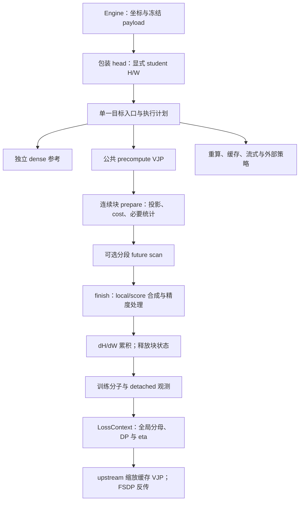

# Agent Note: KL 后端统一执行与 VJP 重构

Status: implemented

选择：以单一计算入口、确定性执行计划和公共预计算 VJP 执行器承载已有 full-vocab 目标，拆开数学公式、分布空间、轨迹信用与梯度存储。活动消费者直接迁移，旧内部接口删除。代价是同步维护研究工具与测试，显式保留各策略的精度和存储差异，并承担低精度与 FSDP 验证成本。

本决定落实了[聚合与未来信用计划](../../proposed/architecture/2026-11-03-Full-vocab聚合与未来信用实现计划.md)的执行优化，以及[评估与训练执行计划](../../proposed/architecture/2026-11-04-评估与训练执行重构计划.md#36-f复用-full-vocab-的公共-vjp-骨架)的公共 VJP 和必要 engine 拆分。两份旧计划的数学合同、失败记录、其他评估工作和独立未完成事项继续有效。当前接口、能力和参数由[Full-vocab 架构](../../../../docs/infra/architecture/full-vocab.md)、[算子走读](../../../../docs/infra/architecture/full-kl-kernel-walkthrough.md)和[迁移指南](../../../../docs/infra/architecture/runtime-migration.md)维护。

## 执行边界与所有权

[full_vocab_objective_result](../../../../../../verl/trainer/distillation/full_vocab.py)是生产计算入口；[execution.py](../../../../../../verl/trainer/distillation/execution.py)以有限能力表解析不可变执行计划。配置早检与实际 tensor 检查共用能力规则，后者仍检查形状、dtype、device、布局及冻结 payload，空 rank 也不例外。计划不存 student 数值或 future 系数，不跨 optimizer 更新缓存这些量。对外仍只有一个 backend 字段，不暴露可任意组合的 strategy/kernel/traversal 配置，不自动测速或静默回退。

数学行公式归 [rows.py](../../../../../../verl/trainer/distillation/rows.py)及对应 fused 模块；结果合同归 [results.py](../../../../../../verl/trainer/distillation/results.py)。[vjp.py](../../../../../../verl/trainer/distillation/vjp.py)拥有共同块循环、梯度缓冲、累积、保存与 backward 缩放；[reduction.py](../../../../../../verl/trainer/distillation/reduction.py)拥有行权重、回答边界、suffix 和 carry；[trajectory.py](../../../../../../verl/trainer/distillation/trajectory.py)只保留动作 score 数学。目标公式、轨迹布局与梯度存储之间没有独立兼容执行器。

## 公共 VJP 与精度合同

预计算路径的 prepare 产生局部 cost、诊断、local dZ 与完成梯度需要的块状态；开启 future 时计算 detached 系数，finish 在释放概率状态前合成 score/local 梯度。令当前行局部梯度为 $g_t$、动作 score 为 $s_t$、future 系数为 $F_t$、行权重为 $w_t$，均映射到原 head 坐标：

$$
G_t=w_t(g_t+F_t s_t),\qquad dH=GW_s,\qquad dW_s=G^\top H_s.
$$

$w_t$ 包含回答权重及 discounted_sequence 的绝对时间权重。全局 DP 分母和 η 由 loss 层的 autograd upstream 施加。Backward 只缩放已存 dH/dW，支持一阶梯度；行观测 detached。结果区分训练 surrogate、原始 KL、未加权未折扣 local cost、future 系数与 score 分量，公共结果不暴露 logits、normalizer 或 carry。

原有投影、FP32 累积、FP16 特殊处理和 GEMM 前 cast 保留。BF16 的 local/future 合成结果在 GEMM 前恢复规定 dtype；测试直接检查矩阵乘输入精度，避免无意改成 FP32 GEMM。EOS 归并与 native score 使用各自明确的归一化统计，小 stop group 的 FP64 修正和 pivot 零和重建保留。不能从已舍入 dZ 反推概率，不能把 coarsened normalizer 用于 native score。

MDPO future 使用完整状态 cost，包含目标 normalizer；额外 teacher 支持的修正虽无局部 student 梯度，仍进入 future 系数。生产使用分开的 native student/anchor/teacher logits。已舍入 target 的数值控制移至 [research encoded_target](../../../../research/studies/precision/encoded_target.py)，保留研究用途但不作为训练 backend。

## 连续块与轨迹信用

无 future 使用连续正序块，不构造 scan、score 或 future 系数。Future 使用连续逆序块，允许 GEMM 跨回答；分段 scan 在回答边界重置，跨块仅携带边缘回答的 suffix 状态。每个块只投影一次所需角色，backward 不重放投影。

sum、mean、discounted_sum、discounted_mean、discounted_sequence 保持原定义，不增加 λ。严格 future 使用下一位置的后缀；不通过“大总和减当前项”构造小信用，不使用负次折扣幂。原始 response 时间决定折扣距离，mask 空洞消耗距离；最后一个有效 token 的严格未来为零，不为截断后的未知尾部补值。γ=1 消除不必要的幂运算，sum 不计算 mean 的 mass。

词表工作区保持 $O(CV)$，预计算梯度为 $O(Nd+Vd)$，行观测为 $O(N)$。没有全批 $[N,V]$ 缓存，也没有默认两遍投影。Fused finish 复用 native 统计，合成 score、local dZ 与行权重，避免完整 score/log-prob 中间缓冲。

## 后端审查与删除范围

保留的七种 backend 都对应实际策略，不以旧名称兼容新实现：

| Backend          | 保留理由及成本                                                                 |
| ---------------- | ------------------------------------------------------------------------------ |
| dense            | 独立可微参考，用于数学与小规模梯度验证；保留全图显存成本                       |
| precompute       | 普通行算术与预计算 dH/dW，提供 CPU/FP64 和 fused 数值对照                      |
| precompute_fused | 相同存储策略，使用 fused 词表归约与 finish；请求不支持的 device/dtype 时报错   |
| recompute        | forward/backward 分开，反向重算完整词表块；减少保存量并增加计算                |
| cached           | reverse KL 的块内投影缓存策略；保留其容量与投影行为                            |
| streaming        | reverse KL 的词表流式容量策略，保持二维分块合同                                |
| liger            | 独立外部实现，用于受限策略对照；保留实际依赖与能力限制，单组速度较慢不足以删去 |

目标支持矩阵保持既有范围：不新增 recompute＋future、forward/BPO＋future、共同支持＋future。PPO、科学默认参数、checkpoint 数据格式和历史实验身份保持各自合同。历史实验及旧 checkpoint 使用对应冻结源码，新代码不承诺恢复旧运行或自动转换旧 resolved config。

删除了 PrecomputedKL、TrajectoryVJP、独立 forward 预计算类、生产 fused_mirror_rows 和 full_reverse_kl 标量别名。活动配置、benchmark、研究工具与测试直接使用新接口；历史冻结源码仍按其原接口运行。迁移方式见[迁移指南](../../../../docs/infra/architecture/runtime-migration.md#kl-执行与内部接口)。

## Engine 与只读路径

[FSDP engine](../../../../../../verl/workers/engine/fsdp/transformer_impl.py)分成 capture/readout/train helper，共享预测坐标和 payload 校验。Capture 提取冻结 hidden/位置，anchor head 快照经过包装 head；readout 只运行 value-only RKL，不分配 dZ/dH/dW，不应用训练 aggregate/future；train 验证 anchor 位置和版本，构造 reduction 并调用目标入口。

包装 backbone/head 的调用继续由 engine 掌握。Student H/W 显式进入自定义 autograd，可微分子通过 head 返回的 pytree 暴露；不在闭包或计划中隐藏可训练 W，不绕过 FSDP hooks。Tied head、optimizer offload、checkpoint 恢复后的下一步由真实双卡测试覆盖。评估事件、rollout 和 optimizer 生命周期不扩大重写。

## 真实备选与重新审查条件

保留旧 VJP 类并加适配器可缩小初始 diff，但会留下两套空输入、dtype 与 backward 规则，因此直接迁移。所有 backend 共用一个大循环会混淆重算和预计算的保存合同，因此仅共享适用的累积工具。

两遍投影先求全批 cost/suffix 再重算梯度，表达更直接但增加 head 计算；当前选择块内单投影与 carry，明确的容量或正确性需求出现时再重审。长期 teacher/anchor logits 缓存还需容量预算与失效身份，不在此决定内。

自动 backend 调优需要稳定 profile、测量预算与可复现选择依据；当前保留确定性分派。通用 DAG、插件注册框架和每种 future 一个类没有现有需求，不建立。精度公式调整应独立验证，不能借重构改变 cast 或小梯度合同。

## 验收、代价与缺口

原 A–E 五阶段均有独立提交：公共 VJP `17f360fe`；执行计划与块接口 `ce57ae6a`；连续分段信用 `87865444`；fused finish `650f1846`；engine/消费者及旧接口清理 `a5f4a335`。源码与格式、数值、FSDP 证据的详细范围由[数值验收](../../../../docs/infra/numerics/full-vocab/validation.md#公共-vjp-与连续分块验收2026-11-04)维护。

CPU 927 passed、18 skipped；CUDA 757 passed。覆盖已有目标能力、五种 aggregate、六种 future、一般 κ/η 与 endpoint、EOS、额外 teacher 支持、共同支持、近目标/近确定分布、mask 空洞、非整齐 chunk、空 rank、非单位 upstream 和全局 DP/micro-batch 分母。独立 FP64、dense 与轨迹枚举分开于生产 VJP。真实双卡 FSDP 15 组及 readout 隔离组通过，另有原失败条件的同 backend A/A 通过。

原混合精度 MDPO＋EOS、无 future、activation checkpointing 的 fused/precompute 严格参数比较仍失败，最大差为 `1.6333884559571743e-5`，与既有记录一致。门槛未放宽，原 A/A、FP64 AdamW 小梯度放大解释保留；这允许继续工程工作，不证明长期训练等价。Future 配置的严格比较通过也不能覆盖旧条件。[原始条件与当前证据](../../../../docs/infra/numerics/full-vocab/validation.md#混合精度-mdpo-参数差异)独立维护。

[Head 性能](../../../../docs/infra/performance/full-vocab/operators.md#公共执行与连续分块复测2026-11-04)中，短回答 mean 从 41.04 ms 到 12.88 ms，投影调用从 32 到 8，总投影行数保持 2048；长回答 mean 为 19.67 到 12.88 ms。最终 native profile 的 none 为 64 个 kernel，旧版 65；mean 为 478，旧版长/短/混合为 604/1924/1065。显存、完整样本、kernel 名称和哈希均随报告保留。

[完整 actor 对照](../../../../docs/infra/performance/full-vocab/training.md)覆盖真实 Qwen3、anchor、backbone、反传、optimizer 与 offload，排除 rollout/teacher 准备。版本间顺序测量且有主机噪声；现有结果不支持稳定的完整 actor 加速结论，不能将 head 倍率外推。最终无 future 清理的 profile 与 actor 冻结源码分别记录身份。当前 sampled 与纯 full-vocab 同前缀公平成本对照仍缺失，未以 legacy sampled 填补。

文档与接口同步，执行 Ruff、Ruff format、docs-format、docs-check 和暂存提交检查。大日志、trace、临时运行与冻结测试缓存留在 `runs/kl-backend-20261104/`，不改写历史数据、sources 或 archive。旧两份计划中独立的未完成研究/评估项继续单独跟踪。
