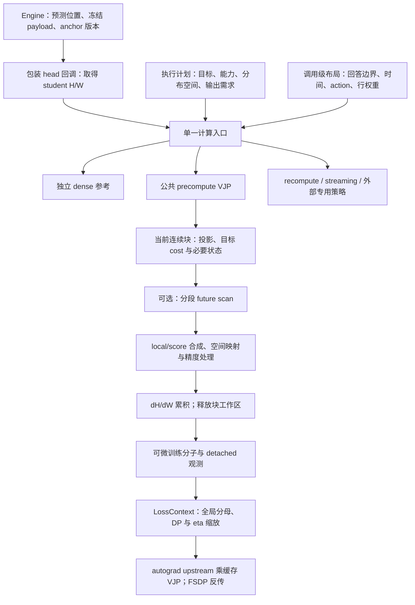

# Agent Note: KL 后端统一执行与 VJP 重构

Status: proposed

选择：以单一计算入口、确定性执行计划和公共预计算 VJP 执行器承载已有 full-vocab 目标，拆开数学公式、分布空间、轨迹信用与梯度存储。直接迁移活动消费者并删除旧实现，不保留兼容层。代价是同步修改配置、研究工具与测试，并重新验证低精度数值、FSDP hooks 和实际性能。

代码走读基线为 `a54207ef`，核对日期为 2026-11-04。本文是待实施提案；文中的模块名和接口为拟议设计，不表示已经存在。当前行为由 [Full-vocab 数据流](../../../../docs/infra/architecture/full-vocab.md)、[算子走读](../../../../docs/infra/architecture/full-kl-kernel-walkthrough.md)维护。

本文接替[聚合与未来信用计划](2026-11-03-Full-vocab聚合与未来信用实现计划.md)的后续执行优化，以及[评估与训练执行计划](2026-11-04-评估与训练执行重构计划.md#36-f复用-full-vocab-的公共-vjp-骨架)的 F 项与 G 项中 capture/readout/training 的必要拆分。旧计划的数学合同、既有验收条件、失败记录和其他评估工作继续有效；不以重分文档降低验收要求。

## 1. 问题与代码依据

向量—雅可比积（vector–Jacobian product，VJP）在这里将目标对 logits 的导数传播到 student hidden 与线性 head。已有数学与训练合同已经实现，问题集中在执行重复、能力分派分散和 future 的调度开销。

| 当前位置                                                                                                                                                   | 已核对行为                                                 | 拟议处理                                             |
| ---------------------------------------------------------------------------------------------------------------------------------------------------------- | ---------------------------------------------------------- | ---------------------------------------------------- |
| [FullVocabConfig](../../../../../../verl/workers/config/distillation.py#L37) 与 [目标入口](../../../../../../verl/trainer/distillation/full_vocab.py#L547) | 配置、目标、future 和分布路径分别判断 backend 能力         | 共享能力规则；配置早检与实际 tensor 检查各负其责     |
| [precompute_rows](../../../../../../verl/trainer/distillation/full_vocab.py#L240)                                                                          | forward 累积 dH/dW，backward 乘标量 upstream               | 迁入公共预计算执行器                                 |
| [PrecomputedVJP](../../../../../../verl/trainer/distillation/vjp.py)                                                                                       | 重复累积与存储逻辑，额外执行 suffix/score                  | 信用计算保留，独立 autograd 类删除                   |
| [ForwardRecompute](../../../../../../verl/trainer/distillation/forward_vocab.py#L74)                                                                       | 同时包含预计算和反向重算，两处累积代码                     | 预计算迁入公共执行器；重算保持独立策略并共用累积工具 |
| [PackedReduction.blocks](../../../../../../verl/trainer/distillation/reduction.py#L122)                                                                    | 按回答逆序分块，每块不能跨回答                             | GEMM 使用连续 token 块；suffix 在回答边界重置        |
| [trajectory_rows/action_score](../../../../../../verl/trainer/distillation/trajectory.py#L26)                                                              | student 投影复用，但 score 再做归一化并构造词表级中间量    | 当前块保留必要统计，合成 score 与局部梯度            |
| [fused_rows](../../../../../../verl/trainer/distillation/full_vocab_triton.py#L264)                                                                        | weighted_rows 已返回统计，包装层只返回值和梯度             | 按输出需求保留可复用统计，不从 dZ 反推概率           |
| [FSDP head 入口](../../../../../../verl/workers/engine/fsdp/transformer_impl.py#L1282)                                                                     | 同时承担 capture、只读评分和训练；调用包装 head 维护 hooks | 拆分三种职责，共享预测坐标与 payload 校验            |
| [research backend](../../../../research/backends/fsdp.py#L113) 与 [精度工具](../../../../research/studies/precision/isolate_mirror_precision.py#L46)       | 有主入口替换和直接调用 PrecomputedKL 的消费者              | 列入迁移清单；完成迁移后删除旧内部接口               |

`c86b11dd` 引入 trajectory 分块 VJP；`7724b32f` 降低 score 的 FP64 工作区；`91b4e748` 区分局部代价与训练 surrogate。重构保留这些数学与精度约束，减少重复执行代码。

[2026-11-04 head 测量](../../../../docs/infra/performance/full-vocab/operators.md#聚合与未来信用复测2026-11-04)中，总计 1024 token、chunk256 的连续零信用控制约 19.5 ms，回答内分块的十六条短回答控制约 40.8 ms；student/teacher 投影调用由 8 增至 32，总投影行数不变。这支持优先解除回答边界对 GEMM 的限制，但零信用控制没有真实分段 future，不能充当优化后读数。[完整 actor 配对](../../../../docs/infra/performance/full-vocab/training.md#aggregatefuture-的完整-actor-配对2026-11-04)使用带 anchor 的 MDPO；不得把其整步时间称为纯 KL，或把 head 倍率外推为训练倍率。

## 2. 范围与已确定选择

迁移现有 reverse KL、forward KL、MDPO、BPO、五种 aggregate、六种 future 和既有分布空间能力；只读 RKL 保持独立的指标定义。改造保留目标支持矩阵，不新增 recompute＋future、forward KL＋future、BPO＋future 或共同支持＋future 等组合。

| 决定               | 实施约束及理由                                                                                                  |
| ------------------ | --------------------------------------------------------------------------------------------------------------- |
| 直接迁移到新接口   | 当前生产代码、launcher、配置、测试和研究工具同步修改；删除旧类、旧参数、分派与别名，不留双轨开关                |
| 单一 backend 配置  | 内部区分存储策略和行实现；不暴露可任意组合的多维配置，不引入自动测速选择                                        |
| 明确能力检查       | 请求 fused 就执行已支持的 fused 路径，否则报错；不静默回退或换目标                                              |
| 保留有效计算策略   | dense 保留独立参考；普通/fused precompute 保留；recompute/cached/streaming 按实际计算与容量合同决定是否合并     |
| 外部 backend 审查  | Liger 依据活动消费者、能力、独有收益和维护成本决定保留或移除；结论形成前维持当前能力，不因一组速度较慢删除      |
| 精度行为独立审查   | 抽取代码先保留已有投影精度、累积与 cast 时机；后续变化单独提交并验证                                            |
| 必要的 engine 拆分 | 拆 capture/readout/training，保留资源所有权与包装 head；不扩展到 rollout、评估事件系统或 optimizer 生命周期重写 |
| 历史执行身份冻结   | 历史实验和 checkpoint 使用对应冻结源码；不承诺新代码恢复旧运行，不改写旧 resolved config 和测量数据             |

后端精简的结论在实施阶段写入本文和迁移指南。记录每个名称的活动消费者、forward/backward 投影行为、保存张量、容量用途、去留及替代方式；未核实差异前不把名字相近的策略当作别名。

## 3. 最终职责与依赖

### 3.1 入口与执行计划

保留一个权威计算入口，接收 student/frozen 张量、目标声明、已编译分布空间、backend 设置与可选回答布局，返回统一训练结果。生产、benchmark 与活动研究工具使用这一边界；底层块接口只向确需数值实验的开发调用者开放，避免再依赖具体 autograd 类。

执行计划是少量只读字段和函数分派，包含目标、存储策略、行实现、分布能力、输出需求与访问方向。使用简单函数和有限能力表，不建立插件注册框架、通用 DAG 或多层 factory。

配置检查验证声明组合；模型加载后编译支持集与动作映射；每次调用验证真实维度、device、dtype、行布局和冻结 payload。能力规则共用，实际 tensor 校验不能被静态校验代替，空 rank 同样校验。计划不保存 student 数值状态或未来系数，不跨 reuse 缓存这些值。

### 3.2 目标块接口与状态生命周期

块计算在内部具有 prepare 与 finish 两阶段，具体函数签名以实现后的最小合同为准：

1. prepare 投影 student、teacher 和需要的 anchor，产生完整局部训练 cost、必要诊断，以及完成梯度所需的块状态。
2. 若启用 future，用 cost 和回答布局计算 detached 系数；否则直接进入局部路径。
3. finish 接收行权重及可选 future 系数，组合 logits VJP，完成空间映射与规定的 cast；随后公共执行器累积参数梯度。

初版允许块状态保留现有 local dZ 和 student logits，以复用已有数值公式；融合优化再减少重复张量。归一化统计必须标注 native/selected/coarsened 坐标，不能把 EOS 合并后的统计当作原词表 score 的归一化。无 future 不构造 score 状态；只读路径不构造 dZ。状态只活到当前 chunk 释放，不进入公共结果或长期缓存。

数学公式仍由目标实现拥有。MDPO future 使用完整 cost，包括状态相关目标 normalizer；额外 teacher 支持的修正即使没有局部 student 梯度，仍会改变未来 score 系数。各目标按需保留这些项，不用 endpoint shortcut 替代一般目标。

### 3.3 分布空间与原词表梯度

分布组件负责 native、共同支持和 EOS 合并的 action 定义，以及回到原 head 坐标的链式梯度映射。local 与 score 在一致的 action 语义下组合；允许因当前稳定数值实现采用不同内部坐标，但必须显式映回同一原词表坐标再累积。

EOS score 对停止类概率求导，不把某个 EOS token 的 one-hot 作为整个停止类。保留小 stop group 的 FP64 修正、近确定分布的小信号和 pivot 梯度重建，检查最终 logits 梯度零和。重构阶段不同时重写全部空间映射 kernel。

### 3.4 公共预计算 VJP

公共执行器拥有梯度缓冲、分块循环、dH/dW 累积、保存张量、空输入和 backward 缩放。已有 PrecomputedKL、TrajectoryVJP 与 ForwardVocab 的预计算逻辑迁入后删除，ForwardVocab 的重算策略改由独立执行路径承担。

令当前行局部梯度为 $g_t$、sampled action score 为 $s_t$、detached future 为 $F_t$、行权重为 $w_t$，均在明确的共同梯度坐标下：

$$
G_t=w_t(g_t+F_t s_t),\qquad dH=GW_s,\qquad dW_s=G^\top H_s.
$$

$w_t$ 包含既有回答权重和 discounted_sequence 适用的绝对时间权重。全局 DP 分母与 η 缩放仍由 loss 层传入 autograd upstream。Backward 对保存的 dH/dW 应用 upstream，保持仅一阶可微；返回结果中的行观测均 detached。

FP32 梯度累积、FP16 特殊处理和 BF16 cast 时点按既有各路径显式迁移；不能因共用一个类而提前舍入 local/future 合成。投影仍沿用 [project/ProjectionFP32](../../../../../../verl/utils/linear.py)，梯度累积沿用核实后的 add_product 行为，改动精度需独立数值与 optimizer 对照。

### 3.5 轨迹信用与连续分块

无 future 使用连续正序块，有 future 使用连续逆序块，GEMM 可跨回答。分段 scan 只在同一回答中传播 cost 和 mass，回答边界重置；跨块只携带边缘回答的 suffix 状态。计算使用原始 response 时间，mask 空洞消耗折扣距离，最后一个有效 token 的严格未来为零，截断以外的未知尾部不补值。

先实现可审查的分段参考，再按 profile 引入融合 scan。保留 sum、mean、discounted_sum、discounted_mean、discounted_sequence 的现有定义，不增加 λ。扫描使用下一位置累计量构造严格后缀，避免大总和减当前项；不使用负次折扣幂。可专门消去 γ=1 的幂运算，sum 不必计算 mean 的 mass。

每块只投影一次所需角色，计算 cost 后在释放概率状态前合成 future VJP。保持词表工作区 $O(CV)$、预计算梯度 $O(Nd+Vd)$ 和必要行观测 $O(N)$，不缓存全批 $[N,V]$，不先算全批 cost 再默认重放投影。

### 3.6 其他策略与只读输出

Dense 保留独立可微实现与独立数学 oracle，不调用生产预计算 backward。Recompute 保存输入/必要统计并在 backward 重算，streaming 保持其词表工作区合同；它们可共享梯度累积工具，但不改成预计算或被迫符合单次投影假设。

只读 RKL 使用 value-only 行实现，共享稳定算术和已声明的分布映射，不分配 dZ/dH/dW，不应用训练聚合或 future。Capture 只提取冻结 hidden/位置与必要 anchor head 快照，不运行目标计算。

结果继续区分可微训练分子、原始词表 KL、未加权未折扣的局部目标分子、future 系数与 score surrogate。公共结果不携带 logits、normalizer 或 carry。[FullVocabOutput](../../../../../../verl/trainer/distillation/output.py)继续承担指标语义出口，[LossContext](../../../../../../verl/workers/utils/loss_context.py)继续使用 optimizer batch 的全局分母，避免 micro-batch 均值或 rank 均值替代实际 sum/count。

### 3.7 FSDP 与模块落点

Engine 把 capture、readout、training 拆为职责明确的 helper，共享预测坐标与 payload 身份校验；包装模型和包装 head 的调用继续由 engine 掌握。Student H/W 必须作为自定义 autograd 的 tensor 输入，可微分子必须通过 head 的返回 pytree 暴露。不得在闭包/计划中隐藏可训练 W 或绕过 head hooks，tied head 同样验收。

| 模块，拟议落点                      | 职责                                                 |
| ----------------------------------- | ---------------------------------------------------- |
| full_vocab.py                       | 薄的权威计算入口，迁出交叉分派和重复执行逻辑         |
| execution.py，新增                  | 能力规则、计划解析和执行策略选择                     |
| vjp.py，新增                        | 公共 precompute autograd、累积与存储规则             |
| 轻量结果合同模块，按依赖需要抽取    | 结果类型；不得依赖执行器、engine 或目标实现          |
| numerics.py、目标模块及 Triton 模块 | 稳定数学、prepare/finish 块实现与后续融合            |
| reduction.py、trajectory.py         | 行权重、布局、suffix 与 carry；不再拥有独立 autograd |
| distribution.py、termination.py     | 支持集与动作映射、原词表链式梯度                     |
| evaluation.py、output.py            | 只读数值计算、训练结果的观测转换                     |

依赖方向为入口→计划/执行器→目标与信用→稳定数值/空间映射；结果合同位于依赖底部。消除 full_vocab 与 trajectory/forward 模块互相导入执行类的关系。模块数不按表机械增加；只有职责和依赖确需独立时才拆文件。

## 4. 备选与代价

保留旧 VJP 类并加适配器能够缩小初始 diff，但会保留两套 dtype、空输入和 backward 行为，已决定放弃。所有 backend 共用一个大循环会混淆重算与预计算的保存合同，也放弃。

两遍投影方案先求全批 cost/suffix，再重算梯度，易表达 future，却增加 head 工作量；当前采用块内单投影与 carry，只有明确的容量或正确性需求才重开这一选择。长期 teacher/anchor logits 缓存需要容量预算和身份失效机制，不属于此提案。

对外暴露 strategy/kernel/traversal 任意组合会增加不支持组合与校验负担，因此维持一个 backend 参数。自动调优需稳定 profile、测量成本和选择可复现性，暂不实施。通用插件与每种 future 一个类没有现有需求，不建立。

## 5. 分阶段实施与提交

| 阶段              | 交付与删除                                                                                        | 验收边界                                                                       |
| ----------------- | ------------------------------------------------------------------------------------------------- | ------------------------------------------------------------------------------ |
| A：VJP 合同与累积 | 抽公共梯度分配/保存/backward，迁移 precompute 消费者；保留既有遍历和 cast 行为                    | CPU 值、dH/dW、非单位 upstream、空输入、tied head；无新数值差异未解释          |
| B：计划与块接口   | 集中能力表，接入 prepare/finish，迁移配置、benchmark 与研究工具；删除替代后的类、旧入口与配置别名 | 支持与拒绝矩阵、实际 tensor 校验、诊断含义、value-only、当前全部目标           |
| C：连续逆序与信用 | 跨回答 chunk、分段 scan/carry，future 接入公共 VJP，删除独立 trajectory 执行循环                  | 独立轨迹枚举、mask 空洞、空回答、跨块边界、各 aggregate/future；投影行数不增加 |
| D：融合与性能     | 按 profile 复用统计、融合 score/行权重/VJP，必要时优化 scan                                       | CUDA 精度、显存、kernel/投影计数和同输入完整 actor 配对                        |
| E：交付清理       | 后端去留落实，活动消费者全迁移，删除遗留导出与失效文档；当前合同回填架构参考/迁移指南             | CPU、CUDA、真实 FSDP、checkpoint 回归及文档检查；已知失败有独立对照            |

每阶段完成独立且可审查的 commits；源码或配置不兼容提交使用 Conventional Commits 的 `!` 和迁移说明。阶段内可暂存迁移中的调用关系，交付时只保留新架构，不提供新旧实现开关。迁移旧配置直接报明确错误，不自动转换；旧名称若继续保留，必须对应有效策略，不能只是兼容别名。

阶段 A/B 优先保持数值执行行为；遍历顺序和 cast 调整不得混进机械抽取。GPU 不可用时先完成 CPU 工作并明确标注等待项，不把跳过或 mock 记为 GPU 通过，也不启动正式训练替代工程验收。

## 6. 验收与性能证据

CPU 以现有 [full-vocab](../../../../../../tests/trainer/distillation/test_full_vocab_on_cpu.py)、[trajectory VJP](../../../../../../tests/trainer/distillation/test_trajectory_vjp_on_cpu.py)、[future credit](../../../../../../tests/trainer/distillation/test_future_credit_on_cpu.py)、[输出合同](../../../../../../tests/trainer/distillation/test_full_vocab_output_on_cpu.py)和 [只读指标回归](../../../../../../tests/trainer/distillation/test_fixed_rkl_readout_on_cpu.py)为基线，新增只验证新边界与真实失败风险的测试。

数值矩阵覆盖 reverse/forward/MDPO/BPO 的已有能力、五种 aggregate、六种 future、一般 κ/η 和 endpoint、EOS、额外 teacher 支持、共同支持、近目标/近确定分布、mask 间隔、非整齐 chunk、空 rank 与全局 DP/micro-batch 归一化。独立 FP64 概率参考、有限轨迹枚举和小规模 dense 与生产实现分开，不能只用两个共享实现互相比对。

GPU 复用 [trajectory CUDA](../../../../../../tests/trainer/distillation/test_trajectory_on_gpu.py)、[full-vocab FSDP2](../../../../../../tests/special_distributed/test_full_vocab_fsdp2.py)和 [mirror FSDP2](../../../../../../tests/special_distributed/test_mirror_fsdp2.py)，检查 wrapped-head hooks、tied/untied head、参数更新、优化器状态、梯度累积、activation checkpointing 和恢复后的下一步。数值差异必须定位到公式、归约顺序、cast 或 optimizer 敏感性等可审查原因，不能通过放宽原门槛完成验收。

[混合精度 MDPO 的现有严格参数失败](../../../../docs/infra/numerics/full-vocab/validation.md#混合精度-mdpo-参数差异)继续保留。已有 A/A 参数差为零、FP64 AdamW 复算解释了小梯度放大；这允许继续工程工作，不证明长期训练等价。重构应区分已知差异与新增差异，同 backend 恢复检查保持原条件。

性能使用同一输入、目标、精度、初态、EOS、chunk、DP 和诊断设置配对，保留预热、原始样本、失败/OOM、冻结源码与命令。报告 head 前反向及完整 actor 两个层级，明确完整 actor 是否含 anchor、optimizer、offload，以及排除的 rollout/teacher 准备。

重点记录总投影行数、每角色投影调用、dH/dW GEMM 次数、kernel 数、allocated/reserved、墙钟分布和输出误差。覆盖一条长回答、多条短回答、长短混合、跨块边界，保持总 token 相同时检查打包收益。无 future 不运行 scan/score；不能为共享执行器导致其默认路径退化而不解释。融合性能改善需在相同 cohort 中复测，不能拼接旧版本倍率。

当前 sampled 与纯 full-vocab 同前缀公平成本对照仍缺失；此提案不以历史 legacy sampled 作为性能验收基线，也不宣称已解决该测量缺口。性能接受标准在各对照采集前记录，工程量计数作为确定性验收，时间收益根据完整样本与噪声解释，不预设通用加速比例。

## 7. 文档与完成条件

实施时同步维护当前 [Full-vocab 架构](../../../../docs/infra/architecture/full-vocab.md)、[算子走读](../../../../docs/infra/architecture/full-kl-kernel-walkthrough.md)、[配置链](../../../../docs/infra/architecture/training-loop.md#配置入口)、[迁移指南](../../../../docs/infra/architecture/runtime-migration.md)、[数值验收](../../../../docs/infra/numerics/full-vocab/validation.md)与性能专题。不新建平行接口手册。

源码修改执行受影响文件的 Ruff 与 Ruff format；文档执行 `make docs-format`、`make docs-check`。提交前核对活动调用者无旧内部类/别名残留、冻结来源未改写、原失败与未完成项有归属。临时运行、profile 与诊断进入 `runs/`。

全部阶段及必要验收完成后才把本文迁为 implemented，并改写为实际选择、代价和验证缺口；当前接口归架构参考，详细性能归测量专题。后端审查结论、GPU 等待项或未解释回归未完成时，本文保持 proposed。旧两份计划的其他未完成事项继续单独跟踪，不因本提案完成自动结项。
