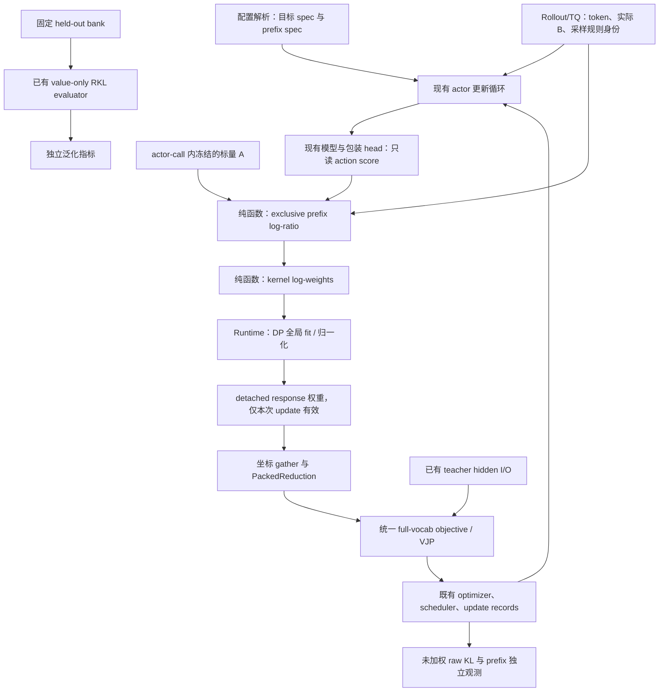
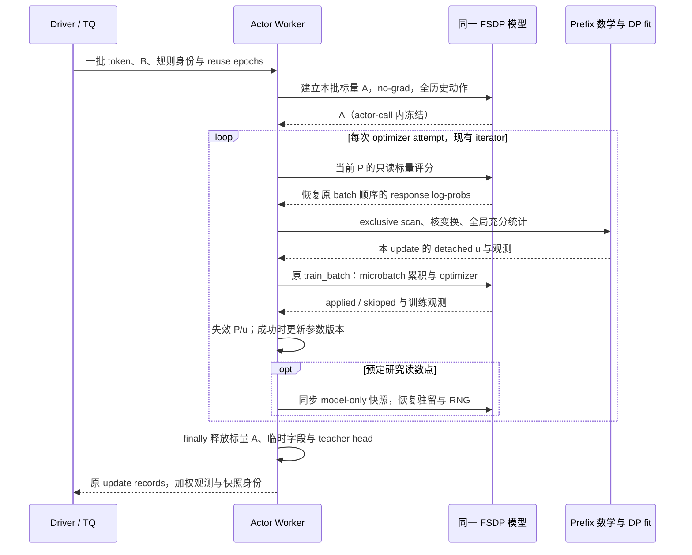
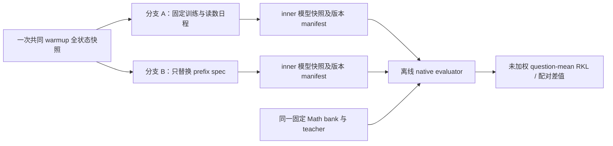

# Agent Note: Prefix 加权统一接入

Status: proposed

选择：把 prefix 加权作为条件蒸馏目标之外的一层 detached 状态权重，以“概率评分 → prefix log-ratio → 核变换与批统计 → 现有 row weights”接入。不同方法共享训练目标、内循环、全局 reduction 和 held-out 评估；不按 IS 方法新增 loss mode。首版以每次 optimizer update 前的只读评分换取实现简单与归一化一致，代价是额外 student forward，后续有性能证据再融合。

这是设计提案，配置与新接口尚未实现，也没有启动训练。[已有聚合与 future 提案](2026-11-03-Full-vocab聚合与未来信用实现计划.md)继续拥有聚合及未来信用合同；[公共 VJP 决策](../../implemented/architecture/2026-11-04-KL后端统一执行与VJP重构.md)继续拥有后端执行。本文补充状态权重，不取代它们。数学边界见 [prefix 理论](../../../../docs/theory/prefix-is.md)，前期文献筛选见 [prefix 与 sequence IS 调研](../../../../docs/literature/learning-signal/2026-11-16-prefix与sequence-IS调研.md)。

2026-11-21 按工作树实际源码复核。阅读顺序：第 1–3 节确定目标与方法边界，第 4 节说明最小接入，第 5–6 节规定实验与验收，第 7 节逐层走读并细化所有权、第 8 节核对公开实现、第 9 节说明交付顺序。所有拟议函数、字段与 Mermaid 新节点均未实现；源码事实与外部实现以各节引用为准。

## 1. 先确定实验比较什么

原实验是在同批固定 prefix 上重复拟合 full-vocab RKL，没有使用 prefix IS。设行为生成策略为 B、同批 inner0 trainer 为 A、当前 trainer 为 P，当前位置状态为 h。我们拟比较的更新是

$$
g_k=\frac{1}{D}\sum_{i,t}a_{it}\,
\operatorname{sg}[u_{it}(P_k,A,B)]\,
\nabla_\theta \mathrm{KL}(p_\theta(\cdot\mid h_{it})\Vert T(\cdot\mid h_{it})),
$$

其中 a 是既有 token/sequence 聚合权重，D 是既有全局分母。所有实验保持 a、D、teacher、optimizer 与评测协议相同，只改变 u。`u=1` 是必要主基线；它对固定经验状态目标本身没有缺失的 IS。

full-vocab 已积分当前位置动作，prefix 比率只累计 **j<t** 的历史生成动作；不能再乘当前位置 action ratio。detached u 给出状态加权的条件半梯度，不包含访问分布的 prefix-score 项，不能称为完整当前策略 sequence-RKL 的梯度。实际固定 held-out bank 的风险也不是当前访问分布风险；IS 是否有助迁移必须由 held-out 下降验证。

在可变长度回答中，正确 prefix 比率可换测度预期 token 损失总和；若目标是“当前策略的每 token 均值”，还涉及当前策略预期长度分母。保留旧 batch token 分母的实验应称为上式的状态加权更新，不能一概声称估计了该均值。固定位置的存活轨迹 ESS 是行为存活子集上的集中度，不能由此假定 mean(W)=1。

## 2. Anchor 与 behavior 必须是独立选项

定义同一条轨迹上的 prefix log-ratio：

$$
z_{it}^{P/B}=\sum_{j<t}(\log P(y_j\mid h_j)-\log B(y_j\mid h_j)),
$$

$$
z^{P/A}=\sum_{j<t}(\log P-\log A),\qquad
z^{A/B}=\sum_{j<t}(\log A-\log B),\qquad
z^{P/B}=z^{P/A}+z^{A/B}.
$$

| 选择                      | 在 B 数据上的含义                                              | 使用建议                           |
| ------------------------- | -------------------------------------------------------------- | ---------------------------------- |
| `reference=behavior`      | identity 核以 P/B 换到当前 prefix 测度，要求概率口径和支持正确 | 真正研究当前状态测度修正的主选项   |
| `reference=anchor`        | 只按本轮更新漂移 P/A 重加权，忽略初始 A/B                      | 隔离 reuse 漂移的有意代理与消融    |
| P/A 与 A/B 分开变换后相乘 | 分别限制更新漂移和生成/训练差异                                | 第二阶段；有独立的偏置与额外超参数 |

即使选择 anchor，数据仍由 B 采样，因此一般 **E_B[(P/A)f] ≠ E_P[f]**。精确分解需要同时保留 A/B；当两个核都是 identity，才恢复 P/B。非线性核一般满足 φ(Wa Wb) ≠ φ(Wa)φ(Wb)，不能把组合修正标成与合并后修正等价。

早期 outer31、inner0、4096 长度处 behavior ESS/N=6.48%，anchor 此时因同数组相除为 100%。这支持把 A/B 与 P/A 分别记录，尚不足以确定底层引擎差异或证明 anchor 更合理。需要零更新重复评分，区分稳定的引擎差异与评分噪声。ESS 不满足上述乘法分解。

同版本模型、同 seed 或 temperature=1 均不能代替概率口径核验。B 必须是实际 vLLM 采样概率，包括温度、允许 token、截断和 logits processor；P/A 应声明同一目标生成规则。若 B 使用 top-p/top-k 而目标 P 在其支持外有质量，精确 IS 的覆盖条件不成立。首版只验收无采样截断、可重建的共同支持与单轮停止规则；其他组合显式拒绝，不能默默当成 raw-softmax 比率。

full-vocab loss 的 EOS 合并或 teacher 支持条件化属于损失空间，不能用于真实生成 token 的概率分母。概率 payload 需携带 sample ID、response 坐标、策略版本与评分规则版本，不能仅凭张量形状认定一致。MD 使用的 anchor hidden 与 prefix 标量 anchor 有不同用途，不能为了 prefix IS 强制存完整 hidden，也不能未经核验就把 `old_log_probs` 当成新 scorer 的 A。

## 3. 文献怎样映射到我们的更新

| 方法                                         | 原本处理什么                                                               | 在 full-vocab OPD 的位置与限制                                                                                 |
| -------------------------------------------- | -------------------------------------------------------------------------- | -------------------------------------------------------------------------------------------------------------- |
| [REVO](https://arxiv.org/html/2609.37500v1)  | 每个 inner 重采当前动作，prefix 用几何平均并封顶；另按 RKL variance 优先化 | 我们已有完整动作积分，只需对照 prefix 核；variance priority 是另一个因素，首轮关闭                             |
| [VESPO](https://arxiv.org/html/2602.10693v3) | 完整序列 policy-gradient 权重的平滑重塑                                    | 可借核做 prefix 状态加权；这不是复现完整 VESPO，也没有原序列 RL 效果保证                                       |
| [GSPO](https://arxiv.org/html/2507.18071v2)  | response 几何平均 ratio 与序列级 PPO clipping                              | 不能直接复制 sequence surrogate；借鉴长度温度时应明确不是精确密度比                                            |
| [CTPO](https://arxiv.org/html/2605.07331v1)  | token policy-gradient 的累计至当前动作 ratio，按位置调 log clip            | 我们应累计到当前动作之前；可借位置依赖 cap，不搬其 PPO/advantage loss；终局 sampled advantage 仍有 suffix 条件 |
| 本仓库 rollout correction                    | rollout B 到 proximal A 的 token/sequence 修正，配合 actor action ratio    | 当前 full-vocab 明确绕过它；不能只打开开关当成 prefix IS                                                       |
| [OAPL](https://arxiv.org/html/2602.19362v2)  | KL 正则最优策略关系下的回归，依赖 reward/soft-value 目标                   | 支持“离线拟合不必都靠 IS”的区分；不能据其回归定理推断当前 full-vocab OPD 无分布迁移问题                        |
| V-trace、Retrace、DICE                       | 值函数递推、trace 或额外 occupancy-ratio 学习                              | 需要新增模型/目标与验收；不适合最低复杂度的第一版                                                              |

首版内核用一个小型纯函数分派，不建立插件注册框架：

| kernel       | u 的定义，W=exp(z)，h 为 prefix 生成动作数 | 解释                                             |
| ------------ | ------------------------------------------ | ------------------------------------------------ |
| `none`       | 1                                          | 默认，保留原训练路径                             |
| `identity`   | W                                          | 正确 behavior 比率下的精确测度基线；主要用于诊断 |
| `upper_clip` | min(W,C)                                   | 截断大尾部；不能救回全体极小的 W                 |
| `geometric`  | min(exp(z/max(h,1)),C)，h=0 时为 1         | REVO prefix 核，强烈长度温度化的代理             |
| `vespo`      | exp(c1 z + c2(1-exp(z)))                   | 在 W 很大和很小时均衰减的平滑代理                |

对上述 transformed kernels 不宣称原始 IS 无偏。温度、滑窗、双边 log clip、ESS 自适应温度与此前的 ESS 约束投影，后续只扩展此层。ESS 约束投影还需一个每批统计/求解步骤；首版已有统一的 fit 边界容纳它，不提前引入额外优化器。

### VESPO 常数与 advantage

当前条件 full-vocab RKL 没有一个天然的“每 prefix 正/负 advantage”。KL 非负也不能推出每个动作的 log(P/T) 为正；局部梯度可写成 centered log-ratio 的有符号动作和，但这不是给整个 prefix 选择正负核的理由。按动作分别选核会改变条件梯度，已超出这一状态加权实验。

因此使用所有 prefix 共用的 c1、c2，不伪造 advantage 分支。建议先用 (1,1) 作为较温和候选，(2,2) 做更强抑制对照；(2,3)、(3,2) 可分别作为论文分支核迁移的对照，不能称为原论文符号规则。对 c1=c2=c，φ(1)=1、φ'(1)=0，最大值为 1；c 越大，两侧衰减越强。没有依据提前指定最优常数。

VESPO 有界不等于经验 ESS 有下界。W≪1 时 φ≈exp(c2) W^c1，c1>1 会加重小 W 间的相对集中；我们后期恰有所有已观测 W<1 的情况。必须同时检查 ESS 与平均权重。其变分约束 E_Q W≤C 不是直接限制 E_B u² 的 ESS 约束；后者会产生不同核，不能沿用论文常数或其保证。

## 4. 最小一致实现

建议在 `distillation_loss` 下增加与 `mirror`、`full_vocab` 并列的 `prefix_weighting`，表示目标之上的状态加权，而非一种计算 backend。以下仅展示拟议配置，当前不可直接运行：

```yaml
distillation:
  distillation_loss:
    prefix_weighting:
      kernel: geometric        # none | identity | upper_clip | geometric | vespo
      reference: behavior      # behavior | anchor
      normalization: none      # none | global_mean
      cap: 4.0                 # geometric / upper_clip
      c1: 1.0                  # vespo
      c2: 1.0
      diagnostics: false       # none + true 可只测量，仍不改变 loss
```

首版不暴露可任意组合的 scorer/backend/scan 配置。参数验证拒绝无意义组合、无效常数与不支持的训练后端；配置解析一次，数学层不依赖 Hydra、TQ 或模型对象。默认 none 且 diagnostics=false 时不评分、不传新 payload、不新增 collective；显式只测量模式复用同一评分与统计路径，但不向 loss 传 state weights。

### 概率与 prefix 数学

新增一个生产 selected-action scorer，复用现有模型输入、动作空间与包装 head，返回 O(tokens) 标量 log-probs。不能从研究工具目录 import probe 作为生产实现，也不能绕过 FSDP head hooks。投影精度与归一化要明确并经过重复评分校准；“更高精度”本身不保证与实际 B 相同。

数学层可放 `verl/trainer/distillation/prefix_weighting.py`：输入已对齐的 P、A、B 标量 log-probs、回答边界、历史生成动作 mask 和配置；输出 detached 的 log raw weight、log kernel weight、最终 row weight 与批统计。exclusive segmented cumsum 保证回答首位置 z=0、不跨回答、不包含当前动作。

prefix 历史要包含 loss mask 隐去的**历史策略动作**，不能仅在 loss 选中位置上 cumsum。工具/环境提供的内容不当作策略动作乘比率；首版只支持单轮，后续多轮需单独的历史动作 mask 与共同环境条件。完成 prefix scan 后，才按 loss positions 选取权重。所有坐标保持原 response 时间，不能把 mask 空洞压成相邻动作。

### 评分刷新与现有 inner loop

[训练编排入口](../../../../../../verl/trainer/ppo/v1/trainer_base.py)目前 full-vocab 的 batch fields 不传 rollout/old log-probs；[TrainingWorker](../../../../../../verl/workers/engine_workers.py)已有每个 optimizer minibatch 的循环。沿用该循环，在 `train_batch` 的 microbatch 切分之前加“准备本次 prefix weights”步骤，避免新增另一套 trainer 内循环，更不能由 held-out readout callback 承担训练语义。

每次更新前，对本次逻辑 batch 以当前参数做一次只读标量评分；P、核参数拟合和全局统计均属于本次更新版本。A 每个 rollout batch 只评分一次并冻结，B 由 rollout 保存。microbatch 训练消费同一版本的最终权重；optimizer step 后 P 权重立即失效。首版实验限制纯 full-vocab RKL（mdpo/eta=1）、整批 rollout 一次 optimizer update、future=none、零 dropout、已验证的 FSDP 路径；后续 mini-batch 或 MD 扩展须明确归一化范围与双 anchor 合同。

评分必须恢复模型模式、RNG、offload 状态，不能改变优化器或 LR scheduler；每次评分/更新的版本与成功更新计数分开记，跳过 optimizer step 不冒充参数已变化。无须新增 teacher forward。额外 student forward 的耗时必须单列，不能拿同 inner 数声称同算力。

现有 train/score 入口支持分批，但不代表任意 infer/train 嵌套模式与 offload 已被验证；这是实施时的 FSDP 验收项目。后续若 prepass 成为瓶颈，可复用同一 transformer hidden，再做轻量 head 标量评分与 prefix scan；需要完整历史、跨 head chunk prefix 及全局归一化调度证据后才替换，保持数学层不变。

### 共用 reduction 与后端

[PackedReduction.row_weights](../../../../../../verl/trainer/distillation/reduction.py)已有 sequence 聚合行权重；增加 detached `state_weights`，令最终行权重为原聚合权重乘 state weight。修改 [full_vocab_reduction](../../../../../../verl/workers/utils/padding.py)，加权时即使 token-mean/future=none 也必须创建 reduction，不能命中当前返回 None 的快路径。

[FSDP full-vocab engine](../../../../../../verl/workers/engine/fsdp/transformer_impl.py)负责把 response-aligned 权重映射到 packed loss rows；[统一 full-vocab 入口](../../../../../../verl/trainer/distillation/full_vocab.py)与 [公共 VJP](../../../../../../verl/trainer/distillation/vjp.py)已有 row-weight 通路，逐 backend 检查而非另写各核。权重必须在逐行 loss/VJP 内施加，不能在汇总后的标量 loss 外乘“平均 IS”。

保留原来的全局 token/sequence 分母与 DP 梯度缩放。`normalization=global_mean` 定义为**本次逻辑 batch 的有效 loss rows 上** u 的算术均值归一化，先跨 DP 聚合 sum/count 再广播，绝不逐 microbatch/rank 各自归一化。它只消除一个公共乘法尺度；对 sequence 聚合不承诺原聚合质量总和也保持不变。按位置归一化会额外改变位置间相对权重，首版不加入。

raw log-W、VESPO log-kernel 与归一化都在 log-space 稳定计算。不能沿用既有 IS helper 的 ±20 log clip 来画“原始”指标。不可表示的 raw identity 权重显式报错，不能静默变换；normalized 模式可用 logsumexp，合法的极小 raw 核权重允许下溢为零但须记录。非有限概率、全部零权重或全空逻辑 batch 显式失败。

已有 [FullVocabOutput](../../../../../../verl/trainer/distillation/output.py)的 raw teacher RKL 与 position metrics 保持物理含义；新增加权 surrogate 指标，不把权重变小导致的数值下降写成 teacher KL 下降。held-out value-only 路径永远不带训练 prefix weights。状态权重与 anchor 的持久化合同记录版本与 scorer 规则，短命 P 权重恢复时重算。

## 5. 最小但能回答问题的实验

第一步是评分校准与离线权重重放，不启动训练：对同参数重复评分、核验历史坐标及 P/B=(P/A)(A/B)，用已有 outer31–33 数组比较各核的 raw/normalized 权重。已有的图只说明有限轨迹上的重塑，不证明训练方向或泛化收益。

旧实验完整模型与 Adam state 已未找到，不能声称从 update480 原样恢复。需重新产生一份共同 warmup 快照，保存 model、optimizer、scheduler、RNG、data cursor、rollout/anchor 身份及 resolved config，再分叉所有实验。不能只共享模型而让 Adam state 不同。

先做单 outer 的配对 inner16：所有分支用相同初始模型/Adam、相同 prompts、同一 rollout prefix bank、同一 teacher payload，隔离状态加权。主比较固定同一归一化规则，建议先用 global_mean 研究相对状态选择，再对候选补 raw 规则，检查收益是否只是改变梯度尺度。none 仍为 u=1；即使加权数值平均相同，Adam 的历史、epsilon 与梯度裁剪也不使 raw 与 normalized 等价。

第一轮只跑 `none`、behavior identity、behavior geometric(C=4)、behavior upper_clip(C=4)、behavior VESPO(1,1)。identity 先做数值预检，承认可能退化/失败，不为跑通悄悄裁剪。随后给 geometric 与最有希望的核补 anchor 对照；若 anchor 胜出，再补 identity-anchor 与 A/B 诊断，定位是 baseline 影响还是核交互。VESPO 的额外常数只在独立开发 bank 上挑选；不做全部参数笛卡尔积。

这一步有意共享旧数据，只能回答“相同 prefix 上的权重怎样影响迁移”；不能证明完整多 outer 训练更好。候选随后做相同预算的在线多 outer、配对 seeds 验证。除按成功 optimizer updates 对齐，还报告 wall time、student/teacher 评分成本、rollout tokens，区别相同步数与相同计算预算。

held-out Math 主指标沿用现有固定 initial/bootstrap bank 的 unweighted question-mean RKL，teacher bank 为辅助，两个 bank 均排除训练 prompts。保存 inner0 以及每次成功更新后的 RKL；主终点预先固定，例如 ΔRKL(inner16)=RKL16−RKL0，辅以固定区间下降曲线与计算预算曲线。不能只报告最小值 checkpoint；若据开发集选核/常数/停止点，需要另一份最终 bank 或新的独立 prompts 验证。

每个 inner 同时记录：

- raw P/B、P/A、A/B 的位置分桶 log-W 分位数；固定长度的存活轨迹数与身份。
- raw W 与实际 u 的 ESS/N、top1 mass、log mean weight、零权重/非有限计数；固定长度跨轨迹统计，不把所有相关 token 混成独立样本。
- 未加权训练 teacher RKL、加权 objective、原始与裁剪后 gradient norm、实际参数更新范数、成功/跳过更新数。
- 固定 held-out Math RKL 及其变化；question 为重采样单位的配对不确定性，不能把 token 当独立样本。

仅提高 ESS 不作为成功标准：u=1 天然 ESS 满分，仍可能有状态迁移问题；raw IS ESS 很差也不妨碍原固定状态目标下降。目标是 held-out 下降在相同步数与成本下可复现地改善。

## 6. 实施验收与真实备选

需要有意义的数学/梯度测试：none/全一与原结果和梯度一致；prefix 排除当前动作且跨 mask 空洞正确；log 分解逐轨迹成立；不同 microbatch 切分与 DP 划分得到相同权重和全局梯度；raw KL 不受权重改名污染；fused/参考后端在非均匀权重下同梯度；实际 FSDP 包装 head、模式/RNG 恢复和 optimizer 版本正确。CPU 测试不能代替 FSDP/GPU 验收，真实训练需另行安排。

真实备选包括：直接启用旧 rollout correction、按方法新增 loss、把 probe monkey patch 作为训练入口、一次性融合所有 prefix 评分。前两种混淆动作与状态/冻结与当前比率，第三种让研究回调拥有生产更新，第四种提前增加 chunk 与全局归一化调度复杂度，均不作为首版。若额外评分成本经测量成为瓶颈，再以保持相同数学和版本合同为条件做融合优化。

## 7. 逐层代码走读与最终所有权

### 7.1 当前路径到底在哪里分叉

| 层次与实际入口                                                                                                                                   | 走读确认的现状                                                                              | 最小修改与保留边界                                                                          |
| ------------------------------------------------------------------------------------------------------------------------------------------------ | ------------------------------------------------------------------------------------------- | ------------------------------------------------------------------------------------------- |
| [配置解析](../../../../../../verl/workers/config/distillation_spec.py)                                                                           | pure RKL 为 mirror/mdpo/full_vocab/eta=1；此时 `anchor_payload=None`                        | prefix 配置独立解析成不可变 spec；不改变 `anchor_payload` 的 MD 含义                        |
| [outer 编排](../../../../../../verl/trainer/ppo/v1/trainer_base.py)的 `_step_once`                                                               | rollout → balance → shared teacher → actor；mirror 跳过普通 old-log-prob 与 advantage 阶段  | 不指望普通 `_compute_old_log_prob` 自动提供 A；保留 teacher 生命周期                        |
| 同文件 `_update_actor`                                                                                                                           | full-vocab 只选六个小输入字段；epochs 由固定配置或 reuse controller 给定                    | 启用加权时携带 B、概率规则身份；不改 reuse 决策目标和预算计数                               |
| [TQ bridge](../../../../../../verl/utils/transferqueue_utils.py)                                                                                 | `retain_sample_identity` 保留 sample keys/partition，字段选择控制实际输入                   | 每行 token、B、mask、身份同步传递；禁止依赖 balance 前数组顺序                              |
| [actor 更新 RPC](../../../../../../verl/workers/engine_workers.py)的 `update_actor`                                                              | `anchor_scope` 包住整次 `train_mini_batch`，最终释放 teacher head                           | 在相同 actor-call 边界建立 prefix 标量 A 的局部作用域；不新增模型或 worker                  |
| 同文件 `train_mini_batch`                                                                                                                        | 建立多 epoch iterator，外层 train context 保持驻留，逐 optimizer minibatch 调 `train_batch` | 完整逻辑 batch 的 P 评分/全局 fit 放在此循环每次训练调用之前；不放进 loss 或每个 microbatch |
| 同文件 `train_batch` 与 [BaseEngine](../../../../../../verl/workers/engine/base.py)                                                              | worker 处理配置/计时/scheduler；engine 执行 zero-grad → forward/backward → optimizer        | 权重准备完成后才进入梯度累积；保留现有 optimizer 与 scheduler 时钟                          |
| [FSDP 批处理](../../../../../../verl/workers/engine/fsdp/transformer_impl.py)的 `forward_backward_batch`                                         | 全局有效 token/sequence 计数之后，动态拆 microbatch，最后恢复顺序                           | 使用其 batch scorer 与顺序恢复机制；准备权重时 collective 统一执行，空 rank 也参与          |
| 同文件 `_full_vocab_output`                                                                                                                      | loss positions 选择 hidden；训练与 KL readout 都依赖 teacher payload                        | 单独的 action-score 请求在查 teacher 前分流，选择全部历史动作的 prediction positions        |
| [hidden I/O](../../../../../../verl/trainer/distillation/hidden_io.py)                                                                           | TQ hidden 按 microbatch 注入并 finally 释放；仅 train/score 分支读取                        | 标量评分不得设置 `full_vocab_train` 或 `full_vocab_score`，不得触发 teacher hidden 预取     |
| [坐标与 reduction](../../../../../../verl/workers/utils/padding.py)                                                                              | response-aligned 概率不再 shift；token-mean/future=none 直接返回 None                       | score 输出一次对齐；prefix scan 后只按目标位置 gather，创建含 state weights 的 reduction    |
| [目标执行](../../../../../../verl/trainer/distillation/full_vocab.py)、[梯度执行器](../../../../../../verl/trainer/distillation/vjp.py)          | 多数核已有 row weights，权重在行梯度累积前使用                                              | 复用这一通路；不写 REVO/VESPO 专用反向，不在总 loss 后补平均权重                            |
| [后端能力](../../../../../../verl/trainer/distillation/execution.py)、[reverse KL](../../../../../../verl/trainer/distillation/reverse_vocab.py) | liger 显式拒绝非空 row weights；其余 backend 的分布/future 能力不同                         | 用同一个能力检查边界验证 state weighting，不能声称所有 backend 已支持                       |
| [观测输出](../../../../../../verl/trainer/distillation/output.py)                                                                                | 区分训练分子、未加权 local cost、teacher RKL 和位置统计                                     | 新指标独立命名；统计 O(tokens) 不应变成跨 DP 收集全部 `[tokens,vocab]`                      |
| [评估协调器](../../../../../../verl/trainer/evaluation/coordinator.py)、[只读评分](../../../../../../verl/trainer/evaluation/scoring.py)         | held-out 独立 value-only；回调在 actor RPC 返回后接收整批 update records                    | 保持训练权重不进入评估；逐 inner 模型读数另需显式快照边界                                   |

这次复核不把研究 probe 的 `on_inner_start/on_inner_update` 当成生产能力：其定义仍在工具里，但当前 `ReadoutCallback` 和 trainer 没有这条调用链。当前 `_log_update_records` 能记录每次更新的训练统计，不能回到已经过去的模型版本做 held-out forward。

### 7.2 只增加三个有明确职责的实现单元

建议只新增两个纯数值模块和一个薄 runtime 模块，其余沿已有文件扩展；下面名称是设计接口，不是现有符号。

| 拟议单元                           | 输入 → 输出                                                                                         | 明确不拥有                                        |
| ---------------------------------- | --------------------------------------------------------------------------------------------------- | ------------------------------------------------- |
| `distillation/action_score.py`     | head hidden、head weight、原生 sampled actions、已编译 support → FP32 action log-probs              | Transformer、teacher、TQ、optimizer、概率规则推断 |
| `distillation/prefix_weighting.py` | response 对齐 P/A/B、历史动作 mask、loss mask、spec → raw/核 log-weights；全局 fit 后 materialize u | 模型调用、分布式初始化、配置读取、训练时钟        |
| `distillation/prefix_runtime.py`   | actor、局部逻辑 batch、静态 spec/概率规则 → 临时最终权重和更新级观测                                | 新训练循环、通用插件注册、teacher 评分、评估调度  |

`prefix_runtime` 拥有一次 actor-call 的 anchor scope，以及每次 update 的 prepare；先沿现有 `anchor_scope` 邻近位置建立独立标量 scope，但不往 MD `anchor_payload` 枚举塞新语义。runtime 调 engine 的只读评分能力，计算本 rank 的 log-weight 充分统计，再由既有 DP group 做有限 collective，把 scalar fit 结果交回纯函数。数学模块不会自行调用 `torch.distributed`。

标量 scope 可以由 RPC 建立身份与 finally 清理，但首次 A 的实际评分放在 worker 进入原外层 train 驻留 context 后、消费 iterator 前完成；这样与每次 P 评分共用同一个无嵌套 scorer。现有 `make_iterator` 根据索引延迟读取 TensorDict，在首次迭代前把 A 附到原 data 即可随索引选择；这处行为应保留回归测试，不能把 A 保存到不随 shuffle 的旁路数组。

prefix spec 保持 `reference × kernel × normalization` 三个正交轴。`none` 且诊断关闭立即返回原路径，不以 `kernel=identity, W=1` 模拟关闭；因此默认未启用时没有评分、collective、cache 或结果字段变化。新增核只改纯函数分派及其参数验证；新增 reference 只改 log-ratio 构造，不改 VJP；新增 scorer backend 只实现相同概率输出合同，不改核。

为比较完整 inner 的 ESS/W，研究分支可统一打开 diagnostics，包括 `kernel=none` 基线。只测量时仍保留原始梯度，评分开销明确计入；必须验证“只测量”与完全关闭的参数更新一致。正式吞吐再单列关闭诊断的 none，避免将额外观测成本混为算法收益或让基线缺少可比概率读数。

概率规则不另建一套“推测合法词表”的接口。现有 [generation contract](../../../../../../verl/trainer/evaluation/generation_contract.py)拥有 tokenizer support、processor、EOS 和引擎身份；实现时把训练与评估都需要的纯数据描述提到共同生成概率模块，评估保留调用方入口，避免生产蒸馏反向依赖评估包。每次请求的 temperature、top-p/top-k、penalties 与 stop 等最终参数需一起绑定，不能只 hash 全局 rollout 配置。`DistributionSpec` 继续描述 loss 的 student/teacher 空间，不与这个生成概率描述合并。



图中的状态权重只流向训练 reduction，held-out 支路没有权重输入；teacher 与 B 的生命周期也独立。新增 runtime 是现有循环的一步，而非另一套控制器。

### 7.3 明确三个 mask、两个坐标与三个版本

mask 需要区分：`history_action_mask` 表示 prefix 中由策略生成的历史动作；`loss_mask` 表示本次条件 KL 选中状态；padding mask 表示是否有真实 token。首版单轮中可由真实 response 长度构造 history mask，不需要扩大 rollout schema；不能用可能有空洞的 loss mask 代替。masked probability 要先用 `where` 选择有效项，再减法和累加，不能依赖 `0 × NaN=0`。

采样概率、anchor 概率、最终 u 均用 **response target 坐标** 存储。只有 engine 选择 hidden 时转为 **prediction 坐标**：target t 的 scorer 输入是预测 y_t 的 hidden；prefix u_t 只使用先前 y_0…y_{t-1} 的概率。现有 `as_padded_response` 明确不再 shift；新 scorer 若已经返回 response 布局，不能再经过旧 full-sequence log-prob 的 shift helper。

拟议 payload 只需 `prefix_anchor_log_probs`、`prefix_state_weights` 与小版本描述；不复制一份 B，复用已核验的 `rollout_log_probs`。P log-probs 是准备阶段临时值，统计完成即释放。B 每条轨迹绑定自己的 rollout policy version，不能统一写成当前 outer；A 绑定 actor-call scope；u 同时绑定 scope 与准备时模型版本/attempt ID。当前参数版本用实际成功更新推进，attempt ID 每次尝试递增，用以拒绝上一尝试遗留的临时权重。



A 的完整局部 shard 在 iterator shuffle 前评分、按行存入 TensorDict，因此 shuffle、mini/microbatch 选择时自然一起移动；不用按 Python 列表下标猜测对应关系。首个完整 batch 的 P 与 A 可复用同一次评分，前提是无参数变化且评分合同完全一致；零更新重复评分校准仍须另做，不能用这个缓存“证明”一致。

### 7.4 Scorer 的正确接入比核公式更重要

首版增加一个互斥的只读 action-score 请求，在 FSDP `forward_step` 和 `_full_vocab_output` 的 teacher 查找前分流。请求显式限定 `forward_only=True`、`compute_loss=False`、无 teacher/capture/entropy 等其他任务；只选择全部历史 action 的 hidden，经包装 head 回调调用 `action_score`。不复用 `full_vocab_score=True`，该标志当前代表需要 teacher hidden 的 RKL readout。

score batch 从原输入显式 select 小字段，清除 full-vocab train/score/capture 任务标志。`HiddenBatchIO` 不将此任务判作 student hidden consumer；模型输出只含 response-aligned jagged action log-probs，现有 `postprocess_batch_func` 恢复动态分批顺序。训练最终权重仍作为普通小字段进入原 batch，不经过 hidden I/O 写回 TQ；默认不向 driver 回传每个 inner 的全部 P/u。

worker 的 train/infer 当前各自注入 microbatch 等运行选项；新 action scorer 应抽取并复用这段必要的准备逻辑，不能再维护第三份 defaults。首版只用共同生成规则的 temperature=1，无 top-p/top-k 截断；scorer 不需要新公开 RPC，供同进程 prefix runtime 调用即可，CPU 离线重放直接调用纯数学模块。

现有 `train_mini_batch` 外层已有 `train_mode`，`BaseEngineCtx.__exit__` 会把 `engine.mode` 设为 None；FSDP eval context 还可能 reshard/offload。**因此不要在 prepare 里直接调带 eval context 的 worker `infer_batch` 并假定 context 可嵌套。** 最小方案是保持外层驻留边界，增加窄的 engine action-score 方法：检查零 dropout，在原 training flags 下 `no_grad` 调已有 forward-only batch 执行，finally 恢复 RNG，不进入新的 engine train/eval/offload context。请求本身负责只读，不用“module.eval”当作只读标记。后续支持非零 dropout 需另定义目标概率，而非默默关 dropout。

它会多一次 backbone forward，但不运行 backward、不读取 teacher hidden、不产生整个响应的持久 logits。head 按 token/vocab chunk 做选中动作 logit 与 logsumexp，结果 O(N)。只选 tokenizer support 时不能默认复制一份全词表 FP32 head；应使用受控分块与明确临时空间。probe 的整块 `head.float()` 可作数值参考，不直接成为生产默认。action-score 的投影精度独立记录，与完整 KL 行梯度的精度不强求相同，二者应分别验证正确概率口径与数值稳定性。

### 7.5 全局 fit、梯度尺度和可扩展性

纯函数分成三个自然阶段即可：`prefix_log_ratios`、`kernel_log_weights`、`materialize_weights`。runtime 在中间提供拟合得到的小状态（如 log normalizer 或 temperature）；固定核无需参数求解。不要让每个核实现自己的模型读取、mask、DDP 或缓存。

global_mean 的 log-space 归一化只需要全局 max、相对该 max 的 exp-sum 与 count；固定 collective 顺序，空 rank 用 count=0、max=−∞ 参与。raw ESS 需要另算 exp(2z) 的稳定充分统计；top1 mass 用 global max/sum，不能平均每 rank 的 ESS 或 quantile。quantile 如需精确值，对选定位置的 O(batch) 标量做受控 gather；不要每步 all-gather 全 token 矩阵。SP 中同一逻辑 token 的副本不能重复计数，首版先验收 SP=1，多 SP 要独立核验 DP group 与源 rank 约定。

prefix 累计与批统计建议固定使用 FP64 标量工作区，action scorer 输出 FP32，最终 u 经检查后供现有 FP32 行权重使用。这里增加的是 O(tokens) 标量开销，不是 FP64 词表投影。形状、版本或非有限值的局部验证先形成状态码，再在固定 collective 边界汇总并一致失败；不能某个 rank 提前抛异常、其余 rank 永久等归一化。实际分布式进程失联仍按现有 fail-stop 处理，不在数学模块里设计恢复协议。

global_mean 是**核变换后**统一乘公共常数，所以最终 u 可超过原 cap；cap=4 描述未归一化核，不是 normalized u 的上界。VESPO 的有界核同样不意味着归一化后保持那个界。若需最终权重同时满足 cap 与均值约束，应改成另一个约束求解问题，不偷偷二次 clip。经验 ESS 对公共常数不变，但 Adam、epsilon、weight decay 与 grad clipping 使整体缩放仍可改变更新。

空的全局有效 loss batch 是失败；空局部 rank 必须继续参与 collective。无权重或无更新也保留明确状态，不能把无可比样本的 ESS 写成 100%。极小核权重的 underflow、overflow guard 与真实非有限概率分开记录。VESPO 计算 c2 exp(z) 时仍可能溢出，不能因为“最终指数在 log-space”就忽略内层 exp；极端正 z 应用有证明的尾部处理输出零，或拒绝超范围输入，记录策略。

### 7.6 Held-out inner 曲线的缺口与最小解决方式

当前统一 evaluator 只能看到 actor RPC 结束后的参数。不能把 `epochs=16` 简单拆成 16 次 RPC 来测 inner：`anchor_scope` 会每次重新建立，worker 的 scheduler 结束条件也会每次触发，导致 MD 锚点、LR 时钟和现有计时改变。当前 evaluator 还明确要求 fresh run；共享 warmup 分叉不是未经修改就能 resume 的现成功能。

为保持训练所有权不变，第一版研究读数优先采用**worker 在预定成功更新边界同步保存 model-only 快照，整批结束后离线逐快照评估固定 bank**。每个 inner 都要读则保存每个成功更新；只研究终点则无需新增中间快照。bank、teacher、loss space、精度 profile 与 question reducer 复用现有 native evaluator，不在 actor microbatch 内串行调用 held-out teacher RPC。

这需要薄的“读数日程 → model-only 快照 → manifest”能力，不是任意 Python callback。既有 FSDP `save_checkpoint(model_only=True)` 可作底座：已有 shard/HF 输出及 retention 状态恢复；但它会 offload，调用方必须显式恢复进入前驻留状态、RNG、模型 flags，验证 optimizer、scheduler、retention 均未变化。快照必须同步完成、全 rank 成功后发布 manifest，不能让后台 writer 持有活动参数的别名；失败则终止，不继续产生看似完整的曲线。

当前 scientific FP32 readout helper 显式限制单 FSDP rank，不可直接宣称多卡可用。首版多卡快照要验证现有 model-only shard/HF 路径的精度身份与 reload parity；完整 warmup checkpoint 仍保存 optimizer/scheduler/RNG，model-only 只用于读数。离线评估在独立进程或训练分支结束后执行，避免反复覆盖正在训练的参数再恢复。

代价是磁盘 I/O 与存储；所有分支使用同一读数日程，分别报告训练本身与读数总成本。若以后需要实时 held-out 驱动停止，则另设计可暂停的更新 session，明确持久化 A、scheduler/optimizer 时钟与 RPC 生命周期；这超出只比较固定 inner 轨迹的最小首版。



## 8. 公开实现审计：可借鉴什么，不能直接复制什么

访问日期为 2026-11-21。以下链接均固定 commit，不以会变化的 main 作为行为证据。只读下载和审查代码，未安装或执行外部训练实现；不能由静态走读声称复现其性能或测试通过。调研范围是实际方法实现、actor 接入和关键默认脚本，不是仅阅读 README。

### 8.1 REVO：最接近的 prefix 模块，但有额外的实验性实现

固定版本 `f56037ee833a37e518c6a50101b20c3983af7255`。

- [训练脚本，第 71–93 行](https://github.com/UNCSciML/REVO/blob/f56037ee833a37e518c6a50101b20c3983af7255/run_qwen3_1.7b_base.sh#L71-L93)：K=16、leave-one-out、variance threshold=0.005、expectile τ=0.75、最多 10 次更新，prefix_geometric 的 upper log cap=log(4)。这比从方法名猜实现更可靠；几何核单独实验不等于完整 REVO。
- [prefix 数学，第 281–365 行](https://github.com/UNCSciML/REVO/blob/f56037ee833a37e518c6a50101b20c3983af7255/verl/verl/trainer/ppo/prefix_drift.py#L281-L365)：有独立结果对象，P/reference 先 detach，再计算 inclusive cumsum 减去当前项得到 exclusive prefix，geometric 除历史 mask count。借鉴“独立纯数学模块与 raw/applied 分离”。我们应改用显式 exclusive scan，并区分 history 与 loss mask，避免 inclusive-minus-current 的抵消及 mask 语义混用。
- [归一化函数，第 241–252 行](https://github.com/UNCSciML/REVO/blob/f56037ee833a37e518c6a50101b20c3983af7255/verl/verl/trainer/ppo/prefix_drift.py#L241-L252)：`batch/global` 用传入矩阵的 masked mean，此函数没有 DP collective。因此只能说是该输入上的归一化，不能移植名称后承诺全更新一致性。
- [actor 调用，第 195–243 行](https://github.com/UNCSciML/REVO/blob/f56037ee833a37e518c6a50101b20c3983af7255/verl/verl/workers/actor/dp_actor.py#L195-L243)与[实际候选重用调用，第 2770–2815 行](https://github.com/UNCSciML/REVO/blob/f56037ee833a37e518c6a50101b20c3983af7255/verl/verl/workers/actor/dp_actor.py#L2770-L2815)：response 上 sampled current log-probs 与保存的 rollout reference 分开于 candidate proposal/teacher log-probs，说明 prefix 分母与当前动作候选分母是不同对象。我们 full-vocab 只接 prefix 层，不接其 candidate estimator。
- [实际 repeated-update 调度，第 3126–3154 行](https://github.com/UNCSciML/REVO/blob/f56037ee833a37e518c6a50101b20c3983af7255/verl/verl/trainer/ppo/ray_trainer.py#L3126-L3154)冻结的是初始 `old_log_probs`；[每次刷新，第 2586–2676 行](https://github.com/UNCSciML/REVO/blob/f56037ee833a37e518c6a50101b20c3983af7255/verl/verl/trainer/ppo/ray_trainer.py#L2586-L2676)重算 current old-log-probs、更新 prefix weights，再刷新 teacher/candidate 监督；[prefix 函数调用，第 2464–2484 行](https://github.com/UNCSciML/REVO/blob/f56037ee833a37e518c6a50101b20c3983af7255/verl/verl/trainer/ppo/ray_trainer.py#L2464-L2484)确实把这两个数组相除。因而具体分母仍取决于初始 old 的来源：trainer 重算时是我们的 A，rollout bypass 时才是 B，不能因变量含 `rollout_reference` 就断言它是实际 vLLM B。[初始化选择，第 4450–4473 行](https://github.com/UNCSciML/REVO/blob/f56037ee833a37e518c6a50101b20c3983af7255/verl/verl/trainer/ppo/ray_trainer.py#L4450-L4473)也保留了这条分叉。这直接支持我们把 reference 与 kernel 解耦，而不只配置一个 `method=revo`。
- [ESS temperature 求解，第 125–143 行](https://github.com/UNCSciML/REVO/blob/f56037ee833a37e518c6a50101b20c3983af7255/verl/verl/trainer/ppo/prefix_drift.py#L125-L143)与[部署，第 402–448 行](https://github.com/UNCSciML/REVO/blob/f56037ee833a37e518c6a50101b20c3983af7255/verl/verl/trainer/ppo/prefix_drift.py#L402-L448)：公开代码还包含 `prefix_ess`，逐位置二分 β∈[0,1]，用 exp(βz) 满足输入样本 ESS 目标，并做逐位置归一化。它不是主脚本默认，也不应自动视为论文主方法，但**“按 prefix ESS 自适应温度”已有明确代码先例，不能作为我们未加区分的新意**。若迁移需改为全 DP 位置统计，且与此前 Lambert-W/L2 约束投影的目标不同。

该仓库也含 inclusive/decomposed、terminal 等其他路径；不能看到同一个 `prefix_geometric` 字符串就认定所有分支都与论文 exclusive 公式一致。引用应落实到实际脚本及调用链。

### 8.2 VESPO：合并 ratio 后重塑值得借鉴，数值 guard 必须单列

固定版本 `aa1f3045c3462bba07518dc112693a8bb3183ed2`。

[核心实现，第 83–155 行](https://github.com/FloyedShen/VESPO/blob/aa1f3045c3462bba07518dc112693a8bb3183ed2/recipe/vespo/code/core_algos.py#L83-L155)的实际计算是：

1. `log_prob-old_log_prob` 先逐 token clamp 到 ±20，再按 response mask 求完整 sequence sum。
2. 如有 `rollout_is_weights`，先取 log、clamp，再求和，与前一项合并。这是更新比率与 rollout correction **先合并再施核**的实码先例；若输入 correction 已截断/归一化，合并结果已非精确 P/B。
3. 合并 sequence log-ratio 再 clamp 到 ±20，得到 detached W。随后 `log(W.clamp(min=1e-8))`，按序列 advantage 正负取 (2,3)/(3,2)，算 φ 并 `nan_to_num`。
4. φ 按序列广播，loss 为 −sg(φ) A logP，交给原 aggregation。

我们借鉴 detached coefficient 和合并 ratio 的边界，但不移植序列 reward loss 或符号分支。代码 docstring 含“UNBIASED”字样，不等于这些裁剪与核变换后的估计器无偏；同一函数头注释中的旧默认数值也与实际取值不同，应以运行语句为准。

这些 guard 在当前问题里不是小差异。以原分析中 z=−72.30、(c1,c2)=(2,3) 代入：裸公式 logφ≈−141.6；按该代码 clamp 次序做标量复算，logφ≈−33.84。后者会抹平许多极小比率的差异。该示例是将其序列数值规则移到 prefix 的说明，不是声称论文做过这项测量。因此“裸 VESPO 核”和“公开代码数值规则”必须在实验身份中分开；首版采用文档声明的数学核，如需复现 guarded 核应显式新增变体，不悄悄替换已有图的定义。

[actor，第 251–280 行](https://github.com/FloyedShen/VESPO/blob/aa1f3045c3462bba07518dc112693a8bb3183ed2/recipe/vespo/code/dp_actor.py#L251-L280)还根据 on-policy/NoMu/use-rollout 配置选 old 概率；[trainer，第 188–216 行](https://github.com/FloyedShen/VESPO/blob/aa1f3045c3462bba07518dc112693a8bb3183ed2/recipe/vespo/code/trainer.py#L188-L216)决定是否用 rollout 概率 bypass 旧评分。所以变量名 `old_log_prob` 并不唯一决定是 A 还是 B，必须核对有效配置和输入 provenance。

### 8.3 CTPO：借鉴位置尺度，保留我们的动作积分边界

固定版本 `acc40211dbeaa8cb37c2347a8b7ad64192b635c4`。

[基础累计 token loss，第 1371–1418 行](https://github.com/horizon-llm/CTPO/blob/acc40211dbeaa8cb37c2347a8b7ad64192b635c4/verl/trainer/ppo/core_algos.py#L1371-L1418)先逐 token log-ratio clamp ±20，做累计至**当前动作**的 cumsum；之后用 `sg(cumulative)+logP-sg(logP)` 将梯度局部化，再 max=10 guard、PPO/dual clip，并可额外乘 rollout correction。

[位置自适应版本，第 1568–1635 行](https://github.com/horizon-llm/CTPO/blob/acc40211dbeaa8cb37c2347a8b7ad64192b635c4/verl/trainer/ppo/core_algos.py#L1568-L1635)用 mask 的 cumsum 定义位置，log clip 阈值乘 t^power，默认 power=0.5。可借鉴位置依赖上限的纯函数；我们用历史动作位置、exclusive prefix 和完整 KL 行梯度，不照抄它的 stop-gradient action ratio trick。PPO 的 advantage-sign gating 也不是“所有样本都截成同一权重”的核，不能把名字相近的裁剪误当成相同算法。

### 8.4 上游 verl 与 slime：学习统一接口及归一化边界

上游 verl 固定版本 `453954b3cb68575803ba4ff769032dda655b8f99`。

[rollout correction，第 531–665 行](https://github.com/volcengine/verl/blob/453954b3cb68575803ba4ff769032dda655b8f99/verl/trainer/ppo/rollout_corr_helper.py#L531-L665)将 token/sequence ratio、TIS/IcePop、detachment、统计与可选 distributed normalization 统一；它是 A/B correction 的参考，不是 per-inner P/B prefix 实现。它的所谓 raw weights 也经过 safety clamp，不能用来替换我们的未截断 log-W 诊断。调用处是否全批/分片、distributed mean 的 group 是否等于逻辑 DP group，仍需单独核验，不能仅凭函数含 distributed 就认为边界相同。

[GSPO，第 1545–1625 行](https://github.com/volcengine/verl/blob/453954b3cb68575803ba4ff769032dda655b8f99/verl/trainer/ppo/core_algos.py#L1545-L1625)清楚区分 sequence 几何平均、局部 autograd surrogate、PPO clip 和额外 rollout correction。可借其“固定系数与局部梯度分开”的思路，不搬整个 PPO loss。我们已有直接 full-vocab 梯度，直接 detached row weight 更简单。

slime 固定版本 `79aa41a884ab0bf65222c94418f6357d3c31192b`。

[TIS 函数，第 904–925 行](https://github.com/THUDM/slime/blob/79aa41a884ab0bf65222c94418f6357d3c31192b/slime/backends/megatron_utils/loss.py#L904-L925)把 train/rollout ratio 变换与 loss 乘法分开；[统一 actor loss，第 1248–1312 行](https://github.com/THUDM/slime/blob/79aa41a884ab0bf65222c94418f6357d3c31192b/slime/backends/megatron_utils/loss.py#L1248-L1312)允许自定义 TIS，并明确区分原 mask 统计与 rejection 后 mask，保留原 rollout 分母。可借鉴“权重、拒绝 mask、统计分母分开”的合同；我们首版只有状态加权，不让 kernel 修改 loss mask，也不引入任意 import-path 插件。

本轮外部下载包含 22 份固定版本源码/脚本，临时来源清单记录 URL、commit、字节哈希：[source manifest](../../../../../../runs/prefix-is-integration-review/upstream/source-manifest.json)。工作树源码哈希见[本地走读清单](../../../../../../runs/prefix-is-integration-review/local-source-manifest.json)。runs 可清理，长期行为证据以上述 commit 链接与本文明确列出的代码事实为准。

## 9. 交付顺序与可观察验收

| 阶段                  | 代码范围                                                      | 必须能观察到的结果                                                                                    |
| --------------------- | ------------------------------------------------------------- | ----------------------------------------------------------------------------------------------------- |
| A：合同与纯数学       | prefix config/spec、纯核与 scan、能力验证                     | none 零开销；P/B 分解、mask 空洞、首 token 和极端值 oracle 通过；不同核不改变目标解析                 |
| B：独立 action scorer | head 数学、FSDP 请求分流、概率规则编译                        | 无 teacher payload 也能评分；动态分批后 sample/response 坐标正确；零更新重复评分与参考投影误差有界    |
| C：每次更新的 runtime | 标量 A scope、每 update prepare、DP fit、row-weight transport | A 不随 inner 漂移；u 版本错误被拒绝；同一数据不同 microbatch/DP 划分得到同权重与同梯度                |
| D：训练后端与观测     | reduction、execution 能力表、各 VJP、update observations      | 非均匀权重下参考/生产梯度一致；raw KL 保持原数值，weighted objective 单列；失败/跳过更新不污染时钟    |
| E：研究读数与恢复     | model-only 快照、离线 native scoring、共同 warmup 初始化      | 成功 inner 与快照一一绑定，导出回读一致；读数不变更 model/Adam/scheduler/RNG；开发与最终 bank 分离    |
| F：实验工具           | 统一 arm 配置与结果汇总                                       | 每个分支只改 prefix spec；输出固定终点 ΔRKL、配对曲线和含评分/快照的成本，不按最小 loss 挑 checkpoint |

共同 warmup 初始化需明确支持“新分支加载 model+optimizer+runtime，但从新的实验 output 开始”。这不同于把旧统一 evaluator 的 resume_mode 开关强行打开；需保存并核对起始 optimizer 计数、scheduler、RNG 与 data cursor，避免初始化流程重新 bootstrap 或多走一步 scheduler。若暂未实现则不能开始声称配对 plateau 的实验。

验收分三层：纯数值 oracle 与 CPU 编排；真实 FSDP 的 score/train/head/offload/DP parity；最后才是多 seed 泛化与预算实验。支持范围首版写死 pure RKL、future=none、单轮、无采样截断、零 dropout、SP=1 及已验收 backend；Liger、非零 dropout、MD/future、多轮与 SP 扩展不是 silent fallback。新范围通过同一能力表和验收后放开，不再创建平行训练入口。

当前交付状态：完成上述源码走读、外部实现引用和设计，尚未实现 A–F，也未运行其训练/GPU 验收。文档格式/链接通过只证明提案可读可追踪，不证明方案已在实际 FSDP 上运行。
