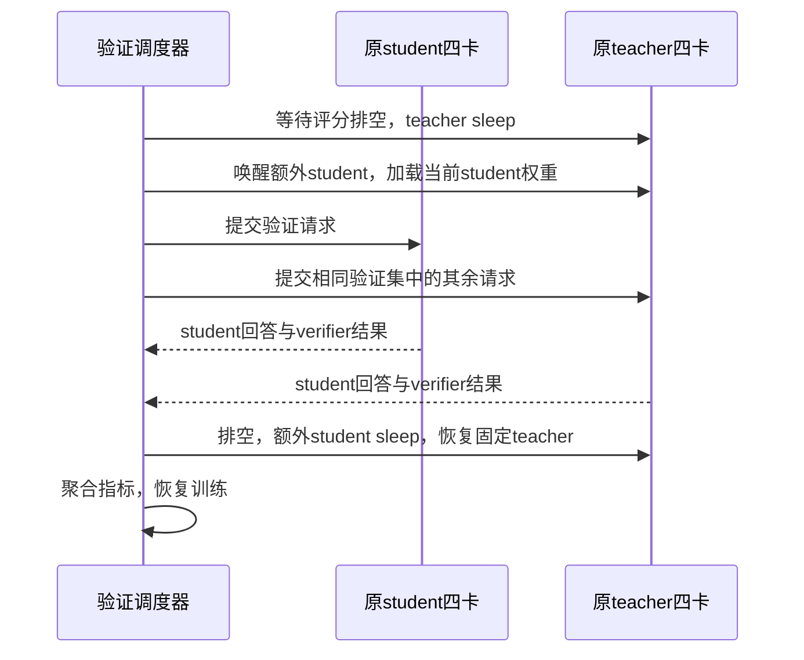
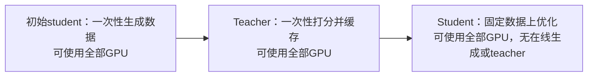
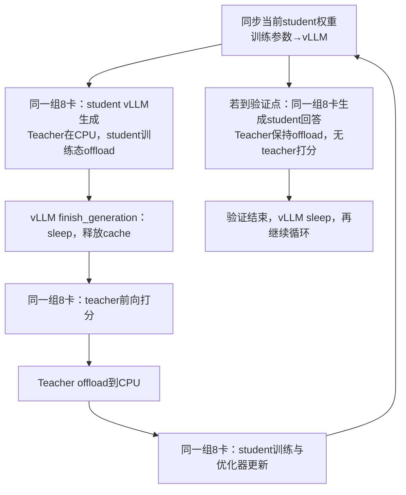

# NeMo RL 小模型流水线、Semi-OPD 设置与验证借卡

验证可以使用全部 8 卡生成 student 回答。当前 4+4 的限制来自固定的资源池、服务副本和权重同步范围；验证算法不需要 teacher。NeMo RL 的共置蒸馏实现提供了一个可参照的结构：student vLLM、teacher 前向、student 训练分阶段复用同一个 GPU 池。将这个结构接入本项目需要实现模型生命周期和数据接口，现有 V1 配置没有一个开关可以完成转换。

本文保留当前 570 题、每题 16 次采样、response≤31744、temperature=0.7、top-p=0.9、验证间隔 20 与提交窗口 16。代码和配置核对日期为 2026-10-20；论文使用 arXiv:2610.11291v1，NeMo RL 使用提交 `d1e23adb3df33dedd0e9c6edd9482430a2e5e8ad`。论文没有公布逐模型的资源布局或 NeMo RL 修订号，下面分别说明论文记载与当前开源实现，避免将二者混作同一次运行。

## 当前验证只使用 student 池

[V1 trainer](../../../verl/trainer/ppo/v1/trainer_base.py) 的 `_init_resource_pool_mgr()` 分别建立 `global_pool` 和 `teacher_pool`。配置中的 student 4 卡用于 actor 和 student rollout；另 4 卡交给 `MultiTeacherModelManager`。初始化 student `LLMServerManager` 时传入的是 actor 的资源池，权重同步也只登记该 manager 的副本。

因此，验证时即使 teacher 没有请求，student 负载均衡器里仍只有 4 个 TP=1 服务。GPU 空闲、释放显存和 GPU 已注册为 student 服务是三件不同的事。Teacher sleep 后保留原 Ray actor 和资源池归属，不会自动生成新的 student 服务。

| 状态 | 当前 4+4 | 验证借卡后的目标 |
| --- | --- | --- |
| 原 student 4 卡 | 生成当前 student 的回答 | 继续生成 |
| 原 teacher 4 卡 | 保留 teacher 服务，无验证请求 | Teacher sleep，运行另外 4 个 student 副本 |
| Student 权重 | 仅同步给原 4 个副本 | 额外副本也加载同一个当前 student 版本 |
| 验证结束 | 直接恢复训练循环 | 排空额外 student 请求，卸载 student，恢复固定 teacher |
| 验证题目和采样预算 | 570×16 | 保持 570×16 |

以当前模型计算，一份 BF16 权重约 3.31 GiB；额外 4 份权重本身不大。长序列 KV cache、工作区、CUDA Graph 和模型切换期间的同时占用才决定是否能放下。不能把当前 teacher 约 32.7 GiB 和 student 约 40.8 GiB 的整卡观测相加后，直接宣布两套活跃服务一定可以安全共存。

### 只在验证时借用 teacher 卡

这是一条保留当前训练结构的候选实现，不要求先迁移整个 teacher 后端：

1. 初始化时规划 teacher 池内的额外 student 服务及 Ray 共置资源；也可以在验证边界创建服务，但必须复用原池的 placement group，不能再申请 4 张独占新卡。
2. 进入验证前等待训练、teacher 请求和数据写入结束；调用 teacher 副本的 sleep，并确认显存释放完成。
3. 唤醒额外 student 服务，传入当前 actor 权重，将它们加入 student 路由。校验 8 个服务的 student 权重版本一致。
4. 完成相同验证；退出前排空额外服务、移除路由、sleep，再恢复 teacher 的原始固定权重与 cache。
5. 为部分初始化失败、验证异常和唤醒失败定义清理路径；恢复失败时停止训练，避免用错误模型继续生成或评分。

当前 [TeacherModelManager](../../../verl/experimental/teacher_loop/teacher_model.py) 的底层副本通过 `init_colocated()` 启动；[vLLM server](../../../verl/workers/rollout/vllm_rollout/vllm_async_server.py) 已有 COLOCATED 模式的 sleep/wake，sleep 使用 level 1。还需要上层调度封装、共享资源预算、额外副本的权重传输和路由管理。当前同步 V1 将 checkpoint engine 固定为 naive；跨到 teacher 池的额外副本不能假设直接兼容现有权重同步路径，应检查并接入适合该布局的传输方式。

此方案只让验证使用 8 卡；训练时仍是原来的 4+4。若目标还包括 rollout 和 actor update 都使用 8 卡，则需要下面的完整共置结构。

### 8 卡容量与验证长尾

当前每窗口 16 题×16 次采样共有 256 个请求。4 个 TP=1 副本、每副本 `max_num_seqs=32`，合计最多容纳 128 条活跃序列；8 个同规格副本的容量是 256。每个副本拥有完整的小模型，问题分发给不同副本；这里优先使用数据并行副本，不需要为了凑卡数将一个 1.5B 模型设为 TP=8。

8 卡容量不能消除窗口边界。当前 `_validate()` 提交一个窗口后，等待该窗口全部 prompt group 完成，再提交下一窗口。已完成验证的保守观测中，至少 32.02% 的时间只剩不超过 4 个 prompt group，每组最多 16 条未完成回答，也就是最多 64 条；CPU verifier 尚未结束的请求也包含在其中。8 卡各 32 条的总容量在这些时段仍无法填满。详细依据见[组件审计](2026-10-20-OPD流水线组件与阶段审计.md)。

因此，验证借卡与有界的跨窗口持续补充请求应分别评测。后者保持题目、采样、长度和指标不变，但调整请求调度；还要确保样本 UID、每题采样计数、seed 分配与最终汇总一致。保持相同随机数配置不保证更换调度后生成文本逐条一致。

## arXiv:2610.11291 的设置与可借鉴范围

论文《When Do We Need On-Policy Distillation? Distilling on Offline Student Rollouts Is Often Better》比较标准 OPD 与 Semi-OPD。Semi-OPD 在训练前，用初始 student 生成固定回答，再一次性缓存 teacher 对这些回答的 sampled-token log-prob。优化时只重算当前 student 概率和 advantage，不再在线生成回答或运行 teacher。[^paper]

| 设置 | 论文主实验 | 当前 math 基线 |
| --- | --- | --- |
| 数据 | 去重后的 DAPO 英文题 14116 条 | 当前 parquet 17917 条 |
| 每批 prompt / 每题回答 | 128 / 1 | 64 / 1 |
| Prompt 上限 | 2048 | 4096 |
| Thinking 模型训练回答上限 | 16384 | 7168 |
| 训练 temperature / top-p | 1.0 / 1.0 | 1.0 / 1.0 |
| 优化 | AdamW，lr=1e-6，常数，无 warmup；wd=0.01；clip=1.0；BF16 | 这些优化器数值相同；详见[实验记录](2026-10-20-sampled-token-OPD数学基线-b38hw8v0.md) |
| 损失 | Sampled-token reverse KL，advantage 停梯度 | 当前 `k1 + PG`，advantage 使用当前 student 概率 |
| 数学验证 | AIME24/25/26、HMMT Feb26，avg@32，T=1、p=1，通常 response=32768 | MATH-500、AMC23、AIME25，mean@16，T=0.7、p=0.9，response=31744 |
| 框架 / 硬件 | NeMo RL DTensor 训练，vLLM 生成；1–8 节点，每节点 8×H100 | verl V1 FSDP2，vLLM；1 节点 8×A800 |

论文包含与我们同名的 checkpoint 对：`deepseek-ai/DeepSeek-R1-Distill-Qwen-1.5B` 与 `hbx/JustRL-DeepSeek-1.5B`。表 3 的初始 top-64 overlap 是 79.7%；Semi-OPD 相对 OPD 的最后一个共同评测点高 1.4 个百分点，但曲线面积除以训练区间长度的差值为 −1.36 个百分点。不能从这个结果判断 Semi-OPD 在这组模型的整个训练过程中更好，也不能将论文的 overlap 当作我们当前 checkpoint 和 prompt 上实测的值。[^paper]

两种训练的数据分布分别为：

$$
y\sim\pi_{\theta_k}(\cdot\mid x)\quad\text{（OPD）},\qquad
y\sim\pi_0(\cdot\mid x)\quad\text{（Semi-OPD）}.
$$

在相应前缀 $s_t=(x,y_{<t})$ 上，两者都可使用：

$$
A_t^{(k)}=\operatorname{stopgrad}\left[\log\pi_T(y_t\mid s_t)-\log\pi_{\theta_k}(y_t\mid s_t)\right],
\qquad
\ell_k=-\sum_t A_t^{(k)}\log\pi_{\theta_k}(y_t\mid s_t).
$$

Semi-OPD 固定的是回答和 teacher 概率，student 概率仍随更新改变。它改变了期望中的采样分布；“保留公式”不意味着“保留当前 sampled-token OPD 算法”。

论文的阶段拆分允许每阶段使用完整集群；原文未说明小模型每次 OPD 运行的 TP/DP、是否共置、CPU offload、GPU 比例和切换开销。当前开源 NeMo RL 可以证明一种共置实现存在，不能补成作者未披露的具体运行配置。

### 论文加速数字的比较条件

表 4 的 Qwen3-1.7B←Qwen3-4B-Instruct-2507 案例报告，100 步 OPD 为 56.8 H100 GPU 小时，Semi-OPD 为 5.0，约 11.4 倍。Semi-OPD 的成本包含离线生成、teacher 打分与训练，所有方法都排除验证；该行脚注还写明 Semi-OPD 用 4K 训练回答上限，OPD 用 16K。这个数字同时包含算法、实际轨迹长度和资源复用收益，不是相同在线 OPD 只改 GPU 调度的加速比。论文没有给我们这组 1.5B→1.5B 的对应成本行。[^paper]

## NeMo RL 小模型共置蒸馏的实际流水线

核对的是 `examples/run_distillation.py` → `nemo_rl/algorithms/distillation.py`。在 `policy.generation.colocated.enabled=true` 时，`setup()` 只建立一个 `RayVirtualCluster`，将 `train_cluster` 和 `inference_cluster` 都指向该集群；vLLM 路径允许 3 组 worker 共置。Teacher `Policy`、student `Policy` 与 student `VllmGeneration` 使用同一组物理 GPU。[^nemo-loop]

三组进程可以一直存在，但它们的权重、优化器状态和 KV cache 按阶段迁移或释放。Ray 的共置资源份额只允许进程放在同一张卡上，不会替代显存管理，也不要求三个模型同时执行。

### 切换顺序与数据

| 阶段 | 源码行为 | GPU 中的主要活动对象 |
| --- | --- | --- |
| 权重同步 | `refit_policy_generation()`；共置时先卸载优化器，唤醒 vLLM weights，CUDA IPC/ZMQ 传权重，再卸载训练态并唤醒 KV | 短暂共存的同步工作集 |
| 生成 | 调用 student generation，完成后 `finish_generation()` | Student vLLM |
| Teacher 评分 | `teacher_policy.prepare_for_lp_inference()`，`get_topk_logits()` | Teacher 模型前向 |
| 训练准备 | `teacher_policy.offload_after_refit()`，`student_policy.prepare_for_training()` | Student 参数、优化器、训练工作区 |
| 更新 | `student_policy.train()`，标记生成权重 stale | Student forward/backward |
| 验证 | 必要时先 refit，然后直接调用同一个 `student_generation`；无 teacher 参数 | Student vLLM，原推理池的全部资源 |

Automodel worker 的 `offload_after_refit()` 显式把模型搬到 CPU，并卸载优化器；`prepare_for_lp_inference()` 和 `prepare_for_training()` 再把相应状态移回 GPU。vLLM 的 `finish_generation()` 在共置模式下调用 sleep，普通同步 worker 使用 `sleep(level=1)`。这些是 CPU 内存中的阶段切换，不是每步从磁盘重读 checkpoint。[^nemo-offload] [^nemo-vllm] [^nemo-refit]

当前标准 `run_distillation.py` 路径先生成完整 batch，再评分，再更新，阶段之间有等待。Teacher 在 student 生成和更新时仍没有计算工作，但那些 GPU 已交给 student；消除的是 GPU 的专用预留空闲。它与我们“生成过程中，完成一条就交给独立 teacher 打分”的实现有不同的重叠关系。

该路径取 teacher top-k logits，默认 k=64、mixed forward/reverse KL。即便某个 recipe 设为 reverse，也不能直接当成本项目 sampled-token `k1 + PG` 的等价实现；可以迁入资源复用和生命周期设计，再保留我们已有 sampled-token loss。

### 实际配方与合成配置

使用上游 `nemo_rl/utils/config.py` 的 `load_config()` 和 OmegaConf resolver 合成父配置，未启动 Ray/GPU。结果保存在 [config-audit.json](data/nemo-rl-20261020/config-audit.json)，来源说明见 [source.json](data/nemo-rl-20261020/source.json)。表中的 DP / 副本数由合成后的 GPU 数和并行度计算，不是运行日志实测。

| 配方 | 共用 GPU 总数 | Student 训练 | Teacher 前向 | Student 生成 / 验证 |
| --- | ---: | --- | --- | --- |
| `distillation_math.yaml` | 8 | Qwen3-1.7B-Base，TP2×CP2×DP2 | Qwen3-4B，TP4×CP2×DP1 | TP1×PP1，8 副本 |
| `distillation-qwen3-32b-to-1.7b-base-1n8g-automodel.v1.yaml` | 8 | 1.7B，TP1×CP1×DP8 | 32B，TP4×CP1×DP2 | TP1×PP1，8 副本 |
| 对应 `1n4g-automodel` 配方 | 4 | 1.7B，TP1×CP1×DP4 | 32B，TP4×CP1×DP1 | TP1×PP1，4 副本 |
| Gym `distillation_qwen3_0_6b.yaml` | 1 | 0.6B，TP1×CP1×DP1 | 1.7B，TP1×CP1×DP1 | 1 个异步 HTTP 副本；1 步 smoke 配置 |

这些配方直接展示了小模型用多个 TP=1 推理副本，大 teacher 根据体积采用不同 TP/CP，但不因此永久分割两套卡。第一行的 student/teacher TP/CP 组合是上游示例设置，不能据此认定我们的 1.5B 必须采用 TP2/CP2。[^nemo-config] [^nemo-recipe] [^nemo-gym]

默认数学配方每轮采样 128 个 prompt、n=1，`train_global_batch_size=64`；32B→1.7B 配方分别为 64 和 32。采样批量与优化批量不是同一个参数，不能只看一个 batch 数字比较 ours 的 64/64。默认数学配方 BF16、context=8192、vLLM memory=0.6、`enforce_eager=false`、dynamic batching=true、sequence packing=false；Megatron 配方另行选择 packing。这些配置在不同 recipe 中有覆盖，应以合成结果为准。

NeMo RL 的 `validate()` 仍然按 dataloader batch 循环并等待该 batch 的 rollout 完成；它使用全推理池，并不自动提供跨所有验证 batch 的持续补充机制。迁入共置结构后，我们仍应独立修复已观测到的窗口长尾。

### 当前 MOPD 是另一条流水线

NeMo RL 还提供基于异步 GRPO/Gym 的 MOPD：使用 teacher-minus-student sampled-token advantage，并为 teacher 创建独立的 Megatron inference-only worker group。参考 Qwen3-1.7B 的 3n8g 配方是 8 卡 student 训练、8 卡 student vLLM 生成、8 卡 teacher，共 24 卡，而不是 8 卡内部共置。独立资源能让生成、评分和更新跨批重叠，但需处理异步旧策略数据及重要性采样修正。[^nemo-mopd] [^nemo-mopd-recipe]

因此，“NeMo RL 的 OPD 都是共享 8 卡”不成立；应指定 `run_distillation.py` 的共置蒸馏，或异步 MOPD 的独立角色池。后者可为将来的异步 pipeline 提供实现参考，不适合直接拿 24 卡 recipe 解释我们的 8 卡利用率。

## 本项目的实现优先级与验收

若当前目标是保留最基本 sampled-token OPD 复现，优先采用共享 GPU 的系统改造，Semi-OPD 另立实验。两条系统路径分别解决不同范围的问题：

| 路径 | 训练生成 | Actor 更新 | 验证生成 | 改动范围 |
| --- | --- | --- | --- | --- |
| 当前 4+4 | Student 4 卡，teacher 独立评分 | Student 4 卡 | Student 4 卡 | 现状 |
| 仅验证借卡 | 保持 4+4 | 保持 4 卡 | Student 8 卡 | Teacher 生命周期、借用服务、跨池权重同步与路由 |
| 同步完整共置 | Student 8 卡，之后 teacher 8 卡前向 | Student 8 卡 | Student 8 卡 | Shared teacher backend、批评分数据流、共享资源池和切换 |

完整共置可以参照 NeMo RL 的生命周期，以及本地 One-Shot-OPD 的冻结 FSDP teacher。在我们的 1.5B→1.5B 上，应保持 student TP=1 推理副本方向；冻结 teacher 的训练后端只前向并返回 sampled-token 概率，避免额外建立完整词表 / top-k 蒸馏通路。当前 actor batch=64 可被 DP8 整除，不因共享 8 卡而强制增加 global batch。

共置会失去当前在线生成与独立 teacher 的部分重叠，还增加 CPU/GPU 搬运。将 $G,Q,O,U,W,S$ 分别记为生成、teacher 评分、student 旧概率、更新、权重同步和额外切换的墙钟时间，候选结构的估计形式为：

$$
T_{\mathrm{shared}}\approx G_8+Q_8+O_8+U_8+W_8+S,
\qquad
T_{\mathrm{current}}\approx T_{\mathrm{gen\;and\;scoring},4+4}+O_4+U_4+W_4.
$$

当前训练每批只有 64 条回答，从 4 个副本扩大到 8 个后，每副本平均由 16 条变成 8 条；单卡 decode batch 变小会影响效率，不能承诺生成恰好快一倍。可以在固定 batch=64 下先测调度净收益，再单独研究增加训练 batch 的优化行为。

验证借卡的收益条件可写为：

$$
T_{\mathrm{val},4}-T_{\mathrm{val},8}>T_{\mathrm{borrow}}+T_{\mathrm{restore}}.
$$

这里 $T_{\mathrm{val},8}$ 必须来自相同 checkpoint、题目与采样预算。借卡 / 恢复单独计时，记录每副本请求数、活跃序列数、排队、KV cache、preemption、GPU busy 与整卡显存；训练共置另需比较完整步时和 GPU 小时。先用固定 token 序列校验 teacher 的 shift、mask、log-prob 和 `k1 + PG` 梯度，再运行短训练与完整验证。本文只完成源码、论文与配置审计，没有修改训练启动配置或运行 GPU 试验。

### 参考文献

[^paper]: Siyan Zhao et al. When Do We Need On-Policy Distillation? Distilling on Offline Student Rollouts Is Often Better. arXiv 2026，v1，第 2 节、附录 A 表 2/3、附录 C 表 4。[论文原文](https://arxiv.org/html/2610.11291v1)。
[^nemo-loop]: NVIDIA. NeMo RL distillation controller. GitHub 2026，提交 d1e23adb，setup、training loop 与 validate。[distillation.py](https://github.com/NVIDIA-NeMo/RL/blob/d1e23adb3df33dedd0e9c6edd9482430a2e5e8ad/nemo_rl/algorithms/distillation.py#L365)。
[^nemo-offload]: NVIDIA. Automodel policy lifecycle. GitHub 2026。[automodel_policy_worker.py](https://github.com/NVIDIA-NeMo/RL/blob/d1e23adb3df33dedd0e9c6edd9482430a2e5e8ad/nemo_rl/models/policy/workers/automodel_policy_worker.py#L1355)。
[^nemo-vllm]: NVIDIA. vLLM generation lifecycle. GitHub 2026。[vllm_generation.py](https://github.com/NVIDIA-NeMo/RL/blob/d1e23adb3df33dedd0e9c6edd9482430a2e5e8ad/nemo_rl/models/generation/vllm/vllm_generation.py#L1387)；[同步 worker 的 sleep](https://github.com/NVIDIA-NeMo/RL/blob/d1e23adb3df33dedd0e9c6edd9482430a2e5e8ad/nemo_rl/models/generation/vllm/vllm_worker.py#L1573)。
[^nemo-refit]: NVIDIA. Refit policy generation. GitHub 2026。[grpo.py](https://github.com/NVIDIA-NeMo/RL/blob/d1e23adb3df33dedd0e9c6edd9482430a2e5e8ad/nemo_rl/algorithms/grpo.py#L2788)。
[^nemo-config]: NVIDIA. Default small-model distillation config. GitHub 2026。[distillation_math.yaml](https://github.com/NVIDIA-NeMo/RL/blob/d1e23adb3df33dedd0e9c6edd9482430a2e5e8ad/examples/configs/distillation_math.yaml)。
[^nemo-recipe]: NVIDIA. Qwen3-32B to Qwen3-1.7B, one node eight GPUs. GitHub 2026。[1n8g recipe](https://github.com/NVIDIA-NeMo/RL/blob/d1e23adb3df33dedd0e9c6edd9482430a2e5e8ad/examples/configs/recipes/llm/distillation-qwen3-32b-to-1.7b-base-1n8g-automodel.v1.yaml)。
[^nemo-gym]: NVIDIA. Qwen3-0.6B NeMo Gym distillation smoke config. GitHub 2026。[单 GPU 配方](https://github.com/NVIDIA-NeMo/RL/blob/d1e23adb3df33dedd0e9c6edd9482430a2e5e8ad/examples/nemo_gym/distillation_qwen3_0_6b.yaml)。
[^nemo-mopd]: NVIDIA. Multi-Teacher On-Policy Distillation. GitHub 2026。[MOPD 机制与资源说明](https://github.com/NVIDIA-NeMo/RL/blob/d1e23adb3df33dedd0e9c6edd9482430a2e5e8ad/docs/about/algorithms/mopd.md)。
[^nemo-mopd-recipe]: NVIDIA. Qwen3-1.7B three-node MOPD recipe. GitHub 2026。[3n8g 配方](https://github.com/NVIDIA-NeMo/RL/blob/d1e23adb3df33dedd0e9c6edd9482430a2e5e8ad/examples/configs/recipes/llm/mopd-qwen3-1.7b-3n8g-megatron-pack.yaml)。
