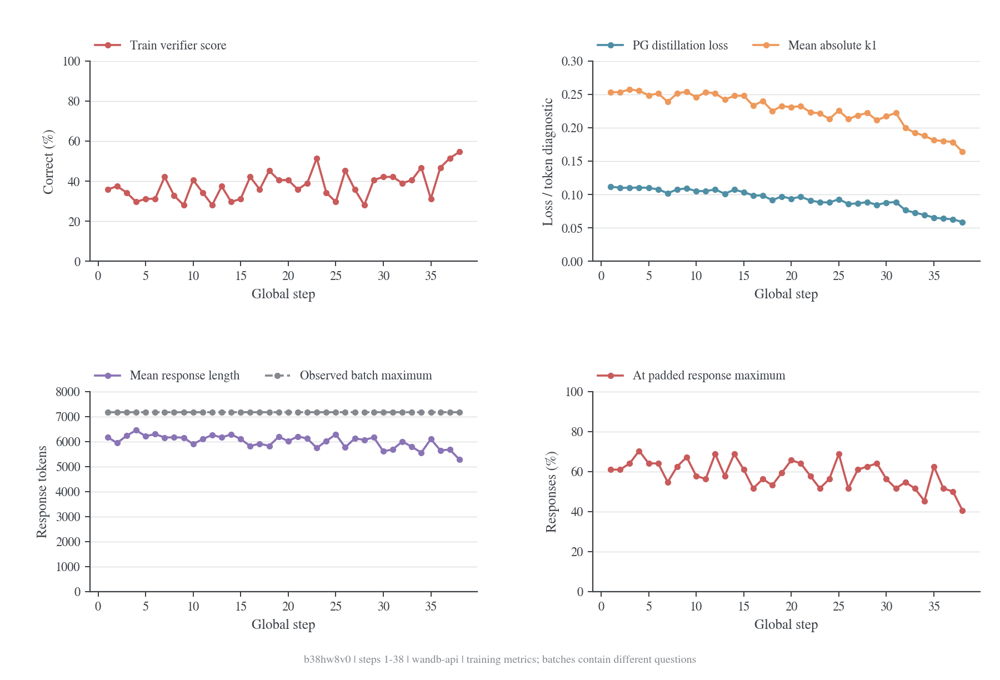
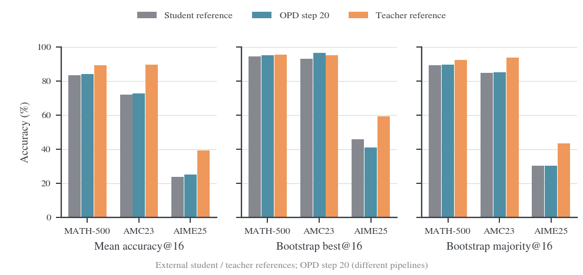
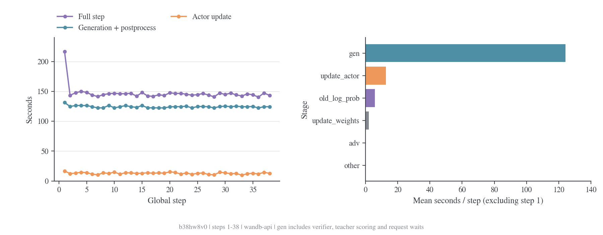
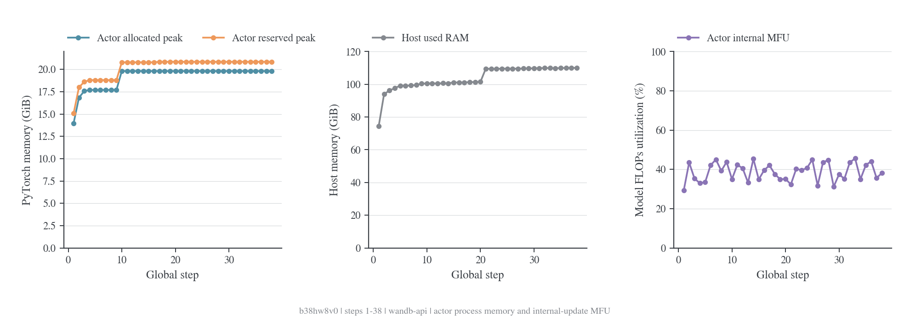

# sampled-token OPD 数学基线：b38hw8v0

## 背景 / 问题 / 动机

本实验复现最基本的 sampled-token on-policy distillation（OPD）数学训练：student 自己生成解答，固定 teacher 对这些 sampled token 给出条件概率，再用 token 级蒸馏信号更新 student。目标是先确认数学基线的数据、训练与验证可以运行，并记录质量和资源开销，为后续方法与性能对照提供起点。实验对应 W&B run `b38hw8v0`。[^run]

这是 sampled-token OPD + math 基线，采用当前 verl 的 `k1 + policy gradient` 路径。仓库名 MirrorOPD-verl 不表示这次实验已经实现额外的 MirrorOPD 算法。One-Shot-OPD 提供了单教师领域配方与 verifier 的参考；本文按本 run 实际上传配置和当前实现描述行为。[^oneshot]

2026-10-20 12:23（Asia/Shanghai）完成本次 API 快照。训练 history 用 `scan_history(keys=None)` 完整扫描到服务端边界 `_step=38`，共 38 行，global step 连续为 1–38；不是 W&B 图表抽样后的 500 点曲线。系统 stream 通过 `history(stream="system", samples=100000)` 返回 3825 行，其中 1912 行含 8 张卡的 GPU 指标，不能保证该 stream 完整无抽样。数据保存在 [API 快照目录](data/b38hw8v0-api-20261020/source.json)，配置、summary、训练原始指标、系统指标及派生统计均随文档保存。[^api]

服务端状态为 `finished`，但上传数据只到 **38/279，约 13.62%**。最后训练记录为北京时间 11:30:13，最后系统采样约 12:02。该 run 使用 offline 模式后同步，服务端状态和上传边界不能证明 Hope 当前是否仍在运行、是否已停止或是否完成整个 epoch；需要接收更新日志才能继续判断。已下载的 `output.log` 到 step 38，没有出现 Traceback 或 CUDA OOM。本文所有结果均限定于这个快照。

后续[流水线审计](2026-10-20-OPD流水线组件与阶段审计.md)补查了 console 文件：虽然 history 仍为 38 行，console 已打印 step 39，并出现第 40 步验证的状态。这不改变本文冻结的 38 行指标；它补充说明了 offline 上传边界和真实执行进度不能等同。

## 算法 / 实验设置

### 蒸馏信号与实际优化目标

给定数学题 $x_i$，student rollout 策略 $\pi_{\rm roll}$ 生成序列 $y_i$。令 $h_{it}=(x_i,y_{i,<t})$，$m_{it}$ 是有效 response token 的 mask，$q$ 是固定 teacher，$\pi_\theta$ 是当前训练模型。每个 sampled token 的 `k1` 值为：

$$
d_{it}=\log\pi_\theta(y_{it}\mid h_{it})-\log q(y_{it}\mid h_{it}),\qquad A_{it}^{\rm KD}=-\operatorname{stopgrad}(d_{it}).
$$

Teacher 只返回 student 实际生成 token 的 log-prob；不是全词表 KL，也不使用配置中未被 `k1` 路径消费的 `topk=32`。对固定前缀分布，student 采样下的平均 $d$ 对应 reverse-KL 的采样估计；这里使用的是基于 sampled histories 的 policy-gradient surrogate，不把它宣称为完整轨迹目标的无偏梯度。

训练先用 actor 计算 `old_log_probs`。重要性比率为：

$$
\rho_{it}=\exp\left(\operatorname{clip}(\log\pi_\theta-\log\pi_{\rm old},-20,20)\right).
$$

实际采用 vanilla PPO 风格 surrogate。先定义：

$$
u_{it}=\max\left(-\rho_{it}A_{it}^{\rm KD},-\operatorname{clip}(\rho_{it},0.8,1.2)A_{it}^{\rm KD}\right).
$$

当前 vanilla 实现对负 advantage 另有默认 dual-clip（$c=3$）；最终 token loss 与全局 token-mean loss 为：

$$
\ell_{it}=\begin{cases}\min(u_{it},-3A_{it}^{\rm KD}),&A_{it}^{\rm KD}<0,\\u_{it},&A_{it}^{\rm KD}\ge0,\end{cases}
\qquad
L_{\rm KD}=\frac{\sum_{i,t}m_{it}\ell_{it}}{\sum_{i,t}m_{it}}.
$$

一次全局 batch 只做一次更新，梯度累积期间参数尚未更新，通常 $\rho\simeq1$，因此 distillation clipfrac 与 PPO KL 接近零是合理现象。尽管 loss 的数值在该点近似 token 平均 $d$，梯度通过 $\rho$ 产生，`d.detach()` 的语义不能省略。

设置为 `use_policy_gradient=True`、`use_task_rewards=False`、`distillation_loss_coef=1`，无 loss/log-prob clamp；entropy coefficient=0，无 reference-KL loss。数学 verifier 分数用于诊断与验证，不参与这个实验最终的 actor 优化目标。配置中的 `algorithm.adv_estimator=grpo` 和日志 `actor/pg_loss`、`critic/advantages/*` 仍可能有数值，但任务分支被置零，不代表在用数学奖励训练 GRPO。实现可查 [distillation loss](../../../verl/trainer/distillation/losses.py) 与 [policy loss](../../../verl/trainer/ppo/core_algos.py)。

### 模型、数据与执行配置

以下从本 run 的 [config.json](data/b38hw8v0-api-20261020/config.json)、[hardware.json](data/b38hw8v0-api-20261020/hardware.json) 和 [包版本](data/b38hw8v0-api-20261020/package-versions.txt) 读取；不把后来新增的脚本默认值当作历史实验设置。

| 项目 | 本 run 设置 |
| --- | --- |
| Student | DeepSeek-R1-Distill-Qwen-1.5B；Qwen2，28 层，hidden=1536，实际参数约 1.777B |
| Teacher | JustRL-DeepSeek-1.5B；固定权重，4 个同模型评分副本 |
| 硬件 | 单机 8 × NVIDIA A800-SXM4-80GB；4 张 student + 4 张 teacher |
| 框架 | Python 3.12.13；Torch 2.11.0+cu128；vLLM 0.25.1+cu129；Transformers 5.12.1；Ray 2.56.1；W&B 0.28.1 |
| Trainer | V1 sync；student FSDP2；rollout 服务内部 `mode=async` 表示服务接口，不改变 trainer 同步语义 |
| 训练数据 | DAPO 17917 条；seed=42，shuffle=True，过滤超长 prompt；当前资产检查均在限制内 |
| Batch 与更新 | 全局 64 prompt，n=1，mini-batch=64，ppo_epochs=1；4 rank 各约 16 条 |
| 训练预算 | 1 epoch，优化器配置记录 279 步；末尾不足 batch 的 61 条不参与 |
| 长度 | prompt≤4096；训练 response≤7168；teacher context=11265；student context=35841 |
| 动态 batching | remove-padding=True；actor token budget=32768/GPU；micro-batch-size=1 配合动态 batching |
| 优化器 | AdamW；lr=1e-6，constant；betas=(0.9,0.999)，weight decay=0.01，clip_grad=1 |
| 显存选项 | gradient checkpointing=True；parameter/optimizer offload=True；actor use_torch_compile=False，fsdp_config.use_torch_compile=True |
| Student vLLM | TP=1，4 副本；eager=True；memory utilization=0.5；max_num_seqs=32；batched tokens=8192 |
| Teacher vLLM | TP=1，4 副本；eager=True；memory utilization=0.4；max_num_seqs=64；batched tokens=8192 |
| 训练采样 | temperature=1.0，top-p=1.0，top-k=-1；记录 rollout log-prob |
| 验证 | MATH-500 / AMC23 / AIME25，500 / 40 / 30 题；n=16，temperature=0.7，top-p=0.9，response≤31744 |
| 验证与保存 | 每 20 步验证，训练前不验证；每 50 步保存；最终一步额外验证与保存 |

W&B metadata 报告源 commit 为 `e70acdf1e0df157181a931b8cf49a5216c879f38`。尚未取得该次启动的 `source_changes.patch`，所以不能保证运行代码完全等于这个 Git commit。模型目录名与仓库资产的固定 revision 对应，但没有从 run 取得权重内容级版本证据；后续应连同启动目录的来源记录保存。

### 主要指标的表达式与解读

令 $B=64$，$M=\sum m_{it}$，$z_i\in\{0,1\}$ 为数学判分结果。训练任务正确率 `critic/score/mean` 为：

$$
\widehat a_{\rm train}=\frac1B\sum_i z_i.
$$

每步题目变化，因此它是训练 batch 正确率；趋势只能作为诊断，泛化结论优先看固定验证集。`actor/distillation/loss` 对应上面的 $L_{\rm KD}$，`abs_loss` 的 token 统计定义为：

$$
\widehat d_{\rm abs}=\frac1M\sum_{i,t}m_{it}\lvert d_{it}\rvert.
$$

实现中的 `abs_loss` 先在 micro-batch 上计算再通过 `Metric(MEAN)` 聚合，可能与严格全局 token 加权平均存在差别；不能直接拿它反推整个 batch 的精确 KL。`loss_min/max` 是 sampled token 上的极值，单个 k1 值可以为负。

Response 平均长度与当前日志中的长度最大值占比为：

$$
\overline r=\frac1B\sum_i r_i,\qquad c_r=\frac1B\sum_i\mathbf1[r_i=R_{\rm padded}].
$$

V1 转成 padded tensor 后统计长度，因此 `clip_ratio` 的比较对象是该批 tensor 宽度。本快照每步 response max 都为 7168，可把 $c_r$ 解读为达到训练长度上限的比例；其中可能包含恰在边界自然结束的回答，严格截断率仍需 finish reason。Prompt 的 `clip_ratio≈1/64` 只是达到该批最大 prompt 长度的比例，不能据此说有 1/64 的 prompt 被截断。

训练与 rollout 的一致性指标应和 teacher 蒸馏距离分开。令 $b_{it}=\log\pi_{\rm train}-\log\pi_{\rm roll}$：

$$
\widehat{\mathrm{KL}}_{\rm roll\|train}=\langle-b\rangle_m,\qquad
\widehat{\mathrm{KL}}_{k3}=\langle e^b-b-1\rangle_m.
$$

这里 $\langle\cdot\rangle_m$ 为有效 response token 平均。它们检查同一 student 的不同执行后端；当前 `rollout_corr/kl` 约 $4.5\times10^{-4}$ 至 $7.9\times10^{-4}$，不是 student 对 teacher 的 KL。`chi2_seq` 使用 $\operatorname{mean}_i\exp(2\sum_t b_{it})-1$ 的有限样本估计（实现另有 clamp），长序列会放大差异，样本估计也可能为负。

`actor/entropy` 是 response 位置上的模型 token 分布熵统计：

$$
H=\left\langle-\sum_{v=1}^{V}\pi_\theta(v\mid h)\log\pi_\theta(v\mid h)\right\rangle_m.
$$

它与 sampled token NLL 是不同的量；当前没有 entropy bonus。`grad_norm` 是梯度裁剪函数返回的裁剪前总范数：

$$
G=\sqrt{\sum_j g_j^2},\qquad g_j\leftarrow g_j\min\left(1,\frac{1}{G+\varepsilon}\right).
$$

这里 $g_j$ 遍历整个模型的梯度分量，分片后需全局归约；所以日志范数略大于 1 与 `clip_grad=1` 并不矛盾。

固定验证集每题有 $n=16$ 个回答，$z_{jk}$ 表示第 $j$ 题第 $k$ 个回答是否正确：

$$
\mathrm{mean@16}=\frac1D\sum_{j=1}^{D}\frac1{16}\sum_{k=1}^{16}z_{jk}.
$$

这是 16 次采样估计的单次回答平均正确率，不是“16 次中至少一次正确”。当前 `best@16/mean` 来自每题有放回 bootstrap：从已有 16 个回答中抽 16 次，取最大正确性，重复 1000 次，再在题目间平均。若某题已有 $c_j$ 个正确回答，对应 bootstrap 期望为：

$$
\mathbb E[\mathrm{best@16}]_j=1-\left(1-\frac{c_j}{16}\right)^{16}.
$$

这与直接对原始 16 个回答做 $\mathbf1[c_j>0]$、以及无放回 pass@k 估计不同。`maj@16/mean` 同样先有放回采样，然后按抽样回答的规范化答案 `pred` 找众数，取众数答案的正确性；不是对二元正确/错误标签投票。`best/maj` 的 `/std` 是 bootstrap 统计，不能直接当作整个 benchmark 结果的置信区间。实现见 [validation aggregation](../../../verl/trainer/ppo/metric_utils.py)。

速度优先看完整步时与总时长：

$$
\mathrm{throughput}=\frac{\sum_i(p_i+r_i)}{t_{\rm step}\times8},\qquad
\mathrm{GPU\ hours}=\frac{8\,t_{\rm wall}}{3600}.
$$

日志 throughput 按申请的 8 卡归一化，包含 prompt 和 response；不是每个 rollout 副本的 decode token/s。actor MFU 的分母则仅有 4 张训练卡，计算过程见 [MFU 文档](2026-10-20-MFU计算.md)。

## 结果 / 分析 / 结论

正式看板优先观察固定验证集 `mean@16`，再结合 distillation loss / abs loss、response 长度与上限占比、entropy / grad norm、rollout 一致性判断训练状态；效率则看包括验证的墙钟、整卡显存与按资源池统计的 busy。单看 loss 或 actor MFU 都不足以评价实验。

### 训练趋势

前 10 步与最后 10 步是不同题目批次，以下只作描述性对比：

| 指标 | 前 10 步均值 | 最后 10 步均值 | 解读 |
| --- | ---: | ---: | --- |
| 训练正确率 | 34.38% | 43.59% | 有改善迹象，需要固定验证集前后对照确认 |
| Distillation PG loss | 0.10859 | 0.07324 | sampled-token 蒸馏目标下降 |
| Mean absolute k1 | 0.25122 | 0.19378 | 与 teacher 的 token 概率差异缩小 |
| Response 平均长度 | 6167.55 | 5749.95 | 解答变短，题目组成也会影响长度 |
| 达到 7168 上限比例 | 62.66% | 52.81% | 仍有大量样本耗尽预算 |
| 裁剪前 grad norm | 1.1990 | 0.7755 | 数值稳定，未见梯度爆炸迹象 |
| Entropy | 0.87784 | 0.77967 | 分布变集中；需继续观察多样性与验证表现 |

Step 38 的正确率为 54.69%、distillation loss 为 0.05892、entropy 为 0.66507。单个 batch 的高分不能代表最终数学能力。全 38 步 pooled 训练正确率为 38.03%，58.59% 的回答达到训练长度上限。同步指标 trajectory staleness=0、trajectory spans=1、aborted ratio=0，rollout/actor 概率相关性接近 1；当前快照支持训练链路一致且数值稳定。

### Step 20 与 student / teacher 外部基线

Student 参考是 One-Shot-OPD 的 `math_student`（`6uorrk2k`），teacher 参考是 `math_teacher`（`u87buult`），两者都是 `trainer.val_only=True`、只有一行评测 history。用户提供的 student 链接少了最后一个 `k`，已通过同项目 run 列表及模型路径确认正确 ID。Student 对应 DeepSeek-R1-Distill-Qwen-1.5B，teacher 对应 JustRL-DeepSeek-1.5B。[^student-ref] [^teacher-ref]

图中三个面板分别是 mean@16、bootstrap best@16、bootstrap majority@16；同一模型在所有面板里颜色一致。全部 27 个数值及原始 metric key 保存在 [baseline-comparison.json](data/b38hw8v0-api-20261020/baseline-comparison.json)。两个参考 run 的全量 summary、单行 history 和实际配置也随文档保存，读取时间约为 2026-10-20 12:44（Asia/Shanghai）。

| 验证集 | Student mean@16 | OPD step 20 mean@16 | Teacher mean@16 | OPD − student，百分点 |
| --- | ---: | ---: | ---: | ---: |
| MATH-500 | 83.25% | 84.11% | 89.11% | +0.86 |
| AMC23 | 72.03% | 72.50% | 89.38% | +0.47 |
| AIME25 | 23.75% | 25.21% | 39.17% | +1.46 |

相对于外部 student 参考，三个数据集的平均正确率都略高，但差值不足以直接证明训练提升。AIME25 的 bootstrap best@16 从 student 的 45.76% 变为当前 40.94%，majority@16 则基本不变（30.35% 对 30.34%）；不能说所有指标均改善。AMC23 当前 bootstrap best@16 高于 teacher 参考，mean@16 仍远低于 teacher，也不能据此称为整体超越 teacher。

主要采样预算已经核对一致：三个数学验证集、prompt≤4096、response≤31744、n=16、temperature=0.7、top-p=0.9。但执行与输入路径有差异：

| 项目 | One-Shot-OPD 两个参考 | 当前 OPD run |
| --- | --- | --- |
| 用途 / trainer | Val-only，旧 DataProto trainer（use_v1=False） | V1 同步训练中的验证 |
| Student 推理 GPU | 8 × A800，TP=1 | 4 × A800，另 4 卡为 teacher |
| 验证提交窗口 | val_batch_size=null；该版本默认整个验证集 | 16 题 |
| vLLM seq / token budget | 64 / 35840 | 32 / 8192 |
| vLLM memory utilization | 0.75 | 0.5 |
| 连续 token 配置 | enable=False、model_family=auto | model_family=deepseek，V1 输入路径 |
| 数据与 verifier | One-Shot-OPD 目录下的数据与 opd_mixed_verify | 本仓独立资产目录与迁入 verifier |

GPU 数和服务容量影响速度；prompt 构造、模型权重版本、题目内容和判分路径尚未做输入级复核，可能影响结果。两个基线作为外部参考，不能补造当前 run 的 step 0 点，也不能将上述差值直接记为同协议训练增益。它们另外记录了 `pass@16`，当前 run 没有该 key；图中统一比较 `best@16/mean`，没有混用 pass 与 bootstrap best。

本机[资产检查](资产准备.md)曾发现 DAPO 与 MATH-500、AMC23 分别有 2、5 道完全相同的题面。尚未取得本次接收端的资产检查报告，需核对实际数据版本；正式泛化评估应同时报告原配方与排除训练重叠题目的结果。当前仍只有 step 20 一个训练后验证点，AMC23/AIME25 题量也较小，应继续观察相同实现下的配对评测。

### 时间、显存与 GPU 利用率

剔除首步后，step 2–38 平均 144.97 秒，`gen` 124.18 秒，占 85.66%；`old_log_prob` 5.75 秒、actor 更新 12.80 秒、权重同步 2.09 秒。平均总吞吐约 2691 有效 token/s，约 26.49 道题/分钟；按 8 卡归一化的日志吞吐需另看其每步平均，不能混用两个分母。`gen` 的源码范围含 student 生成、verifier、teacher 评分与等待，现有 timer 不能进一步分离 GPU decode 与 teacher 的精确成本。

**完整耗时的主要瓶颈是验证。** 38 步训练 timer 合计 5580.66 秒（1.550 小时），step 20 验证 21200.77 秒（5.889 小时），验证占这两部分合计的 79.16%。记录 runtime 约 7.48 小时。验证发生在 `timing_s/step` 计时之外，若只把 throughput 曲线外推到整次训练，会严重低估总时间。

actor PyTorch 高水位到 step 38 为 allocated 19.82 GiB、reserved 20.85 GiB；这些是 actor 进程的峰值统计，不能拿 80 GiB 减它作为整卡空闲显存。主机已用内存从 74.39 到 110.01 GiB，是 `psutil.virtual_memory().used` 的整机值；该曲线本身不足以诊断进程内存泄漏。稳定阶段 actor 内部 MFU 平均约 38.98%，不等于整步或整机利用率。

系统采样显示 GPU 0–3 的整卡显存约 37–41 GiB，GPU 4–7 约 32.61–32.86 GiB。近似验证区间内，0–3 的 busy 均值约 35–36%，4–7 为 0%；剔除验证后，训练区间 0–3 约 39–40%，4–7 约 0.5–1.2%。前一组与 student 的工作模式一致，后一组与专用 teacher 一致；这是依据行为的角色推断，改资源分配前仍需核对 Ray 的物理 GPU 映射。15 秒级采样可能漏掉短促 teacher kernel，低 busy 不能直接换算成 teacher 的精确评分耗时。

验证时 4–7 保留约 32 GiB 显存但没有 kernel；GPU 内存占用和计算忙碌程度明显不同。后续保持完整验证设置不变，优先提高 student 生成效率，并参考 One-Shot-OPD 的共享 FSDP teacher 结构让同一组 8 卡参与生成、打分与更新，再检查 actor offload。参数候选、显存预算和可执行对照命令见[显存与速度优化](2026-10-20-显存与速度优化.md)。

### 复现与后续结论边界

运行入口与数据准备已从 README 拆到[训练配方](训练配方.md)和[资产准备](资产准备.md)。本次产出不修改正式训练超参数，避免分析期间改变正在运行的基线。下一次更新应下载同一 run 新增 history 或新的完整日志；若任务已结束，补齐退出原因、最终 checkpoint 与验证记录。

外部 student / teacher 参考已补齐；接下来应在本仓同一输入和判分路径下做配对评测，再比较固定 checkpoint 的 mean@16、答案长度和 entropy。性能对照保持训练 batch、response budget、采样温度、teacher 和优化器一致，单独报告验证耗时与 GPU 小时。现有证据支持 sampled-token OPD 的训练信号在下降，尚不足以证明最终质量增益或完整 epoch 已完成。

### 参考文献

[^run]: 本项目. Math sampled-token OPD run `b38hw8v0`，读取于 2026-10-20. [W&B 实验](https://forge.coreweave.com/wandb/wncfht/MirrorOPD-verl/runs/b38hw8v0)。
[^oneshot]: Thinking-Space. One-Shot-OPD 单教师领域配方. [固定来源](https://github.com/Thinking-Space/One-Shot-OPD/blob/6b6b1782cc3f04749dd077de19353f839f6bc048/recipe/opd.sh)。
[^api]: Weights & Biases. Public API Run，`history` 与 `scan_history` 的抽样语义. [官方文档](https://docs.wandb.ai/models/ref/python/public-api/run)。

[^student-ref]: 本项目. One-Shot-OPD math_student，run `6uorrk2k`. [W&B student 基线](https://forge.coreweave.com/wandb/wncfht/One-Shot-OPD/runs/6uorrk2k)。
[^teacher-ref]: 本项目. One-Shot-OPD math_teacher，run `u87buult`. [W&B teacher 基线](https://forge.coreweave.com/wandb/wncfht/One-Shot-OPD/runs/u87buult)。
