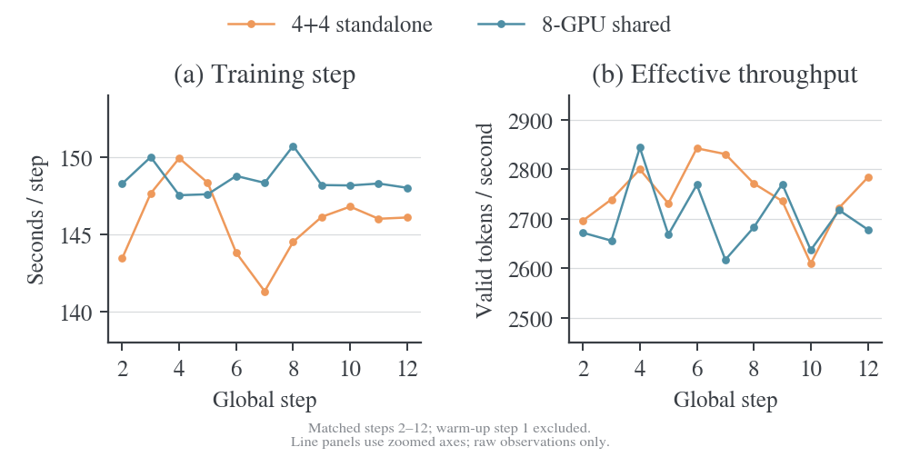
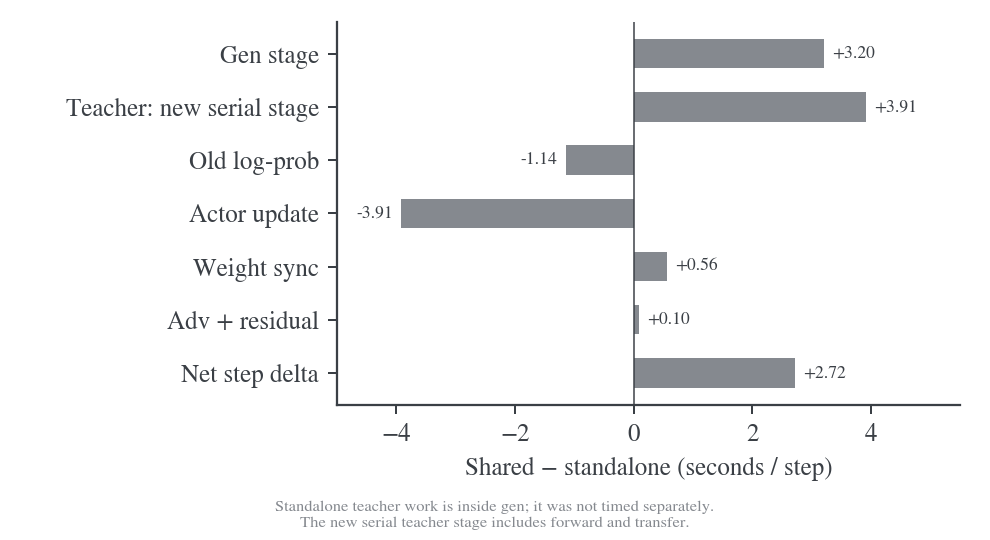
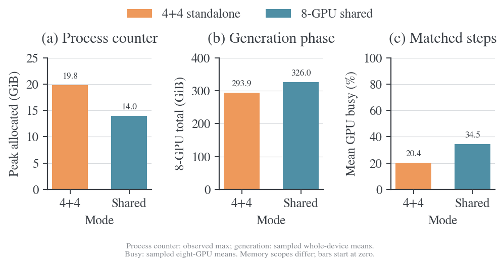
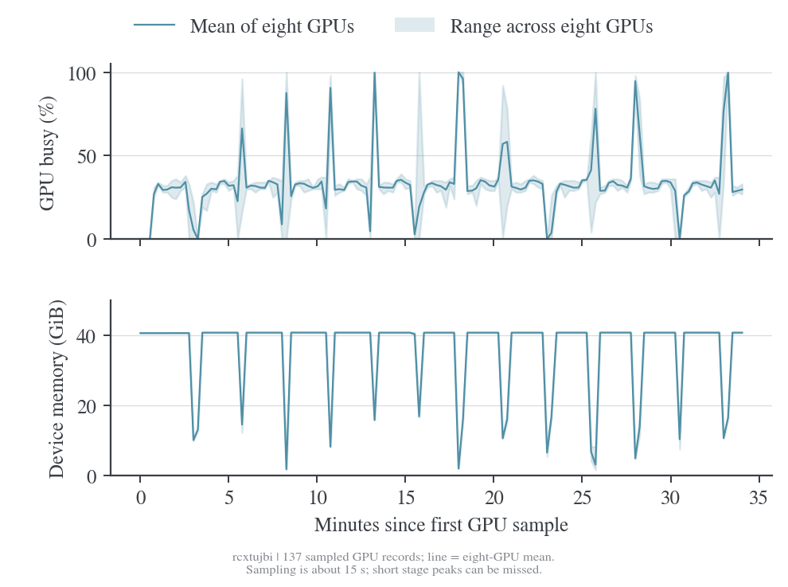
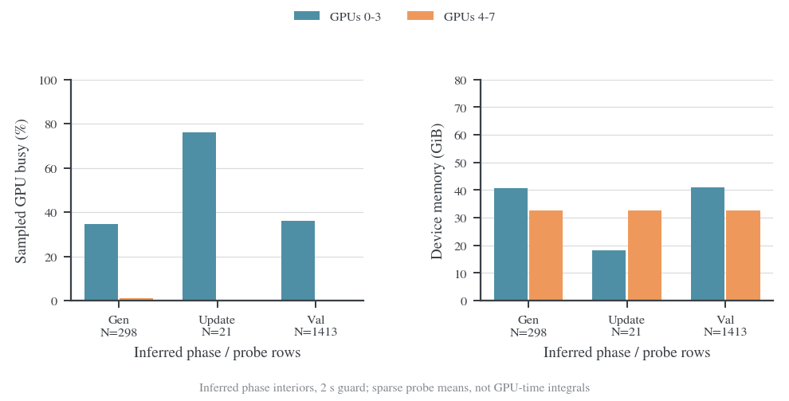
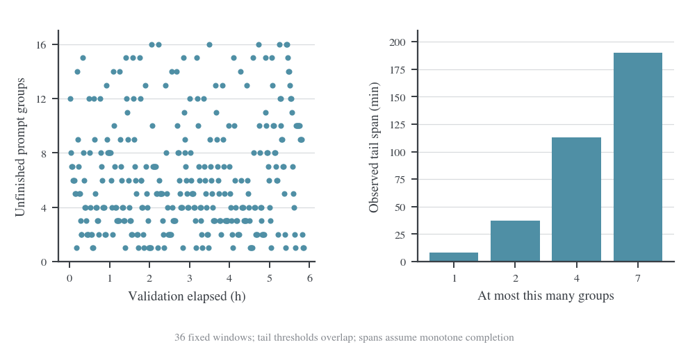
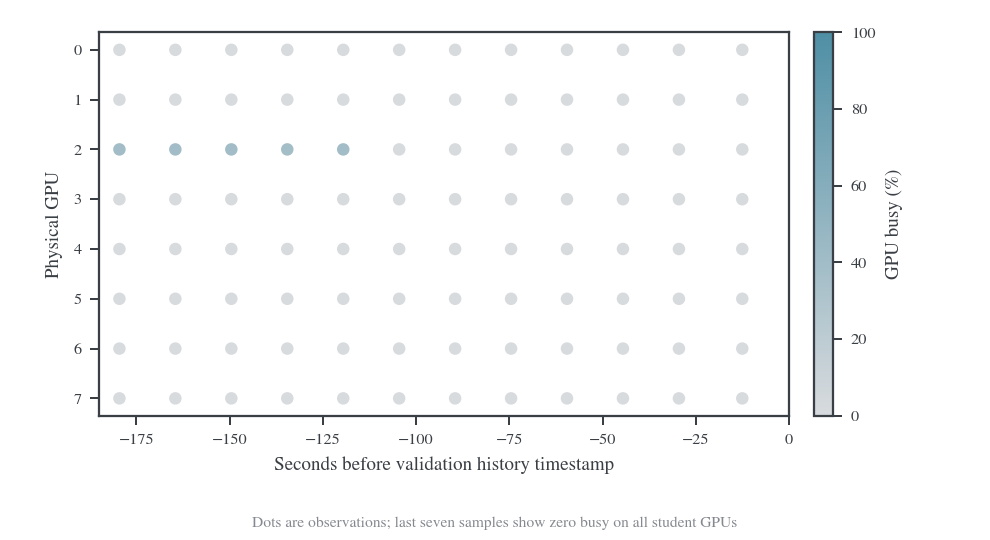

# 历史八卡与 One-Shot 运行对照

本页归档原实测文档第 4 节，保留 2026-10-20 至 2026-10-21 的快照、原始结论和章节编号。正文中的“当前”“后续”指当时条件；不继续刷新旧 run。当前 E15 分析见[训练动态与指标](../experiments/full-kl-comparison/2026-10-23-E15训练动态与指标分析.md)，本机参数测量见[训练与验证性能实测](../infra/2026-10-22-训练与验证性能实测.md)。

## 4. 八卡历史与One-Shot对照

符号遵循[统一约定](../符号约定.md)；代码字段、论文原名与历史数据键保留原样。

本文汇总冻结运行记录，不把早期eager结果当作当前Graph默认值的性能。One-Shot新增快照与4+4早期细项分别列出；H800上的优化试验只在[本机报告](../infra/2026-10-22-训练与验证性能实测.md#3-本机编译与训练优化)维护。

### 4.1 4+4与共享八卡的历史对照

本项目以 sampled-token OPD 数学训练为工作负载，优化的是整个训练管线：student 生成、CPU 判分、teacher 概率计算、student 更新、权重同步、周期验证，以及各阶段 GPU/CPU 内存驻留。目标是在保留算法和训练/验证预算的条件下，降低完整周期耗时与预留 GPU 小时，而不是仅提高 GPU busy 或某一个计算阶段的速度。

原 `b38hw8v0` 使用 student 4 卡、独立 teacher 4 卡；`rcxtujbi` 使用同池八卡，顺序执行生成、冻结 FSDP2 teacher 评分和 actor 更新。两者均为 V1 sync、`k1 + PG`，数学 verifier 用于诊断和验证，不参与最终训练 loss。算法推导见 [OPD 目标文档](../opd-objective/README.md)；调度、配置、字段对齐和支持边界见 [infra 总览](../infra/README.md)，本文只维护实际实验条件、测量和结论。[^baseline] [^shared]

**截至 2026-10-21 08:55（Asia/Shanghai）的 API 快照，共享八卡没有加速已观测的训练步。** 对齐两次运行的 step 2–12，总 token 工作量只差 0.012%，完整步时却从 145.82 秒变为 148.54 秒（慢 1.86%），有效 token 吞吐下降 1.82%。Actor 更新快了 30.26%，但收益被新增串行 teacher 阶段、略慢的生成和同步抵消。

**显存改善主要体现在 FSDP 进程计数器，整卡显存没有同比下降。** 同名 allocated 高水位的观测最大值由 19.82 降到 13.97 GiB；生成阶段八卡整卡显存总占用均值则由 293.91 增至 326.00 GiB。GPU busy 提高，说明原 teacher 卡参与了计算，但这没有转化成相同工作量的训练加速。

**完整训练周期是否加速仍未测到。** 共享 run 只上传到 step 12，没有验证记录；4+4 已上传到 step 98，四次完整验证平均耗时 5.70 小时。验证是旧管线的主要成本，必须等共享模式同预算验证完成后再下总体结论。

### 4.2 数据范围与可比性

#### 4.2.1 对照使用的冻结快照

| 项目                             | 4+4：b38hw8v0       | 共享八卡：rcxtujbi  |
| -------------------------------- | ------------------- | ------------------- |
| API 抓取时间，北京时间           | 2026-10-21 08:55:16 | 2026-10-21 08:55:15 |
| 已上传训练 history               | Step 1–98，共 98 行 | Step 1–12，共 12 行 |
| 已上传完整验证                   | Step 20、40、60、80 | 尚无                |
| 最后一条训练指标时间             | 2026-10-21 06:50:52 | 2026-10-21 08:35:27 |
| 系统 stream 原始行 / 有效 GPU 行 | 13717 / 6858        | 275 / 137           |
| GPU 采样间隔中位数               | 15.003 秒           | 15.009 秒           |
| 服务端状态                       | finished            | finished            |
| 另取 console 的最高指标步        | 99                  | 13                  |

两次都是 offline W&B 上传，`finished` 不能证明整个 279-step epoch 已结束。Console 比 history 多一条，系统采样又延伸至约 08:38；这里只用冻结的 history 边界计算性能，不混入更晚的 console 指标。下载的 console 未发现 Traceback/CUDA OOM 文本，这也不能证明边界之后没有异常。

原始证据：[4+4 source](../data/b38hw8v0-api-20261021/source.json)、[共享 source](../data/rcxtujbi-api-20261021/source.json)、各目录的 `config.json`、`hardware.json`、`history.jsonl`、`system-sampled.jsonl.gz` 和包版本。完整派生结果见 [comparison.json](../data/pipeline-comparison-20261021/comparison.json)，逐步对照见 [matched-steps.csv](../data/pipeline-comparison-20261021/matched-steps.csv)。2026-10-20 的旧 38 步快照及历史图表保留原路径，早期38步快照的详细审计见[本页细项审计](#48-44早期快照的细项审计)。

History 使用 `scan_history(keys=None)`，冻结服务端边界后读取；系统 stream 是 API sampled export，不保证全量。此次较长 history 中有稀疏字段的显式 null，分析按数值有效性筛选，不将其算作一次验证、一次 GPU 采样或零耗时。[^api]

#### 4.2.2 保持一致与实际改变的条件

| 条件 | 核对结果 |
| --- | --- |
| 硬件 | 两次 metadata 均为 8×NVIDIA A800-SXM4-80GB；不沿用其他 Hope 日志中的 A100 型号 |
| 主要软件 | Python 3.12.13、Torch 2.11.0+cu128、vLLM 0.25.1+cu129、Transformers 5.12.1、Ray 2.56.1、W&B 0.28.1 相同 |
| 模型与数据配置 | 相同 student/teacher 路径、DAPO 路径、seed=42、shuffle 与长度限制；未取得权重/输入内容级版本证据 |
| 更新与优化 | Batch=mini-batch=64、n=1、ppo_epochs=1、AdamW lr1e-6、gradient checkpointing、parameter/optimizer offload 相同 |
| 生成 | T=1、top-p=1、TP1、eager=True、memory utilization=0.5、max_num_seqs=32、token budget=8192 相同 |
| 长度与验证 | Prompt≤4096、训练 response≤7168；验证 570×16、response≤31744、T0.7/p0.9、窗口 16、每 20 步验证相同 |
| 核心变化 | Actor/rollout 由 4 卡到 8 卡；teacher 由独立 4 卡 vLLM 改为同池 BF16 FSDP2、每卡前向预算 32768，整阶段迁移 |
| 派生字段 | Rollout GPU 数及关闭的 reward-model 资源字段随池大小变化；日志/输出目录随 run 改变 |

全部配置差异保存在 `comparison.json` 的 `config_diff`，不是仅挑选相同字段。两次 metadata 都报告旧 commit `e70acdf1e0df157181a931b8cf49a5216c879f38`，没有取得对应 `source_changes.patch`；不能因此称为严格同一代码版本对照。Run 配置和新 timer 可以确认共享执行路径，不能替代实际运行代码的完整来源记录。

主要比较使用两次共同的 step 2–12，排除首步初始化。11 对 step 的 prompt 平均长度全部一致，但没有逐 token 输入审计；生成文本也不能假定相同。平均总 token 为 401158.36 / 401205.55，response 平均长度为 6169.01 / 6169.74；聚合工作量几乎相同，使这一窗口比“旧 run 2–98 对新 run 2–12”更适合评估速度。

### 4.3 4+4与共享的训练速度



| 指标，step 2–12 | 4+4 | 共享八卡 | 变化 |
| --- | --: | --: | --: |
| 完整训练步均值 | 145.82 s | 148.54 s | +1.86% |
| 总有效 token / 总训练秒数 | 2751.04 token/s | 2701.07 token/s | −1.82% |
| gen | 124.71 s | 127.92 s | +2.57% |
| old_log_prob | 6.00 s | 4.86 s | −19.03% |
| update_actor | 12.92 s | 9.01 s | −30.26%，约 1.43 倍阶段加速 |
| update_weights | 2.05 s | 2.61 s | +27.33% |
| teacher_forward | 嵌入 gen，未单独测量 | 2.74 s | 新增串行阶段 |
| teacher_transfer | 未单独测量 | 1.17 s | 新增显式迁移 |
| adv 及未分解残差 | 0.144 s | 0.240 s | +0.096 s |

11 对 step 中有 9 对共享模式更慢，逐步差值均值 +2.72 秒，中位数 +2.28 秒，范围 −2.40～+7.02 秒。这是短窗口描述性结果，尚无多次独立重复实验，不解释为稳定系统差异的置信区间。首步分别为 216.87 / 222.88 秒，不混入稳态均值。



整步变化可由互不重叠的 timer 核对：

$$
\Delta t\approx\underbrace{3.204}_{gen}+\underbrace{3.907}_{teacher 前向与迁移}
-\underbrace{1.142}_{old\ logprob}-\underbrace{3.909}_{actor 更新}
+\underbrace{0.559}_{权重同步}+\underbrace{0.096}_{adv 与残差}
=2.715\ \mathrm{s}.
$$

旧 teacher 的计算不是零，它与生成重叠并被包含在旧 `gen` 中。新方案把约 3.91 秒评分/迁移明确放到生成之后。完整 teacher 数据生产成本在两种模式下的计时边界不同，不能拿这些数字推导“FSDP teacher 比 vLLM teacher 慢多少”。

共享 `gen` 仍占整步 86.12%。两次每个训练 batch 的 response 最大长度都是 7168，约 62% 的回答达到上限；严格截断仍需 finish reason。固定 64 条请求分给 4/8 个 TP1 副本，平均每副本请求由 16 变 8，均低于 `max_num_seqs=32`。增加副本没有缩短自回归依赖链或最长回答，因此不能期待固定小 batch 的生成延迟自动减半。这是与观测一致的解释；该A800历史run缺少TTFT/TPOT和kernel trace。后续H800 trace已单独确认执行间隙与Graph收益，不能补作这次A800运行的原始trace。

即使假设完全消除 1.17 秒显式 teacher 迁移、其余时间不变，新步时仍约 147.37 秒，高于旧 145.82 秒。后续优先处理生成和完整验证，而不是把小比例搬运时间当作唯一瓶颈。

本次还反算了 `perf/total_num_tokens / timing_s/step / perf/throughput`：两次每行分母均为 8。实际日志已按总资源池归一化；不能误以为旧 run 只除 4 卡。上表吞吐使用总 token 除以总时间，避免与每步比值的算术平均混用。Actor 内部 MFU 均值 39.40%→31.89%，分母/计时范围另见 [MFU 说明](../infra/2026-10-22-MFU与利用率口径.md)，不能用它代替整步效率。

### 4.4 显存与 GPU 忙碌程度



| 口径，step 2–12 | 4+4 | 共享八卡 | 可支持的结论 |
| --- | --: | --: | --- |
| 同名 PyTorch allocated 累计高水位，窗口内最大 | 19.82 GiB | 13.97 GiB | 同名日志值下降约 29.5%；不是当步 actor backward 独占峰值 |
| 新增全 rank 累计 allocated 最大值 | 未记录 | 14.20 GiB | 共享模式可直接读 rank-max；旧字段聚合不补作相同新指标 |
| 整卡显存观测最大，八卡取最大 | 40.88 GiB | 40.82 GiB | 观测峰值基本相同；15 秒采样可能漏掉短峰值 |
| gen 阶段每卡显存样本均值 | Student 40.80 / teacher 32.67 GiB | 全池 40.75 GiB | 旧 teacher 卡变成了 student 生成卡 |
| gen 阶段八卡显存总和的样本均值 | 293.91 GiB，88 个 probe | 326.00 GiB，91 个 probe | 总驻留增加约 10.9%，没有整机显存节省 |
| 整个匹配训练窗口，八卡平均 busy | 20.36%，103 个 probe | 34.51%，106 个 probe | 更多卡工作，但不是 SM 满载率或吞吐提升比例 |
| 整机 CPU 已用内存，worker 日志均值 | 98.79 GiB | 115.74 GiB | 主机口径增加 16.94GiB，不能全部归因于 teacher 或认定泄漏 |

共享更新阶段的整卡 GPU 采样只有 3 个，旧路径 7 个；teacher 阶段仅 1 个。它们不足以估计更新或 teacher 的真实峰值与精确 busy 时间。常规 PyTorch 计数器覆盖自身进程分配，却不包含另一个 vLLM 进程；共置 teacher 又可能共享训练进程 allocator，不能把一个计数器当成整个设备或独立角色的显存预算。



共享 gen 阶段八卡 busy 样本均值 31.22%；旧 student 四卡为 34.22%、旧 teacher 四卡为 1.01%。新池消除了生成阶段后四卡几乎不工作的结构，但每张生成卡的计算批量更小。当前“更多卡忙碌”和“同一批请求更快”并未同时成立。整机显存曲线周期性下降与推理 sleep/训练阶段切换相符，阶段的精确边界及采样方法见 [infra 测量方法](metric-implementation/2026-10-22-历史性能口径与验收.md#两次运行的对照测量方法)。

### 4.5 新指标已经提供了什么

共享 run 的 12 个训练 step 均包含 `rollout_batch`、`teacher_forward`、`teacher_transfer` 和 `fsdp_worker_peak_allocated_gib_max`。在 step 2–12 中，纯提交到最后生成返回的跨度均值 126.06 秒，teacher 评分 2.74 秒，显式迁移 1.17 秒；这些已是实际上传指标，不再是待实现设计。

`rollout_batch` 与 `gen` 有重叠且起点不同，不能相加，也不能把差值直接归为 verifier 服务时间。首步 `rollout_batch=185.03s` 大于 `gen=138.19s` 正说明提交早于 `gen` timer，不是计时溢出。Teacher forward 包含 RPC/TQ 及分批前向，具体边界只在 [infra 指标表](metric-implementation/2026-10-22-历史性能口径与验收.md#指标口径)定义。

`rollout/preemptions` 未发布；console 有一次“backend did not report preemptions”的提示。这里是缺测，不是 0 次抢占。共享模式没有独立 teacher RPC，因此没有 `teacher/request_latency_s/mean`；当前快照也没有验证侧新增指标。Verifier/TQ 细计时、纯 GPU forward、逐 rank micro-batch 和分段 actor 搬运仍不能从这些标量直接恢复。

### 4.6 验证、质量与完整周期

4+4 的四次已完成验证分别为 21200.77、20155.49、19643.28、21141.51 秒，均值 20535.26 秒（5.70 小时）。98 步训练 timer 合计 3.97 小时，已完成验证合计 22.82 小时，验证占已计时工作 85.19%。这些不包含启动前成本及未完成的下一次验证，不是整个作业的最终成本。

共享快照没有完成的验证。即便训练步稍慢，共享八卡仍可能改善验证主导的周期：按匹配窗口推算，每 20 步多花约 54.30 秒；若共享验证比旧均值少 54.30 秒以上（约 0.264%），就能抵消这部分训练增量，暂不计保存/初始化差异。这只是收支平衡条件，不是验证加速预测。

目标八卡仍缺同一checkpoint、570×16条、相同窗口/长度/采样条件下的完整验证；执行模式应另作单变量对照。训练阶段 64 条请求与验证窗口 256 条请求的并发条件不同，不能把本次训练侧无加速外推为验证一定无收益；也不能先假定验证会减半。

| 验证集，mean@16 | 4+4 step20 | step40 | step60 | step80 | 共享八卡   |
| --------------- | ---------: | -----: | -----: | -----: | ---------- |
| MATH-500        |     84.11% | 85.94% | 86.35% | 85.90% | 未上传验证 |
| AMC23           |     72.50% | 78.13% | 81.56% | 82.50% | 未上传验证 |
| AIME25          |     25.21% | 26.67% | 28.96% | 28.13% | 未上传验证 |

两次早期蒸馏 loss 均值约 0.10791/0.10886、absolute k1 约 0.25129/0.25245、entropy 约 0.89055/0.89083、裁剪前 grad norm 约 1.19175/1.19723，未表现出明显的量级异常；不能据此证明共享后端数值等价或泛化质量不变。`mean@16` 是每题 16 次回答的平均正确率，bootstrap best/majority 与无放回 pass@k 也不能混用。

原 [student 参考](../../../../../wandb-logs/MirrorOPD-verl/analysis/oneshot-student-6uorrk2k-api-20261020/source.json)和 [teacher 参考](../../../../../wandb-logs/MirrorOPD-verl/analysis/oneshot-teacher-u87buult-api-20261020/source.json)保留 2026-10-20 快照；它们是不同执行/输入路径的 val-only 运行，不补作这两个 run 的 step0。历史资产检查还发现 DAPO 与 MATH-500/AMC23 分别有 2/5 道相同题面，接收端数据内容未重新审计，质量结论仍需注明这一边界。

### 4.7 One-Shot历史训练与当前路径

2026-10-21只读枚举项目21个run，选择同为1.5B student、JustRL teacher、batch64、n1、八卡的三个完整训练。覆盖full-data直接优势、full-data discounted advantage、one-shot直接优势；排除val-only、不同student及top-k训练目标。来源、完整history、系统采样和复算结果冻结在[oneshot-comparison-20261021](../data/oneshot-comparison-20261021/README.md)。

| Run | 工作负载 | GPU | 训练history | 完整验证 |
| --- | --- | --- | --: | --: |
| `mdxt04lm` | full-data、token_reward_direct | 8×A800 | 279步 | 14次 |
| `mzwm9q04` | full-data、discounted_token_reward | 8×A100 | 279步 | 14次 |
| `5aub1k4h` | one-shot t22、token_reward_direct | 8×A800 | 300步 | 15次 |

三个run均为V0、FSDP1、eager、mini64、actor动态token32768、teacher最多24条/rank、vLLM并发64、memory0.75、验证窗口null。实际`val_files`均包含MATH-500/AMC23/AIME25，570题×16；当前仓库脚本默认仅MATH-500与历史run实际覆盖三集合是不同事实。其中one-shot配置的prompt上限8192、调度token预算39936，高于full-data的4096/35840；实际题面较短也不能忽略这项配置差异。训练actor自身`use_torch_compile=True`不代表vLLM开启Graph。[^oneshot-full][^oneshot-discount][^oneshot-single]

#### 4.7.1 同一早期窗口的阶段对照

前三个run与本仓共享run使用step2–12，共11步。最后一列为本机H800的step2–5，单列展示，不计算跨GPU型号的架构加速倍数。各列均为prompt/mini64，n1。

| 秒/步 | One-Shot full A800 | One-Shot full A100 | One-Shot单题 A800 | 本仓shared A800八卡 | 本仓Graph H800四卡 |
| --- | --: | --: | --: | --: | --: |
| gen | 128.22 | 127.08 | 101.93 | 127.92 | 24.20 |
| old log-prob | 11.04 | 10.70 | 5.33 | 4.86 | 2.70 |
| teacher评分块 | 4.42 | 4.46 | 4.78 | 3.91 | 2.18 |
| actor update | 9.86 | 9.59 | 8.78 | 9.01 | 5.80 |
| 权重同步 | 6.97 | 6.89 | 6.14 | 2.61 | 0.87 |
| 完整step | 160.54 | 158.87 | 126.99 | 148.54 | 35.93 |

One-Shot的`opd_teacher`嵌套于`adv`，不可将两个timer重复相加；这里的teacher块使用其完整评分调用，本仓使用显式transfer＋forward，两者都不是纯kernel时间。各列还有小量adv残差与调度成本，表内阶段不强行补成完全相同的语义。

最可比的A800 full与本仓shared，平均有效token为402486.55与401205.55，rollout128.22与127.92秒几乎相同；整步减少7.47%，有效token吞吐2507.15→2701.07，增加7.73%。这不支持“TQ使rollout明显变慢”的解释。旧One-Shot还开启`metric_top_k=16`，现有源码会在old-log-prob阶段提取student top-K并计算teacher诊断；old-log-prob差异不能全部归因于FSDP版本或数据传输。

为避免只取早期窗口，所有非首步、非保存步的均值也保留：三个One-Shot的step为159.14/159.33/125.62秒，gen为128.32/128.23/101.79秒，分别基于272/272/293步。三者gen都约占纯训练80%。算法、数据分布和生成长尾不完全相同，不将one-shot较短的gen解释为独立系统优化。

#### 4.7.2 系统采样与完整验证成本

旧run的GPU采样间隔中位数约15秒。训练取非首步、非保存步区间，两端各留1秒；长gen/验证窗口使用15秒guard，gen起点另剔除未分解残差。窗口均由history的`_timestamp`与timer反推。短teacher/actor阶段没有足够保守内部窗口，因此不报告它们的精确busy。该方法与前述4+4对照的2秒guard不同，结果不能按小数点直接合并。

| Run | 训练GPU busy均值 | gen内部busy | 验证busy | gen / 验证GPU采样时点数 | 每次完整验证均值 |
| --- | --: | --: | --: | --: | --: |
| `mdxt04lm` | 33.68% | 31.68% | 69.14% | 1782 / 2197 | 2385.84秒 |
| `mzwm9q04` | 34.42% | 31.91% | 74.10% | 1781 / 2235 | 2423.82秒 |
| `5aub1k4h` | 40.11% | 37.61% | 72.08% | 1395 / 2581 | 2611.19秒 |
| 本仓`rcxtujbi` | 34.83% | 32.27% | 缺测 | 71 / 0 | 缺测 |

One-Shot三个run在上述训练窗口的整卡显存观测最大值分别为61.78/62.05/61.45GiB，本仓旧shared为40.82GiB。前者vLLM memory0.75，后者0.5；它们是整卡驻留，不能等价成actor峰值或证明需要更多显存才快。

三个One-Shot的验证分别占已记录step＋testing计时42.77%/43.13%/50.78%。完整570×16验证平均约40–44分钟，明显值得作为周期成本优化对象；不同模型checkpoint、生成长度和主机负载仍影响它。历史日志没有验证输出token总量，不能拿本机四卡32题的177.53秒直接外推或声称全量验证已经超过这些run。

Shared run重新查询后仍为12行history、无完整验证；原始source保存新的抓取时间。API服务端finished仅描述上传状态，不能补造未记录的训练进度。相同卡型和工作量下的执行变化与H800 Graph收益分别解释，最终判断仍需目标八卡完整周期。

### 4.8 4+4早期快照的细项审计

以下仅使用2026-10-20的38步快照，提供后续98步对照未细分的replay长尾和CPU收尾证据。窗口、采样边界不能与上面的step2–12表混用。

#### 4.8.1 阶段耗时与资源使用

Step 2–38 剔除首步预热，37 步的算术均值如下：

| 阶段 | 秒 / step | 比例 | Student 池 | Teacher 池 |
| --- | --: | --: | --- | --- |
| gen / 等待样本 / sleep | 124.176 | 85.66% | VLLM 生成；训练态 offload | 陆续打分，间歇等待 |
| old_log_prob | 5.753 | 3.97% | 加载 actor 参数，前向计算概率和 entropy | 无当前 batch 的新评分工作 |
| adv | 0.106 | 0.07% | 主要是 CPU/TQ 张量处理 | 空闲 |
| update_actor | 12.802 | 8.83% | 参数/优化器状态载入、FSDP2 训练与卸载 | 空闲 |
| update_weights | 2.092 | 1.44% | 参数同步、vLLM 唤醒与准备 | 空闲 |
| 计时残差 | 0.039 | 0.03% | 数据提交、平衡、调度等未拆分工作 | 无法仅从残差细分 |
| 完整训练 step | 144.967 | 100% | 不含 testing | — |

首步为 216.867 秒，其中约 55.1 秒不在上述子 timer 中，属于未分解的首次启动成本，不能全部当作 JIT。

#### 4.8.2 GPU probe 的对齐方法

令 history 的记录时间为 $\mathsf t_{\rm end}$，testing 耗时为 $\mathsf t_{\rm val}$，训练 step 耗时为 $\mathsf t_{\rm train}$。训练区间的近似起点为 $\mathsf t_{\rm end}-\mathsf t_{\rm val}-\mathsf t_{\rm train}$，各子阶段按源码执行顺序累加 timer。所有未解释时间的残差不强行归给某个阶段；选样时剔除可能包含残差的边界，再加 2 秒 guard。详见 [audit_pipeline.py](../scripts/audit_pipeline.py)。

这是 timer 推导窗口，不是 profiler 原始事件。NVML busy 自身也是一个采样窗口统计；2 秒 guard 只能减少边界混入，不能恢复连续 kernel 活动。每个结果都报告 probe 数，零 probe 表示缺数据，不能写成 GPU 利用率为零。



| 阶段 | 保留下来的 GPU probe 行 | GPU 0–3 busy 均值 | GPU 4–7 busy 均值 | GPU 0–3 显存均值 | GPU 4–7 显存均值 |
| --- | --: | --: | --: | --: | --: |
| gen | 298 | 34.56% | 0.97% | 40.81 GiB | 32.67 GiB |
| old_log_prob | 2 | 样本不足 | 两次均为 0 | 样本不足 | 32.67 GiB |
| adv | 0 | 无法估计 | 无法估计 | 无法估计 | 无法估计 |
| update_actor | 21 | 76.30% | 0.00% | 18.19 GiB | 32.67 GiB |
| update_weights | 0 | 无法估计 | 无法估计 | 无法估计 | 无法估计 |
| step 20 验证 | 1413 | 35.92% | 0.00% | 40.89 GiB | 32.67 GiB |

GPU 0–3 的行为与 student 池一致，4–7 与 teacher 池一致；物理映射还应在下一次启动时打印确认。一个 probe 行包含该时点 8 张卡的观测，不是 8 个独立时间样本。

Actor 更新的 student 平均功率约 306.5 W，gen 为 133.2 W；其内部 GPU 工作明显更密集。改变 guard 为 0/1/3 秒后，actor busy 样本均值约为 70.7%/79.4%/78.2%，gen 约为 33.9%/34.4%/34.7%。因此 actor 的“约七到八成 busy”相对稳健，old-log-prob 的样本则太少，不适合下同样判断。

更新期间的整卡显存观测峰值约 22.09 GiB，生成时约 40.98 GiB。Actor 的 `max_memory_allocated_gb` 是 PyTorch 进程峰值，经 rank 指标聚合后也不必然是全局最大卡；既不是当前值，也不包括另一个 vLLM 进程。不能将它和 vLLM 预算机械相加，或把两者差值全当作碎片。

#### 4.8.3 Teacher 空闲的精确与非精确部分

源码依赖关系确认：同步配方的 teacher 在 actor 更新、old-log-prob、权重同步、验证期间没有新 batch 可评分。Actor 更新内部选中的 21 个 probe 行里，teacher 对应四卡的 busy 全为 0，与这个判断一致。

全部 38 步 actor 更新 timer 合计 490.46 秒，即 8.17 分钟。固定占用四张 teacher 卡，对应约 0.545 GPU 小时的阶段预留；old-log-prob 另约 0.247 GPU 小时，权重同步另约 0.090 GPU 小时。完整 step 20 验证期间，teacher 四卡空闲预留更达到 **23.556 GPU 小时**。这些是分配时长，不是 measured idle-kernel time 或电量。

Gen 内 teacher 有多空闲则不能精确积分：约 15 秒采样可能漏掉短促 teacher forward。需要请求开始/结束、排队和 kernel trace，不能直接将 0.97% 的样本均值当成 teacher 用时占比。当前没有证据证明 teacher 排队是主要瓶颈，也不能仅凭低采样均值证明 1 卡一定够用。

#### 4.8.4 Actor 更新还混合了哪些工作

`update_actor` 包含 CPU/GPU 参数与优化器状态搬运、动态 micro-batch、checkpoint 重计算、FSDP all-gather/梯度通信、反向和 optimizer step。`optimizer_offload=True` 表示状态在阶段间放 CPU，不表示本 run 的 AdamW 必然在 CPU 计算；engine train context 会按配置将其载入 GPU。

当前每 rank 约处理 10 万有效 token，token budget=32768，因此至少需要约 4 个动态 micro-batch；实际 packing 数和每批长度未记录。总 token 平衡后的 rank 差异不到约 0.54%，没有明显的总 token 严重失衡证据，但不能排除长度平方项、micro-batch 数或通信差异。

Entropy coefficient=0、actor.calculate_entropy=False，所以更新阶段不为了 entropy bonus 计算熵；old-log-prob 阶段却明确请求 `calculate_entropy=True` 以记录诊断。这能帮助区分输出头/entropy 优化应该测哪个阶段。

MFU 内部 timer 不覆盖完整 load/offload context，且日志 MFU 有 rank 聚合、序列长度平方项未保留。不能反推一个内部时间后，把外层差值全部记为 PCIe 搬运。要拆分这些部分，需要 profiler 中的 memcpy、NCCL、forward/backward 和 optimizer 标记。

### 4.9 验证阶段的窗口长尾

验证固定 570 题、每题 16 个回答，总共 9120 条请求；val_batch_size=16 将它分为 35 个 16 题窗口和最后一个 10 题窗口，共 36 个。源码等待每个窗口所有 prompt group 完成后，才提交下一窗口。运行中最多 4×32=128 条 student 活跃序列，而不是一次连续喂入全部 9120 条。

从 331 条完整验证状态日志中，恢复到的窗口恰好是 `[16×35, 10]`。`running=4, finished=12` 表示这个窗口只剩四道题的整组回答/后处理未完成，不代表恰好还有四条回答正在 GPU decode。



按同一窗口内完成数单调增加、失败/待提交为零的条件，统计相邻状态都落在阈值内的连续观测跨度。这个算法不外推首次观测前和最后观测后的时间；在上述条件下可作保守下界。

| 剩余 prompt group 阈值 | 连续观测跨度 | 占 353.35 分钟 testing | 此时最多未完成回答数 |
| --- | --: | --: | --: |
| ≤1 | 8.01 分钟 | 2.27% | 16 |
| ≤2 | 37.04 分钟 | 10.48% | 32 |
| ≤4 | **113.13 分钟** | **32.02%** | 64 |
| ≤7 | 190.22 分钟 | 53.83% | 112 |

阈值互相包含，不能相加。未完成回答还可能在 CPU verifier/TQ 后处理，而非解码，因此真实在 GPU 上运行的数量只能更小。至少约三分之一验证时间的连续日志观测跨度内，最多只有 64 条未完成回答，不超过当前 128 条推理并发容量的一半；下一窗口却还没提交。

这支持一个更直接的系统优化：保持题目、n、长度、频率不变，采用有界的跨窗口连续投喂，在一部分请求完成后补入后续请求，减少等待最慢回答时的空档。这改变的是调度实现与在途窗口数，不减少验证工作量。仅把 student 从 4 卡增为 7/8 卡，不能自动消除这个窗口 barrier；尾部仍可能只有一张卡在做最后一条长回答。

### 4.10 验证结束的 CPU / 后处理区间



验证末尾先出现仅 GPU 2 仍忙、其他卡为零的观测；随后 10:45:03–10:46:35 的最后 7 个 GPU probe，student 四卡均为 0，覆盖约 91.99 秒。Testing timer 在 10:46:47 才结束。

这段观测与等待 verifier、收集/排序输出、JSONL dump、bootstrap 指标聚合等 CPU/后处理相符，但不能从 sparse probe 精确计算这些组件各用了多少秒。当前 validation aggregation 每题对 best/majority 等做 1000 次 bootstrap，driver 上确有需要计时的 CPU 工作。不能把整个 testing 时长全归给 vLLM decode，也不能把这 92 秒直接命名为某一个 CPU 函数的耗时。这段观测跨度相比 353 分钟 testing 较小，现有证据仍更支持优先处理长 decode 与窗口长尾，而不是先优化指标汇总代码。

W&B driver RSS 在验证中的样本均值约 1777 MiB、观测最大约 1926 MiB，不是整机内存 100+ GiB，也不包含 8 个 verifier worker、8 个 AgentLoop worker 和 8 个 TQ storage 的 RSS。现有 CPU 指标缺逐组件采集，无法判断哪个 worker 或文件系统占用了剩余主机内存与 CPU 时间。

### 4.11 启动、保存与离线记录

Ray/TQ actor 创建、模型与 tokenizer 加载、数据过滤、vLLM 的 KV profiling 和首次 kernel 编译没有分别记录 timer。首步 216.867 秒及其 55.1 秒子 timer 残差只能描述部分首次成本；启动中发生在第一个 step 之前的耗时另算，不能用 steady step 或实验名称里的时间戳反推各组件初始化耗时。

保存频率为 50，这个38行历史快照 没有 checkpoint 保存样本，不能估计写盘代价。每步 update_weights 是内存中的参数同步，与保存 checkpoint 不同。验证 JSONL dump 由线程池异步执行，提交与排序在验证路径上，实际后台写入可能跨越 testing 结束；它与 bootstrap/后续工作可能重叠，需要独立线程事件才能分开计账。

W&B 在 TaskRunner 中离线记录，系统采样后台执行；后续上传快照的服务端 finished 状态不是训练循环完成的充分证据。现有 console 没有该快照中的异常退出信息，也没有完整 epoch 完成标记，因此不补造结束原因。

### 4.12 基线快照缺失的观测

| 子阶段 / 组件 | 早期快照能测到 | 尚缺证据 |
| --- | --- | --- |
| Student prefill / decode | 整体 gen 和逐卡稀疏 busy | TTFT、TPOT、prefill/decode token 数、running/pending、KV usage、preemption |
| Teacher | 逐卡采样与源码调用顺序 | Queue wait、RPC/forward/序列化分段、每请求与每副本 p50/p95 |
| Verifier | CPU worker 数与调用位置 | 排队、Math-Verify 服务时间、timeout/fallback、进程级 CPU/RSS |
| TQ | Group 状态与后端配置 | Tag 同步、tensor put/get、字节数、每 storage 的内存/延迟 |
| Actor | 外层更新时间、局部 MFU | 每 rank 的 micro-batch、recompute、memcpy、NCCL、optimizer 时间 |
| 权重同步 | update_weights timer | 参数导出、IPC、wake、KV 重建、cache reset 的各自时间 |
| 验证汇总 | testing timer 与末尾 GPU probes | 最后一条 GPU 完成、verifier 全完成、dump、bootstrap 的明确边界 |

AgentLoopOutput 已有 generate_sequences / compute_score 等字段，但本 run 的 W&B history 没有它们；teacher 还缺自己的请求 timer。数据没有记录就无法通过下载更多同一 history 字段补出这些时间。

#### 4.12.1 基线的 profiling 边界

该历史审阅版本的teacher manager不在 V1 默认 profiling manager 列表；训练 step 的停止点在随后验证之前。仅启用 teacher profiler 或将 step20 列入 steps，都不足以证明录到了 teacher 或完整验证。具体上游状态见[profiling 调研](../infra/2026-10-21-上游实现与论文基线.md#profiling-与可观测性)。现在已按[指标与验收](../infra/2026-10-21-指标与验收.md)实现常规指标和共享 teacher 阶段计时；上面的完整缺口用于后续定点诊断，不要求全部实现。

### 4.13 可复算命令

使用同一 run 的 W&B output.log 或接收端完整 train.log；解析器会提取指标和时间戳状态，不将完整日志和私密路径发布到仓库。

```bash
python3 examples/mirroropd/docs/scripts/audit_pipeline.py \
  --api-data examples/mirroropd/docs/data/b38hw8v0-api-20261020 \
  --console-log /本地日志目录/output.log \
  --out examples/mirroropd/docs/data/b38hw8v0-pipeline-20261020

export FIGURE_VIZ_HOME=/figure-viz/skill/实际目录
"$PYTHON" examples/mirroropd/docs/scripts/plot_pipeline_audit.py \
  --data examples/mirroropd/docs/data/b38hw8v0-pipeline-20261020 \
  --api-data examples/mirroropd/docs/data/b38hw8v0-api-20261020 \
  --out examples/mirroropd/docs/figures/b38hw8v0-pipeline-20261020
```

计算程序额外保存 guard=0/1/3 秒的敏感性结果，防止把短阶段的少量样本当成稳定结论。图表直接使用保存的观测，输出 PNG/矢量 PDF，调用 figure-viz audit 后再目检；没有插值补出不存在的 GPU 工作时间。

### 参考文献

[^baseline]: 本项目。4+4 sampled-token OPD run `b38hw8v0`，API 快照 2026-10-21。[W&B 运行](https://forge.coreweave.com/wandb/wncfht/MirrorOPD-verl/runs/b38hw8v0)。

[^shared]: 本项目。Shared-eight-GPU sampled-token OPD run `rcxtujbi`，API 快照 2026-10-21。[W&B 运行](https://forge.coreweave.com/wandb/wncfht/MirrorOPD-verl/runs/rcxtujbi)。

[^api]: Weights & Biases. Public API Run，history 与 scan_history 接口。[官方说明](https://docs.wandb.ai/models/ref/python/public-api/run)。

[^oneshot-full]: 本项目历史实验. One-Shot-OPD `mdxt04lm`，2026-10-21只读快照. [W&B运行](https://forge.coreweave.com/wandb/wncfht/One-Shot-OPD/runs/mdxt04lm)。

[^oneshot-discount]: 本项目历史实验. One-Shot-OPD `mzwm9q04`，2026-10-21只读快照. [W&B运行](https://forge.coreweave.com/wandb/wncfht/One-Shot-OPD/runs/mzwm9q04)。

[^oneshot-single]: 本项目历史实验. One-Shot-OPD `5aub1k4h`，2026-10-21只读快照. [W&B运行](https://forge.coreweave.com/wandb/wncfht/One-Shot-OPD/runs/5aub1k4h)。
