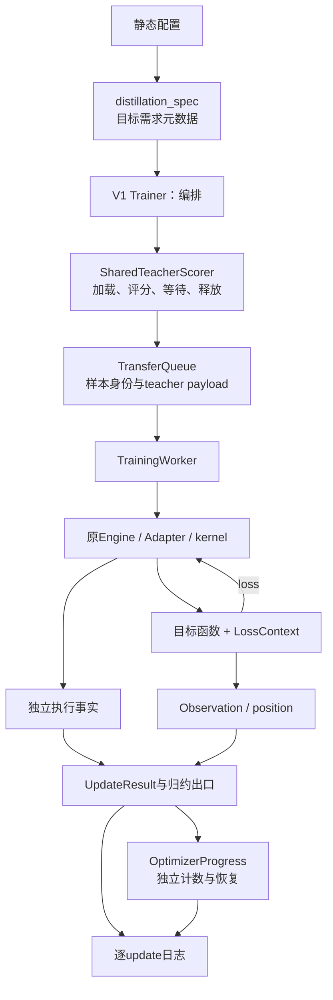

# 架构重构实施与验收

> 本文记录此次重构的决策、提交和验收范围。持续更新的模块职责与接口说明见[当前架构](../../infra/architecture/README.md)及[代码走读](../../infra/architecture/代码走读.md)。

更新：2026-10-25。实施基点：`dc7037eb0`。状态：**五项重构已实现，本文列出的CPU、分布式GPU和真实模型短运行验收已完成，独立review最终结论为approve。** 开发使用隔离分支 `codex/architecture-refactor-20261025`，保留基点之后已有的实验预设、停止协议和辅助脚本布局。

实施依据是[经评审的计划](2026-10-24-架构背景与重构计划.md)。没有更换KL公式、精度配置、默认学习预算或停止协议；本轮不建立新Tensor容器、目标插件框架，也不重写standalone teacher manager。

## 1. 已完成的模块边界

| 工作 | 实现 | 保持的约定 |
| --- | --- | --- |
| 窄布局适配 | [padding.py](../../../../../verl/workers/utils/padding.py) 增加response padding和target坐标换算，集中prediction位置选择 | Behavior／anchor不重复移位；模型／teacher预测值仍走原response切片；mask空洞保留 |
| 每次调用的归一化上下文 | [loss_context.py](../../../../../verl/workers/utils/loss_context.py) | 显式全局分母不变；旧policy loss取得调用级配置副本，原配置不被batch修改 |
| 静态目标描述 | [distillation_spec.py](../../../../../verl/workers/config/distillation_spec.py) | 现有registry、目标别名和校验规则保持；配置初始化不再导入张量loss实现 |
| 更新事实与指标出口 | [update_records.py](../../../../../verl/workers/update_records.py) | 成功／跳过／未知三态；原始Observation与训练贡献分别归约；逐update不混入outer均值 |
| 进度与恢复 | [progress.py](../../../../../verl/trainer/ppo/v1/progress.py) | 原checkpoint schema、actor/critic轴、unknown传播；scheduler独立保存与推进 |
| Shared-sync协调 | [shared_teacher.py](../../../../../verl/trainer/distillation/shared_teacher.py) | 上卡、等待、offload、发布及主异常优先；不管理standalone或student持有的teacher head |
| 通用传输身份 | [transferqueue_utils.py](../../../../../verl/utils/transferqueue_utils.py) | `retain_sample_identity`请求保留`sample_keys/sample_partition`；重排与index-based dispatch后身份不丢失 |

`HiddenBatchIO`在自己的边界仍可读取旧 `full_vocab_keys/full_vocab_partition`；新训练driver使用通用身份字段。微批读取、预取、单笔pending write背压和退出flush保持原样。

执行事实现在从engine的独立 `optimizer_step_applied` 字段传到worker，在原有的一次DP object collective中与metrics并列传输。归约后新主链读取明确的更新结果；旧metric-carried事实仅在适配入口解析。

Trainer由2590行降为2475行，TrainingWorker所在文件由1020行降为975行，distillation losses由601行降为539行。相关逻辑迁入小模块并增加测试，总代码行数未必减少；主要变化是运行状态、数学目标、资源协议和统计归约各有明确负责人。

## 2. 已裁决的归一化与时钟契约

### 2.1 拒绝采样保留原总体分母

真实TQ存储、实际Trainer发布路径及FSDP批归一化确认：拒绝采样更新 `response_mask` 后，`loss_mask` 保留原始有效token总体。

- 两个回答原有6个token，保留3个时，单位token损失和参数梯度均为0.5；微批切成1个或2个回答不改变结果。
- 两rank Gloo实验中，原始token数分别为4和2，第一rank全部拒绝、第二rank保留2个，两个rank共同使用分母6，平均梯度为1/3，与串行计算一致。
- 调用真实 `_compute_advantage` 和真实拒绝采样，确认发布后的三个mask及不等长回答坐标；仅advantage数值计算使用受控替代。

本轮保留“拒绝token为原总体的零贡献”的目标，没有改成在保留token上条件重归一化。该行为与固定上游一致，不作为bug修复改变。

| 对象 | 保留的含义 |
| --- | --- |
| `loss_mask` | 原始训练资格与全局token归一化总体 |
| `response_mask` | 当前目标实际应用位置，可因拒绝采样减少 |
| `metrics_response_mask` | 筛选前诊断总体 |
| 显式sequence分母 | 配置的全局batch数，包含零贡献的空sequence |
| 全部拒绝、原始总体非空 | 允许零loss／零梯度；不自动跳过optimizer |
| 原始全局总体为空 | 训练入口拒绝，避免零分母 |

这些CPU检查使用真实独立Ray/TQ、Gloo collective、原FSDP归一化和backward；模型forward与微批划分是受控CPU实现。两rank测试显式执行梯度collective，真实FSDP参数分片由后面的GPU检查覆盖。

### 2.2 四种事件保持独立

Outer、更新尝试、成功optimizer更新和scheduler调用不合并计数。原有4次尝试／3次执行／scheduler推进1次的pipeline测试继续通过。真实1.5B短运行的4次更新中，下一轮LR记录只出现在update 2和4，即每批末轮。

未知执行事实保持 `None`，没有根据gradient norm猜测成功。Scheduler状态由引擎checkpoint保存／恢复，Trainer进度不重建它。

## 3. CPU与真实TQ验收

| 范围 | 结果 |
| --- | --- |
| 主回归：69个可运行模块 | 893 passed，14 skipped |
| 独立CPU Ray上的replay/reissue | 59 passed |
| 真实TQ、Trainer发布、归一化与身份桥接 | 9个用例通过 |
| 上述三个不重叠范围 | 961个不同CPU用例通过 |
| Megatron相关模块 | 4个因缺少 `megatron.core` 未收集，不计为通过 |

主回归覆盖目标值与VJP、不同DP／microbatch切分、teacher冻结、诊断开关、配置、位置指标、更新事实、进度恢复及原有V1路径。14项跳过和4个未收集模块是环境／平台覆盖边界；不能据此宣称所有verl后端都已验收。

独立review指出的两个缺口均已补齐：[真实Trainer发布和两rank分母检查](../../../../../tests/trainer/ppo/v1/test_rejection_denominator_on_cpu.py)，以及下节的完整optimizer恢复和下一步更新等价。

## 4. GPU与真实模型实验

### 4.1 基点与重构的精确对照

在两个独立checkout中使用同一份增强测试harness，训练实现分别为 `dc7037eb0` 和重构版本。两卡FSDP2、相同小模型初始化、相同固定batch、三次更新，验证：

- 每次loss完全相同。
- 两个rank的所有模型参数分片逐值精确一致。
- 完整optimizer状态逐值精确一致，包括Adam动量。

使用 `torch.testing.assert_close(..., atol=0, rtol=0)` 检查，未仅比较参数范数。结果见 [equivalence.json](../../infra/architecture/acceptance/data/2026-10-25-acceptance/equivalence.json)。

### 4.2 完整checkpoint与下一步更新

[两卡Full-KL测试](../../../../../tests/special_distributed/test_full_vocab_fsdp2.py) 在保存点记录参数、完整optimizer state和scheduler state；执行一步参考更新，再恢复checkpoint、重复同一batch，精确比较参数、Adam状态、LR及scheduler状态。

通过的配置包括：

| 配置 | 覆盖 |
| --- | --- |
| Qwen2普通precompute | Teacher额外词表行、空有效token rank、mask空洞、真实checkpoint |
| Qwen3 fused precompute | 师生tied head、不同hidden宽度、额外词表行、同样的完整恢复 |
| Sampled current＋IS、4次复用 | 真实teacher/actor阶段、tied head、恢复后改变复用次数 |
| Sampled frozen＋PPO、2次复用 | 冻结行为信号、clipping路径、恢复与继续更新 |

独立reviewer复核了增强测试和结果，确认完整恢复验收缺口关闭。Reviewer只读审查代码和结果，没有独立运行这些实验。

### 4.3 真实1.5B四GPU端到端检查

Student为R1-Distill-Qwen-1.5B，teacher为JustRL-DeepSeek-1.5B。分别运行sampled vanilla与full reverse KL：batch8、n=1、每批2次更新、2个outer、LR1e-6、response cap128；三个valid各取1题、每题1个回答。Full启用hidden异步写入与预取。

| 检查项 | Sampled | Full |
| --- | --- | --- |
| 训练、teacher评分、更新、验证正常结束 | 通过 | 通过 |
| Update／optimizer轴 | 1、2、3、4 | 1、2、3、4 |
| Scheduler下一轮LR记录 | update 2、4 | update 2、4 |
| Loss及梯度指标 | 有限 | 有限 |
| 相对位置十分桶 | 不适用 | 加权重建全局KL，最大误差约1.36e-9 |

这两个短运行只用于链路验收，不是模型效果实验或论文failure复现；128-token上限与每基准1题不能产生有意义的准确率结论。

所有运行使用独立本地Ray session和console/file logger，没有上传W&B、修改原始模型或数据，也没有停止其他GPU任务。

### 4.4 旧profiling入口

保留旧 `fused_candidate` 命令标签，直接映射到正式 `precompute_fused`，删除替换生产kernel类的monkeypatch。用真实1.5B权重、两卡、固定两条数学前缀、两次lr=0更新验证，loss均为约0.0565577，输出明确记录effective backend。这里只确认功能兼容，不比较性能。

## 5. 广泛回归发现的已有问题

扩大测试后发现9项失败。对基点复测确认其中7项在原版本也失败；另2项为整套运行时的日志捕获隔离问题，单独运行通过。它们分别处理，没有混成loss数学修改：

| 问题 | 处理 |
| --- | --- |
| 无效target_modules先触发模型I/O，遮蔽类型错误 | 独立提交将原有类型检查前移，并补“不得触发资产I/O”测试 |
| 旧fused probe导入已经不存在的类 | 保留一个委托正式kernel的标量薄适配 |
| profiling pipeline仍monkeypatch旧kernel类 | 映射历史CLI选项到正式backend，完成真实两卡验收 |
| Stub未实现已有进度／rank接口 | 补齐stub，保留原行为断言 |
| AST测试不接受安全的空model_output分支 | 允许空字典及两侧均安全的条件表达式，仍拒绝未detach的张量发布 |
| Warning捕获依赖其他测试的logger状态 | 隔离被测logger的捕获路径，不修改生产logger行为 |

修复后主回归全部通过；缺少Megatron依赖的模块继续明确列为未运行。

## 6. 提交与交付边界

| 提交 | 内容 |
| --- | --- |
| `4e42df96c` | 原总体分母、空样本和时钟契约 |
| `22c69b622` | Prediction／response布局辅助函数 |
| `4a5fbc12a` | LossContext和静态目标元数据 |
| `f1103b200` | 独立更新事实与集中指标出口 |
| `90f5ae9ec` | 进度、事件坐标与checkpoint格式 |
| `3310ee742` | Shared-sync协调与通用TQ身份；补跨边界测试 |
| `6c2c5708b` | 静态配置检查前移，修复已有验证顺序问题 |
| `dba175e08` | 完整恢复、旧fixture和profiling薄适配 |
| `bf919271d` | 旧profiling选项直接映射正式fused backend |

独立review最终结论为 **approve**，没有剩余阻断问题。当前不声称Megatron、VeOmni等未运行GPU后端已经通过同等验收，也没有扩大shared-sync支持范围。

开发机没有自动同步或部署。需要同步时，在发送端使用 `make archive-pack`，人工传输生成的bundle或全部分卷，在接收端执行 `make archive-unpack ARCHIVE=/实际上传路径/包.bundle`；分卷指定 `.part.000`。接收成功后发送端再 `make archive-ack`。具体规则见[传输文档](../../../../../meituan/README.md)。

## 7. 证据与复现

- [验收数据与命令](../../infra/architecture/acceptance/data/2026-10-25-acceptance/README.md)：CPU模块列表、未覆盖模块、基点对照、GPU结果、真实短运行配置和原始指标。
- [阶段0原始摘要](../../infra/architecture/acceptance/data/2026-10-25-contracts/results.json)：开始实施时的基线回归与分母裁决。
- [固定评审计划](2026-10-24-架构背景与重构计划.md)：保留原计划和当时状态，不作为当前实施状态。

真实短运行的原始命令记录了当时worktree的绝对路径；复现时替换机器路径并使用新的输出目录。源代码版本与运行时未提交差异均随证据保留，不能把正式A–F实验或完整长序列资源验收视为已经完成。
