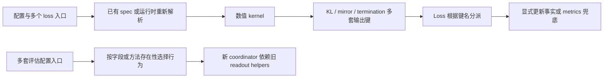

# 运行合同重构：历史依据、取舍与验收

更新日期：2026-11-01。两轮重构已在 `refactor/runtime-contracts-20261101` 实现，当前代码基线为 `eade5b8b`。本页解释代码来源、改动理由和验证范围；当前架构以[架构总览](../../infra/architecture/README.md)为入口，使用者按[运行接口迁移指南](../../infra/architecture/runtime-migration.md)升级。原审计文件路径保留，实施前方案可由 Git 提交 `6945292a` 查看。

## 范围与证据

审计从 `402f6353` 出发，覆盖 launcher 与目标解析、sampled/full loss、teacher/anchor、位置布局和 TQ、FSDP/AMP、更新事件与恢复、rollout、评估、模型身份及 profile 工具。[基线清单](../../infra/architecture/data/runtime-contracts-20261101/inventory.json)记录 113 个源码／配置文件和 243 处候选行。候选行不是问题数量，也不表示逐行验证了全部上游、多模态、Megatron 或第三方实现。

| 依据               | 能说明什么                         | 边界                                     |
| ------------------ | ---------------------------------- | ---------------------------------------- |
| 文档、源码和调用者 | 职责、数据生产消费及运行行为       | 静态分析不证明速度和分布式正确性         |
| 本地 Git 历史      | 适配层的来源、原先解决的问题       | 历史验收不自动适用于当前代码             |
| CPU/CUDA/FSDP 检查 | 指定配置下的接口、数值和执行一致性 | 不替代所有模型、完整 accuracy 或长程训练 |
| 固定输入 profile   | 相同工作量下的阶段成本             | 不把 head 倍率外推为完整任务倍率         |

共享主工作区的动作空间、token mapping 和模型扩展仍是独立演进内容，没有被本分支覆盖或冒充为本轮成果。组合这些修改时，需要接入统一目标输出和评估构造入口，再运行相应验收。

## 代码演进依据

以下提交均经本地 Git 核对。表格描述其引入时的责任和约束，现行处理结果见后文；旧分支的等价提交可能使用另一组哈希。

| 提交                   | 引入的责任                                             | 当时的约束与迁移动机                                                           |
| ---------------------- | ------------------------------------------------------ | ------------------------------------------------------------------------------ |
| `ef138884`             | sampled advantage、IS 等对照                           | current/rollout、vanilla/IS/PPO 是算法差异，不能合并成同一种梯度               |
| `06820b3a`             | shared FSDP2 Full-RKL、独立 teacher head、head adapter | 必须保留 root/head hooks、全局 token 分母和空 rank 梯度连接                    |
| `2c9d4bb5`             | 按 micro-batch 运输 hidden                             | TQ 身份与 position 跟随重排；不能为简化改成完整 logits 长期缓存                |
| `63594adf`             | opt-in fused precompute                                | CPU/FP64 reference 与 CUDA fast path 并存有验证用途，但实际 backend 必须可观察 |
| `91dd21c6`             | 统一预测坐标与 response 坐标                           | `prediction_positions` 旧导入位置的转导出后来随消费者迁移删除                  |
| `1e6e3ea9`             | `LossContext` 与静态目标元数据                         | 浅复制 config 保护共享状态；`bind_legacy_config` 是迁移桥梁，不是理想终态      |
| `85ece0a0`             | 执行事实与观测分离                                     | 原 metrics 携带执行事实的 fallback 当时仍保留；新 engine 已有显式字段          |
| `3be00adb`             | `SharedTeacherScorer`                                  | 保留单一 teacher 生命周期所有者，不在 loss 内操作 worker 或设备                |
| `48915607`             | sampled/full MDPO、full BPO、调用级 anchor             | η=1 复用 KL endpoint；只在 loss 层施加一次 1/η                                 |
| `4771eb66`             | target/diagnostics 融合                                | 性能分支应共用目标和 VJP 合同，不再建立新训练循环                              |
| `3d4243b9`、`2bbbb2fd` | 近目标稳定差分、小量余项、pivot VJP                    | 这些是数值正确性，不是待删除的历史兼容                                         |
| `5e5f8007`、`64e2b561` | FP16 VJP 与 loss scale 顺序                            | 未缩放 VJP 必须保持足够精度，不能提前转 FP16                                   |
| `cb890d2e`             | EOS 合并 MDPO                                          | 引入全词表 FP64 reference 和 fused 限制，形成后来的慢路径                      |
| `4e95a18b`             | EOS 补偿融合与统一停止类映射                           | 已解决主要行代数回退；重构不能丢弃 remainder 或改变 EOS 目标                   |
| `0b8d0981`             | 模型资产归一与历史位置投影                             | 资产别名在应用边界解析；内核运行不需要旧路径软链接                             |
| `69607488`、`ff5e73e6` | rollout 绑定解析、schema 2、公共采样合同               | 旧来源字段和旧恢复语义显式拒绝，是已经收敛的边界                               |
| `b6298e99`             | 来源留出/history 的固定 RKL 读出                       | 创建第二条 `_validate` 行为；后来演进为更完整评估协调器                        |
| `80d15713`             | 统一评估、Parquet 产物与最终模型导出                   | 新协调器仍依赖旧 readout 的共享函数，旧配置和调度继续并存                      |

可用 `git show <hash> -- <path>` 复核具体差异。[上游改动地图](../../infra/architecture/upstream-changes.md)负责更广的来源定位，当前调用顺序由[训练循环](../../infra/architecture/training-loop.md)和[代码走读](../../infra/architecture/代码走读.md)维护。

## 重构前后的责任变化

重构前的主要问题是同一语义拥有多个表示，或由字段存在性推断执行行为。下面保留基线的关键分叉，便于解释迁移原因；当前完整流程见架构总览。

| 责任       | 当前结构                                                    | 实际收益                                                   |
| ---------- | ----------------------------------------------------------- | ---------------------------------------------------------- |
| 目标与配置 | 只读 MirrorConfig；私有派生 loss_settings；canonical 注册名 | 不能注入运行元数据或在调用间污染目标                       |
| 数值结果   | FullVocabOutput 区分可微目标、除数和 detached 观测          | loss 不再从字符串键猜测算法                                |
| 归一化     | policy 显式接收 LossContext                                 | 静态配置不携带 batch 分母，拒绝采样仍保留原总体            |
| 更新记录   | optimizer_step_applied 是独立字段                           | 缺字段与显式未知 None 不再混淆                             |
| 评估       | 一个 `_target_` 构造边界，组件拥有严格 options              | 不再增加平行 trainer 配置命名空间                          |
| 生命周期   | 显式能力和 RolloutService 所有权                            | source/history 不误继承 suite 的 full-batch 或最终同步行为 |
| 复用身份   | checkpoint-v2 与公共 engine_contract                        | 权重、模板或停止协议改变时拒绝复用；相同内容可迁移目录     |
| 性能工具   | 真实 backend 名称和显式测量条件                             | 不把 CPU 参考回退记录为 fused 执行                         |

## 兼容候选的最终处理

C 编号沿用原审计，便于对应基线清单和提交。具体替换步骤集中在迁移指南，不在这里保留另一套操作说明。

| ID  | 候选                             | 已采取的处理或保留理由                                                 |
| --- | -------------------------------- | ---------------------------------------------------------------------- |
| C01 | prediction_positions 旧转导出    | 删除，调用者使用公共 padding 模块                                      |
| C02 | optimizer 状态函数旧导入别名     | 删除，测试使用正式执行合同                                             |
| C03 | metrics 携带更新执行事实         | 删除 fallback；生产者必须显式报告，None 仍表示未知                     |
| C04 | 多个 payload 标志与共享可变 spec | payload_kind 是唯一存储来源；名称使用不可变 tuple                      |
| C05 | hot path 重新解析目标            | 构造阶段解析；loss_settings 为只读派生属性，不接受配置输入             |
| C06 | full-vocab 多套输出字段          | 统一为 FullVocabOutput，保留各指标的数学含义                           |
| C07 | config 注入运行时分母            | 删除 bind_legacy_config，迁移到显式 LossContext                        |
| C08 | 新评估依赖旧 readout helper      | native 轨迹、history 与 scoring 原语归 evaluation 所有                 |
| C09 | 回调方法存在性探测               | 使用统一生命周期和明确能力声明                                         |
| C10 | 重复 RKL 执行及平行配置          | 旧 FixedRKLReadout 入口退役，共用 scorer；不同初始化协议由不同组件表达 |
| C11 | Metric 与 Observation            | 保留实际生产者和统计语义差异，在边界归约；不能把 SUM/MEAN/MAX 混成一种 |
| C12 | 参考与容量 backend               | 保留数学验证和显存用途；fused 请求不再静默回退                         |
| C13 | 局部 FP64 与 EOS remainder       | 保留数值正确性合同，没有以重构为名降低精度预算                         |
| C14 | DTensor、不同 engine 和模型能力  | 保留真实能力适配；不批量删除 getattr 或模型校验                        |
| C15 | profiling 硬编码和旧候选名       | 显式暴露 κ、η、EOS、诊断、no-sync；删除 fused_candidate 执行别名       |
| C16 | checkpoint／历史产物读取         | 历史只读独立保留；新运行拒绝旧身份，缺失历史进度仍标未知               |

Sampled vanilla、IS、PPO、reinforce、MDPO、BPO、FKL 是实际算法选择。Standalone 与 shared-sync 是不同资源拓扑。它们的差异不能按“兼容代码”统一删除。

## 关键取舍与修复

### EOS 优化是后续重构的基础

EOS 合并已接入 teacher-only KL 与 MDPO 的 precompute_fused 路径。大词表工作区和主要归约保持 FP32，EOS 合并保留逐行修正；易抵消的局部差分仍使用高精度。完整诊断保留，Torch 诊断改用 value-only 接口，不再计算随后丢弃的 VJP。没有为未测收益新增跨更新 target 缓存或动态精度调度。

固定输入的双 H800、Qwen3-1.7B、reuse16 actor 测量为 34.45→11.52 秒，约 2.99×；allocated 峰值为 25.60→17.25 GiB。该窗口包含 actor/anchor、optimizer、通信及上下卡，不含 teacher hidden 准备、rollout 和验证，也不是八卡长序列任务的速度承诺。原始条件、精度反例和分阶段 trace 见[精度权衡](../../infra/performance/full-vocab/2026-11-01-EOS精度与速度权衡.md)及[EOS 验收](../../infra/performance/full-vocab/2026-11-01-EOS融合实现与训练验收.md)。E59–E62 沿用 E55–E58 对应的科学预算并选择融合实现，旧编号配置没有被覆盖。

### FSDP 输出必须保持可遍历的梯度连接

统一输出最初使用普通 dataclass，CPU 数值测试通过，但双卡验收发现 FSDP pytree 遍历无法看到可微分子，可能漏挂 backward hook。结果改成原生 NamedTuple，新增 pytree 检查并重跑分布式验收。失败日志保留在原运行目录；这是重构中发现并修复的回归，不能把 CPU 通过当作 hooks 通过。

FullVocabOutput 保留未缩放可微分子和目标除数；EOS raw KL、合并目标、FKL 反向 KL 诊断和位置统计各自保留含义。LossContext 施加原全局 token 分母与 DP 缩放，MDPO/BPO 的 1/η 只施加一次。teacher/anchor/target 诊断不除 η。

### GMPO 的总体不能随 micro-batch 改变

geo_mean 原先直接平均每个 micro-batch 的序列 loss，不等大小分块会改变序列权重。几何比值与序列目标保持原式，归约改为同一 LossContext 的 sequence-sum/global-sequence-count；未指定全局总体的本地调用仍是本地序列均值。新增不等大小 micro-batch 的 loss 与 VJP 重建检查。

### 共享执行器，保留不同初始化协议

Source/history 在训练内生成初始 source bank；公共 suite 使用独立 bootstrap。统一后仍保留这一工作量差异，source-only 不会被强制增加公共 benchmark 或 teacher accuracy。五类现有组件共用一个构造入口、同一生命周期及原生评分边界。

DefaultRolloutService 原先根据 evaluation 配置存在与否跳过最终同步。现在由 owns_final_weight_sync 明确声明，Source/history 通过 RolloutService 休眠和恢复，恢复时重新配置 sampler。它独占 source/history 调度，拒绝重复的 trainer.test_freq。未确认结束的评分 RPC 执行 fail-stop，不清理可能仍被远端写入的 partition，不恢复 rollout，也不发布完成标记。

### 身份与科学协议不做自动升级

模型身份复用完整 checkpoint 清单，覆盖权重、配置、tokenizer、生成配置和嵌套模板；source bank 还记录公共 engine_contract。相同内容换目录可复用，同路径换权重、改模板或改停止条件应拒绝。旧银行不能通过补新 hash 冒充当时的生成身份。生成支持集、训练概率空间和评估概率空间仍是独立选择，不能靠裁剪 logits 伪装为同一指标。

### 保持资源所有权和数值边界

Teacher scorer 管理 teacher backbone 的阶段性驻留，actor worker 管理冻结 teacher head，anchor_scope 管理调用级 q 与 head 快照，TQ 按样本身份传递 hidden/position/version。Root/head FSDP hooks、tied embeddings、空本地 mask、FP16 loss scaling 和局部 FP64 稳定计算均保留。

Anchor 推理与 actor 训练之间的额外模型往返、跨 reuse 的输出头投影缓存仍需要 profile 决定是否优化。它们涉及峰值显存、version 与 shuffle 失效条件，不能仅为减少调用次数引入未经验证的状态。

## 提交与验收

| 提交组                             | 交付                                                   |
| ---------------------------------- | ------------------------------------------------------ |
| `6945292a`                         | 实施前审计与 Mermaid 图                                |
| `08d00a6a`、`cb5d30d2`、`f1572b90` | 输出／上下文／更新合同，FSDP hook 和 GMPO 修复         |
| `af40b946`、`25f7e86f`、`19e869fb` | 原生评估职责拆分、profile 参数与首轮验收               |
| `5bc0660f`、`58002c29`             | 严格入口设计、canonical 目标、私有元数据与真实 backend |
| `1c61cac1`、`8093a201`、`eade5b8b` | 单一评估入口、内容身份、生成和同步所有权及验收记录     |

| 验收批次         | 已通过的范围                                                                                              | 证据与限制                                                                                   |
| ---------------- | --------------------------------------------------------------------------------------------------------- | -------------------------------------------------------------------------------------------- |
| 第一轮 CPU／配置 | 904 项组合检查中 898 项直接通过，六个 fixture 迁移后复跑；另增五个 callback 和两个 GMPO 案例，去重 911 项 | [第一轮记录](../../infra/architecture/data/runtime-contracts-20261101/acceptance.json)；早期 549 项是其子集，不另累加 |
| 第一轮 GPU       | 五组双卡、60 次有效更新，覆盖 EOS BF16/FP16、endpoint、BPO、sampled MDPO、累积及恢复                      | EOS BF16 融合/参考参数差为 0，旧 endpoint 对照逐位一致；原失败和复跑均保留                   |
| 第二轮 CPU／配置 | 核心 563 项、配置/launcher 369 项、最终生成/所有权 67 项；canonical 元数据另有 93 项 targeted 检查        | [第二轮记录](../../infra/architecture/data/strict-contracts-20261101/acceptance.json)；分组重叠，不相加为独立总数     |
| 第二轮 GPU       | 六组双卡、122 项 CUDA；元数据收紧后再复跑 EOS、endpoint、forward-KL 三条双卡路径                          | 覆盖原数值预算和 checkpoint；没有新增一轮完整 vLLM accuracy                                  |
| 工具和文档       | E59/E62 配置预览，Ruff、格式、mypy、配置生成、提交 hooks、文档检查                                        | 旧原始证据缺失的链接由检查器单列，不宣称核验其内容                                           |

原始命令、日志和资源归还记录位于 `runs/runtime-contracts-20261101` 与 `runs/runtime-contracts-20261101-v2`。早期 Ray 扩大测试在本机启动阶段停滞的记录不计为通过；FSDP 输出封装失败也没有从证据中删除。冻结 JSON、图表与历史实验数据保持原样。

本分支工作树为 `.worktrees/architecture-refactor`，尚未覆盖主工作区的并行动作空间修改。后续合并必须把新增分布空间观测接入统一输出和构造合同，不恢复旧键名分派来解决冲突。完整 profiling、其他 engine/模型和正式长程实验仍按各自协议执行；重构本身没有产生新的吞吐倍率或收敛结论。
