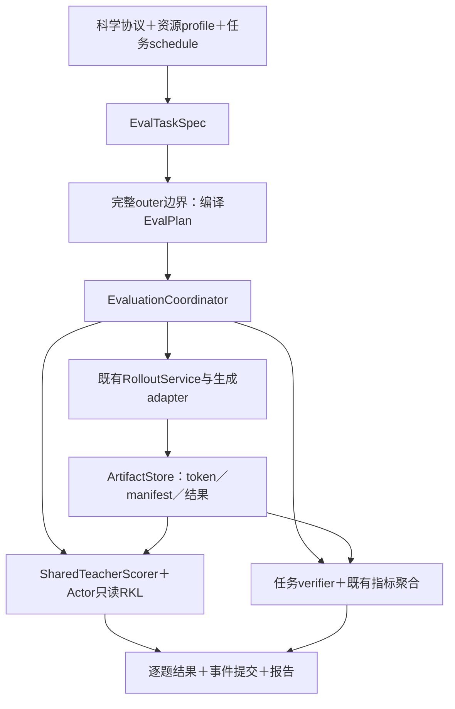

# 四域 RKL 实验的 verl 接入方案

推荐在原生 verl 增加一个小型统一评估协调层，复用现有 RolloutService、FSDP worker、RKL 算子、指标和保存器。保留四个核心抽象：任务声明、不可变执行计划、协调器、轨迹存储。Bench、bank、source、history 是不同输入和调度，不各自发展一套 pipeline。

状态：2026-10-31，已基础实现 Parquet 轨迹／结果、history 引用、来源/history 独立频率和按题 RKL；完整公共评估协调器尚未实现。阅读基线为`28180c4b76a52b4e77164ac7a2938b87bda3c7ef`。既有 JustRL→R1-1.5B 四卡、batch128／reuse32／cap7168、两轮 64 次更新通过；公共 32K 和 50outer 尚未验收。科学设置由[四域协议](../../../experiments/teacher-transfer/protocols/online-four-domain.md)唯一维护，历史性能由[实测页](../../../infra/performance/full-vocab/training.md)维护。

资源边界仍为物理 GPU0–5，首轮按四卡验收。Batch128 不能直接整除六卡 DP；评估的推理 padding 与训练的全局 batch 分片是两项验收，不因本方案有 padding 就视为六卡训练已支持。

## 1. 按问题阅读

| 要决定的事情                                         | 文档                                                                                                |
| ---------------------------------------------------- | --------------------------------------------------------------------------------------------------- |
| 任务类型、bench 差异、频率与去重、初始化             | [配置与调度](2026-10-31-配置与调度草案.md)，含完整待实施 YAML 草案                                      |
| 串行切换、模型并发、内存、轨迹、最终导出、指标与图表 | [执行存储与可观测性](2026-11-01-执行与存储设计依据.md)                                              |
| 真实调用链、当前缺口、逐阶段改动与测试               | [代码走读与实施计划](2026-11-01-分阶段代码走读与验收.md)                                              |
| 每个决定的备选、推荐、代价与重新讨论条件             | [决策记录](../../../../.agents/notes/proposed/architecture/2026-10-31-统一验证的任务计划与产物边界.md) |

这次合并将原接入页的执行／容量／恢复细节归入工程子页，将协议中重复的第 6／11 节顺序和频率合为一份科学定义。论文原始参数与统计论证保留在 literature；旧提案保留为早期候选，不再并列维护当前方案。

## 2. 架构和依赖方向

Trainer 提供稳定训练边界和当前权重，协调器只决定本次工作。生成、评分和 verifier 消费同一份带身份的轨迹；RKL 数学仍在 distillation 与 engine 里。新增 bench 主要增加 dataset／renderer／verifier 配置，新增银行主要增加 InputRef，资源优化不改科学任务。

实现集中在`verl/trainer/evaluation/`：`config.py`维护 typed schema，`plan.py`维护纯计划，`coordinator.py`拥有事件执行，`artifacts.py`维护轨迹和提交；原生生成、串行 RKL、CPU 判分分别由`generation.py/scoring.py/accuracy.py`适配。History 复用已有纯抽样函数。配置纳入已有 Hydra 树，模型与资源 profile 沿用原生配置，题目清单由 prepared artifact 固定。

`GenerationProtocol`与原生模型资源配置分离，不为不同 bench 复制 Trainer、Ray worker 或 generation server。公共原语保持在 verl，studies 只提供分析与绘图工具，生产路径不依赖研究训练器。接口与调用方式见[组件说明](../../../../../../verl/trainer/evaluation/README.md)；完整 GPU 验收仍在进行。

## 3. 最重要的执行决定

| 关注点                     | 推荐                                                                                                              |
| -------------------------- | ----------------------------------------------------------------------------------------------------------------- |
| 多 bench 参数              | n、T/p/k、cap、模板逐请求显式传递；每模型 TP／并发与科学参数分开                                                  |
| 不同频率                   | 在完整 outer 边界一次计算 at/every/final 并集；旧回调和新入口不能双重触发                                         |
| 生成复用                   | acc 与 current RKL 共用生成；sample0 身份固定，n 增加不重新选择 bank                                              |
| 冻结 teacher／initial 生成 | 首版在 Trainer 创建前的 prepare 阶段完成，共用原生 adapter 与持久协议，避免训练 worker 占资源后另起任意 TP 引擎   |
| 模型切换                   | 同一 student 版本／teacher／支持与精度的 RKL 任务合并，按 CPU 字节窗口串行 teacher→student；不同来源只分统计      |
| 资源恢复                   | 沿现有生命周期统一所有权；版本相同但 level2 sleep 丢弃权重后仍须恢复                                              |
| 存储                       | 轨迹／结果统一 Parquet；history 只存引用；对象级小 manifest 合并完成记录；不重复 complete/result 文件             |
| 完成与故障                 | 收齐请求并 drain 后才切换；基础设施缺失不当模型答错；完整事件才进入主表                                           |
| 最终权重                   | 仅终点保存一个 model-only 及身份 manifest；不保存 optimizer 或中间 checkpoint                                     |
| 报告                       | 原生训练更新账本＋逐题结果；按题目集、轨迹来源、模型版本、支持定义分组；新增 native reader，不套旧 H1024/320 常量 |

只有 accuracy 与 RKL 两种评分 kind，生成与 bank 选取是共享操作。首版不引入通用 DAG 系统、多评估集群或跨 outer 后台队列。未来异步和多教师可扩展 adapter 和资源所有权，不必先承担其复杂度。

## 4. 已有能力、性能与缺口

当前 V1 同步训练、fresh rollout、reuse32、临时 teacher hidden、来源/history RKL、权重同步、逐更新指标与基础 checkpoint 均有实现。走读期间主分支已合入 RolloutService 和显式生命周期，方案以新接口为基础。

统一配置、bootstrap、逐请求协议、字节窗口、推理 padding、四域判分、逐更新 Parquet 与最终导出均已实现。合并 CPU 回归 495 项通过；四域集成、独立 HF 重载、7B／14B 长前缀与六卡检查通过。正式 Math50 轮流程已进入全集初始化，目前使用 GPU2／3／4／5 恢复已发布回答；Code 执行器的 SystemExit 边界已修复，并保留已发布回答用于恢复。参数更新尚未开始。当前条件和证据由[实施页](2026-11-01-分阶段代码走读与验收.md#8-统一评估实现与待验收边界)维护。

四卡 Qwen3-1.7B／8B 的 768 条真实轨迹原型中，调优后串行中位 75.8 秒，固定 2＋2 为 92.7 秒，支持当前采用串行。该比较不包含新公共 32K 完整设置；32K、多 TP 与其他模型组合还需校准。并发不能只按 B 数推断：32768 总 token 单序列的 BF16 KV，R1-1.5B 约 0.875GiB，Qwen3-1.7B 约 3.5GiB。资源依据和容量边界见执行页。

初始走读时发现的 RolloutService 夹具缺口已修复，定向 CPU 检查现为 144 项通过。真实旧轨迹的 Parquet 往返及历史 JSON 验收复算通过；新增链路现已完成四卡两轮 64 次更新的 GPU 验收，详见[Parquet 实测](../../../infra/performance/full-vocab/training.md#parquet-基础链路的四卡-gpu-验收)。实际可用入口见[组件说明](../../../../../../verl/trainer/evaluation/README.md)，实施边界见代码走读。

## 5. 外部实现提供的边界参考

| 实现                                      | 核对到的组织方式                                                                     | 对本项目的用途                                                      |
| ----------------------------------------- | ------------------------------------------------------------------------------------ | ------------------------------------------------------------------- |
| 本仓库 SharedTeacherScorer／HiddenBatchIO | teacher 先评分，hidden 在 TQ 临时发布；actor 微批读取与可选 prefetch，outer 结束清理 | 与用户允许的批内复用一致，优先复用                                  |
| verl 官方 OPD                             | 明确 student 状态上的 teacher 监督，配置 teacher 资源池与蒸馏目标                    | 通用模块边界参考，不能据最新版文档假定本地分支已支持全部模式[^verl] |
| verl Async On-Policy KD recipe            | 生成、teacher 查询、训练重叠；传 top-k 信号，稀疏 KL，接受一定策略滞后               | 可借鉴有界队列与调度，不直接替换本项目 full-vocab RKL[^async-verl]  |
| TRL DistillationTrainer                   | 在 student 生成序列上用本地 teacher 提供分布监督                                     | 同输入 teacher／student 前向的接口组织参考[^trl]                    |
| TRL AsyncDistillationTrainer              | 独立生成与 HTTP teacher 评分，传稀疏候选分布，显式 staleness 窗口                    | 可借鉴版本追踪；该 HTTP 信号不是本项目的精确全词表 RKL[^async-trl]  |

文档核验于 2026-10-31，外部 main/latest 会变化。没有据这些实现对当前六卡任务宣称哪种布置已实测最优。

## 6. 实施顺序与尚需决定的选项

先处理服务契约与 CPU 回归，再做纯配置／计划和持久轨迹；接入生成与 bank 后，完成有界 RKL 执行和唯一 Trainer 边界；随后补指标／图表、最终模型导出，最后做四卡全任务短验收和 32K 容量测速。每步的具体文件与验收矩阵见[实施计划](2026-11-01-分阶段代码走读与验收.md#4-分阶段实施与验收)。

已确认训练 token-mean、报告题内 token 均值后按题平均、全集 accuracy 与既定 n、LR1e-6／reuse32、仅保存最终 model-only 且不存 optimizer。剩余抽样方案先进行覆盖与分布实验，再冻结题目 ID 和配额；其他优化器细节与资源 profile 在正式运行配置中验收。历史恢复方案保留为后续选项，不属于本轮必做。

### 参考文献

[^verl]: verl contributors. On-Policy Distillation documentation. [官方文档](https://verl.readthedocs.io/en/latest/algo/opd.html).

[^async-verl]: verl contributors. Async On-Policy Knowledge Distillation Trainer. [官方 recipe](https://verl.readthedocs.io/en/latest/advance/async-on-policy-distill.html).

[^trl]: Hugging Face. Distillation Trainer. [官方文档](https://huggingface.co/docs/trl/distillation_trainer).

[^async-trl]: Hugging Face. Async Distillation. [官方文档](https://huggingface.co/docs/trl/async_distillation_trainer).
