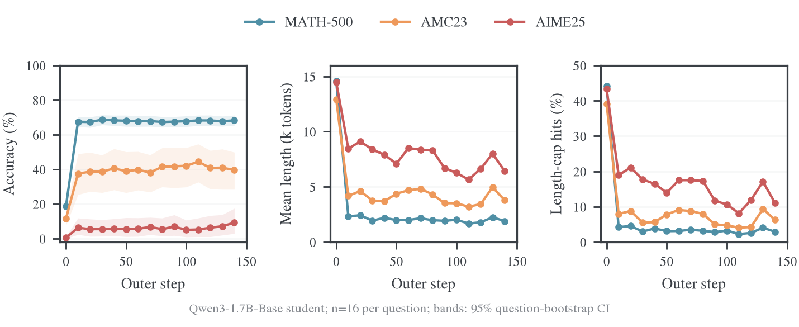

# Qwen3-1.7B-Base 蒸馏 Qwen3-8B 的阶段验证分析

最终200步结果与完整曲线见[完整训练与验证分析](../../../experiments/teacher-transfer/teacher-comparison/qwen-base-8b/2026-10-27-完整训练与验证分析.md)；本页保留step 140的冻结统计。

本记录冻结至 outer step 140 的完整验证，生成于 2026-10-27。运行使用 8 张 H800，Full-r16 与终止动作对齐，batch 64、学习率 1e-6、200 outer step、每 10 step 验证一次。验证温度 0.7、top-p 0.9、每题采样 16 次、回答上限 31,744 token。Qwen3-8B 权重固定；训练中记录的验证指标属于 student。

主要改善发生在前 10 步：回答长尾明显减少，同时正确率大幅提高。后续长度继续改善，但 MATH-500 的正确率基本稳定在 67%–69%；AMC23 波动较大，AIME25 的能力仍弱。这些结果支持“训练修复了大量生成退化并提高了验证准确率”，尚不支持“已达到 teacher 水平”或“后半程准确率持续收敛”。

图中每个点是一轮完整验证，阴影为原始指标中的题目 bootstrap 95% 置信区间，表示题目抽样不确定性，不表示多 seed 方差。三条曲线分别对应 MATH-500、AMC23、AIME25。

| 数据集 | 初始 acc | step 10 acc | step 140 acc | 平均长度：初始 → step 140 | 撞长度上限：初始 → step 140 |
| --- | ---: | ---: | ---: | ---: | ---: |
| MATH-500 | 18.59% | 67.44% | 68.25% | 14.57k → 1.89k | 44.20% → 2.90% |
| AMC23 | 11.41% | 37.50% | 39.53% | 12.91k → 3.78k | 39.06% → 6.25% |
| AIME25 | 0.42% | 6.25% | 9.17% | 14.47k → 6.42k | 43.33% → 11.04% |

acc 是每题 16 次采样的平均正确率再按题平均，不是 pass@16。MATH-500、AMC23、AIME25 分别有 500、40、30 题。按全部 9,120 条回答加权，平均长度从 14.45k 降到 2.26k token，截断率从 43.79% 降到 3.56%，平均正确率从 17.13% 升到 63.13%；这个加权总分由 MATH-500 主导。三个数据集等权平均正确率为 10.14% → 38.98%。

长度下降伴随着可用输出增加，而非普遍提前结束：少于 32 token 的回答在初始验证占约 16.89%，step 10 与 step 140 均为 0。与此同时，AMC23 的长度中位数从 907 升到 1,385 token，AIME25 从 1,681 升到 3,029 token。初始阶段既有极短退化输出，也有撞上限的极长输出；只看平均长度会掩盖这两个方向的改善。

step 140 正确／错误回答的平均长度分别为：MATH-500 0.62k／4.62k，AMC23 1.30k／5.40k，AIME25 1.80k／6.89k token。较长尾部主要集中在错误回答中，但这些统计不能单独把每条长回答认定为重复循环；本记录未补算全文重复率。

MATH-500 在 step 10 已有 67.44%，step 140 为 68.25%；后续 20–140 步的波动处于约 67.31%–68.65%。AMC23 在 step 10 后约为 38.13%–44.38%，并未单调增加。AIME25 的 step 140 为 9.17%，此前多次在 5%–7% 左右；只有 30 道题，不能仅凭最后一个点认定能力出现稳定跃迁。

同批 16 次更新的优化 KL 仍在下降：step 1–10 的批首／批末均值约 0.239／0.188，step 121–140 约 0.111／0.086，step 141–150 约 0.112／0.086。批末是最后一次更新前记录的 loss；不同 outer step 使用不同 student 轨迹，不能把它们当作同一固定样本集上的收敛曲线。较低的局部蒸馏损失与验证准确率平台同时存在。

目前找到的 Qwen3-8B teacher 实测是 2026-10-24 留存的非 thinking 子集：每个数据集 8 题，每题 4 次，共 96 条。此处用当前实验冻结源码中的同一数学评分器，对已有回答补算准确率，没有重新生成。原记录温度 0.7、top-p 0.9、长度上限 31,744，与当前验证一致；每题样本数、模型提示模板及运行批处理条件存在差异。

下面只比较相同的 8 道题；student 使用 step 140 每题 16 次采样。两个模型的平均正确率口径一致，但 teacher 每题只有 4 次，估计噪声较大。该表不能作为三个完整验证集的 teacher 基线。

| 数据集（每组 8 题） | Teacher acc（32 条） | Student acc（128 条） | Teacher 平均长度 | Student 平均长度 | Teacher 截断率 |
| --- | ---: | ---: | ---: | ---: | ---: |
| MATH-500 | 87.50% | 69.53% | 1.51k | 4.41k | 3.12% |
| AMC23 | 87.50% | 57.03% | 1.19k | 2.74k | 0.00% |
| AIME25 | 28.12% | 7.81% | 5.22k | 6.76k | 9.38% |

Teacher 在这个同题子集中准确率更高、平均回答更短；完整 teacher 验证尚未找到。本轮 student 的改善不能解释为已经追平 teacher。也不能将该子集的 teacher 数值与上面的 student 全集数值直接相减。

分析输入与结果：[冻结统计](../../../../../../../wandb-logs/MirrorOPD-verl/analysis/e39-qwen3base-validation-20261027-step140/analysis.json)、[完整验证曲线数据](../../../../../../../wandb-logs/MirrorOPD-verl/analysis/e39-qwen3base-validation-20261027-step140/validation.csv)。原始模型输出与逐条评分来源保存在统计文件的 provenance 字段和分析脚本中。曲线可使用 [plot_validation.py](../../../../research/analysis/qwen_base/plot_validation.py) 从 CSV 重绘；[analyze_validation.py](../../../../research/analysis/qwen_base/analyze_validation.py) 使用指定历史回答、验证 records 和冻结评分器复算统计。图同时提供 [PDF](../../../experiments/teacher-transfer/teacher-comparison/qwen-base-8b/figures/validation-trends.pdf) 和 [SVG](../../../experiments/teacher-transfer/teacher-comparison/qwen-base-8b/figures/validation-trends.svg)。
