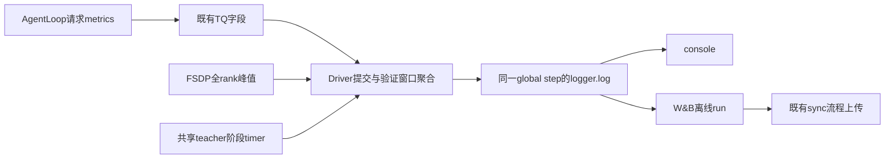

# 历史性能口径与验收

Last updated: 2026-10-22。

以下内容由原 `examples/mirroropd/docs/infra/2026-10-21-指标与验收.md` 的已提交版本迁入，保留当时字段名与验收证据。它说明历史系统计时/显存的范围，不用于判断后续 metrics 的 GPU 验收状态。当前字段名与采集粒度以[指标字典](../../experiments/metrics/指标字典.md)为准，当前测试以[完整指标实现与验收](2026-10-22-完整指标实现与验收.md)为准。

符号遵循[统一约定](../../符号约定.md)；代码字段、论文原名与历史数据键保留原样。

本页按 `5b3ccdd30` 记录实际观测能力，只维护指标合同、测试证据与验收方法。常规指标默认采集；共享 teacher 的 forward/transfer 两个 timer 已随流水线实现。运行、配置和生命周期只在[共享八卡运行与架构](../../infra/2026-10-22-共享八卡运行与架构.md)维护，历史数值只引用[4+4 基线测量](../2026-10-23-历史八卡与One-Shot运行对照.md#4-八卡历史与one-shot对照)。

## 指标口径

继续保留 `timing_s/{step,gen,old_log_prob,update_actor,update_weights,testing}`、token 数、回答长度、质量、loss/gradient 等既有指标。`step` 包含训练、按需保存和权重同步，周期验证另计 `testing`；`gen` 仍是等待生成侧 batch 完成及 student sleep，不等于纯 decode。

| 字段 | 适用路径 | 定义及边界 |
| --- | --- | --- |
| `timing_s/rollout_batch` | 完整同步 single-turn 提交 | Driver 提交边界到最后一个 student generate 返回；含排队和推理，可与其他请求后处理重叠，不追加最后返回后的尾部工作 |
| `timing_s/teacher_forward` | shared_sync | 整批 `infer_batch()` 提交到 futures 全部完成，含 RPC、动态 micro-batch、结果及 TQ 开销，不是纯 kernel 时间 |
| `timing_s/teacher_transfer` | shared_sync | 显式 teacher onload 和 offload 完成等待时间之和；不包含 old-log-prob 或 actor 状态搬运 |
| `memory/fsdp_worker_peak_allocated_gib_max` | FSDP actor 更新 | Worker 进程/设备累计 PyTorch allocated 高水位的全 rank 最大值；不是当步 actor 独占峰值，也不是整卡显存 |
| `rollout/preemptions` | 完整提交且后端全部提供计数 | 各请求非负 `num_preempted` 之和；任一未知则省略，不把 -1/None 当 0 |
| `teacher/request_latency_s/mean` | standalone teacher RPC | 按请求数汇总的 teacher client 往返延迟均值；不能与共享模式整批 teacher_forward 相减 |

共享模式不存在独立 teacher RPC，因此没有该请求均值。没有 teacher 的普通训练仍采集适用的生成和显存指标。无需 `OPD_METRICS` 或 trainer 指标开关；重型 trace/profiler 继续沿用显式配置。

### 提交完整性与验证

Driver 注入提交 ID、预期请求数、开始时间和时钟域；SingleTurnAgentLoop 在生成返回后、token 合并/verifier/teacher 之前记录结束时间。TQ 保存请求 metrics，driver 清理轨迹前读出并汇总，padding 副本不重复计数。

时钟域由 Ray node ID 与 Linux `/proc/self/ns/time` 标识校验。跨节点、不可验证时钟、缺失/重复请求、混合提交或多轮输出不发布该 batch 跨度；首版不覆盖 DAPO 补样、异步选样和跨 batch 预生成。缺测原因按类型提示一次，不能用最大单请求时长替代整批跨度。

验证新增的流水线字段只发布 `validation/timing_s/rollout_batch` 和可用的 `validation/rollout/preemptions`。各窗口分别计时后求和，任一窗口缺测则省略该整轮字段；窗口之间的汇总/提交间隙不在跨度和中，完整成本仍看 `timing_s/testing`。未来持续投喂会让窗口重叠，不能继续直接相加；须同时调整提交完整性与时间覆盖口径。验证不执行 teacher，不输出 teacher 时间为 0 的占位字段。

训练前验证及 `val_only` 路径也默认记录同名 `timing_s/testing`，与周期验证使用一致的完整 `_validate()` 墙钟口径。验证请求省略未被评分消费的 sampled-token 概率，训练仍按 `rollout.calculate_log_probs` 配置返回；没有新增指标开关。

### 显存与日志路径

每次 FSDP training update 的全部 mini-batch 完成后，所有 rank（包括不返回模型输出的 SP rank）参与一次标量 `all_reduce(MAX)`，再用 `Metric("max", ...)` 返回。它不重置 peak counter，不逐生成请求同步 CUDA，也不改变既有 `perf/max_memory_*` 指标定义。其他训练角色沿用其 logger 前缀，如 `critic/memory/...`。

共置 worker 可能共享进程 allocator，因此该累计峰值可以包含之前的 teacher 前向。需要区分 actor、teacher、通信或 KV 的阶段峰值时，用短的单变量运行及 profiler 定点采样；不能将此字段直接解释为 actor backward 所需显存。



请求 metrics 是逐轨迹 TQ 字段；TrainingWorker 的 metrics 随返回 metadata 传递，二者不混用。Worker 不独立初始化 W&B。公共配方默认 `trainer.logger=[console,wandb]`、`WANDB_MODE=offline`，离线文件存在不等于云端已经上传；上传流程见[传输说明](../../../../../meituan/README.md)。

实现入口：[pipeline_metrics.py](../../../../../verl/utils/pipeline_metrics.py)、[SingleTurnAgentLoop](../../../../../verl/experimental/agent_loop/single_turn_agent_loop.py)、[AgentLoopWorker](../../../../../verl/experimental/agent_loop/agent_loop.py)、[PPOTrainer](../../../../../verl/trainer/ppo/v1/trainer_base.py)、[TrainingWorker](../../../../../verl/workers/engine_workers.py)。

## 两次运行的对照测量方法

2026-10-21对照取自两个独立的只读API快照，历史边界分别为98步和12步。实验结果、显存表和质量结论只在[实测报告](../2026-10-23-历史八卡与One-Shot运行对照.md#4-八卡历史与one-shot对照)维护；这里定义统计口径。

- 主比较使用共同的step 2–12，排除首步，并分别报告完整历史以避免挑选窗口。不能把旧run后期更短的回答与新run早期平均直接比较。
- 吞吐使用有效token总和除以对应step时间总和；验证在step计时之外，保存若已计入step则不重复加。`rollout_batch`与`gen`重叠，不加入互斥阶段之和。
- 新history和system stream存在显式null。按有限数值筛选有效观测，既不能把key存在视作一次验证/GPU采样，也不能把null填成零耗时、零busy或零preemption。
- 系统阶段窗口按history的`_timestamp`减去testing与step timer反推。`_runtime`在旧快照中存在与下一次log对齐的现象，不能混用。
- 阶段core从起点剔除全部未分解残差，并在两端各留2秒guard；另外计算0/1/3秒敏感性。共享teacher的onload/offload合计字段不能拆成两个真实事件，因此与forward一起作为一个评分/迁移块定位。
- 物理GPU分组的角色由运行行为推断，未保存Ray rank映射；全池统计不依赖该角色命名。
- GPU数值是稀疏probe的样本均值/观测最大值，不积分成连续利用率或精确GPU峰值。某阶段没有probe就缺测；仅1～3个probe的teacher/update阶段不足以支持精确占用结论。

复算程序为[compare_pipeline_runs.py](../../scripts/compare_pipeline_runs.py)，保存逐步工作量、配置完整差异、guard窗口与敏感性结果。两次生成阶段busy的guard敏感性分别约17.17%～17.66%（旧全八卡）和30.85%～31.22%（共享）；资源参与面扩大这一判断对边界选择稳健，但不能据此推出吞吐增长。

## 已完成的验证

以下是既有提交/运行记录；不同测试批次有重叠，数量不可相加。本次文档重构核对源码和测试内容，不重新运行 GPU 作业，也不把历史测试记录写成新的性能实测。

| 证据 | 已确认范围 | 不能据此确认 |
| --- | --- | --- |
| `5188828d2` 实现、`8b495a311` 测试记录：139 项 CPU 测试 | 配置/资源映射、tokenizer、评分时序与失败隔离、TQ metadata、next-token 对齐、loss/梯度及既有路径回归 | 实际八卡 vLLM/Ray 吞吐与部署环境稳定性 |
| `2631b3a0b`：130 项 CPU 测试 | 默认采集、缺测、时钟域、rank-max、真实 W&B SDK 离线 history | 云端同步结果和真实 NCCL 时间开销 |
| `565a1fda2`：43 项启动测试 | 读取真实 Hope worker 命令，覆盖三个领域、两种模式、GPU 环境保留、原生解释器、日志和退出码 | Hope 平台实际提交成功或 GPU 训练完成 |
| 已记录的两卡 H800 小模型测试 | 真实 TrainingWorker/FSDP2/NCCL；三轮 teacher 迁移、actor 更新、checkpoint；普通和 tied embedding 两种布局 | vLLM/Ray rollout、生产模型精度阈值、完整八卡收益 |
| 2026-10-21 W&B `rcxtujbi` 快照 | 8×A800共享模式的step 1–12；实际rollout、teacher评分/迁移、actor更新及新增指标 | 完整验证、保存/恢复、完整epoch和周期加速仍无对应记录 |
| 2026-10-21 本机shared四卡，离线W&B `cy5nr43p` / `tzzdwjer` | 4×H800上eager/编译Graph各5步；teacher、更新、权重同步及多轮sleep/wake；稳态整步约2.63倍提速 | 不是A800八卡验证；未测完整验证、保存/恢复或长期质量，详见[本机训练对照](../../infra/2026-10-22-训练与验证性能实测.md#3-本机编译与训练优化) |
| `5b3ccdd30`：99项CPU回归 | Graph/窗口配置、V0/V1验证概率、验证长度、初始计时、日志退出与源码重入保护 | 测试数量与前批有重叠，不相加；不能代替目标环境GPU验收 |
| 2026-10-21 H800验证与batch128 | 五组32题×16真实验证；固定token概率对照；batch128三步训练 | 完整570题、八卡Graph与长期学习质量仍未测到，见[本机实测](../../infra/2026-10-22-训练与验证性能实测.md#3-本机编译与训练优化) |
| 2026-10-21 One-Shot历史API审计 | 三个完整历史训练，逐阶段timer、约15秒GPU采样与完整验证成本 | 只读历史数据，非新运行；短teacher/actor阶段不据此估算busy |
| 用户提供的 2026-10-20 23:44 Hope 日志 | 目标镜像依赖导入、八张 A100 80GB 的矩阵运算通过 | 训练尚未开始：旧入口 teacher=4 与 shared_sync 参数检查冲突 |

两卡测试环境记录为 PyTorch 2.6、Transformers 4.51.1、FlashAttention 2.7.4，使用本地小型 Qwen2。检查 teacher 初始化前后 actor 输出不变、teacher 无梯度且固定输出不变、真实 actor 参数更新、root/层级参数迁移和恢复。Teacher packed 前向与 HF 逐序列前向的对照使用 `atol=0.03, rtol=0.01`，仅适用于该小模型测试，不能拿作生产模型的默认容差。

复现已有测试的方法如下。GPU 命令仅在另行取得空闲设备后执行；示例设备编号不是当前空闲卡声明。

```bash
python -m pytest -q \
  tests/trainer/ppo/v1/test_shared_teacher_on_cpu.py \
  tests/examples/test_mirroropd_math_launcher_on_cpu.py \
  tests/trainer/ppo/v1/test_trainer_base_on_cpu.py \
  tests/trainer/ppo/v1/test_agent_loop_tq_on_cpu.py \
  tests/trainer/ppo/v1/test_pipeline_metrics_on_cpu.py \
  tests/utils/test_fsdp2_model_transfer_on_cpu.py \
  tests/utils/test_transferqueue_utils_on_cpu.py

CUDA_VISIBLE_DEVICES=0,1 OMP_NUM_THREADS=1 \
  torchrun --standalone --nproc-per-node=2 \
  tests/special_distributed/test_shared_teacher_fsdp2.py
# 同一测试可追加 --tie-word-embeddings 验证共享embedding布局。
```

历史Hope预检日志记录的环境为 PyTorch 2.11.0+cu128、vLLM 0.25.1+cu129、FlashAttention 2.8.3、Transformers 5.12.1、TensorDict 0.10.0、TransferQueue 0.1.11。CPU 回归/两卡测试与该运行环境不同，仍需完成下节验收。原仓库 license、下划线 helper 命名、uv 默认值检查与本项目既有约定存在冲突；此前测试记录未为通过这些规则而改变原生运行方式。

## 八卡端到端验收

| 阶段 | 固定条件 | 验收结果应记录 |
| --- | --- | --- |
| 部署与预览 | 正确镜像/模型/数据，Hope 已直连配方 | shared_sync、全共享池 8、独立 teacher 池 0、student TP1、相同 worker Python |
| 数值对照 | 相同 token 轨迹，覆盖不同长度、EOS、padding、截断和空 response | 因果位置、mask、有效 token 数；vLLM/FSDP 概率误差分布及明确容差 |
| Loss 与梯度 | 相同 student 参数、teacher 概率、训练轨迹 | loss、梯度方向/范数、不同长度权重一致；teacher 无梯度 |
| 生命周期 | 连续生成→评分→更新→验证，含保存/恢复与评分异常 | 各阶段卸载完成、推理权重版本一致、不消费未评分数据、TQ 最终清理 |
| 短训练 | 同卡型、batch64、相同数据/采样/长度 | 初始化与稳定步分开；完整步时、分阶段时间、主机内存、质量指标 |
| 完整验证 | 同 checkpoint，570×16 条，原长度/温度/窗口 | 9120 条请求完整、全部八副本参与、整体 testing 与窗口长尾、输出完整 |
| 性能与质量 | 相同 token/更新预算，必要时多个 seed | 包含验证与保存的周期成本、总 GPU 小时、student-only 质量 |

已有环境导入和矩阵乘法通过，不等于模型加载、NCCL、KV 分配与完整训练通过。固定 teacher 评分的数值误差需解释 dtype/backend 差异，不要求浮点逐位相同，也不预设生产模型必然通过的阈值。

## 固定工作量下的收益判断

Shared把独立teacher的预留卡交给student，同时增加串行评分与显式迁移，并改变生成/评分重叠。比较完整`step`、`testing`和周期成本，不能把旧`gen`除以二或相加重叠请求timer。

V1 sync使用resource-pool manager的总GPU数归一化`perf/throughput`。这两个run已逐行反算，分母均为8，旧4+4也包含独立teacher池。此前“旧run只按actor四卡归一化”的推断不适用于这两次实测；其他异步资源布局仍应单独核对。对照使用总token除以总时间，避免算术平均比值的偏差。

完整成本按实际预留资源计算：

$$
\mathrm{GPUh}_{\mathrm{total}}=\sum_j G_j \mathsf t_j/3600.
$$

始终预留八卡时按总墙钟乘8计费，闲置teacher卡不能按busy折算掉。已完成step/testing计时不包含全部启动与尚未结束的验证；它们是已计时工作，不是最终作业总账。离线算法还需计数据生成、teacher预计算和必要SFT。

当前匹配训练窗口的差值、完整周期收支平衡条件和验证记录统一见[速度与显存实测](../2026-10-23-历史八卡与One-Shot运行对照.md#46-验证质量与完整周期)，不在工程说明中再维护一套结果表。

## 后续单变量优化

Batch口径、RLVR/OPD论文配置、引擎统计开关、decode trace和Graph/并发实验统一在[批量大小与GPU利用率调优](../../infra/2026-10-22-批量大小与GPU利用率调优.md)维护。本页保留指标契约和八卡验收，避免维护第二套调参表。

本机已有统计、trace及Graph试验；复现时仍按轻量统计先于重型trace：`disable_log_stats=False`与Ray worker中的`VLLM_LOGGING_LEVEL=INFO`用于确认请求供给、排队和KV压力；短trace用于定位kernel间隙。两者不会自动增加W&B标量，常规性能指标继续默认采集。新文档记录本机前四卡的独立环境与实际测试边界。
