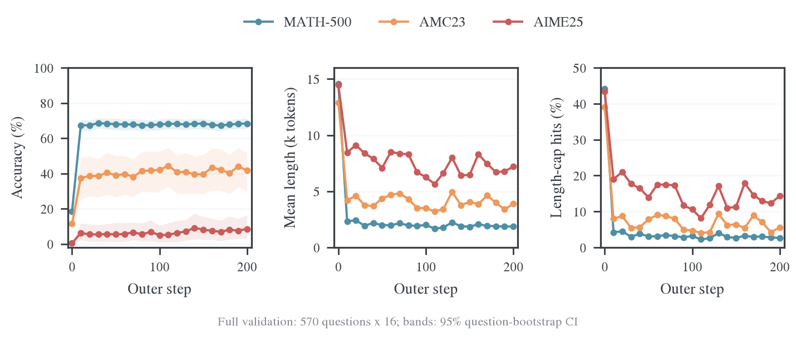
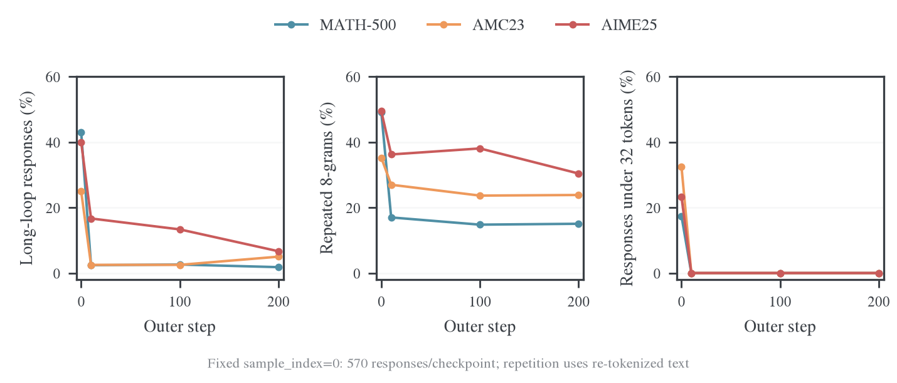
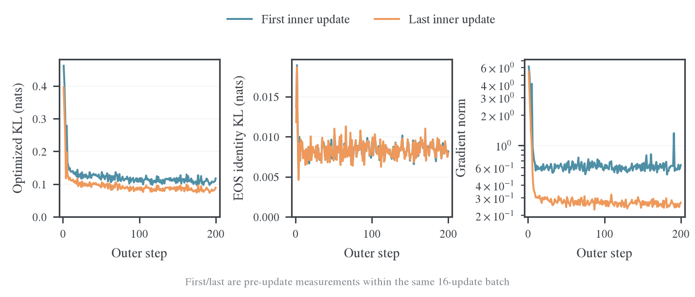
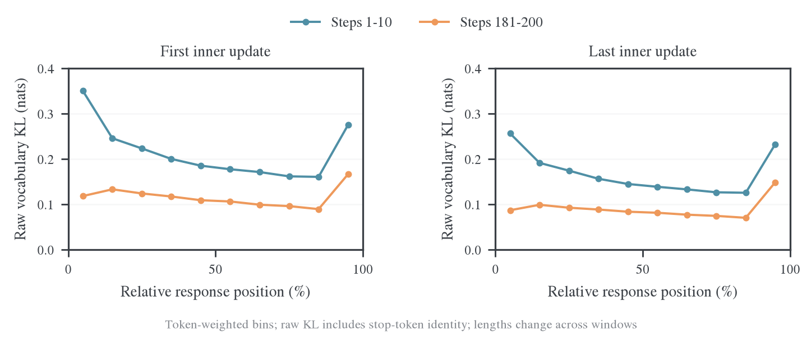
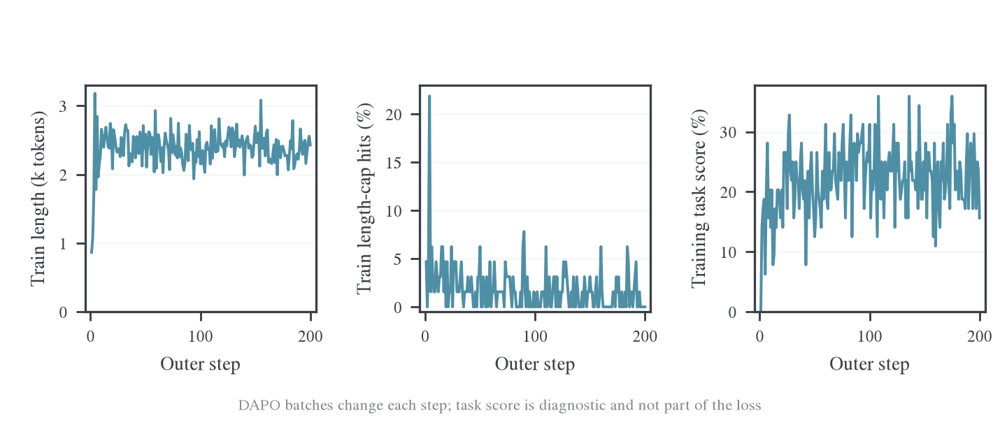
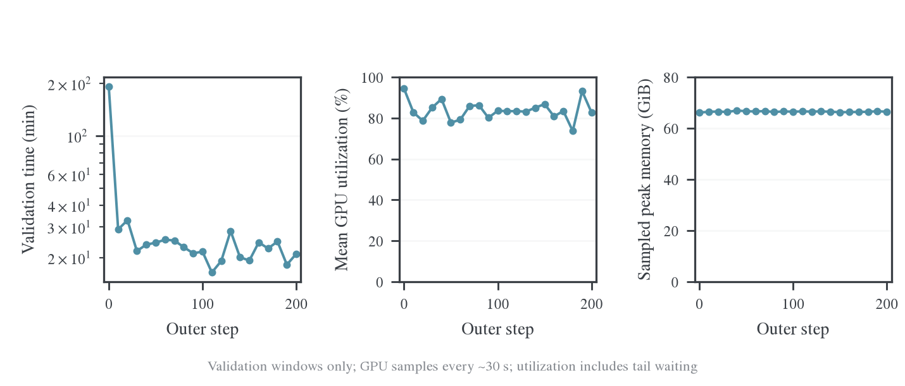

# Qwen3-1.7B-Base 蒸馏 Qwen3-8B：完整训练与验证分析

Qwen3-1.7B-Base 在本次 Full-r16、终止动作对齐设置下完成 200 个 outer step、3,200 次实际参数更新。21 轮完整验证覆盖初始 checkpoint 与 step 10–200，合计 191,520 条回答。训练于北京时间 2026-10-26 22:26 启动，2026-10-27 12:12 正常退出；本地退出码为 0，原始 W&B 日志完整解码，云端状态为 finished。GPU 4–7 已由守护程序恢复占用。

主要收益发生在前 10 步：模型从大量极短无效输出和长循环，转为较完整、可结束的解答，验证准确率大幅上升。此后同批 KL 仍能下降，但新批 KL 与验证准确率逐渐进入平台。最终模型没有继续崩溃，仍保留困难题错误、部分长循环与明显的 teacher 差距。

| 设置 | 实际值 |
| --- | --- |
| Student / Teacher | Qwen3-1.7B-Base / Qwen3-8B，teacher 冻结 |
| 目标 | Full-vocabulary reverse KL；合并终止动作 151643 与 151645 |
| 训练预算 | 200 outer × 16 reuse；全局 batch/mini-batch 64；每题 1 个 rollout |
| 优化 | AdamW，LR 1e-6，seed 42；常量学习率 |
| 资源 | 8 张 H800，共享同步执行；vLLM TP1，每卡并发 64，显存比例 0.8 |
| 生成协议 | Qwen3 non-thinking 提示，enable_thinking=False |
| 训练长度 | prompt 1,024 / response 7,168 |
| 验证 | 570 题 × 16，温度 0.7、top-p 0.9、top-k -1，回答上限 31,744 |
| 验证与保存 | 初始及每 10 outer 验证；step 50/100/150/200 保存 checkpoint |

这是 E39 模型配置上的 200-step 对齐目标实验，预算、验证频率与目标开关均记录在实际配置中，不等同于预设原有的 250-step 原始词表 KL 对照。以下验证分数始终属于 student；本轮没有生成完整 teacher 验证结果。

准确率使用每题 16 次采样的平均正确率。表中长度是平均生成 token 数，截断率来自实际 finish_reason=length，而不是 padded_width_fraction。

| 数据集 | 初始准确率 | Step 10 | 最终 Step 200 | 平均长度：初始 → 最终 | 截断率：初始 → 最终 |
| --- | ---: | ---: | ---: | ---: | ---: |
| MATH-500 | 18.59% | 67.44% | 68.39% | 14.57k → 1.87k | 44.20% → 2.65% |
| AMC23 | 11.41% | 37.50% | 41.72% | 12.91k → 3.89k | 39.06% → 5.62% |
| AIME25 | 0.42% | 6.25% | 8.54% | 14.47k → 7.20k | 43.33% → 14.37% |

全体回答加权后的平均正确率从 17.13% 升到 63.37%，平均长度从 14.45k 降到 2.29k，截断率从 43.79% 降到 3.48%。MATH-500 占 500/570 道题，因而主导这个加权总分；三个数据集等权平均正确率为 10.14% → 39.55%。初始不足 32 token 的回答占 16.89%，最终为 0，长度下降伴随着有效解答增加。

最终 pass@16 分别为 MATH-500 89.2%、AMC23 77.5%、AIME25 33.3%。它衡量 16 次里至少答对一次，与平均正确率不是同一指标。本文按预先约定的最终 checkpoint 报告结果，没有从多个验证点挑选最高分替代末点。

后半程增长较小。以同一道题的 16 次平均正确率作配对，按题 bootstrap 5,000 次，step 10 到 step 200 的变化如下。区间反映这一 seed 下的题目抽样不确定性，不包含独立训练 seed 的方差；多 checkpoint 的探索性比较不应当作预注册显著性检验。

| 数据集 | Step 10 → 200 的变化（百分点） | 配对 bootstrap 95% 区间（百分点） |
| --- | ---: | ---: |
| MATH-500 | +0.95 | [-0.55, +2.51] |
| AMC23 | +4.22 | [-0.31, +8.91] |
| AIME25 | +2.29 | [-0.42, +6.25] |

三个区间都跨过零，当前证据不足以确认 step 10 后的提升稳定。AIME25 相对 step 100 的后期提升在这一配对分析中更明显，但只有 30 道题，且不同参考 checkpoint 的结论会变化；应保留“小幅、波动的改善”这一判断，而不是把最后一个点解释为持续突破。

为直接检查重复，固定每题 sample_index=0，分别读取 step 0/10/100/200 的 570 条回答。保存文本用同一 student tokenizer 重新分词；长循环定义为周期 1–128 token、至少重复 4 次且连续跨度至少 128 token，repeat8 为回答内部重复 8-gram 占比再按回答平均。这是固定题目面板的文本重复统计，不是全部 191,520 条回答的原始生成 token 重复率。公式复述等正常内容也会产生重复8-gram，应与长循环、长度和样本一起解释。

| Checkpoint | 面板回答数 | 长循环回答比例 | 平均重复 8-gram 比例 |
| --- | ---: | ---: | ---: |
| 0 | 570 | 41.58% | 48.08% |
| 10 | 570 | 3.16% | 18.70% |
| 100 | 570 | 3.16% | 16.63% |
| 200 | 570 | 2.28% | 16.47% |

改善后仍有两类不同问题：少量回答继续长循环，另一些回答正常结束但数学推导错误。最终 AIME25 的 14.38% 回答撞长度上限，平均错误回答约 7.74k token，正确回答约 1.45k；长度长尾仍主要落在错误输出。一个判分正确的样本也出现了未经推导的“已知结果”，所以答案匹配不能证明推理过程可靠。具体题目、原文摘录与错误定位见[最终样本分析](2026-10-27-最终样本分析.md)。

训练损失优化的是 `distill/termination_equiv_kl`。`distill/full_kl` 保留原始词表 KL，`distill/eos_identity_kl` 是两者的差。三者应分别解释，不能把原始 KL 或终止 token 身份差异下降当作任务正确率提升。

| Outer 窗口 | 批首优化 KL | 批末优化 KL | 平均同批相对下降 | 批首原始 KL | 批末原始 KL |
| --- | ---: | ---: | ---: | ---: | ---: |
| 1–10 | 0.2394 | 0.1884 | 22.13% | 0.2494 | 0.1980 |
| 11–30 | 0.1300 | 0.1038 | 20.19% | 0.1378 | 0.1117 |
| 81–100 | 0.1133 | 0.0861 | 24.01% | 0.1219 | 0.0947 |
| 121–140 | 0.1113 | 0.0856 | 23.09% | 0.1196 | 0.0938 |
| 181–200 | 0.1078 | 0.0820 | 23.89% | 0.1162 | 0.0904 |

批首和批末分别是同一批第 1 次和第 16 次更新前的 loss 观测。末期每批仍能降低约 24%，但换到新的一批轨迹后，批首优化 KL 仍约 0.108；这与验证准确率平台同时存在。它说明“同批拟合仍有效”与“跨新轨迹、跨验证题目继续提升”是两件不同的事，不能据此直接判定过拟合或确定平台的唯一成因。

3,200 次更新均实际执行，没有非有限 loss、非有限梯度或跳过更新。最大裁剪前梯度范数为 6.11，主要出现在早期；末 20 批首／末均值约 0.634／0.258。最终一次更新前，优化 KL 为 0.0892，原始 KL 为 0.0971，终止 token 身份项约 0.0080。教师前向、actor 更新及权重同步均完成，没有 OOM 退出。

`full_kl_position` 按回答自身相对位置分成十段，图中对每段累计 sum/count 后求均值，避免把 token 数量当成损失大小。它仍是原始词表 KL，包含终止 token 身份差异。

末 20 步的批末原始 KL，在前 90% 的位置约为 0.070–0.099，最后 10% 约为 0.149；前 10 步对应尾段约 0.233。整体位置失配降低，但末端仍较高。由于回答长度和访问前缀随训练变化，同一相对位置不代表相同绝对 token 位置；原始尾段 KL 也不能直接代表合并终止动作后的尾段优化梯度。

训练 DAPO 的批次题目持续变化，训练平均长度及任务分数不能与固定验证集一一比较。末 20 个训练 batch 平均长度约 2.38k，截断率约 1.33%，任务平均分约 22.11%；任务分数只作诊断，本次损失不使用任务奖励。完整训练长度、截断和任务分数见下面的原始逐批曲线。

整个运行墙钟约 13.76 小时：初始验证 3.21 小时，之后 20 次验证合计 7.71 小时，训练与保存等 outer-step 主流程合计 2.77 小时，其余为初始化、收尾等开销。验证占墙钟约 79%。总计生成约 5.74 亿个验证 token；不能把全部墙钟时间当作 3,200 次参数更新的计算时间。

训练主流程内部，rollout 管线累计 1.08 小时、actor 更新 1.43 小时、teacher 前向约 5.0 分钟；这些是主流程的组成部分，不能再与 2.77 小时重复相加。FSDP worker 上报的 allocated peak 最大约 11.45 GiB，未单独分解 teacher 与 actor 的峰值；这与包含 vLLM 预分配池的整卡显存不是同一个口径。

图中耗时轴采用对数刻度。生成期间各卡经常满载，但整轮验证还包含等待长尾。训练后各轮 valid 的 GPU 平均利用率约为 73.7%–93.2%，整卡采样显存峰值最高约 67.0 GiB。当前运行未完整记录 KV block 使用率和抢占计数，不能据此声称没有 KV 竞争或算出重算损失。资源口径和逐卡收尾证据见[完整验证资源实测](2026-10-27-并发64验证阶段资源实测.md)。

完整 teacher 基线仍待补齐。现有 Qwen3-8B 历史子集每个数据集 8 题、每题 4 次；将最终 student 的相同题目、每题 16 次与其比较，得到下表。两边均为 non-thinking、温度 0.7、top-p 0.9、回答上限 31,744，但每题采样次数、模型及执行条件不同；该表不能替代 teacher 全集评测。

| 相同的 8 道题 | Teacher 平均正确率 | 最终 Student 平均正确率 | Teacher 平均长度 | Student 平均长度 |
| --- | ---: | ---: | ---: | ---: |
| MATH-500 | 87.50% | 70.31% | 1.51k | 2.98k |
| AMC23 | 87.50% | 53.91% | 1.19k | 3.26k |
| AIME25 | 28.12% | 6.25% | 5.22k | 8.58k |

本次结果证明这组设置在单 seed 下能显著缓解 Base 的生成退化，并改善三个验证集的准确率。单条长程运行无法把全部收益归因于某一项修改，也不足以证明继续增加 step 或 reuse 会带来相应的准确率增长。后续最有价值的证据是同协议 teacher 全集参考，以及对平台阶段的新前缀失配和具体解题错误做受控分析。

本报告使用本地原始 W&B 文件解码的完整 3,401 条 history，未用云端采样 history 拼接学习曲线。启动保存的源码快照记录为 `a73dcbc0f`；SDK 自动记录的 Git 字段来自父目录仓库，不能代替该快照的来源说明。原始日志、本次配置和分析输入位于独立日志仓库；正文只链接冻结数据及可复算脚本。运行页面见参考链接。[^run]

- [冻结配置](../../../../../../wandb-logs/MirrorOPD-verl/analysis/e39-qwen3base-final-20261027/config.json)、[完整 history](../../../../../../wandb-logs/MirrorOPD-verl/analysis/e39-qwen3base-final-20261027/history.jsonl)、[完成状态与分析摘要](../../../../../../wandb-logs/MirrorOPD-verl/analysis/e39-qwen3base-final-20261027/analysis.json)。
- [逐次验证 CSV](../../../../../../wandb-logs/MirrorOPD-verl/analysis/e39-qwen3base-final-20261027/validation.csv)、[逐批训练 CSV](../../../../../../wandb-logs/MirrorOPD-verl/analysis/e39-qwen3base-final-20261027/training.csv)、[位置 KL](../../../../../../wandb-logs/MirrorOPD-verl/analysis/e39-qwen3base-final-20261027/position-kl.csv)。
- [配对准确率区间](../../../../../../wandb-logs/MirrorOPD-verl/analysis/e39-qwen3base-final-20261027/paired-accuracy.json)、[固定题目重复面板](../../../../../../wandb-logs/MirrorOPD-verl/analysis/e39-qwen3base-final-20261027/sample-panel-summary.csv)、[完整样本摘录](../../../../../../wandb-logs/MirrorOPD-verl/analysis/e39-qwen3base-final-20261027/sample-examples.json.gz)。
- [分析脚本](scripts/analyze_final.py)、[绘图脚本](scripts/plot_final.py)。所有六组图均保存 PNG、PDF、SVG，审计文件随图保存。

[^run]: W&B. Qwen3-1.7B-Base ← Qwen3-8B，Full-r16，200 outer step. [运行页面](https://wandb.ai/wncfht/MirrorOPD-verl/runs/f0e44ec7)。
