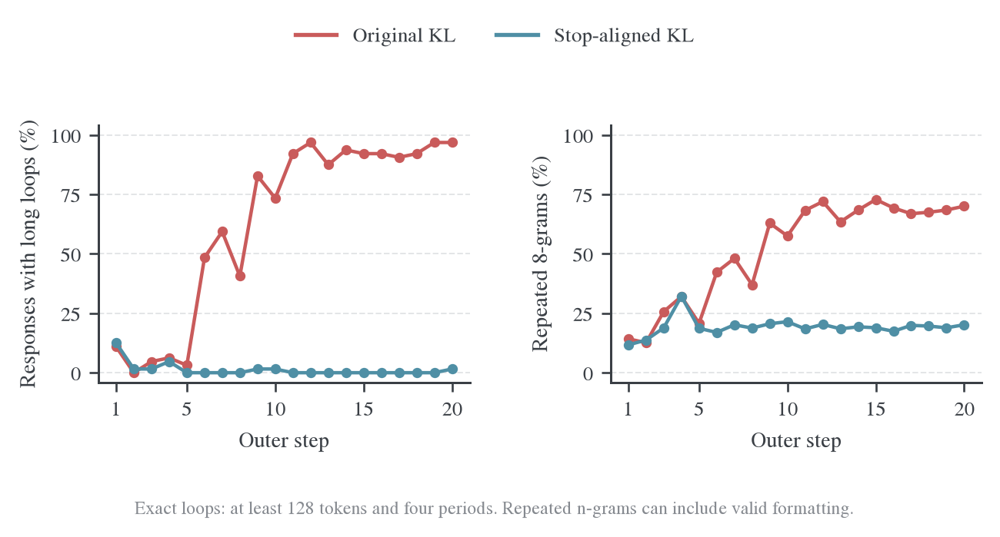
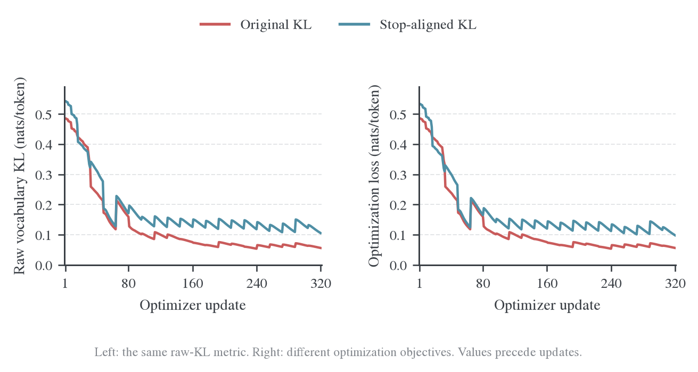
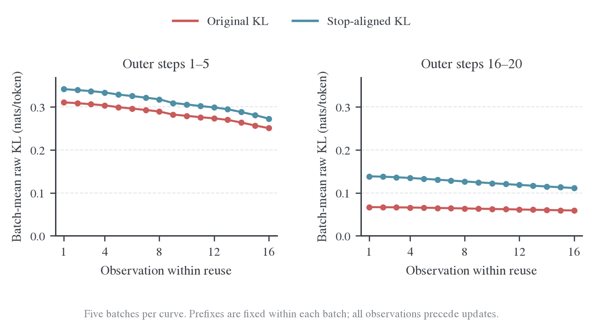
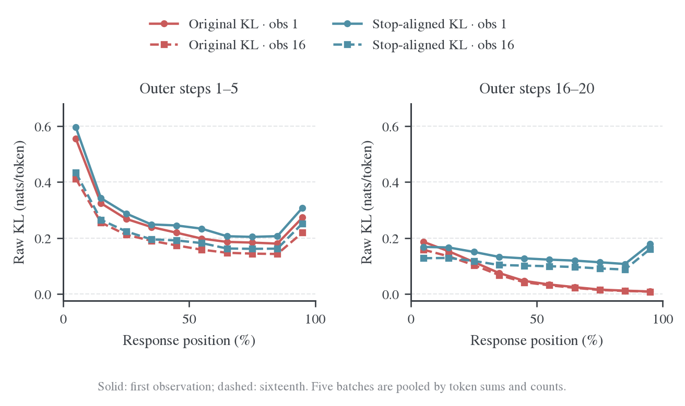
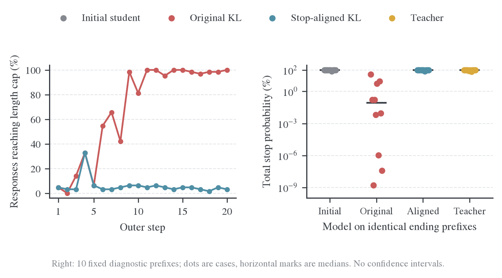
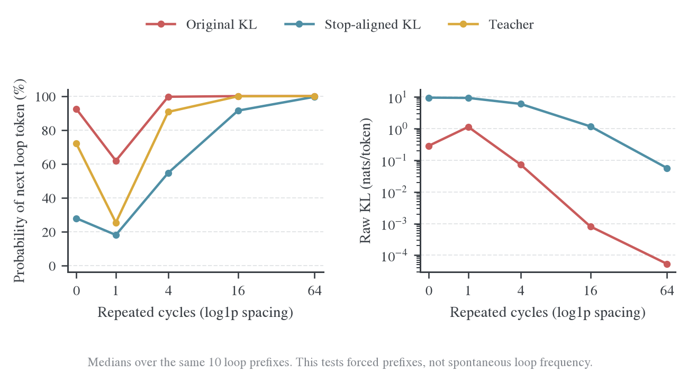

# E41：终止动作对齐与生成行为对照

正式E41入口现已默认启用这项修正，可显式恢复原始词表KL；使用方式、支持范围和指标定义见[配置与实现](2026-10-26-终止动作对齐的配置与实现.md)。下面保留两组实验的原始对照结果，不改变已有数据口径。

Qwen3-1.7B-Base 学生、Qwen3-4B 教师，四张 H800，各训练 20 个 outer step、320 次更新。两个实验的 20 批训练题目逐步一致，区别仅为优化 KL 时是否将两种合法结束 token 合为一个停止动作。两组均完成数据与更新验收，未运行独立验证。

**停止动作对齐大幅减少了这组短训练中的循环和长度膨胀，但没有显示数学正确率提高。** 下表比较最后 5 步，各 320 条回答。

| 指标 | 原始词表 KL 训练 | 终止动作对齐训练 |
| --- | ---: | ---: |
| 平均回答长度（千 token） | 7.11 | 2.61 |
| 长度中位数（千 token） | 7.17 | 2.12 |
| 回答达到长度上限 | 98.4% | 3.4% |
| 存在长循环的回答 | 93.8%（300/320） | 0.3%（1/320） |
| 平均重复 8-gram 比例 | 68.5% | 19.2% |
| 少于 32token 的回答 | 0% | 0% |
| 训练题目评分均值 | 24.7% | 23.4% |
| 固定结束前缀的停止概率中位数 | 0.084% | 99.95% |

折线图中红色表示原始词表 KL 训练，青色表示终止动作对齐训练；热图颜色只表示 KL 数值，四个面板共用色标。时间坐标区分 outer step 和 optimizer update：每个 outer 生成 64 个新回答，复用 16 次，每次 loss 观测发生在对应参数更新之前。曲线直接连接实际观测点，不做平滑或缺失值补齐。

## 长度与回答分布


左图显示原始实验逐渐接近 7 Ki token 上限，对齐实验则稳定在约 2–3 千 token。右图使用最后 5 步的全部回答绘制经验累积分布，保留了原实验在上限处的集中堆积。对齐组末 5 步没有少于 32token 的回答，长度改善并非靠大量空答或极短回答实现。

[逐步数据](data/outer-metrics.csv) · [逐回答数据](data/response-metrics.csv)

## 循环重复



“长循环”要求连续重复片段至少 128 个 token、周期不超过 128 个 token、至少重复 4 次。“重复 8-gram 比例”在每条回答内统计重复出现的连续 8-token 窗口，再对回答取平均。前者侧重机械循环，后者还会包含正常数学格式，因此不把二者混成一个质量分数。

原实验后期的循环比例接近 100%；对齐组大多数训练批没有长循环，但仍保留约 19% 的重复 8-gram，不能理解为所有重复表达都消失了。完整同题片段见[样本对照](2026-10-26-同题样本对照.md)。

## 原始 KL 与优化 loss



左图的 `distill/full_kl` 在两组中始终是同一个原始词表 KL。右图是实际优化 loss：原实验优化原始 KL，对齐实验优化停止动作等价类上的 KL；两条优化 loss 不是完全相同的目标，不能仅凭绝对值较低判断哪个模型更好。

原实验的原始 KL 更低，同时循环更多。这与“给定重复前缀时，教师也可能认为继续重复很合理”相容；低 KL 不直接衡量回答是否完整、正确或有用。

| 对齐实验的指标 | 含义 |
| --- | --- |
| `distill/full_kl` | 未修改的原始词表 KL，用于可比诊断 |
| `optim/actor/loss`、`distill/termination_equiv_kl` | 实际优化目标，两者在记录中一致 |
| `distill/eos_identity_kl` | 原始 KL 减去对齐目标，即结束 token 身份差异项 |

[640 次更新记录](data/update-metrics.csv) · [目标定义与梯度推导](2026-10-26-终止动作与循环退化诊断.md)

## 同批次复用中的 KL 变化



每条曲线对 5 个训练批等权平均，展示同一批固定前缀上的 16 次更新前观测。两个窗口使用相同纵轴范围。两组均在批次内继续降低原始 KL；原实验后期的低值同时伴随严重循环，不能把它解释为生成质量已经收敛。

[复用曲线数据](data/reuse-profiles.csv)

## Full-KL position：全程位置分布


每条回答按自身实际长度分成十段，统计有效 token 上的原始词表 KL，不包含 prompt。四个面板分别是两组实验在每批第 1 次和第 16 次更新前的观测，使用相同色标。结束 token 若属于有效回答，也计入位置统计。

对齐优化目标没有单独记录逐位置桶，不能从全局 loss 差额恢复，所以本图保留可比的原始词表 KL，不将它改名为对齐后的 position loss。

位置不是按 7 Ki token 上限或绝对 token 编号划分：短回答的“末 10%”与长回答的“末 10%”包含不同数量、不同内容的 token。各桶用 KL 之和除以 token 数；长回答权重更大，不能简单平均桶均值来重建总体 KL。

## Full-KL position：前后窗口与复用变化



每个面板汇总 5 个训练批，按 sum/count 加权。实线是第 1 次观测，虚线是第 16 次观测；二者都来自实际测量，不是预测。相同批次的前缀固定，两次观测之间包含 15 次更新。

末 5 步第 16 次观测中，回答前 30% 的 KL 相近：原实验约 0.132，对齐实验约 0.125；后 30% 则分别约 0.011 与 0.113。原实验低后缀 KL 与大量循环同时出现，不能解释为推理更好。两组生成内容和长度不同，位置桶本身也不足以将全部差异归因于某一类 token；固定前缀诊断提供另一层证据。

[全部 6,400 行位置统计](data/full-kl-position.csv) · [加权位置剖面](data/position-profiles.csv)

## 终止行为



左图是实际生成的触顶比例。右图在相同 10 个诊断前缀上比较初始学生、原始 KL 训练后的学生、对齐训练后的学生及教师；每个点是一条前缀，横线是中位数，纵轴为对数概率。前缀取自早期自然结束的回答，不用于估计所有输入上的停止概率。

初始学生与教师都几乎确定应该结束，但分别偏好不同的结束 token。原始 KL 训练破坏了这些前缀上的终止能力；对齐模型保留了它。对齐组末 5 步有 309 条回答使用学生原生结束 token 正常结束，11 条达到长度上限；没有替换实际生成 token 或缩短上限。

[逐前缀停止概率](data/fixed-prefix-stop.csv) · [完整诊断分布](data/README.md#固定前缀诊断)

## 训练稳定性与评分边界


左图是裁剪前梯度范数，虚线为裁剪阈值 1。两组 320 次更新全部执行，loss、梯度和 KL 均有限，没有用跳过更新掩盖数值故障。右图是每批训练题目的已有 verifier 得分，不是独立验证准确率。

对齐组末 5 步得分 23.4%，原实验 24.7%；没有证据表明数学正确率提高。单 seed 短训练也不能证明长程收敛、跨 seed 稳定性或泛化改善。

| 资源与执行 | 原始词表 KL | 终止动作对齐 |
| --- | ---: | ---: |
| 全程显存峰值（四卡中最大，GiB） | 66.1 | 66.0 |
| 作业墙钟（分钟） | 48.5 | 27.4 |

墙钟包含初始化和最终保存；两组生成长度不同，耗时差异不能单独归因于计算内核加速。

## 循环前缀为何能产生低 KL



在相同 10 个后期循环样本上，比较重复 0、1、4、16、64 个周期后的条件预测；横轴按 log(1+ 重复次数) 布局。教师和两个学生看到的是相同的固定前缀，图中是 10 个样本的中位数。

教师在深循环前缀上预测下一个循环 token 的概率接近 100%；原实验学生也高度一致，原始 KL 降得很低。对齐模型在循环入口更不倾向继续该 token，但深度强制重复仍可让它受到前缀影响。这支持“避免破坏终止能力、减少进入循环”的解释，不意味着模型能从任意循环上下文中自行恢复。

右图保留未合并结束 token 的原始 KL，仍包含结束身份差异项，不能只按高低判断这些固定前缀上的行为好坏。

[循环前缀数据](data/loop-prefix.csv)

## 受控配置

| 项目 | 两组共同设置 |
| --- | --- |
| 学生 / 教师 | Qwen3-1.7B-Base / Qwen3-4B |
| 资源 | 四张 H800，shared_sync |
| 数据 | DAPO，按 1 Ki token 的 prompt 上限过滤；20 批 prompt 逐步相同 |
| 预算 | 20 个 outer，batch64，reuse16，320 次更新 |
| 优化器 | AdamW，学习率 1e-6，betas=(0.9,0.999)，weight decay=0.01，grad clip=1 |
| 生成资源 | 每卡并发 24，显存比例 80%，调度预算 8 Ki token |
| 训练采样 | temperature=1，top-p=1，top-k 关闭，无额外重复惩罚 |
| 回答上限 | 7 Ki token；两个结束 ID 均能终止回答 |
| Teacher 评分预算 | 32 Ki token，BF16 |
| Full-vocab 计算 | precompute，token chunk512，vocab chunk8192 |
| 验证与保存 | 不做初始或周期 valid；第 20 步保存 checkpoint |

两组数据种子相同，但异步随机采样不保证逐 token 结果完全一致，首批 loss 也已有差异。本页将结果视为单次受控实验及机制证据，不进行统计显著性宣称。

## 本地数据与复现

本目录包含绘图所需的全部数据、压缩原始指标、完整训练回答、诊断分布及代码差异。图提供 PNG 预览和 SVG 矢量版本。

- [数据说明与口径](data/README.md)
- [图表文件与 SVG 矢量版本](figures/README.md)
- [数值重算检查](data/audit.json)
- [图形审计](figures/audit.json)
- [独立复制与重绘检查](data/portability-check.json)
- [重算脚本](scripts/build_data.py)
- [绘图脚本](scripts/render_figures.py)
- [实现差异](code/termination-equivalence.patch)

在本目录中，用包含 NumPy 和 Matplotlib 的 Python 环境运行：

```bash
python scripts/build_data.py
python scripts/render_figures.py
```

重绘只读取本目录的数据，不需要 GPU 或模型权重。图形样式已随目录保存；可选的 figure-viz 审计器可通过 Python 搜索路径加载，当前提交的图形已经过完整审计与目检。

依赖版本见[scripts/requirements.txt](scripts/requirements.txt)，实际生成环境见[data/render-environment.json](data/render-environment.json)。
