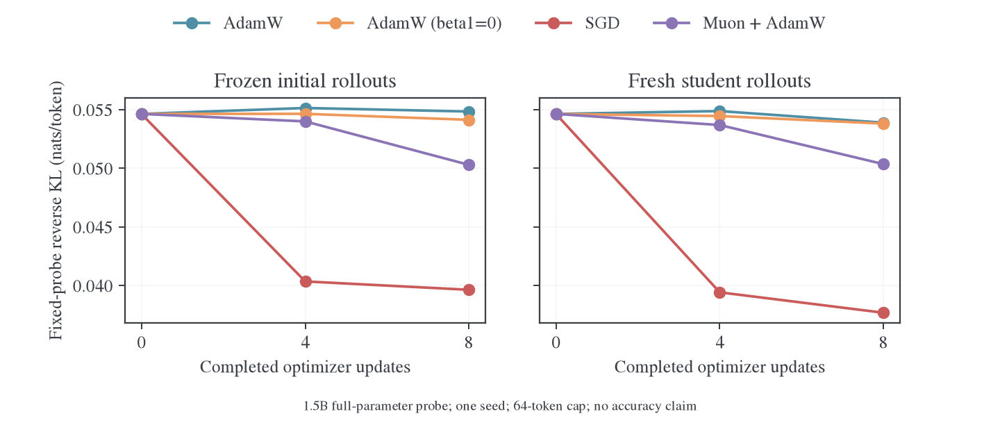

# Full-vocab reverse KL 的优化器小实验

更新日期：2026-10-27。范围限定为全参数 student、冻结 teacher、直接完整词表 reverse KL；没有 sampled-token PG、top-k 目标、任务奖励、anchor 或 mirror 目标。已完成 BF16 两种轨迹条件共 8 组、64 次更新，FP32 4 组、8 次更新，以及独立数值验算与同更新精度控制。实验是短程机制验证，不是数学能力或长期 optimizer 排名。

后续方案见[大规模实验计划](2026-10-27-Full-vocab-OPD优化器大规模实验计划.md)：包括独立学习率搜索、reuse 对照、任务评测、更新与精度诊断、FSDP2 Muon 适配及代码验收要求。该计划尚未执行。

## 从实现到条件梯度

仓库 [full-vocab 说明](../../internals/full-vocab.md)规定：学生生成 response，教师在同一前缀上提供 hidden/head；actor 在固定序列上执行条件 KL 反传。下面令教师分布为 $T_s$，学生为 $p_\theta(\cdot\mid s)$，一个冻结轨迹批次给出经验 token 测度 $\widehat d_B$。训练目标为

$$
L_B(\theta)=\mathbb E_{s\sim\widehat d_B}\left[K_s(\theta)\right],\qquad
K_s=\sum_a p_a\log\frac{p_a}{T_a}.
$$

更新时不对轨迹采样或 token ID 求导。Full-vocab 只完整枚举动作词表，不枚举全部可能前缀。记 $z_s$ 为 logits、$J_s=\partial z_s/\partial\theta$，$r_a=\log p_a-\log T_a$。由 $\partial p_a/\partial z_b=p_a(\mathbf 1_{a=b}-p_b)$，有

$$
\begin{aligned}
\frac{\partial K_s}{\partial z_b}
&=\sum_a p_a(\mathbf1_{a=b}-p_b)(r_a+1)\\
&=p_b\left(r_b+1-\sum_a p_a(r_a+1)\right)
=p_b(r_b-K_s).
\end{aligned}
$$

令 $\delta_s=p_s\odot(r_s-K_s\mathbf1)$，则

$$
g_B=\nabla L_B=\mathbb E_{\widehat d_B}[J_s^\top\delta_s],\qquad
\mathbf1^\top\delta_s=0.
$$

这对应当前仓库的 [kl_rows](../../../../../verl/trainer/distillation/numerics.py)及 [full_reverse_kl](../../../../../verl/trainer/distillation/full_vocab.py)。教师如果有额外输出行，应在完整教师支持上归一化；它们对 KL 值贡献支持校正项，不能偷偷将教师截断后重归一化。实验使用生产 endpoint 的该处理。

## 接近教师时的局部曲率

先考虑师生相同输出支持，并在 $p=T$ 处展开。记 $F_T=\operatorname{diag}(T)-TT^\top$，对 logits 扰动 $u$，softmax Jacobian 为 $F_T$。由于该点 $r=0$ 且 KL 一阶梯度为零，有

$$
K(z_*+u)=\frac12u^\top F_Tu+O(\|u\|^3),\qquad
\nabla_z^2K(z_*)=F_T.
$$

若参数 $\theta_*$ 在全部被比较前缀上都匹配教师，则链式求导中乘有 $\nabla_zK$ 的二阶项消失，得到

$$
H_B(\theta_*)=\mathbb E_{\widehat d_B}[J_s^\top F_{T_s}J_s]\succeq0.
$$

这个局部 Fisher/Gauss–Newton 结构不意味着一般状态的 reverse KL 在网络参数上凸，也不意味着 Adam 的二阶矩就是上述 Hessian。

## 同一个梯度经过三种 optimizer

无动量、无衰减、无裁剪的 SGD 使用 $\Delta=-\eta g_B$。固定批次和足够小步长下，线性项为 $g_B^\top\Delta=-\eta\|g_B\|^2$。近教师的局部特征方向以 $1-\eta\lambda_i(H_B)$ 收缩，曲率不同会导致收敛速度不同。

AdamW 在本实验关闭衰减，使用 $\Delta=-\eta P_t\hat m_t$，$P_t=\operatorname{diag}(1/(\sqrt{\hat v_t}+\epsilon))$。固定 $P$ 且暂时省略偏差校正时，局部递推为 $e_{t+1}=e_t-\eta Pm_t$、$m_t=\beta m_{t-1}+(1-\beta)H_Be_t$；消去动量，得到

$$
e_{t+1}=[(1+\beta)I-\eta(1-\beta)PH_B]e_t-\beta e_{t-1}.
$$

方向与步长均由历史和预条件化决定。真实 Adam 的 $P_t$ 随梯度变化，上式仅是局部定系数解释。

Muon 对隐藏矩阵梯度的动量做近似极分解。理想化紧致 SVD 为 $M=U_r\Sigma_rV_r^\top$，对应矩阵更新 $-\eta c(m,n)U_rV_r^\top$；本实验使用原生 PyTorch 的 Nesterov、五步 Newton–Schulz 与 `match_rms_adamw` 缩放。Embedding、输出头及归一化参数由辅助 AdamW 更新。因此它使用相同的条件 KL 梯度，但改变矩阵更新几何；有历史时同样可能滞后。

### 可直接验算的三个结论

1. 冷启动 Adam 的首步经过 bias correction 后为 $-\eta g/(|g|+\epsilon)$，与 beta1 无关。单步比较 beta1=0 与 0.9 不能验证长期动量假说。
2. 给定同一 $g$ 和相同全参数 L2 位移预算，SGD 的 $-g$ 方向取得最大线性下降。这是 Cauchy–Schwarz 的结果，不证明它在有限步长、曲率或独立前缀上最好。
3. 每步 Muon 更新的谱和累计参数差分的谱是不同对象；不能由 OPD 最终差分谱集中直接断言 Muon 不适合。

## 刷新轨迹时优化的向量场

若每轮重新由学生采样，期望更新信号是 $G(\theta)=\mathbb E_{d_\theta}[\nabla_\theta K_s(\theta)]$，当前代码不计算访问分布导数。它一般不同于 $\nabla\mathbb E_{d_\theta}K_s$。对有限状态或满足交换微分条件的分布，

$$
\begin{aligned}
\nabla\mathbb E_{d_\theta}K_s
&=G(\theta)+\mathbb E_{d_\theta}[K_s\nabla\log d_\theta(s)],\\
DG(\theta)
&=\mathbb E_{d_\theta}[\nabla^2K_s]
+\mathbb E_{d_\theta}[(\nabla K_s)(\nabla\log d_\theta(s))^\top].
\end{aligned}
$$

第二式的后项不必对称，所以刷新轨迹后的半梯度场未必是某个静态势函数的梯度。动量的作用取决于访问分布变化、噪声与曲率，不能由固定批次下降定理推出统一优劣。在所有状态匹配教师时 $\nabla K_s=0$，这项消失。附带的两 token 自回归穷举验证只用于验证该数学现象，不代表真实 LLM 性能。

## 实验设计与数据边界

[audit.py](audit.py) 使用 FP64 独立 dense oracle，对照生产 KL 值、解析 logits VJP、零和性质、匹配点 Hessian，以及冷启动 Adam 的 beta1 不变性。还验证逐矩阵执行原生 Muon 与整体调用一致。

[study.py](study.py) 参考已有 [状态迁移小实验](../polaris-transfer/scripts/state_transfer_probe.py)的低显存 FP32 master / CPU state 方式，直接调用生产 Full-KL endpoint。使用 DeepSeek-R1-Distill-Qwen-1.5B 学生和 JustRL-DeepSeek-1.5B 教师；全参数可训练，模型前反向 BF16，CPU FP32 masters 长期累积，optimizer 状态 FP32。每个 mini-batch 的梯度在 CPU FP32 累积后做统一 global norm 1 裁剪。

从 DAPO 选择短 prompt：4 条用于更新，另 4 条只作固定初始学生前缀上的条件 KL probe。Teacher 始终冻结，所有生成位置都进入完整词表求和，无 token 子采样或 top-k。短 response 上限会截断推理，故不把输出正确率当作能力指标。

四个候选为标准 AdamW、beta1=0 的 AdamW、无动量 SGD、Muon+辅助 AdamW。共同 beta2=.999，全部 weight decay=0。各 seed 用相同初始批次，将首步 FP32 参数位移 L2 对齐到 AdamW lr=1e-6；之后各自使用固定学习率，不逐步强行对齐。该设计控制冷启动幅度，不代替独立学习率搜索。

冻结条件复用初始学生回答；online 条件每 outer 重新生成当前学生回答，每批连续 reuse 两次。两个条件的 prompt 调度相同。固定 probe 不随各方法更新，比较 teacher KL、初始 student KL 和熵；训练历史记录同批更新前后 KL、梯度范数、实际参数位移、动量夹角和显存。

当前使用一个配对 seed42，每条件每方法 4 outer × reuse2。历史动量夹角在更新前计算，即 $\cos(m_{t-1},g_t)$；beta1=0 分支的该字段是上一梯度与当前梯度的关系，不是其实际更新使用了历史。模型名为 1.5B，实际 1,777,088,000 个参数全部可训练，师生输出均为 151,936 行。初始轨迹全部达到 64 token 上限；未对任务正确率评分。Muon 的辅助 AdamW 与主组共用该方法校准后的学习率，故比较包含参数组步长分配，不是只改变正交化的一项严格消融。

原始日志、协议、rollout、逐步数据归档于同级日志仓库 `MirrorOPD-verl/analysis/full-rkl-optimizers-20261027/`。这些是新增小实验，不混入正式 E 系列或既有 W&B 运行记录，不上传云端。共享 GPU 上的耗时不能作为 optimizer 系统性能排名。

## 实测结果

### 八步后的独立固定前缀 KL

所有 BF16 分支共享同一初始 probe，KL 为 0.05462740 nats/token。四个独立 prompt 各有 64 个初始学生前缀，均未参与参数更新。下降比例由相同初值计算，负数表示变差。

| Optimizer | 冻结轨迹：最终 KL | 下降比例 | 刷新轨迹：最终 KL | 下降比例 |
| --- | ---: | ---: | ---: | ---: |
| AdamW | 0.05482965 | −0.37% | 0.05387832 | 1.37% |
| AdamW，beta1=0 | 0.05412094 | 0.93% | 0.05379894 | 1.52% |
| SGD，无动量 | 0.03962492 | 27.46% | 0.03766570 | 31.05% |
| Muon + AdamW | 0.05027841 | 7.96% | 0.05034116 | 7.85% |



图为一个 seed 的原始曲线，无误差带；[PDF](figures/probe-kl.pdf)、[SVG](figures/probe-kl.svg)与[图形审计](figures/figure-audit.txt)同时保留。汇总由 [analyze.py](analyze.py)从逐步 JSON 重算，原始[CSV](../../../../../../wandb-logs/MirrorOPD-verl/analysis/full-rkl-optimizers-20261027/summary.csv)和[JSON](../../../../../../wandb-logs/MirrorOPD-verl/analysis/full-rkl-optimizers-20261027/summary.json)保存在日志仓库。

BF16 首步 FP32 参数位移 L2 约 0.03588，四方法实测首步范数偏差小于 0.01%。对应学习率为 AdamW 1e-6、beta1=0 AdamW 约 1e-6、SGD 0.0358774、Muon 1.24713e-5。这个小实验确实出现 SGD 和 Muon 的 probe KL 优于 AdamW，且共同 weight decay=0，因而可以排除该设置中 weight decay 差异的解释。

但去掉动量远未重现 SGD 的改进，当前结果不支持将收益全部归因于历史动量。标准 AdamW 更新前历史与当前梯度的平均 cosine 从冻结条件 0.627 降为刷新条件 0.497，说明当前信号变化会影响历史对齐；64 次 BF16 更新的梯度与实际位移内积仍全部为负，没有观察到一阶方向反转。

### 相同参数位移预算不等于相同分布漂移

在 online 末步，对同一初始固定 probe 测量 $\mathrm{KL}(p_{final}\Vert p_{initial})$：AdamW 为 0.00011619，beta1=0 为 0.00009068，Muon 为 0.00082857，SGD 为 0.01278751。SGD 的函数空间变化约为 AdamW 的 110 倍。它更快拟合教师的同时，也明显改变了原学生分布；该指标不是全局遗忘或任务准确率。

因此首步参数 L2 对齐并未建立完全公平的函数空间更新预算。后续若要解释质量或稳定收益，应增加独立学习率搜索，或在相同 student old→new KL 预算下比较，而不是直接采纳此处短程顺序。

### FP32 对照与有限步长效应

FP32 的四分支共享同一初始前缀，初始 probe KL 为 0.05535367；两步后 AdamW 为 0.05378530，beta1=0 为 0.05381858，Muon 为 0.05357075，SGD 为 0.05044804。它与 BF16 的八步预算不同，不能跨表排总名次；它只表明 SGD 的短程改进并非仅在 BF16 中存在。

FP32 SGD 的第二步同批训练 KL 从 0.02498335 上升至 0.03056172，虽然梯度与参数位移内积为负。这是有限步长下曲率可以抵消线性下降的真实模型例子，不需要 BF16 舍入来解释；进一步减小学习率是否改善，需要额外搜索。

### 同一份 FP32 更新的精度控制

[precision_probe.py](precision_probe.py)固定第一批的两个初始学生回答、教师反馈和 FP32 梯度，用同一份冷启动 AdamW 位移进行三种评估。位置编码等 buffers 始终保持原值和 dtype；中间列只将更新后的参数舍入到 BF16，再以 FP32 算术前向，因此与第一列的区别仅是权重舍入。学习率为 1e-6 时：

| 实现精度 | 更新前同批 KL | 更新后同批 KL |
| --- | ---: | ---: |
| FP32 权重，FP32 算术 | 0.04908223 | 0.02909972 |
| BF16 舍入权重，FP32 算术 | 0.04908223 | 0.04858293 |
| BF16 权重，BF16 算术 | 0.04824036 | 0.04792004 |

同一 FP32 位移改变约 80.70% 的 FP32 参数，但舍入到 BF16 后只约 0.763% 的参数相对初值发生可见变化，舍入误差范数约为原位移范数的 99.70%。这不是说精确有 99.70% 的更新能量被丢弃；该指标是位移误差的 L2 比值。直接 KL 对照证明，这个冷启动点的单步拟合收益被参数舍入显著削弱。

补充 LR=2.5e-7 与 4e-6 也保留于[精度数据](../../../../../../wandb-logs/MirrorOPD-verl/analysis/full-rkl-optimizers-20261027/precision/precision.json)。这不意味着应简单加大学习率：4e-6 的 FP32 末 KL 为 0.04305838，反而高于 1e-6 的 0.02909972。保持 FP32 masters 可以长期积累小更新，但不保证每一次 BF16 前向都能立即体现全部位移。

同初始前缀的 FP32 与 BF16 归约梯度 cosine 为 0.996536，相对 L2 差约 8.32%。较接近的梯度方向也不能保证低精度实际更新表现接近。该精度干预只直接分析 AdamW，不能据此将 SGD 或 Muon 的全部优势归因于舍入。

## 数学验算与结论范围

独立 FP64 检查中，生产 KL 值最大绝对误差为 8.88e-16，解析 logit VJP 最大误差为 1.94e-16，匹配点 Hessian 与 Fisher 差为 5.55e-17。冷启动不同 beta1 的 AdamW 首步差小于 3e-20，逐矩阵与整体原生 Muon 的检查差为 0。Hessian 检查使用独立可二阶微分的 dense oracle，不声称生产 first-order custom VJP 支持二阶反传。

两 token 自回归穷举例子中，半梯度 Jacobian 的非对称部分范数为 0.0266865，与完整访问目标梯度的差为 0.0396914；在所有前缀匹配教师时非对称部分约 3.3e-17。它验证访问分布项确实能改变局部动力学，但没有为真实 LLM 建立某个 optimizer 必然更快的定理。

可以据此保留四个结论：本设置的差异不来自 weight decay；单独去掉 AdamW 动量不能解释 SGD 的全部改进；参数更新如何分配到坐标并在低精度中实现，显著影响真实 KL 拟合；参数范数、分布漂移和任务质量是不同预算。

本实验只有四个训练 prompt、四个 probe prompt、一个 seed、64 token cap 和八步主比较，没有独立 HPO、长回答推理或任务正确率结果。不能据此推荐统一改用 SGD，不能证明 Muon 普遍超过 AdamW，也不能将刷新收益唯一归因于动量滞后。

## 复算与执行记录

运行使用已有 `/root/.local/share/mirroropd/venvs/profile-cu128/bin/python`，PyTorch 2.11.0+cu128。主 BF16 实验分别用物理 GPU2、GPU3，allocator 上限各 12 GiB，实测 `max_memory_allocated` 约 7.12 GiB；FP32 对照与精度控制用物理 GPU0，上限 18 GiB，FP32 训练实测峰值约 13.74 GiB。前四卡为用户明确授权的共享余量；GPU4–7 未参与。模型和训练环境均未修改。

早期试跑、共享显存不足的退出和位置编码 buffer 随 dtype 转换的初版精度控制均保留原日志。`precision-buffer-cast-confounded/` 的结果排除在正式结论之外；正式精度数据来自固定 buffer 的 `precision/`。原有工作区已有未提交修改，未并入或覆盖；新增实验脚本与实际使用的数值源码副本保留于原始数据目录 `source/`。

以下从源码仓库根目录执行；GPU 编号应按实际分配设置，重新训练使用新的输出目录。

```bash
CUDA_VISIBLE_DEVICES='' /root/.local/share/mirroropd/venvs/profile-cu128/bin/python \
  examples/mirroropd/docs/experiments/full-rkl-optimizers/audit.py \
  --out ../wandb-logs/MirrorOPD-verl/analysis/full-rkl-optimizers-20261027/audit.json

CUDA_VISIBLE_DEVICES=2 PYTHONPATH="$PWD" TOKENIZERS_PARALLELISM=false \
  /root/.local/share/mirroropd/venvs/profile-cu128/bin/python \
  examples/mirroropd/docs/experiments/full-rkl-optimizers/study.py \
  --student ../model/DeepSeek-R1-Distill-Qwen-1.5B \
  --teacher ../model/JustRL-DeepSeek-1.5B \
  --data ../MD-OPD/data/math/DAPO/train.parquet \
  --out ../wandb-logs/MirrorOPD-verl/analysis/新的输出目录 \
  --modes frozen online --outers 4 --reuse 2 --cap 64 --memory-gib 12

/root/.local/share/mirroropd/venvs/profile-cu128/bin/python \
  examples/mirroropd/docs/experiments/full-rkl-optimizers/analyze.py \
  --data ../wandb-logs/MirrorOPD-verl/analysis/full-rkl-optimizers-20261027 \
  --figures examples/mirroropd/docs/experiments/full-rkl-optimizers/figures \
  --style ../dotfiles/.agents/skills/figure-viz/assets/mpl
```
