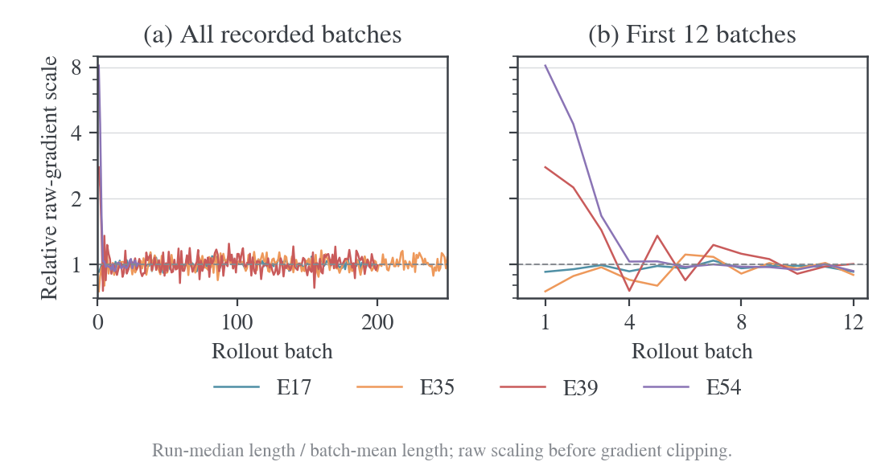

# Token-mean 的现有运行风险核查

核验日期：2026-10-31。本文以本地日志和执行源码快照检查 full-RKL 的长度分母，不改变训练配置、不运行 GPU 实验，也不把离线梯度重标度称为新的训练结果。理论与文献依据见 [Full-RKL 平均方式及 OPD 消融](../../literature/learning-signal/2026-10-31-Full-RKL的平均方式与MOPD及verl实现对照.md)。

**当前数据不支持把全局 token-mean 视为现有运行的主要故障源。R1/JustRL 在线运行的长度缩放较稳定，Qwen 启动阶段出现更大的瞬态变化；近期核对的教师边界研究已经采用固定分母，不属于实际 token 数归一化。** 这些判断不等于测出了 token-mean 的准确率代价，后者仍缺同设置对照。

## 1. 实际设置与证据范围

从 `wandb-logs/derived/MirrorOPD-verl/*/config.json` 选择显式 `full_reverse_kl`，或 `mdpo/full_vocab, kappa=0, eta=1` 的等价 full-RKL 运行，要求 `loss_agg_mode=token-mean`，排除 smoke 与不足 20 个完整 rollout batch 的快照。共 15 个运行、2695 个新 rollout batch、39851 条带梯度范数的 update 记录。运行在模型、学习率、精度、训练长度和 reuse 上有差异，不是 15 个同设置独立重复。

这些在线运行均为 train batch64、optimizer mini-batch64、每题一个回答，记录的空 loss-mask 比例为零，没有熵 loss 或 reference KL。每批的 `response_tokens / response_length_mean` 精确等于 64。因而可以用记录的 response token 总数还原该批的长度尺度，无需把 prompt token 算进分母。

其中 E54 有 480 条 update 梯度记录，但只有 29 批完整 rollout 汇总，长度能够配对的 update 为 464 条。全部运行共配对 39835 条 update。E50 有 4091 条带范数的记录，不能把预期更新数量与实际有记录的数量混为一谈。下面的梯度与裁剪比较只使用长度配对成功的记录；不补齐缺失尾部。

另核对两个近期固定轨迹研究：Qwen thinking T-E3、Llama L3-arithmetic-full，均覆盖 1280 次更新。它们有独立的训练实现和执行时源码快照，不能从在线 verl 的默认值推断其分母。

完整配置、日志和源码的路径及 SHA256 保存在 [summary.json](data/token-mean-20261031/summary.json)，逐 rollout batch 数据为 [outer-series.csv](data/token-mean-20261031/outer-series.csv)。

## 2. 比较量与可解释范围

对于记录下来的同一个 batch、同一组参数，设有效 KL 总和为 $S_B$、回答数为 $B=64$、平均长度为 $\bar L_B$。比较

$$
L_{\mathrm{token}}=\frac{S_B}{B\bar L_B},
\qquad
L_{\mathrm{fixed}}=\frac{S_B}{BC}.
$$

每个运行取其全部已记录 batch 平均长度的中位数为参考 $C$，用于消除任意固定倍数、只描述动态长度缩放。这个 $C$ 是事后描述量，没有将它当作预先选择的训练超参数。相同 batch 的原始梯度满足

$$
g_{\mathrm{token}}=s_Bg_{\mathrm{fixed}},
\qquad
s_B=\frac{C}{\bar L_B}.
$$

因此比较的是整个 batch 的共同缩放，不是各回答相对权重的变化。不能将下面的 3%–6% 波动解释成对每条长回答单独降权，也不能套用原始 GRPO 的逐回答 $1/L_i$ 长度偏好。

记录了 preclip 梯度范数 $n_B$ 后，还可以在不读取梯度张量的情况下重算同参数下的全局裁剪结果：

$$
n_{\mathrm{fixed}}=n_B\frac{\bar L_B}{C},
\qquad
d_B=\left|\frac{\min(n_{\mathrm{fixed}},1)}{\min(n_B,1)}-1\right|.
$$

这里裁剪阈值为实际配置中的 1；省略实现中的微小数值 epsilon。因为正标量重缩放和全局 norm clipping 都保持方向，$d_B$ 等于两个裁剪后梯度向量之差相对于实际裁剪后梯度范数的比例。它是同参数、同数据的局部反事实，不是另一条 Adam 轨迹。

## 3. 在线运行中的实际波动

下表的“90% 缩放范围”是所有已记录新 rollout batch 的 P05–P95；CV 为标准差除以均值。“裁剪后平均差异”按配对 update 计算 $d_B$ 的均值。两者不是置信区间，也不是独立重复实验的误差条。

| 运行                     | 新 batch / 配对 update | batch 平均长度中位数 | $s_B$ 的 90% 范围 | $s_B$ 的 CV | 裁剪后平均差异 |
| ------------------------ | ---------------------- | -------------------- | ----------------- | ----------- | -------------- |
| E13，R1/JustRL，reuse1   | 200 / 200              | 5804                 | 0.923–1.073       | 4.39%       | 2.86%          |
| E17，R1/JustRL，reuse16  | 200 / 3200             | 5716                 | 0.941–1.064       | 3.81%       | 2.95%          |
| E20，R1/JustRL，reuse16  | 256 / 4096             | 5693                 | 0.946–1.057       | 3.48%       | 2.71%          |
| E35，R1/JustRL，cap15360 | 250 / 4000             | 6985                 | 0.900–1.121       | 6.64%       | 5.16%          |
| E39，Qwen，reuse16       | 200 / 3200             | 2407                 | 0.883–1.182       | 17.42%      | 6.41%          |
| E43，Qwen，reuse16       | 100 / 1600             | 4856                 | 0.911–1.122       | 18.45%      | 4.02%          |
| E54，Qwen，部分日志      | 29 / 464               | 6447                 | 0.945–3.301       | 103.08%     | 5.56%          |

R1/JustRL 的短窗口运行，典型动态缩放约在固定参考的正负 6%–8% 内；长窗口 E35 的范围扩大到约正负 10%–12%。这些量级足以成为优化细节，但没有出现普遍数倍震荡。

也没有看到“回答越来越长，token-mean 让梯度持续变小”的趋势。E17 前 20 批与末 20 批平均长度为 5863、5691，按这两个窗口长度计算的尺度变化为后期增加 3.02%；E35 为 7333、6908，对应增加 6.16%。这里只比较长度项，不把目标本身随训练下降导致的梯度减小归因于分母。



图中每条曲线是一项实际在线 full-RKL 运行，每个点对应一个新 rollout batch 的 $C/\bar L_B$。右图只展开前 12 批；两图 y 轴均为对数尺度。图展示原始梯度的共同缩放，不展示 Adam 参数更新倍数。

### 3.1 Qwen 的异常集中在启动阶段

E39 第一批平均长度为 864，对照运行中位数 2407，原始梯度缩放达到 2.78 倍；第 4 批长度已达 3181。E43 第一批为 1752，中位数 4856，达到 2.77 倍。E54 第一批为 793，中位数 6447，达到 8.13 倍，第 4 批已达 6256。

这说明短初始回答与后续长度分布不同，会使启动时的 raw gradient 尺度较大。但“8.13 倍 raw scaling”不能改称为“实际参数步长放大 8.13 倍”：同一步两种尺度若都超过阈值，裁剪后梯度相同；Adam 还会按历史一阶、二阶矩预条件化。

排除前 10 个新 batch 后，E39 的缩放 CV 降到 8.17%，E43 为 6.74%，E54 为 3.39%。E54 的裁剪后平均梯度差异也降到 2.47%。这些只是按阶段分解的描述，不证明分母引起了模型早期行为改变；模型分布变化同样会改变回答长度。

### 3.2 裁剪是否放大了问题

| 运行                | 实际触发裁剪的比例 | 同参数下换固定 $C$ 后的比例 | 裁剪开关改变比例 |
| ------------------- | ------------------ | --------------------------- | ---------------- |
| E17                 | 0.750%             | 0.938%                      | 0.188%           |
| E20                 | 0.562%             | 0.586%                      | 0.024%           |
| E35                 | 0.500%             | 0.900%                      | 0.400%           |
| E39                 | 2.531%             | 2.656%                      | 0.375%           |
| E43                 | 23.375%            | 23.563%                     | 4.063%           |
| E54，464 条配对记录 | 23.491%            | 14.871%                     | 13.793%          |

E17/E20/E35 的裁剪触发变化很小；E54 的早期阶段较敏感。E43 的触发比例净变化小于开关改变比例，因为有些 update 从触发变成不触发，另一些反向改变。不能用两列比例相减替代改变的 update 数量。

39851 条已记录范数中没有 NaN/Inf。这不能证明未记录的 update 正常，也不能排除有限但不合适的梯度或任务退化。更不能根据 token-mean 下已有成绩提高，就证明它与固定分母效果相同。

## 4. 近期固定轨迹研究的实际分母

核对执行时保存的 `Training.denominator`，返回值为 `batch_size * horizon`；两个研究的 receipt 都指定 batch16、horizon1024。因此分母固定为 16384，不随 `actual_tokens` 改变。当前参考源码为 [spec.py](../../../research/studies/fixed_transfer/spec.py)，数据摘要保留执行快照的路径与哈希。

| 研究运行                 | 已记录更新 | 每批实际 token 数 | 反传分母   | 对 token-mean 风险的含义                            |
| ------------------------ | ---------- | ----------------- | ---------- | --------------------------------------------------- |
| Qwen thinking T-E3       | 1280       | 始终为 16384      | 固定 16384 | 两种归一化在这些 batch 上恰好相同，长度缩放波动为零 |
| Llama L3-arithmetic-full | 1280       | 7214–12735        | 固定 16384 | 实际训练没有按变长的 token 数重新归一化             |

对后者，若误认为它使用 token-mean，会把训练梯度误读为当前值的 1.29–2.27 倍。这个范围是“假如改成 token-mean”的局部尺度，不是已经发生的扰动。本文只对这两个代表性研究完成 receipt 与执行源码核验，不将其他研究快照自动归为相同分母。

## 5. 判断与尚未回答的问题

对 R1/JustRL 的已核验在线数据，动态分母更像几个百分点的梯度扰动，现有证据不足以把它列为主要失效原因。对 Qwen，启动阶段值得单独控制：短回答迅速变长时，raw scaling 的瞬态可达数倍；裁剪会削弱一部分变化，Adam 历史仍可能受影响。

Adam 对整个历史都一致的常数倍梯度，在 epsilon 可忽略、没有改变裁剪行为等条件下具有尺度抵消性质。这里的系数随 batch 变化，所以不能保证完全抵消；也不能把平均裁剪后梯度差异直接当作实际参数步长差异。只有范数，没有逐参数梯度与对应优化器状态，无法重建改变归一化后的完整 Adam 训练轨迹。

因此，目前没有数据支持“token-mean 让准确率损失了若干百分点”，也没有理由仅凭理论分母差异停掉当前运行或否定历史结果。新对照应优先覆盖 Qwen 的启动阶段，保持 rollout、教师、随机种子、精度和更新预算一致，只改分母；若使用固定 $C$，应事先定义，而非按最后成绩挑选。近期已核对的固定轨迹研究无需为 token-mean 风险作这种修改。

## 6. 复算与验证

从源码仓库根目录执行，只读取本地日志并写分析产物：

```bash
python examples/mirroropd/research/studies/normalization/audit_token_mean.py \
    --logs ../wandb-logs \
    --output examples/mirroropd/docs/experiments/learning-signal/data/token-mean-20261031

uv run --no-project --with matplotlib --with numpy python \
    examples/mirroropd/research/studies/normalization/plot_token_mean.py \
    --data examples/mirroropd/docs/experiments/learning-signal/data/token-mean-20261031 \
    --output examples/mirroropd/docs/experiments/learning-signal/figures/token-mean-20261031 \
    --style ../.agents/skills/figure-viz/assets/mpl
```

分析脚本校验 batch/mini-batch 一致、响应 token 计数、空 mask、额外 loss 和固定研究的执行源码合同。图的 [审计结果](figures/token-mean-20261031/token-mean-scale.audit.json)、[PDF](figures/token-mean-20261031/token-mean-scale.pdf) 和 [SVG](figures/token-mean-20261031/token-mean-scale.svg) 与 PNG 同源。没有启动新的模型训练或推理。
