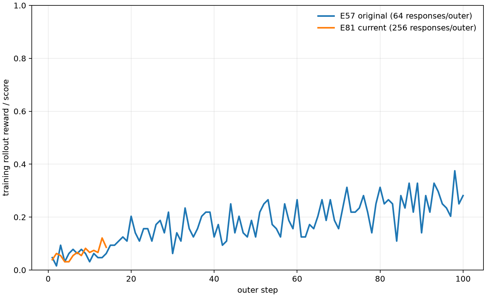
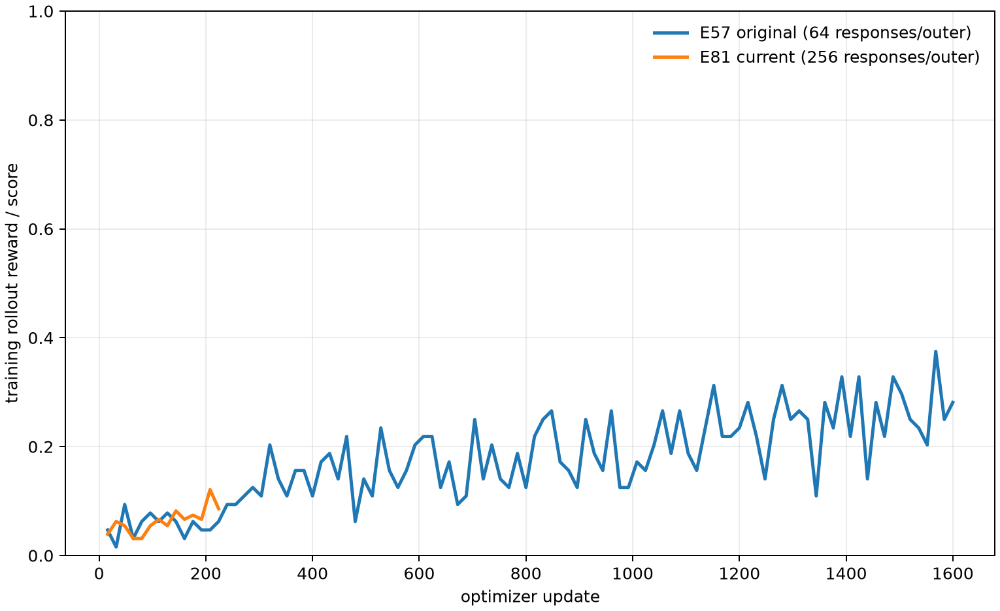
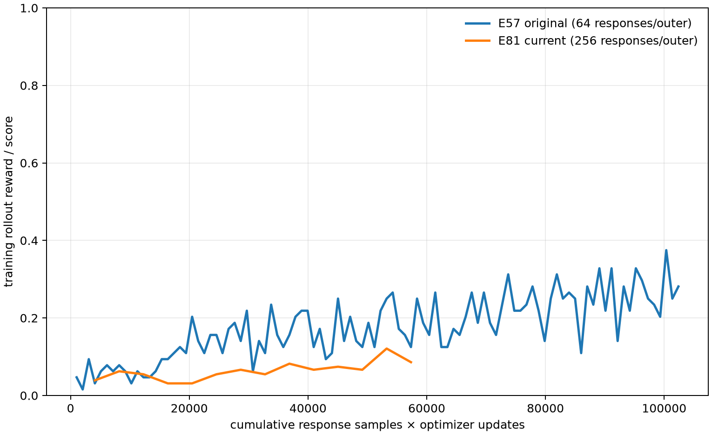

# 学习信号、估计器与目标

RQ1 区分信号刷新、更新校正、动作积分和聚合方式；RQ5 独立讨论 TOP-D 复现与 κ/η 消融。给定前缀上的数学身份由[理论](../../theory/README.md)维护，完整线上效果以实际配置和评测为准。

| 研究问题                              | 正文                                                                                                                     |
| ------------------------------------- | ------------------------------------------------------------------------------------------------------------------------ |
| current/rollout 与 IS/NoIS/PPO 的影响 | [Sampled 信号消融](sampled-controls.md)，比较短程与长程更新                                                              |
| Full-vocab 是否优于 sampled           | [基础对照](sampled-full.md)，按实际代码、硬件、学习率与预算分析各数据集结果                                              |
| token-mean 的长度缩放是否影响已有运行 | [归一化核查](normalization.md)，核对长度分布及离线反事实                                                                 |
| 复现多少 TOP-D，κ/η 改变什么          | [主要实验](weighted-targets.md)、[小规模消融](weighted-targets-controls.md)、[当前 A/B 实验](weighted-targets-active.md) |

固定生成/更新预算的 reuse 与长度比较见[预算线](../reuse-budget/README.md)。RKL/FKL 的 Polaris 方向证据见[教师吸收](../teacher-transfer/cases/polaris.md)。

## 训练时钟对照

三张图按 outer、optimizer update 和累计 response presentations × optimizer updates 展示 E57 原始运行与当前 E81 运行的训练 rollout reward。E57 使用 64 responses/outer，E81 使用 256 responses/outer；两者均为 16 次 optimizer update/outer。

这三张图的当前 E81 数据是训练过程中的 rollout reward，不是公共 benchmark accuracy。TOP-D 的论文 Figure 5 曲线已经由审计数据[复原](data/topd-e57-all-curves-20261104/curves.csv)，并保存在[对应图组](figures/topd-e57-all-curves-20261104/)；论文只公开了图形和预算说明，未公开逐点运行日志，因此 TOP-D 曲线与本地训练 reward 不做未经校准的数值拼接。
