# MDPO position objective: E55–E57, E81–E83

数据快照：2026-11-07T15:10:24+08:00。每组独立绘图，展示 first / last update 随 outer 的位置热力图、首尾五个 outer 放大，以及每个位置桶一条训练曲线。初始与末 outer 的 first-update 横向位置曲线见[位置形状汇总](../teacher-transfer/cases/first-update-position-profiles.md)。

## 指标与实际 setting

位置日志为 `distill/mdpo/objective_position/p00_10/{mean,sum,token_count}` 至 `p90_100`。每个桶对有效 token 取均值，十个桶按各自回答的有效长度划分。诊断始终按 token 平均；E83 的实际训练 loss 使用回答等权聚合，因此不能把这个诊断当成 E83 的 actor loss。

令当前 student 为 $p$、本轮冻结 anchor 为 $q$、teacher 为 $T$，未归一化 target 为 $u$，$Z=\sum_a u(a)$，归一化 target 为 $m=u/Z$。实际记录的是

$$
J_{\mathrm{pos}}=\frac{D_{\mathrm{KL}}(p\Vert m)-\log Z}{\eta}.
$$

E57、E81、E82、E83 使用 κ=1、η=0.1，此时 $m=0.9q+0.1T$，$Z=1$，所以图中数值就是 target RKL 的 10 倍；乘以 0.1 即可得到 target RKL，位置形状不变。E55（κ=0）与 E56（κ=0.5）的 $\log Z$ 随前缀变化，图中同时包含 target RKL 与归一化项，现有 position 日志不能把两者分离。六组均未记录独立的 teacher position RKL。

[冻结运行的 objective 实现](../../../../../runs/topd-large-batch-20261105/source/verl/trainer/distillation/objectives.py)与[输出缩放、分桶实现](../../../../../runs/topd-large-batch-20261105/source/verl/trainer/distillation/output.py)说明上述关系。每次有效更新均核对全局 `objective=(target_kl-target_log_z)/0.1`，并按桶内 token 数加权复算 position 均值；误差见[来源核验](figures/mdpo-position-20261107/provenance.json)。

| 实验 | κ / η     | batch / reuse | 聚合                | 日志覆盖 outer / update |
| ---- | --------- | ------------- | ------------------- | ----------------------- |
| E55  | 0 / 0.1   | 64 / 16       | token-mean          | 100 / 1600              |
| E56  | 0.5 / 0.1 | 64 / 16       | token-mean          | 100 / 1600              |
| E57  | 1 / 0.1   | 64 / 16       | token-mean          | 100 / 1600              |
| E81  | 1 / 0.1   | 256 / 16      | token-mean          | 25 / 400                |
| E82  | 1 / 0.1   | 256 / 16      | token-mean          | 70 / 1120               |
| E83  | 1 / 0.1   | 256 / 16      | seq-mean-token-mean | 30 / 480                |

模型均为 Qwen3-1.7B-Base ← Qwen3-30B-A3B-Instruct-2507，LR=1e-6，future=none。其余历史配置、执行精度与停止协议差异分别见[E55–E57 主报告](weighted-targets.md)和[当前实验](weighted-targets-active.md)。E82 应用已有 SHA256 排除清单，隔离重复实例写入；仅取有效连续 update。E84–E90 在该快照未找到正式 position 指标，不补造曲线。

first / last 是同一 outer 中第 1 / 第 16 次 optimizer 操作前的观测，两点间为 15 次更新。若最后一个 outer 尚未写满 16 次，last 只表示最后已记录的观测，图表数据保留实际 reuse；覆盖表不表示运行已经结束。每张热力图全部面板共用一个线性色阶，early / late 放大窗口各自重新定标；训练线图 first / last 共用对数纵轴。跨 outer 的 batch、前缀和 target 都会变化。

## E55

| 实验 | 观测           | outer / update |    0–10% |  90–100% | 前 30% / 后 30% | 最大位置桶 |
| ---- | -------------- | -------------- | -------: | -------: | --------------: | ---------- |
| E55  | 初始 first     | 1 / 1          |   1.1528 | 0.293856 |           2.465 | 0-10%      |
| E55  | 末 outer first | 100 / 1585     | 0.410732 | 0.221021 |           1.467 | 0-10%      |

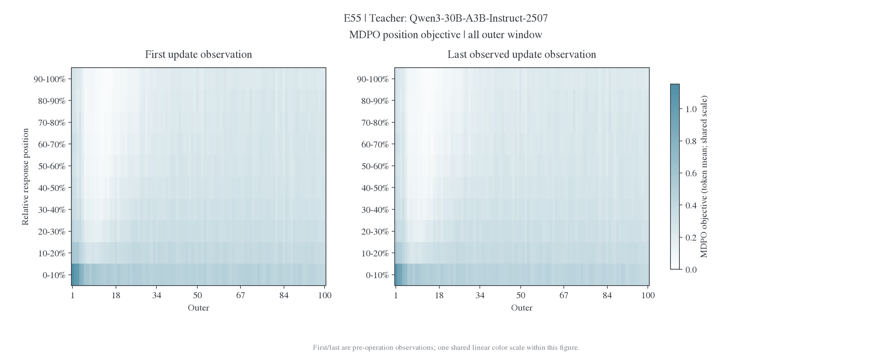

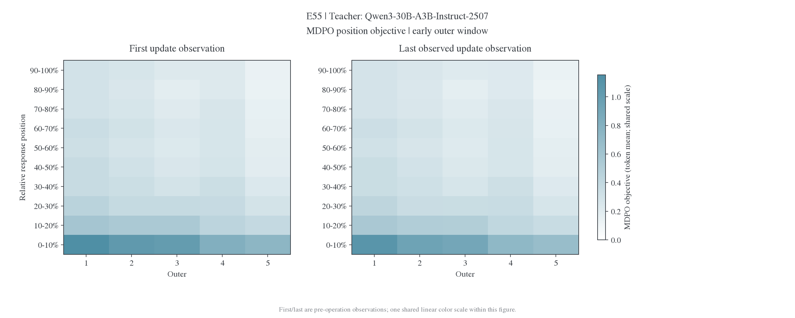

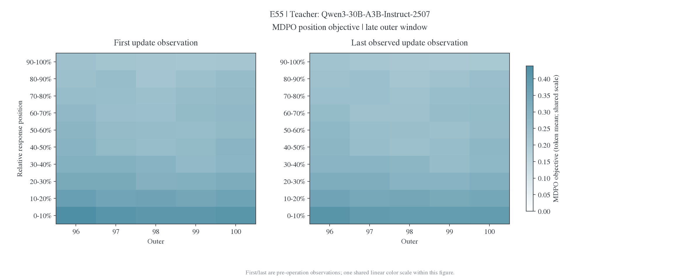

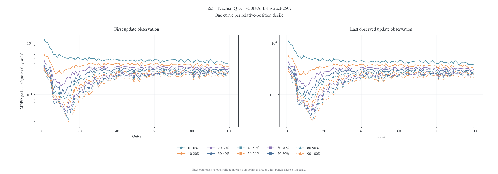

## E56

| 实验 | 观测           | outer / update |    0–10% |  90–100% | 前 30% / 后 30% | 最大位置桶 |
| ---- | -------------- | -------------- | -------: | -------: | --------------: | ---------- |
| E56  | 初始 first     | 1 / 1          | 0.341432 |  0.16211 |           1.677 | 0-10%      |
| E56  | 末 outer first | 100 / 1585     | 0.154316 | 0.121497 |           1.156 | 0-10%      |

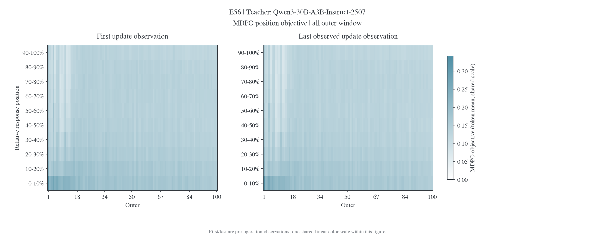

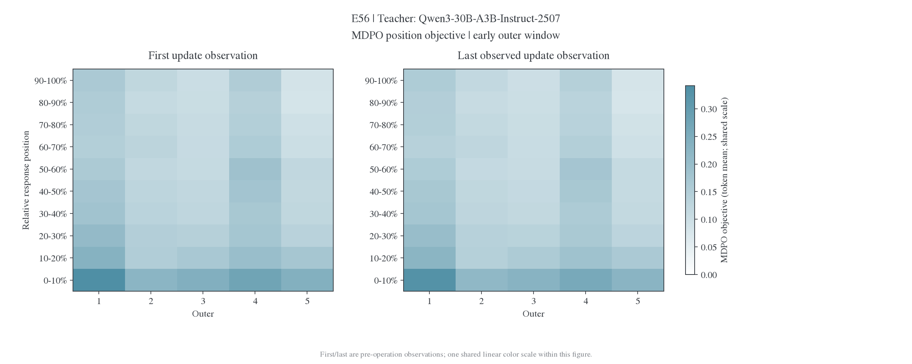

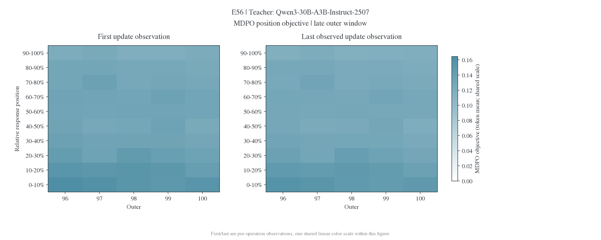

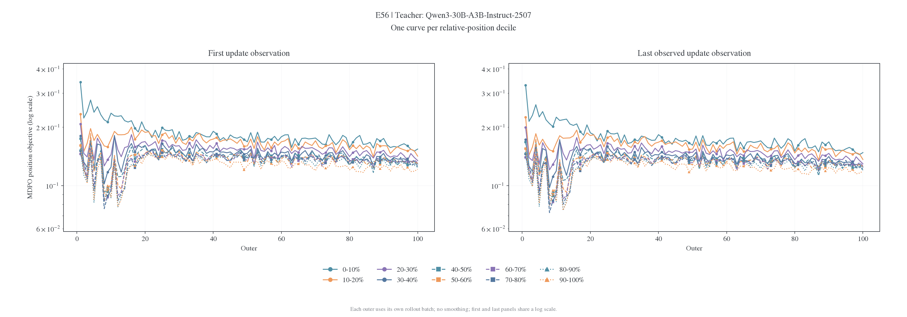

## E57

| 实验 | 观测           | outer / update |     0–10% |   90–100% | 前 30% / 后 30% | 最大位置桶 |
| ---- | -------------- | -------------- | --------: | --------: | --------------: | ---------- |
| E57  | 初始 first     | 1 / 1          | 0.0937222 | 0.0355831 |           2.142 | 0-10%      |
| E57  | 末 outer first | 100 / 1585     |  0.041244 |  0.031913 |           1.152 | 0-10%      |

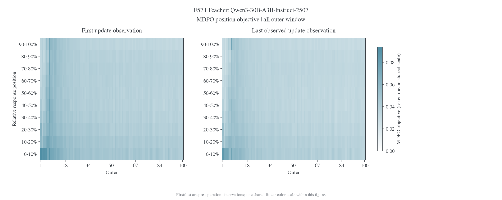

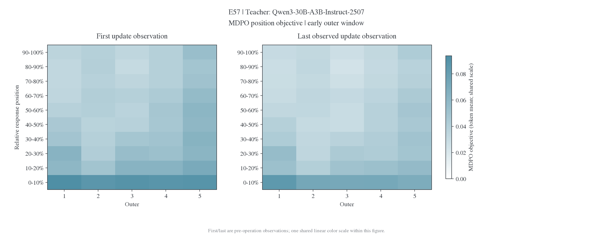

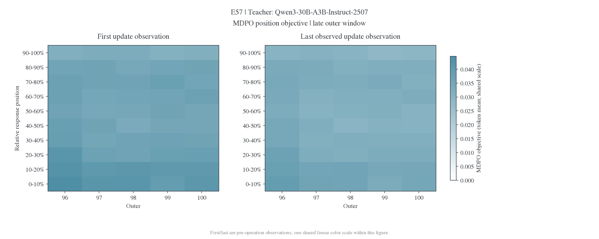

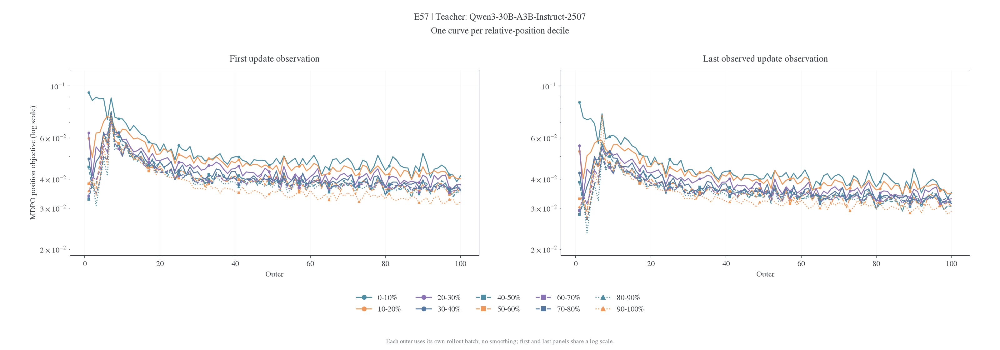

## E81

| 实验 | 观测           | outer / update |     0–10% |   90–100% | 前 30% / 后 30% | 最大位置桶 |
| ---- | -------------- | -------------- | --------: | --------: | --------------: | ---------- |
| E81  | 初始 first     | 1 / 1          |  0.103788 | 0.0486466 |           1.714 | 0-10%      |
| E81  | 末 outer first | 25 / 385       | 0.0480381 | 0.0382528 |           1.180 | 0-10%      |

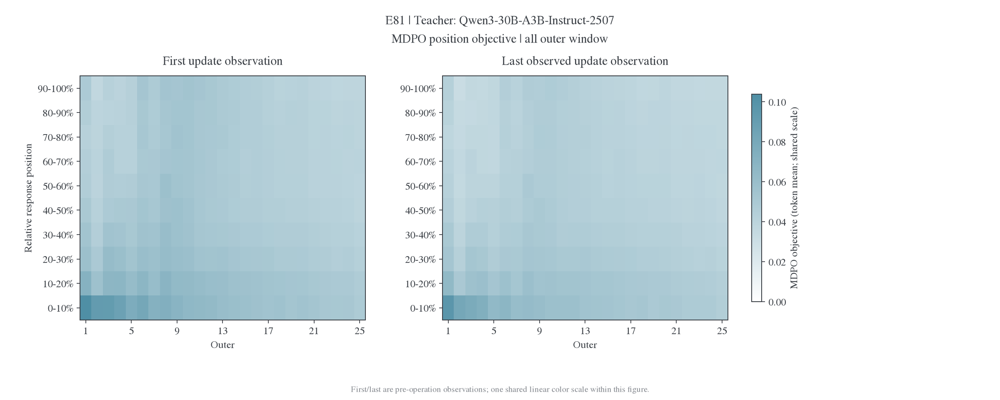

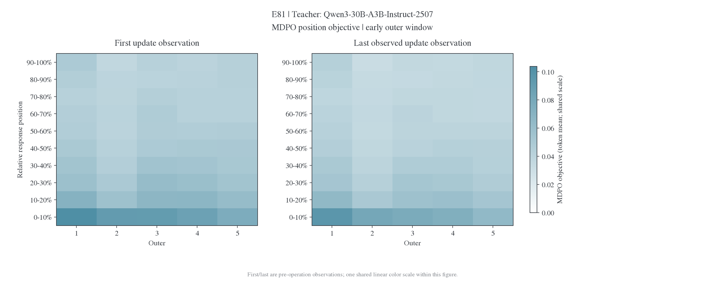

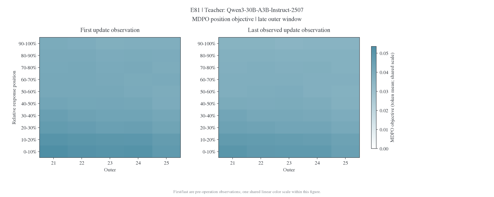

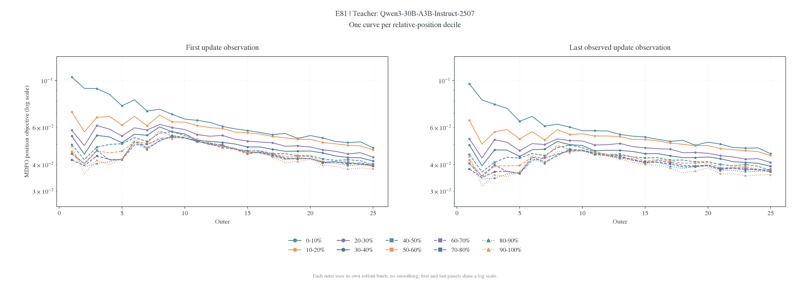

## E82

| 实验 | 观测           | outer / update |     0–10% |   90–100% | 前 30% / 后 30% | 最大位置桶 |
| ---- | -------------- | -------------- | --------: | --------: | --------------: | ---------- |
| E82  | 初始 first     | 1 / 1          | 0.0937007 | 0.0410487 |           1.730 | 0-10%      |
| E82  | 末 outer first | 70 / 1105      | 0.0429453 | 0.0323897 |           1.181 | 0-10%      |

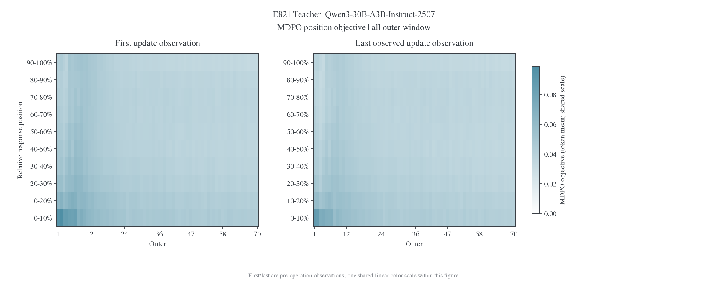

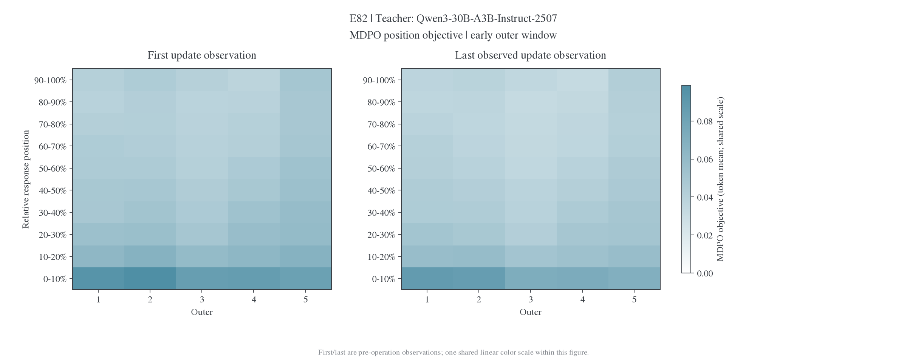

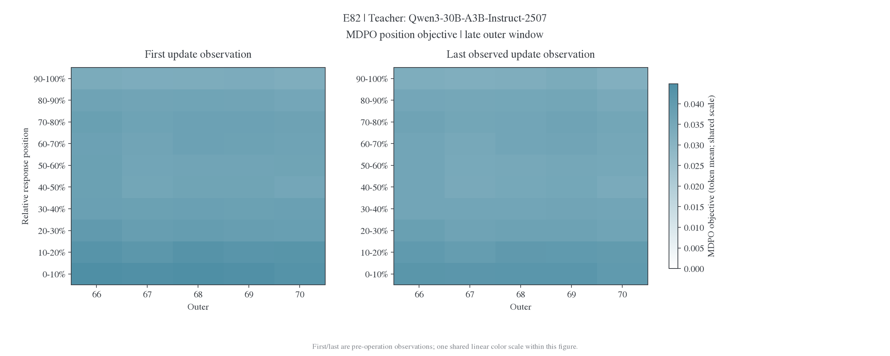

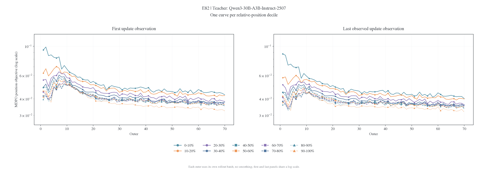

## E83

| 实验 | 观测           | outer / update |     0–10% |   90–100% | 前 30% / 后 30% | 最大位置桶 |
| ---- | -------------- | -------------- | --------: | --------: | --------------: | ---------- |
| E83  | 初始 first     | 1 / 1          | 0.0965122 |  0.040861 |           1.792 | 0-10%      |
| E83  | 末 outer first | 30 / 465       | 0.0482672 | 0.0378584 |           1.181 | 0-10%      |

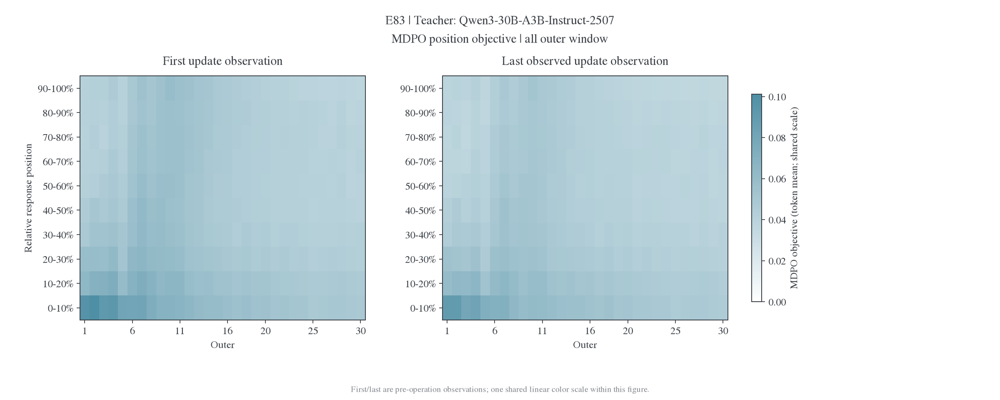


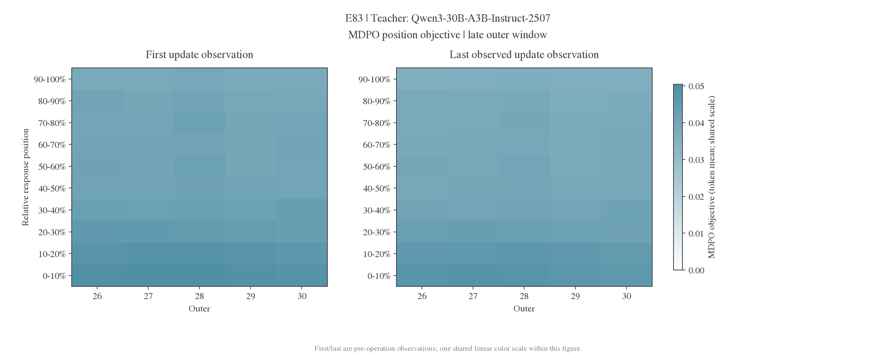

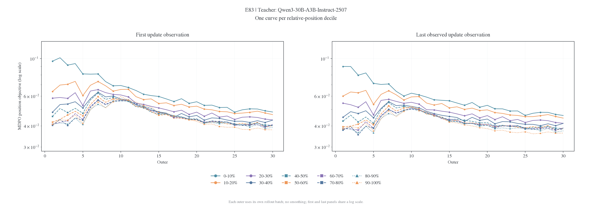

## 数据与复画

[逐 outer 首末观测](figures/mdpo-position-20261107/endpoints.csv)、[各实验初始和末 outer first-update 原值](figures/mdpo-position-20261107/profiles.csv)、[形状数值表](figures/mdpo-position-20261107/profile-summary.csv)与[来源哈希和核验](figures/mdpo-position-20261107/provenance.json)使用同一冻结快照。图提供 PNG、PDF、SVG 和 `.audit.txt`。

[生成器](../../../research/studies/weighted_targets/plot_position_profiles.py)默认读取冻结 CSV，同时复画本页和位置形状汇总；`--refresh` 才重新读取运行日志。

```bash
uv run --no-project --with matplotlib --with numpy python -m examples.mirroropd.research.studies.weighted_targets.plot_position_profiles
```
