# Sampled 与 Full-vocab：基础对照与解释

E13/E15比较一次更新下的Full-KL与sampled；E13/E14提供学习率参照，E13/E16/E17提供reuse参照。正文先统一实际设置与快照，再比较任务结果、拟合过程和成本，最后用E15的详细日志解释sampled信号。

<a id="settings"></a>
<a id="settings-full-kl学习率与批内复用对照"></a>
<a id="five"></a>
<a id="five-五组-math-实验对比full-kl学习率与批内复用"></a>

<a id="settings-setting-与实验边界"></a>

## 实验设置

E13/E14 比较学习率；E13/E15 比较一次更新下的 full-vocab 与 sampled；E13/E16/E17 比较 Full-KL 的批内复用。五个历史主 run 使用 R1-Distill-Qwen-1.5B student、JustRL-DeepSeek-1.5B teacher、DAPO、seed=42、batch=mini-batch=64、n=1、prompt/response cap=4096/7168。验证三个数学集 500/40/30 题，每题 16 条、T=0.7、top-p=0.9、cap=31744，每 20 outer 验证；没有初始验证。

| 实验           | 目标与实际路径                      |   LR | 复用 | 历史 outer / 成功更新 |
| -------------- | ----------------------------------- | ---: | ---: | --------------------- |
| E13[^five-e13] | Full reverse KL，precompute         | 1e-6 |    1 | 200 / 200             |
| E14[^five-e14] | Full reverse KL，precompute         | 5e-7 |    1 | 200 / 200             |
| E15[^five-e15] | Sampled k1，current，legacy vanilla | 1e-6 |    1 | 200 / 200             |
| E16[^five-e16] | Full reverse KL，precompute         | 1e-6 |    4 | 200 / 800             |
| E17[^five-e17] | Full reverse KL，precompute         | 1e-6 |   16 | 200 / 3200            |

四个 Full-KL run 启用 async write/prefetch。Full-KL 的 current＋IS 是固定前缀下完整动作求和的梯度对应，不额外乘 sampled ratio，不使用 PPO clipping。E15 未启用行为 token IS；legacy vanilla 与 E4/E10 的 token_is 不同。

E13 使用 A800，其余主 run 使用 A100；W&B 记录的 Git commit 不足以证明部署源码无额外修改。更完整的环境审计见[五组比较](#five-1-实验身份与可比性)。实际 setting 与 run ID 见[运行记录](../运行记录.md)，完整 config 保留在日志仓库。

<a id="five-setting-与实验设计"></a>

<a id="five-1-实验身份与可比性"></a>

## 实现与可比性

配置扁平化后共 13 个差异字段，包含实验目录、LR、epochs、Full-KL/PG 模式和相关 payload 开关，完整列表见[配置差异](../../../../../../wandb-logs/MirrorOPD-verl/analysis/five-run-comparison-20261024/config-differences.json)。`critic.ppo_epochs` 随 actor 配置继承变化，但这些 run 没有启用 critic。

硬件信息来自各 run 自身：E13/E15 有 metadata 附件；E14/E16/E17 的信息从 `.wandb` 的分批 environment 记录恢复。E13/E14/E15 记录的 Git commit 为 `e70acdf1e`，E16/E17 为 `df93f4d6f`。前一个提交尚不包含 `verl/trainer/distillation/full_vocab.py`，所以这个 commit 字段不足以重建实际运行源码，存在未被该字段描述的代码状态。不能把记录配置接近等同于源码、后端和硬件均受控。

所有 requirements 记录均列出 torch 2.11.0+cu128、vLLM 0.25.1+cu129、Transformers 5.12.1、Triton 3.6.0；同时列出了两个 Liger distribution 版本，不能据此断言实际导入哪个版本。这些 run 的 Full-KL backend 是 precompute，不能归因于某个 Liger 或新增融合 kernel。

<a id="settings-已有分析及所用快照"></a>

## 数据快照

| 分析                                                       | 覆盖内容                                 | 数据边界                                                          |
| ---------------------------------------------------------- | ---------------------------------------- | ----------------------------------------------------------------- |
| [五组 Math 对比](#five)                                    | 效果、学习率、复用、生成／更新／时间预算 | 2026-10-24 冻结；E17 完整 outer 到 177，更新到 2848，最后验证 160 |
| [E15 训练动态](#sampled)                                   | 单 run 的蒸馏、策略、长度、验证和成本    | krkmq098 完整 200 updates                                         |
| [收敛与师生参考](#reference)                               | 批内 KL、IS 含义、历史教师差距           | 同一五组冻结快照，加历史 One-Shot val-only                        |
| [E16/E17 后期收敛](../reuse-budget/budget.md#within-batch) | 新批起点与复用末次，缺失的位置观测       | E16 完整；E17 截断于第 178 批更新                                 |

各组图表采用表中列出的快照，复算入口见文末。

<a id="settings-当前完成情况与最新末点"></a>

## 完整运行的末次评测

2026-10-25 日志 `ff8b9f0` 已包含 E17 的完整退出、200 个 outer 汇总和 3200 次成功更新。五组主 run 均 exit=0。末次 mean accuracy（%）为：

| 实验 / run     | 验证 outer / update | MATH-500 |   AMC23 |  AIME25 |
| -------------- | ------------------- | -------: | ------: | ------: |
| E13 / jt2r9h88 | 200 / 200           |  86.6250 | 86.2500 | 34.1667 |
| E14 / aq474oay | 200 / 200           |  84.8000 | 82.1875 | 29.3750 |
| E15 / krkmq098 | 200 / 200           |  86.9125 | 87.8125 | 31.8750 |
| E16 / ujy2qx5d | 200 / 800           |  87.5875 | 89.3750 | 35.8333 |
| E17 / cix5i2x2 | 200 / 3200          |  88.2625 | 89.6875 | 33.5417 |

E17 在 outer 200 相对 E16 的 MATH/AMC/AIME 差为 +0.6750/+0.3125/−2.2917 个百分点。16 次复用的末点并未在三个集合全部领先，且使用四倍更新。完整末点与下面的 outer160 共同窗口分别报告；两者均来自单个训练 seed。

另一条 E15 `xwkeo5z5` 云端为 failed：完成 outer 汇总到 99，更新到 100，最后验证在 outer 80。它单独登记，不与 `krkmq098` 拼接，也不当作完整重复 seed。

<a id="five-实验结果"></a>

## 共同窗口中的任务、拟合与成本

<a id="five-2-对齐生成预算后的验证表现"></a>

<a id="2-对齐生成预算后的验证表现"></a>

### 对齐生成预算后的验证表现

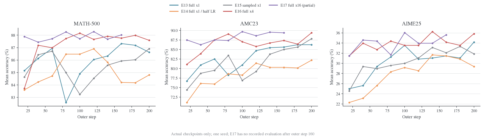

五组共有的最后验证点是 **outer 160**。此时都已记录 10240 条训练回答，但成功 optimizer 更新数分别是 160、160、160、640、2560；训练生成的 token 数约 5855–6012 万，不完全相同。

| Outer 160 | MATH mean | AMC mean | AIME mean | MATH majority@16 | AMC majority@16 | AIME majority@16 |
| --------- | --------: | -------: | --------: | ---------------: | --------------: | ---------------: |
| E13       |   87.325% |  85.625% |   31.458% |          92.267% |         93.750% |          41.111% |
| E14       |   84.200% |  80.313% |   31.458% |          91.133% |         95.000% |          43.542% |
| E15       |   85.925% |  85.000% |   32.083% |          92.413% |         93.750% |          41.667% |
| E16       |   87.763% |  87.344% |   34.167% |          92.700% |         92.500% |          40.000% |
| E17       |   88.025% |  89.375% |   35.625% |          92.100% |         93.750% |          44.375% |

同一 outer 预算下，E17 的 mean accuracy 点估计领先，但 majority 并未逐数据集领先。E17 相比 E16 的 mean 差为 **+0.263、+2.031、+1.458 个百分点**，同时用了 4 倍 optimizer 更新。

若将共同后期三个 checkpoint（120、140、160）取描述性均值，E16/E17 的 MATH 为 87.779%/87.996%，AMC 为 86.615%/89.167%，AIME 为 34.653%/34.514%。因此 E17 的 AMC 优势在这些点上较一致，AIME 优势不稳定。三个 checkpoint 相关，不能将其当作三个独立训练重复。

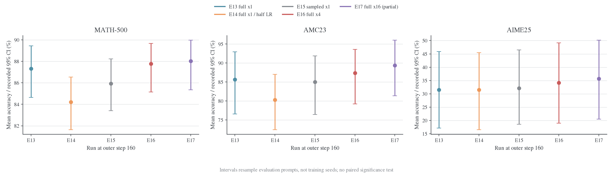

图中 95% CI 来自每个 run 内的题目 bootstrap，重采样次数为 256。AIME 只有 30 题，E16 的区间约 [18.96%, 49.14%]，E17 约 [20.44%, 50.18%]。这里没有跨 seed 方差，也没有拿到用于跨 run 配对检验的完整逐题结果，不能从点排序或区间重叠直接作显著性判断。不同数据集面板使用独立纵轴。

<a id="five-已完成-run-的-step-200"></a>

#### 已完成 run 的 step 200

| Step 200 | MATH mean | AMC mean | AIME mean | AIME pass@16 | AIME majority@16 |
| -------- | --------: | -------: | --------: | -----------: | ---------------: |
| E13      |   86.625% |  86.250% |   34.167% |      60.000% |          43.333% |
| E14      |   84.800% |  82.188% |   29.375% |      53.333% |          38.333% |
| E15      |   86.913% |  87.813% |   31.875% |      56.667% |          41.667% |
| E16      |   87.588% |  89.375% |   35.833% |      63.333% |          48.333% |

E16 相比 E15 的 mean 提升为 +0.675、+1.563、+3.958 个百分点；相比 E13 为 +0.963、+3.125、+1.667 个百分点。它消耗了更多更新，不能称为等 optimizer 预算下的优势。这张 10 月 24 日快照表只覆盖已完成的四组；E17 的完整末点见前面的运行汇总。

E13 与 E15 在一次更新下没有清楚的全面胜负：E15 的最终 MATH/AMC 略高，E13 的 AIME 略高。现有证据不支持“完整词表必然显著胜过 sampled”，也不支持“二者训练完全等价”。

<a id="five-3-学习率与更新预算"></a>

<a id="3-学习率与更新预算"></a>

### 学习率与更新预算

E14 的半学习率在当前 200-update 预算内落后：最终相对 E13 的 MATH/AMC/AIME 低 1.825/4.063/4.792 个百分点，最后 20 次更新的 full KL 均值为 0.01715，而 E13 为 0.00723。这与较慢的 teacher 分布拟合一致；不能据此断言更长预算下半学习率仍较差。

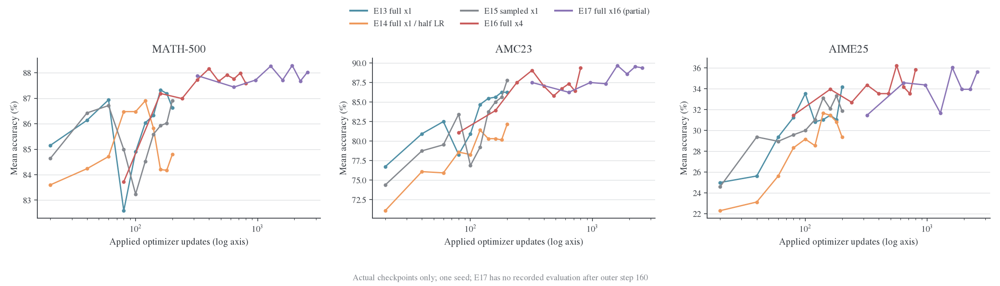

五组没有一个共同的 optimizer 验证坐标：E17 首次验证已在 update 320，E13/E14/E15 在 update 200 就结束。不能将 E17 outer 20 的结果与其他组 outer 20 称作“相同训练进度”。

可直接比较的交点包括：

| 成功更新数 | 实验 / outer | MATH mean | AMC mean | AIME mean |
| ---------: | ------------ | --------: | -------: | --------: |
|        160 | E13 / 160    |   87.325% |  85.625% |   31.458% |
|        160 | E16 / 40     |   87.188% |  83.906% |   33.958% |
|        320 | E16 / 80     |   87.725% |  89.063% |   34.375% |
|        320 | E17 / 20     |   87.888% |  87.500% |   31.458% |
|        640 | E16 / 160    |   87.763% |  87.344% |   34.167% |
|        640 | E17 / 40     |   87.438% |  86.250% |   34.583% |

在相同更新数下，16 次复用没有显示稳定的三数据集优势。它用了更少的新回答和验证轮次，故仍可能节省生成及评估成本；这种收益与“每次更新更有效”是不同判断。

<a id="five-中期回落与长回答同时出现"></a>

#### 中期回落与长回答同时出现

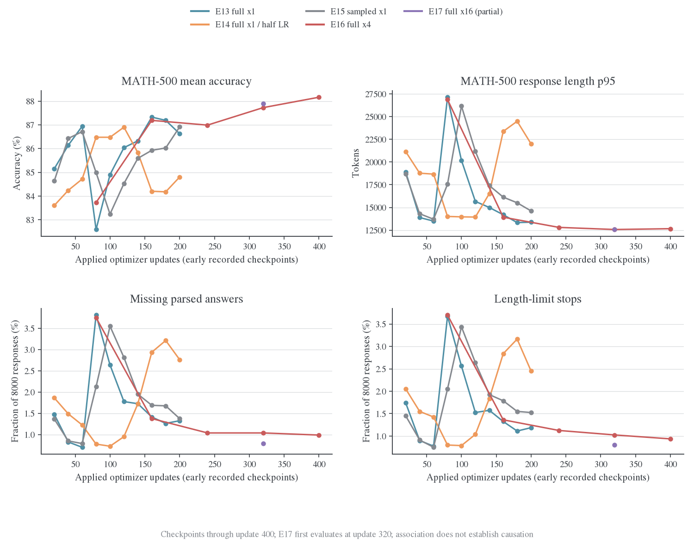

E13/E15 的 MATH 曲线都有中期回落，E14 的回落出现在更后面的更新区间。它们与验证生成长度、截断和解析缺失同步变化：

| Run / outer 区间 | 对应 optimizer 区间 | MATH mean     | Mean length | Length p95  | length-stop 数 / 8000 |
| ---------------- | ------------------- | ------------- | ----------- | ----------- | --------------------- |
| E13，60→80       | 60→80               | 86.94%→82.59% | 4160→5874   | 13495→27136 | 62→294                |
| E14，120→160     | 120→160             | 86.90%→84.20% | 4250→5371   | 13938→23374 | 83→227                |
| E15，60→100      | 60→100              | 86.71%→83.24% | 4066→5593   | 13698→26170 | 60→275                |
| E16，20→40       | 80→160              | 83.73%→87.19% | 5663→4626   | 26880→13922 | 296→109               |

这些回落发生在 KL 总体下降期间，没有相应的非有限梯度或跳步。它们更值得从生成行为、长回答和截断角度复核，而不能直接判作 loss 发散。低学习率使相似现象较晚出现，与优化进程不同这一解释相容，但这些单次轨迹不足以证明学习率与阶段位置成线性关系。

E16 第一次验证已经在 update 80，确实观察到高 p95 和较低 MATH 分数，第二次验证恢复。E17 第一次验证在 update 320，早期区间没有观测，不能由平稳的已记录曲线推出“16 次复用消除了中期回落”。后续若研究这个阶段，应把早期验证点按 optimizer 更新数对齐。

Length-stop、解析缺失与错误答案的逐样本交集没有进入这份快照，因此不能把整个准确率降幅都归因于截断。需要回读对应 checkpoint 的逐题生成文本才能进一步区分重复推理、答案格式和真正的解题错误。

<a id="five-4-kl-下降批内拟合和数值稳定性"></a>

<a id="4-kl-下降批内拟合和数值稳定性"></a>

### KL 下降、批内拟合和数值稳定性

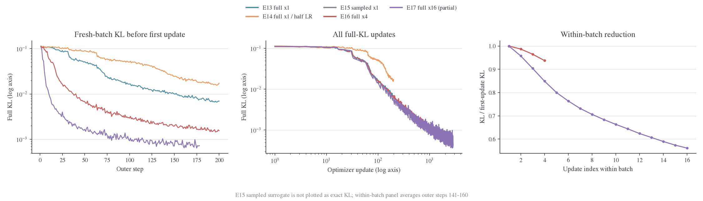

Full-KL 的每条 loss 是对应 optimizer 操作之前的观察，虽然日志在 worker 返回后集中写出。按 outer 比较时，必须区分每批第一次更新前的 fresh-batch KL 与后续复用中的 KL。

| Outer 141–160，20 批平均 | 首次更新前 KL | 最后一次更新前 KL | 批内相对下降均值 |
| ------------------------ | ------------: | ----------------: | ---------------: |
| E13，1 次                |      0.009977 |          0.009977 |   不存在批内对照 |
| E14，1 次                |      0.024820 |          0.024820 |   不存在批内对照 |
| E16，4 次                |      0.001986 |          0.001861 |            6.26% |
| E17，16 次               |      0.000829 |          0.000464 |           43.85% |

这里 E17 的末点在第 16 次更新之前，反映前 15 次更新的效果，不能称作最后一次更新后的 KL。E16/E17 的 fresh-batch KL 也明显低于 E13，说明改善不局限于同一批的末次 loss；但这些前缀仍来自各自不断变化的策略，不是一个共同固定的 held-out KL 测试集。

按 optimizer 更新数画图后，LR=1e-6 的几条 KL 曲线接近得多。例如 update 200 的 E13/E16/E17 为 0.00698/0.00650/0.00531，而按各自最终更新看会形成更悬殊的差距。复用提高了单位生成批次的优化量，不能把更多更新造成的降幅全部解释成更新规则的优势。

所有已记录更新均成功：200/200/200/800/2848 次，无 loss/grad 非有限标志、无跳步、无空 loss mask。梯度范数裁剪阈值均为 1：

| Run | 超过阈值的更新数 |   占比 | 最后触发的 update |
| --- | ---------------: | -----: | ----------------: |
| E13 |               19 |  9.50% |                23 |
| E14 |               43 | 21.50% |                56 |
| E15 |               23 | 11.50% |                30 |
| E16 |               20 |  2.50% |                24 |
| E17 |               24 |  0.84% |                24 |

较低的 E17 比例主要因为分母更大，早期触发次数与 E16 接近。当前没有数值发散证据。KL 更小而验证收益趋缓，与 teacher 拟合和任务正确率不是同一个目标相符；补充检索已找到同采样预算、不同评测管线的历史 teacher 参考，E17 的 MATH/AIME 点估计仍低于它；详见[师生参考与收敛分析](#reference)。这些参考不能确定任务性能上限。

<a id="five-5-生成长度截断和采样选择"></a>

<a id="5-生成长度截断和采样选择"></a>

### 生成长度、截断和采样选择

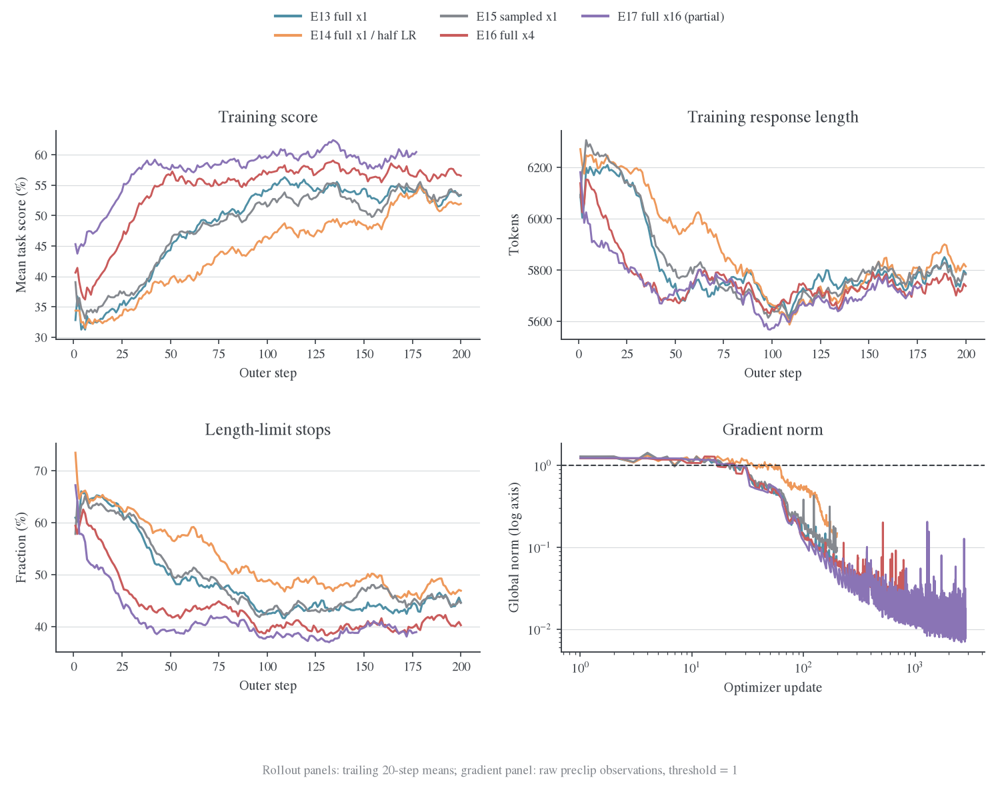

| 完整已记录 outer 区间 | 训练 mean score | 训练 response token | length 停止比例 |
| --------------------- | --------------: | ------------------: | --------------: |
| E13，1–200            |         49.617% |             7427 万 |          47.61% |
| E14，1–200            |         45.242% |             7500 万 |          51.99% |
| E15，1–200            |         49.188% |             7435 万 |          48.26% |
| E16，1–200            |         55.047% |             7355 万 |          42.30% |
| E17，1–177            |         58.377% |             6481 万 |          40.34% |

E17 区间较短，公平的共同 1–160 训练 score 均值为 E13 48.574%、E14 43.271%、E15 47.969%、E16 54.600%、E17 58.145%。任务分数只作诊断，没有混入这些 Full-KL loss。

所有已记录训练 batch 的 `response_length/max` 都等于 7168。即使平均长度下降，每批仍有回答到达上限，rollout pipeline 的普通步均值仍约 33 秒。这与同步 batch 的最长回答约束一致，但没有逐请求 trace，不能据此量化可消除的长尾等待。

验证生成与训练 cap 不同，不能用训练 40%–52% 的 length-stop 比例推断验证同样严重。共同 step 160 的 MATH 验证 mean length 为 E13 4664、E14 5371、E15 4885、E16 4490、E17 4436；E14 的 MATH 解析缺失为 235/8000，E16/E17 为 79/8000、83/8000。解析缺失和 length-stop 存在关联，但两者计数不完全相同，不能等同。

所有已记录验证窗口的 `failed_count` 与 `nonfinite_score_count` 均为 0；这不表示没有错误答案或解析缺失。

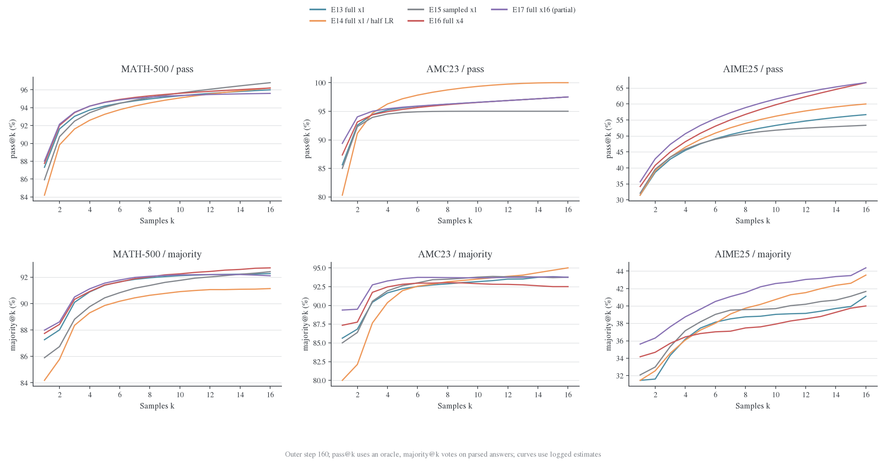

共同 step 160，E16/E17 的 AIME pass@16 都是 66.67%，majority@16 却只有 40.00%/44.38%。MATH 上 E17 的 mean 更高，但 pass@16 为 95.60%，低于 E16 的 96.20%，majority 也略低。复用的提升并不是所有题目覆盖和投票指标的一致提升。

Pass@k 使用“至少一个正确”的 oracle，majority@k 使用解析答案投票；部分 k 包含子集 Monte Carlo，k=16 使用完整集合。不能把 pass-majority 差距全部解释成模型缺少排序能力，也不能把 `mc_se=0` 解释成没有题目采样误差。

<a id="five-6-e15-独有诊断及其解释边界"></a>

<a id="6-e15-独有诊断及其解释边界"></a>

### E15 独有诊断及其解释边界

E15 有 107 个 policy、15 个 advantage、4 个 correction 数值字段，四个 Full-KL run 没有这些完整字段族。不能用 E15 的 entropy 与 Full-KL 的“缺失”比较模型是否发生熵坍缩。

E15 的主要观察为：

- Pre-update entropy 的前/后 20 步均值由 0.8782 降到 0.6728。
- `current_anchor/log_ratio_mean` 等当前—锚点差值全部为 0；PPO clip 与 dual-clip active fraction 全部为 0。每批仅更新一次，观察发生在 optimizer 前，这与实际完成 200 次更新并不矛盾。
- Anchor—behavior 的 ESS fraction 大多数接近 1，但最小值为 0.724，发生在 outer 14；它是 FSDP/vLLM 概率差异的诊断，behavior IS 并未启用。
- Current/frozen 信号符号分歧率的前/后 20 步均值约为 1.97%/6.56%；信号变小后，少量概率差异更容易改变符号。它不是当前这五组已经测过 frozen advantage 的证据。

因此这五个 run **没有比较 clip on/off，也没有比较 current/frozen 或 IS/NoIS 六格**。它们比较的是既有 sampled vanilla、Full-KL 的学习率和复用次数。现阶段不应据此宣称 PPO clipping 有害、NoIS 无效或 frozen 信号更差。

<a id="five-7-时间成本显存和资源活动"></a>

<a id="7-时间成本显存和资源活动"></a>

### 时间成本、显存和资源活动

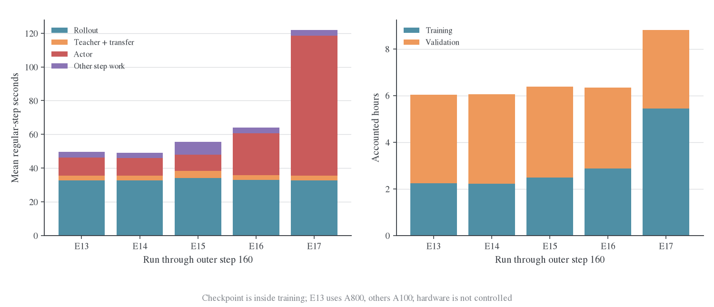

普通步统计排除首步、验证步和 checkpoint 步；下面统一截止 outer 160。计时遵循 `outer + validation`，不重复加 checkpoint、rollout_batch 或 validation_rollout。

| Run | 普通 outer 均值 | Actor/outer 均值 | 训练累计 | 验证累计 |    合计 | 按 8 卡折算 |
| --- | --------------: | ---------------: | -------: | -------: | ------: | ----------: |
| E13 |         49.63 s |          10.57 s |  2.230 h |  3.800 h | 6.030 h | 48.24 GPU·h |
| E14 |         49.21 s |          10.43 s |  2.210 h |  3.855 h | 6.065 h | 48.52 GPU·h |
| E15 |         55.47 s |           9.44 s |  2.490 h |  3.888 h | 6.378 h | 51.02 GPU·h |
| E16 |         63.99 s |          24.77 s |  2.867 h |  3.466 h | 6.333 h | 50.66 GPU·h |
| E17 |        121.81 s |          83.05 s |  5.434 h |  3.368 h | 8.802 h | 70.41 GPU·h |

这是记录到的计时账，不包括全部初始化、日志与其他未计时工作，也不是平台账单。E13 的 A800 与其他组 A100 不同，不能把 E13/E15 的时间差全归因于 loss。

E16/E17 的 actor 阶段含多个更新及固定搬运开销。摊到每次更新约为 6.19/5.19 秒，说明复用有摊薄开销的效果；它们的整步则仍从约 64 秒增加到 122 秒。**GPU 更忙和单次更新更便宜，不自动意味着同时间质量更好。**

同为 A100 的 E14/E15，Full-KL 虽然 actor 阶段较重，但省掉了 old-log-prob/advantage，并使用 hidden teacher 通路，普通步更短；这仍是不同目标和工作量下的描述性结果，不是固定输入 kernel benchmark。

四个完成 run 的训练＋验证合计分别为 E13 7.417 h、E14 7.695 h、E15 7.907 h、E16 7.879 h。E16 的额外训练时间部分被较短的验证生成抵消。验证在这四组占比约 54.6%–64.1%；每个 run 共验证 91200 条回答、生成约 4.67–5.02 亿 response token，约为训练生成量的 6.35–6.69 倍。

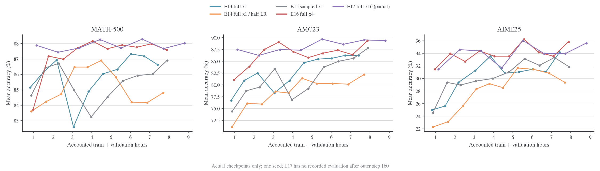

这张图用于看到测量预算的现实代价。相同 optimizer 数下验证次数不同，比较该横轴时也不能把减少评估次数当作等价评估的纯性能优化。

接近墙钟预算的实际 checkpoint 对比如下，没有在两个验证点之间插值：

| 时间窗口    | Run / outer / update | 记录累计时间 | MATH mean | AMC mean | AIME mean |
| ----------- | -------------------- | -----------: | --------: | -------: | --------: |
| 约 1 小时   | E16 / 20 / 80        |      0.971 h |   83.725% |  81.094% |   31.458% |
| 约 1 小时   | E17 / 20 / 320       |      1.147 h |   87.888% |  87.500% |   31.458% |
| 约 3.3 小时 | E16 / 80 / 320       |      3.286 h |   87.725% |  89.063% |   34.375% |
| 约 3.3 小时 | E17 / 60 / 960       |      3.350 h |   87.713% |  87.500% |   34.375% |

E17 较快跨过了早期更新区间，首个已记录点的 MATH/AMC 较强；但约 3.3 小时的两点已接近，E16 的 AMC 点估计还更高。固定生成量、固定更新量和固定时间会产生不同排序，因此“主推 E16”对应的是上述较长生成预算下的折中，不能推广成所有预算下都胜过 E17。

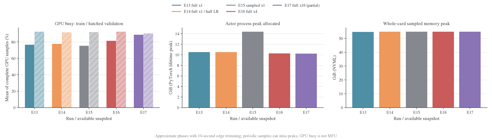

| Run | Actor 进程 allocated 高水位 | NVML 单卡采样最大值 | 训练窗口 GPU busy 均值 | 验证窗口 GPU busy 均值 |
| --- | --------------------------: | ------------------: | ---------------------: | ---------------------: |
| E13 |                   10.52 GiB |           54.66 GiB |                 76.59% |                 92.71% |
| E14 |                   10.50 GiB |           54.92 GiB |                 77.64% |                 91.87% |
| E15 |                   14.40 GiB |           54.88 GiB |                 75.32% |                 91.93% |
| E16 |                   10.27 GiB |           54.77 GiB |                 81.43% |                 92.51% |
| E17 |                   10.21 GiB |           54.77 GiB |                 88.80% |                 90.36% |

PyTorch 高水位是该进程生命周期的 allocator 口径，不是单个 KL kernel 的峰值；NVML 包含 vLLM 等整卡分配。二者差距大，不能据 10 GiB 就说整卡还有 70 GiB 可用于增加训练 batch。E16/E17 的复用没有使已记录 allocated 高水位随 epochs 成倍增长。

System 记录包含 CPU/GPU 等不同周期条目，完整八卡 GPU 样本大约每 15 秒一组，可能漏掉短峰值。训练/验证边界由 host timer 与日志时间戳重建，表内各窗口两端裁去 10 秒，报告 sample mean，不假装连续 trace 或时间加权能耗。0/10 秒裁边结果均保存在 analysis.json，可做敏感性复核。

较长的 actor 阶段提高了 E17 的整段训练 GPU busy，同时训练窗口平均 NVML 显存由 E16 的约 33.1 GiB 降到 E17 的约 21.7 GiB，因为更多时间处于较低显存的 actor 阶段，而非 vLLM KV 驻留阶段。这是时间构成变化，不能解释为 16 次更新本身减少了每次更新需要的显存。记录的 actor MFU 均值约为 E13 25.3%、E16 35.2%、E17 37.1%；它是模型 FLOPs 估算口径，与 GPU busy 不同，也不是完整 Full-KL 所有额外 head 运算的硬件计数器结果。

<a id="reference-1-没有显式-ratio不等于-nois"></a>

<a id="reference-11-ess-仍可定义但日志没有测量"></a>

<a id="reference-12-多-epoch-仍有前缀陈旧问题"></a>

## Full-KL 目标与读数

E16/E17直接优化完整词表RKL，固定前缀上的梯度对应current信号与精确动作积分。目标、score形式和detach位置统一见[固定前缀理论](../../theory/fixed-prefix.md)；这里使用训练日志中的实际 Full-KL 观测。

<a id="reference-2-多次复用到底降低了多少-kl"></a>

## 批内 KL 的实际下降

下面统一取 outer 141–160 的 20 批。每一批先计算自己的相对降幅，再对 20 批取均值；不是用表中两个均值的比值替代逐批统计。单位为自然对数 nats/token。

| 实验           | 第 1 次更新前 KL 均值 | 最后一次更新前 KL 均值 | 批内相对下降均值 | 最后相邻两个观测之间的下降均值 |
| -------------- | --------------------: | ---------------------: | ---------------: | -----------------------------: |
| E16，4 epochs  |            0.00198573 |             0.00186135 |            6.26% |                          2.83% |
| E17，16 epochs |            0.00082887 |             0.00046412 |           43.85% |                          2.21% |

**日志测量发生在 optimizer 更新之前。E16 的首末差只覆盖 3 次已执行更新，E17 覆盖 15 次；都没有对最后一次更新后的同一批再 forward。** 不能把最后一点写成“完成第 16 次更新后的 KL”。E16/E17 的轨迹本身不同，上表也不是相同输入的 epoch 数控制实验。

E17 更靠后的 outer 159–178 共 20 批，首末 KL 均值为 0.00076594 → 0.00041153，逐批相对下降均值 45.89%，最后相邻观测平均仍下降 2.49%。outer 178 有完整的 16 条更新记录，但没有完整 outer 汇总或对应验证，故只用于批内分析。最后一条 KL 为 0.00040642，梯度范数约 0.00834。

这些结果说明 **E17 在已经复用十余次后仍有可见的局部优化空间**。它们不证明继续增加 epochs 会提升 held-out 准确率，也不证明固定批次能收敛到零。要判断该批次的停止状态，至少应比较同一批上的 update 前后 KL、梯度范数和后续几步相对变化；要判断模型训练收敛，还应看新 rollout、固定 held-out 前缀及验证指标。不能用旧批次损失下降替代这些证据。

<a id="reference-21-不存在由-epochs-单独决定的理论降幅"></a>

<a id="21-不存在由-epochs-单独决定的理论降幅"></a>

### 不存在由 epochs 单独决定的理论降幅

即使对普通梯度下降，也需要光滑性和步长等条件。例如 $L$-smooth 的 $F$ 满足

$$
F(\theta-\alpha\nabla F)\leq F(\theta)
-\alpha(1-L\alpha/2)\|\nabla F(\theta)\|^2.
$$

只有再加 PL/强凸等假设，才能给出相对最优值的几何收敛界。当前是共享参数的 Transformer、AdamW、梯度裁剪和低精度训练，不能把这个理想 GD 界直接代入 $\alpha=10^{-6}$，更不能将 16 epochs 解释成 16 次独立的分布空间精确镜像更新。这里实际采用 lr=$10^{-6}$、weight decay=0.01、grad clip=1；E17 的梯度范数非零也不等价于任务指标必然还有收益。

<a id="reference-3-找到的原始-student--teacher-评测"></a>

## 历史师生参考

历史记录来自已保存的 **2026-10-20 API 快照**，不是本轮从 .wandb 重新解码：

- [Student 6uorrk2k](../../../../../../wandb-logs/MirrorOPD-verl/analysis/oneshot-student-6uorrk2k-api-20261020/source.json)：`DeepSeek-R1-Distill-Qwen-1.5B`。
- [Teacher u87buult](../../../../../../wandb-logs/MirrorOPD-verl/analysis/oneshot-teacher-u87buult-api-20261020/source.json)：`JustRL-DeepSeek-1.5B`。

两者都是 One-Shot-OPD 的 val-only，MATH-500/AMC23/AIME25，每题 16 个回答、temperature=0.7、top-p=0.9、max_tokens=31744。这些采样预算与五组实验一致，但历史输入/模板与执行管线不同，不能当成五个 run 各自的真实 step 0，也不构成严格的配对显著性比较。

| 参考或实验                 | 验证点   |    MATH mean |     AMC mean |    AIME mean |
| -------------------------- | -------- | -----------: | -----------: | -----------: |
| 历史原始 student           | val-only |     83.2500% |     72.0313% |     23.7500% |
| 本仓原始 student，rzfdphjr | val-only |     83.2375% |     71.5625% |     23.1250% |
| 历史 teacher               | val-only | **89.1125%** | **89.3750%** | **39.1667%** |
| E13 Full-KL ×1             | 200      |     86.6250% |     86.2500% |     34.1667% |
| E14 Full-KL ×1，半 LR      | 200      |     84.8000% |     82.1875% |     29.3750% |
| E15 sampled ×1             | 200      |     86.9125% |     87.8125% |     31.8750% |
| E16 Full-KL ×4             | 200      | **87.5875%** | **89.3750%** | **35.8333%** |
| E17 Full-KL ×16            | 160      | **88.0250%** | **89.3750%** | **35.6250%** |

E17 距历史 teacher 的 MATH/AIME 点估计分别还有 **1.0875/3.5417 个百分点**；E16 为 **1.5250/3.3333 个百分点**。AMC 的点估计相等，只能说这个指标相等，不能说分布已经一致。也不能仅凭 E16@200 与 E17@160 的 AIME 差异认定更多 epochs 有害；共同预算比较见原报告。

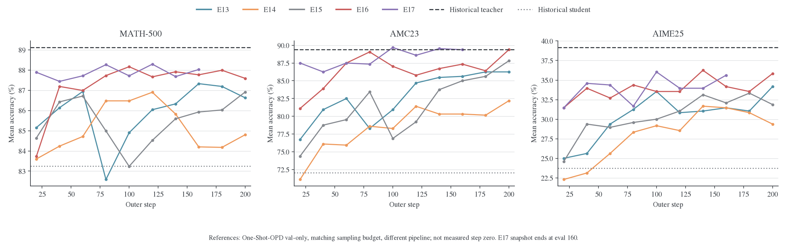

图中历史参考是水平线，不是 step 0 数据点。面板使用不同纵轴范围以显示各数据集变化，不能比较视觉斜率大小。**参考线只用于 mean accuracy**。旧 `best@16/mean`、`maj@16/mean` 含历史 bootstrap 估计口径，不与新的 exact `pass@16` / `majority@16` 混画。

<a id="reference-31-长度和熵已找到什么仍缺什么"></a>

<a id="31-长度和熵已找到什么仍缺什么"></a>

### 长度和熵：已找到什么，仍缺什么

原始两份 One-Shot 评测的 history 和 summary 中均没有 length、entropy 或生成 token 数记录。不能补写 teacher 长度，不能用训练长度替代验证长度，也不能从准确率倒推熵。它们另有 format_score 等辅助指标，但这些同样不是 KL。

本仓已有一次原始 student 的四卡 H800 验证（[性能实测](../../infra/performance/2026-10-22-训练与验证性能实测.md)，`rzfdphjr`）保留了总生成 token：56,291,141 / 9,120 responses，整体均值 **6172.27 tokens**。它使用相同验证题目和采样预算、graph rollout；该值来自 engine 生成计数，未存逐数据集长度或熵。

| 验证点           | MATH 平均长度 | AMC 平均长度 | AIME 平均长度 | 全部回答加权平均长度 |
| ---------------- | ------------: | -----------: | ------------: | -------------------: |
| 本仓原始 student |        未记录 |       未记录 |        未记录 |              6172.27 |
| E13@200          |       4600.72 |      6932.50 |      10482.11 |              5073.90 |
| E14@200          |       5236.30 |      8201.90 |      11584.50 |              5778.52 |
| E15@200          |       4728.27 |      7146.05 |      10762.53 |              5215.53 |
| E16@200          |       4557.12 |      6919.46 |      10318.40 |              5026.12 |
| E17@160          |       4435.98 |      6647.74 |      10321.78 |              4900.97 |
| 历史 teacher     |        未记录 |       未记录 |        未记录 |               未记录 |

据此可以说，相较本仓初始 checkpoint 的这次历史验证，E16/E17 的整体回答均值更短，准确率更高。但不知道 teacher 的回答有多长，因此不能声称长度已经趋近 teacher。还应联合查看 p50/p95、length-limit stop、答案缺失和正确/错误回答长度，避免把截断或答案缺失造成的变短误判为效率提升；这些训练后指标已在交互报告中保留。

E16/E17 没有 entropy 日志。E15 有训练前缀的 `pre_update` entropy：最初 20 次均值约 0.8782，最后 20 次约 0.6728；这是训练采样前缀上的条件熵，**不是验证生成序列的熵，也不是 teacher 自己生成前缀上的熵**，不能拿来填师生 entropy 对照表。

<a id="sampled"></a>
<a id="sampled-e15-训练动态与指标分析"></a>

<a id="sampled-setting-与实验设计"></a>

## E15 的日志与观测时刻

<a id="sampled-结论与数据范围"></a>

### 结论与数据范围

E15 的 200 次更新全部实际执行，没有记录到跳过更新；蒸馏 loss、梯度范数和优势幅度明显下降。与此同时，current 与 behavior 两种蒸馏信号的符号分歧上升，说明后期值得进一步检查信号接近零时的敏感性。训练回答有 48.26% 因长度上限结束；验证占已计时总耗时的 60.71%，是本次运行最大的时间支出。

E15 诊断读取`krkmq098`的完整 history 与独立 system 采样流。[^sampled-run]

模型、200 次更新和训练/验证长度沿用前面的 E15 设置；以下列出日志快照及执行细节。

| 项目           | 冻结记录                                                         |
| -------------- | ---------------------------------------------------------------- |
| 状态与抓取时间 | finished；2026-10-23 09:48:51 北京时间                           |
| 修正项         | behavior IS、RS 均关闭；任务 reward 仅作诊断                     |
| 学习率         | 常数 1e-6，无 warmup；gradient clip=1                            |
| 资源           | 单机 8×A100-SXM4-80GB；shared-sync、FSDP2；八个 TP1 rollout 副本 |

完整条件见[config](../../../../../../wandb-logs/MirrorOPD-verl/analysis/e15-krkmq098-20261023/config.json)、[硬件](../../../../../../wandb-logs/MirrorOPD-verl/analysis/e15-krkmq098-20261023/hardware.json)和[软件版本](../../../../../../wandb-logs/MirrorOPD-verl/analysis/e15-krkmq098-20261023/package-versions.txt)。本段描述 sampled 路径的观测。Git 字段为 W&B 记录的 revision，部署中的额外差异需结合源码记录核对。

<a id="sampled-指标覆盖与时间轴"></a>

### 指标覆盖与时间轴

600 条 history 对应 200 个 outer step，每一步包含更新前、更新指标、完整步汇总三个事件。更新前事件的 optimizer/update 计数仍是上一轮，因此不能把 `_step` 当训练步，也不能将所有字段强行放在 optimizer 轴上。

| 指标家族                | 数值字段数 | 主要用途                                                                  |
| ----------------------- | ---------: | ------------------------------------------------------------------------- |
| `policy`                |        107 | anchor/behavior/current 概率差、ESS、token 与 sequence log-ratio、entropy |
| `advantage` + `distill` |         26 | 优势幅度、符号、分位数、蒸馏信号差异                                      |
| `optim` + `correction`  |         16 | loss、梯度、更新执行、PPO clipping 诊断                                   |
| `rollout`               |         56 | 长度、终止原因、score、token 预算、复用与 staleness                       |
| `perf`                  |         27 | 阶段耗时、吞吐、MFU、分配器显存与负载均衡                                 |
| `eval`                  |       2145 | 三个数据集、采样预算 k=1…16、置信区间、格式与生成质量                     |
| 合计                    |   **2377** | 不包含三个 `step/*` 轴与三个 W&B 内部字段                                 |

`eval`字段按预算、区间和评分展开；本次数学任务中的 acc/reward/score 还包含同值观测。

字段定义继续以[当前指标字典](../../settings/指标口径.md)为准。本次新增[逐字段目录](../../../../../../wandb-logs/MirrorOPD-verl/analysis/e15-krkmq098-20261023/metric-catalog.csv)，记录实际横轴、出现次数、是否常量、首尾值、范围和均值；[冻结横轴映射](../../../../../../wandb-logs/MirrorOPD-verl/analysis/e15-krkmq098-20261023/metric-axes.json)来自导出分析时的 `metric_axis`。普通指标有 200 个观测，验证有 10 个，训练分位数有 26 个。目录中的 `first20_mean/last20_mean` 是前后 20 个**观测**的均值；下文仅对完整 200 点序列使用这一窗口。

脚本忽略未填充的 null，不将其变成零；同一字段同一横轴出现不同数值则报错。常量零仍保留，例如本次 current-anchor 差异、PPO active fraction 和 staleness；IS 关闭后没有实际 IS 权重统计，不能把未出现的字段补成零。

<a id="sampled-实验结果"></a>

## E15 的采样信号与训练动态

<a id="sampled-优化与蒸馏信号"></a>

### 优化与蒸馏信号

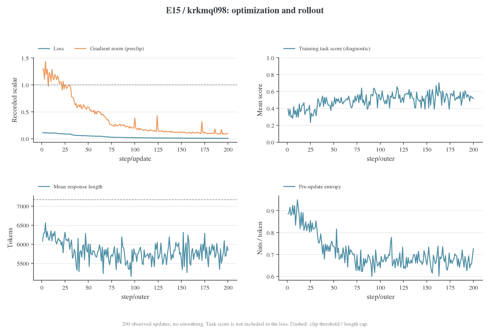

图中每点是一个实际 batch/update，没有平滑。为了降低单批题目难度变化的影响，下表比较前 20 次与后 20 次观测的均值。

| 指标                 |    1–20 | 181–200 |
| -------------------- | ------: | ------: |
| 记录的 actor loss    | 0.10544 | 0.00869 |
| 裁剪前梯度范数       | 1.17024 | 0.10311 |
| 蒸馏优势标准差       | 0.52585 | 0.14256 |
| 训练 task score      |  36.56% |  53.44% |
| 平均 response token  | 6201.56 | 5782.87 |
| 更新前 entropy       | 0.87824 | 0.67281 |
| 因长度上限结束的回答 |  62.27% |  44.53% |

loss 是当前 sampled-token 配方记录的量，不是完整词表 reverse KL 的精确数值。下降表明采样轨迹上的训练信号在缩小；不同 batch 的前缀分布也在变化，不能单凭这条曲线推断全分布 KL 或泛化效果。

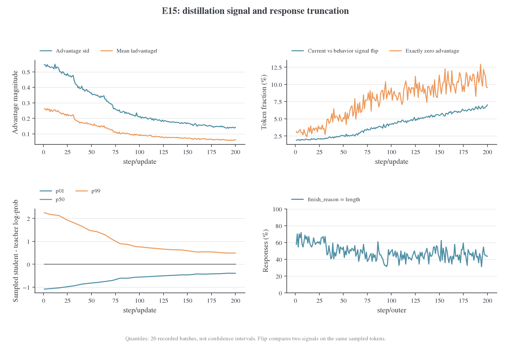

`sign_flip_fraction` 比较同一批 sampled token 上，用 current log-prob 与 rollout behavior log-prob 构造的两个教师差值是否异号，不是相邻两次更新之间的梯度翻转。它的窗口均值从 **1.97% 上升到 6.56%**；零优势比例也在上升。与此同时，优势标准差下降约 73%。一种符合这些观测的解释是：信号靠近零时，同量级的概率重算差异更容易改变符号。这是待验证假设；目前没有逐 token 联合记录，不能证明符号变化由哪一种数值误差造成，更不能断言这些 token 主导了梯度。

训练共采样 12,800 条回答、74,346,912 个 response token；其中 **6177 条 length、6623 条 stop、unknown/aborted/completed 均为 0**。48.26% 的截断率来自实际 `finish_reason`。`padded_width_fraction` 的通用含义仍是“等于当前 padded width 的比例”，不能在其他运行中自动替代终止原因。

<a id="sampled-策略差异与长序列尾部"></a>

### 策略差异与长序列尾部

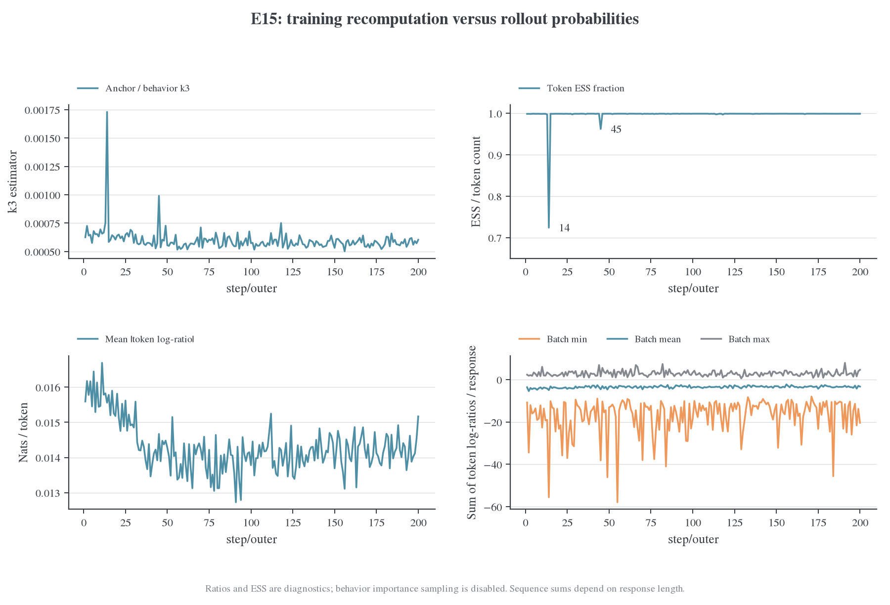

anchor 与 behavior 的平均绝对 token log-ratio 大致处在 0.013–0.017 nats，前后窗口均值为 0.01575 和 0.01429；并未随训练后期符号分歧的上升而扩大。大多数 batch 的 ESS fraction 接近 1，但 **outer step 14 降到 0.724，step 45 降到 0.962**。均值、相关系数与 ESS 需要一起看，平均概率很接近仍可能存在少量异常比率。

sequence log-ratio 将一条回答的所有有效 token 累加，最负的 batch 内样本约为 −57.9。它受长度影响很大，不能与单 token 的 0.014 直接比较；目录同时保留按长度平均的 `sequence_mean_log_ratio/*`。原 `chi2_seq` 是有限样本指数矩减一，可能受极端尾部主导甚至出现负估计值，因此保留原始字段但没有将其画成“精确非负散度”的对数图。

本次 behavior IS 没有启用，图中的 ratio/ESS 是诊断值。current-anchor 为零也不表示模型没有更新：每批只做一次更新，相关观测发生在该次 optimizer.step 之前；实际执行计数为 200，跳过为 0。字段时刻与公式见[指标字典](../../settings/指标口径.md)和[旧辅助统计定义](../../archive/metrics/2026-10-22-旧Correction辅助字段.md)。

<a id="sampled-验证效果与采样预算"></a>

### 验证效果与采样预算

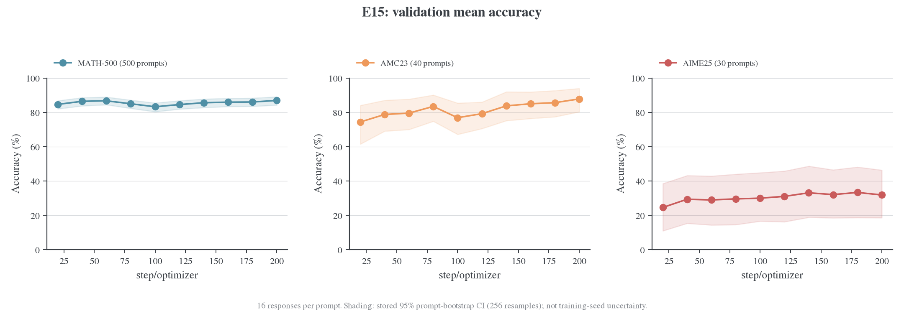

| step 200 | Mean accuracy | 记录的 95% CI    | pass@16 | majority@16 |
| -------- | ------------: | ---------------- | ------: | ----------: |
| MATH-500 |        86.91% | [84.23%, 89.08%] |  95.80% |      92.40% |
| AMC23    |        87.81% | [80.33%, 93.95%] |  97.50% |      95.00% |
| AIME25   |        31.88% | [18.62%, 46.38%] |  56.67% |      41.67% |

区间来自题目维度 bootstrap，256 次重采样，不是跨训练 seed 的不确定性。AMC23 只有 40 题、AIME25 只有 30 题，区间很宽。没有 step 0 验证；step 20 才是第一条观测。MATH 在 step 100 有回落，各数据集并非单调改善，不能仅凭首尾或区间是否重叠下显著性结论。

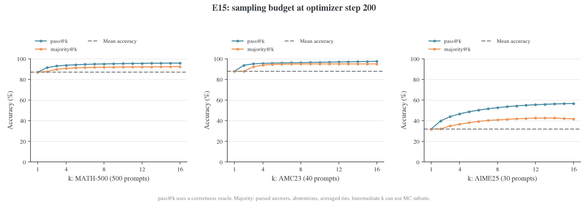

pass@k 表示 k 个样本中至少一个正确，使用正确性判定；majority@k 从解析答案投票，不拥有正确性 oracle。因此 AIME 的 pass@16=56.67% 与 majority@16=41.67% 之间的差距，说明“采到正确答案”与“选出正确答案”仍是不同问题。不能直接把这 15 个百分点全部归因于模型排序能力，解析缺失与投票规则也会影响结果。

majority 的解析缺失按弃权处理，并列最大票数按候选正确性的平均值计分，故 30 题上也可能得到分数不是 1/30 整数倍的结果。部分中间 k 使用子集 Monte Carlo；k=16 使用完整样本集合，`mc_se=0` 只表示无此类子集采样误差，不表示没有题目采样不确定性。具体算法继续引用指标字典，不在这里另立定义。

<a id="sampled-时间开销验证生成与资源"></a>

### 时间开销、验证生成与资源

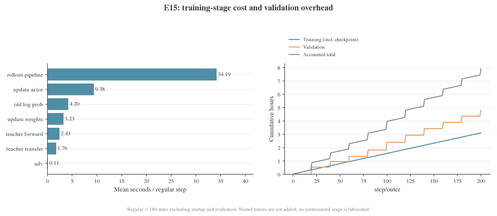

排除启动首步和 10 个验证步后，189 个常规步平均 **55.42 s**：rollout pipeline 34.19 s、actor update 9.38 s、old log-prob 4.20 s、权重同步 3.23 s、teacher forward 2.43 s、teacher transfer 1.76 s、advantage 0.11 s。阶段覆盖外的少量时间保留为未归属部分，不强行命名为通信或 I/O。

全部 outer timer 合计 **3.107 h**，validation timer 合计 **4.800 h**，总计 **7.907 h**。其中验证占 **60.71%**。两次 checkpoint 共 33.10 s，已包含在 outer 中；`rollout_batch` 包含在 `rollout_pipeline` 的范围内，`validation_rollout` 包含在 validation 中，均不重复相加。

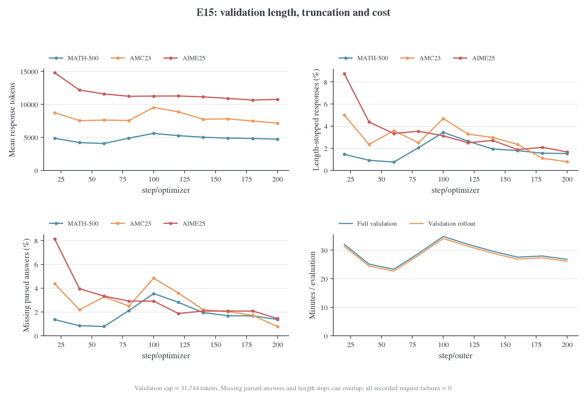

10 次验证共生成 91,200 条回答，按每个数据集的 count×mean length 复算得到 **493,510,519 response token**，约为训练 response token 的 6.64 倍。验证 rollout 占验证计时约 **97.64%**；验证每轮约 23.3–34.8 分钟。这使得验证频率、采样数与生成尾部成为高优先级的实验成本分析对象。改变验证预算会改变估计精度，应保留固定完整评估点；不能将降低预算记作等价评测的纯性能提升。

最后一次验证的 length 结束数为 MATH 122/8000、AMC 5/640、AIME 8/480；解析缺失数为 110、5、7。二者可能重叠，不能相加。全部记录的 failed_count 为零，不能因此把解析缺失也认定为零。当前只有聚合值，要分析“错误是否集中在截断答案”，还需要逐回答记录。

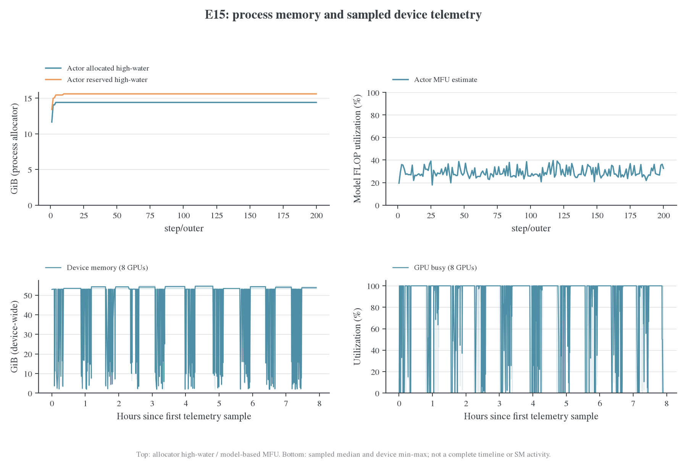

actor allocated/reserved 的累计高水位分别为 **14.40/15.60 GiB**，MFU 的步均值约 **29.03%**。口径统一见[MFU 与利用率说明](../../infra/performance/2026-10-22-MFU与利用率口径.md)；这些累计进程计数不能定位 backward 的整卡瞬时峰值。

本快照 system stream 共 2000 行，其中 1018 个时刻有 GPU 数据；图中实线是八卡中位数、浅色带是同一时刻八卡最小至最大值。采样覆盖与缺失处理见[数据说明](../../../../../../wandb-logs/MirrorOPD-verl/analysis/e15-krkmq098-20261023/README.md)。图中没有 SM Active、Tensor Core Active 或实际 HBM GB/s。

如需判断“训练 rollout 是否空闲”，继续读已有的 [E15 分阶段资源分析](../../infra/performance/2026-10-23-E15训练Rollout资源分析.md)。该文使用同一 run 的另一份更密集系统采样和阶段对齐，覆盖 1899 个 GPU 时刻；这里不把两个采样快照拼成完整 trace，也不重复计算其窗口结论。对 forward/backward 的细粒度归因仍需要 profiler。

<a id="reference-4-kl-能否趋于零序列行为能否趋近-teacher"></a>

<a id="reference-41-表达能力允许不等于这条训练路径保证达到"></a>

<a id="reference-42-完整序列-kl-的正确关系"></a>

<a id="reference-43-accuracylengthentropy-是诊断不是多项相加得到的-kl"></a>

## 从条件拟合到行为

### 模型可表示性

本地两个模型配置的 qwen2 架构、28 层、hidden size=1536、vocab size=151936、12 attention heads/2 KV heads、RoPE 和非共享输出 head 等关键结构一致。对相同 token 定义和输入/输出变换，且全部对应参数可训练时，直接取 teacher 参数是一个可表示的 $p=T$ 解。

有限数据、优化路径、权重衰减、学习率和执行精度共同决定实际拟合程度。批内 $F_k$ 衡量该经验前缀集合上的条件误差；未见状态和完整行为需要各自读出。

训练使用温度 1 的完整支持分布，验证使用 temperature0.7 与 top-p0.9。它们对应不同的生成协议。序列 KL 要求当前学生访问分布上的条件 KL 之和；这里的日志是训练前缀上的 token 均值。

[正确率与序列/Token KL](../../theory/accuracy-and-kl.md)统一维护链式关系、熵分解和任务指标界；[数值例子](../../theory/accuracy-and-kl.md#convergence-examples)保留本组分析使用的量纲示例与反例。

<a id="five-结论与阅读入口"></a><a id="five-9-后续实验优先级"></a>

## 综合判断

E13 与 E15 在 200 次更新后各有领先的数据集，当前直接对照没有统一赢家。E14 的较低学习率在这个预算内拟合更慢。增加 reuse 改善了批内 KL，但任务收益取决于预算轴：E16 在较长生成预算下兼顾成绩与成本，E17 在约一小时窗口较早取得较强 checkpoint。

下一项有区分力的比较是同版本、同评测和多 seed 的 sampled/full 对照，并补共同固定前缀与同管线 teacher 读出。已有结果中的学习率、reuse 及长度因素由[预算专题](../reuse-budget/budget.md)继续分析。

<a id="five-8-全指标覆盖与不能从日志推出的结论"></a>

### 日志覆盖与统计范围

各 Full-KL run 有 2235 个数值指标，E15 有 2377 个；并集 2378 个、五组交集 2234 个。每组其中 2145 个属于 eval，主要来自数据集、k、CI、子集估计和生成统计的组合，不是两千多个独立训练信号。

| 字段族     | Full-KL 每 run |  E15 | 已使用的解释                                                   |
| ---------- | -------------: | ---: | -------------------------------------------------------------- |
| eval       |           2145 | 2145 | mean/pass/majority/all-correct、题目区间、长度、失败与解析缺失 |
| rollout    |             52 |   56 | 样本量、长度/截断、评分、复用坐标、staleness                   |
| optim      |             12 |   12 | loss、LR、梯度、实际更新、有限性                               |
| perf       |             24 |   27 | 阶段计时、吞吐、MFU、allocator 高水位                          |
| distill    |              1 |   11 | Full-KL 与 sampled gap 分别解释，不混作同一数值                |
| policy     |           缺失 |  107 | 熵、ratio、ESS 等仅能分析 E15                                  |
| advantage  |              1 |   15 | Full-KL 只有 task loss 使用标记，缺少 E15 的信号分布           |
| correction |           缺失 |    4 | E15 的 PPO/dual-clip 记录；Full-KL 缺失不填零                  |

所有字段的轴、观测数、首尾、极值、均值、中位数、前后 20 点均值和常量标记均已输出到 CSV，并可在 HTML 查看原始曲线。常量字段包括有效性标志、固定 LR、任务 reward 未使用、零轨迹 staleness 等；没有把常量当成缺失。

轨迹 staleness 为 0 只说明这些同步批次没有跨版本延迟；它不表示 E16/E17 的第 2–16 次更新仍使用当前策略刚生成的数据。Full-KL 缺少当前—行为完整漂移指标，不能直接复用 E15 的 ESS 推断它们的批内离策略程度。

这份输入包含单 seed 训练 history 和周期系统采样；逐请求 CUDA trace、共同固定前缀 KL 和同管线 teacher 基线尚缺。下面分别按已有观测解释执行成本、在线拟合与任务表现。

<a id="sampled-后续最值得补充的分析"></a>

### E15 诊断尚缺的联合信息

| 优先级 | 问题                           | 已有数据能回答什么                                     | 还需要什么                                                                        |
| ------ | ------------------------------ | ------------------------------------------------------ | --------------------------------------------------------------------------------- |
| 1      | 后期符号分歧是否有实质梯度影响 | 信号幅度下降、翻转比例上升、重算差异大体稳定           | 少量固定 batch 的逐 token 联合记录；按优势绝对值分桶，并统计翻转 token 的梯度贡献 |
| 2      | 验证成本如何降低               | 验证占 60.71%，生成占验证 97.64%；已有 k=1…16 预算曲线 | 保留固定完整评估点，对较低中间评估频率/预算做成本与精度对照                       |
| 3      | 训练长度上限是否限制有效样本   | 48.26% 回答由 length 结束，后期仍约 44.53%             | 逐回答 score×finish_reason 联合分布；长度消融需单独视为数据分布变化               |
| 4      | ESS 尾部是否可复现             | step 14/45 异常能定位到 batch                          | 固定输入重算，保存尾部 token 和 mask；不能仅看平均概率相关性                      |

不新增训练即可持续做的部分包括：窗口统计、最终 k 曲线、每次验证的格式/长度分解和耗时累计。进一步的逐题配对比较需要取回部署端 validation 记录；W&B 聚合 history 本身不足以恢复这些联合信息。

<a id="reference-5-下一步最小补证方案"></a>

### 师生与新鲜轨迹的补充读出

同管线 teacher 基线、固定留出前缀和 current-trajectory 风险分别补足任务参照、未见状态拟合与访问分布的观察。若分析行为漂移，另保存 behavior log-prob 及对应 mask。完整词表目标继续使用原动作积分。

<a id="settings-当前预设与待办"></a>

## 复现历史设置与当前入口

从 2026-10-25 起，E13–E17 的启动默认值为 **250 outer，开启初始验证**；每 20 outer 验证、每 100 outer 和最终步保存，保留四份 checkpoint。相应计划更新数为 250/250/250/1000/4000。上表历史 200-step 结果不计作新预设完成。

250-step 预设与本文 200-step 运行具有不同预算，后续同版本比较需注明所用预设。E18–E20 的固定更新预算另见[等更新系列](../reuse-budget/budget.md#equal-updates)。E13/E15/E17 在[失败复现矩阵](../teacher-transfer/failure-reproduction.md#matrix)中承担成功对照，不能把旧 200-step 结果标成该矩阵的 250-step 已完成。

```bash
STUDENT_GPUS=8 bash examples/mirroropd/run_math_opd_ablation_fsdp2.sh E13
STUDENT_GPUS=8 bash examples/mirroropd/run_math_opd_ablation_fsdp2.sh E15
STUDENT_GPUS=8 bash examples/mirroropd/run_math_opd_ablation_fsdp2.sh E17
CONFIG_ONLY=1 bash examples/mirroropd/run_math_opd_ablation_fsdp2.sh E17
```

环境与资源覆盖见[训练配方](../../settings/训练设置.md)，完整实现见[Full-KL 工程](../../infra/numerics/full-vocab/README.md)。复现实验时显式设定历史预算与初始验证开关，并核对实际 config；当前默认值不用于推断历史设置。

<a id="five-证据与复算"></a>

## 数据与复算

[指标覆盖](../../../../../../wandb-logs/MirrorOPD-verl/analysis/five-run-comparison-20261024/metric-coverage.csv)和[逐字段统计](../../../../../../wandb-logs/MirrorOPD-verl/analysis/five-run-comparison-20261024/metric-catalog.csv)记录五组输入的完整指标范围。

<a id="five-10-复核与复现"></a>

<a id="10-复核与复现"></a>

### 复核与复现

统计程序为 [compare_policy_runs.py](../../../research/studies/production/compare_policy_runs.py)，使用日志内的 metric definitions 定义横轴；绘图为 [plot_policy_comparison.py](../../../research/studies/production/plot_policy_comparison.py)。复现命令、来源提交与完整性记录见[数据 README](../../../../../../wandb-logs/MirrorOPD-verl/analysis/five-run-comparison-20261024/README.md)。

硬件与软件信息从对应 writer 的 environment 记录恢复，来源保存在冻结输入中。图表均输出 PNG/PDF/SVG 并经过 figure-viz 审计；不同数据集的独立纵轴、误差条端帽和同色双柱带来的警告已按图面语义复核。

<a id="five-参考来源"></a>

#### 参考来源

[^five-e13]: 用户指定的 E13 run。分析读取其本地事务日志。[jt2r9h88](https://forge.coreweave.com/wandb/wncfht/MirrorOPD-verl/runs/jt2r9h88)。

[^five-e14]: 用户指定的 E14 run。分析读取其本地事务日志。[aq474oay](https://forge.coreweave.com/wandb/wncfht/MirrorOPD-verl/runs/aq474oay)。

[^five-e15]: 用户指定的 E15 run。分析读取其本地事务日志。[krkmq098](https://forge.coreweave.com/wandb/wncfht/MirrorOPD-verl/runs/krkmq098)。

[^five-e16]: 用户指定的 E16 run。分析读取其本地事务日志。[ujy2qx5d](https://forge.coreweave.com/wandb/wncfht/MirrorOPD-verl/runs/ujy2qx5d)。

[^five-e17]: 用户指定的 E17 run。分析读取其本地截断快照，不将网页可能更新的状态混入冻结分析。[cix5i2x2](https://forge.coreweave.com/wandb/wncfht/MirrorOPD-verl/runs/cix5i2x2)。

<a id="sampled-证据与复算"></a>

### E15 原始记录与图表

<a id="sampled-数据图表与复现"></a>

#### 数据、图表与复现

输入、图表与复算入口如下：

- [数据快照](../../../../../../wandb-logs/MirrorOPD-verl/analysis/e15-krkmq098-20261023/README.md)：完整 history 的无损 gzip、配置、硬件、软件、system 采样、字段目录、逐轴序列和统计。
- [图表目录](sampled-vs-full/figures/e15-krkmq098-20261023)：八组 PNG/PDF 和逐图 audit 记录。
- [复现入口](../../archive/历史复算命令参考.md#e15-policy-v3-完整指标分析)：命令和依赖；脚本不访问旧 run、不启动训练。

六项 CPU 测试覆盖更新前横轴、null/重复事件、计时嵌套、无损归档、真实 E15 计数及 GPU 缺失采样。八组图经过 figure-viz audit 和 PNG 人工检查；`timing.audit.txt` 的一项 warning 是将“类别条形图”和“累计小时曲线”误判为需要同一 y 轴的 facet，两个面板量纲不同，保留原始提示。

<a id="sampled-参考文献"></a>

##### 参考文献

[^sampled-run]: W&B. MirrorOPD-verl / krkmq098，E15 完成后的只读 API 快照。[运行页面](https://forge.coreweave.com/wandb/wncfht/MirrorOPD-verl/runs/krkmq098)。抓取方式与边界见 [source.json](../../../../../../wandb-logs/MirrorOPD-verl/analysis/e15-krkmq098-20261023/source.json)。

<a id="reference"></a>
<a id="reference-full-kl-批内收敛与原始师生参考评测"></a>

<a id="reference-6-数据与验算"></a>

### 师生参考与有限分布验算

所有派生数值在 [references.json](../../../../../../wandb-logs/MirrorOPD-verl/analysis/teacher-convergence-20261024/references.json)，有限分布验算在 [mathematical-checks.json](../../../../../../wandb-logs/MirrorOPD-verl/analysis/teacher-convergence-20261024/mathematical-checks.json)。提取脚本为 [compare_teacher_references.py](../../../research/studies/production/compare_teacher_references.py)，验证脚本为 [verify_sequence_kl.py](../../../research/checks/objectives/verify_sequence_kl.py)。复现命令集中在[分析复现](../维护说明.md)。

验收包括历史 mean/budget/缺失字段逐项核对、固定窗口统计复核、有限分布链式法则与反例、既有分析/导出测试 14 项通过，以及四个 Python 脚本的 Ruff 检查。独立临时目录只放一个 HTML，以浏览器 offline 模式确认 mean 显示 7 条线、其他指标保持 5 条、参考开关有效、E17@200 保持缺失、批内图保留 16 个点，无页面错误或网络请求。PNG 与页面截图已检查；图审计的独立纵轴提示在图注中说明。
