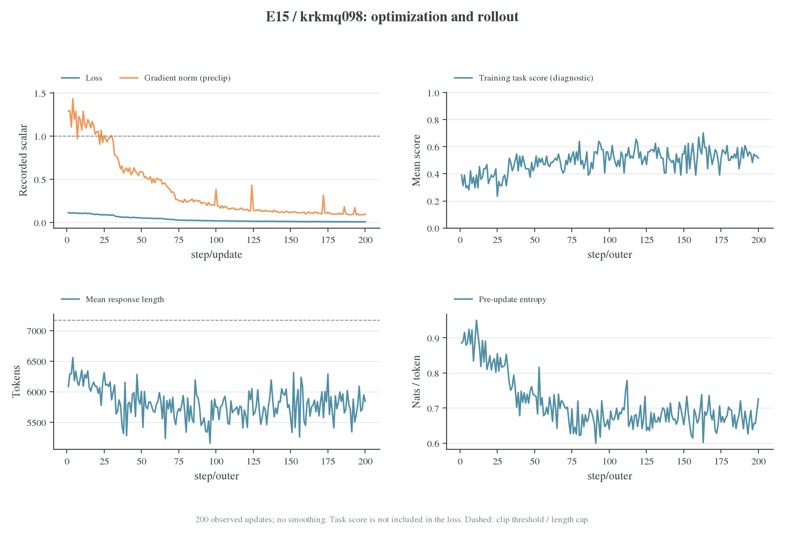
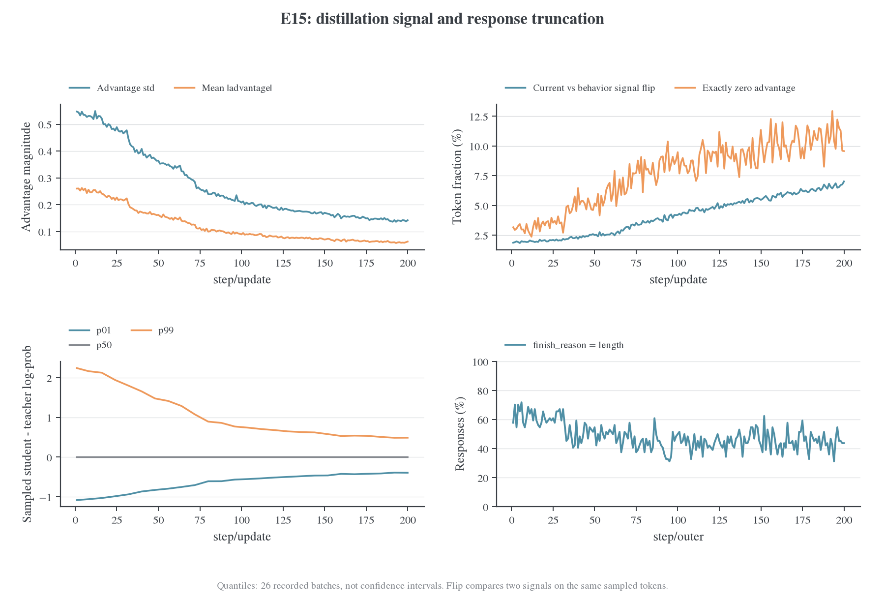
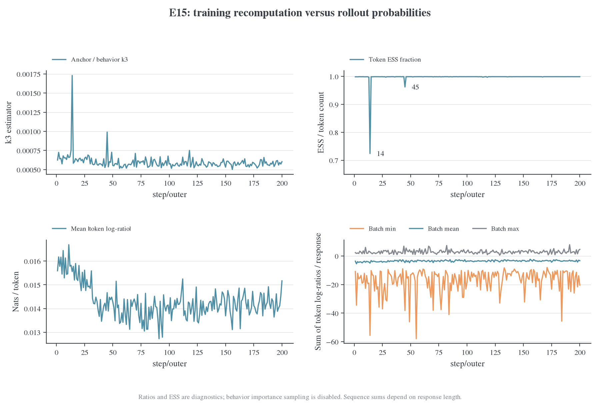
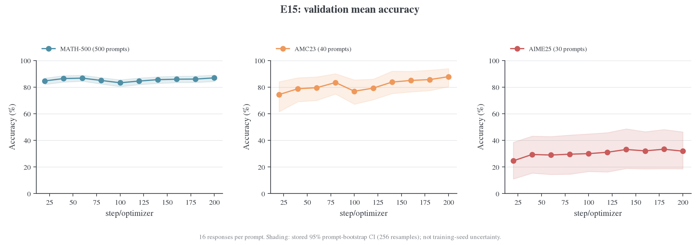
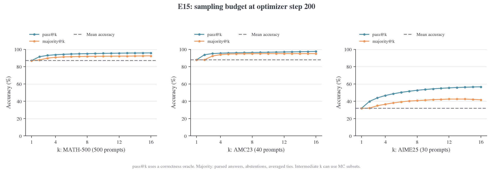
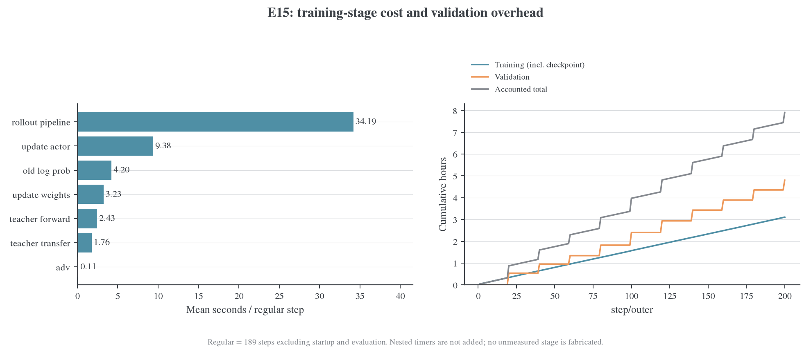
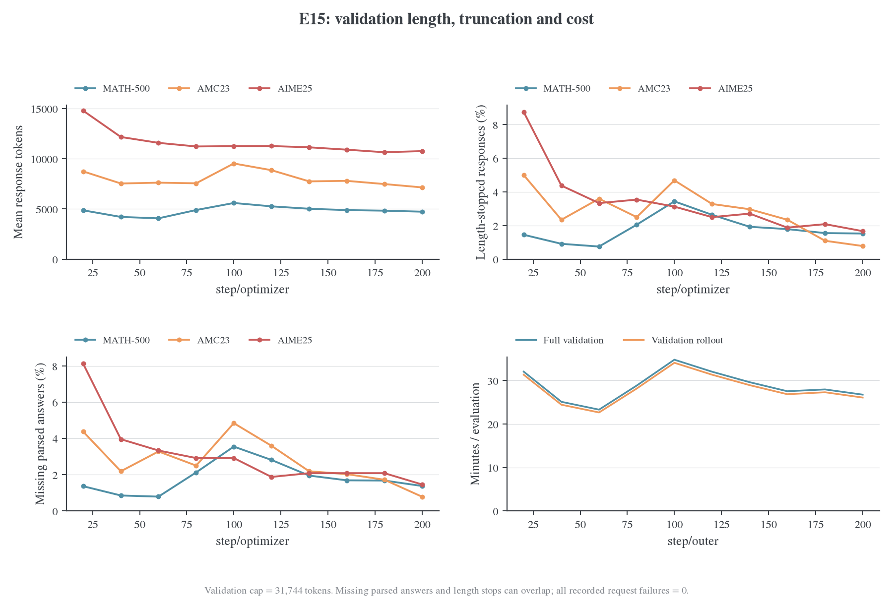
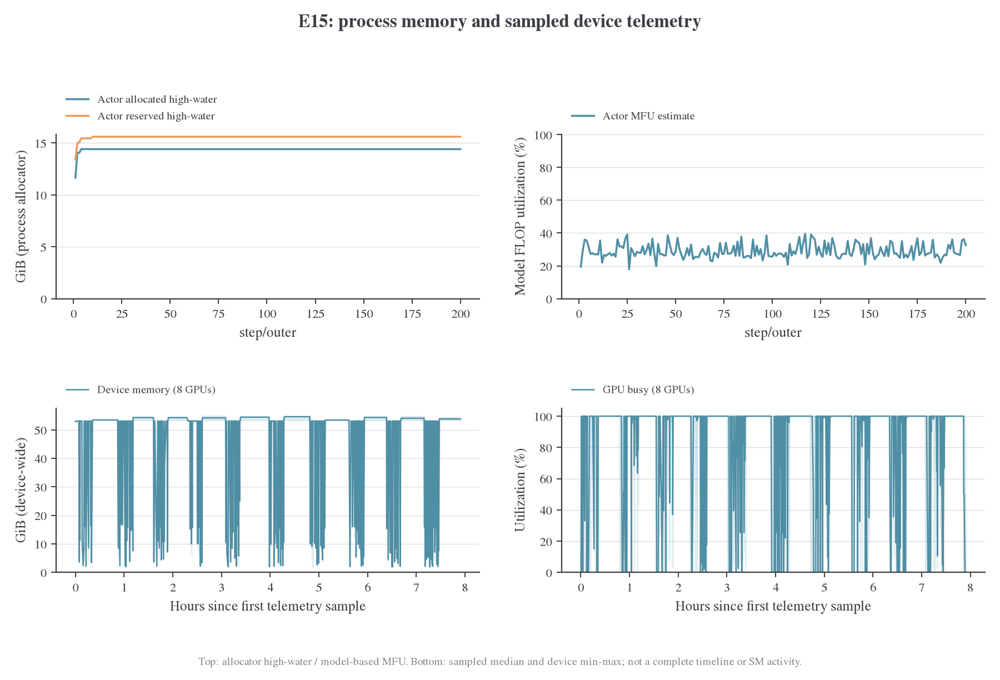

# E15 训练动态与指标分析

## 背景与 motivation

Sampled 蒸馏的 loss、行为概率、长度和任务表现不是同一个量。E15 的完整单 run 诊断用于明确这些观测的关系与预算含义，为后续估计器对照提供可复算的参照，不承担单独的算法优劣结论。

## Setting 与实验设计

### 结论与数据范围

E15 的 200 次更新全部实际执行，没有记录到跳过更新；蒸馏 loss、梯度范数和优势幅度明显下降。与此同时，current 与 behavior 两种蒸馏信号的符号分歧上升，说明后期值得进一步检查信号接近零时的敏感性。训练回答有 48.26% 因长度上限结束；验证占已计时总耗时的 60.71%，是本次运行最大的时间支出。

本报告只分析 E15 `krkmq098`。所有数值来自该 run 的完整 history；系统资源曲线来自另行采样的 system stream。没有引入其他 run，也没有用最终 summary 替代历史曲线。[^run]

| 项目           | 冻结记录                                                                                                                             |
| -------------- | ------------------------------------------------------------------------------------------------------------------------------------ |
| 状态与抓取时间 | finished；2026-10-23 09:48:51 北京时间                                                                                               |
| 模型与目标     | student 为 DeepSeek-R1-Distill-Qwen-1.5B，teacher 为 JustRL-DeepSeek-1.5B；sampled-token k1、current signal、vanilla policy gradient |
| 修正项         | behavior IS、RS 均关闭；任务 reward 只作诊断、不进入训练 loss                                                                        |
| 预算           | global batch 64、mini-batch 64、rollout n=1、PPO epoch=1；200 次 optimizer update                                                    |
| 学习率         | 常数 `1e-6`，无 warmup；gradient clip=1                                                                                              |
| 资源           | 单机 8×A100-SXM4-80GB；shared-sync、FSDP2；八个 TP=1 rollout 副本                                                                    |
| 训练长度       | prompt 上限 4096、response 上限 7168                                                                                                 |
| 验证           | 每 20 步一次，共 10 次；570 题 × 16 responses；response 上限 31744                                                                   |

完整条件见 [config](../../../../../../../wandb-logs/MirrorOPD-verl/analysis/e15-krkmq098-20261023/config.json)、[硬件](../../../../../../../wandb-logs/MirrorOPD-verl/analysis/e15-krkmq098-20261023/hardware.json)和[软件版本](../../../../../../../wandb-logs/MirrorOPD-verl/analysis/e15-krkmq098-20261023/package-versions.txt)。E15 未启用 Full-KL，不能用此报告证明 Full-KL 算子的性能。硬件元数据中的 Git commit 只代表 W&B 记录值，不能证明部署目录没有额外修改。

### 指标覆盖与时间轴

600 条 history 对应 200 个 outer step，每一步包含更新前、更新指标、完整步汇总三个事件。更新前事件的 optimizer/update 计数仍是上一轮，因此不能把 `_step` 当训练步，也不能将所有字段强行放在 optimizer 轴上。

| 指标家族                | 数值字段数 | 主要用途                                                                  |
| ----------------------- | ---------: | ------------------------------------------------------------------------- |
| `policy`                |        107 | anchor/behavior/current 概率差、ESS、token 与 sequence log-ratio、entropy |
| `advantage` + `distill` |         26 | 优势幅度、符号、分位数、蒸馏信号差异                                      |
| `optim` + `correction`  |         16 | loss、梯度、更新执行、PPO clipping 诊断                                   |
| `rollout`               |         56 | 长度、终止原因、score、token 预算、复用与 staleness                       |
| `perf`                  |         27 | 阶段耗时、吞吐、MFU、分配器显存与负载均衡                                 |
| `eval`                  |       2145 | 三个数据集、采样预算 k=1…16、置信区间、格式与生成质量                     |
| 合计                    |   **2377** | 不包含三个 `step/*` 轴与三个 W&B 内部字段                                 |

`eval` 数量大，主要来自预算、区间和不同评分字段的展开；本次数学任务中的 acc/reward/score 还有重复信息。它们不等于 2145 个独立研究结论。

字段定义继续以[当前指标字典](../../../settings/指标口径.md)为准。本次新增[逐字段目录](../../../../../../../wandb-logs/MirrorOPD-verl/analysis/e15-krkmq098-20261023/metric-catalog.csv)，记录实际横轴、出现次数、是否常量、首尾值、范围和均值；[冻结横轴映射](../../../../../../../wandb-logs/MirrorOPD-verl/analysis/e15-krkmq098-20261023/metric-axes.json)来自导出分析时的 `metric_axis`。普通指标有 200 个观测，验证有 10 个，训练分位数有 26 个。目录中的 `first20_mean/last20_mean` 是前后 20 个**观测**的均值；下文仅对完整 200 点序列使用这一窗口。

脚本忽略未填充的 null，不将其变成零；同一字段同一横轴出现不同数值则报错。常量零仍保留，例如本次 current-anchor 差异、PPO active fraction 和 staleness；IS 关闭后没有实际 IS 权重统计，不能把未出现的字段补成零。

## 实验结果

### 优化与蒸馏信号

图中每点是一个实际 batch/update，没有平滑。为了降低单批题目难度变化的影响，下表比较前 20 次与后 20 次观测的均值。

| 指标                 |    1–20 | 181–200 |
| -------------------- | ------: | ------: |
| 记录的 actor loss    | 0.10544 | 0.00869 |
| 裁剪前梯度范数       | 1.17024 | 0.10311 |
| 蒸馏优势标准差       | 0.52585 | 0.14256 |
| 训练 task score      |  36.56% |  53.44% |
| 平均 response token  | 6201.56 | 5782.87 |
| 更新前 entropy       | 0.87824 | 0.67281 |
| 因长度上限结束的回答 |  62.27% |  44.53% |

loss 是当前 sampled-token 配方记录的量，不是完整词表 reverse KL 的精确数值。下降表明采样轨迹上的训练信号在缩小；不同 batch 的前缀分布也在变化，不能单凭这条曲线推断全分布 KL 或泛化效果。

`sign_flip_fraction` 比较同一批 sampled token 上，用 current log-prob 与 rollout behavior log-prob 构造的两个教师差值是否异号，不是相邻两次更新之间的梯度翻转。它的窗口均值从 **1.97% 上升到 6.56%**；零优势比例也在上升。与此同时，优势标准差下降约 73%。一种符合这些观测的解释是：信号靠近零时，同量级的概率重算差异更容易改变符号。这是待验证假设；目前没有逐 token 联合记录，不能证明符号变化由哪一种数值误差造成，更不能断言这些 token 主导了梯度。

训练共采样 12,800 条回答、74,346,912 个 response token；其中 **6177 条 length、6623 条 stop、unknown/aborted/completed 均为 0**。48.26% 的截断率来自实际 `finish_reason`。`padded_width_fraction` 的通用含义仍是“等于当前 padded width 的比例”，不能在其他运行中自动替代终止原因。

### 策略差异与长序列尾部

anchor 与 behavior 的平均绝对 token log-ratio 大致处在 0.013–0.017 nats，前后窗口均值为 0.01575 和 0.01429；并未随训练后期符号分歧的上升而扩大。大多数 batch 的 ESS fraction 接近 1，但 **outer step 14 降到 0.724，step 45 降到 0.962**。均值、相关系数与 ESS 需要一起看，平均概率很接近仍可能存在少量异常比率。

sequence log-ratio 将一条回答的所有有效 token 累加，最负的 batch 内样本约为 −57.9。它受长度影响很大，不能与单 token 的 0.014 直接比较；目录同时保留按长度平均的 `sequence_mean_log_ratio/*`。原 `chi2_seq` 是有限样本指数矩减一，可能受极端尾部主导甚至出现负估计值，因此保留原始字段但没有将其画成“精确非负散度”的对数图。

本次 behavior IS 没有启用，图中的 ratio/ESS 是诊断值。current-anchor 为零也不表示模型没有更新：每批只做一次更新，相关观测发生在该次 optimizer.step 之前；实际执行计数为 200，跳过为 0。字段时刻与公式见[指标字典](../../../settings/指标口径.md)和[旧辅助统计定义](../../../archive/metrics/2026-10-22-旧Correction辅助字段.md)。

### 验证效果与采样预算

| step 200 | Mean accuracy | 记录的 95% CI    | pass@16 | majority@16 |
| -------- | ------------: | ---------------- | ------: | ----------: |
| MATH-500 |        86.91% | [84.23%, 89.08%] |  95.80% |      92.40% |
| AMC23    |        87.81% | [80.33%, 93.95%] |  97.50% |      95.00% |
| AIME25   |        31.88% | [18.62%, 46.38%] |  56.67% |      41.67% |

区间来自题目维度 bootstrap，256 次重采样，不是跨训练 seed 的不确定性。AMC23 只有 40 题、AIME25 只有 30 题，区间很宽。没有 step 0 验证；step 20 才是第一条观测。MATH 在 step 100 有回落，各数据集并非单调改善，不能仅凭首尾或区间是否重叠下显著性结论。

pass@k 表示 k 个样本中至少一个正确，使用正确性判定；majority@k 从解析答案投票，不拥有正确性 oracle。因此 AIME 的 pass@16=56.67% 与 majority@16=41.67% 之间的差距，说明“采到正确答案”与“选出正确答案”仍是不同问题。不能直接把这 15 个百分点全部归因于模型排序能力，解析缺失与投票规则也会影响结果。

majority 的解析缺失按弃权处理，并列最大票数按候选正确性的平均值计分，故 30 题上也可能得到分数不是 1/30 整数倍的结果。部分中间 k 使用子集 Monte Carlo；k=16 使用完整样本集合，`mc_se=0` 只表示无此类子集采样误差，不表示没有题目采样不确定性。具体算法继续引用指标字典，不在这里另立定义。

### 时间开销、验证生成与资源

排除启动首步和 10 个验证步后，189 个常规步平均 **55.42 s**：rollout pipeline 34.19 s、actor update 9.38 s、old log-prob 4.20 s、权重同步 3.23 s、teacher forward 2.43 s、teacher transfer 1.76 s、advantage 0.11 s。阶段覆盖外的少量时间保留为未归属部分，不强行命名为通信或 I/O。

全部 outer timer 合计 **3.107 h**，validation timer 合计 **4.800 h**，总计 **7.907 h**。其中验证占 **60.71%**。两次 checkpoint 共 33.10 s，已包含在 outer 中；`rollout_batch` 包含在 `rollout_pipeline` 的范围内，`validation_rollout` 包含在 validation 中，均不重复相加。

10 次验证共生成 91,200 条回答，按每个数据集的 count×mean length 复算得到 **493,510,519 response token**，约为训练 response token 的 6.64 倍。验证 rollout 占验证计时约 **97.64%**；验证每轮约 23.3–34.8 分钟。这使得验证频率、采样数与生成尾部成为高优先级的实验成本分析对象。改变验证预算会改变估计精度，应保留固定完整评估点；不能将降低预算记作等价评测的纯性能提升。

最后一次验证的 length 结束数为 MATH 122/8000、AMC 5/640、AIME 8/480；解析缺失数为 110、5、7。二者可能重叠，不能相加。全部记录的 failed_count 为零，不能因此把解析缺失也认定为零。当前只有聚合值，要分析“错误是否集中在截断答案”，还需要逐回答记录。

actor allocated/reserved 的累计高水位分别为 **14.40/15.60 GiB**，MFU 的步均值约 **29.03%**。口径统一见[MFU 与利用率说明](../../../infra/performance/2026-10-22-MFU与利用率口径.md)；这些累计进程计数不能定位 backward 的整卡瞬时峰值。

本快照 system stream 共 2000 行，其中 1018 个时刻有 GPU 数据；图中实线是八卡中位数、浅色带是同一时刻八卡最小至最大值。采样覆盖与缺失处理见[数据说明](../../../../../../../wandb-logs/MirrorOPD-verl/analysis/e15-krkmq098-20261023/README.md)。图中没有 SM Active、Tensor Core Active 或实际 HBM GB/s。

如需判断“训练 rollout 是否空闲”，继续读已有的 [E15 分阶段资源分析](../../../infra/performance/2026-10-23-E15训练Rollout资源分析.md)。该文使用同一 run 的另一份更密集系统采样和阶段对齐，覆盖 1899 个 GPU 时刻；这里不把两个采样快照拼成完整 trace，也不重复计算其窗口结论。对 forward/backward 的细粒度归因仍需要 profiler。

## 分析与下一步

### 后续最值得补充的分析

| 优先级 | 问题                           | 已有数据能回答什么                                     | 还需要什么                                                                        |
| ------ | ------------------------------ | ------------------------------------------------------ | --------------------------------------------------------------------------------- |
| 1      | 后期符号分歧是否有实质梯度影响 | 信号幅度下降、翻转比例上升、重算差异大体稳定           | 少量固定 batch 的逐 token 联合记录；按优势绝对值分桶，并统计翻转 token 的梯度贡献 |
| 2      | 验证成本如何降低               | 验证占 60.71%，生成占验证 97.64%；已有 k=1…16 预算曲线 | 保留固定完整评估点，对较低中间评估频率/预算做成本与精度对照                       |
| 3      | 训练长度上限是否限制有效样本   | 48.26% 回答由 length 结束，后期仍约 44.53%             | 逐回答 score×finish_reason 联合分布；长度消融需单独视为数据分布变化               |
| 4      | ESS 尾部是否可复现             | step 14/45 异常能定位到 batch                          | 固定输入重算，保存尾部 token 和 mask；不能仅看平均概率相关性                      |

不新增训练即可持续做的部分包括：窗口统计、最终 k 曲线、每次验证的格式/长度分解和耗时累计。进一步的逐题配对比较需要取回部署端 validation 记录；W&B 聚合 history 本身不足以恢复这些联合信息。

## 证据与复算

### 数据、图表与复现

本次新增的交付物集中在三个位置：

- [数据快照](../../../../../../../wandb-logs/MirrorOPD-verl/analysis/e15-krkmq098-20261023/README.md)：完整 history 的无损 gzip、配置、硬件、软件、system 采样、字段目录、逐轴序列和统计。
- [图表目录](figures/e15-krkmq098-20261023)：八组 PNG/PDF 和逐图 audit 记录。
- [复现入口](../../../archive/历史复算命令参考.md#e15-policy-v3-完整指标分析)：命令和依赖；脚本不访问旧 run、不启动训练。

六项 CPU 测试覆盖更新前横轴、null/重复事件、计时嵌套、无损归档、真实 E15 计数及 GPU 缺失采样。八组图经过 figure-viz audit 和 PNG 人工检查；`timing.audit.txt` 的一项 warning 是将“类别条形图”和“累计小时曲线”误判为需要同一 y 轴的 facet，两个面板量纲不同，保留原始提示。

#### 参考文献

[^run]: W&B. MirrorOPD-verl / krkmq098，E15 完成后的只读 API 快照。[运行页面](https://forge.coreweave.com/wandb/wncfht/MirrorOPD-verl/runs/krkmq098)。抓取方式与边界见 [source.json](../../../../../../../wandb-logs/MirrorOPD-verl/analysis/e15-krkmq098-20261023/source.json)。
