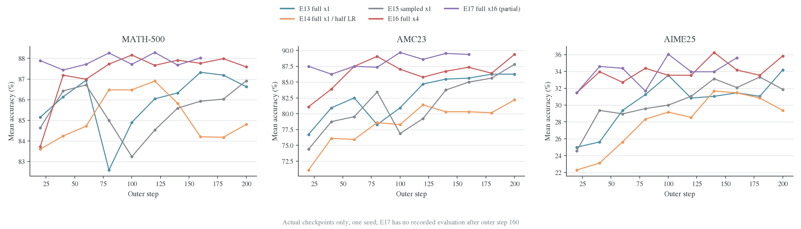
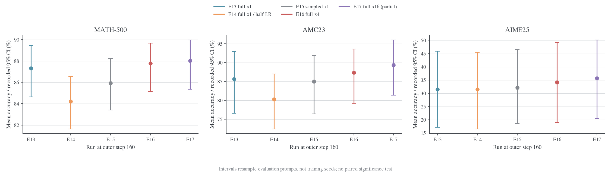
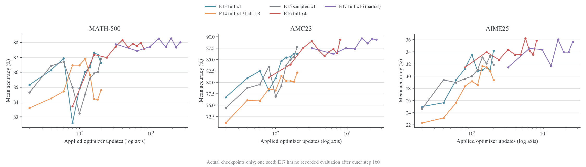
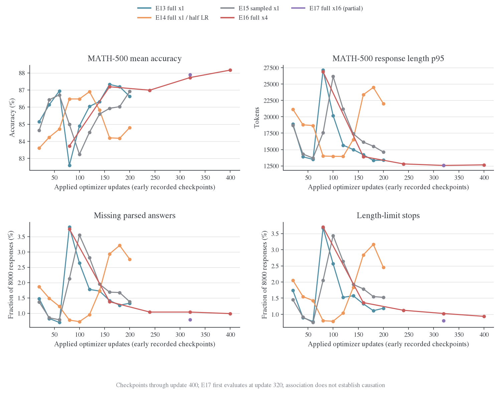
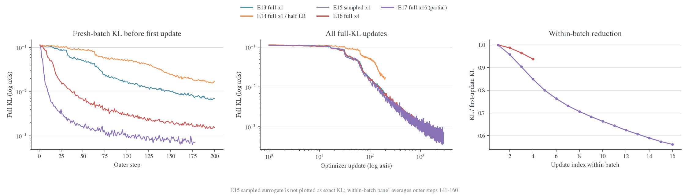
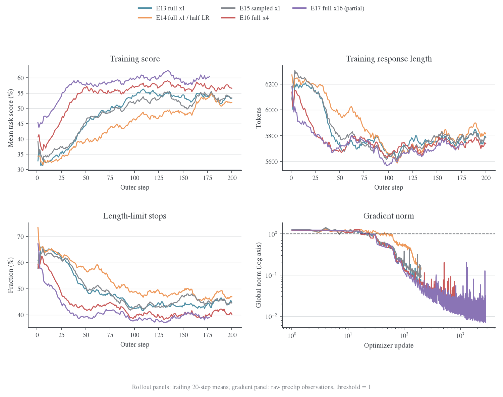
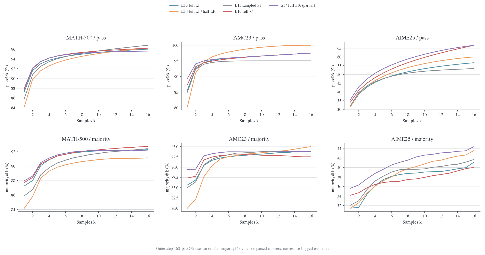
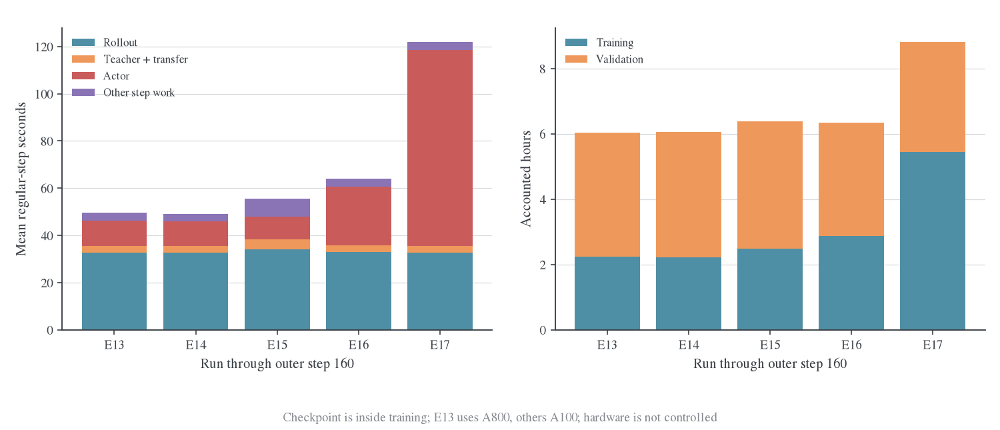
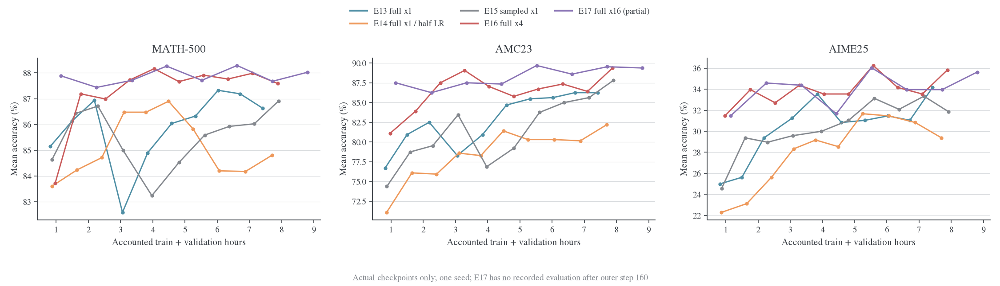
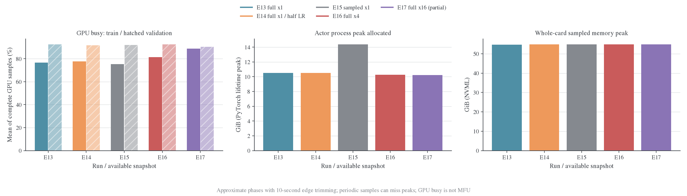

# 五组 Math 实验对比：Full-KL、学习率与批内复用

## 背景与 motivation

给定同一师生配对，需要分开估计器、学习率与复用次数，判断不同预算下的任务收益和条件分布拟合。五组历史运行的代码、硬件与快照边界不完全相同，因此先核对实际setting，再报告共同预算结果。

## Setting 与实验设计

### 1. 实验身份与可比性

| 组别 / run | 目标 | LR | 每批更新 | 完整 outer / 成功更新 | GPU | 最后验证 |
| --- | --- | ---: | ---: | --- | --- | ---: |
| E13 / `jt2r9h88`[^e13] | Full reverse KL | 1e-6 | 1 | 200 / 200 | 8×A800 80GB | 200 |
| E14 / `aq474oay`[^e14] | Full reverse KL | 5e-7 | 1 | 200 / 200 | 8×A100 80GB | 200 |
| E15 / `krkmq098`[^e15] | Sampled k1 + current + legacy vanilla PPO | 1e-6 | 1 | 200 / 200 | 8×A100 80GB | 200 |
| E16 / `ujy2qx5d`[^e16] | Full reverse KL | 1e-6 | 4 | 200 / 800 | 8×A100 80GB | 200 |
| E17 / `cix5i2x2`[^e17] | Full reverse KL | 1e-6 | 16 | 177 / 2848；更新已到第 178 批 | 8×A100 80GB | 160 |

共同配置是 student `DeepSeek-R1-Distill-Qwen-1.5B`、teacher `JustRL-DeepSeek-1.5B`、DAPO、seed=42、global batch=mini-batch=64、每题一条训练回答、prompt/response 上限 4096/7168、shared-sync、FSDP2、graph rollout。验证每 20 个 outer step 做一次，MATH-500/AMC23/AIME25 分别为 500/40/30 题，每题 16 个回答，response 上限 31744；没有 step 0 验证。

四个 Full-KL run 都使用 **`precompute`，async write/prefetch 开启**，没有使用 `precompute_fused`。E15 未启用额外 behavior IS；它不是 sampled 的 `token_is` 预设 E4/E10。Full-KL 与 sampled 的数学对应见[计算图与四种更新](../../../theory/2026-10-22-Full-vocab计算图与四种更新.md#four-cases)。

配置扁平化后共 13 个差异字段，包含实验目录、LR、epochs、Full-KL/PG 模式和相关 payload 开关，完整列表见[配置差异](../../../../../../../wandb-logs/MirrorOPD-verl/analysis/five-run-comparison-20261024/config-differences.json)。`critic.ppo_epochs` 随 actor 配置继承变化，但这些 run 没有启用 critic。

硬件信息来自各 run 自身：E13/E15 有 metadata 附件；E14/E16/E17 的信息从 `.wandb` 的分批 environment 记录恢复。E13/E14/E15 记录的 Git commit 为 `e70acdf1e`，E16/E17 为 `df93f4d6f`。前一个提交尚不包含 `verl/trainer/distillation/full_vocab.py`，所以这个 commit 字段不足以重建实际运行源码，存在未被该字段描述的代码状态。不能把记录配置接近等同于源码、后端和硬件均受控。

所有 requirements 记录均列出 torch 2.11.0+cu128、vLLM 0.25.1+cu129、Transformers 5.12.1、Triton 3.6.0；同时列出了两个 Liger distribution 版本，不能据此断言实际导入哪个版本。这些 run 的 Full-KL backend 是 precompute，不能归因于某个 Liger 或新增融合 kernel。

## 实验结果

### 2. 对齐生成预算后的验证表现

五组共有的最后验证点是 **outer 160**。此时都已记录 10240 条训练回答，但成功 optimizer 更新数分别是 160、160、160、640、2560；训练生成的 token 数约 5855–6012 万，不完全相同。

| Outer 160 | MATH mean | AMC mean | AIME mean | MATH majority@16 | AMC majority@16 | AIME majority@16 |
| --- | ---: | ---: | ---: | ---: | ---: | ---: |
| E13 | 87.325% | 85.625% | 31.458% | 92.267% | 93.750% | 41.111% |
| E14 | 84.200% | 80.313% | 31.458% | 91.133% | 95.000% | 43.542% |
| E15 | 85.925% | 85.000% | 32.083% | 92.413% | 93.750% | 41.667% |
| E16 | 87.763% | 87.344% | 34.167% | 92.700% | 92.500% | 40.000% |
| E17 | 88.025% | 89.375% | 35.625% | 92.100% | 93.750% | 44.375% |

同一 outer 预算下，E17 的 mean accuracy 点估计领先，但 majority 并未逐数据集领先。E17 相比 E16 的 mean 差为 **+0.263、+2.031、+1.458 个百分点**，同时用了 4 倍 optimizer 更新。

若将共同后期三个 checkpoint（120、140、160）取描述性均值，E16/E17 的 MATH 为 87.779%/87.996%，AMC 为 86.615%/89.167%，AIME 为 34.653%/34.514%。因此 E17 的 AMC 优势在这些点上较一致，AIME 优势不稳定。三个 checkpoint 相关，不能将其当作三个独立训练重复。

图中 95% CI 来自每个 run 内的题目 bootstrap，重采样次数为 256。AIME 只有 30 题，E16 的区间约 [18.96%, 49.14%]，E17 约 [20.44%, 50.18%]。这里没有跨 seed 方差，也没有拿到用于跨 run 配对检验的完整逐题结果，不能从点排序或区间重叠直接作显著性判断。不同数据集面板使用独立纵轴。

#### 已完成 run 的 step 200

| Step 200 | MATH mean | AMC mean | AIME mean | AIME pass@16 | AIME majority@16 |
| --- | ---: | ---: | ---: | ---: | ---: |
| E13 | 86.625% | 86.250% | 34.167% | 60.000% | 43.333% |
| E14 | 84.800% | 82.188% | 29.375% | 53.333% | 38.333% |
| E15 | 86.913% | 87.813% | 31.875% | 56.667% | 41.667% |
| E16 | 87.588% | 89.375% | 35.833% | 63.333% | 48.333% |

E16 相比 E15 的 mean 提升为 +0.675、+1.563、+3.958 个百分点；相比 E13 为 +0.963、+3.125、+1.667 个百分点。它消耗了更多更新，不能称为等 optimizer 预算下的优势。E17 没有 step 200 结果，本表不补值。

E13 与 E15 在一次更新下没有清楚的全面胜负：E15 的最终 MATH/AMC 略高，E13 的 AIME 略高。现有证据不支持“完整词表必然显著胜过 sampled”，也不支持“二者训练完全等价”。

### 3. 学习率与更新预算

E14 的半学习率在当前 200-update 预算内落后：最终相对 E13 的 MATH/AMC/AIME 低 1.825/4.063/4.792 个百分点，最后 20 次更新的 full KL 均值为 0.01715，而 E13 为 0.00723。这与较慢的 teacher 分布拟合一致；不能据此断言更长预算下半学习率仍较差。

五组没有一个共同的 optimizer 验证坐标：E17 首次验证已在 update 320，E13/E14/E15 在 update 200 就结束。不能将 E17 outer 20 的结果与其他组 outer 20 称作“相同训练进度”。

可直接比较的交点包括：

| 成功更新数 | 实验 / outer | MATH mean | AMC mean | AIME mean |
| ---: | --- | ---: | ---: | ---: |
| 160 | E13 / 160 | 87.325% | 85.625% | 31.458% |
| 160 | E16 / 40 | 87.188% | 83.906% | 33.958% |
| 320 | E16 / 80 | 87.725% | 89.063% | 34.375% |
| 320 | E17 / 20 | 87.888% | 87.500% | 31.458% |
| 640 | E16 / 160 | 87.763% | 87.344% | 34.167% |
| 640 | E17 / 40 | 87.438% | 86.250% | 34.583% |

在相同更新数下，16 次复用没有显示稳定的三数据集优势。它用了更少的新回答和验证轮次，故仍可能节省生成及评估成本；这种收益与“每次更新更有效”是不同判断。

#### 中期回落与长回答同时出现

E13/E15 的 MATH 曲线都有中期回落，E14 的回落出现在更后面的更新区间。它们与验证生成长度、截断和解析缺失同步变化：

| Run / outer 区间 | 对应 optimizer 区间 | MATH mean | Mean length | Length p95 | length-stop 数 / 8000 |
| --- | --- | --- | --- | --- | --- |
| E13，60→80 | 60→80 | 86.94%→82.59% | 4160→5874 | 13495→27136 | 62→294 |
| E14，120→160 | 120→160 | 86.90%→84.20% | 4250→5371 | 13938→23374 | 83→227 |
| E15，60→100 | 60→100 | 86.71%→83.24% | 4066→5593 | 13698→26170 | 60→275 |
| E16，20→40 | 80→160 | 83.73%→87.19% | 5663→4626 | 26880→13922 | 296→109 |

这些回落发生在 KL 总体下降期间，没有相应的非有限梯度或跳步。它们更值得从生成行为、长回答和截断角度复核，而不能直接判作 loss 发散。低学习率使相似现象较晚出现，与优化进程不同这一解释相容，但这些单次轨迹不足以证明学习率与阶段位置成线性关系。

E16 第一次验证已经在 update 80，确实观察到高 p95 和较低 MATH 分数，第二次验证恢复。E17 第一次验证在 update 320，早期区间没有观测，不能由平稳的已记录曲线推出“16 次复用消除了中期回落”。后续若研究这个阶段，应把早期验证点按 optimizer 更新数对齐。

Length-stop、解析缺失与错误答案的逐样本交集没有进入这份快照，因此不能把整个准确率降幅都归因于截断。需要回读对应 checkpoint 的逐题生成文本才能进一步区分重复推理、答案格式和真正的解题错误。

### 4. KL 下降、批内拟合和数值稳定性

Full-KL 的每条 loss 是对应 optimizer 操作之前的观察，虽然日志在 worker 返回后集中写出。按 outer 比较时，必须区分每批第一次更新前的 fresh-batch KL 与后续复用中的 KL。

| Outer 141–160，20 批平均 | 首次更新前 KL | 最后一次更新前 KL | 批内相对下降均值 |
| --- | ---: | ---: | ---: |
| E13，1 次 | 0.009977 | 0.009977 | 不存在批内对照 |
| E14，1 次 | 0.024820 | 0.024820 | 不存在批内对照 |
| E16，4 次 | 0.001986 | 0.001861 | 6.26% |
| E17，16 次 | 0.000829 | 0.000464 | 43.85% |

这里 E17 的末点在第 16 次更新之前，反映前 15 次更新的效果，不能称作最后一次更新后的 KL。E16/E17 的 fresh-batch KL 也明显低于 E13，说明改善不局限于同一批的末次 loss；但这些前缀仍来自各自不断变化的策略，不是一个共同固定的 held-out KL 测试集。

按 optimizer 更新数画图后，LR=1e-6 的几条 KL 曲线接近得多。例如 update 200 的 E13/E16/E17 为 0.00698/0.00650/0.00531，而按各自最终更新看会形成更悬殊的差距。复用提高了单位生成批次的优化量，不能把更多更新造成的降幅全部解释成更新规则的优势。

所有已记录更新均成功：200/200/200/800/2848 次，无 loss/grad 非有限标志、无跳步、无空 loss mask。梯度范数裁剪阈值均为 1：

| Run | 超过阈值的更新数 | 占比 | 最后触发的 update |
| --- | ---: | ---: | ---: |
| E13 | 19 | 9.50% | 23 |
| E14 | 43 | 21.50% | 56 |
| E15 | 23 | 11.50% | 30 |
| E16 | 20 | 2.50% | 24 |
| E17 | 24 | 0.84% | 24 |

较低的 E17 比例主要因为分母更大，早期触发次数与 E16 接近。当前没有数值发散证据。KL 更小而验证收益趋缓，与 teacher 拟合和任务正确率不是同一个目标相符；补充检索已找到同采样预算、不同评测管线的历史 teacher 参考，E17 的 MATH/AIME 点估计仍低于它；详见[师生参考与收敛分析](2026-10-24-Full-KL收敛与师生参考评测.md)。这些参考不能确定任务性能上限。

### 5. 生成长度、截断和采样选择

| 完整已记录 outer 区间 | 训练 mean score | 训练 response token | length 停止比例 |
| --- | ---: | ---: | ---: |
| E13，1–200 | 49.617% | 7427 万 | 47.61% |
| E14，1–200 | 45.242% | 7500 万 | 51.99% |
| E15，1–200 | 49.188% | 7435 万 | 48.26% |
| E16，1–200 | 55.047% | 7355 万 | 42.30% |
| E17，1–177 | 58.377% | 6481 万 | 40.34% |

E17 区间较短，公平的共同 1–160 训练 score 均值为 E13 48.574%、E14 43.271%、E15 47.969%、E16 54.600%、E17 58.145%。任务分数只作诊断，没有混入这些 Full-KL loss。

所有已记录训练 batch 的 `response_length/max` 都等于 7168。即使平均长度下降，每批仍有回答到达上限，rollout pipeline 的普通步均值仍约 33 秒。这与同步 batch 的最长回答约束一致，但没有逐请求 trace，不能据此量化可消除的长尾等待。

验证生成与训练 cap 不同，不能用训练 40%–52% 的 length-stop 比例推断验证同样严重。共同 step 160 的 MATH 验证 mean length 为 E13 4664、E14 5371、E15 4885、E16 4490、E17 4436；E14 的 MATH 解析缺失为 235/8000，E16/E17 为 79/8000、83/8000。解析缺失和 length-stop 存在关联，但两者计数不完全相同，不能等同。

所有已记录验证窗口的 `failed_count` 与 `nonfinite_score_count` 均为 0；这不表示没有错误答案或解析缺失。

共同 step 160，E16/E17 的 AIME pass@16 都是 66.67%，majority@16 却只有 40.00%/44.38%。MATH 上 E17 的 mean 更高，但 pass@16 为 95.60%，低于 E16 的 96.20%，majority 也略低。复用的提升并不是所有题目覆盖和投票指标的一致提升。

Pass@k 使用“至少一个正确”的 oracle，majority@k 使用解析答案投票；部分 k 包含子集 Monte Carlo，k=16 使用完整集合。不能把 pass-majority 差距全部解释成模型缺少排序能力，也不能把 `mc_se=0` 解释成没有题目采样误差。

### 6. E15 独有诊断及其解释边界

E15 有 107 个 policy、15 个 advantage、4 个 correction 数值字段，四个 Full-KL run 没有这些完整字段族。不能用 E15 的 entropy 与 Full-KL 的“缺失”比较模型是否发生熵坍缩。

E15 的主要观察为：

- Pre-update entropy 的前/后 20 步均值由 0.8782 降到 0.6728。
- `current_anchor/log_ratio_mean` 等当前—锚点差值全部为 0；PPO clip 与 dual-clip active fraction 全部为 0。每批仅更新一次，观察发生在 optimizer 前，这与实际完成 200 次更新并不矛盾。
- Anchor—behavior 的 ESS fraction 大多数接近 1，但最小值为 0.724，发生在 outer 14；它是 FSDP/vLLM 概率差异的诊断，behavior IS 并未启用。
- Current/frozen 信号符号分歧率的前/后 20 步均值约为 1.97%/6.56%；信号变小后，少量概率差异更容易改变符号。它不是当前这五组已经测过 frozen advantage 的证据。

因此这五个 run **没有比较 clip on/off，也没有比较 current/frozen 或 IS/NoIS 六格**。它们比较的是既有 sampled vanilla、Full-KL 的学习率和复用次数。现阶段不应据此宣称 PPO clipping 有害、NoIS 无效或 frozen 信号更差。

### 7. 时间成本、显存和资源活动

普通步统计排除首步、验证步和 checkpoint 步；下面统一截止 outer 160。计时遵循 `outer + validation`，不重复加 checkpoint、rollout_batch 或 validation_rollout。

| Run | 普通 outer 均值 | Actor/outer 均值 | 训练累计 | 验证累计 | 合计 | 按 8 卡折算 |
| --- | ---: | ---: | ---: | ---: | ---: | ---: |
| E13 | 49.63 s | 10.57 s | 2.230 h | 3.800 h | 6.030 h | 48.24 GPU·h |
| E14 | 49.21 s | 10.43 s | 2.210 h | 3.855 h | 6.065 h | 48.52 GPU·h |
| E15 | 55.47 s | 9.44 s | 2.490 h | 3.888 h | 6.378 h | 51.02 GPU·h |
| E16 | 63.99 s | 24.77 s | 2.867 h | 3.466 h | 6.333 h | 50.66 GPU·h |
| E17 | 121.81 s | 83.05 s | 5.434 h | 3.368 h | 8.802 h | 70.41 GPU·h |

这是记录到的计时账，不包括全部初始化、日志与其他未计时工作，也不是平台账单。E13 的 A800 与其他组 A100 不同，不能把 E13/E15 的时间差全归因于 loss。

E16/E17 的 actor 阶段含多个更新及固定搬运开销。摊到每次更新约为 6.19/5.19 秒，说明复用有摊薄开销的效果；它们的整步则仍从约 64 秒增加到 122 秒。**GPU 更忙和单次更新更便宜，不自动意味着同时间质量更好。**

同为 A100 的 E14/E15，Full-KL 虽然 actor 阶段较重，但省掉了 old-log-prob/advantage，并使用 hidden teacher 通路，普通步更短；这仍是不同目标和工作量下的描述性结果，不是固定输入 kernel benchmark。

四个完成 run 的训练＋验证合计分别为 E13 7.417 h、E14 7.695 h、E15 7.907 h、E16 7.879 h。E16 的额外训练时间部分被较短的验证生成抵消。验证在这四组占比约 54.6%–64.1%；每个 run 共验证 91200 条回答、生成约 4.67–5.02 亿 response token，约为训练生成量的 6.35–6.69 倍。

这张图用于看到测量预算的现实代价。相同 optimizer 数下验证次数不同，比较该横轴时也不能把减少评估次数当作等价评估的纯性能优化。

接近墙钟预算的实际 checkpoint 对比如下，没有在两个验证点之间插值：

| 时间窗口 | Run / outer / update | 记录累计时间 | MATH mean | AMC mean | AIME mean |
| --- | --- | ---: | ---: | ---: | ---: |
| 约 1 小时 | E16 / 20 / 80 | 0.971 h | 83.725% | 81.094% | 31.458% |
| 约 1 小时 | E17 / 20 / 320 | 1.147 h | 87.888% | 87.500% | 31.458% |
| 约 3.3 小时 | E16 / 80 / 320 | 3.286 h | 87.725% | 89.063% | 34.375% |
| 约 3.3 小时 | E17 / 60 / 960 | 3.350 h | 87.713% | 87.500% | 34.375% |

E17 较快跨过了早期更新区间，首个已记录点的 MATH/AMC 较强；但约 3.3 小时的两点已接近，E16 的 AMC 点估计还更高。固定生成量、固定更新量和固定时间会产生不同排序，因此“主推 E16”对应的是上述较长生成预算下的折中，不能推广成所有预算下都胜过 E17。

| Run | Actor 进程 allocated 高水位 | NVML 单卡采样最大值 | 训练窗口 GPU busy 均值 | 验证窗口 GPU busy 均值 |
| --- | ---: | ---: | ---: | ---: |
| E13 | 10.52 GiB | 54.66 GiB | 76.59% | 92.71% |
| E14 | 10.50 GiB | 54.92 GiB | 77.64% | 91.87% |
| E15 | 14.40 GiB | 54.88 GiB | 75.32% | 91.93% |
| E16 | 10.27 GiB | 54.77 GiB | 81.43% | 92.51% |
| E17 | 10.21 GiB | 54.77 GiB | 88.80% | 90.36% |

PyTorch 高水位是该进程生命周期的 allocator 口径，不是单个 KL kernel 的峰值；NVML 包含 vLLM 等整卡分配。二者差距大，不能据 10 GiB 就说整卡还有 70 GiB 可用于增加训练 batch。E16/E17 的复用没有使已记录 allocated 高水位随 epochs 成倍增长。

System 记录包含 CPU/GPU 等不同周期条目，完整八卡 GPU 样本大约每 15 秒一组，可能漏掉短峰值。训练/验证边界由 host timer 与日志时间戳重建，表内各窗口两端裁去 10 秒，报告 sample mean，不假装连续 trace 或时间加权能耗。0/10 秒裁边结果均保存在 analysis.json，可做敏感性复核。

较长的 actor 阶段提高了 E17 的整段训练 GPU busy，同时训练窗口平均 NVML 显存由 E16 的约 33.1 GiB 降到 E17 的约 21.7 GiB，因为更多时间处于较低显存的 actor 阶段，而非 vLLM KV 驻留阶段。这是时间构成变化，不能解释为 16 次更新本身减少了每次更新需要的显存。记录的 actor MFU 均值约为 E13 25.3%、E16 35.2%、E17 37.1%；它是模型 FLOPs 估算口径，与 GPU busy 不同，也不是完整 Full-KL 所有额外 head 运算的硬件计数器结果。

## 分析与下一步

### 结论与阅读入口

在固定生成预算、计划运行约 200 个 outer step 的比较中，这组日志支持优先保留 **E16：Full-KL、LR=1e-6、每批更新 4 次** 作为下一轮复测的主配方。它在已完成的四个 run 中，step 200 的三个数据集 mean accuracy 点估计最高；总训练＋验证计时接近 sampled E15。E17 的 16 次复用进一步降低了 KL，但相对 E16 的验证增益小、随数据集和 checkpoint 波动，共同生成预算下的成本更高。若目标是约一小时内拿到较强 checkpoint，E17 的首个验证点反而值得保留，不能简单判作“16 次不划算”。这些是单 seed 的工程决策，不是算法优劣的显著性结论。

全部指标覆盖见 [metric-coverage.csv](../../../../../../../wandb-logs/MirrorOPD-verl/analysis/five-run-comparison-20261024/metric-coverage.csv)，逐项统计见 [metric-catalog.csv](../../../../../../../wandb-logs/MirrorOPD-verl/analysis/five-run-comparison-20261024/metric-catalog.csv)。数据与复现命令见[快照说明](../../../../../../../wandb-logs/MirrorOPD-verl/analysis/five-run-comparison-20261024/README.md)。

原始 `.wandb` 来自独立日志仓库提交 `35b1610`，使用本地解码，没有用网页下采样曲线代替 history。E13/E14/E15/E16 都记录了退出码 0；E17 是 `partial_snapshot`：有 177 个完整 outer 记录，以及第 178 批的 16 条更新记录，总计 2848 次成功更新，最后一次完整验证在 outer 160。不能把 E17 的缺尾解释成训练失败，也不能称它已经完成 200 步。

### 8. 全指标覆盖与不能从日志推出的结论

各 Full-KL run 有 2235 个数值指标，E15 有 2377 个；并集 2378 个、五组交集 2234 个。每组其中 2145 个属于 eval，主要来自数据集、k、CI、子集估计和生成统计的组合，不是两千多个独立训练信号。

| 字段族 | Full-KL 每 run | E15 | 已使用的解释 |
| --- | ---: | ---: | --- |
| eval | 2145 | 2145 | mean/pass/majority/all-correct、题目区间、长度、失败与解析缺失 |
| rollout | 52 | 56 | 样本量、长度/截断、评分、复用坐标、staleness |
| optim | 12 | 12 | loss、LR、梯度、实际更新、有限性 |
| perf | 24 | 27 | 阶段计时、吞吐、MFU、allocator 高水位 |
| distill | 1 | 11 | Full-KL 与 sampled gap 分别解释，不混作同一数值 |
| policy | 缺失 | 107 | 熵、ratio、ESS 等仅能分析 E15 |
| advantage | 1 | 15 | Full-KL 只有 task loss 使用标记，缺少 E15 的信号分布 |
| correction | 缺失 | 4 | E15 的 PPO/dual-clip 记录；Full-KL 缺失不填零 |

所有字段的轴、观测数、首尾、极值、均值、中位数、前后 20 点均值和常量标记均已输出到 CSV，并可在 HTML 查看原始曲线。常量字段包括有效性标志、固定 LR、任务 reward 未使用、零轨迹 staleness 等；没有把常量当成缺失。

轨迹 staleness 为 0 只说明这些同步批次没有跨版本延迟；它不表示 E16/E17 的第 2–16 次更新仍使用当前策略刚生成的数据。Full-KL 缺少当前—行为完整漂移指标，不能直接复用 E15 的 ESS 推断它们的批内离策略程度。

没有逐请求 CUDA trace，不能从这组日志判断所有 decode 长尾、通信等待和 kernel 占比；没有按共同固定前缀测 KL，不能完全排除前缀分布变化；没有多个 seed，不能给算法差异的稳健置信区间；历史 teacher 同预算参考来自另一套评测管线，仍缺当前管线的受控师生验证，不能判定任务性能上限。

### 9. 后续实验优先级

1. **优先复测 E16 与 E13/E15 的种子差异。** 当前 E16 的点估计与成本组合更有吸引力，值得先验证是否稳定，而不是继续把复用次数推得更高。
2. **保留 E17，先补齐最后 200 步的日志和验证。** 再决定 16 次是否值得其额外时间；不要把当前 partial 快照外推为最终结果。
3. **明确比较预算。** 至少同时保留共同生成量、共同 optimizer 点和记录墙钟三个视角；后一轮可固定若干共同 optimizer 评估点，避免没有交点。
4. **对 Full-KL 增补低额外成本诊断。** 优先记录分块可复用的 student entropy、有效 loss token 数、fresh/within-batch KL，以及少量共同固定前缀上的 KL；不要为凑齐 E15 所有字段直接引入一套昂贵旧模型。
5. **验证成本值得单独规划。** 保留可比的完整评估点，再考虑中间评估预算；改变 n 或题数必须明确，不将其当作相同评测下的加速。

这些是数据支持的后续选择，没有据此启动新训练或改现有配方。新采集的 kernel/全流程 profile 仍由 [profile 专题](../../../infra/performance/full-vocab/README.md)维护。

## 证据与复算

### 10. 复核与复现

统计程序为 [compare_policy_runs.py](../../../../research/analysis/compare_policy_runs.py)，使用日志内的 metric definitions 定义横轴；绘图为 [plot_policy_comparison.py](../../../../research/analysis/plot_policy_comparison.py)。复现命令、来源提交与完整性记录见[数据 README](../../../../../../../wandb-logs/MirrorOPD-verl/analysis/five-run-comparison-20261024/README.md)。

解码器补充保留 environment 记录，解决 metadata 附件缺失时的硬件追溯，原始 `.wandb` 未修改。项目导出器仅选择硬件/软件字段，拒绝把多个 writer 的环境直接合并，不上传任何数据。图表均输出 PNG/PDF/SVG 并经过 figure-viz 审计；不同数据集的独立纵轴、误差条端帽和同色双柱带来的警告已按图面语义复核。

#### 参考来源

[^e13]: 用户指定的 E13 run。分析读取其本地事务日志。[jt2r9h88](https://forge.coreweave.com/wandb/wncfht/MirrorOPD-verl/runs/jt2r9h88)。
[^e14]: 用户指定的 E14 run。分析读取其本地事务日志。[aq474oay](https://forge.coreweave.com/wandb/wncfht/MirrorOPD-verl/runs/aq474oay)。
[^e15]: 用户指定的 E15 run。分析读取其本地事务日志。[krkmq098](https://forge.coreweave.com/wandb/wncfht/MirrorOPD-verl/runs/krkmq098)。
[^e16]: 用户指定的 E16 run。分析读取其本地事务日志。[ujy2qx5d](https://forge.coreweave.com/wandb/wncfht/MirrorOPD-verl/runs/ujy2qx5d)。
[^e17]: 用户指定的 E17 run。分析读取其本地截断快照，不将网页可能更新的状态混入冻结分析。[cix5i2x2](https://forge.coreweave.com/wandb/wncfht/MirrorOPD-verl/runs/cix5i2x2)。
