# TOP-D 当前实验：大 batch、future 与聚合

E55–E57、E81–E83 已有的逐位置 objective 见[MDPO position 专题](mdpo-position-kl.md)；[初始与末 outer 的 first-update 位置曲线](../teacher-transfer/cases/first-update-position-profiles.md)按实验分图比较形状。κ=1、η=0.1 的 E57、E81–E83 日志值等于 target RKL 的 10 倍，尚无独立的 teacher position RKL。

## 假设与预算

E81（A）和 E82（B）检验：保留 E57 的目标与每批 16 次复用，将每次 optimizer update 使用的回答从 64 条增加到 256 条，能否提高相同累计回答处理量或相同更新次数下的任务表现。OPD 已有前缀是否充足仍是待验证假设；两个设置均增加 batch，不能单独识别 batch、独立前缀覆盖与总计算量的作用。已完成的长程结果和论文曲线见[主报告](weighted-targets.md)。

启动这组实验的依据有两层。E57 虽与 TOP-D 论文都在每个 outer 执行 16 次更新，但 E57 每次只使用 64 条回答，论文每次为 256 条；相同 update 数并未对齐回答处理量。[固定轨迹池对照](weighted-targets-controls.md#固定轨迹池下的-batch-与访问预算)又表明，在固定学习率下，较小 batch、较多更新拟合得更充分，而增加访问量尚未确立任务收益。E81 因此把累计回答条次和新回答数对齐 E57，检验将这些回答集中到较大 batch、较少次更新后的实际任务表现；E82 则保留 1,600 次更新，观察多四倍回答预算的训练进程。这是对预算安排的检验，不能预先认定增大 batch 就能缩小论文差距。

累计训练回答条次定义为每次 optimizer update 的回答数之和，重复使用同一回答也计数；它不等于新生成回答数，也不等于累计 token 数。

| 设置                            | 每 outer 新回答 | 每次更新回答 | 每批复用 | outer | optimizer update | 累计训练回答条次 | 新生成回答 |
| ------------------------------- | --------------: | -----------: | -------: | ----: | ---------------: | ---------------: | ---------: |
| E57，已完成                     |              64 |           64 |       16 |   100 |             1600 |           102400 |       6400 |
| E81，A                          |             256 |          256 |       16 |    25 |              400 |           102400 |       6400 |
| E82，B                          |             256 |          256 |       16 |   100 |             1600 |           409600 |      25600 |
| TOP-D，论文配方换算至 100 outer |            4096 |          256 |        1 |   100 |             1600 |           409600 |     409600 |

A 与 E57 对齐累计回答条次和新生成量，用较少次、较大 batch 的更新；B 与 E57 对齐更新次数，回答条次为其 4 倍。B 对齐论文配方 100 outer 的回答条次和更新次数，新生成量仅为其 1/16。论文公开 Figure5 的 α0.1/0.2 曲线展示到 outer410，不能把表中 100 outer 写成其最终训练预算，来源与推断见[预算核对](weighted-targets.md#top-d-与本项目的预算和评测)。

A/B 的 epoch 上限分别为 1／2，以保证 B 能达到 100 outer；实际仍以各自 outer 预算停止。DAPO 原始题池有 17917 条，正式配置经 prompt cap1024 过滤后保留 17909 条，batch256 的单 epoch 提供 69 个完整 batch，不足 100 outer，B 会重访题目并重新生成回答；25600 是新回答数，不是不同题目数。

A/B 的目标与更新配方相同，默认 seed 相同，A 是 B 的名义前缀；分开运行不保证 vLLM 随机流与浮点计算逐位相同，不构成两个独立 seed。

## 实际预设

预设由[实验目录](../../../launchers/math_experiment.py)统一解析，经[共享启动器](../../../launchers/_run_single_teacher_fsdp2.sh)生成最终配置。环境变量和末尾 Hydra 参数仍可覆盖默认值；实际运行以 resolved config 为准。

| 项目     | E81／E82 默认设置                                                                           |
| -------- | ------------------------------------------------------------------------------------------- |
| 师生     | Qwen3-1.7B-Base ← Qwen3-30B-A3B-Instruct-2507                                               |
| 目标     | full-vocab MDPO，κ1／η0.1，token-mean，future.mode=none                                     |
| 资源     | 4 卡 shared_sync，teacher 无独立卡池；rollout TP1                                           |
| Batch    | train batch=actor mini-batch=256，n1，ppo_epochs=16                                         |
| 优化器   | AdamW，LR1e-6，constant，weight decay0.01，梯度裁剪 1                                       |
| 数值执行 | 继承 E61 的 precompute_fused、chunk512、显式 BF16；EOS 合并 `[151643,151645]`               |
| 训练输入 | DAPO，本地原生 Base 前缀，enable_thinking=null；prompt cap1024，response cap16384           |
| 训练采样 | temperature1，top-p1；不额外添加 TOP-D 的 boxed 指令                                        |
| Rollout  | 每引擎 max_num_seqs64，显存比例 0.8，token budget8192                                       |
| 评测     | 不做初始评测；每 5 outer 及终点，五基准 avg@16，temperature0.7、top-p0.9、response cap31744 |
| 生成终止 | 训练与评测默认开启精确重复停止 16–128/8；可分别显式关闭                                     |
| 保存     | save_freq=-1，不保存训练 checkpoint                                                         |

E57 历史运行使用 precompute 与原混合精度配置，A/B 使用已验收的 E61 融合执行路径；这项执行差异需要在结果解释中保留。2026-11-05 起 A/B 跟随公共重复停止默认值，训练和评测均开启；E57 历史自然终止曲线的停止协议不同。需要严格配对时，应补充相同停止协议的评测，或在启动 A/B 前显式设置 `TRAIN_REPETITION_DETECTION=false VAL_REPETITION_DETECTION=false`。E81 评测节点为 outer5/10/15/20/25，E82 为 outer5/10/…/100。两者都没有新的 step0 测量，可引用主报告中有来源标识的独立 Base 参考点。

### E85–E90：八卡聚合与 future 消融

2026-11-07 调整后续预设：E84 也改为 8 卡 shared_sync，保持 `future=mean`、γ1、`token-mean` 及原有完整状态保存规则。E84–E90 均改为每 20 outer 验证，节点为 20／40／60／80／100；无初始验证，100 outer 内从 20 次减至 5 次，次数降至原来的 1/4。每次验证的 n 不变：E84–E86 五基准均为 avg@16，E87–E90 为 MATH-500 n4、其余四集 n16。E82 的正在运行配置与 E83 的历史结果保持原设置。

E85–E90 均从 E82 的原始 Base 独立启动，固定 100 outer／1,600 optimizer updates、batch256／reuse16、full-vocab MDPO κ1／η0.1、LR1e-6 和其余 rollout 协议；唯一资源变化是使用 8 卡 shared_sync。E85/E86 保持原有五基准 avg@16 验证。尚未启动的 E87–E90 改为 MATH-500 n=4、AMC23 与三个 AIME 各 n=16；每个验证点由 10,080 条回答降至 4,080 条，减少约 59.5%。启动器在各运行目录写入带 `__rollout_n__` 的验证数据副本，原始题库不变。两种预算的估计精度不同，E85/E86 与 E87–E90 的验证曲线不作为同一评测预算直接比较。它们不保存周期 checkpoint、最终模型或 optimizer 状态：`trainer.save_freq=-1`，`resume_mode=disable`，用于快速筛选未测的目标形式。训练结束后只能使用日志与评测导出分析，不能从这些运行续训。

| 实验 | future mode       |    γ | `actor.loss_agg_mode`     | 对照目的                          |
| ---- | ----------------- | ---: | ------------------------- | --------------------------------- |
| E85  | `none`            |    1 | `token-sum`               | token 总和，保留 E82 的即时目标   |
| E86  | `none`            |    1 | `seq-mean-token-sum`      | 回答等权后取 token 总和           |
| E87  | `none`            |    1 | `seq-mean-token-sum-norm` | 回答等权、长度归一化的 token 总和 |
| E88  | `sum`             |    1 | `token-mean`              | 累计后续 cost，不改变主聚合       |
| E89  | `discounted_sum`  | 0.99 | `token-mean`              | 折扣累计后续 cost                 |
| E90  | `discounted_mean` | 0.99 | `token-mean`              | 折扣并按后续有效 token 数归一化   |

E85–E87 只改变 aggregate，E88–E90 只改变 future；E84 的 `future=mean` 是无折扣均值基线。`sum` 可能让长回答的 future 系数变大，discounted 组同时改变时间权重和尺度，因此先比较终点任务读出、回答长度、重复停止率、future/local surrogate、preclip norm 与裁剪比例，不把单一准确率差异直接解释成更好的信用分配。实现合同中的 `discounted_*` 只允许 γ<1；这里统一使用 0.99，不搜索学习率、κ 或 η。E87–E90 与 E85/E86 的评测预算变化也须纳入结果解释。

## 并发与吞吐

每个 TP1 rollout 引擎的并发上限固定为 64，CUDA graph capture sizes 同步覆盖到 64。四卡处理一轮 256 条训练回答，均衡分配时每卡约 64 条；请求路由和长度会使实际分配变化。

验证的 `data.val_batch_size=null` 保持完整题集提交，630 道题各生成 16 次，共 10080 条回答。四卡训练后 checkpoint 的 32／64 并发实测支持选择 64，条件与数值见[性能记录](../../infra/performance/2026-10-22-训练与验证性能实测.md)；重复停止协议与正式 A/B 不同，不能直接作为正式训练吞吐预测。

[并发与利用率调优](../../infra/performance/2026-10-22-批量大小与GPU利用率调优.md)区分请求供给和引擎上限；[训练与验证实测](../../infra/performance/2026-10-22-训练与验证性能实测.md)记录了请求窗口与长尾的影响。A/B 还需记录 rollout token/s、验证耗时、抢占和峰值显存，再判断是否进一步增加上限。

<a id="training-clock-comparison"></a>

## E57、E81 与 E82 的训练时钟对照

下图按 outer、optimizer update 和累计 response presentations × optimizer updates 对照 E57、E81（A）与 E82（B）的训练 rollout reward。E57 每个 outer 使用 64 条回答，E81/E82 每个 outer 使用 256 条；三组每个 outer 均执行 16 次 optimizer update。图中是训练 rollout reward，不是公共 benchmark accuracy。E82 仍在运行，曲线只显示本次数据快照中已有的训练 outer。

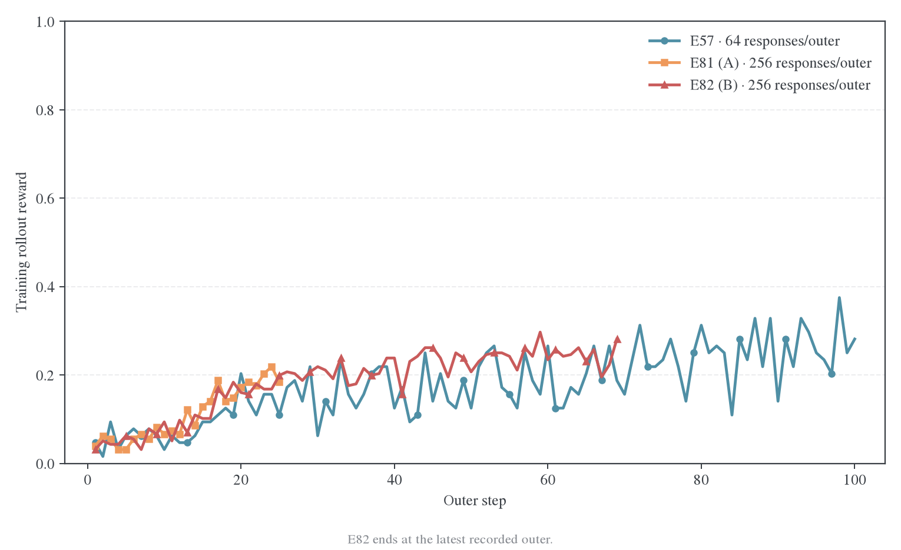

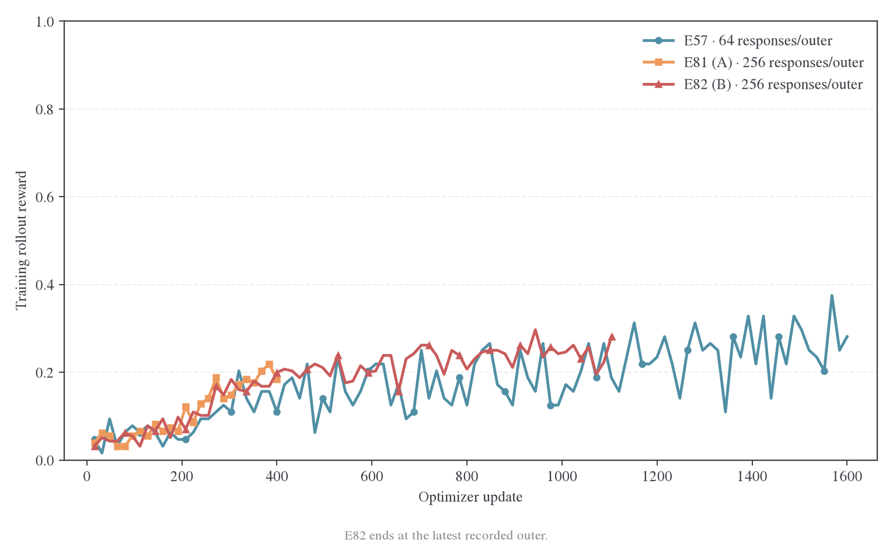

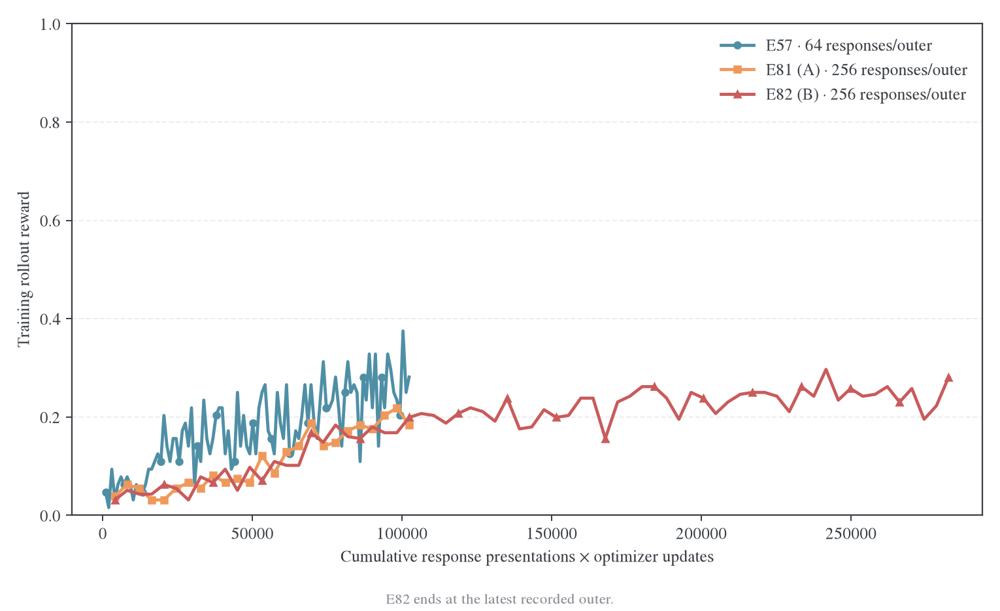

累计回答处理条次按 `outer × responses per outer × 16` 计算；同一回答在每次复用时再次计数。它表示回答呈现次数，不等于唯一新生成回答数或 token 数。当前曲线点与原始文件校验和记录在[图表数据](figures/training-clocks-20261107/training-clocks.csv)和[数据来源及限制](figures/training-clocks-20261107/provenance.json)，可用[绘图脚本](../../../research/studies/weighted_targets/plot_training_clocks.py)重建。训练 reward 使用 2026-11-07 的已落盘快照，E57／E81／E82 分别到 outer100／25／69；outer70 的验证尚未完成，训练 outer 汇总尚未落盘。E82 已应用带 SHA256 的重复实例排除清单。原 [11 月 5 日冻结快照](figures/training-clocks-20261105/provenance.json)保持原样。

TOP-D 论文 Figure 5 曲线由审计数据[复原](data/topd-e57-all-curves-20261104/curves.csv)，图文件保存在[对应图组](figures/topd-e57-all-curves-20261104/)。论文只公开图形和预算说明，没有公开逐点运行日志，因此不把论文曲线与本地训练 rollout reward 未经校准地拼接。

## E81 已落盘的验证与分析

2026-11-07 15:08:53（UTC+8）的综合快照包含 E81 outer5／10／15／20／25、E82 outer5／10／…／65，以及 E83 outer5／10／15／20／25 的完整验证。E82 已应用 1,120 次 optimizer update（outer70，valid 尚未完成）；E83 在 outer30／480 次更新后因用户收回资源而停止，outer30 没有完整验证，不补分或外推。图中仅纳入完整节点。每次验证有 630 道题、每题 16 条回答，共 10,080 条；截至本快照，E81／E82／E83 的有效完整回答数分别为 50,400／131,040／50,400。各记录的正确率、平均 token 长度和停止计数已与 trainer 指标逐项对齐，见[来源核验](figures/validation-comparison-20261106/source-audit.json)。

记录按 `data_source`、`prompt_id` 和 `sample_index` 分组；JSONL 按任务完成顺序写出，不能按行号推断 benchmark。正确率是 avg@16，而非 pass@16；五基准宏平均对 benchmark 等权，三年 AIME 平均也按年份等权，均不采用 MATH-500 占多数的全体回答均值。

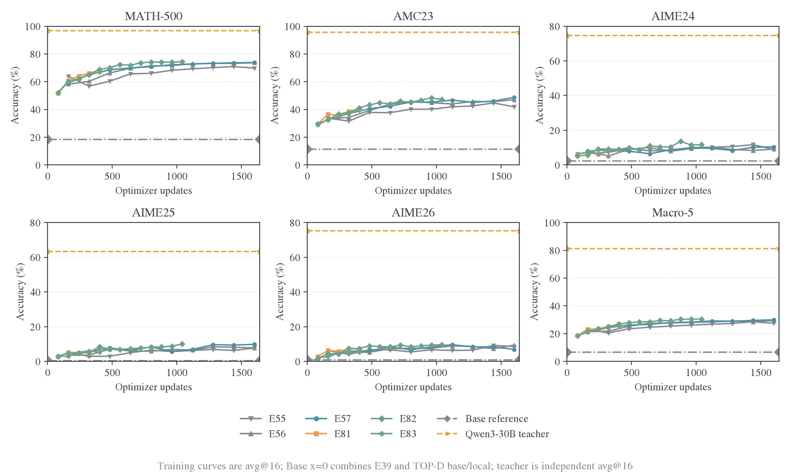

| E81 outer | Optimizer update | 累计训练回答条次 | MATH-500 |  AMC23 | AIME24 | AIME25 | AIME26 | 五基准宏平均 | 三年 AIME 平均 |
| --------: | ---------------: | ---------------: | -------: | -----: | -----: | -----: | -----: | -----------: | -------------: |
|         5 |               80 |            20480 |   51.69% | 29.22% |  6.46% |  2.71% |  2.92% |       18.60% |          4.03% |
|        10 |              160 |            40960 |   60.76% | 36.56% |  6.88% |  5.21% |  6.25% |       23.13% |          6.11% |
|        15 |              240 |            61440 |   64.15% | 35.78% |  6.25% |  5.00% |  5.83% |       23.40% |          5.69% |
|        20 |              320 |            81920 |   66.08% | 38.75% |  8.54% |  4.79% |  7.08% |       25.05% |          6.81% |
|        25 |              400 |           102400 |   68.34% | 40.16% |  8.54% |  8.13% |  7.29% |       26.49% |          7.99% |

E82 在最新完整节点 outer65／update1040 达到 MATH-500 74.45%、AMC23 47.19%、AIME 均值 10.42%、宏平均 30.58%；E83 最后完整验证 outer25／update400 为 66.88%、39.38%、6.53%、25.17%。E82 的 outer40／45 宏平均为 28.52%／29.41%，AIME 均值为 8.89%／9.17%；E83 的 outer20／25 宏平均为 24.22%／25.17%，AIME 均值为 6.39%／6.53%。在共同的 update240，E82 的 AIME 均值／宏平均为 6.04%／23.33%，E83 为 5.49%／22.68%；在共同的 update400，E82 为 8.19%／26.89%，E83 为 6.53%／25.17%。截至共同节点，回答等权聚合没有显示优势；相同 update400 下的点差比 update240 更大，但单次运行和小规模 AIME 题集不足以判断稳定差异。E83 提前停止是资源安排，不是算法失败或完整预算终点。

E82 后续完整节点如下；宏平均对五个基准等权，AIME 平均对三年等权。

| E82 outer | Update | MATH-500 |  AMC23 | AIME24 | AIME25 | AIME26 | 五基准宏平均 | 三年 AIME 平均 |
| --------: | -----: | -------: | -----: | -----: | -----: | -----: | -----------: | -------------: |
|        45 |    720 |   73.61% | 45.94% | 10.42% |  7.71% |  9.38% |       29.41% |          9.17% |
|        50 |    800 |   74.14% | 45.16% | 10.42% |  8.13% |  8.33% |       29.23% |          8.96% |
|        55 |    880 |   74.18% | 46.72% | 13.54% |  8.33% |  8.96% |       30.35% |         10.28% |
|        60 |    960 |   74.01% | 48.28% | 11.46% |  8.75% |  9.38% |       30.38% |          9.86% |
|        65 |   1040 |   74.45% | 47.19% | 11.67% | 10.00% |  9.58% |       30.58% |         10.42% |

E81 从首个到最后一个验证点，MATH-500 提高 16.65 个百分点，AMC23 提高 10.94 个百分点，AIME 平均提高 3.96 个百分点。它在学习，但 AIME 提升较小且中间有回落。AIME 每年只有 30 道题，每题 16 条回答不是 480 道独立题；单训练 seed 的点差不作为稳定排名或显著性结论。

### E82／E83 单独对比：loss、准确率与长度

以下三张图只比较 E82（`token-mean`）与 E83（`seq-mean-token-mean`），两组均为 `future=none`，横轴统一为 optimizer updates。专用图与综合图均刷新至 2026-11-07 15:08–15:10（UTC+8）：训练指标分别到 update1120／480，完整 valid 分别到 outer65／25。E83 已提前停止；其训练 loss 保留到 update480，准确率和验证长度只到 update400。蓝色菱形表示 E82，橙色加号表示 E83，避免与综合图中的同色系列混淆。

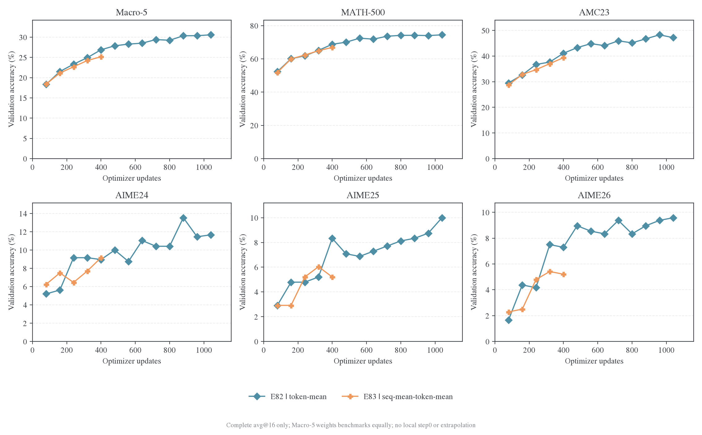

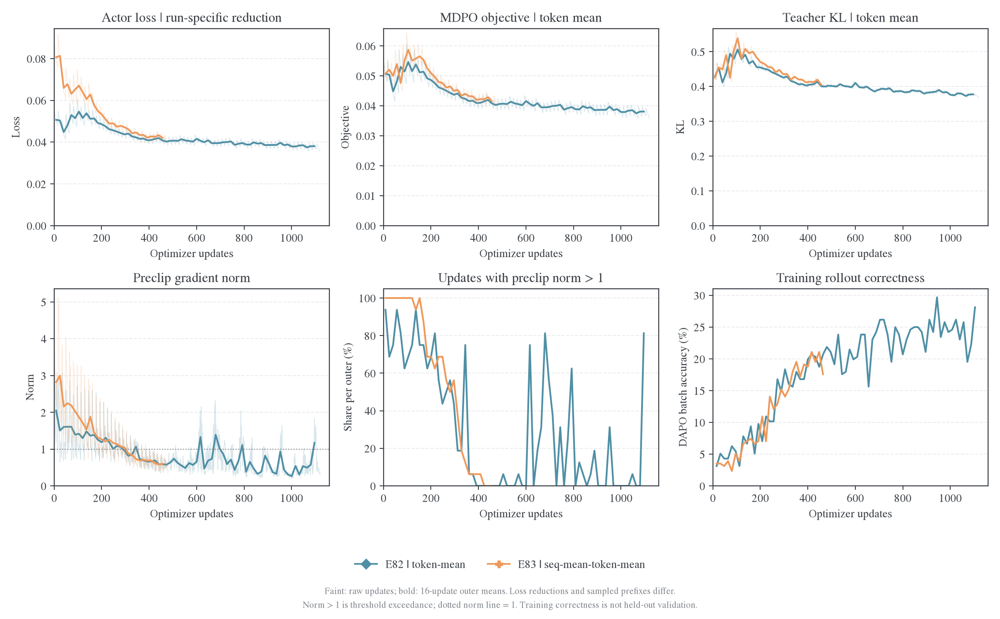

实际 actor loss 使用各运行自己的聚合方式；MDPO objective 与 teacher KL 的日志诊断按有效 token 平均，见冻结运行的输出统计实现。前者不能当作同一个标量目标直接排名，后两者虽然归一化口径一致，也是在各自策略产生的不同前缀上测量，并非共同固定 bank。优化诊断中的淡线为逐次更新原值，实线为每个 outer 内完整 16 次更新的算术平均，放在该批更新的中点；没有跨 outer 平滑。`norm > 1` 是裁剪前梯度范数超过阈值 1 的更新比例，不是 PPO ratio clip fraction。训练回答正确率是变化中的 DAPO batch 读出，不是 held-out valid，也不作为 task reward 加入本次蒸馏 loss。

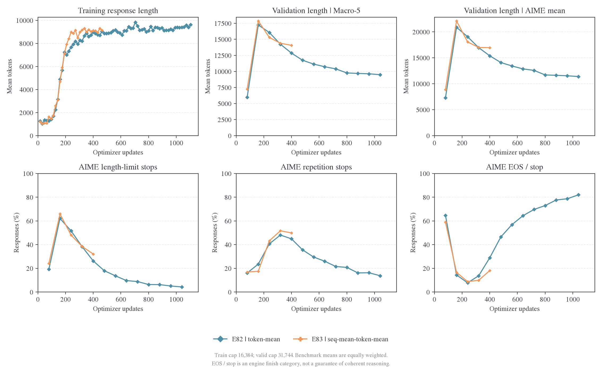

共同的 outer25／update400 提供如下比较。训练 loss、KL 与梯度范数是该 outer 的 16 次更新均值；验证量来自更新结束后的完整 avg@16。

| 指标                       |     E82 |     E83 |
| -------------------------- | ------: | ------: |
| 实际 actor loss，各自聚合  | 0.04092 | 0.04217 |
| MDPO objective，token 平均 | 0.04092 | 0.04199 |
| Teacher KL，token 平均     | 0.40277 | 0.41206 |
| 裁剪前梯度范数，16 次均值  | 0.66154 | 0.69006 |
| 梯度范数 > 1 的更新比例    |   0.00% |   6.25% |
| 训练回答平均长度，token    |   8,981 |   9,113 |
| 五基准宏平均准确率         |  26.89% |  25.17% |
| AIME 三年平均准确率        |   8.19% |   6.53% |
| AIME 回答平均长度，token   |  15,382 |  16,961 |
| AIME 长度触顶              |  26.25% |  32.08% |
| AIME 重复停止              |  44.86% |  49.86% |
| AIME EOS／stop             |  28.89% |  18.06% |

E83 早期实际 loss 和梯度范数更高，后期逐渐接近 E82；同一训练批内的首尾 loss 保存在逐批 CSV 中。到 update400，两组训练回答均长接近，E83 的验证回答仍更长、EOS／stop 更低，准确率也较低。这个组合不支持“回答等权已经改善收束或任务表现”，但也不能把差距单独归因于梯度尺度或长度权重；聚合改变训练权重，各自的在线前缀与随机轨迹也随之变化。E82 在 E83 尚未覆盖的后续区间继续展示已有进程，排名仍按共同节点判断。

[绘图源码](../../../research/studies/weighted_targets/plot_e82_e83.py)、[逐次更新](figures/e82-e83-comparison-20261107/updates.csv)、[逐批汇总及首尾 loss](figures/e82-e83-comparison-20261107/outers.csv)、[验证数据](figures/e82-e83-comparison-20261107/validation.csv)、[来源与口径](figures/e82-e83-comparison-20261107/provenance.json)及[完整记录核验](figures/e82-e83-comparison-20261107/source-audit.json)使用同一个专用快照。每张图另有同名 PDF；默认读取这些 CSV 重画，加入 `--refresh` 才重新核验并读取运行日志：

```bash
python -m examples.mirroropd.research.studies.weighted_targets.plot_e82_e83
```

### 独立 Base 与 teacher 参考

上面的 accuracy 图现在补入两个独立参考系列。它们都放在 optimizer update=0，但不计入 E55–E83 的训练事件或宏平均训练曲线：

| 参考              | MATH-500 |  AMC23 | AIME24 | AIME25 | AIME26 | 评测协议                                                                           |
| ----------------- | -------: | -----: | -----: | -----: | -----: | ---------------------------------------------------------------------------------- |
| Base reference    |   18.59% | 11.41% |  2.50% |  0.42% |  0.83% | MATH／AMC／AIME25 来自 E39 outer0 avg@16；AIME24／26 使用 TOP-D `base/local` avg@4 |
| Qwen3-30B teacher |   96.85% | 95.78% | 74.79% | 63.33% | 75.42% | 原生模板完整五集 avg@16，T0.7、top-p0.9、cap31744                                  |

Base 的五集组合是已有证据的拼接：E39 的完整 MATH-500、AMC23、AIME25 与 TOP-D `base/local` 的 AIME24、AIME26；后者只有 avg@4，且不是 E39 训练日志中的 step0。teacher 是当前 E81／E82 使用的 Qwen3-30B-A3B-Instruct-2507，来自独立冻结评测，不是 teacher 在 student 训练前缀上的逐 token 监督结果。两条参考线用于标记初始能力和 teacher 上界附近的任务读出，不能当作同一个采样协议下的严格差值。

### E81 与 E82 的早期分叉

预算之外，两组 resolved config 只在 epoch 上限及运行命名／输出路径上不同，损失、batch、复用和默认 seed 均相同；名义上 E81 应是 E82 的短预算版本。但实际差异在第一批训练就已出现：E81／E82 的有效 token 数分别为 251,355／321,569，首次 teacher KL 为 0.479434／0.438391，远早于 outer25 的预算分界。因此，早期 valid 差异不能用“E82 训练得更长”解释。

两组 `full_determinism=false`；冻结实现只在开启该选项时注入逐请求采样 seed。相同默认 seed 不足以保证独立 vLLM 运行的随机流、调度和浮点路径一致。这是已知的可变因素，现有记录没有精确定位是哪一项造成首批分叉。E82 错误重复实例的 48 次更新已单独隔离，现有 valid 来自原始有效运行；重复实例不解释原始 E81／E82 的早期差异。新消融保持 E82 原设置，结果仍需跨训练 seed 复核。

### 相同回答处理量与相同更新次数

主图以 optimizer updates 为横轴，加入 E57、E81、E82、E83 与论文 TOP-D α0.1／α0.2。论文仅公开这组三年 AIME 曲线，没有可用于五基准宏平均的完整数据，因此论文对照使用各年 AIME；本地五基准曲线在上图单列。上排保留公开曲线的完整预算，下排放大本地已有预算，均只连接真实观测点。

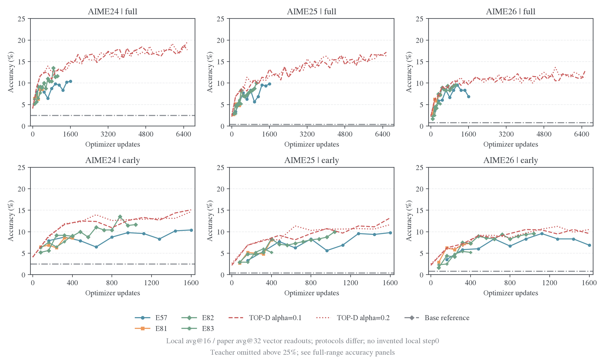

四组本地运行与论文 α0.1／α0.2 都按每 outer 16 次更新换算；E57 每步 batch64，E81／E82／E83／论文每步 batch256。但论文每个 outer 新生成 4,096 条、每条训练一次，本地 E81–E83 每个 outer 新生成 256 条、每条复用 16 次。因此，相同 updates 下 E81–E83 与论文对齐回答处理条次，新生成量只有论文的 1/16；E57 的回答处理量又只有它们的 1/4。回答条次没有计入 token 长度、生成和 full-vocab 运算成本。

| 相同 optimizer updates | E57 AIME 平均 | E81 AIME 平均 | E82 AIME 平均 | E83 AIME 平均 | TOP-D α0.1 AIME 平均 | TOP-D α0.2 AIME 平均 |
| ---------------------: | ------------: | ------------: | ------------: | ------------: | -------------------: | -------------------: |
|                    160 |         4.93% |         6.11% |         4.93% |         4.31% |               ≈7.36% |               ≈7.19% |
|                    320 |         6.67% |         6.81% |         7.29% |         6.39% |               ≈8.92% |               ≈8.85% |
|                    400 |             — |         7.99% |         8.19% |         6.53% |                    — |                    — |
|                    480 |         7.22% |             — |         8.68% |             — |              ≈10.24% |               ≈9.86% |
|                    560 |             — |             — |         8.06% |             — |                    — |                    — |
|                    640 |         7.01% |             — |         8.89% |             — |               ≈9.72% |              ≈11.49% |
|                    720 |             — |             — |         9.17% |             — |                    — |                    — |
|                    800 |         7.92% |             — |         8.96% |             — |              ≈10.03% |              ≈10.52% |
|                    880 |             — |             — |        10.28% |             — |                    — |                    — |
|                    960 |         7.92% |             — |         9.86% |             — |              ≈11.28% |              ≈11.04% |
|                   1040 |             — |             — |        10.42% |             — |                    — |                    — |

表内只列各系列真实存在的节点，缺测记为 —。论文点来自已有的 Figure5 矢量提取，≈表示图上读数，并未重新平滑；论文 outer25 没有节点，因此 update400 不插值补分。E82 在 update160 的宏平均为 21.51%、AIME 为 4.93%，E81 同点为 23.13%／6.11%，E83 为 21.14%／4.31%；同 seed、名义前缀的实际运行也存在采样差异，不能将它们视为独立 seed 或只选较高的一条代表某种聚合。

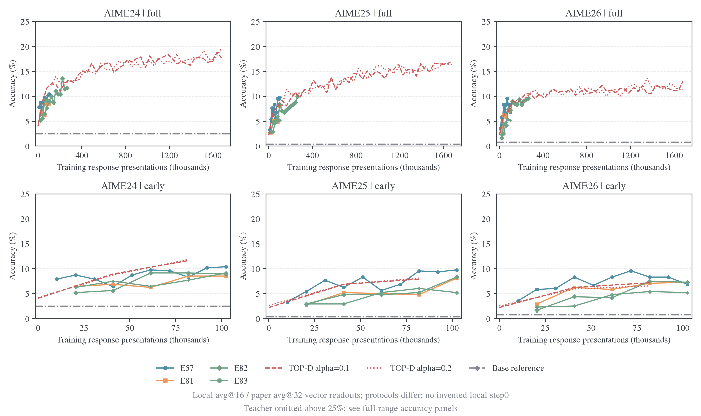

| 相同累计训练回答条次 | E57 AIME 平均 | E81 AIME 平均 | E82 AIME 平均 | E83 AIME 平均 | TOP-D α0.1 AIME 平均 | TOP-D α0.2 AIME 平均 |
| -------------------: | ------------: | ------------: | ------------: | ------------: | -------------------: | -------------------: |
|                40960 |         7.01% |         6.11% |         4.93% |         4.31% |               ≈7.36% |               ≈7.19% |
|                81920 |         8.75% |         6.81% |         7.29% |         6.39% |               ≈8.92% |               ≈8.85% |
|               102400 |         9.03% |         7.99% |         8.19% |         6.53% |                    — |                    — |
|               122880 |             — |             — |         8.68% |             — |              ≈10.24% |               ≈9.86% |
|               163840 |             — |             — |         8.89% |             — |               ≈9.72% |              ≈11.49% |
|               184320 |             — |             — |         9.17% |             — |                    — |                    — |
|               204800 |             — |             — |         8.96% |             — |              ≈10.03% |              ≈10.52% |
|               225280 |             — |             — |        10.28% |             — |                    — |                    — |
|               245760 |             — |             — |         9.86% |             — |              ≈11.28% |              ≈11.04% |
|               266240 |             — |             — |        10.42% |             — |                    — |                    — |

E81 与 E57 同时能对齐回答处理条次和新生成回答数，完整预算下 E81 为 400 次更新、E57 为 1,600 次更新。五个匹配预算点的 E81 宏平均均低于 E57：

| 累计训练回答条次 | E81 outer／update | E57 outer／update | E81 宏平均 | E57 宏平均 |  E81−E57 |
| ---------------: | ----------------: | ----------------: | ---------: | ---------: | -------: |
|            20480 |             5／80 |           20／320 |     18.60% |     24.40% | −5.80 pp |
|            40960 |           10／160 |           40／640 |     23.13% |     26.66% | −3.53 pp |
|            61440 |           15／240 |           60／960 |     23.40% |     28.25% | −4.84 pp |
|            81920 |           20／320 |          80／1280 |     25.05% |     28.92% | −3.88 pp |
|           102400 |           25／400 |         100／1600 |     26.49% |     29.93% | −3.44 pp |

相同 updates 的另一个切面是 E81 在 update160／320 的宏平均为 23.13%／25.05%，E57 为 21.33%／24.40%，点差 +1.80／+0.65 个百分点；E81 同时处理了四倍回答。现有结果不支持“大 batch 改善同回答预算下表现”，也不足以宣称更新次数对齐时的差异来自 batch 本身。

本地与论文仍有[输入、解码、判分、动作空间和算法差异](weighted-targets.md#top-d-与本项目的预算和评测)：本地 avg@16、T0.7/p0.9、cap31744，论文 avg@32、T1/p0.7、cap16384。历史 E57 与 E81／E82 还存在数值执行和重复停止协议差异；同回答条次下 E81 的 outer 与 anchor 刷新次数仅为 E57 的 1/4。图用于定位预算阶段，不作为样本效率、计算效率或 batch 单因素的因果排名。论文全部六种消融仍见[完整 Figure5 图组](weighted-targets.md#figure5-全部消融曲线)。

### 触顶减少与重复停止

综合行为图也统一使用 optimizer updates。E55（κ0）、E56（κ0.5）、E57（κ1）均为历史 η0.1 运行，E81／E82／E83 为 κ1、batch256。先比较三年 AIME，再以五基准等权平均检查现象是否仅由困难题驱动。

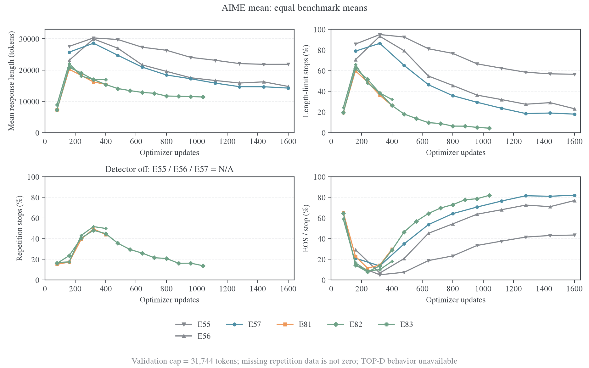

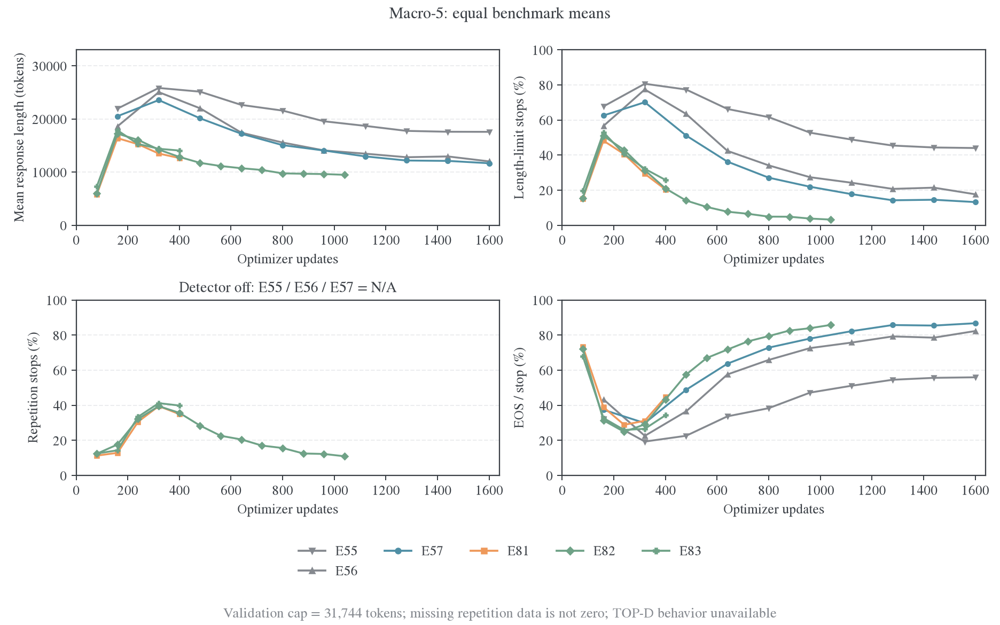

E55–E57 未启用重复检测，`repetition_rate` 保留缺失并在图中标为 N/A，不补成 0，也不推断它们没有重复文本。`EOS / stop` 只表示引擎返回 `finish_reason=stop`，不保证推理完整或内容不重复；因此新图不把该类别命名为“自然收束”。TOP-D 来源没有逐点长度或停止原因，行为图不伪造论文数据。

| 运行与节点   | Updates | AIME 平均长度 | 长度触顶 | 重复停止 | EOS／stop |
| ------------ | ------: | ------------: | -------: | -------: | --------: |
| E57 outer10  |     160 |        25,719 |   78.96% |      N/A |    21.04% |
| E81 outer10  |     160 |        20,249 |   59.86% |   17.29% |    22.85% |
| E82 outer10  |     160 |        20,881 |   62.08% |   23.54% |    14.38% |
| E83 outer10  |     160 |        22,098 |   65.90% |   17.50% |    16.60% |
| E57 outer20  |     320 |        28,581 |   86.46% |      N/A |    13.54% |
| E82 outer20  |     320 |        16,949 |   38.26% |   48.06% |    13.68% |
| E81 outer20  |     320 |        16,197 |   36.18% |   49.38% |    14.44% |
| E81 outer25  |     400 |        15,444 |   26.25% |   43.96% |    29.79% |
| E82 outer30  |     480 |        14,087 |   17.99% |   35.56% |    46.46% |
| E82 outer35  |     560 |        13,425 |   13.68% |   29.51% |    56.81% |
| E82 outer40  |     640 |        12,856 |    9.65% |   25.97% |    64.38% |
| E82 outer45  |     720 |        12,571 |    8.82% |   21.53% |    69.65% |
| E82 outer50  |     800 |        11,693 |    6.32% |   20.76% |    72.92% |
| E82 outer55  |     880 |        11,623 |    6.25% |   16.11% |    77.64% |
| E82 outer60  |     960 |        11,531 |    5.07% |   16.25% |    78.68% |
| E82 outer65  |    1040 |        11,389 |    4.31% |   13.75% |    81.94% |
| E83 outer15  |     240 |        18,055 |   48.06% |   43.19% |     8.75% |
| E83 outer20  |     320 |        16,989 |   38.40% |   51.67% |     9.93% |
| E83 outer25  |     400 |        16,961 |   32.08% |   49.86% |    18.06% |
| E57 outer100 |    1600 |        14,235 |   17.92% |      N/A |    82.08% |

长度单位为 token，评测 cap 均为 31,744。E82 outer25→65 的 AIME 平均长度从 15,382 降至 11,389 token，length stop 从 26.25% 降至 4.31%，repetition stop 从 44.86% 降至 13.75%，EOS／stop 升至 81.94%；AIME 平均在 update800、960 仍有回落，update1040 为 10.42%，五基准宏平均为 30.58%。E83 outer20→25 的平均长度约 17k token，length＋repetition 从 90.07% 降至 81.94%，EOS／stop 增至 18.06%，但停止结构和准确率仍落后于 E82 的 update400 节点。E81 outer10→20 的均长下降 4,053 token、长度触顶下降 23.68 个百分点，同时重复停止增加 32.08 个百分点；outer25 的这项合计回落至 70.21%，EOS／stop 回升，但仍有 43.96% 的 AIME 回答由重复检测器截停。新数据提示 E82 后段准确率与停止行为一起改善，但单次评测仍不足以证明因果关系或泛化稳定性。

训练侧连续 400 次更新全部应用，跳步、非有限 loss 和非有限梯度标记均为零；25 个 outer 内的 MDPO objective 和 teacher KL 在各自 16 次复用的首尾都下降。最后一批 objective 为 0.041640→0.039184、teacher KL 为 0.410403→0.399451，[逐批拟合核验](figures/e81-valid-20261105/source-audit.json)排除了“更新没有执行”这一解释。给定前缀上的拟合改善尚未带来与 E57 同回答预算相当的任务结果。

### 数据与复画

新综合图组的 [CSV](figures/validation-comparison-20261106/validation.csv)、[来源哈希与口径](figures/validation-comparison-20261106/provenance.json)、[记录核验](figures/validation-comparison-20261106/source-audit.json)和同名 PDF 使用同一快照。E55–E57 来自已冻结的历史汇总；TOP-D 使用已有审计的论文矢量读数。11 月 5 日的 [E81 四次验证快照](figures/e81-valid-20261105/e81-valid.csv)保持原样，由新图组承接终点与跨运行比较。

### 训练与验证耗时、并发判断

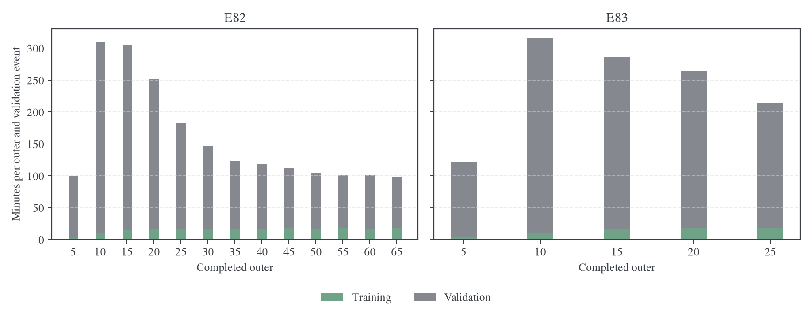

resolved 配置对 E82／E83 都是完整提交 630 题、每题 avg@16、验证回答上限 31,744 token，`max_num_seqs=64`、TP1，`gpu_memory_utilization=0.8`。四卡各有一个推理副本，每副本序列上限 64；`data.val_batch_size=null` 将全题集交给调度器，但不意味着 10,080 条回答同时驻留解码。完整验证耗时为 E82 outer5／10／15／20／25／30／35／40／45 的 5,824／17,963／17,384／14,166／9,929／7,803／6,334／6,037／5,653 秒，E83 outer5／10／15／20／25 为 7,083／18,342／16,139／14,809／11,778 秒。E82 outer50／55／60／65 的完整验证另为 5,259／5,031／4,995／4,808 秒。最新完整 valid 分别约 1 小时 20 分钟和 3 小时 16 分钟。E82 outer65 训练回答均长 9,394 token，E83 outer25 为 9,113 token；训练阶段约 17–18 分钟一轮。验证仍是主要墙钟耗时，不过 E82 验证从 outer20 到 outer65 由约 3 小时 56 分降到约 1 小时 20 分，E83 outer20 到 outer25 也从约 4 小时 7 分降到约 3 小时 16 分。

训练耗时也受回答长度影响。E82 outer65 的训练耗时为 1,066 秒（actor 855 秒、rollout 160 秒），E83 outer25 为 1,070 秒（actor 841 秒、rollout 158 秒）；两者近期训练耗时约 17–18 分钟一轮，没有随 outer 单调增加。

2026-11-07 01:12（UTC+8）的 GPU 采样中，E82 所在 GPU0、5–7 为 100%，显存约 65.6–66.2 GiB；E83 所在 GPU1–4 为 98–99%，显存约 20.0 GiB。训练进程当时均存活且正在写日志。这个采样只说明当时 GPU 忙，不足以判断 rollout 并发是否达到吞吐最优。10 月四卡完整验证实测约 31.3k 输出 token/s，该系列另测并发64→128有吞吐收益；但它使用 DeepSeek-R1-Distill-Qwen-1.5B、另一组输出和不同采样，不能直接与本次 Qwen3-1.7B-Base 对比，也不能把 64→128 的已测收益外推到当前运行。判断当前并发仍需同时间采集各 vLLM 副本的 running／waiting requests、KV cache 使用率、抢占数和输出 token/s；若持续有 waiting backlog 且 KV／显存有余量，再做受控的 64→96/128 对照。单看 `nvidia-smi` 利用率不能单独判定并发不足。参考：[10 月四卡验证吞吐实测](../../infra/performance/2026-10-22-训练与验证性能实测.md#12-全量提交的独立收益)。

耗时来源及每节点阶段计时保存在[运行耗时 CSV](figures/validation-comparison-20261106/runtime.csv)，图和曲线使用同一份验证快照。E82 仍在运行，后续完整节点出现后重新运行 `--refresh` 更新图表；E83 已停止，曲线保留最后完整观测，不将中断耗时记为完整验证耗时。

[绘图源码](../../../research/studies/weighted_targets/plot_validation_comparison.py)默认重画冻结 CSV；仅 `--refresh` 才重新读取运行记录。在仓库根执行：

```bash
python -m examples.mirroropd.research.studies.weighted_targets.plot_validation_comparison
```

## E83／E84：future 与聚合消融

E83／E84 以 E82 的完整设置为基线，各自从原始 Qwen3-1.7B-Base 开始训练，不加载 E81 或 E82 中间权重。原计划先 E83、后 E84，固定物理 GPU1–4；2026-11-07 用户收回资源后，E83 提前停止、E84 取消待启动任务，GPU1–4 随后交给 [E91 MiMo RL-Zero→SFT](../teacher-transfer/cases/2026-11-07-E91-MiMo-RL-Zero到SFT学生.md)。E82 继续使用 GPU0、5–7。两组原定预算均为 batch=mini-batch256、n1、reuse16、100 outer／1,600 optimizer updates，累计 409,600 回答处理条次、25,600 新回答，total_epochs2。学习率保持 1e-6，原方案的其他模型、数据、采样、精度、重复停止与每 5 outer 的验证协议均继承 E82；后续 E84 预设已改为 8 卡、每 20 outer 验证，详见[八卡消融设置](#e85e90八卡聚合与-future-消融)。

| 实验 | Future     | 聚合                  | 相对 E82 的科学变量     |
| ---- | ---------- | --------------------- | ----------------------- |
| E82  | `none`     | `token-mean`          | 原始基线                |
| E83  | `none`     | `seq-mean-token-mean` | 回答等权聚合            |
| E84  | `mean`、γ1 | `token-mean`          | 严格后续 token 平均代价 |

完整机制与解释边界见[E82 基线上的 future 与聚合消融](weighted-targets-controls.md#e82-基线上的-future-与聚合消融)。本轮没有同时启用 future 与回答等权的第四组。E83／E84 配置为每 25 outer 同步保存完整训练状态，包含模型／优化器分片、RNG／scheduler、dataloader 和 optimizer 计数；保存成功后只保留最新一份完整状态，原计划终点另留独立 HF 模型。E83 实际保留 [outer25／update400 的完整状态](../../../../../runs/topd-learning-signal-20261106/formal/E83/checkpoints/global_step_25/trainer_state.json)，四个 rank 的模型、optimizer 与 extra-state 分片及数据／rollout 状态均在；停止时未导出最终模型，也未保存 update480 的新状态。E84 没有训练产物。E82 仍保留原先不保存 checkpoint 的配置。

[冻结计划](../../../../../runs/topd-learning-signal-20261106/plan.json)、[E83 配置差异](../../../../../runs/topd-learning-signal-20261106/E83-config-diff.json)、[E84 配置差异](../../../../../runs/topd-learning-signal-20261106/E84-config-diff.json)与[源码合同](../../../../../runs/topd-learning-signal-20261106/source-contract.json)保存实际条件。运行时沿用 E82 的冻结源码 `c996d634`，只叠加新预设与保存回调；不采用工作树中无关的运行时变化。

## 执行状态与入口

E81 已完成 outer25／400 次更新与全部五次验证，[退出记录](../../../../../runs/topd-large-batch-20261105/logs/E81-train-exit.json)为 returncode0。有效 E82 是 2026-11-05 13:38 启动的 GPU0、5–7 运行；截至 2026-11-07 15:14（UTC+8），trainer 主进程仍存活，已应用 outer70／1,120 次更新，正在该节点验证，完整 valid 到 outer65。E83 已于 03:59 按用户要求停止，最后应用更新到 outer30／480，完整训练 outer 汇总到 29，完整 valid 到 outer25。E83 的 480 次更新均实际应用，没有跳过更新或 loss／梯度非有限记录；停止不是数值故障。E84 未启动，串行队列及 supervisor 一并停止，不会自动接续。物理 GPU1–4 已完成交接并用于 E91 的独立评估银行生成，E82 未受影响，详见[停止与资源交接凭据](../../../../../runs/topd-learning-signal-20261106/user-stop-receipt-20261107.json)。

原 E81→E82 队列在 E81 完成后重复启动了一份 E82，现已停止重复实例和旧队列。重复实例向同一 metrics 文件追加了 48 次更新及 3 条 outer 汇总；原始日志保留，已用带 SHA256 的字节区间排除清单隔离。本次综合图刷新已核验并应用排除清单，保留原始有效运行的连续 1–1,120 次更新和完整 valid。细节见[数据核验凭据](../../../../../runs/topd-learning-signal-20261106/e82-data-audit.json)。

E83／E84 使用独立运行根，启动前已核验 E81 完整终点评测。队列在每个分支启动前检查输出、运行进程及独占启动标记，整队列持有文件锁；上一组未完成全部更新、终点验证和最终模型导出时，不启动下一组。E83 于 2026-11-06 00:46（UTC+8）启动，现已停止。[启动与资源核验](../../../../../runs/topd-learning-signal-20261106/runtime-audit.json)保留启动时验收；[队列原始退出记录](../../../../../runs/topd-learning-signal-20261106/queue-state.json)中的 `failed`／SIGTERM 表示此次主动取消，须结合上述交接凭据解释。旧 A/B 队列也显示 `failed`，但 E82 trainer 仍存活且日志更新，不视作 E82 退出。保存与配置的 CPU 检查分别见[checkpoint 测试](../../../../../tests/examples/test_weighted_targets_checkpoint.py)和[启动器测试](../../../../../tests/examples/test_mirroropd_math_launcher_on_cpu.py)。

从仓库根目录检查默认配置；应先清理会覆盖预设的旧环境变量：

```bash
DRY_RUN=1 bash examples/mirroropd/run_math_opd_ablation_fsdp2.sh E83
DRY_RUN=1 bash examples/mirroropd/run_math_opd_ablation_fsdp2.sh E84
```

历史 E81／E82 的[预算与输入](../../../../../runs/topd-large-batch-20261105/plan.json)、[最终配置](../../../../../runs/topd-large-batch-20261105/configs/)和[首个 outer 验收](../../../../../runs/topd-large-batch-20261105/startup-proof.json)继续保留。长期结果回填主报告，小规模机制核对保留在独立专题。
