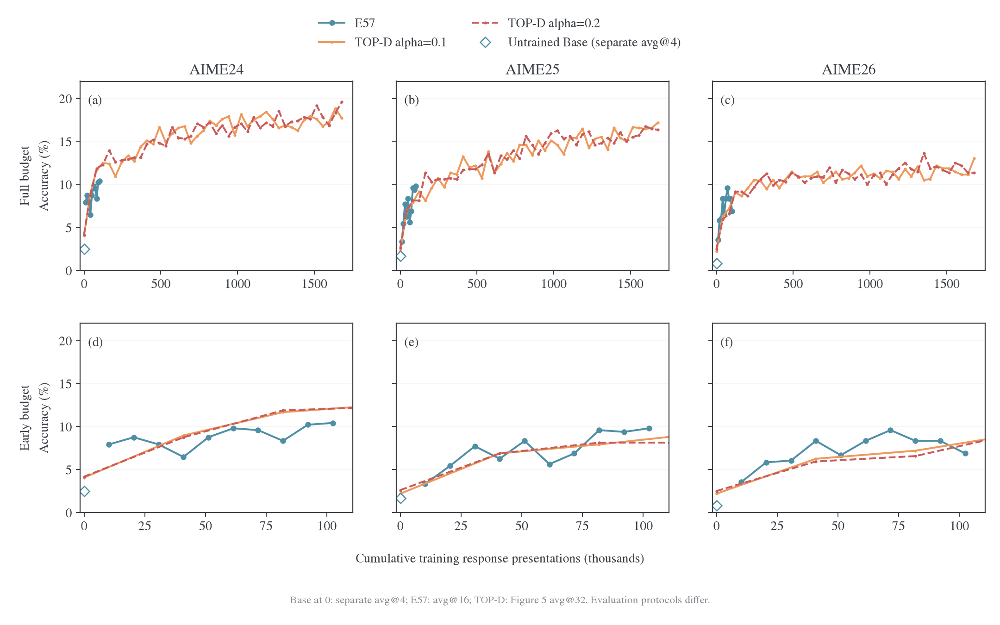
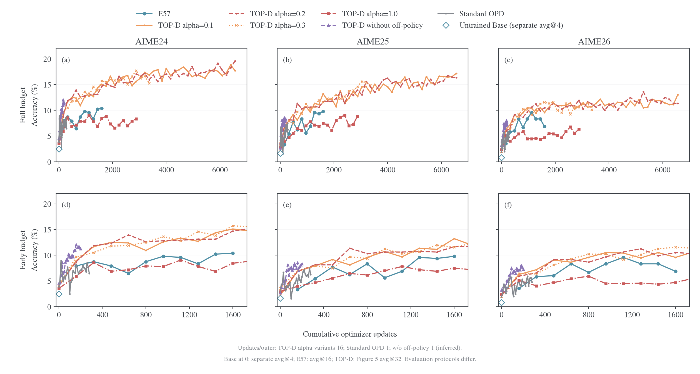

# TOP-D 复现与长程实验

这里比较本项目的 full-vocab MDPO 与 TOP-D。E55／E56／E57 均已完成 100 outer、1600 次更新，最终五基准宏平均为 27.37%／29.39%／29.93%。E57 相对 E55 高 2.56 个百分点，触顶率低 30.83 个百分点；相对 E56 的三个 AIME 平均只高 0.28 个百分点，单 seed 尚不能确立稳定任务排名。E57 的 target 形状与 TOP-D α0.1 对应，更新算法、样本预算、EOS 空间和评测协议仍有差异。

| 文档                                                 | 内容                                                     |
| ---------------------------------------------------- | -------------------------------------------------------- |
| 本文                                                 | TOP-D 算法与预算、E55–E57 长程结果、论文曲线对照         |
| [小规模消融与机制核对](weighted-targets-controls.md) | κ/η 网格、覆盖、局部梯度、输入与解码对照                 |
| [当前实验](weighted-targets-active.md)               | E81／E82 预算对照、跨运行 valid、E83／E84 消融与执行状态 |

E81 已完成全部 400 次更新与五次验证，[综合分析](weighted-targets-active.md#e81-已落盘的验证与分析)同时纳入 E55–E57、E82 的完整 valid、独立 Base 参考、Qwen3-30B teacher 参考和 TOP-D 论文 AIME 曲线，主要横轴为 optimizer updates。在相同 102,400 回答处理条次下，E81／E57 的五基准宏平均为 26.49%／29.93%，AIME 平均为 7.99%／9.03%；现有运行未支持大 batch 的同回答预算优势，数值执行和停止协议差异仍适用。E81 终点 AIME 重复停止率为 43.96%，历史 E55–E57 未启用该检测器，在综合图中保留 N/A。下一轮按已登记的 E83／E84 [future 与聚合四卡对照](weighted-targets-controls.md#e82-基线上的-future-与聚合消融)继续分解机制。

[精度与 optimizer 实验](../../infra/numerics/optimization/README.md)提供执行与求解依据。

<a id="topd"></a>
<a id="topd-e57-与-top-dkl-拟合任务收益与实现对照"></a>

<a id="topd-3-e57-与-top-d-的精确关系"></a>

## 目标构造与实际更新

<a id="topd-31-相同部分算术混合的-proximal-teacher"></a>

<a id="31-算术混合的-proximal-teacher"></a>

### 算术混合的 proximal teacher

记原 teacher 为 $T$、本轮冻结 student 为 $q$，TOP-D 构造 $m=(1-\alpha)q+\alpha T$，即时信号为 $f=\log(m/q)$。[^topd-paper]

E57 的κ1、η0.1 产生

$$
m=0.9q+0.1T,
\qquad f=\log(0.9+0.1T/q).
$$

在相同 state 和动作空间下，它与 TOP-D 的α0.1 构造对应。E57 还合并了 EOS，数值对照需采用相同动作空间。E57 实际最小化的 full-vocab 标量则为

$$
L_{57}(p)=10D_{\rm KL}(p\Vert m)
=10D_{\rm KL}(p\Vert q)-10\mathbb E_p f.
$$

该式由本仓[目标构造](../../../../../verl/trainer/distillation/targets.py)和[full-vocab 目标](../../../../../verl/trainer/distillation/objectives.py)直接核对，外部缩放由[loss 层](../../../../../verl/trainer/distillation/losses.py)执行。

<a id="topd-32-不同部分完整更新算法"></a>

<a id="32-完整更新算法"></a>

### 完整更新算法

官方`topd`先计算即时 $f_t$，再构造“当前 reward＋后续有效 token 的平均 reward”，随后在同一道 prompt 的全部回答 token 内减均值、除标准差。它将固定 advantages 交给 sampled-token PPO 更新，clip 为 0.2，dual-clip 系数为 3.0；另提供只用即时信号的`naive_topd`。[^topd-algos][^topd-common]

| 实现环节         | 官方 TOP-D                     | E57                                |
| ---------------- | ------------------------------ | ---------------------------------- |
| Proximal teacher | 概率算术混合                   | 相同形状，η0.1                     |
| 动作积分         | 已生成 token 上的 sampled 估计 | 给定前缀完整词表求和               |
| 信号             | 即时项＋后续平均 return        | 当前状态的 KL residual             |
| 归一化           | Prompt 组内 token 标准化       | 无该组内标准化                     |
| 更新             | 固定 advantage 的 PPO clipping | 直接 scaled target KL              |
| Anchor 作用      | PPO 信赖域近似                 | 目标内有显式 $D_{KL}(p\Vert q)$ 项 |
| 整体尺度         | 官方 advantage 标准化          | 保留 $1/\eta=10$                   |
| 终止支持         | 原始 token 分别评分            | 合并两个 EOS 动作后构造目标        |

从 E57 的标量自行求导，令 $\psi=\nabla\log p$：

$$
\nabla L_{57}
=10\mathbb E_p\left[(\log(p/q)-f)\psi\right].
$$

在理想起点 $p=q$，它与未裁剪、仅即时 $f$ 的期望策略梯度同方向，梯度尺度相差 10。实际 Adam 步幅还取决于自适应矩、epsilon、clipping 与优势标准化。离开起点后，E57 保留 anchor KL 的梯度；完整 TOP-D 还有 return、组内标准化和 clipping。所以 E57 应称为 **TOP-D-style proximal target 的 full-vocab MDPO 变体**，也与官方`naive_topd`的有限步更新有区别。

Full-vocab 精确化的是已访问前缀上的动作积分；后续轨迹的信用分配仍是独立设计。TOP-D 的 future return 与 E57 的条件 KL 反向传播在这一点上具有不同语义。

<a id="grid-6-与-top-d-的关系和实现边界"></a>

### κ/η 与 EOS 的实现约定

一般κ/η的目标及 normalizer 由[镜像理论](../../theory/mirror-descent/objectives.md#weighted)定义。κ=1、η=α时得到 TOP-D 的算术 target；完整更新的对应关系见上表。κ=0、η=0.1 的目标包含 9 倍 anchor KL，因此它是有近端约束的形状对照；纯 Full-RKL 对应η=1。

κ=1 的即时信号在 T/q 趋近零时下界为 log(1−η)，MDPO 再按 1/η缩放。停止状态上的反向 KL 梯度还取决于 student 给予 EOS 的概率。

EOS 适配先分别合并 student、anchor、teacher 的停止概率，再构造 target；幂均值与合并的次序会影响结果。梯度按 student 类内概率分回两个 logits，teacher 与 anchor 保持冻结。该路径已按独立 FP64 概率参考及实际词表 BF16 CUDA 核对；本组 teacher/anchor KL 使用合并后的动作空间。

<a id="topd-4-16-次更新与实际训练预算"></a>

## TOP-D 与本项目的预算和评测

论文§5.1 把 512 道 prompt、每题 8 条回答组成 4096 条轨迹，再分成 16 个不同 mini-batch、每个 256 条，执行一个 epoch。[^topd-paper]

| 预算口径          | 论文设置                       | 官方当前单机配方          | E57                         |
| ----------------- | ------------------------------ | ------------------------- | --------------------------- |
| 每次生成的 prompt | 512                            | 128                       | 64                          |
| 每题回答          | 8                              | 8                         | 1                           |
| 独立新轨迹／outer | 4096                           | 1024                      | 64                          |
| 更新 mini-batch   | 32prompt×8=256 条              | 32prompt×8=256 条         | 64 条                       |
| 内部处理方式      | 16 个不同 mini-batch，1epoch   | 4 个 mini-batch／epoch    | 同一 64 条重复 16 次        |
| 数据损失聚合      | 依论文实际实现核对             | seq-mean-token-mean       | 全局 token-mean             |
| 训练回答上限      | 16384                          | 16384                     | 16384                       |
| 验证              | AIME avg@32，T1/p0.7，cap16384 | avg@16，T1/p0.7，cap16384 | avg@16，T0.7/p0.9，cap31744 |

官方 README 明确区分论文与单机默认规模；entry 脚本固定 128/32，common 脚本设置 8 次 rollout 与验证参数。[^topd-readme][^topd-entry][^topd-common]

E57 每个 outer 产生的新轨迹数是论文的 **1/64**；相同“16 次”对应不同样本覆盖与更新历史。两个采样预算下的单次梯度噪声、state 覆盖和 Adam 状态都不同。

11 月 2 日按固定官方 commit 下载 parquet，并逐文件核对公开 SHA-256。官方 DAPO 为 17,398 行，本地为 17,917 行；去掉官方统一附加指令并合并空白后，两者覆盖同一批 **16,921 个唯一题干**，重复余量分别为 477 和 996 行。因此，文件行数差不能解读为本地缺少约五百道训练题。[数据核对](data/topd-audit-20261102-0055/input-audit.json)还记录了七个题干对应的答案字符串集合不一致；这些标签用于任务判分，不直接进入本组 full-vocab MDPO 的教师概率目标。[^topd-data]

官方全部 DAPO 训练题和 AIME24/25/26 评测题都附加了逐步推理、将最终答案写入 `\boxed{}` 的要求，本地对应文件没有该指令。AIME 文件还存在题目顺序、LaTeX 写法、图示源码和个别措辞差异，不能只把采样温度改成论文值就称为同协议评测。输入指令的影响已纳入同模型、同题、同 seed 的配对生成对照；数据量对照保持原输入，分别识别访问覆盖与提示方式的效果。[^topd-data]

学习率 1e-6 一致，也不使上述样本覆盖和更新过程自动相同。

论文 Figure5／§5.3 在同一 1.7B Base←30B-A3B teacher 配对上比较 α=0.1/0.2/0.3、α=1 去除 proximal teacher，以及关闭内部 off-policy 迭代。关闭内部迭代后，论文报告需要更多训练步才能提升成绩。这组消融没有独立改变 batch size 或累计新轨迹量，因此支持检验内部优化预算，但不能直接证明本地差距主要来自数据不足。[固定池与在线覆盖实验](weighted-targets-controls.md#复现差距的受控核对)分别控制这些量。[^topd-paper]

### 累计训练回答次数下的 E57 与 TOP-D 曲线

E57 原始 W&B 离线日志 `6j5knkmk` 已完成，包含连续 1,600 次 optimizer update、100 个 outer 和 outer10 至 outer100 的十次完整评测；原文件 SHA-256 与冻结提取记录一致。下图使用该日志的 AIME24/25/26 正确率，与论文 Figure5 的 α0.1、α0.2 曲线叠加；TOP-D 曲线从论文源文件中的矢量路径按坐标刻度提取，没有再次平滑。[^topd-paper]

横轴的**累计训练回答条次**将同一回答的每次重复训练分别计数。E57 的每次更新使用 64 条回答，同一 outer 的 64 条回答更新 16 次；论文则把新生成的 4,096 条回答划成 16 个不同 mini-batch，每条处理一次。因此，在 outer $o$ 完成后：

$$
N_{\mathrm{E57}}(o)=64\times16\times o=1024o,
\qquad
N_{\mathrm{TOP-D}}(o)=512\times8\times o=4096o.
$$

TOP-D 的 outer 解释依据官方 trainer：每轮 rollout、actor 更新和日志记录后，`global_steps` 增加一次；内部 optimizer update 由 mini-batch 循环执行。[^topd-trainer-budget] Figure5 两条曲线均有 42 个可提取节点，横坐标为 0、10、…、410，换算使用论文 §5.1 的 batch 设置。这里推断的是公开曲线已展示的训练预算；论文没有给出 Figure5 与 Table3 checkpoint 的一一对应关系，也没有证明训练恰好在 outer410 终止。



| 公开曲线末端口径 | E57 outer100 | TOP-D α0.1／α0.2 outer410 | TOP-D／E57 |
| ---------------- | -----------: | ------------------------: | ---------: |
| Optimizer update |        1,600 |                     6,560 |        4.1 |
| 新生成回答数     |        6,400 |                 1,679,360 |      262.4 |
| 累计训练回答条次 |      102,400 |                 1,679,360 |       16.4 |

E57 的 AIME24、AIME25 从首个评测点的 7.92%／3.33% 上升至 10.42%／9.79%，AIME26 在 outer70 达到 9.58%，最终为 6.88%。在相近累计训练条次的前期区间，E57 与 TOP-D 的正确率范围重叠，论文更高的后期成绩来自远超 E57 当前终点的训练区间。曲线支持继续控制训练预算，不能据此确定延长 E57 就能复现论文结果。

两边采用相同的 student／teacher 配对，但 E57 为 avg@16、T0.7/p0.9、cap31744，论文为 avg@32、T1/p0.7、cap16384，题目附加指令与更新目标也不同。条次横轴没有计入回答长度、full-vocab 与 sampled-token 的算力差异；因此图用于定位训练阶段，不能据此排名算法的样本效率或计算效率。E57 的原日志无初始验证；图中 x=0 的空心菱形来自独立 Base 评测，采样次数与训练中验证不同。TOP-D 提取值是图上读数，不替代 Table3。

三种横轴均补充了未训练 Base 的独立读出：AIME24／25／26 分别为 **2.50%／1.67%／0.83%**，每年 30 题、每题 4 次回答，即分别判对 3／2／1 条，共 360 条回答。该读出来自 TOP-D 输入与解码消融中的 `base/local` 条件；模型为 `Qwen3-1.7B-Base/ea980cb0`，使用无官方附加指令的本地题目、`enable_thinking=null` 的原生 assistant 前缀、T0.7/p0.9/cap31744 和停止 ID `[151643,151645]`。已核对原输出、逐条评分与汇总的哈希，并独立重算三个均值；三个 AIME 源 parquet 的哈希也与当时的题目计划一致。[逐条基线评分及来源](data/topd-e57-step0-20261104/baseline.json)保留了复算证据。

E57 冻结配置实际为 `trainer.val_before_train=false`，所以原日志的首次验证在 outer10。独立 Base 是 avg@4、使用另一套采样 seed 与推理执行，E57 训练中为 avg@16；图中用同色空心菱形标示零训练预算的独立参考，不把它写入 E57 原日志，也不与 E57 的首个训练中评测点连线。这里补充的是已有的真实基线测量；avg@4 与 avg@16 的估计精度差异仍保留。

[新增回答数横轴图](figures/topd-e57-step0-20261104/fresh_responses.png)保留两边不同的轨迹覆盖口径；早期放大区内 TOP-D 只有 step0 一个观测点，仅显示该点，不在没有评测的区间补画连线。[矢量成品](figures/topd-e57-step0-20261104/response_presentations.pdf)、[原始论文矢量图](data/topd-e57-budget-20261104/topd-figure5.pdf)、[曲线 CSV](data/topd-e57-budget-20261104/curves.csv)、[来源与哈希](data/topd-e57-budget-20261104/provenance.json)均已保留。

[Optimizer update 次数横轴图](figures/topd-e57-step0-20261104/optimizer_updates.png)（[PDF](figures/topd-e57-step0-20261104/optimizer_updates.pdf)）使用同一批评测点，E57 和图中的 TOP-D α0.1／α0.2 均按每 outer16 次更新换算。上排展示完整预算，下排放大 E57 的前 1,600 次更新。E57 每次更新处理 64 条回答，TOP-D 每次处理 256 条；因此，相同 update 次数下，TOP-D 的累计训练回答条次为 E57 的 4 倍，不能将横坐标相同解释为样本预算或计算预算相同。

生成器为 [plot_topd_e57_budget.py](../../../research/studies/weighted_targets/plot_topd_e57_budget.py)。在仓库根设置 `FIGURE_VIZ_MPL` 为 figure-viz 的 `assets/mpl` 目录后，可从冻结数据重画：

```bash
python -m examples.mirroropd.research.studies.weighted_targets.plot_topd_e57_budget \
  --data examples/mirroropd/docs/experiments/learning-signal/data/topd-e57-budget-20261104 \
  --baseline examples/mirroropd/docs/experiments/learning-signal/data/topd-e57-step0-20261104/baseline.json \
  --out runs/topd-e57-budget-replot
```

### Figure5 全部消融曲线

另保留一组完整对比，包含论文的 α0.1、α0.2、α0.3、α1、w/o off-policy 和 Standard OPD 六条曲线，以及 E57 和独立 Base 参考点。三年 AIME 共提取 18 条论文曲线、525 个矢量节点，E57 的 30 个训练中评测点保持不变；各曲线只画到实际可提取的末端，不补齐到统一终点。[^topd-paper]



| 论文曲线             | 已展示末端 outer | 每 outer 的 optimizer update | 末端累计 update |
| -------------------- | ---------------: | ---------------------------: | --------------: |
| TOP-D α0.1／α0.2     |              410 |                           16 |           6,560 |
| TOP-D α0.3           |              210 |                           16 |           3,360 |
| TOP-D α1             |              180 |                           16 |           2,880 |
| TOP-D w/o off-policy |              200 |                      1，推断 |       200，推断 |
| Standard OPD         |              280 |                            1 |             280 |

论文 Appendix D 区分 TOP-D 与 Standard OPD：两者 global batch 均为 512 prompts、每题 8 条回答，但 mini-batch 分别为 32 与 512 prompts，对应 16 次与 1 次更新。α1 只消融外部 proximal teacher，按单因素消融继承 TOP-D 的内部更新设置；它与 Standard OPD 的即时 log-ratio reward 对应，内部更新预算仍不同，所以两条线不能当作同一运行的重复。[^topd-paper]

w/o off-policy 在 §5.3 被描述为取消内部 trust-region 迭代、回到严格 on-policy。图中据此按每 outer 一次全 batch 更新换算，并在图下注明推断；公开材料缺少该条运行独立的 resolved config，不能将这个换算当成原始 optimizer 日志。累计回答图为全部论文消融沿用 512×8 的 global batch、每条一次处理的口径，w/o off-policy 同样继承这一假设。[^topd-paper]

[累计训练回答条次图](figures/topd-e57-all-curves-20261104/response_presentations.png)、[累计新生成回答数图](figures/topd-e57-all-curves-20261104/fresh_responses.png)和 [optimizer update PDF](figures/topd-e57-all-curves-20261104/optimizer_updates.pdf)使用同一批节点；[完整 CSV](data/topd-e57-all-curves-20261104/curves.csv)与[来源及各组换算依据](data/topd-e57-all-curves-20261104/provenance.json)单独保存。可以复用上面的命令，将 `--data` 改为 `examples/mirroropd/docs/experiments/learning-signal/data/topd-e57-all-curves-20261104`，重新生成全部曲线版本。

## 长程实验条件

<a id="presets-e55e58base-与-moe-的长程目标对照"></a>

### E55–E58 预设

四组均为 Qwen3-1.7B-Base ← Qwen3-30B-A3B-Instruct-2507，从原始 Base 权重开始，使用 full-vocab 蒸馏。E55–E57 固定 $\eta=0.1$ 比较目标形状；E58 是纯 Full-RKL 参考。E55 的 $\kappa=0,\eta=0.1$ 仍有 anchor KL 约束，不等于 E58。短程筛参依据与机制边界见 [E54 诊断](../../infra/model-compatibility/qwen-e54/2026-10-29-E54长度膨胀诊断.md#75-top-d-reward-与-full-vocab-mdpo-的受控比较)。

| 编号 | 方法            |        $\kappa$ | $\eta$ |
| ---- | --------------- | --------------: | -----: |
| E55  | Full-vocab MDPO |               0 |    0.1 |
| E56  | Full-vocab MDPO |             0.5 |    0.1 |
| E57  | Full-vocab MDPO |               1 |    0.1 |
| E58  | Full-RKL        | 不影响 endpoint |      1 |

共同设置为 shared-sync 八卡、DAPO、batch/mini-batch64、每题 1 个 response、reuse16、100 outer，即 1,600 次更新；AdamW 学习率 1e-6、constant、token-mean。Prompt cap 为 1,024，训练 response cap 为 16,384；rollout 温度/top-p 为 1/1，每卡并发 64、显存预算 0.80。计算使用 `precompute`、token chunk512，保留 FP32 RoPE 和终止等价类 `[151643,151645]`。

该配对采用 `data.apply_chat_template_kwargs.enable_thinking=null`，共同前缀停在 `<|im_start|>assistant\n`，不追加旧的空思考段。训练 rollout、teacher 条件评分及训练中验证使用同一输入协议；`E55-valid-student` 至 `E58-valid-teacher` 也继承这个模板选择。E54 及其他既有 Qwen 预设保持原模板。

无初始验证；每 10 outer 使用 trainer 内置验证，完整运行 MATH-500、AMC23、AIME24、AIME25、AIME26，共 630 题。每题 16 次采样，温度/top-p 为 0.7/0.9，response cap31,744；验证结果写入 W&B，样本写入运行目录。第 100 outer 仍正常验证。

**四组均不保存任何 checkpoint**：`SAVE_FREQ=-1`，最终 Hydra 配置为 `trainer.save_freq=-1`，周期保存和最后一步保存均关闭；`resume_mode=disable`。不导出最终模型，也不保存 optimizer 或 dataloader 状态。周期验证直接使用内存中的当前 learner，不依赖保存 checkpoint。

通过同一个入口选择编号，例如预览 E55 的实际命令：

```bash
DRY_RUN=1 bash examples/mirroropd/run_math_opd_ablation_fsdp2.sh E55
```

正式运行前按[通用运行合同](../../infra/training/runtime.md#通用运行合同)设置已分配的 GPU 和 Python 环境，再去掉 `DRY_RUN=1`。E56–E58 只需替换编号；公共环境和末尾 Hydra 参数保留原有覆盖优先级。预设来源在 `launchers/math_experiment.py`，shell 入口的速查表从同一目录生成，不另维护一套参数。

<a id="topd-1-新快照的实验进度"></a>

### 三组最终日志与共同预算

11 月 3 日收到的日志补齐了 E55 的最后 20 outer、320 次更新、outer80／90／100 验证和正常退出记录。三组现在均有 100 个完整 outer、1600 次更新、十轮验证与 exit 0；E55 最后指标记录为北京时间 2026-11-03 07:29:22，E56／E57 分别为 11 月 2 日 03:11:30 和 11 月 1 日 15:40:42。[来源与哈希](data/e55-e57-20261103/provenance.json)锁定收到的原始快照，图表和汇总已从本地完整日志重算。

三组 κ 分别为 0／0.5／1，配置均记录 `9fd276af`：batch64、n=1、reuse16、LR1e-6、η0.1、训练 cap16384、验证 cap31744。模型为 Qwen3-1.7B-Base 学习 Qwen3-30B-A3B-Instruct-2507；主仓库后续的 EOS／融合修改没有据此回写为这些冻结 run 的实际设置。

| 各组最新验证，avg@16 | MATH-500 |  AMC23 | AIME24 | AIME25 | AIME26 | 五基准宏平均 | 宏平均长度 | 宏平均触顶率 |
| -------------------- | -------: | -----: | -----: | -----: | -----: | -----------: | ---------: | -----------: |
| E55，outer100        |   69.79% | 41.88% |  8.96% |  7.71% |  8.54% |       27.37% |     17.57k |       44.03% |
| E56，outer100        |   73.69% | 47.03% |  9.17% |  7.71% |  9.38% |       29.39% |     12.01k |       17.65% |
| E57，outer100        |   73.83% | 48.75% | 10.42% |  9.79% |  6.88% |       29.93% |     11.67k |       13.20% |

五基准宏平均对数据集等权；每个 AIME 是 30 题×16 次生成，宏平均不等于全部 10,080 条回答的合并正确率。共同最终预算 outer100 下，E57 比 E55 的宏平均正确率高 **2.56 个百分点**，触顶率低 **30.83 个百分点**，平均回答短 **5.91k token**；E56 比 E55 的正确率高 **2.02 个百分点**，触顶率低 **26.38 个百分点**。E55 从 outer70 到 100，正确率由 26.77% 提高至 27.37%，触顶率从 48.88% 降至 44.03%，长尾仍重。其 AIME24／25／26 回答长度中位数均为 31744，至少半数回答撞上验证上限。

相同最终预算 outer100 下，E57 相比 E56 的宏平均正确率高 **0.54 个百分点**、触顶率低 **4.45 个百分点**，均长仅短 347 token。三个 AIME 的等权正确率为 E56 **8.75%**、E57 **9.03%**，差 **0.28 个百分点**；E57 在 AIME24/25 高 1.25／2.08 个百分点，在 AIME26 反而低 2.50 个百分点。E57 的 MATH/AMC 高 0.14／1.72 个百分点。长尾改善的方向比任务正确率排名更一致；每组只有一个训练 seed，且缺少逐题配对记录，不能将这些小分差写成κ1 稳定优于κ0.5。

E57 从 outer90 到 100，宏平均正确率提高 0.43 个百分点，触顶率从 14.53% 降至 13.20%，均长从 12.11k 降至 11.67k。MATH/AMC 从 73.65%/45.94% 升至 73.83%/48.75%；AIME24/25 小幅升至 10.42%/9.79%，AIME26 从 8.33% 回落至 6.88%。三个 AIME 的等权平均反而从 9.31% 降至 9.03%，因此末段宏平均上升主要由 MATH/AMC 带动。E56 的最后十轮宏平均从 28.50% 提高至 29.39%，触顶率从 21.42% 降至 17.65%；三个 AIME 平均从 7.92% 提高至 8.75%，其中 AIME25 从 8.12% 回落至 7.71%。两组均存在任务间波动。

三组已记录的 4,800 次更新均无跳步或非有限标记，300 个完整复用块的 objective 与 teacher KL 均首尾下降；首尾分别是第 1 与第 16 次更新前的观测，两点之间发生了 15 次更新。E56／E57 最后十批训练分别仅 2/640／1/640 条回答触及 16k 上限，最终验证的宏平均触顶率仍为 17.65%／13.20%；训练中的低触顶率没有消除独立难题上的长尾。

E55 最终验证耗时约 4.19 小时，E56／E57 分别约 2.06／2.04 小时。E55 的验证长尾仍重；E55／E57 使用 A100，E56 使用 A800，训练和验证耗时还受回答长度影响，不能直接作为目标计算速度的比较。


<a id="topd-2-e57-的-accuracy-提升与-kl-拟合"></a>

## 长程拟合与任务表现

<a id="topd-21-对齐时间窗口后两者确有共同改善"></a>

<a id="21-对齐时间窗口后两者确有共同改善"></a>

### 对齐时间窗口后，两者确有共同改善

KL 与 accuracy 使用共同验证窗口 outer10–100 对照。下表列出各验证节点对应批内的首末 teacher KL；不同 outer 的 state 会变化，不能将其直接当作固定状态风险曲线：

| Outer | 批首 teacher KL | 第 16 次观测 teacher KL | 五基准宏平均 avg@16 | 五基准宏平均触顶率 |
| ----- | --------------: | ----------------------: | ------------------: | -----------------: |
| 10    |          0.4765 |                  0.4491 |              21.33% |             62.58% |
| 20    |          0.4477 |                  0.4279 |              24.40% |             70.14% |
| 30    |          0.4122 |                  0.3945 |              26.14% |             51.17% |
| 40    |          0.4170 |                  0.3990 |              26.66% |             36.27% |
| 50    |          0.3975 |                  0.3807 |              27.99% |             27.12% |
| 60    |          0.4031 |                  0.3855 |              28.25% |             21.95% |
| 70    |          0.3966 |                  0.3784 |              29.10% |             17.75% |
| 80    |          0.3758 |                  0.3589 |              28.92% |             14.23% |
| 90    |          0.3939 |                  0.3764 |              29.50% |             14.53% |
| 100   |          0.3775 |                  0.3604 |              29.93% |             13.20% |

Outer10→100，批首 teacher KL 下降 **20.77%**，第 16 次观测下降 **19.76%**，宏平均正确率提高 **8.60** 个百分点。前 10 批与最后 10 批（outer91–100）的批首 KL 均值分别为 0.4642/0.3816。这些均值的 state 随训练变化，不能替代共同固定银行上的风险曲线。

E57 的训练可微目标来自 teacher-conditioned KL，任务判分没有作为 reward 加入 loss。准确率提高是这条蒸馏训练轨迹上的实际学习结果。当前数据展示的是**部分任务相关行为改善，同时师生整体分布仍有较大残差**。

<a id="topd-22-kl-与-accuracy-衡量不同的函数"></a>

<a id="22-kl-与-accuracy-衡量不同的函数"></a>

### KL 与 accuracy 衡量不同的函数

这里的训练 teacher KL 是在 DAPO 在线轨迹上的 token 平均；accuracy 来自独立数学题集、T0.7/top-p0.9、cap31744 的完整回答。输入、生成协议和聚合方式均不同。

即使统一到相同题目和完整回答分布，两者也没有一一对应关系。令 $P$ 为学生、$T$ 为 teacher，$a=P(\mathrm{correct})$、$b=T(\mathrm{correct})$，按正确／错误集合精确分解：

$$
D_{\rm KL}(P\Vert T)
=\operatorname{kl}(a\Vert b)
+aD_{\rm KL}(P_c\Vert T_c)
+(1-a)D_{\rm KL}(P_w\Vert T_w).
$$

Accuracy 只看正确总概率 $a$；KL 还包含正确解法内部、错误输出内部的差异。因此 teacher 监督可以提高成功概率，而整体 KL 的变化较小；给定任务风险的改善也可能被其他输出差异部分抵消。推导与统一条件见[正确率与序列/Token KL](../../theory/accuracy-and-kl.md)。

E57 还有可直接观察的完成行为改善：Outer10→100，MATH 触顶率 26.34%→2.88%，AMC49.69%→9.38%；对应 accuracy59.21%→73.83%、32.66%→48.75%。减少未完成回答、改变生成路径和提高答案概率，都能成为蒸馏收益。其各自贡献需要逐题正确性与 finish reason 的联合读出，现有边际统计保留为同步变化。

所以后续应分别测量：共同固定状态上的分布拟合、当前学生访问分布上的风险、完整任务正确率。训练均值 KL 的平台主要描述整体拟合的累积程度，任务泛化则由独立评测直接观察。

<a id="topd-5-结果能对上到什么程度"></a>

## 与 TOP-D 结果的差距

<a id="topd-51-相同模型对的-aime-数字"></a>

<a id="51-相同模型对的-aime-数字"></a>

### 相同模型对的 AIME 数字

TOP-D 论文 Table3 使用 Qwen3-1.7B-Base ← Qwen3-30B-A3B-Instruct-2507。保留其原始 avg@32 与本地实际 avg@16：[^topd-paper]

| 结果          | AIME24 | AIME25 | AIME26 |
| ------------- | -----: | -----: | -----: |
| 论文 OPD      |  8.96% |  7.50% |  5.94% |
| 论文 TOP-D    | 20.31% | 17.71% | 13.75% |
| E57，outer100 | 10.42% |  9.79% |  6.88% |

**当前 E57 没有复现论文 TOP-D 的 AIME 高分。** 表内还存在训练算法、覆盖、解码、长度和训练节点差异，数字用于定位差距，后续在共同设置下评价相对收益。

<a id="topd-52-哪些现象方向一致"></a>

<a id="52-哪些现象方向一致"></a>

### 哪些现象方向一致

官方 README 报告，30B-A3B-Instruct-2507 这个 MoE teacher 下，TOP-D 能减轻回答长度膨胀；并提示完整 TOP-D 通常优于 naive 变体。E57 已有后续正确率提高、长尾恢复，和这条定性观察相容。[^topd-readme]

本地 E55 是κ0、η0.1，优化 $D_T+9D_q$，同样有 anchor 约束；它与论文的纯 OPD 基线不同。本轮 E55–E57 快照仍没有同协议 E58 纯 Full-RKL 结果，所以本地已经测到的是**三种带 anchor 的 target 形状差异**，尚未形成论文“TOP-D 相对 OPD”的对应比较。

<a id="topd-53-差距的可核验来源与尚未分离的原因"></a>

<a id="53-差距的可核验来源与尚未分离的原因"></a>

### 差距的可核验来源与尚未分离的原因

当前 E57 相对论文 Table3 的差距约为 9.9/7.9/6.9 个百分点。比较对象明确为 1.7B Base 学生，不使用论文 8B 学生表格。下面各项配置差异均已核对，但它们分别造成多少 accuracy 损失，现有数据没有受控分解。

训练覆盖是首先需要控制的量。E57 到 outer100 累计生成 6,400 条新轨迹、执行 1,600 次更新；6,400 也是 prompt 抽取次数，不等于去重题目数。论文每轮为 512×8=4,096 条新轨迹，公开单机默认配方也有 128×8=1,024 条，分别是本地的 64/16 倍。Full-vocab 消除给定前缀上的动作采样误差，不能补出没有访问过的 reasoning state，也不能用重复处理同一条轨迹代替新增路径覆盖。论文未在表中给出对应结果 checkpoint 的完整累计采样量，不能把相同 outer 或 optimizer step 直接当作等总预算比较。[^topd-paper][^topd-readme]

更新算法也没有只差一个动作估计器。完整 TOP-D 将后续 token 的平均 reward 回传给当前 token，再做 prompt 组内标准化和 PPO clipping；本地只优化已访问前缀上的条件 KL，内层偏离 anchor 后仍有显式 drift 项。前者能利用后续 teacher 评分作信用分配，后者的全词表求和没有补上未来 rollout 的信用分配。缺少这些机制是否正是本地 AIME 短板，需要 naive/full TOP-D 以及 return、标准化、clipping 的同预算消融；不能从当前曲线单独证明。[^topd-algos]

损失聚合带来了另一项确定的权重差异。设第 i 条回答长度为 L_i，逐 token 损失为 l_it，则本地 token-mean 为

$$
\mathcal L_{\rm token}=\frac{\sum_i\sum_t l_{it}}{\sum_jL_j}
=\sum_i\frac{L_i}{\sum_jL_j}\bar l_i,
\qquad
\mathcal L_{\rm seq}=\frac1N\sum_i\bar l_i.
$$

官方配方使用后一个 seq-mean-token-mean 聚合方式。相同平均 token 损失下，16k 回答在前者中是 2k 回答的八倍权重，在后者中两条回答权重相同。两边逐 token 目标本来就不同，此式只说明聚合层的权重差异，不将它们视为同一个 loss。当前没有逐轨迹的 loss／正确性联合记录，不能断言坏长回答实际承担了多少梯度。[^topd-common]

评测的 avg@16 与 avg@32 都是平均正确率，不是 pass@k。在相同生成分布下，增加回答数不会使其期望分数翻倍，只会改变估计精度；因此不能用“论文采样更多”解释这十个百分点。真正需要对齐的是 T0.7/p0.9/cap31744 与论文 T1/p0.7/cap16384，以及题目、verifier 和终止协议。较大的 cap 也不能保证更高准确率，已经给出答案后继续生成可能影响最终答案提取。当前缺逐题回答，无法将本地结果换算成论文协议。[^topd-paper][^topd-readme]

E57 的三个 AIME 平均触顶率从 outer10 的 78.96% 降至 outer100 的 17.92%，正确率仍只有约 7%–10%。所以“仍有长尾”是真实限制，但不能把全部差距只归于回答过长。EOS 合并、题目指令、重复权重和评测实现尚未全部对齐，需要用实际输入和同模型读出逐项核对。

现有记录显示批内目标下降、teacher KL 后期下降、无非有限或跳步，尚无证据把分数差距归因于一个已确定的数值错误。原冻结路径的 FP64 Torch 回退解释算力成本，并不自动解释相同训练预算下的任务差距。当前 run 设置 `save_freq=-1`，本地没有这些 checkpoint 和完整逐题回答；同协议复评必须在保留的相同权重上真实执行，不能由现有摘要反推。


<a id="topd-6-理论保证对应什么量"></a>

### 理论保证的适用对象

对任意相同前缀，若学生精确实现算术混合目标 $p_{k+1}=(1-\alpha)p_k+\alpha T$，由 KL 对第一变量的凸性可自行得到

$$
D_{KL}(p_{k+1}\Vert T)
\leq(1-\alpha)D_{KL}(p_k\Vert T).
$$

这是固定状态、精确执行目标的收缩。神经网络在有限状态上只近似拟合 $m_k$ 时，优化误差和其他状态的拟合误差都会进入整体迭代。

论文 Theorem4.4 显式包含近似误差；§4.3 式 15 的内层 KL 对象是固定 proximal teacher。它不直接要求日志中在不断变化前缀上计算的原 teacher token 均值逐 outer 单调下降。[^topd-paper]

E57 每批 target KL 净下降，与其近端目标的局部拟合一致；outer10→100 的 teacher KL 和 accuracy 也有共同改善。下一步应以共同固定银行、当前访问状态与任务结果三类读出，继续测量误差如何传播。

<a id="topd-8-来源与复核"></a>

## 来源与复算

- [论文与官方源码 SHA、E57 最终节点汇总](data/e55-e57-20261101-2259/topd-comparison.json)；[10 月 31 日旧提取](../../progress/data/topd-20261101/comparison.json)保持冻结。
- [完整原始检索报告](../../progress/data/topd-20261101/paper-search.md)与[原样检索诊断](../../progress/data/topd-20261101/search-stderr.log)。
- 官方代码快照保留在仓库`runs/topd-comparison-20261101/source/`；下方引用均固定到已核对的 commit。
- 11 月 3 日三组最终节点的[完整绘图输入](../../../../../../wandb-logs/MirrorOPD-verl/analysis/document-evidence-20261103/experiments/learning-signal/data/e55-e57-20261103/data.json)记录 raw SHA-256、实际配置与逐更新边界；[10 月 31 日阶段报告](../../archive/experiments/weighted-target/2026-10-31-E55至E57阶段快照.md)保持原输入范围。
- [复核来源与脚本身份](data/e55-e57-20261103/provenance.json)、[完整汇总](data/e55-e57-20261103/summary.json)和[分析／绘图脚本](../../../research/studies/termination/analyze_e55_e57.py)支持复算；11 月 2 日及更早快照保持冻结。
- 六组图的 PDF 与 PNG 同目录，每张图附 `*-audit.json`；已通过绘图审计并目检。数据仅使用本地原始日志。[11 月 2 日下午云端关键指标核验](data/e55-e57-20261102-1600/cloud-audit.json)确认三个 run 分别包含 1,359／1,700／1,700 个唯一步，指标与本地一致；扫描返回的重复 step 指标一致，未作为新增更新。

<a id="grid"></a>

κ/η 短程网格已归入[小规模消融与机制核对](weighted-targets-controls.md#grid)。

### 参考文献

[^topd-paper]: Xie et al. Trust Region Policy Distillation. arXiv:2607.04751v2, 2026. §3、§4、§5.1、Table3 及 AppendixD。[论文正文](https://arxiv.org/html/2607.04751v2)。

[^topd-algos]: xie-lab-ml. TOP-D `core_algos.py`, commit 9a2716cba22cab508825ad3be3f78327bb8139e5. [reward、return 与 prompt 归一化](https://github.com/xie-lab-ml/TOP-D/blob/9a2716cba22cab508825ad3be3f78327bb8139e5/verl/verl/trainer/ppo/core_algos.py)。

[^topd-common]: xie-lab-ml. TOP-D 共同配方，同一 commit。[聚合、PPO 与采样设置](https://github.com/xie-lab-ml/TOP-D/blob/9a2716cba22cab508825ad3be3f78327bb8139e5/recipe/opd/run_qwen3_1p7b_base_qwen3_teacher_dapo17k_common.sh)。

[^topd-entry]: xie-lab-ml. TOP-D α0.1 单机入口，同一 commit。[batch 与 mini-batch 定义](https://github.com/xie-lab-ml/TOP-D/blob/9a2716cba22cab508825ad3be3f78327bb8139e5/recipe/opd/run_qwen3_1p7b_base_qwen3_30a3b_teacher_dapo17k_topd_alpha0p1_16k_kl0.sh)。

[^topd-readme]: xie-lab-ml. TOP-D README，同一 commit。[公开说明与单机默认边界](https://github.com/xie-lab-ml/TOP-D/blob/9a2716cba22cab508825ad3be3f78327bb8139e5/README.md)。

[^topd-data]: xie-lab-ml. TOP-D 数据文件及 SHA-256 清单，commit 9a2716cba22cab508825ad3be3f78327bb8139e5。[数据清单](https://github.com/xie-lab-ml/TOP-D/blob/9a2716cba22cab508825ad3be3f78327bb8139e5/recipe/data/data_manifest.json)，[实际 parquet 文件](https://github.com/xie-lab-ml/TOP-D/tree/9a2716cba22cab508825ad3be3f78327bb8139e5/recipe/data/math_reasoning_parquet)。

[^topd-trainer-budget]: xie-lab-ml. TOP-D `ray_trainer.py`, commit 9a2716cba22cab508825ad3be3f78327bb8139e5. [rollout 外层计数与日志](https://github.com/xie-lab-ml/TOP-D/blob/9a2716cba22cab508825ad3be3f78327bb8139e5/verl/verl/trainer/ppo/ray_trainer.py#L1734)。
