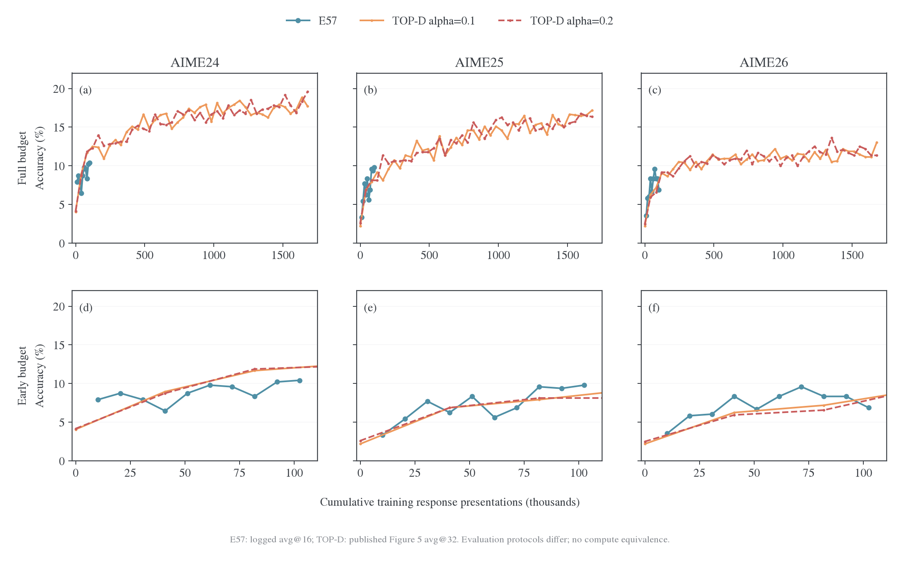
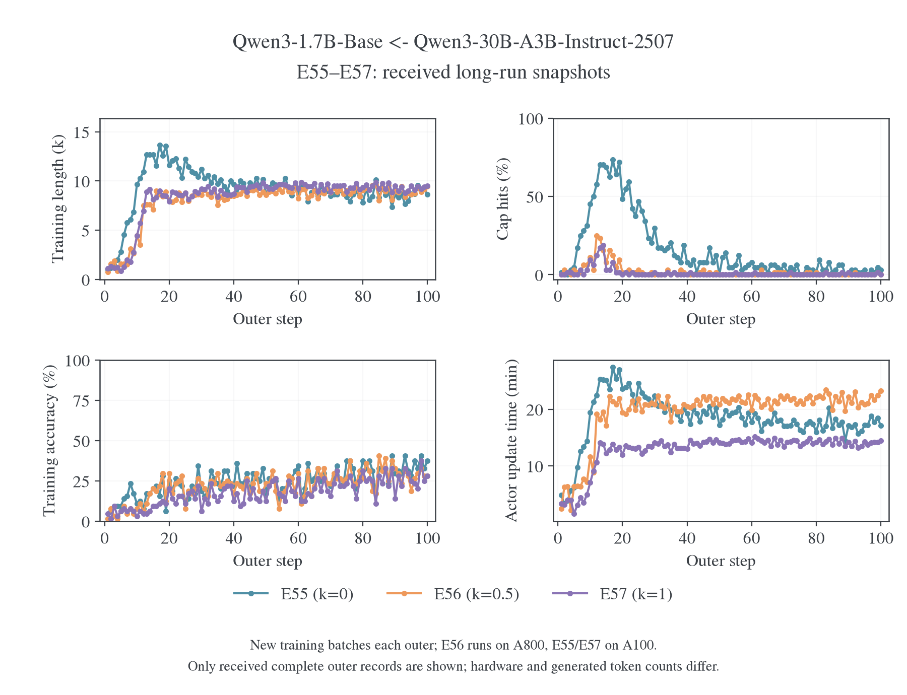
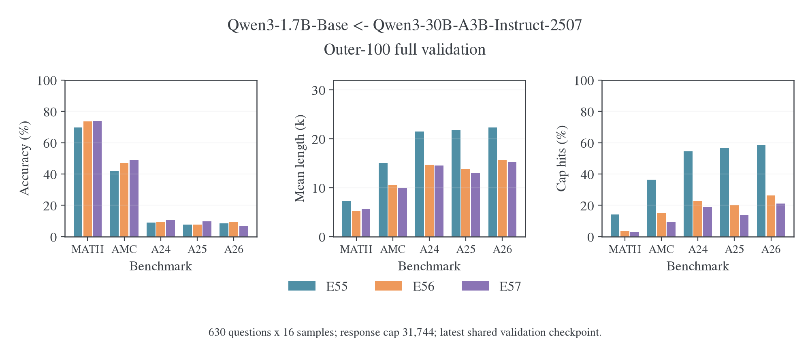
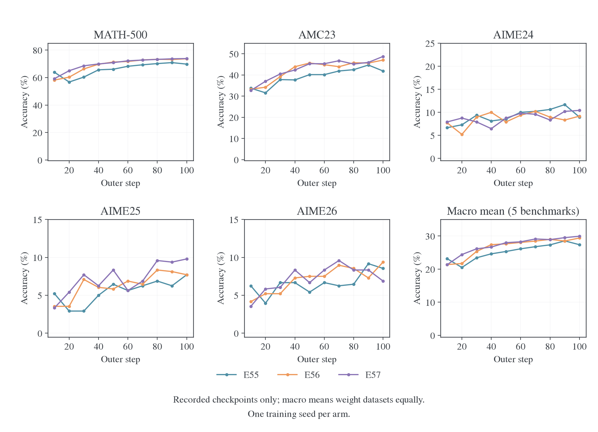
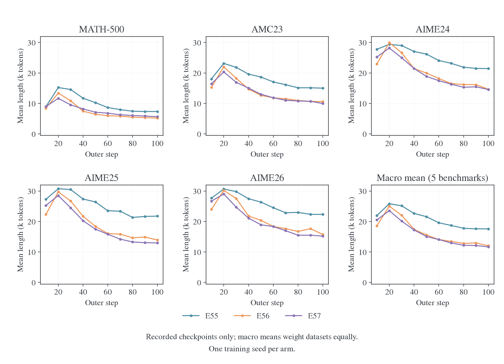
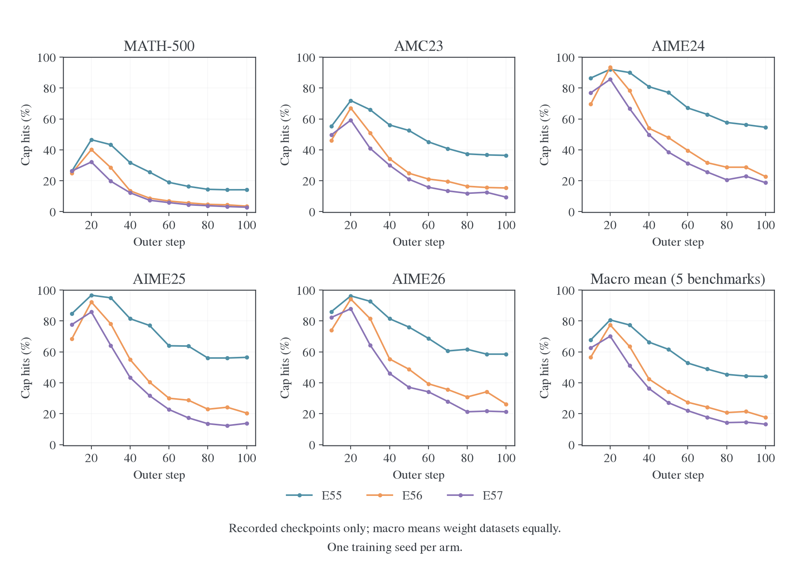
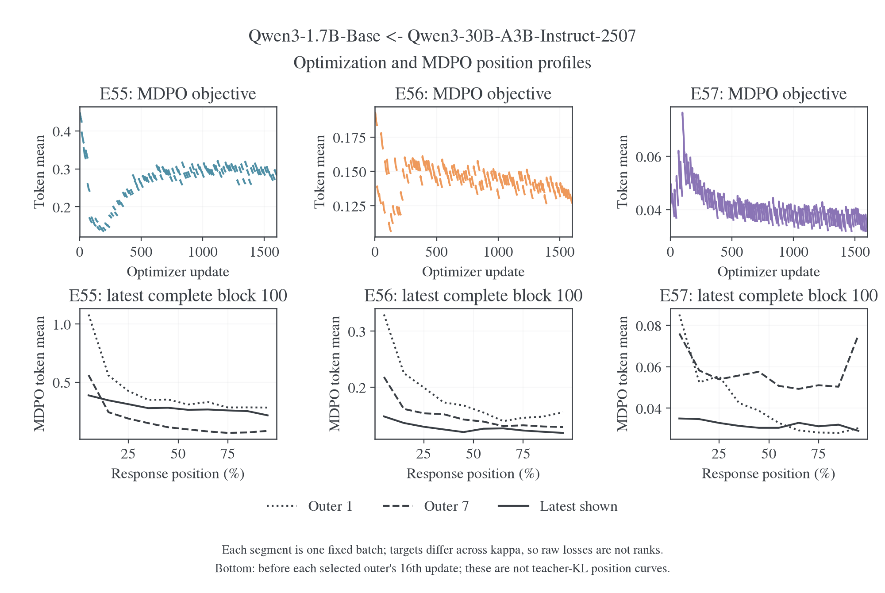

# TOP-D 复现与 κ/η 消融

这里比较本项目的 full-vocab MDPO 与 TOP-D，并分析κ/η改变后的学习表现。E57 采用κ=1、η=0.1：target 形状与 TOP-D 对应，更新算法、样本覆盖、EOS 空间和评测协议仍有差异。11 月 2 日新增日志确认 E56、E57 均正常完成 100 outer，最终五基准宏平均为 29.39%／29.93%；E55 已完成 80% 更新，最新完整验证到 outer70。共同 outer70 下，κ=1 比κ=0 的宏平均正确率高 2.33 个百分点，触顶率低 31.13 个百分点；最终κ=1 比κ=0.5 的三个 AIME 平均只高 0.28 个百分点，尚无稳定任务排名。E57 最终 AIME24/25/26 仍低于论文同师生配对。

参数消融包含两组证据：共同预热起点的十组短程κ/η网格，以及从原始 Base 开始、固定η=0.1 的 E55–E57 长程对照。[精度与 optimizer 实验](../../infra/numerics/optimization/README.md)提供执行与求解依据。

<a id="topd"></a>
<a id="topd-e57-与-top-dkl-拟合任务收益与实现对照"></a>

<a id="topd-3-e57-与-top-d-的精确关系"></a>

## 目标构造与实际更新

<a id="topd-31-相同部分算术混合的-proximal-teacher"></a>

<a id="31-算术混合的-proximal-teacher"></a>

### 算术混合的 proximal teacher

记原 teacher 为 $T$、本轮冻结 student 为 $q$，TOP-D 构造 $m=(1-\alpha)q+\alpha T$，即时信号为 $f=\log(m/q)$。[^topd-paper]

E57 的κ1、η0.1 产生

$$
m=0.9q+0.1T,
\qquad f=\log(0.9+0.1T/q).
$$

在相同 state 和动作空间下，它与 TOP-D 的α0.1 构造对应。E57 还合并了 EOS，数值对照需采用相同动作空间。E57 实际最小化的 full-vocab 标量则为

$$
L_{57}(p)=10D_{\rm KL}(p\Vert m)
=10D_{\rm KL}(p\Vert q)-10\mathbb E_p f.
$$

该式由本仓[目标构造](../../../../../verl/trainer/distillation/targets.py)和[full-vocab 目标](../../../../../verl/trainer/distillation/objectives.py)直接核对，外部缩放由[loss 层](../../../../../verl/trainer/distillation/losses.py)执行。

<a id="topd-32-不同部分完整更新算法"></a>

<a id="32-完整更新算法"></a>

### 完整更新算法

官方`topd`先计算即时 $f_t$，再构造“当前 reward＋后续有效 token 的平均 reward”，随后在同一道 prompt 的全部回答 token 内减均值、除标准差。它将固定 advantages 交给 sampled-token PPO 更新，clip 为 0.2，dual-clip 系数为 3.0；另提供只用即时信号的`naive_topd`。[^topd-algos][^topd-common]

| 实现环节         | 官方 TOP-D                     | E57                                |
| ---------------- | ------------------------------ | ---------------------------------- |
| Proximal teacher | 概率算术混合                   | 相同形状，η0.1                     |
| 动作积分         | 已生成 token 上的 sampled 估计 | 给定前缀完整词表求和               |
| 信号             | 即时项＋后续平均 return        | 当前状态的 KL residual             |
| 归一化           | Prompt 组内 token 标准化       | 无该组内标准化                     |
| 更新             | 固定 advantage 的 PPO clipping | 直接 scaled target KL              |
| Anchor 作用      | PPO 信赖域近似                 | 目标内有显式 $D_{KL}(p\Vert q)$ 项 |
| 整体尺度         | 官方 advantage 标准化          | 保留 $1/\eta=10$                   |
| 终止支持         | 原始 token 分别评分            | 合并两个 EOS 动作后构造目标        |

从 E57 的标量自行求导，令 $\psi=\nabla\log p$：

$$
\nabla L_{57}
=10\mathbb E_p\left[(\log(p/q)-f)\psi\right].
$$

在理想起点 $p=q$，它与未裁剪、仅即时 $f$ 的期望策略梯度同方向，梯度尺度相差 10。实际 Adam 步幅还取决于自适应矩、epsilon、clipping 与优势标准化。离开起点后，E57 保留 anchor KL 的梯度；完整 TOP-D 还有 return、组内标准化和 clipping。所以 E57 应称为 **TOP-D-style proximal target 的 full-vocab MDPO 变体**，也与官方`naive_topd`的有限步更新有区别。

Full-vocab 精确化的是已访问前缀上的动作积分；后续轨迹的信用分配仍是独立设计。TOP-D 的 future return 与 E57 的条件 KL 反向传播在这一点上具有不同语义。

<a id="grid-6-与-top-d-的关系和实现边界"></a>

### κ/η 与 EOS 的实现约定

一般κ/η的目标及 normalizer 由[镜像理论](../../theory/mirror-descent/objectives.md#weighted)定义。κ=1、η=α时得到 TOP-D 的算术 target；完整更新的对应关系见上表。κ=0、η=0.1 的目标包含 9 倍 anchor KL，因此它是有近端约束的形状对照；纯 Full-RKL 对应η=1。

κ=1 的即时信号在 T/q 趋近零时下界为 log(1−η)，MDPO 再按 1/η缩放。停止状态上的反向 KL 梯度还取决于 student 给予 EOS 的概率。

EOS 适配先分别合并 student、anchor、teacher 的停止概率，再构造 target；幂均值与合并的次序会影响结果。梯度按 student 类内概率分回两个 logits，teacher 与 anchor 保持冻结。该路径已按独立 FP64 概率参考及实际词表 BF16 CUDA 核对；本组 teacher/anchor KL 使用合并后的动作空间。

<a id="topd-4-16-次更新与实际训练预算"></a>

## TOP-D 与本项目的预算和评测

论文§5.1 把 512 道 prompt、每题 8 条回答组成 4096 条轨迹，再分成 16 个不同 mini-batch、每个 256 条，执行一个 epoch。[^topd-paper]

| 预算口径          | 论文设置                       | 官方当前单机配方          | E57                         |
| ----------------- | ------------------------------ | ------------------------- | --------------------------- |
| 每次生成的 prompt | 512                            | 128                       | 64                          |
| 每题回答          | 8                              | 8                         | 1                           |
| 独立新轨迹／outer | 4096                           | 1024                      | 64                          |
| 更新 mini-batch   | 32prompt×8=256 条              | 32prompt×8=256 条         | 64 条                       |
| 内部处理方式      | 16 个不同 mini-batch，1epoch   | 4 个 mini-batch／epoch    | 同一 64 条重复 16 次        |
| 数据损失聚合      | 依论文实际实现核对             | seq-mean-token-mean       | 全局 token-mean             |
| 训练回答上限      | 16384                          | 16384                     | 16384                       |
| 验证              | AIME avg@32，T1/p0.7，cap16384 | avg@16，T1/p0.7，cap16384 | avg@16，T0.7/p0.9，cap31744 |

官方 README 明确区分论文与单机默认规模；entry 脚本固定 128/32，common 脚本设置 8 次 rollout 与验证参数。[^topd-readme][^topd-entry][^topd-common]

E57 每个 outer 产生的新轨迹数是论文的 **1/64**；相同“16 次”对应不同样本覆盖与更新历史。两个采样预算下的单次梯度噪声、state 覆盖和 Adam 状态都不同。

11 月 2 日按固定官方 commit 下载 parquet，并逐文件核对公开 SHA-256。官方 DAPO 为 17,398 行，本地为 17,917 行；去掉官方统一附加指令并合并空白后，两者覆盖同一批 **16,921 个唯一题干**，重复余量分别为 477 和 996 行。因此，文件行数差不能解读为本地缺少约五百道训练题。[数据核对](data/topd-audit-20261102-0055/input-audit.json)还记录了七个题干对应的答案字符串集合不一致；这些标签用于任务判分，不直接进入本组 full-vocab MDPO 的教师概率目标。[^topd-data]

官方全部 DAPO 训练题和 AIME24/25/26 评测题都附加了逐步推理、将最终答案写入 `\boxed{}` 的要求，本地对应文件没有该指令。AIME 文件还存在题目顺序、LaTeX 写法、图示源码和个别措辞差异，不能只把采样温度改成论文值就称为同协议评测。输入指令的影响已纳入同模型、同题、同 seed 的配对生成对照；数据量对照保持原输入，分别识别访问覆盖与提示方式的效果。[^topd-data]

学习率 1e-6 一致，也不使上述样本覆盖和更新过程自动相同。

论文 Figure5／§5.3 在同一 1.7B Base←30B-A3B teacher 配对上比较 α=0.1/0.2/0.3、α=1 去除 proximal teacher，以及关闭内部 off-policy 迭代。关闭内部迭代后，论文报告需要更多训练步才能提升成绩。这组消融没有独立改变 batch size 或累计新轨迹量，因此支持检验内部优化预算，但不能直接证明本地差距主要来自数据不足。下面的固定池与在线覆盖实验分别控制这些量。[^topd-paper]

### 累计训练回答次数下的 E57 与 TOP-D 曲线

E57 原始 W&B 离线日志 `6j5knkmk` 已完成，包含连续 1,600 次 optimizer update、100 个 outer 和 outer10 至 outer100 的十次完整评测；原文件 SHA-256 与冻结提取记录一致。下图使用该日志的 AIME24/25/26 正确率，与论文 Figure5 的 α0.1、α0.2 曲线叠加；TOP-D 曲线从论文源文件中的矢量路径按坐标刻度提取，没有再次平滑。[^topd-paper]

横轴的**累计训练回答条次**将同一回答的每次重复训练分别计数。E57 的每次更新使用 64 条回答，同一 outer 的 64 条回答更新 16 次；论文则把新生成的 4,096 条回答划成 16 个不同 mini-batch，每条处理一次。因此，在 outer $o$ 完成后：

$$
N_{\mathrm{E57}}(o)=64\times16\times o=1024o,
\qquad
N_{\mathrm{TOP-D}}(o)=512\times8\times o=4096o.
$$

TOP-D 的 outer 解释依据官方 trainer：每轮 rollout、actor 更新和日志记录后，`global_steps` 增加一次；内部 optimizer update 由 mini-batch 循环执行。[^topd-trainer-budget] Figure5 两条曲线均有 42 个可提取节点，横坐标为 0、10、…、410，换算使用论文 §5.1 的 batch 设置。这里推断的是公开曲线已展示的训练预算；论文没有给出 Figure5 与 Table3 checkpoint 的一一对应关系，也没有证明训练恰好在 outer410 终止。



| 公开曲线末端口径 | E57 outer100 | TOP-D α0.1／α0.2 outer410 | TOP-D／E57 |
| ---------------- | -----------: | ------------------------: | ---------: |
| Optimizer update |        1,600 |                     6,560 |        4.1 |
| 新生成回答数     |        6,400 |                 1,679,360 |      262.4 |
| 累计训练回答条次 |      102,400 |                 1,679,360 |       16.4 |

E57 的 AIME24、AIME25 从首个评测点的 7.92%／3.33% 上升至 10.42%／9.79%，AIME26 在 outer70 达到 9.58%，最终为 6.88%。在相近累计训练条次的前期区间，E57 与 TOP-D 的正确率范围重叠，论文更高的后期成绩来自远超 E57 当前终点的训练区间。曲线支持继续控制训练预算，不能据此确定延长 E57 就能复现论文结果。

两边采用相同的 student／teacher 配对，但 E57 为 avg@16、T0.7/p0.9、cap31744，论文为 avg@32、T1/p0.7、cap16384，题目附加指令与更新目标也不同。条次横轴没有计入回答长度、full-vocab 与 sampled-token 的算力差异；因此图用于定位训练阶段，不能据此排名算法的样本效率或计算效率。E57 无初始验证，不补造 outer0 点；TOP-D 提取值是图上读数，不替代 Table3。

[新增回答数横轴图](figures/topd-e57-budget-20261104/fresh_responses.png)保留两边不同的轨迹覆盖口径；早期放大区内 TOP-D 只有 step0 一个观测点，仅显示该点，不在没有评测的区间补画连线。[矢量成品](figures/topd-e57-budget-20261104/response_presentations.pdf)、[原始论文矢量图](data/topd-e57-budget-20261104/topd-figure5.pdf)、[曲线 CSV](data/topd-e57-budget-20261104/curves.csv)、[来源与哈希](data/topd-e57-budget-20261104/provenance.json)均已保留。

[Optimizer update 次数横轴图](figures/topd-e57-updates-20261104/optimizer_updates.png)（[PDF](figures/topd-e57-updates-20261104/optimizer_updates.pdf)）使用同一批评测点，E57 和 TOP-D 均按每 outer16 次更新换算。上排展示完整预算，下排放大 E57 的前 1,600 次更新。E57 每次更新处理 64 条回答，TOP-D 每次处理 256 条；因此，相同 update 次数下，TOP-D 的累计训练回答条次为 E57 的 4 倍，不能将横坐标相同解释为样本预算或计算预算相同。

生成器为 [plot_topd_e57_budget.py](../../../research/studies/weighted_targets/plot_topd_e57_budget.py)。在仓库根设置 `FIGURE_VIZ_MPL` 为 figure-viz 的 `assets/mpl` 目录后，可从冻结数据重画：

```bash
python -m examples.mirroropd.research.studies.weighted_targets.plot_topd_e57_budget \
  --data examples/mirroropd/docs/experiments/learning-signal/data/topd-e57-budget-20261104 \
  --out runs/topd-e57-budget-replot
```

## 长程实验条件

<a id="presets-e55e58base-与-moe-的长程目标对照"></a>

### E55–E58 预设

四组均为 Qwen3-1.7B-Base ← Qwen3-30B-A3B-Instruct-2507，从原始 Base 权重开始，使用 full-vocab 蒸馏。E55–E57 固定 $\eta=0.1$ 比较目标形状；E58 是纯 Full-RKL 参考。E55 的 $\kappa=0,\eta=0.1$ 仍有 anchor KL 约束，不等于 E58。短程筛参依据与机制边界见 [E54 诊断](../../infra/model-compatibility/qwen-e54/2026-10-29-E54长度膨胀诊断.md#75-top-d-reward-与-full-vocab-mdpo-的受控比较)。

| 编号 | 方法            |        $\kappa$ | $\eta$ |
| ---- | --------------- | --------------: | -----: |
| E55  | Full-vocab MDPO |               0 |    0.1 |
| E56  | Full-vocab MDPO |             0.5 |    0.1 |
| E57  | Full-vocab MDPO |               1 |    0.1 |
| E58  | Full-RKL        | 不影响 endpoint |      1 |

共同设置为 shared-sync 八卡、DAPO、batch/mini-batch64、每题 1 个 response、reuse16、100 outer，即 1,600 次更新；AdamW 学习率 1e-6、constant、token-mean。Prompt cap 为 1,024，训练 response cap 为 16,384；rollout 温度/top-p 为 1/1，每卡并发 64、显存预算 0.80。计算使用 `precompute`、token chunk512，保留 FP32 RoPE 和终止等价类 `[151643,151645]`。

该配对采用 `data.apply_chat_template_kwargs.enable_thinking=null`，共同前缀停在 `<|im_start|>assistant\n`，不追加旧的空思考段。训练 rollout、teacher 条件评分及训练中验证使用同一输入协议；`E55-valid-student` 至 `E58-valid-teacher` 也继承这个模板选择。E54 及其他既有 Qwen 预设保持原模板。

无初始验证；每 10 outer 使用 trainer 内置验证，完整运行 MATH-500、AMC23、AIME24、AIME25、AIME26，共 630 题。每题 16 次采样，温度/top-p 为 0.7/0.9，response cap31,744；验证结果写入 W&B，样本写入运行目录。第 100 outer 仍正常验证。

**四组均不保存任何 checkpoint**：`SAVE_FREQ=-1`，最终 Hydra 配置为 `trainer.save_freq=-1`，周期保存和最后一步保存均关闭；`resume_mode=disable`。不导出最终模型，也不保存 optimizer 或 dataloader 状态。周期验证直接使用内存中的当前 learner，不依赖保存 checkpoint。

通过同一个入口选择编号，例如预览 E55 的实际命令：

```bash
DRY_RUN=1 bash examples/mirroropd/run_math_opd_ablation_fsdp2.sh E55
```

正式运行前按[通用运行合同](../../infra/training/runtime.md#通用运行合同)设置已分配的 GPU 和 Python 环境，再去掉 `DRY_RUN=1`。E56–E58 只需替换编号；公共环境和末尾 Hydra 参数保留原有覆盖优先级。预设来源在 `launchers/math_experiment.py`，shell 入口的速查表从同一目录生成，不另维护一套参数。

<a id="topd-1-新快照的实验进度"></a>

### 三组最终日志与共同预算

11 月 3 日收到的日志补齐了 E55 的最后 20 outer、320 次更新、outer80／90／100 验证和正常退出记录。三组现在均有 100 个完整 outer、1600 次更新、十轮验证与 exit 0；E55 最后指标记录为北京时间 2026-11-03 07:29:22，E56／E57 分别为 11 月 2 日 03:11:30 和 11 月 1 日 15:40:42。[来源与哈希](data/e55-e57-20261103/provenance.json)锁定收到的原始快照，图表和汇总已从本地完整日志重算。

三组 κ 分别为 0／0.5／1，配置均记录 `9fd276af`：batch64、n=1、reuse16、LR1e-6、η0.1、训练 cap16384、验证 cap31744。模型为 Qwen3-1.7B-Base 学习 Qwen3-30B-A3B-Instruct-2507；主仓库后续的 EOS／融合修改没有据此回写为这些冻结 run 的实际设置。

| 各组最新验证，avg@16 | MATH-500 |  AMC23 | AIME24 | AIME25 | AIME26 | 五基准宏平均 | 宏平均长度 | 宏平均触顶率 |
| -------------------- | -------: | -----: | -----: | -----: | -----: | -----------: | ---------: | -----------: |
| E55，outer100        |   69.79% | 41.88% |  8.96% |  7.71% |  8.54% |       27.37% |     17.57k |       44.03% |
| E56，outer100        |   73.69% | 47.03% |  9.17% |  7.71% |  9.38% |       29.39% |     12.01k |       17.65% |
| E57，outer100        |   73.83% | 48.75% | 10.42% |  9.79% |  6.88% |       29.93% |     11.67k |       13.20% |

五基准宏平均对数据集等权；每个 AIME 是 30 题×16 次生成，宏平均不等于全部 10,080 条回答的合并正确率。共同最终预算 outer100 下，E57 比 E55 的宏平均正确率高 **2.56 个百分点**，触顶率低 **30.83 个百分点**，平均回答短 **5.91k token**；E56 比 E55 的正确率高 **2.02 个百分点**，触顶率低 **26.38 个百分点**。E55 从 outer70 到 100，正确率由 26.77% 提高至 27.37%，触顶率从 48.88% 降至 44.03%，长尾仍重。其 AIME24／25／26 回答长度中位数均为 31744，至少半数回答撞上验证上限。

相同最终预算 outer100 下，E57 相比 E56 的宏平均正确率高 **0.54 个百分点**、触顶率低 **4.45 个百分点**，均长仅短 347 token。三个 AIME 的等权正确率为 E56 **8.75%**、E57 **9.03%**，差 **0.28 个百分点**；E57 在 AIME24/25 高 1.25／2.08 个百分点，在 AIME26 反而低 2.50 个百分点。E57 的 MATH/AMC 高 0.14／1.72 个百分点。长尾改善的方向比任务正确率排名更一致；每组只有一个训练 seed，且缺少逐题配对记录，不能将这些小分差写成κ1 稳定优于κ0.5。

E57 从 outer90 到 100，宏平均正确率提高 0.43 个百分点，触顶率从 14.53% 降至 13.20%，均长从 12.11k 降至 11.67k。MATH/AMC 从 73.65%/45.94% 升至 73.83%/48.75%；AIME24/25 小幅升至 10.42%/9.79%，AIME26 从 8.33% 回落至 6.88%。三个 AIME 的等权平均反而从 9.31% 降至 9.03%，因此末段宏平均上升主要由 MATH/AMC 带动。E56 的最后十轮宏平均从 28.50% 提高至 29.39%，触顶率从 21.42% 降至 17.65%；三个 AIME 平均从 7.92% 提高至 8.75%，其中 AIME25 从 8.12% 回落至 7.71%。两组均存在任务间波动。

三组已记录的 4,800 次更新均无跳步或非有限标记，300 个完整复用块的 objective 与 teacher KL 均首尾下降；首尾分别是第 1 与第 16 次更新前的观测，两点之间发生了 15 次更新。E56／E57 最后十批训练分别仅 2/640／1/640 条回答触及 16k 上限，最终验证的宏平均触顶率仍为 17.65%／13.20%；训练中的低触顶率没有消除独立难题上的长尾。

E55 最终验证耗时约 4.19 小时，E56／E57 分别约 2.06／2.04 小时。E55 的验证长尾仍重；E55／E57 使用 A100，E56 使用 A800，训练和验证耗时还受回答长度影响，不能直接作为目标计算速度的比较。





<a id="topd-2-e57-的-accuracy-提升与-kl-拟合"></a>

## 长程拟合与任务表现

<a id="topd-21-对齐时间窗口后两者确有共同改善"></a>

<a id="21-对齐时间窗口后两者确有共同改善"></a>

### 对齐时间窗口后，两者确有共同改善

KL 与 accuracy 使用共同验证窗口 outer10–100 对照。下表列出各验证节点对应批内的首末 teacher KL；不同 outer 的 state 会变化，不能将其直接当作固定状态风险曲线：

| Outer | 批首 teacher KL | 第 16 次观测 teacher KL | 五基准宏平均 avg@16 | 五基准宏平均触顶率 |
| ----- | --------------: | ----------------------: | ------------------: | -----------------: |
| 10    |          0.4765 |                  0.4491 |              21.33% |             62.58% |
| 20    |          0.4477 |                  0.4279 |              24.40% |             70.14% |
| 30    |          0.4122 |                  0.3945 |              26.14% |             51.17% |
| 40    |          0.4170 |                  0.3990 |              26.66% |             36.27% |
| 50    |          0.3975 |                  0.3807 |              27.99% |             27.12% |
| 60    |          0.4031 |                  0.3855 |              28.25% |             21.95% |
| 70    |          0.3966 |                  0.3784 |              29.10% |             17.75% |
| 80    |          0.3758 |                  0.3589 |              28.92% |             14.23% |
| 90    |          0.3939 |                  0.3764 |              29.50% |             14.53% |
| 100   |          0.3775 |                  0.3604 |              29.93% |             13.20% |

Outer10→100，批首 teacher KL 下降 **20.77%**，第 16 次观测下降 **19.76%**，宏平均正确率提高 **8.60** 个百分点。前 10 批与最后 10 批（outer91–100）的批首 KL 均值分别为 0.4642/0.3816。这些均值的 state 随训练变化，不能替代共同固定银行上的风险曲线。

E57 的训练可微目标来自 teacher-conditioned KL，任务判分没有作为 reward 加入 loss。准确率提高是这条蒸馏训练轨迹上的实际学习结果。当前数据展示的是**部分任务相关行为改善，同时师生整体分布仍有较大残差**。

<a id="topd-22-kl-与-accuracy-衡量不同的函数"></a>

<a id="22-kl-与-accuracy-衡量不同的函数"></a>

### KL 与 accuracy 衡量不同的函数

这里的训练 teacher KL 是在 DAPO 在线轨迹上的 token 平均；accuracy 来自独立数学题集、T0.7/top-p0.9、cap31744 的完整回答。输入、生成协议和聚合方式均不同。

即使统一到相同题目和完整回答分布，两者也没有一一对应关系。令 $P$ 为学生、$T$ 为 teacher，$a=P(\mathrm{correct})$、$b=T(\mathrm{correct})$，按正确／错误集合精确分解：

$$
D_{\rm KL}(P\Vert T)
=\operatorname{kl}(a\Vert b)
+aD_{\rm KL}(P_c\Vert T_c)
+(1-a)D_{\rm KL}(P_w\Vert T_w).
$$

Accuracy 只看正确总概率 $a$；KL 还包含正确解法内部、错误输出内部的差异。因此 teacher 监督可以提高成功概率，而整体 KL 的变化较小；给定任务风险的改善也可能被其他输出差异部分抵消。推导与统一条件见[正确率与序列/Token KL](../../theory/accuracy-and-kl.md)。

E57 还有可直接观察的完成行为改善：Outer10→100，MATH 触顶率 26.34%→2.88%，AMC49.69%→9.38%；对应 accuracy59.21%→73.83%、32.66%→48.75%。减少未完成回答、改变生成路径和提高答案概率，都能成为蒸馏收益。其各自贡献需要逐题正确性与 finish reason 的联合读出，现有边际统计保留为同步变化。

所以后续应分别测量：共同固定状态上的分布拟合、当前学生访问分布上的风险、完整任务正确率。训练均值 KL 的平台主要描述整体拟合的累积程度，任务泛化则由独立评测直接观察。

<a id="topd-5-结果能对上到什么程度"></a>

## 与 TOP-D 结果的差距

<a id="topd-51-相同模型对的-aime-数字"></a>

<a id="51-相同模型对的-aime-数字"></a>

### 相同模型对的 AIME 数字

TOP-D 论文 Table3 使用 Qwen3-1.7B-Base ← Qwen3-30B-A3B-Instruct-2507。保留其原始 avg@32 与本地实际 avg@16：[^topd-paper]

| 结果          | AIME24 | AIME25 | AIME26 |
| ------------- | -----: | -----: | -----: |
| 论文 OPD      |  8.96% |  7.50% |  5.94% |
| 论文 TOP-D    | 20.31% | 17.71% | 13.75% |
| E57，outer100 | 10.42% |  9.79% |  6.88% |

**当前 E57 没有复现论文 TOP-D 的 AIME 高分。** 表内还存在训练算法、覆盖、解码、长度和训练节点差异，数字用于定位差距，后续在共同设置下评价相对收益。

<a id="topd-52-哪些现象方向一致"></a>

<a id="52-哪些现象方向一致"></a>

### 哪些现象方向一致

官方 README 报告，30B-A3B-Instruct-2507 这个 MoE teacher 下，TOP-D 能减轻回答长度膨胀；并提示完整 TOP-D 通常优于 naive 变体。E57 已有后续正确率提高、长尾恢复，和这条定性观察相容。[^topd-readme]

本地 E55 是κ0、η0.1，优化 $D_T+9D_q$，同样有 anchor 约束；它与论文的纯 OPD 基线不同。本轮 E55–E57 快照仍没有同协议 E58 纯 Full-RKL 结果，所以本地已经测到的是**三种带 anchor 的 target 形状差异**，尚未形成论文“TOP-D 相对 OPD”的对应比较。

<a id="topd-53-差距的可核验来源与尚未分离的原因"></a>

<a id="53-差距的可核验来源与尚未分离的原因"></a>

### 差距的可核验来源与尚未分离的原因

当前 E57 相对论文 Table3 的差距约为 9.9/7.9/6.9 个百分点。比较对象明确为 1.7B Base 学生，不使用论文 8B 学生表格。下面各项配置差异均已核对，但它们分别造成多少 accuracy 损失，现有数据没有受控分解。

训练覆盖是首先需要控制的量。E57 到 outer100 累计生成 6,400 条新轨迹、执行 1,600 次更新；6,400 也是 prompt 抽取次数，不等于去重题目数。论文每轮为 512×8=4,096 条新轨迹，公开单机默认配方也有 128×8=1,024 条，分别是本地的 64/16 倍。Full-vocab 消除给定前缀上的动作采样误差，不能补出没有访问过的 reasoning state，也不能用重复处理同一条轨迹代替新增路径覆盖。论文未在表中给出对应结果 checkpoint 的完整累计采样量，不能把相同 outer 或 optimizer step 直接当作等总预算比较。[^topd-paper][^topd-readme]

更新算法也没有只差一个动作估计器。完整 TOP-D 将后续 token 的平均 reward 回传给当前 token，再做 prompt 组内标准化和 PPO clipping；本地只优化已访问前缀上的条件 KL，内层偏离 anchor 后仍有显式 drift 项。前者能利用后续 teacher 评分作信用分配，后者的全词表求和没有补上未来 rollout 的信用分配。缺少这些机制是否正是本地 AIME 短板，需要 naive/full TOP-D 以及 return、标准化、clipping 的同预算消融；不能从当前曲线单独证明。[^topd-algos]

损失聚合带来了另一项确定的权重差异。设第 i 条回答长度为 L_i，逐 token 损失为 l_it，则本地 token-mean 为

$$
\mathcal L_{\rm token}=\frac{\sum_i\sum_t l_{it}}{\sum_jL_j}
=\sum_i\frac{L_i}{\sum_jL_j}\bar l_i,
\qquad
\mathcal L_{\rm seq}=\frac1N\sum_i\bar l_i.
$$

官方配方使用后一个 seq-mean-token-mean 聚合方式。相同平均 token 损失下，16k 回答在前者中是 2k 回答的八倍权重，在后者中两条回答权重相同。两边逐 token 目标本来就不同，此式只说明聚合层的权重差异，不将它们视为同一个 loss。当前没有逐轨迹的 loss／正确性联合记录，不能断言坏长回答实际承担了多少梯度。[^topd-common]

评测的 avg@16 与 avg@32 都是平均正确率，不是 pass@k。在相同生成分布下，增加回答数不会使其期望分数翻倍，只会改变估计精度；因此不能用“论文采样更多”解释这十个百分点。真正需要对齐的是 T0.7/p0.9/cap31744 与论文 T1/p0.7/cap16384，以及题目、verifier 和终止协议。较大的 cap 也不能保证更高准确率，已经给出答案后继续生成可能影响最终答案提取。当前缺逐题回答，无法将本地结果换算成论文协议。[^topd-paper][^topd-readme]

E57 的三个 AIME 平均触顶率从 outer10 的 78.96% 降至 outer100 的 17.92%，正确率仍只有约 7%–10%。所以“仍有长尾”是真实限制，但不能把全部差距只归于回答过长。EOS 合并、题目指令、重复权重和评测实现尚未全部对齐，需要用实际输入和同模型读出逐项核对。

现有记录显示批内目标下降、teacher KL 后期下降、无非有限或跳步，尚无证据把分数差距归因于一个已确定的数值错误。原冻结路径的 FP64 Torch 回退解释算力成本，并不自动解释相同训练预算下的任务差距。当前 run 设置 `save_freq=-1`，本地没有这些 checkpoint 和完整逐题回答；同协议复评必须在保留的相同权重上真实执行，不能由现有摘要反推。









<a id="topd-6-理论保证对应什么量"></a>

### 理论保证的适用对象

对任意相同前缀，若学生精确实现算术混合目标 $p_{k+1}=(1-\alpha)p_k+\alpha T$，由 KL 对第一变量的凸性可自行得到

$$
D_{KL}(p_{k+1}\Vert T)
\leq(1-\alpha)D_{KL}(p_k\Vert T).
$$

这是固定状态、精确执行目标的收缩。神经网络在有限状态上只近似拟合 $m_k$ 时，优化误差和其他状态的拟合误差都会进入整体迭代。

论文 Theorem4.4 显式包含近似误差；§4.3 式 15 的内层 KL 对象是固定 proximal teacher。它不直接要求日志中在不断变化前缀上计算的原 teacher token 均值逐 outer 单调下降。[^topd-paper]

E57 每批 target KL 净下降，与其近端目标的局部拟合一致；outer10→100 的 teacher KL 和 accuracy 也有共同改善。下一步应以共同固定银行、当前访问状态与任务结果三类读出，继续测量误差如何传播。

<a id="grid"></a>
<a id="grid-qwen3-base--moemdpo-参数对照与长度恢复"></a>

## κ/η短程消融

十组对照使用同一份两步预热模型，每组再训练三轮。固定η=0.1 时，κ=1 的长尾指标优于κ=0，准确率差的题目配对区间跨零。网格属于探索性比较，评测题曾参与筛参。

<a id="grid-1-结论与适用范围"></a>

<a id="grid-2-实际训练和评测协议"></a>

### 短程设置

| 项目           | 实际设置                                                                                     |
| -------------- | -------------------------------------------------------------------------------------------- |
| 共同起点       | 四卡 Full-RKL 的第 2 outer，预热 cap7,168；恢复同一模型、Adam、数据位置                      |
| 参数网格       | κ=0 的 η=0.1/0.2；κ=0.5/1 的 η=0.05/0.1/0.2/0.3，共 10 组                                    |
| 新增训练       | 第 3–5 outer，共 48 次更新；每组累计 80 次                                                   |
| 批与复用       | DAPO，batch=mini-batch=64，n=1，reuse16，token-mean                                          |
| 优化器         | AdamW，LR=1e-6，constant，weight decay=0.01，梯度裁剪=1                                      |
| Rollout        | 当前 student，temperature/top-p=1/1，seed42；每卡并发 64、显存预算 0.8                       |
| 长度           | Prompt cap1,024，训练 response cap16,384                                                     |
| 输入协议       | 保留旧共同前缀中的空 `<think>…</think>` 段；未切换原生前缀                                   |
| 固定修复与实现 | FP32 RoPE；EOS 等价类 `[151643,151645]`；四卡 shared-sync、full-vocab `precompute`、chunk512 |
| 验证           | 仅最终 outer5；MATH-500 与未用于这五批训练的 DAPO 各 64 题，每题一次，cap31,744              |
| 验证采样       | MATH temperature/top-p=0.7/0.9；DAPO=1/1                                                     |

十组第 3–5 批的训练题目集合一致，评测的 prompt IDs、题目 ID 和逐题 seed 一致。独立复算确认 480 次新增更新、1,280 条判分记录完整；没有跳步或非有限 loss，所有 `finish_reason=stop` 的回答都实际结束于两个合法 EOS ID 之一。空文本和角色起始 token 151644 在这 1,280 条回答中均为零；这个样本内结果不证明旧模板在所有状态上无副作用。

相同问题和 seed 不保证不同参数组生成相同轨迹，更不等于耦合了 vLLM 的随机流。因此，首批更新前的自然输出也存在差异；不同组的 teacher KL 是在各自生成的状态上测量，不能直接按横向绝对值排名。

参数扩展由先验固定的预算筛选触发：在首轮某个共同 η 下，正确总数不减、判对且停止至少增加 4 条、触顶至少减少 4 条，均长和重复不增加，单题集正确数最多减少 2 条。η=0.1 达到该条件后扩展了其余六组。该条件不是显著性检验；评测题目被重复用于筛选和排名，后续结论属于探索性比较。

<a id="grid-3-完整参数结果"></a>

### 参数网格的完整结果

下表的长度和重复比例对两题集等权平均。触顶与判对且停止的分母为 128；每题集正确率的分母为 64。1k=1,000 token。

|   κ |    η | MATH 正确率 | DAPO 正确率 | 合并平均长度 |   触顶 | 判对且停止 | 重复 8-gram |
| --: | ---: | ----------: | ----------: | -----------: | -----: | ---------: | ----------: |
|   0 |  0.1 |      68.75% |      15.63% |        9.21k | 23/128 |     54/128 |      39.29% |
|   0 |  0.2 |      75.00% |      21.88% |       10.62k | 35/128 |     61/128 |      40.72% |
| 0.5 | 0.05 |      70.31% |      10.94% |        7.78k | 14/128 |     49/128 |      36.06% |
| 0.5 |  0.1 |      68.75% |      20.31% |        7.06k | 14/128 |     56/128 |      35.23% |
| 0.5 |  0.2 |      73.44% |      20.31% |        8.21k | 22/128 |     58/128 |      35.77% |
| 0.5 |  0.3 |      71.88% |      18.75% |       10.16k | 29/128 |     56/128 |      38.38% |
|   1 | 0.05 |      70.31% |      21.88% |        6.43k | 12/128 |     59/128 |      34.45% |
|   1 |  0.1 |      70.31% |      20.31% |        6.65k | 12/128 |     58/128 |      32.40% |
|   1 |  0.2 |      68.75% |      21.88% |        8.87k | 24/128 |     56/128 |      34.99% |
|   1 |  0.3 |      65.63% |      18.75% |        8.82k | 22/128 |     54/128 |      33.66% |


灰格表示没有测试该组合，不以零补齐。κ=0、η=0.2 的合并正确数最高，为 62/128，但触顶 35 条、均长 10.62k；κ=1、η=0.05 的判对且停止为 59/128，触顶 12 条、均长 6.43k。二者体现了成绩与长尾的不同取舍，不宜仅以正确率或长度单指标选优。

短程探索选择η=0.1 作为后续共同值。κ=0.5 在 η=0.05 时 DAPO 仅 7/64 判对，η=0.1 时为 13/64；更大的 η=0.3 又伴随更长回答。κ=1 的 η=0.05 虽是有希望的单独候选，但相比 0.1 只多判对 1 题，且重复占比略高。当前证据不足以让三种 κ 都改用 0.05。

历史 16k Full-RKL 参考在同一题集上的合并均长为 19.21k、触顶 69/128、判对且停止 40/128；本轮十组的触顶为 12–35/128。这个变化比同 η 下改变 κ 的差异更大，但历史运行使用较旧的实现与数值路径，不作为严格的新增因果对照。尤其 κ=0 的 MDPO 也有 anchor 正则，不能把所有改善都归给 TOP-D 形状。E58 的作用正是补充同协议纯 Full-RKL 参考。

<a id="grid-4-配对不确定性与具体失败"></a>

### 配对结果与代表样本

按题目 ID 配对，在 MATH、DAPO 内分别有放回抽样，再等权合并；固定 seed20261029，重采样 10,000 次。下面是 κ=1 减 κ=0、η=0.1 的差异：

| 指标             |     差异 |      95% 配对区间 |
| ---------------- | -------: | ----------------: |
| 正确率           | +3.13 pp |  [−3.13,+9.38] pp |
| 判对且停止比例   | +3.13 pp |  [−3.13,+9.38] pp |
| 触顶率           | −8.59 pp | [−15.63,−1.56] pp |
| 平均长度         |   −2.56k |    [−4.63,−0.54]k |
| 重复 8-gram 比例 | −6.88 pp | [−12.10,−1.75] pp |

区间按已观测题目重采样；训练 seed、重复生成、多重比较和筛参效应未纳入。长尾改善的证据比准确率提升更清楚。


κ=1、η=0.1 相比 κ=0、η=0.1，有 11 题由错变对、7 题由对变错；16 条原先触顶的回答变成正常停止，但其中只有 2 条同时被判对，另有 5 条原先未触顶的回答新增触顶。净触顶减少不等于这些题都被正确解决。

| 同题样本                           | κ=0、η=0.1                      | κ=1、η=0.1                      | 观察                                           |
| ---------------------------------- | ------------------------------- | ------------------------------- | ---------------------------------------------- |
| MATH-500:249，模 23 的逆元         | 31.74k，触顶，判错，重复 92.19% | 1.45k，EOS，判对，重复 14.79%   | 有限复查后给出 17 并结束                       |
| MATH-500:108，椭圆与相切圆         | 31.74k，触顶，判错，重复 91.55% | 2.94k，EOS，判对，重复 29.42%   | 给出 2 并结束；判分不保证推导完整正确          |
| MATH-500:470，带和约束的乘积最大化 | 2.22k，EOS，判对                | 20.10k，EOS，判错，重复 87.31%  | 错误方程推导被反复展开，停止也不代表答案完整   |
| DAPO train-3217，2018×4 染色       | 2.12k，EOS，判错                | 31.74k，触顶，判错，重复 87.25% | 后段仍在重复“标准杨表”说法，编号延伸到 Step464 |

这些病例按结果选取，用于解释变化机制。完整评测中，MATH-500:110、352、422 在全部十组都触顶；这直接排除了“这组设置已完全消除不收束”的表述。选定病例的头尾摘录及其余 κ 的同题结果保存在[聚合数据](../../infra/model-compatibility/qwen-e54/figures/e54-mdpo-20261029/data.json)，原始完整文本和 token 在证据归档中。

<a id="grid-5-训练目标下降与生成行为"></a>

### 拟合、长度与停止行为


每个 outer 都换成新问题和新生成回答。κ=1、η=0.1 的平均长度为 4.47k、7.17k、6.18k；κ=0.5、η=0.3 的最后一批达到 9.13k、24/64 触顶。短程没有统一的单调收缩趋势；模型仍可能在后续访问更长、更难收束的状态。

已完成十组都执行了 48 次新增更新。每批开始 anchor KL 为零，并随 learner 更新增加；目标归一化项在同一批保持恒定，符合冻结 anchor/teacher 的实现。κ=1、η=0.1 三批 MDPO objective 首尾分别下降 10.84%、13.13%、16.00%，teacher KL 也都下降。

当 κ<1 时，objective 包含常数项：

$$
L_{\mathrm{MDPO}}=\frac{KL_{\mathrm{target}}-\log Z}{\eta}.
$$

例如 κ=0.5、η=0.05 的最后一批 objective 只下降 1.50%，但 target KL 下降 21.82%。同一批的常数下界压低了 objective 的相对降幅；这不足以证明没有学习。跨 κ 的绝对 objective 与跨批的 loss 跳变也不直接可比。


底行记录的是 `distill/mdpo/objective_position`，不是 teacher KL 的分位置曲线。`p90_100` 表示每条回答最后 10% 的 token，而非单独 EOS。κ=1、η=0.1 的十个位置区间在三批中均首尾下降；κ=0、η=0.1 的第 4 批有两个后段区间小幅上升。给定状态上的拟合进展与独立生成质量是不同读数，需要同时保留。

十组 W&B run 均已结束；云端各有完整的 48 个更新点和 3 个长度点，MDPO objective、teacher KL、末段位置指标及长度与本地核对一致，见[云端核验](../../../../../../wandb-logs/MirrorOPD-verl/analysis/e54-mdpo-20261029/wandb-final-audit.json)。最终独立评测没有回传 W&B；本轮也没有采集 teacher KL 的位置分桶，这两个观测缺口仍需在后续训练中处理。

<a id="topd-7-最有区分力的后续对照"></a>

## 复现差距的受控核对

优先固定学习目标和优化器，区分独立题目覆盖、同题多条路径、重复更新及输入指令。初始近端块的三种数据安排如下，均交叉测试 κ=0/0.5/1、η=0.1，并执行 16 次 mini-batch64 的 AdamW 更新：

| 安排                    | 独立训练题 | 新轨迹 | 回答访问次数 | 更新次数 |
| ----------------------- | ---------: | -----: | -----------: | -------: |
| 64 条回答重复 16 遍     |         64 |     64 |         1024 |       16 |
| 1024 道题各学一次       |       1024 |   1024 |         1024 |       16 |
| 128 道题、每题 8 条回答 |        128 |   1024 |         1024 |       16 |

三组使用原始 Base 生成的共同轨迹库，原生 assistant 前缀、T1/p1、cap16384；训练题去重并排除与五个验证基准精确去空白重合的文本。每组从原始 Base 和新 Adam 状态开始，LR1e-6、token-mean、梯度裁剪 1，FP32 master／Adam、BF16 autocast 与输出投影，采用已核验的 fused full-vocab 路径。Anchor 在这一整个近端块内冻结。真实 token 访问量随回答长度变化，另行记录，不能把相同回答访问次数当成严格等 token 预算。

共同 heldout 为另外 128 道题的固定 Base 轨迹，初始 teacher KL 为 0.4097565。九个近端块均已完成，下表为完整的固定前缀读出，尚不代表新生成回答的正确率：

| κ   | 64 条重复 16 遍 | 1024 道题各一次 | 128 题×8 回答 |
| --- | --------------: | --------------: | ------------: |
| 0   |         0.38196 |         0.38697 |       0.38666 |
| 0.5 |         0.39523 |         0.39634 |       0.39601 |
| 1   |         0.39678 |         0.39827 |       0.39860 |

三个 κ 组在这一初始近端块中都表现为重复 64 条的 heldout teacher KL 更低；增加独立题目或同题新路径没有在相同 16 次更新下改善这个读出。κ=0 的 teacher KL 低于 κ=0.5/1，同时它偏离初始 anchor 的 KL 也较大。任务正确率、在线多轮访问和新 seed 仍待验证，不能把这些代理量的排序直接当作最终能力排序。


图中 $q$ 是固定的初始 Base，$p$ 是更新后的学生；两个 KL 都在同一批 heldout 前缀上测量。[完整输入与配对分析](figures/topd-fixed-blocks-20261102/data.json)、[PDF](figures/topd-fixed-blocks-20261102/fixed-block-risks.pdf)和[绘图源码](../../../research/studies/weighted_targets/plot_fixed_blocks.py)支持复算。该图通过机器审计和目检。

### 实际前缀覆盖与长度权重

同样 1024 次回答访问不等于相同 token 预算。按实际训练 schedule 和已判分轨迹复算：

| 安排            | 新轨迹的 token 数 | 训练 token 访问次数 |   判对的独立回答 | 判对回答的平均 loss 聚合权重 |
| --------------- | ----------------: | ------------------: | ---------------: | ---------------------------: |
| 64 条重复 16 遍 |            85,216 |           1,363,456 |   7/64（10.94%） |                        6.72% |
| 1024 道题各一次 |         1,287,081 |           1,287,081 | 54/1024（5.27%） |                        4.47% |
| 128 题×8 回答   |         1,261,842 |           1,261,842 | 41/1024（4.00%） |                        3.56% |

最后一列先按每次更新的 token 总数归一化，再对 16 次更新取平均。它描述 loss 聚合系数，不是正确轨迹的梯度贡献或 reward 权重；本组 full-vocab 目标也在判错回答上使用 teacher 条件分布。

按完整 prompt 和动作之前的全部 token 精确去重，三组分别访问 85,216／1,287,081／1,259,692 个不同前缀。同题八回答中的精确前缀重复只占其 token 的 0.17%。因此更多新轨迹确实增加了约 15 倍不同前缀；这个计数无法度量语义多样性或梯度相关性，但不支持“新数据基本只重复同一前缀”的解释。[完整覆盖和权重读出](data/topd-bank-coverage-v2-20261102/bank-coverage-analysis.json)保存了逐 batch 分母、访问次数和原始身份。

原始前 64 条的判对比例高于完整池。以现有 1024 条及其中 54 条判对为条件，随机选 64 条时，至少含七条判对的组合比例为 4.54%；这是观察到结果之后的条件描述，不作为预注册的显著性检验。前 64 条中最长的七条还占了 60.17% 的 token 权重。[随机子集参照](data/topd-bank-coverage-20261102/bank-draw-reference.json)显示，判对比例、长度权重与覆盖量并未被这一次数据抽样完全分离。已有初始块结果仍需换数据抽样／rollout seed 复核，不能据此断言增加覆盖无效；在线换题则继续观察这种差异是否持续。

### 固定轨迹池下的 batch 与访问预算

固定池控制保持同一 1024 条轨迹、κ=1、η=0.1 和学习率 1e-6，交叉改变有效 batch 与总访问次数。一遍恰为 1,287,081 个回答 token，四遍恰为 5,148,324 个；这些组不增加新轨迹。四个角点的训练和论文解码评测均已完成；[训练预算与 KL](data/topd-budget-complete-20261102/results.json)及[任务均值与配对区间](data/topd-task-screen-20261102-0824/task-controls.json)分别保留来源：

| 有效 batch | 更新次数 | 回答访问次数 | 回答 token 访问次数 | heldout teacher KL | 论文解码 AIME avg@4 |
| ---------- | -------: | -----------: | ------------------: | -----------------: | ------------------: |
| 64         |       16 |         1024 |           1,287,081 |            0.39827 |               3.61% |
| 256        |        4 |         1024 |           1,287,081 |            0.40665 |               1.67% |
| 256        |       16 |         4096 |           5,148,324 |            0.39713 |               2.50% |
| 64         |       64 |         4096 |           5,148,324 |            0.38777 |               2.22% |

同样访问 1024 次时，batch64×16 的 KL 为 0.39827，batch256×4 为 0.40665；同样访问 4096 次时，batch64×64 为 0.38777，batch256×16 为 0.39713。在这个固定池、固定学习率实验中，较小 batch、更多更新的组合拟合得更充分。另一方面，固定 16 次更新，将 batch 增大四倍、处理四倍访问，只把 KL 从 0.39827 降至 0.39713。更新次数、每步样本量和累计访问次数不能同时固定；这些预算切面支持继续检验优化预算不足，而不是直接把不同运行都称为“训练了相同 step”。本组没有假设学习率随 batch 线性缩放；相同访问预算下仍需区分更新次数与每步样本量。

固定 batch256，把同一 1024 条轨迹的访问预算从一遍增至四遍，teacher KL 明显下降，但任务收益尚未确立。本地解码的 AIME 为 2.50%→1.39%，差 −1.11 个百分点，配对 95% 区间[−3.33,+0.83]；论文解码为 1.67%→2.50%，差 +0.83 个百分点，区间[−0.28,+2.22]。这两个切面都不能确认任务提升或损害，不能用固定前缀 KL 的改善替代新生成回答的正确率。

batch64 的访问次数从 1024 增至 4096，论文解码 AIME 点差为 −1.39 个百分点，配对区间[−3.33,+0.28]；在 4096 次访问下，batch64×64 相对 batch256×16 的差值为 −0.28，区间[−1.11,+0.56]。任务区间仍包含零，不能确认哪种预算安排更好，也不能把重复访问的增加当作新增轨迹覆盖。当前更明确的结果是优化预算改变了固定前缀拟合，而不是已经带来了相应的任务增益。

### 初始块的任务读出与在线确认

截至 11 月 2 日 06:10，已有十个训练后条件完成独立评测。每个条件在 AIME 的 90 道题上各生成 4 次回答；下表只比较相同输入、解码和 seed 的配对结果，区间按题目分层重采样：

| 初始块                           | 解码               | Base AIME avg@4 | 训练后 AIME avg@4 | 差值及配对 95% 区间，百分点 |
| -------------------------------- | ------------------ | --------------: | ----------------: | --------------------------- |
| κ=0，64 条重复 16 遍             | T0.7/p0.9/cap31744 |           1.67% |             2.50% | +0.83 [−1.11,+2.78]         |
| κ=0，64 条重复 16 遍             | T1/p0.7/cap16384   |           1.94% |             1.39% | −0.56 [−1.94,+0.83]         |
| κ=0.5，64 条重复 16 遍           | T0.7/p0.9/cap31744 |           1.67% |             2.78% | +1.11 [−0.28,+2.78]         |
| κ=0.5，64 条重复 16 遍           | T1/p0.7/cap16384   |           1.94% |             1.67% | −0.28 [−1.67,+1.11]         |
| κ=1，64 条重复 16 遍             | T0.7/p0.9/cap31744 |           1.67% |             2.50% | +0.83 [−0.56,+2.50]         |
| κ=1，64 条重复 16 遍             | T1/p0.7/cap16384   |           1.94% |             2.50% | +0.56 [−0.83,+1.94]         |
| κ=1，batch256×4，同一 1024 条池  | T0.7/p0.9/cap31744 |           1.67% |             2.50% | +0.83 [−1.11,+3.06]         |
| κ=1，batch256×4，同一 1024 条池  | T1/p0.7/cap16384   |           1.94% |             1.67% | −0.28 [−1.94,+1.39]         |
| κ=1，batch256×16，同一 1024 条池 | T0.7/p0.9/cap31744 |           1.67% |             1.39% | −0.28 [−1.94,+1.11]         |
| κ=1，batch256×16，同一 1024 条池 | T1/p0.7/cap16384   |           1.94% |             2.50% | +0.56 [−0.83,+1.94]         |

十个正确率区间均包含零，尚不能确认这些初始块相对 Base 有稳定收益，也不能确认初始 κ=0 更新产生负迁移。[完整逐题配对分析](data/topd-task-screen-20261102-0610/task-controls.json)保留已完成条件和未完成条件。这里固定了训练 seed 和四个生成 seed，题目重采样区间不覆盖训练随机性；MATH 读出仅为预先选定的 64 题子集。

同一 64 条、16 次更新的三个 κ 组已收齐两种解码。κ=1 相比 κ=0.5，本地解码差 −0.28 个百分点，配对区间[−1.67,+1.11]；论文解码差 +0.83 个百分点，区间[−0.56,+2.50]。κ=1 相比 κ=0 的差值分别为 0.00[−1.67,+1.67]与 +1.11[−0.28,+2.78]个百分点。初始块的点估计方向随解码改变，尚未复现稳定的 κ=1 任务优势；这些结果也不能否定多轮训练之后才出现的差异。


图中每一点相对同解码的 Base，不能用两条区间是否重叠代替 κ 之间的直接配对比较。[完整输入](figures/topd-initial-task-20261102/data.json)、[PDF](figures/topd-initial-task-20261102/initial-task-controls.pdf)与[绘图源码](../../../research/studies/weighted_targets/plot_task_controls.py)支持复算。

初始 3×3 覆盖／κ 矩阵已收齐论文解码读出：同一原生输入、T1/p0.7/cap16384、AIME90 题×4，所有训练组均为 16 次 batch64 更新。下表是原生自动判分的 AIME avg@4，三种 κ 共用同一初始轨迹库，不能视为三个独立训练重复。[完整任务矩阵](data/topd-coverage-complete-20261102/task-controls.json)保留逐题配对、来源身份及未完成的其他协议条件。

| κ   | 重复 64 条 | 1024 道新题各一次 | 128 题×8 回答 |
| --- | ---------: | ----------------: | ------------: |
| 0   |      1.39% |             3.33% |         3.33% |
| 0.5 |      1.67% |             2.50% |         2.78% |
| 1   |      2.50% |             3.61% |         2.50% |

同一 κ 内增加覆盖，相对重复 64 条的差值与题目配对 95% 区间如下，单位为百分点：

| κ   | 1024 道新题减重复组 |      128×8 减重复组 |
| --- | ------------------: | ------------------: |
| 0   |  +1.94 [0.00,+4.17] | +1.94 [+0.28,+3.89] |
| 0.5 | +0.83 [−0.83,+2.50] | +1.11 [−0.56,+3.06] |
| 1   | +1.11 [−1.11,+3.61] |  0.00 [−1.67,+1.67] |


左图为绝对正确率，虚线是 Base；右图为覆盖安排减去同κ重复组的差值，零线代表无差异。区间按题目重采样，不包含训练 seed 变异和多重比较调整。[绘图输入](figures/topd-coverage-20261102/data.json)、[PDF](figures/topd-coverage-20261102/coverage-controls.pdf)和[绘图源码](../../../research/studies/weighted_targets/plot_coverage_controls.py)支持复算，图已通过机器审计和目检。

κ=0 的 128×8 组为 12/360 判对，重复组为 5/360；它是当前正向覆盖候选。判分协议影响区间边界：重复组有一条 AIME 回答仅被官方 wrapper 判对；按官方口径，差值变为 +1.67，区间[0.00,+3.61]，见[双判分器敏感性](data/topd-task-screen-20261102-0912/coverage-verifiers.json)。因此原生区间排除零并不等于已经得到跨判分器、跨训练 seed 的稳定收益。

基准之间也不一致。κ=1 新题组相对重复组的 AIME24 点差 +4.17、AIME26−3.33、AMC23−5.00 个百分点；五基准等权宏平均差−0.65，区间[−2.46,+1.23]。κ=0 的 128×8 组五基准宏平均差 +1.48，区间[−0.30,+3.34]，AMC23 点差−3.13；κ=0.5 的对应宏平均差 +0.34，区间[−1.42,+2.14]。MATH 仍只用预先固定的 64 题子集。这些结果支持继续检验数据覆盖，不能仅因新题组的固定前缀 KL 较高而判定覆盖无效，也不能据 AIME 的点差宣称普遍任务改善。

κ的点估计排序随数据安排改变。直接比较κ=1 减κ=0.5，重复组为 +0.83[−0.56,+2.50]、新题组为 +1.11[−0.83,+3.06]、128×8 组为−0.28[−1.67,+1.11]个百分点；三组区间都跨零。进一步把各覆盖下的“κ=1 减κ=0.5”再减去重复组的同一差值，得到[直接配对交互检验](data/topd-coverage-complete-20261102/interaction.json)：新题组 +0.28[−2.78,+3.06]、128×8 组−1.11[−3.33,+1.11]个百分点。这六个κ=0.5/1 条件的 AIME 逐条判决在两种 verifier 之间一致。当前既未确认稳定的κ=1 优势，也未确认数据覆盖可靠地改变了κ=1 相对κ=0.5 的优势；该交互检验是在查看矩阵后追加的探索分析，保留单 bank 及多重比较的限制。

κ=0.5 的本地解码还出现两条判分分歧：原生 AIME 宏平均为 2.78%，本地执行官方公开 wrapper 为 3.33%。两个输出都在 AIME25:13 触及 31,744 token 上限，没有给出最终答案，只在早先的题设复述／代码赋值中出现角度 `60`。官方 wrapper 从全文解析出数值 60，恰好与标准答案相同；原生无 boxed 回答时只检查末尾 2,000 个字符，其中已无这个数字。官方结果中的 `pred` 是另一套投票用末行提取，本例为 `#` 或 `# The`，并非判分时实际使用的数学候选。

[文本干预复核](data/topd-verifier-audit-20261102/controls.json)在同一原文上将题设的 60 改为 61，或只保留末尾窗口，官方评分均从对变错；每个官方条件重测三次一致。只含题设角度、明确没有最终答案的短合成控制，两套 fallback 又都会判对。因此这是答案提取范围与宽松 fallback 的局限，不能把任一自动判分器当作人工正确性标准。[两个原始输出](data/topd-verifier-audit-20261102/responses.jsonl)和依赖版本一并保留，原实验分数没有改写。已定位的两条只影响这组 AIME 宏平均 0.56 个百分点，不能据此解释论文约十个百分点的全部差距。[^topd-grader]

为检验在线访问分布的变化，已启动[八轮在线对照](data/topd-task-screen-20261102/online-plan.json)：从已有第一轮 checkpoint 及其 Adam 状态继续，κ=0/0.5/1 各使用每轮 64 条新轨迹、重复 16 次，另设 κ=1 每轮 1024 条新轨迹、各访问一次。四组都用 batch64，每轮 16 次更新；每轮由当前学生重新生成回答、刷新 anchor，保持原生前缀、EOS 合并、η0.1、LR1e-6 和 token-mean。

数据使用预先固定的 8192 道不重复训练题，每轮分配下一个 1024 题块，64 条组取该块前 64 题；固定 128 题 heldout 与评测题均从训练选择中排除。到 outer8，每组累计 128 次更新、8192 次回答访问；重复组／新题组分别生成 512／8192 条新轨迹，实际 token 与时间另记。每轮读取共同固定前缀风险和本轮新轨迹风险，outer8 再按 T1/p0.7/cap16384 做相同任务评测。此设计检验在线行为的早期演化；四组及两个独立重复均已完成八轮终点评估，结果见下文，不替代 100 outer 的最终表现。

四个在线组在 outer2 时，分别累计 32 次真实 Adam 更新；共同固定 heldout 的 teacher KL 如下。[续训读出与身份核验](data/topd-online-outer2-all-20261102/arms.json)核对了 checkpoint 文件、轨迹 hash、逐次更新和全部 310 个参数的 optimizer step。

| 安排                 |   κ | outer1 后 | outer2 后 |
| -------------------- | --: | --------: | --------: |
| 每轮 64 条重复 16 遍 |   0 |   0.38196 |   0.34752 |
| 每轮 64 条重复 16 遍 | 0.5 |   0.39523 |   0.37813 |
| 每轮 64 条重复 16 遍 |   1 |   0.39678 |   0.38181 |
| 每轮 1024 条各一次   |   1 |   0.39827 |   0.38173 |

这些早期点说明在共同初始 Base 前缀上的分布拟合继续改善，任务效果以八轮终点评测为准。固定 heldout 文件里的 anchor KL 和 objective 仍以原始 Base 为参考，不能当作当前 outer 的训练目标；当前目标使用每轮刷新的 anchor，另在本轮新轨迹上读出。κ=1 的两种覆盖在 outer2 的固定前缀风险已接近；新题组减重复组为 -0.000085，按相同 128 道 heldout 题配对重采样的 95% 区间为[-0.001555,+0.001349]，包含零。两组同为 32 次更新、2048 次回答访问，但累计生成 128／2048 条新轨迹，实际训练 token 访问为 2,384,912／2,527,232；它们仍不是严格等 token 预算。

主 seed42 的四组在共同 outer6 时均完成 96 次更新和 6144 次回答访问。[实际预算核对](data/topd-online-budget-20261102/analysis.json)从每批原始轨迹长度逐项重算 16 次更新的 token 分母，并检查更新序号、完成记录和不同 prompt token 序列的数量：

| 安排                 |   κ | 新轨迹数 | 新回答 token 数 | 训练回答 token 访问量 |
| -------------------- | --: | -------: | --------------: | --------------------: |
| 每轮 64 条重复 16 遍 |   0 |      384 |         909,964 |            14,559,424 |
| 每轮 64 条重复 16 遍 | 0.5 |      384 |         509,604 |             8,153,664 |
| 每轮 64 条重复 16 遍 |   1 |      384 |         505,637 |             8,090,192 |
| 每轮 1024 条各一次   |   1 |     6144 |       8,115,741 |             8,115,741 |

κ=1 新题组接触了 16 倍新轨迹，累计训练回答 token 却只比重复组多 0.32%。因此这个共同窗口中，更新次数、回答访问次数相同，回答 token 预算也很接近。跨κ的 token 量则明显不同；这些差异随生成长度和题目抽样产生，不是另一个独立随机化的 token 预算干预。计数按每个模型统计，首轮共享轨迹可分别进入不同模型的预算；“回答 token”指 loss 覆盖的位置，不包含 prompt 上下文、激活重算、缓存准备及评测计算。[口径与复算入口](data/topd-online-budget-20261102/provenance.json)保留了这些区别，outer8 独立任务成绩及三个 seed 的完整预算见下文。

第 2–4 轮及第 7 轮已生成的共同 64 题另补充了[原生自动判分](data/topd-online-generation-20261102-0912/provenance.json)和[较晚读出](data/topd-online-outer7-20261102/provenance.json)。这些回答在其所属轮的更新之前生成，分别来自累计 16、32、48、96 次更新后的模型；每题一答，T1/p1/cap16384。每一行的三组题目、输入 token、答案与生成 seed 相同，不同行则换了题目。这些是尚未用于该轮更新的 DAPO 训练题，不是八轮末的独立基准评测。

| 生成轮次 | 生成前累计更新 | κ=0 判对／64 | κ=0.5 判对／64 | κ=1 判对／64 |
| -------- | -------------: | -----------: | -------------: | -----------: |
| outer2   |             16 |            2 |              2 |            4 |
| outer3   |             32 |            5 |              4 |            3 |
| outer4   |             48 |           12 |              0 |            1 |
| outer7   |             96 |           11 |              7 |            4 |

前两行中，κ=1 对另外两组的正确率配对区间均跨零。outer4 中，κ=1 相对 κ=0 的平均长度短 999 token，配对 95% 区间[−1879,−172]；自动判对率却低 17.19 个百分点，区间[−28.13,−7.81]。κ=1 相对 κ=0.5 只多判对一题，长度差 −189 token 的区间[−958,+511]也包含零。这批较短回答并未体现更好的任务完成；它是观察到长度差后追加的探索性读出，区间未覆盖训练 seed、多重比较和选轮效应，跨行变化也混合了题目变化。

[评分复测](data/topd-online-generation-20261102-0912/outer04/repeat-scoring.json)中，192 条原生结果逐条一致，官方 wrapper 的三组判对数也为 12/0/1；仅统计带 boxed 答案且被原生判对的回答则为 10/0/0。两种自动判分一致仍不能保证数学正确：κ=1 唯一的 fallback 判对样本 `3120-0` 只列出待做步骤，没有求出问题要求的值。样本 `3074-0` 的标准答案为 1007，κ=0 给出 boxed1007，κ=0.5/1 都只输出一个 emoji 后停止。[原始病例](data/topd-online-generation-20261102-0912/selected-responses.jsonl)与[token 解码核验](data/topd-online-generation-20261102-0912/outer04/decode-audit.json)保留了这类短回答；192 条文本均能从各自 checkpoint tokenizer 与原 token 精确重建，父 checkpoint 身份与累计 48 次更新的完成记录一致。现阶段应同时观察拟合、任务和回答内容，不能把早期长度下降解释为稳定的 κ=1 优势。

outer7 中，κ=1 相对κ=0 的自动判对率差为−10.94 个百分点，题目配对 95% 区间[−20.31,−1.56]；相对κ=0.5 为−4.69，区间[−14.06,+4.69]。κ=0 的 11 条判对均有 boxed 答案，κ=0.5/1 分别为 6/3 条 boxed 判对及各 1 条 fallback 判对。但κ=0 同时有 20/64 条触顶，均长 7057 token；κ=0.5/1 均未触顶，均长分别 1171/1478 token。这份单 seed、新题单次采样读出呈现准确率与长尾的不同取舍，不能仅凭较短回答认定κ=1 任务表现更好。

[固定 bank 的分组核对](data/topd-online-outer7-20261102/loop-weights.json)显示，κ=0 的 20 条触顶回答占 72.56% 的 token-mean 聚合系数，只有 1 条被原生判对。其重复 8-gram 比例中位数为 88.35%，正常停止组为 14.86%；这里的重复比例为一减去“不同 8-gram 数／全部 8-gram 窗口数”。病例`6149-0`将同一面积公式重复 154 次，步骤编号延伸至 171；[原始病例](data/topd-online-outer7-20261102/loop-cases.jsonl)保留了按请求 ID 选取的前三条触顶输出和那条判对触顶输出。

| κ=0 的既有回答组 | 条数 | token 聚合系数 | 同 bank teacher KL，训练前 | 同 bank teacher KL，训练后 |
| ---------------- | ---: | -------------: | -------------------------: | -------------------------: |
| 触顶             |   20 |         72.56% |                    0.08585 |                    0.07781 |
| 正常停止         |   44 |         27.44% |                    0.29252 |                    0.26033 |

这里的前／后分别为累计 96／112 次更新，在同一批已生成前缀上测量。循环较多的触顶组反而更接近条件教师分布，并且还能继续降低 KL；这项固定前缀读数本身不能说明重新生成时循环是否改善。触顶组占训练前目标数值的 43.69%，与 72.56% 的 token 系数不同，两者都不是参数梯度贡献。若改成每条回答等权，该组的聚合系数会变为 31.25%；这只是尚未执行的重新加权对照，需要从相同父 checkpoint 和 Adam 状态做真实训练后才能判断准确率影响。

κ=1 的在线覆盖对照进一步在 outer2/3/4/7 的完整 1024 条新回答上补做原生判分，再取与重复组完全相同的前 64 题配对。生成前累计 16/32/48/96 次更新时，新题组此前分别生成了 1024/2048/3072/6144 条轨迹，重复组为 64/128/192/384 条；两组更新次数和回答访问次数一致，token 预算仍随长度变化。[前两轮评分](data/topd-online-coverage-20261102/complete.json)、[outer4 读出](data/topd-online-coverage-outer4-20261102/complete.json)与[outer7 读出](data/topd-online-outer7-20261102/coverage-scores-summary.json)如下：

| 生成前累计更新 | 重复组，同 64 题 | 新题组，同 64 题 | 新题组减重复组，百分点及 95% 区间 | 新题组完整 1024 题，仅作描述 |
| -------------- | ---------------: | ---------------: | --------------------------------- | ---------------------------: |
| 16             |             4/64 |             7/64 | +4.69 [−1.56,+12.50]              |             39/1024（3.81%） |
| 32             |             3/64 |             2/64 | −1.56 [−7.81,+4.69]               |             44/1024（4.30%） |
| 48             |             1/64 |             0/64 | −1.56 [−4.69,0.00]                |             34/1024（3.32%） |
| 96             |             4/64 |             4/64 | 0.00 [−9.38,+7.81]                |             49/1024（4.79%） |

四个窗口的同题差值没有一致方向，区间都包含或接触零；更多新轨迹尚未表现为稳定的任务收益。outer7 两组判对数相同也不证明能力等价，其差值区间仍很宽。outer4 的重复组唯一判对正是前述没有完成求解的 `3120-0`，因此不能用这一分之差认定新题组能力下降。完整 1024 题与共同 64 题的难度组成不同，不能直接拿最后一列与重复组比较，更不能用跨轮变化推断纯训练效应。全部 4096 条新题组评分均有原始行身份与外层成功记录；四个窗口分别有 14/11/11/13 条判对来自无 boxed 的 fallback，仍受前述提取错误和内部超时记零的限制。[早期来源](data/topd-online-coverage-20261102/provenance.json)、[outer4 来源](data/topd-online-coverage-outer4-20261102/provenance.json)与[outer7 来源](data/topd-online-outer7-20261102/provenance.json)保留了这一口径。独立基准与跨 seed 的八轮终点见下文；这些早期窗口仍不能排除更长训练中的覆盖收益。

为检验首批数据的偶然性，另冻结了[两个独立重复](data/topd-online-replications-20261102/plan.json)：[seed43](data/topd-online-replications-20261102/seed43-plan.json)使用数据打乱 seed20261102，[seed44](data/topd-online-replications-20261102/seed44-plan.json)使用 seed20261103；两组 rollout seed 分别为 43、44。它们都从原始 Base 和新的 Adam 状态重跑同样的四组八轮实验，不继承 seed42 的已训练权重，也不按已知判对率挑选题目。每个 seed 的第一轮只生成一份共同轨迹库，各 κ 重复组使用完全相同的前 64 条，κ=1 新题组使用全部 1024 条；后续各轮才随各自学生重新采样并恢复 optimizer 状态。

### 八轮终点与三个训练 seed

截至 2026-11-03 的终点核对，seed42/43/44 的四个条件全部完成 outer8，每组累计 128 次成功更新、8192 次回答访问，并完成独立任务生成和双判分器评分。[终点评分与配对统计](data/topd-online-final-20261103/task-controls.json)逐项检查完成回执、回答／评分／摘要 SHA-256，以及共同题目、输入 token、标准答案和采样 seed；[实际预算](data/topd-online-final-20261103/budgets.json)从每批原始轨迹长度和逐更新日志重算。

评测沿用 T1/p0.7/cap16384，每题四答，先按题平均。AIME24/25/26 各 30 题、AMC23 为 40 题、MATH 为固定的 64 题切片，共 194 题／776 条回答；“五集宏平均”包含 MATH64，不能与完整 MATH500 的成绩互换。原始 Base 的 AIME／五集宏平均为 1.94%／12.40%。三个训练 seed 共享评测题与生成 seed，下面逐 seed 展示，不将重复评测当成更多独立题目。


| 条件        | seed42 AIME／五集 | seed43 AIME／五集 | seed44 AIME／五集 | 三 seed 均值 AIME／五集 |
| ----------- | ----------------: | ----------------: | ----------------: | ----------------------: |
| 重复，κ=0   |     5.28%／23.15% |     5.83%／23.94% |     8.33%／26.44% |           6.48%／24.51% |
| 重复，κ=0.5 |     6.11%／22.40% |     5.00%／22.30% |     6.11%／21.43% |           5.74%／22.04% |
| 重复，κ=1   |     3.89%／20.90% |     5.00%／20.70% |     4.72%／21.82% |           4.54%／21.14% |
| 新题，κ=1   |     5.00%／20.25% |     4.17%／21.56% |     5.00%／22.00% |           4.72%／21.27% |

三 seed 均值仅作描述；只有三个训练重复，未报告跨 seed 的显著性。下面的 95% 区间是在各 AIME 集内对题目配对重采样 10000 次，四次回答随题目一起抽取，未作多重比较校正，也不覆盖训练随机性。

| AIME 差值，百分点 [95% 区间] |               seed42 |               seed43 |               seed44 |
| ---------------------------- | -------------------: | -------------------: | -------------------: |
| 新题κ=1 − 重复κ=1            | +1.11 [+0.00, +2.50] | -0.83 [-3.61, +1.67] | +0.28 [-1.67, +2.22] |
| 重复κ=1 − 重复κ=0.5          | -2.22 [-4.72, +0.00] | +0.00 [-3.61, +3.33] | -1.39 [-3.89, +0.83] |
| 重复κ=1 − 重复κ=0            | -1.39 [-3.61, +0.83] | -0.83 [-4.44, +2.22] | -3.61 [-6.39, -1.11] |

κ=1 的新题组较重复组接触 16 倍新轨迹，AIME 差值方向为正／负／正，三 seed 均值仅 +0.19 个百分点；五集差值为 −0.65／+0.86／+0.18 个百分点。八轮预算内没有稳定的数据覆盖收益，仍不能据此排除更长训练的效果。

重复κ=1 相对κ=0.5 的 AIME 点估计为负／零／负；相对κ=0 则三个 seed 都低。κ=0 的较高点估计同时伴随更多 token 与触顶，不能按相同更新次数称为等计算量优势。AIME 上，κ=1 相对κ=0 的均长分别短 2916／2414／1278 token、触顶率低 18.33／14.72／8.06 个百分点；相对κ=0.5 却分别长 1119／2306／1666 token、触顶率高 7.50／15.83／10.83 个百分点。这些长度及触顶率差值的题目配对区间均不跨零，因此“κ 越大回答越短”也不是八轮终点的普遍规律。

| seed | 条件        | 新回答 token 数 | 训练回答 token 访问量 | 固定 heldout teacher KL |
| ---- | ----------- | --------------: | --------------------: | ----------------------: |
| 42   | 重复，κ=0   |       1,838,772 |            29,420,352 |                 0.24825 |
| 42   | 重复，κ=0.5 |         798,929 |            12,782,864 |                 0.29068 |
| 42   | 重复，κ=1   |         806,711 |            12,907,376 |                 0.30122 |
| 42   | 新题，κ=1   |      12,238,751 |            12,238,751 |                 0.30227 |
| 43   | 重复，κ=0   |       1,528,290 |            24,452,640 |                 0.25021 |
| 43   | 重复，κ=0.5 |         749,724 |            11,995,584 |                 0.29055 |
| 43   | 重复，κ=1   |         796,981 |            12,751,696 |                 0.30292 |
| 43   | 新题，κ=1   |      11,981,117 |            11,981,117 |                 0.30141 |
| 44   | 重复，κ=0   |       1,530,221 |            24,483,536 |                 0.25277 |
| 44   | 重复，κ=0.5 |         813,839 |            13,021,424 |                 0.29079 |
| 44   | 重复，κ=1   |         719,407 |            11,510,512 |                 0.29942 |
| 44   | 新题，κ=1   |      12,005,198 |            12,005,198 |                 0.30110 |

重复组各生成 512 条新轨迹，新题组各生成 8192 条；按精确 prompt token 序列核对，分别为 512／8192 个不同输入，不将其解释为语义多样性。κ=1 新题组／重复组的训练回答 token 比为 0.948／0.940／1.043，接近但不严格相等；κ=0 则用了约 2 倍于重复κ=1 的训练回答 token。计数按每个模型统计，包含各自使用的共享首批轨迹，不计 prompt 上下文、重算、生成、缓存准备与评估计算。固定 heldout KL 使用相同 128 条 Base 轨迹上的实际 token 加权，区别于 Qwen prefix 实验的固定 H1024 分母。κ=0 拟合该银行最好，也不能直接代替自由生成成绩。

十二个终点共 10 条回答有原生／官方 wrapper 判分分歧；两套 AIME 点估计仅 seed43 的重复κ=1 不同，为 5.00%／4.72%。换用官方 wrapper 后，覆盖差值方向仍为正／负／正，κ=1 仍未超过κ=0.5，且三个 seed 都低于κ=0；主要方向不依赖这一处判分分歧。自动判分仍受前述 fallback 局限约束，双判分一致不等于人工验证。逐组两套成绩与分歧数见[终点 CSV](data/topd-online-final-20261103/endpoints.csv)。

[来源及复算命令](data/topd-online-final-20261103/provenance.json)保留两份分析脚本快照；[绘图代码](../../../research/studies/weighted_targets/plot_online_endpoints.py)读取已核验的评分摘要，图内各点为独立训练 seed，不合并置信区间。图形的 PNG／PDF／SVG 与[审计及来源](figures/topd-online-final-20261103/provenance.json)一并保存。复画在仓库根目录运行，`FIGURE_VIZ_MPL` 指向 figure-viz 的 `assets/mpl`，输出使用新目录：

```bash
python -m examples.mirroropd.research.studies.weighted_targets.plot_online_endpoints \
  --data examples/mirroropd/docs/experiments/learning-signal/data/topd-online-final-20261103/task-controls.json \
  --out runs/topd-online-final-replot-20261103
```

### κ 的局部梯度与任务读出

还需区分 loss 数值与能力排序：固定同一学生、anchor、teacher 和η时，未归一化幂均值随κ增大，实际 MDPO objective 因而满足 $L_0\ge L_{1/2}\ge L_1$，见[完整推导](../../theory/mirror-descent/objectives.md#weighted-loss-order)。本实验完全相同的首批 64 条、模型尚未更新时，三个 objective 已经分别是 0.33405/0.12386/0.03785，见[数值核对](data/topd-mechanism-20261102/loss-order-check.json)。因此，跨κ的 loss 数值变小本身不能证明任务变好；独立正确率和轨迹行为要另行验证。

κ=0.5 的归一化目标也不等于从 κ=0 向 κ=1 简单线性插值。其分子是 $0.81q+0.18\sqrt{qT}+0.01T$，归一化后可分为学生、平方根重叠分布和教师三个分量；重叠分量本身也含教师信息，不能把显式的 0.01 系数当作教师监督份额。[精确分解与概率比下界](../../theory/mirror-descent/objectives.md#half-target-overlap)表明，在相同动作空间、η0.1 下，对满足 $T_a/q_a\ge100$ 的动作，κ=1 的目标概率至少为 κ=0.5 的 2.4759 倍。

在原始 64 条回答的 993 个抽样前缀上，先合并 EOS，再对各目标归一化，得到以下动作集合上的概率质量。表内对这些抽样状态等权，不是训练 token 均值：

| 教师相对偏好的动作集合 |  原始 q |   原始 T | κ=0 目标 | κ=0.5 目标 | κ=1 目标 |
| ---------------------- | ------: | -------: | -------: | ---------: | -------: |
| T/q≥10                 | 0.3077% | 13.6480% |  1.6701% |    0.7915% |  1.6417% |
| T/q≥100                | 0.0235% |  4.9062% |  0.3097% |    0.1416% |  0.5117% |

第二行中，κ=1 与 κ=0.5 的目标质量比为 3.61；κ=0.5 低于两个端点，这些动作集合上的目标质量并不随 κ 单调变化。这为不同 κ 的学习方向提供了具体解释，但“教师相对偏好”不等于“数学上正确”，目标质量倍率也不等于训练后能力倍率。[真实前缀测量](../../../../../../wandb-logs/MirrorOPD-verl/analysis/document-evidence-20261103/experiments/learning-signal/data/topd-target-overlap-20261102/diagnostic.json)通过了 1024 个随机分布与全部真实状态上的分解／下界检查，并精确复现此前 CPU 的合并 teacher KL；共享参数模型能否把这些目标差异转化为任务收益，仍由在线实验判断。

同一 64 条轨迹上的[实际 Adam 末点检查](../../infra/numerics/optimization/mechanisms.md#qwen-kappa-displacement)补上了参数空间的读出：κ=0.5/1 的位移范数分别为 0.42055/0.42416，只差 0.86%，方向余弦为 0.93344。较小的原始 loss 并不对应同比例变小的实际参数更新；两组仍有更新方向差异，任务影响需要独立生成检验。

[同前缀机制测量](data/topd-audit-20261102-0055/initial-mechanism.json)使用 64 条真实回答、993 个等间隔状态。κ=0/0.5/1 的平均 action-logit 梯度范数为 0.37058/0.15793/0.15823，κ=1 与 κ=0 的平均方向余弦为 0.81536。在 teacher 对 EOS 的概率低于 student 十分之一、student EOS 概率大于 0.001 的 63 个探索性状态中，κ增大会减轻局部停止概率的压低；所有终止位置的平均结果并不支持“κ=1 总是更强地推高 EOS”。这些是动作 logits 上的导数，尚不能当作 Adam 参数步长或生成长度的因果分解。

对这 64 条训练回答的终止位置固定初始 Base hidden state，只换成各组 16 步后的输出投影，平均停止概率变化为 κ0/0.5/1 的 −0.0353/−0.0334/−0.0272 个百分点。三组在这个局部干预中都略微压低停止概率，κ=1 的压低较轻；它不支持仅靠输出层直接提高 EOS 概率来解释长度改善。[完整读出](../../infra/numerics/optimization/data/qwen-kappa-displacement-20261102/parameter-geometry.json)使用 BF16 投影操作数与 CPU FP32 矩阵乘法。真实模型还会改变 hidden state，且输入 embedding 与输出投影共享权重，因此这不是整个模型的停止概率或轨迹长度效应。

两个停止 token 的定义也会改变局部信号。对同一批 64 条回答的终止位置，从实际缓存重建原词表概率后，原词表 teacher KL 均值为 7.9608，合并停止动作后为 0.8009；差额 7.1600 来自停止类内部对 `[151643,151645]` 的不同偏好。这里满足精确链式分解

$$
D_{KL}(q\Vert T)=D_{KL}(\bar q\Vert\bar T)
+q(EOS)D_{KL}(q(\cdot\mid EOS)\Vert T(\cdot\mid EOS)).
$$

其中 $\bar q,\bar T$ 合并两个停止动作。共同 EOS logit 偏置的梯度均值如下：

| κ   |   原词表 | 合并停止动作 |
| --- | -------: | -----------: |
| 0   | +0.79769 |     −0.09403 |
| 0.5 | +0.08989 |     −0.03399 |
| 1   | +0.05867 |     −0.01614 |

正值表示沿该单独偏置做梯度下降会压低停止概率。这个诊断解释了停止动作定义为何不能从κ机制中省略，也提醒本地κ=0 已包含 EOS 语义修复及 anchor 约束，不能当作未修复的纯 OPD 基线。[完整重算](../../../../../../wandb-logs/MirrorOPD-verl/analysis/document-evidence-20261103/experiments/learning-signal/data/topd-mechanism-20261102/eos-action-space-diagnostic.json)使用 CPU 重建相同 BF16 投影操作数，合并 KL 与 GPU 读数最大差为 0.000116；终止位置的统计不代表全批 token 平均，更不直接证明任务准确率的因果贡献。

较晚的[循环前缀诊断](data/topd-online-outer7-20261102/loop-eos.json)取κ=0 累计 96 次更新后 outer7 的 64 条轨迹，各取最后一个已评分前缀，即预测最终生成 token 之前的状态。保持同一个 q、T 和前缀，只切换目标公式中的κ。20 条触顶轨迹在这些状态上的平均 q(EOS) 为 3.24×10⁻⁶，平均 T(EOS) 为 1.67×10⁻⁶；没有一个 T(EOS) 达到 1%。教师的最高概率动作均为非 EOS，并与学生最高概率动作相同。这里的教师是在学生既有前缀上评分，不是从原题重新生成；截断前缀也常位于句中。

| 目标公式中的κ | 20 个触顶前缀的平均 EOS 偏置梯度 | 44 个自然停止前缀的平均 EOS 偏置梯度 |
| ------------- | -------------------------------: | -----------------------------------: |
| 0             |                      +2.058×10⁻⁵ |                             +0.07584 |
| 0.5           |                      +5.897×10⁻⁶ |                             +0.07821 |
| 1             |                      +2.571×10⁻⁶ |                             +0.09884 |

在触顶组中，16 个状态的三个κ都给出正梯度；κ=1 的平均局部压低信号较弱，但自然停止组的均值顺序不同。因此只能提出条件性解释：在这些已进入重复、教师也偏向继续的前缀上，κ=1 较少压低原有的停止概率，不能推广为“κ=1 总提高 EOS”。该虚拟偏置不是模型的独立参数，统计也不是全 token 平均，不能直接当作真实参数更新或任务收益。测量使用真实缓存的 BF16 投影乘数、CPU FP32 矩阵乘法和 FP64 概率归约；解析梯度与 64 个状态上的自动微分最大差小于 1.9×10⁻¹³，但未声称与 GPU 逐 bit 相同。循环形成原因与重新生成效果仍需相同父 checkpoint 下的真实训练干预检验。

独立生成先使用 AIME24/25/26 全部题目、AMC23 全部题目及固定 64 道 MATH 题，每题 4 次回答；本地解码与论文解码分别读出。Base 和三个 κ=1 覆盖组另作官方附加指令的对照，保持题目与 seed 不变。两种判分实现也对同一批回答分别评分；官方公开配方默认使用自定义 math-verify wrapper，不能用 verl 的默认 `math_dapo` 入口代替。这个首轮读出用于筛查较大的差异，小分差还需扩大采样、重复训练 seed 与完整基准验证。[^topd-grader]

### Base 的输入与解码配对结果

未训练 Base 的四个条件均已完成，每个条件为相同 90 道 AIME 题、每题 4 次回答。附加指令干预只在同一本地题干末尾加入官方的推理／boxed 要求，question ID、采样 seed 和 ground truth 保持一致。以下平均对三年等权；不同解码条件的触顶上限不同：

| 解码               | 官方附加指令 | AIME 宏平均 avg@4 | 平均回答长度 | 触顶率 |
| ------------------ | ------------ | ----------------: | -----------: | -----: |
| T0.7/p0.9/cap31744 | 无           |             1.67% |        8.58k | 24.44% |
| T0.7/p0.9/cap31744 | 有           |             3.06% |        5.34k | 13.89% |
| T1/p0.7/cap16384   | 无           |             1.94% |        5.03k | 26.67% |
| T1/p0.7/cap16384   | 有           |             3.33% |        3.62k | 17.22% |

两个解码条件下，指令带来的正确率点差均为 +1.39 个百分点；按题目分层配对重采样的 95% 区间分别为[−0.56,+3.33]和[−0.56,+3.61]个百分点，都跨过零。长度和触顶改善更明确：本地解码的均长减少 3.24k，区间[−5.25,−1.21]k，触顶率减少 10.56 个百分点，区间[−16.94,−3.89]；论文解码的均长减少 1.42k，区间[−2.42,−0.43]k，触顶率减少 9.44 个百分点，区间[−15.83,−3.06]。

[完整配对分析](data/topd-mechanism-20261102/base-factorial-analysis.json)保留了样本、身份和区间口径。这些区间固定模型和已生成的四次回答，只按题目重采样，未覆盖训练 seed 变化。两种判分器对这 1440 条 AIME 输出的判对／判错结果没有分歧。当前证据支持附加指令改善 Base 的停止行为，准确率提升尚不稳定；不能据此解释训练后约十个百分点的全部差距，也不能替代训练数据指令或更长在线训练的实验。

### 初始 κ=1 块后的输入指令效应

同一 64 条回答训练 16 次之后，κ=1 模型的四种输入／解码条件已收齐。以下对照只在评测题后添加官方推理／boxed 要求，训练数据仍使用原始输入；两种判分器在这八个 Base／训练后条件上的 AIME 均值一致。

| 解码               | 原始输入 avg@4 | 加指令 avg@4 | 指令差值及配对 95% 区间，百分点 |
| ------------------ | -------------: | -----------: | ------------------------------- |
| T0.7/p0.9/cap31744 |          2.50% |        5.00% | +2.50 [0.00,+5.28]              |
| T1/p0.7/cap16384   |          2.50% |        3.61% | +1.11 [−0.83,+3.06]             |

本地解码的正确率点估计翻倍，但区间下界接触零；这里的零边界不能写成已排除无效应。训练后加入指令的长度与触顶率点估计也较低，不过各自区间均覆盖零。

进一步用“训练后的指令差值减去 Base 的指令差值”检查交互：本地解码为 +1.11 个百分点，区间[−1.94,+4.44]；论文解码为 −0.28，区间[−2.78,+2.22]。因此尚不能确认这 16 次训练让模型对指令更敏感。[完整交互分析](data/topd-input-interaction-20261102/interaction.json)验证相同权重、题目、ground truth 和采样 seed，并逐项复现已有 Base 配对结果；区间保留每题四个回答、按 AIME 年份分层，未作多重比较校正，也未包含训练 seed 变异。这个输入实验不能代替训练时添加指令的对照或长程结果。

### 覆盖安排改变后的输入指令效应

论文解码下，Base 与三个 κ=1 初始块的输入对照现已收齐。每个指令差值保持同一模型权重、90 道 AIME 题及每题 4 个生成 seed；训练后的三个模型仍分别使用原生训练输入和 16 次 batch64 更新。[八条件配对分析](data/topd-coverage-input-20261102/analysis.json)逐项复现此前 Base 与重复组的结果，并补充新题与同题多回答组：

| 模型／训练覆盖 | 原生输入 avg@4 | 加指令 avg@4 | 指令差值及 95% 区间，百分点 |
| -------------- | -------------: | -----------: | --------------------------: |
| Base，未训练   |          1.94% |        3.33% |         +1.39 [−0.56,+3.61] |
| 重复 64 条     |          2.50% |        3.61% |         +1.11 [−0.83,+3.06] |
| 1024 道新题    |          3.61% |        3.06% |         −0.56 [−2.78,+1.67] |
| 128 题×8 回答  |          2.50% |        2.78% |         +0.28 [−1.39,+1.94] |

这些正确率区间均包含零，两种自动判分口径的表内均值相同。新题组加指令后的触顶率由 26.11% 降至 19.72%，差−6.39 个百分点，题目配对区间[−12.22,−0.28]；均长差−863 token 的区间[−1770,+75]则仍包含零。这份采样呈现了停止行为改善，尚未确立正确率收益；单 bank 和多重比较限制仍适用。

在共同加指令的输入上，新题组减重复组的正确率差为−0.56[−2.50,+1.11]，128×8 组减重复组为−0.83[−2.78,+1.11]个百分点。再比较“加指令与原生输入下的覆盖差值”，交互分别为−1.67[−4.72,+1.39]与−0.83[−3.06,+1.39]。这些直接配对区间都跨零，不能把点估计翻转解释为已经确认的覆盖与指令交互。[来源与分析脚本](data/topd-coverage-input-20261102/provenance.json)保留了全部输入和输出身份；这里测试的是推理时追加指令，训练输入与算法没有随之改变。

覆盖、输入和评测口径控制后若仍有实质差距，再在相同模型、数据、终止协议、生成／评测预算下比较纯 Full-RKL、E57 式 full-vocab MDPO、官方 naive TOP-D 和官方完整 TOP-D，并分别控制 future return、组内标准化和 clipping。公平预算同时记录独立 prompt、新轨迹／token、重复训练 token、真实 optimizer 更新和计算成本。

<a id="topd-8-来源与复核"></a>

## 来源与复算

- [论文与官方源码 SHA、E57 最终节点汇总](data/e55-e57-20261101-2259/topd-comparison.json)；[10 月 31 日旧提取](../../progress/data/topd-20261101/comparison.json)保持冻结。
- [完整原始检索报告](../../progress/data/topd-20261101/paper-search.md)与[原样检索诊断](../../progress/data/topd-20261101/search-stderr.log)。
- 官方代码快照保留在仓库`runs/topd-comparison-20261101/source/`；下方引用均固定到已核对的 commit。
- 11 月 3 日三组最终节点的[完整绘图输入](../../../../../../wandb-logs/MirrorOPD-verl/analysis/document-evidence-20261103/experiments/learning-signal/data/e55-e57-20261103/data.json)记录 raw SHA-256、实际配置与逐更新边界；[10 月 31 日阶段报告](../../archive/experiments/weighted-target/2026-10-31-E55至E57阶段快照.md)保持原输入范围。
- [复核来源与脚本身份](data/e55-e57-20261103/provenance.json)、[完整汇总](data/e55-e57-20261103/summary.json)和[分析／绘图脚本](../../../research/studies/termination/analyze_e55_e57.py)支持复算；11 月 2 日及更早快照保持冻结。
- 六组图的 PDF 与 PNG 同目录，每张图附 `*-audit.json`；已通过绘图审计并目检。数据仅使用本地原始日志。[11 月 2 日下午云端关键指标核验](data/e55-e57-20261102-1600/cloud-audit.json)确认三个 run 分别包含 1,359／1,700／1,700 个唯一步，指标与本地一致；扫描返回的重复 step 指标一致，未作为新增更新。

<a id="topd-参考文献"></a>

### 参考文献

[^topd-paper]: Xie et al. Trust Region Policy Distillation. arXiv:2607.04751v2, 2026. §3、§4、§5.1、Table3 及 AppendixD。[论文正文](https://arxiv.org/html/2607.04751v2)。

[^topd-algos]: xie-lab-ml. TOP-D `core_algos.py`, commit 9a2716cba22cab508825ad3be3f78327bb8139e5. [reward、return 与 prompt 归一化](https://github.com/xie-lab-ml/TOP-D/blob/9a2716cba22cab508825ad3be3f78327bb8139e5/verl/verl/trainer/ppo/core_algos.py)。

[^topd-common]: xie-lab-ml. TOP-D 共同配方，同一 commit。[聚合、PPO 与采样设置](https://github.com/xie-lab-ml/TOP-D/blob/9a2716cba22cab508825ad3be3f78327bb8139e5/recipe/opd/run_qwen3_1p7b_base_qwen3_teacher_dapo17k_common.sh)。

[^topd-entry]: xie-lab-ml. TOP-D α0.1 单机入口，同一 commit。[batch 与 mini-batch 定义](https://github.com/xie-lab-ml/TOP-D/blob/9a2716cba22cab508825ad3be3f78327bb8139e5/recipe/opd/run_qwen3_1p7b_base_qwen3_30a3b_teacher_dapo17k_topd_alpha0p1_16k_kl0.sh)。

[^topd-readme]: xie-lab-ml. TOP-D README，同一 commit。[公开说明与单机默认边界](https://github.com/xie-lab-ml/TOP-D/blob/9a2716cba22cab508825ad3be3f78327bb8139e5/README.md)。

[^topd-data]: xie-lab-ml. TOP-D 数据文件及 SHA-256 清单，commit 9a2716cba22cab508825ad3be3f78327bb8139e5。[数据清单](https://github.com/xie-lab-ml/TOP-D/blob/9a2716cba22cab508825ad3be3f78327bb8139e5/recipe/data/data_manifest.json)，[实际 parquet 文件](https://github.com/xie-lab-ml/TOP-D/tree/9a2716cba22cab508825ad3be3f78327bb8139e5/recipe/data/math_reasoning_parquet)。

[^topd-grader]: xie-lab-ml. TOP-D `math_verify_reward.py`，同一 commit。共同启动配方显式选择这个自定义入口。[判分源码与超时规则](https://github.com/xie-lab-ml/TOP-D/blob/9a2716cba22cab508825ad3be3f78327bb8139e5/recipe/opd/math_verify_reward.py)。

<a id="grid-7-长程验证与证据复算"></a>

### 短程输入与图表

短程采用旧空思考段与共享预热；长程采用原始 Base 和原生 assistant 前缀。两组的实际设置分别见上文。

[独立复算脚本](../../../research/studies/termination/summarize_e54_mdpo.py)从[完整归档](../../../../../../wandb-logs/MirrorOPD-verl/analysis/e54-mdpo-20261029/runs)读取实际配置、逐次指标、训练题目、完整生成和判分，核对计数、EOS、重复率、配对关系并计算区间；[绘图脚本](../../../research/studies/termination/plot_e54_mdpo.py)只读取[聚合数据](../../infra/model-compatibility/qwen-e54/figures/e54-mdpo-20261029/data.json)。无需加载模型即可复算本报告的表格和图。

已完成实验的中间模型、优化器分片与评测导出权重已清理。配置、tokenizer、训练状态元数据、源码和全部文本证据保留；这些目录不再支持直接续训或重新执行模型前向。权重可用性见[清理记录](../../../../../../wandb-logs/MirrorOPD-verl/analysis/e54-mdpo-20261029/checkpoint-cleanup.json)。后续 E55–E58 从原始模型开始，不依赖这些已清理权重。

图的 PDF：[参数网格](../../infra/model-compatibility/qwen-e54/figures/e54-mdpo-20261029/final-evaluation.pdf)、[配对区间](../../infra/model-compatibility/qwen-e54/figures/e54-mdpo-20261029/paired-intervals.pdf)、[训练长度](../../infra/model-compatibility/qwen-e54/figures/e54-mdpo-20261029/training-length.pdf)、[优化与位置](../../infra/model-compatibility/qwen-e54/figures/e54-mdpo-20261029/optimization.pdf)。

<a id="grid-参考文献"></a>

#### 参考文献

[^topd-trainer-budget]: xie-lab-ml. TOP-D `ray_trainer.py`, commit 9a2716cba22cab508825ad3be3f78327bb8139e5. [rollout 外层计数与日志](https://github.com/xie-lab-ml/TOP-D/blob/9a2716cba22cab508825ad3be3f78327bb8139e5/verl/verl/trainer/ppo/ray_trainer.py#L1734)。
