# TOP-D 复现：目标形状、训练预算与 future 信号

本报告汇总 Qwen3-1.7B-Base ← Qwen3-30B-A3B-Instruct-2507 的长程蒸馏实验，统一讨论 κ/η、batch 与更新次数、loss 聚合，以及后续轨迹代价。小规模网格、固定池、在线覆盖、输入和解码对照见[机制核对](weighted-targets-controls.md)。

## 主要结论

**近端 target 有效，单纯放大 batch 没有带来同回答预算收益；future=mean 有末段增益，但还没有复现 TOP-D 的 AIME 高分。** 已完成结果给出四个判断：

- **目标形状首先改善长尾。** 同为 batch64／1,600 updates，E57（κ1）相对 E55（κ0）的五基准宏平均提高 2.56 pp，触顶率降低 30.83 pp；κ0.5 与 κ1 的 AIME 平均只差 0.28 pp，形状对长尾的影响比这两者的正确率排名更明确。
- **把相同回答集中到更大 batch、减少更新，效果更差。** E81 与 E57 都生成 6,400 条新回答、处理 102,400 回答条次，E81 只有 400 次更新，宏平均 26.49%，低于 E57 的 29.93%；五个匹配预算点均落后。E82 再增加四倍回答预算、恢复到 1,600 次更新，达到 31.20%。
- **回答等权和 token 求和没有产生明确的任务突破。** E83 在共同 update400 比 E82 低 1.72 pp；E85/E86 的后段结果与 E82 接近。现有证据不支持将 loss 聚合视为复现差距的主要来源。
- **E84 的 future=mean 值得继续保留，但增益集中在末段和个别题集。** 相同 1,600 updates／409,600 回答条次下，宏平均 **32.05%**、AIME 平均 **12.22%**，相对 E82 为 **+0.85／+0.83 pp**。AIME24 持平、AIME25 +2.92 pp、AIME26 −0.42 pp；终点长度和截断率没有进一步降低。完整逐更新记录显示，后十批 teacher KL 与 E82 仅差 0.054%，梯度范数提高 53.96%、裁剪触发比例由 5.00% 升至 36.88%；任务收益没有伴随整体 teacher KL 领先。

上述是每种条件一个训练运行的观测结论；差值不代表跨 seed 的稳定增益。E84 与 E82 的 AMC/AIME 都是 avg@16，MATH 则为 avg@4 与 avg@16；宏平均仍对五个题集等权，MATH 采样预算影响估计精度，不改变 mean accuracy 的定义。

阅读顺序：[实际设置](#长程实验条件) → [目标与更新](#目标构造与实际更新) → [目标形状](#三组最终日志与共同预算) → [batch 与更新预算](#相同回答处理量与相同更新次数) → [聚合](#聚合方式的结果) → [E84 完整结果](#e84-完整结果与分析) → [论文差距](#与-top-d-结果的差距)。

## 长程实验条件

<a id="presets-e55e58base-与-moe-的长程目标对照"></a>
<a id="假设与预算"></a>

### 模型、数据与优化器

全部本地条件从原始 Qwen3-1.7B-Base 独立初始化，以 Qwen3-30B-A3B-Instruct-2507 为固定 teacher。数据为本地 DAPO 17,917 行，prompt cap1,024 后正式 batch256 运行保留 17,909 行。原生 Base 前缀停在 `<|im_start|>assistant\n`，`enable_thinking=null`，不添加官方 TOP-D 的逐步推理／boxed 指令。重新访问题目时重新生成回答。

| 项目           | 实际条件                                                                                                                                                  |
| -------------- | --------------------------------------------------------------------------------------------------------------------------------------------------------- |
| 优化器         | AdamW，LR1e-6，constant，β=(0.9,0.999)，weight decay0.01，grad clip1；默认 seed42                                                                         |
| 即时目标       | MDPO 组除 E55/E56 外均 κ1／η0.1；E58 为纯 Full-RKL；anchor 每个 outer 刷新，批内冻结                                                                      |
| 生成与复用     | current student rollout，n1，temperature1、top-p1；train batch=actor mini-batch，每个 batch 复用 16 次                                                    |
| 长度           | prompt cap1,024；训练 response cap16,384；验证 cap31,744                                                                                                  |
| 验证采样       | MATH-500、AMC23、AIME24/25/26，共 630 题，temperature0.7、top-p0.9；主指标为 benchmark 内 mean accuracy，再对五集等权平均                                 |
| 停止与动作空间 | `[151643,151645]` EOS 等价类；E55–E57 未启用重复停止，E81 以后训练和验证均启用精确重复停止 16–128/8                                                       |
| 执行           | shared_sync，rollout TP1，max_num_seqs64、显存比例 0.8；token chunk512。E55–E57 为冻结 `precompute`／原混合精度；E81 以后为 `precompute_fused`／显式 BF16 |
| 固定 bank      | 本系列没有固定 bank RKL；训练 KL 依赖各自实际访问前缀。逐位置 objective 见 [MDPO position](mdpo-position-kl.md)                                           |

全部运行均关闭初始验证；独立 Base 参考点与训练中验证分别标识。avg@n 表示每题 n 次生成的平均正确率，不是 pass@n。

### 实验矩阵与完成范围

| 实验 | κ／η         | Batch | Future   | Loss 聚合           |    卡数 | 最后训练 update／完整验证 update | 验证协议                       |
| ---- | ------------ | ----: | -------- | ------------------- | ------: | -------------------------------- | ------------------------------ |
| E55  | 0／0.1       |    64 | none     | token-mean          |       8 | 1600／1600                       | 每 10 outer，五集 n16          |
| E56  | 0.5／0.1     |    64 | none     | token-mean          |       8 | 1600／1600                       | 同 E55                         |
| E57  | 1／0.1       |    64 | none     | token-mean          |       8 | 1600／1600                       | 同 E55                         |
| E58  | Full-RKL，η1 |    64 | none     | token-mean          | 8，预设 | 无本报告可用结果                 | 纯 RKL 参考尚缺                |
| E81  | 1／0.1       |   256 | none     | token-mean          |       4 | 400／400                         | 每 5 outer，五集 n16           |
| E82  | 1／0.1       |   256 | none     | token-mean          |       4 | 1600／1600                       | 同 E81                         |
| E83  | 1／0.1       |   256 | none     | seq-mean-token-mean |       4 | 480／400                         | 同 E81；资源收回后停止         |
| E84  | 1／0.1       |   256 | mean，γ1 | token-mean          |       8 | 1600／1600                       | 每 20 outer，MATH n4，其余 n16 |
| E85  | 1／0.1       |   256 | none     | token-sum           |       8 | 1520／1440                       | 五集 n16；现有 W&B 快照        |
| E86  | 1／0.1       |   256 | none     | seq-mean-token-sum  |       8 | 1360／1280                       | 五集 n16；现有 W&B 快照        |

E55–E57 的冻结源码标识为 `9fd276af`；E82/E83 使用 `c996d634` 加当时配置与保存回调，实际条件分别保存在[历史 A/B 配置](../../../../../runs/topd-large-batch-20261105/configs)和[E83 源码合同](../../../../../runs/topd-learning-signal-20261106/source-contract.json)。E84 附件包含完整 resolved config，但没有对应源码 commit；其[实际配置](data/e84-20261110/resolved-config.json)确认八卡、BF16、precompute_fused、future=mean 和上述预算。硬件、执行版本及历史停止协议差异在比较时保留，不把这些在线实验写成 batch 单因素的因果估计。

E55–E57、E81/E82、E85/E86 都不保存训练 checkpoint、最终 HF 模型或 optimizer。E83 每 25 outer 保存完整训练状态，现有最新可恢复点为 [outer25／update400](../../../../../runs/topd-learning-signal-20261106/formal/E83/checkpoints/global_step_25/trainer_state.json)，不能从该点直接恢复为 update480。E84 的实际 `save_freq=25`，日志记录 outer25/50/75/100 保存和旧状态清理；原机器的 checkpoint 路径在 resolved config 中，本次保存的是收到的完整日志与可重算结果，附件没有模型／optimizer 张量。

<a id="e85e90八卡聚合与-future-消融"></a>

### 后续预设

E87–E90、E92/E93 已登记但本报告没有其结果；编号不表示完成。它们保持 κ1／η0.1、batch256／reuse16、100 outer／1,600 updates、八卡 shared_sync，从原始 Base 开始；每 20 outer 验证、MATH n4／其余 n16，且不保存 checkpoint。

| 实验 | Future          |    γ | 聚合                    | 比较的问题               |
| ---- | --------------- | ---: | ----------------------- | ------------------------ |
| E87  | none            |    1 | seq-mean-token-sum-norm | 长度归一化的回答等权求和 |
| E88  | sum             |    1 | token-mean              | 后续 cost 累加           |
| E89  | discounted_sum  | 0.99 | token-mean              | 折扣累加                 |
| E90  | discounted_mean | 0.99 | token-mean              | 折扣均值                 |
| E92  | discounted_sum  | 0.95 | token-mean              | 相对 E89 缩短时间范围    |
| E93  | discounted_mean | 0.95 | token-mean              | 相对 E90 缩短时间范围    |

<a id="topd"></a>
<a id="topd-e57-与-top-dkl-拟合任务收益与实现对照"></a>

<a id="topd-3-e57-与-top-d-的精确关系"></a>

## 目标构造与实际更新

<a id="topd-31-相同部分算术混合的-proximal-teacher"></a>

<a id="31-算术混合的-proximal-teacher"></a>

### 算术混合的 proximal teacher

记原 teacher 为 $T$、本轮冻结 student 为 $q$，TOP-D 构造 $m=(1-\alpha)q+\alpha T$，即时信号为 $f=\log(m/q)$。[^topd-paper]

E57 的κ1、η0.1 产生

$$
m=0.9q+0.1T,
\qquad f=\log(0.9+0.1T/q).
$$

在相同 state 和动作空间下，它与 TOP-D 的α0.1 构造对应。E57 还合并了 EOS，数值对照需采用相同动作空间。E57 实际最小化的 full-vocab 标量则为

$$
L_{57}(p)=10D_{\rm KL}(p\Vert m)
=10D_{\rm KL}(p\Vert q)-10\mathbb E_p f.
$$

该式由本仓[目标构造](../../../../../verl/trainer/distillation/targets.py)和[full-vocab 目标](../../../../../verl/trainer/distillation/objectives.py)直接核对，外部缩放由[loss 层](../../../../../verl/trainer/distillation/losses.py)执行。

<a id="topd-32-不同部分完整更新算法"></a>

<a id="32-完整更新算法"></a>

### 完整更新算法

官方`topd`先计算即时 $f_t$，再构造“当前 reward＋后续有效 token 的平均 reward”，随后在同一道 prompt 的全部回答 token 内减均值、除标准差。它将固定 advantages 交给 sampled-token PPO 更新，clip 为 0.2，dual-clip 系数为 3.0；另提供只用即时信号的`naive_topd`。[^topd-algos][^topd-common]

| 实现环节         | 官方 TOP-D                     | E57                                |
| ---------------- | ------------------------------ | ---------------------------------- |
| Proximal teacher | 概率算术混合                   | 相同形状，η0.1                     |
| 动作积分         | 已生成 token 上的 sampled 估计 | 给定前缀完整词表求和               |
| 信号             | 即时项＋后续平均 return        | 当前状态的 KL residual             |
| 归一化           | Prompt 组内 token 标准化       | 无该组内标准化                     |
| 更新             | 固定 advantage 的 PPO clipping | 直接 scaled target KL              |
| Anchor 作用      | PPO 信赖域近似                 | 目标内有显式 $D_{KL}(p\Vert q)$ 项 |
| 整体尺度         | 官方 advantage 标准化          | 保留 $1/\eta=10$                   |
| 终止支持         | 原始 token 分别评分            | 合并两个 EOS 动作后构造目标        |

从 E57 的标量自行求导，令 $\psi=\nabla\log p$：

$$
\nabla L_{57}
=10\mathbb E_p\left[(\log(p/q)-f)\psi\right].
$$

在理想起点 $p=q$，它与未裁剪、仅即时 $f$ 的期望策略梯度同方向，梯度尺度相差 10。实际 Adam 步幅还取决于自适应矩、epsilon、clipping 与优势标准化。离开起点后，E57 保留 anchor KL 的梯度；完整 TOP-D 还有 return、组内标准化和 clipping。所以 E57 应称为 **TOP-D-style proximal target 的 full-vocab MDPO 变体**，也与官方`naive_topd`的有限步更新有区别。

Full-vocab 消除已访问前缀上的动作积分误差；E84 进一步加入后续轨迹代价，定义见下文。

<a id="grid-6-与-top-d-的关系和实现边界"></a>

### κ/η 与 EOS 的实现约定

一般κ/η的目标及 normalizer 由[镜像理论](../../theory/mirror-descent/objectives.md#weighted)定义。κ=1、η=α时得到 TOP-D 的算术 target；完整更新的对应关系见上表。κ=0、η=0.1 的目标包含 9 倍 anchor KL，因此它是有近端约束的形状对照；纯 Full-RKL 对应η=1。

κ=1 的即时信号在 T/q 趋近零时下界为 log(1−η)，MDPO 再按 1/η缩放。停止状态上的反向 KL 梯度还取决于 student 给予 EOS 的概率。

EOS 适配先分别合并 student、anchor、teacher 的停止概率，再构造 target；幂均值与合并的次序会影响结果。梯度按 student 类内概率分回两个 logits，teacher 与 anchor 保持冻结。该路径已按独立 FP64 概率参考及实际词表 BF16 CUDA 核对；本组 teacher/anchor KL 使用合并后的动作空间。

<a id="topd-1-新快照的实验进度"></a>

## 三组最终日志与共同预算

E55–E57 都完成 100 outer、1,600 次更新、十轮完整 avg@16 验证。三组共同使用 batch64／n1／reuse16，生成 6,400 条新回答、处理 102,400 回答条次；区别为 κ=0／0.5／1，η固定为 0.1。

| 终点      | MATH-500 |  AMC23 | AIME24 | AIME25 | AIME26 | 宏平均 | AIME 平均 | 宏平均长度 | 宏平均触顶 |
| --------- | -------: | -----: | -----: | -----: | -----: | -----: | --------: | ---------: | ---------: |
| E55，κ0   |   69.79% | 41.88% |  8.96% |  7.71% |  8.54% | 27.37% |     8.40% |     17.57k |     44.03% |
| E56，κ0.5 |   73.69% | 47.03% |  9.17% |  7.71% |  9.38% | 29.39% |     8.75% |     12.01k |     17.65% |
| E57，κ1   |   73.83% | 48.75% | 10.42% |  9.79% |  6.88% | 29.93% |     9.03% |     11.67k |     13.20% |

**κ0 的长尾问题最重，κ0.5 已获得大部分改善。** E57 相对 E55 的 accuracy +2.56 pp、触顶 −30.83 pp、均长 −5.91k token；E56 对应为 +2.02 pp、−26.38 pp。E55 最后 30 outer 的宏平均仅从 26.77% 升到 27.37%，触顶从 48.88% 降到 44.03%；三个 AIME 的长度中位数仍为 31,744。相反，E56/E57 最后十批训练只有 2/640、1/640 条回答触顶 16k。

κ1 相对 κ0.5 的宏平均只高 0.54 pp，AIME 只高 0.28 pp；AIME26 还低 2.50 pp。**后续保留κ1 是为了固定 TOP-D 算术 target，现有结果没有证明它稳定优于κ0.5。** E57 outer90→100 的宏平均提高 0.43 pp，但 AIME 平均从 9.31% 回落到 9.03%，末段收益主要由 MATH/AMC 带动。

三组 4,800 次更新均无跳步或非有限标记，300 个复用块的 objective 和 teacher KL 均首尾下降。这里首末观测分别位于第 1 和第 16 次更新前，中间实际发生 15 次更新。E55/E56/E57 最终验证耗时约 4.19/2.06/2.04 小时；E55/E57 为 A100、E56 为 A800，墙钟差异同时包含硬件和回答长度。


详细[正确率轨迹](figures/e55-e57-20261103/validation-accuracy.png)、[长度轨迹](figures/e55-e57-20261103/validation-length.png)、[触顶轨迹](figures/e55-e57-20261103/validation-cap_rate.png)和[批内拟合及位置读数](figures/e55-e57-20261103/optimization.png)使用同一完整快照。

<a id="e81-已落盘的验证与分析"></a>

## 相同回答处理量与相同更新次数

回答处理条次是每次 optimizer update 使用的回答数之和，同一回答复用 16 次计 16 条次；新生成回答数则只计一次。E81 固定 E57 的新回答数与回答条次，把 batch 扩大四倍、更新次数缩到四分之一；E82 保留大 batch 并补足 1,600 次更新。

| 实验                      | 每 outer 新回答 | 每次更新回答 | Outer | 更新次数 | 回答处理条次 | 新生成回答 |
| ------------------------- | --------------: | -----------: | ----: | -------: | -----------: | ---------: |
| E57                       |              64 |           64 |   100 |     1600 |       102400 |       6400 |
| E81                       |             256 |          256 |    25 |      400 |       102400 |       6400 |
| E82/E84                   |             256 |          256 |   100 |     1600 |       409600 |      25600 |
| TOP-D 论文，换算 100outer |            4096 |          256 |   100 |     1600 |       409600 |     409600 |

E81/E82的epochs上限为1/2，按outer预算停止；batch256单epoch只有69个完整batch，100outer会重访题目。25,600条新回答不等于25,600道不同题目。E81与E82是相同默认seed的独立运行，名义共享前缀而非两个独立seed。

### 同回答预算：小 batch、多更新更有效

| 回答处理条次 | E81 outer／update | E57 outer／update | E81 宏平均 | E57 宏平均 |  E81−E57 |
| -----------: | ----------------: | ----------------: | ---------: | ---------: | -------: |
|        20480 |             5／80 |           20／320 |     18.60% |     24.40% | −5.80 pp |
|        40960 |           10／160 |           40／640 |     23.13% |     26.66% | −3.53 pp |
|        61440 |           15／240 |           60／960 |     23.40% |     28.25% | −4.84 pp |
|        81920 |           20／320 |          80／1280 |     25.05% |     28.92% | −3.88 pp |
|       102400 |           25／400 |         100／1600 |     26.49% |     29.93% | −3.44 pp |

五个匹配预算点方向一致：**当前学习率和 reuse16 下，将回答集中到大 batch、少做更新损失了训练收益。** 这与[固定轨迹池](weighted-targets-controls.md#固定轨迹池下的-batch-与访问预算)中较多更新拟合更充分的结果一致。在线比较还同时改变 anchor 刷新次数、执行和停止协议，因此判断对象是这两种预算安排，不是 batch 独立效应。

E81 的五次完整验证如下，均为 630 题×16 回答：

| E81 outer | Optimizer update | 累计训练回答条次 | MATH-500 |  AMC23 | AIME24 | AIME25 | AIME26 | 五基准宏平均 | 三年 AIME 平均 |
| --------: | ---------------: | ---------------: | -------: | -----: | -----: | -----: | -----: | -----------: | -------------: |
|         5 |               80 |            20480 |   51.69% | 29.22% |  6.46% |  2.71% |  2.92% |       18.60% |          4.03% |
|        10 |              160 |            40960 |   60.76% | 36.56% |  6.88% |  5.21% |  6.25% |       23.13% |          6.11% |
|        15 |              240 |            61440 |   64.15% | 35.78% |  6.25% |  5.00% |  5.83% |       23.40% |          5.69% |
|        20 |              320 |            81920 |   66.08% | 38.75% |  8.54% |  4.79% |  7.08% |       25.05% |          6.81% |
|        25 |              400 |           102400 |   68.34% | 40.16% |  8.54% |  8.13% |  7.29% |       26.49% |          7.99% |

E81 连续 400 次更新均实际应用，无跳步或非有限标记；25 个 outer 的 MDPO objective 与 teacher KL 均批内下降。最后一批分别为 0.041640→0.039184、0.410403→0.399451，见[逐批拟合核验](figures/e81-valid-20261105/source-audit.json)。所以同回答预算落后不能解释成“更新没执行”。

### 同更新次数：更多回答有收益，但收益有限

E82 在 update1600 达到 MATH75.14%、AMC46.72%、AIME 平均 11.39%、宏平均 31.20%；相对 E57，宏平均 +1.27 pp、AIME+2.36 pp，代价是四倍回答处理条次和四倍新回答。共同 update160/320 时，E81 宏平均 23.13%/25.05%，E57 为 21.33%/24.40%，同时 E81 处理了四倍回答。**增加回答能改善任务成绩，但当前收益远小于预算增幅。**

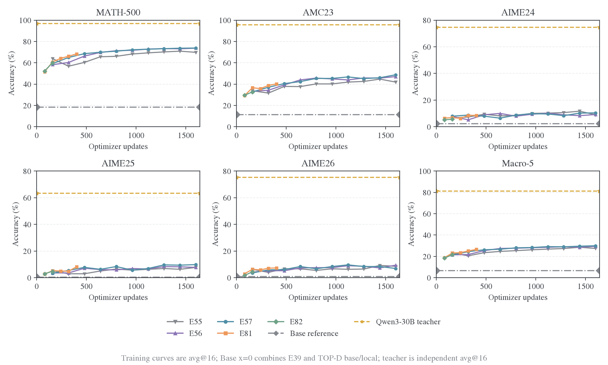

E82 的完整末段宏平均在 outer70/75/80/85/90/95/100 为 30.54/30.78/30.78/30.54/30.70/30.60/31.20%，已进入约 31% 的平台。三年 AIME 平均对应 10.00/10.90/11.11/10.00/11.11/10.42/11.39%，后段仍有波动；曲线和全部节点来自[完整验证 CSV](figures/validation-comparison-20261106/validation.csv)。

### 停止结构随训练恢复

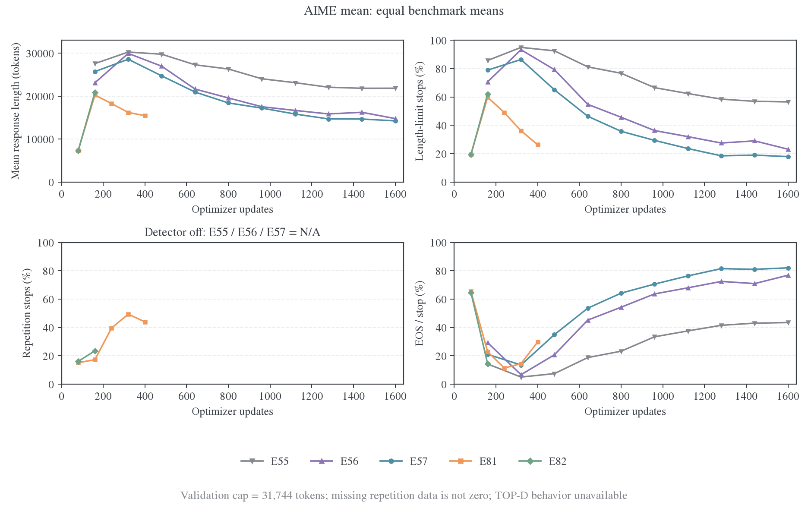

E82 outer10→100 的 AIME 平均长度 20,881→10,692，长度触顶 62.08%→2.78%，重复停止 23.54%→9.44%，EOS/stop14.38%→87.78%。outer20 时重复停止曾达到 48.06%，说明早期“触顶下降”部分来自更早的检测器截停；到终点，两种截断都降下来，才体现完成行为的实际恢复。

E81 终点 AIME 长度 15,444、长度触顶 26.25%、重复停止 43.96%、EOS/stop29.79%；其较短训练还未达到 E82 后段的恢复程度。E83 最后完整节点 update400 的长度约 16,961，长度＋重复停止 81.94%，也落后于 E82 同节点。E55–E57 未启用重复检测，对应重复率缺失；图中保留 N/A。EOS/stop 仅是引擎结束类别，文本是否正确仍由任务评分判断。

五基准行为见[等权平均图](figures/validation-comparison-20261106/behavior-macro5-optimizer-updates.png)。这些记录描述准确率与完成行为共同改善，不将两者的相关性写成因果分解。

<a id="training-clock-comparison"></a>

### 训练时钟与耗时

[Outer 时钟](figures/training-clocks-20261107/reward-by-outer.png)、[update 时钟](figures/training-clocks-20261107/reward-by-optimizer-update.png)和[回答条次时钟](figures/training-clocks-20261107/reward-by-sample-update.png)使用 E57/E81/E82 同一批训练 rollout score；它们与公共 benchmark accuracy 分别解释。换算为`outer × batch × 16`，完整[CSV 与来源](figures/training-clocks-20261107)由[脚本](../../../research/studies/weighted_targets/plot_training_clocks.py)生成。

E82 训练后段约 17–18 分钟/outer，outer70–90 训练均长 8,790–9,345、训练耗时 1,005–1,055 秒；E83 outer25 为 1,070 秒。验证全量提交 10,080 回答，每副本并发上限 64、TP1，四副本并不意味着所有回答同时解码。验证是主要墙钟成本之一，[阶段耗时图](figures/validation-comparison-20261106/training-validation-runtime.png)和[每节点 CSV](figures/validation-comparison-20261106/runtime.csv)保留完整计时。并发选择依据归[性能实测](../../infra/performance/2026-10-22-训练与验证性能实测.md)，GPU 利用率本身不能判定并发最优。

## 聚合方式的结果

E82/E83保持即时目标，将token-mean改为seq-mean-token-mean；E85/E86进一步检查求和式聚合。令第$i$条回答长度为$L_i$、token损失为$l_{it}$，则

$$
\mathcal L_{\rm token}=\frac{\sum_i\sum_t l_{it}}{\sum_jL_j}
=\sum_i\frac{L_i}{\sum_jL_j}\bar l_i,
\qquad
\mathcal L_{\rm seq}=\frac1N\sum_i\bar l_i.
$$

相同平均 token 损失下，16k 回答在 token-mean 中是 2k 回答的八倍权重，seq-mean-token-mean 中两条等权。回答等权并不等于官方 TOP-D 的 prompt 组内 advantage 标准化；token 求和还改变整体梯度尺度。

E83 在 update240 的 AIME/宏平均为 5.49%/22.68%，E82 为 6.04%/23.33%；update400 则为 6.53%/25.17% 对 8.19%/26.89%。**回答等权在已观察的早期区间没有改善成绩。** E83 到 update480 因资源收回而停止，最后完整验证是 update400，不将其与完整预算终点混为一谈。

E82/E85/E86在共同update1280的宏平均为30.78%/31.31%/31.45%，AIME平均为11.11%/10.90%/10.90%。**两种 token-sum 聚合没有表现出 AIME 优势。** E85/E86快照W&B状态为failed，已写入更新无非有限loss或跳步；后续没有完整预算终点可用于最终排名。现有记录到E85 update1520、完整验证 1440，E86 update1360、完整验证 1280。

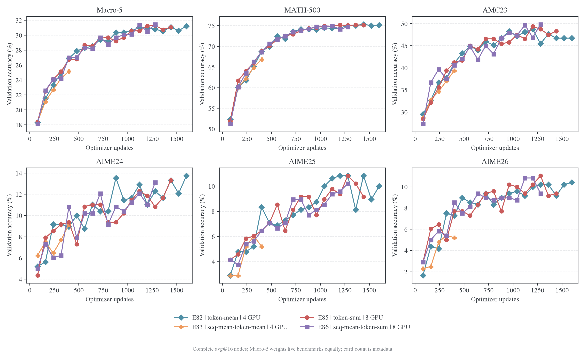

[优化诊断](figures/e82-e83-e85-e86-comparison-20261109/optimization.png)与[长度／停止](figures/e82-e83-e85-e86-comparison-20261109/length-stopping.png)解释各自轨迹。Raw actor loss 随聚合改变尺度，跨组比较使用任务成绩、token 均值 objective 及 teacher KL。完整输入为[统一 CSV 和审计](figures/e82-e83-e85-e86-comparison-20261109)，[脚本](../../../research/studies/weighted_targets/plot_e82_e83_e85_e86.py)从来源快照重建。

<a id="e83e84future-与聚合消融"></a>

## E84 完整结果与分析

### 实际运行与 future 定义

E84 运行名为`math-opd-E84-mdpo-full_vocab-k1-eta0.1-bf16-20261109-021054-2566`，W&B ID 为`x73jzh0z`。完整日志记录 100 个 outer，显式 optimizer 计数到 1,600；验证节点为 20/40/60/80/100，共 20,400 条回答。五次 MATH 各 2,000 回答，AMC 各 640，三个 AIME 各 480；每次均无失败回答。训练进度完成于`100/100 [31:54:22]`，终点评测和 W&B 汇总已经打印，其后的 atexit BrokenPipeError 发生在 W&B 服务收尾阶段；补齐的原始 W&B 记录含正常 exit、exit_code=0。

E84 相对 E82 保留κ1／η0.1、token-mean、batch256／reuse16，只在训练信号中加入严格后续 token 的平均代价；实际执行资源为八卡，MATH 评测由 n16 改成 n4。定义当前 token 的未缩放 local cost 为

$$
c_t=D_{\rm KL}\bigl(p_\theta(\cdot\mid h_t)\Vert m_k(\cdot\mid h_t)\bigr),
\qquad
\bar c_{>t}=\frac{1}{L-t}\sum_{u=t+1}^{L}c_u,
$$

其中 $L$ 是该条回答有效 token 数，末 token 取 $\bar c_{>L}=0$。`future=mean`排除当前 token，在本次前向计算中 detach 后续均值，再加入 sampled-action score 项。以有效 token 平均表示，训练 surrogate 为

$$
\mathcal L_{84}=\frac{1}{\eta}\operatorname{mean}_{i,t}
\left[c_{it}+\operatorname{sg}(\bar c_{i,>t})\log p_\theta(a_{it}\mid h_{it})\right].
$$

最小化该式会压低通向高后续代价路径的动作概率。它将条件词表拟合和轨迹后续信号连接起来；**加入的是后续蒸馏代价，没有引入答案正确性 reward。** reuse16 仍使用本轮旧轨迹，机制对应 TOP-D 式后续均值结构，但没有官方的固定 advantages、prompt 组内标准化和 PPO clipping。实现关系见[future 与聚合合同](../../infra/architecture/full-vocab.md#聚合与未来信用)，完整机制推导见[受控设计](weighted-targets-controls.md#e82-基线上的-future-与聚合消融)。

### 五次完整验证

| Outer | Update | MATH-500 n4 | AMC23 n16 | AIME24 n16 | AIME25 n16 | AIME26 n16 | 宏平均 | AIME 平均 |
| ----: | -----: | ----------: | --------: | ---------: | ---------: | ---------: | -----: | --------: |
|    20 |    320 |      65.55% |    36.25% |      7.92% |      6.25% |      6.46% | 24.48% |     6.88% |
|    40 |    640 |      72.10% |    47.03% |      9.79% |      9.38% |      6.04% | 28.87% |     8.40% |
|    60 |    960 |      74.30% |    47.97% |     10.83% |      8.12% |      9.38% | 30.12% |     9.44% |
|    80 |   1280 |      74.70% |    46.56% |     12.08% |      9.58% |     10.62% | 30.71% |    10.76% |
|   100 |   1600 |      74.70% |    48.91% |     13.75% |     12.92% |     10.00% | 32.05% |    12.22% |

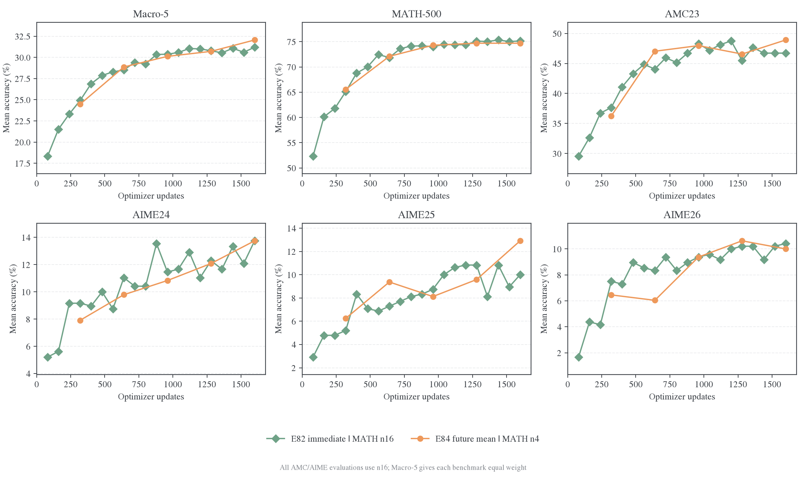

**Future 没有加速前 80outer 的 AIME 学习，终点才拉开。** 在共同 outer20/40/60/80，E84 的 AIME 均值均比 E82 低 0.35–0.49 pp；宏平均差为−0.44/+0.35/−0.26/−0.07 pp。到 outer100，AIME 才从 10.76% 升到 12.22%，宏平均从 30.71% 升到 32.05%；E82 对应终点为 11.39%/31.20%。所以这次结果支持“future 有后段候选收益”，不支持“future 普遍提高每个阶段的学习速度”。

### 终点增益来自哪里

| 题集     |    E82 |    E84 |  E84−E82 | E84 正确回答／总回答 |
| -------- | -----: | -----: | -------: | -------------------: |
| MATH-500 | 75.14% | 74.70% | -0.44 pp |            1494/2000 |
| AMC23    | 46.72% | 48.91% | +2.19 pp |              313/640 |
| AIME24   | 13.75% | 13.75% | +0.00 pp |               66/480 |
| AIME25   | 10.00% | 12.92% | +2.92 pp |               62/480 |
| AIME26   | 10.42% | 10.00% | -0.42 pp |               48/480 |

AIME24 都是 66/480 条回答正确；AIME25 由 E82 的 48/480 升到 E84 的 62/480，多 14 条；AIME26 从 50/480 变为 48/480，少 2 条。三年合计由 164/1,440 变为 176/1,440，净多 12 条，因此 AIME 均值提高 0.83 pp。五基准宏平均提高 0.85 pp，分解为 AMC 贡献 +0.4375 pp、AIME25 贡献 +0.5833 pp，MATH 贡献−0.0875 pp、AIME26 贡献−0.0833 pp，AIME24 为零。**成绩增量集中在 AMC23 与 AIME25，尚未扩展到三个 AIME 年份。**

E84 终点的题目 bootstrap 区间由原 trainer 按题重采样得到：AIME24 为 6.33%–23.05%，AIME25 为 4.32%–22.97%，AIME26 为 3.33%–18.05%。这些是各自均值区间，并非 E84−E82 差值区间；附件没有逐题回答，不能从边际汇总恢复配对差值。当前结论采用实际点差和训练阶段的一致性，不声称跨 seed 显著增益。

完整终点评分还显示，三个 AIME 的 best@16 为 33.33%/33.33%/26.67%，即 90 道题中只有 28 道至少出现一次正确回答，另外 62 道在 16 次尝试里都没有答对。Future 之后仍有较大的题目覆盖缺口，不能仅靠多数投票解决。AIME 的`prediction_missing_count`合计 208/1,440（14.44%），说明答案提取失败仍是具体的失败类型；它与重复、触顶可能重叠，不额外加到错误数或停止率中。

### 终点没有进一步改善长度与停止

| AIME 三年等权终点 |      E82 |      E84 |  E84−E82 |
| ----------------- | -------: | -------: | -------: |
| 回答均长，token   | 10691.98 | 10962.39 |  +270.41 |
| 长度触顶          |    2.78% |    2.85% | +0.07 pp |
| 重复停止          |    9.44% |   10.14% | +0.69 pp |
| EOS/stop          |   87.78% |   87.01% | -0.76 pp |

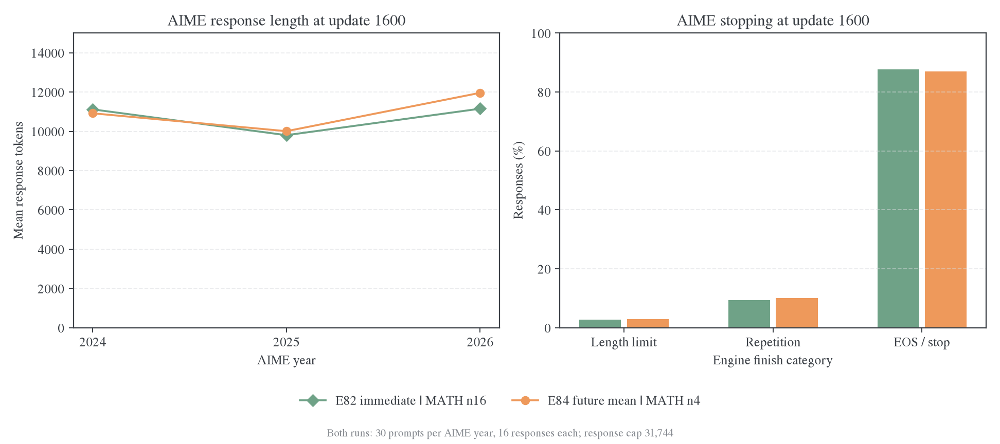

E84 的 AIME 平均长度比 E82 多 270token（+2.53%），长度与重复截断合计 12.99%，E82 为 12.22%；EOS/stop 则低 0.76 pp。**这次 future 收益没有伴随更短回答或更少截断。** E84 自身从 outer20 到 100，AIME 均长 17,666→10,962，整体确实恢复了长度；但 E82 也有同方向恢复，不能将 E84 自身前后变化全部算作 future 的贡献。附件只在终点打印完整停止分项，图中不补画 outer20–80 的停止曲线。

### 优化、耗时与复现价值

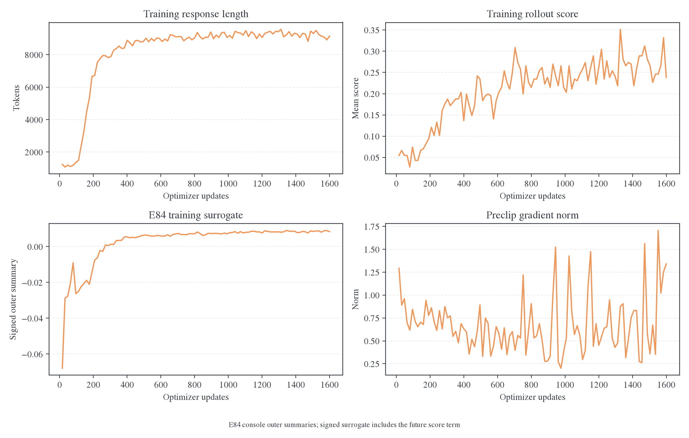

E84 训练回答均长从 outer1 的 1,242 升至中段约 9k，终点为 9,147；最后十批保持约 9k。outer100 的 rollout score 为 23.83%。完整 W&B history 包含连续 1–1,600 次 optimizer update，每次均实际应用，无跳步、非有限 loss 或非有限梯度范数。下面使用逐 update 数据分析；曲线每个点为同一 outer 的 16 次观测算术平均，批内比较使用第 1 和第 16 次更新前的观测，两者之间实际执行了 15 次更新。

#### Future 系数下降，但始终提供长后缀信号

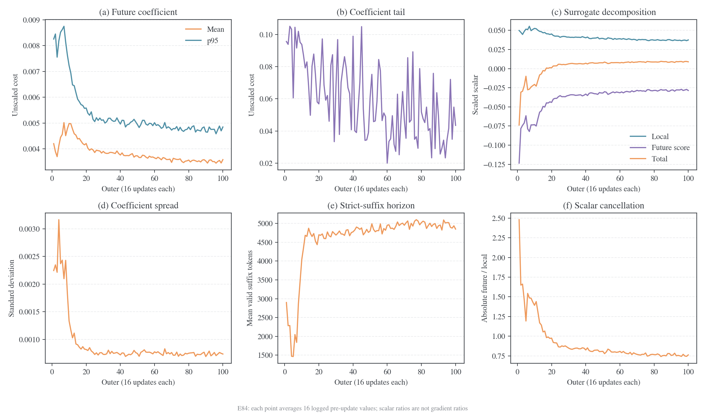

`coefficient` 是未乘 $1/\eta$ 的严格后缀平均代价；`suffix_mean_cost` 只对后缀非空的位置求均值，前者还包含每条回答末 token 的零，因此两者数值接近。`effective_mass` 在 $\gamma=1$ 时等于有效后缀 token 数。下表首末值分别来自 update1 与 update1600，属于各自访问到的轨迹分布。

| E84 指标                  |   update1 | update1600 |
| ------------------------- | --------: | ---------: |
| Future coefficient 均值   |  0.004345 |   0.003453 |
| Future coefficient p95    |  0.008538 |   0.004678 |
| Future coefficient 标准差 |  0.002314 |   0.000714 |
| Future coefficient 最大值 |  0.096164 |   0.044467 |
| 平均有效后缀 token 数     |   2,898.6 |    4,848.1 |
| Local surrogate           |  0.051432 |   0.035932 |
| Future score surrogate    | −0.127290 |  −0.027568 |
| Total training surrogate  | −0.075858 |   0.008364 |

**Mean future 的常见系数与离散程度随训练下降，信号范围仍覆盖数千个后续 token。** 均值首末下降 20.5%，p95 下降 45.2%，标准差下降 69.2%；最大值在不同批次仍有尖峰，不能把尾部描述为已经消失。回答变长时，后缀 token 数增加而系数没有按长度累加放大，符合 mean 的归一化定义；图中不是 sum-return。

完整日志逐项满足 $\text{training surrogate}=\text{local surrogate}+\text{future score surrogate}$，最大绝对分解误差为 $2.55\times10^{-9}$。前 16 个 outer 的全部 256 次更新为负 surrogate，outer17 起全部为正；转正主要伴随负的 future score 项绝对值收缩。终点该项抵消了 local scalar 的 76.7%。这是标量值分解，**不能据抵消比例判断梯度分量的大小或方向，也不能把训练 loss 转正当成 KL 恶化。**

#### Teacher KL 与 E82 持平，梯度范数和裁剪频率上升

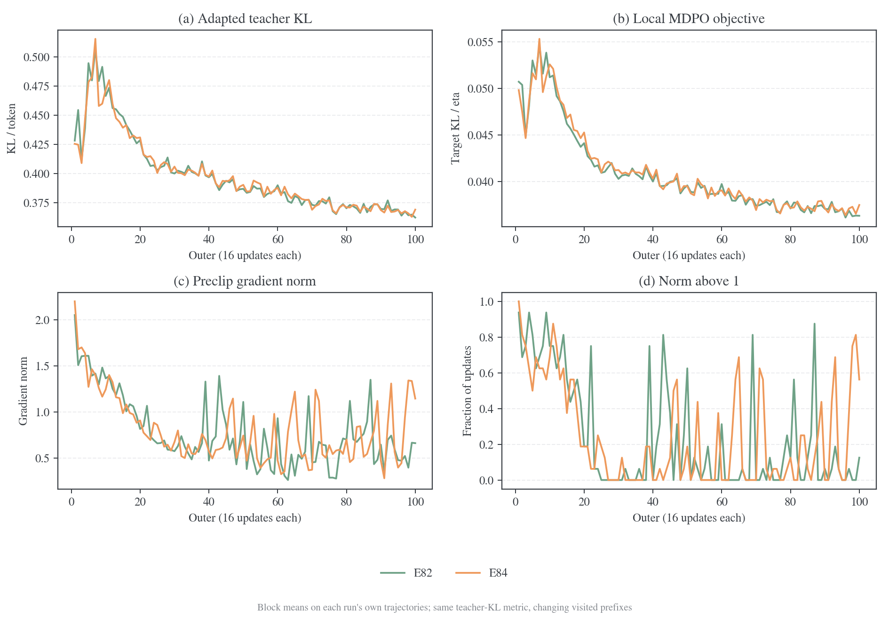

`teacher_kl` 沿用两组共有的 EOS 合并动作空间；E84 另有原生词表 `teacher_rkl`，不将两种 KL 混在同一条比较曲线。Local objective 为 $D_{\rm KL}(p_\theta\Vert m_k)/\eta$，本组 $\eta=0.1$、target normalizer 为 1，所以它等于 target KL 的 10 倍。为减少单个末批的波动，下表平均 outer91–100 的全部 160 次更新。

| 后十个 outer 的逐更新均值      | E82 即时 | E84 mean future | E84 相对变化 |
| ------------------------------ | -------: | --------------: | -----------: |
| Teacher KL／token              | 0.367625 |        0.367427 |      −0.054% |
| Local MDPO objective           | 0.036725 |        0.036991 |       +0.73% |
| Preclip gradient norm          | 0.561148 |        0.863968 |      +53.96% |
| Preclip norm 大于 1 的更新比例 |    5.00% |          36.88% |    +31.88 pp |

**E84 的后段 teacher KL 没有实质领先，增加最明显的是梯度范数与触发裁剪的频率。** 最后一次更新的 teacher KL 为 E82 0.358521、E84 0.365119，同样没有 E84 更低的证据。结合宏平均 +0.85 pp、AIME +0.83 pp 的终点成绩，现有数据支持“mean future 改变了优化信号，并出现局部任务收益”；它不支持“通过更低的整体 teacher KL 获得收益”。这里的 KL 测在各自当前生成的前缀上；要判断同一状态上的教师拟合改善，仍需共同固定前缀评估。两组 GPU 数不同，梯度统计保留这一实际执行差异，不能仅据范数增幅定量分解 future 梯度贡献。

#### Reuse 内拟合持续有效，anchor 偏移受控

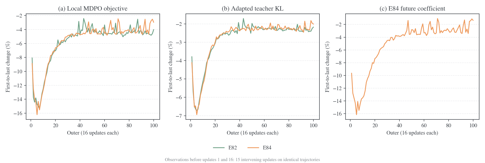

100/100 个 E84 reuse 块的 local objective、teacher KL、future coefficient 和 coefficient p95 均首末下降。E84 local objective 的块内相对降幅中位数为 4.61%，E82 为 4.63%；teacher KL 对应 2.31% 与 2.35%；E84 coefficient 与 p95 对应下降 3.52% 与 4.13%。**Future 没有破坏同批轨迹上的 local／teacher 拟合，但也没有提高它们的典型块内降幅。** Future score surrogate 在全部块内变得较不负，和 local 项下降相抵，total surrogate 只有 78/100 块首末下降。用 total loss 是否下降判断 reuse 是否有效，会混入两个标量项的相消。

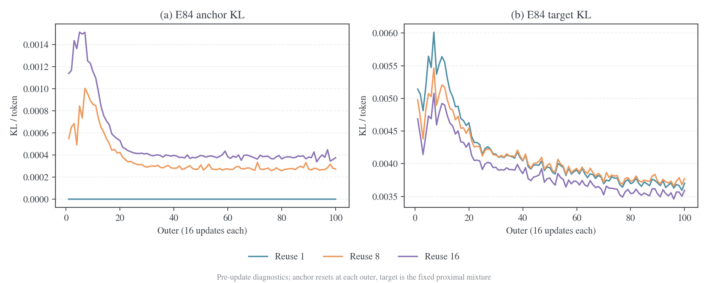

每个 outer 的首次更新前 anchor KL 均为零，符合 anchor 刷新为本轮 student 的语义；第 16 次更新前的 anchor KL 跨批平均为 0.000518，outer100 为 0.000376。Target KL 在 100 个块内均首末下降，终点为 0.003593。学生在同一块中逐步离开 anchor，同时接近 proximal target；这个变化与 mean future 并存，没有出现跳步或数值发散。

#### 相对位置显示系数归一化，不能定位正确路径

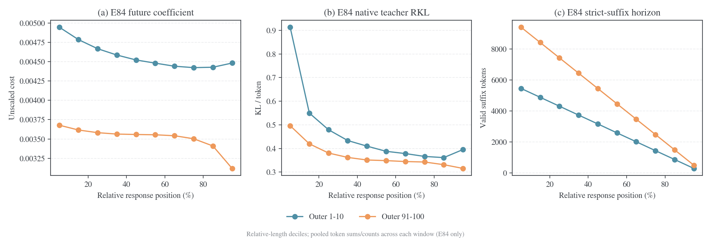

位置图按回答长度划为十个区间，使用各区间记录的 sum／token_count 汇总全部 token 与更新。后十批的平均后缀长度从开头 0–10% 区间的 9,404 降至结尾 90–100% 区间的 494，coefficient 仅由 0.003678 降至 0.003119；**mean 系数沿位置的变化远弱于剩余长度变化，没有把长后缀直接变成更大的累计代价。** 原生 teacher RKL 的首区间由前十批 0.913 降到后十批 0.496，末区间由 0.395 降到 0.315。前后窗口访问的轨迹和长度已经变化，这些分布诊断可描述当前信号形态；判定哪些动作获得了正确性收益，需要逐题轨迹或共同状态上的对照。

100 个 outer 的训练阶段计时合计 26.17 小时，五次验证阶段合计 5.72 小时，与 31 小时 54 分的训练进度接近；终点验证约 47 分钟。八卡和 MATH n4 减少了评测开销，不能把它与四卡、MATH n16 的 E82 墙钟差直接解释成 future 的计算加速。E84 保留状态的配置则使后续同权重复评成为可执行方向；实际模型仍须从原机器取回。

**后续优先检验 future 增益能否重复，并在相同终点权重上对齐评测。** 先补共同 MATH 采样预算、逐题正确性与停止原因，再判断 AIME25 的 14 条净增正确是否来自新解题路径、答案提取或少数题的成功率提升；E90/E93 的折扣均值用于检验远期信号范围，而不是预先认定更短折扣更优。

<a id="topd-4-16-次更新与实际训练预算"></a>

## TOP-D 与本项目的预算和评测

论文§5.1 把 512 道 prompt、每题 8 条回答组成 4096 条轨迹，再分成 16 个不同 mini-batch、每个 256 条，执行一个 epoch。[^topd-paper]

| 预算口径          | 论文设置                       | 官方当前单机配方          | E57                         |
| ----------------- | ------------------------------ | ------------------------- | --------------------------- |
| 每次生成的 prompt | 512                            | 128                       | 64                          |
| 每题回答          | 8                              | 8                         | 1                           |
| 独立新轨迹／outer | 4096                           | 1024                      | 64                          |
| 更新 mini-batch   | 32prompt×8=256 条              | 32prompt×8=256 条         | 64 条                       |
| 内部处理方式      | 16 个不同 mini-batch，1epoch   | 4 个 mini-batch／epoch    | 同一 64 条重复 16 次        |
| 数据损失聚合      | 依论文实际实现核对             | seq-mean-token-mean       | 全局 token-mean             |
| 训练回答上限      | 16384                          | 16384                     | 16384                       |
| 验证              | AIME avg@32，T1/p0.7，cap16384 | avg@16，T1/p0.7，cap16384 | avg@16，T0.7/p0.9，cap31744 |

官方 README 明确区分论文与单机默认规模；entry 脚本固定 128/32，common 脚本设置 8 次 rollout 与验证参数。[^topd-readme][^topd-entry][^topd-common]

E57 每个 outer 产生的新轨迹数是论文的 **1/64**；相同“16 次”对应不同样本覆盖与更新历史。两个采样预算下的单次梯度噪声、state 覆盖和 Adam 状态都不同。

11 月 2 日按固定官方 commit 下载 parquet，并逐文件核对公开 SHA-256。官方 DAPO 为 17,398 行，本地为 17,917 行；去掉官方统一附加指令并合并空白后，两者覆盖同一批 **16,921 个唯一题干**，重复余量分别为 477 和 996 行。因此，文件行数差不能解读为本地缺少约五百道训练题。[数据核对](data/topd-audit-20261102-0055/input-audit.json)还记录了七个题干对应的答案字符串集合不一致；这些标签用于任务判分，不直接进入本组 full-vocab MDPO 的教师概率目标。[^topd-data]

官方全部 DAPO 训练题和 AIME24/25/26 评测题都附加了逐步推理、将最终答案写入 `\boxed{}` 的要求，本地对应文件没有该指令。AIME 文件还存在题目顺序、LaTeX 写法、图示源码和个别措辞差异，不能只把采样温度改成论文值就称为同协议评测。输入指令的影响已纳入同模型、同题、同 seed 的配对生成对照；数据量对照保持原输入，分别识别访问覆盖与提示方式的效果。[^topd-data]

论文 Figure5／§5.3 在同一 1.7B Base←30B-A3B teacher 配对上比较 α=0.1/0.2/0.3、α=1 去除 proximal teacher，以及关闭内部 off-policy 迭代。关闭内部迭代后，论文报告需要更多训练步才能提升成绩。这组消融没有独立改变 batch size 或累计新轨迹量，因此支持检验内部优化预算，但不能直接证明本地差距主要来自数据不足。[固定池与在线覆盖实验](weighted-targets-controls.md#复现差距的受控核对)分别控制这些量。[^topd-paper]

### 累计训练回答次数下的 E57 与 TOP-D 曲线

E57 原始 W&B 离线日志 `6j5knkmk` 已完成，包含连续 1,600 次 optimizer update、100 个 outer 和 outer10 至 outer100 的十次完整评测；原文件 SHA-256 与冻结提取记录一致。下图使用该日志的 AIME24/25/26 正确率，与论文 Figure5 的 α0.1、α0.2 曲线叠加；TOP-D 曲线从论文源文件中的矢量路径按坐标刻度提取，没有再次平滑。[^topd-paper]

横轴的**累计训练回答条次**将同一回答的每次重复训练分别计数。E57 的每次更新使用 64 条回答，同一 outer 的 64 条回答更新 16 次；论文则把新生成的 4,096 条回答划成 16 个不同 mini-batch，每条处理一次。因此，在 outer $o$ 完成后：

$$
N_{\mathrm{E57}}(o)=64\times16\times o=1024o,
\qquad
N_{\mathrm{TOP-D}}(o)=512\times8\times o=4096o.
$$

TOP-D 的 outer 解释依据官方 trainer：每轮 rollout、actor 更新和日志记录后，`global_steps` 增加一次；内部 optimizer update 由 mini-batch 循环执行。[^topd-trainer-budget] Figure5 两条曲线均有 42 个可提取节点，横坐标为 0、10、…、410，换算使用论文 §5.1 的 batch 设置。这里推断的是公开曲线已展示的训练预算；论文没有给出 Figure5 与 Table3 checkpoint 的一一对应关系，也没有证明训练恰好在 outer410 终止。


| 公开曲线末端口径 | E57 outer100 | TOP-D α0.1／α0.2 outer410 | TOP-D／E57 |
| ---------------- | -----------: | ------------------------: | ---------: |
| Optimizer update |        1,600 |                     6,560 |        4.1 |
| 新生成回答数     |        6,400 |                 1,679,360 |      262.4 |
| 累计训练回答条次 |      102,400 |                 1,679,360 |       16.4 |

E57 的 AIME24、AIME25 从首个评测点的 7.92%／3.33% 上升至 10.42%／9.79%，AIME26 在 outer70 达到 9.58%，最终为 6.88%。在相近累计训练条次的前期区间，E57 与 TOP-D 的正确率范围重叠，论文更高的后期成绩来自远超 E57 当前终点的训练区间。曲线支持继续控制训练预算，不能据此确定延长 E57 就能复现论文结果。

两边采用相同的 student／teacher 配对，但 E57 为 avg@16、T0.7/p0.9、cap31744，论文为 avg@32、T1/p0.7、cap16384，题目附加指令与更新目标也不同。条次横轴没有计入回答长度、full-vocab 与 sampled-token 的算力差异；因此图用于定位训练阶段，不能据此排名算法的样本效率或计算效率。E57 的原日志无初始验证；图中 x=0 的空心菱形来自独立 Base 评测，采样次数与训练中验证不同。TOP-D 提取值是图上读数，不替代 Table3。

三种横轴均补充了未训练 Base 的独立读出：AIME24／25／26 分别为 **2.50%／1.67%／0.83%**，每年 30 题、每题 4 次回答，即分别判对 3／2／1 条，共 360 条回答。该读出来自 TOP-D 输入与解码消融中的 `base/local` 条件；模型为 `Qwen3-1.7B-Base/ea980cb0`，使用无官方附加指令的本地题目、`enable_thinking=null` 的原生 assistant 前缀、T0.7/p0.9/cap31744 和停止 ID `[151643,151645]`。已核对原输出、逐条评分与汇总的哈希，并独立重算三个均值；三个 AIME 源 parquet 的哈希也与当时的题目计划一致。[逐条基线评分及来源](data/topd-e57-step0-20261104/baseline.json)保留了复算证据。

E57 冻结配置实际为 `trainer.val_before_train=false`，所以原日志的首次验证在 outer10。独立 Base 是 avg@4、使用另一套采样 seed 与推理执行，E57 训练中为 avg@16；图中用同色空心菱形标示零训练预算的独立参考，不把它写入 E57 原日志，也不与 E57 的首个训练中评测点连线。这里补充的是已有的真实基线测量；avg@4 与 avg@16 的估计精度差异仍保留。

[新增回答数横轴图](figures/topd-e57-step0-20261104/fresh_responses.png)保留两边不同的轨迹覆盖口径；早期放大区内 TOP-D 只有 step0 一个观测点，仅显示该点，不在没有评测的区间补画连线。[矢量成品](figures/topd-e57-step0-20261104/response_presentations.pdf)、[原始论文矢量图](data/topd-e57-budget-20261104/topd-figure5.pdf)、[曲线 CSV](data/topd-e57-budget-20261104/curves.csv)、[来源与哈希](data/topd-e57-budget-20261104/provenance.json)均已保留。

[Optimizer update 次数横轴图](figures/topd-e57-step0-20261104/optimizer_updates.png)（[PDF](figures/topd-e57-step0-20261104/optimizer_updates.pdf)）使用同一批评测点，E57 和图中的 TOP-D α0.1／α0.2 均按每 outer16 次更新换算。上排展示完整预算，下排放大 E57 的前 1,600 次更新。E57 每次更新处理 64 条回答，TOP-D 每次处理 256 条；因此，相同 update 次数下，TOP-D 的累计训练回答条次为 E57 的 4 倍，不能将横坐标相同解释为样本预算或计算预算相同。

生成器为 [plot_topd_e57_budget.py](../../../research/studies/weighted_targets/plot_topd_e57_budget.py)。在仓库根设置 `FIGURE_VIZ_MPL` 为 figure-viz 的 `assets/mpl` 目录后，可从冻结数据重画：

```bash
python -m examples.mirroropd.research.studies.weighted_targets.plot_topd_e57_budget \
  --data examples/mirroropd/docs/experiments/learning-signal/data/topd-e57-budget-20261104 \
  --baseline examples/mirroropd/docs/experiments/learning-signal/data/topd-e57-step0-20261104/baseline.json \
  --out runs/topd-e57-budget-replot
```

### Figure5 全部消融曲线

另保留一组完整对比，包含论文的 α0.1、α0.2、α0.3、α1、w/o off-policy 和 Standard OPD 六条曲线，以及 E57 和独立 Base 参考点。三年 AIME 共提取 18 条论文曲线、525 个矢量节点，E57 的 30 个训练中评测点保持不变；各曲线只画到实际可提取的末端，不补齐到统一终点。[^topd-paper]


| 论文曲线             | 已展示末端 outer | 每 outer 的 optimizer update | 末端累计 update |
| -------------------- | ---------------: | ---------------------------: | --------------: |
| TOP-D α0.1／α0.2     |              410 |                           16 |           6,560 |
| TOP-D α0.3           |              210 |                           16 |           3,360 |
| TOP-D α1             |              180 |                           16 |           2,880 |
| TOP-D w/o off-policy |              200 |                      1，推断 |       200，推断 |
| Standard OPD         |              280 |                            1 |             280 |

论文 Appendix D 区分 TOP-D 与 Standard OPD：两者 global batch 均为 512 prompts、每题 8 条回答，但 mini-batch 分别为 32 与 512 prompts，对应 16 次与 1 次更新。α1 只消融外部 proximal teacher，按单因素消融继承 TOP-D 的内部更新设置；它与 Standard OPD 的即时 log-ratio reward 对应，内部更新预算仍不同，所以两条线不能当作同一运行的重复。[^topd-paper]

w/o off-policy 在 §5.3 被描述为取消内部 trust-region 迭代、回到严格 on-policy。图中据此按每 outer 一次全 batch 更新换算，并在图下注明推断；公开材料缺少该条运行独立的 resolved config，不能将这个换算当成原始 optimizer 日志。累计回答图为全部论文消融沿用 512×8 的 global batch、每条一次处理的口径，w/o off-policy 同样继承这一假设。[^topd-paper]

[累计训练回答条次图](figures/topd-e57-all-curves-20261104/response_presentations.png)、[累计新生成回答数图](figures/topd-e57-all-curves-20261104/fresh_responses.png)和 [optimizer update PDF](figures/topd-e57-all-curves-20261104/optimizer_updates.pdf)使用同一批节点；[完整 CSV](data/topd-e57-all-curves-20261104/curves.csv)与[来源及各组换算依据](data/topd-e57-all-curves-20261104/provenance.json)单独保存。可以复用上面的命令，将 `--data` 改为 `examples/mirroropd/docs/experiments/learning-signal/data/topd-e57-all-curves-20261104`，重新生成全部曲线版本。

<a id="topd-2-e57-的-accuracy-提升与-kl-拟合"></a>

## 长程拟合与任务表现

<a id="topd-21-对齐时间窗口后两者确有共同改善"></a>

<a id="21-对齐时间窗口后两者确有共同改善"></a>

### 对齐时间窗口后，两者确有共同改善

KL 与 accuracy 使用共同验证窗口 outer10–100 对照。下表列出各验证节点对应批内的首末 teacher KL；不同 outer 的 state 会变化，不能将其直接当作固定状态风险曲线：

| Outer | 批首 teacher KL | 第 16 次观测 teacher KL | 五基准宏平均 avg@16 | 五基准宏平均触顶率 |
| ----- | --------------: | ----------------------: | ------------------: | -----------------: |
| 10    |          0.4765 |                  0.4491 |              21.33% |             62.58% |
| 20    |          0.4477 |                  0.4279 |              24.40% |             70.14% |
| 30    |          0.4122 |                  0.3945 |              26.14% |             51.17% |
| 40    |          0.4170 |                  0.3990 |              26.66% |             36.27% |
| 50    |          0.3975 |                  0.3807 |              27.99% |             27.12% |
| 60    |          0.4031 |                  0.3855 |              28.25% |             21.95% |
| 70    |          0.3966 |                  0.3784 |              29.10% |             17.75% |
| 80    |          0.3758 |                  0.3589 |              28.92% |             14.23% |
| 90    |          0.3939 |                  0.3764 |              29.50% |             14.53% |
| 100   |          0.3775 |                  0.3604 |              29.93% |             13.20% |

Outer10→100，批首 teacher KL 下降 **20.77%**，第 16 次观测下降 **19.76%**，宏平均正确率提高 **8.60** 个百分点。前 10 批与最后 10 批（outer91–100）的批首 KL 均值分别为 0.4642/0.3816。这些均值的 state 随训练变化，不能替代共同固定银行上的风险曲线。

E57 的训练可微目标来自 teacher-conditioned KL，任务判分没有作为 reward 加入 loss。准确率提高是这条蒸馏训练轨迹上的实际学习结果。当前数据展示的是**部分任务相关行为改善，同时师生整体分布仍有较大残差**。

<a id="topd-22-kl-与-accuracy-衡量不同的函数"></a>

<a id="22-kl-与-accuracy-衡量不同的函数"></a>

### KL 与 accuracy 衡量不同的函数

这里的训练 teacher KL 是在 DAPO 在线轨迹上的 token 平均；accuracy 来自独立数学题集、T0.7/top-p0.9、cap31744 的完整回答。输入、生成协议和聚合方式均不同。

即使统一到相同题目和完整回答分布，两者也没有一一对应关系。令 $P$ 为学生、$T$ 为 teacher，$a=P(\mathrm{correct})$、$b=T(\mathrm{correct})$，按正确／错误集合精确分解：

$$
D_{\rm KL}(P\Vert T)
=\operatorname{kl}(a\Vert b)
+aD_{\rm KL}(P_c\Vert T_c)
+(1-a)D_{\rm KL}(P_w\Vert T_w).
$$

Accuracy 只看正确总概率 $a$；KL 还包含正确解法内部、错误输出内部的差异。因此 teacher 监督可以提高成功概率，而整体 KL 的变化较小；给定任务风险的改善也可能被其他输出差异部分抵消。推导与统一条件见[正确率与序列/Token KL](../../theory/accuracy-and-kl.md)。

E57 还有可直接观察的完成行为改善：Outer10→100，MATH 触顶率 26.34%→2.88%，AMC49.69%→9.38%；对应 accuracy59.21%→73.83%、32.66%→48.75%。减少未完成回答、改变生成路径和提高答案概率，都能成为蒸馏收益。其各自贡献需要逐题正确性与 finish reason 的联合读出，现有边际统计保留为同步变化。

所以后续应分别测量：共同固定状态上的分布拟合、当前学生访问分布上的风险、完整任务正确率。训练均值 KL 的平台主要描述整体拟合的累积程度，任务泛化则由独立评测直接观察。

<a id="topd-5-结果能对上到什么程度"></a>

## 与 TOP-D 结果的差距

论文 Table3 与本地使用同一 student/teacher 配对。[^topd-paper]

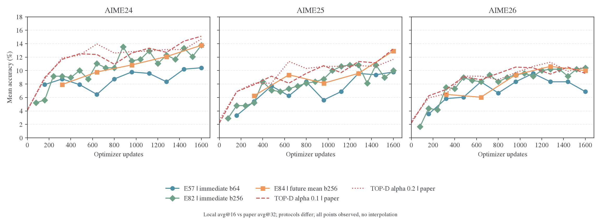

该图只展示各系列真实节点；相同 update 下论文与 E82/E84 的回答处理条次相同，论文新生成量是其 16 倍。E57 每次更新回答数仅为其 1/4。

| 条件                       | AIME24 | AIME25 | AIME26 | 三年平均 |
| -------------------------- | -----: | -----: | -----: | -------: |
| 论文 OPD                   |  8.96% |  7.50% |  5.94% |    7.47% |
| 论文 TOP-D                 | 20.31% | 17.71% | 13.75% |   17.26% |
| E57，immediate，batch64    | 10.42% |  9.79% |  6.88% |    9.03% |
| E82，immediate，batch256   | 13.75% | 10.00% | 10.42% |   11.39% |
| E84，future mean，batch256 | 13.75% | 12.92% | 10.00% |   12.22% |

**E84 将本地 AIME 均值推进到 12.22%，仍比论文 TOP-D 低 5.03 pp，未完成论文高分复现。** 相对 E57 的 +3.19 pp 同时包含更大回答预算、执行与停止协议变化，以及 future；其中只有 E84−E82 的 +0.83 pp 是在相同回答／update 预算下比较 future 的增量。E55 不是纯 OPD，E58 没有可用长程结果，本地也尚未建立同协议“TOP-D 对纯 Full-RKL”的完整对照。

### 已排除什么，下一步控制什么

**训练确实产生了任务学习，不是只有 loss 下降。** E55–E57、E81/E82 都有完整任务评测，teacher KL 和批内 target 拟合也得到核验。Full-vocab 精确的是给定前缀上的动作积分，没有替代新轨迹覆盖；E82/E84 每个 outer 生成 256 条新回答，仍只有论文 4,096 条的 1/16。论文公开α0.1/0.2 曲线到 6,560 次更新，本地到 1,600 次；预算差异仍然实在。

**聚合方式和简单 future 缺失都不足以单独解释剩余差距。** E83 在已测区间没有优势，E85/E86 没有 AIME 突破，E84 只取得 0.83 pp 的终点增量。完整 TOP-D 仍有每题 8 回答、固定 sampled advantages、prompt 组内标准化、PPO clipping 和不同 anchor/inner update 语义。这些环节应在共同预算下分开比较，不将“已经加入 future”写成“已经复现完整 TOP-D”。

**评测协议差异不能靠 n16→n32 解释。** 两者都是平均正确率，增大 n 改变估计精度，不提高其期望。实际需要对齐的是输入附加指令、T0.7/p0.9/cap31744 与论文 T1/p0.7/cap16384、停止动作空间和 verifier。E84 在原机器按配置保存了训练状态，使共同终点的配对复评比继续从摘要猜测差距更有价值。

E84 三年 AIME 的终点合计截断只剩 12.99%，但 mean accuracy 仍为 12.22%，且 62/90 题在 16 次采样中全错。**下一阶段的主要问题是有效解题路径覆盖和成功概率，已不宜只围绕长度收束调参。** 长度恢复是必要的行为改善，不能替代困难题上的知识与推理迁移。

<a id="topd-6-理论保证对应什么量"></a>

### 理论保证的适用对象

对任意相同前缀，若学生精确实现算术混合目标 $p_{k+1}=(1-\alpha)p_k+\alpha T$，由 KL 对第一变量的凸性得到

$$
D_{KL}(p_{k+1}\Vert T)\leq(1-\alpha)D_{KL}(p_k\Vert T).
$$

这是固定状态、精确执行目标的收缩；有限神经网络拟合时，优化误差和其他状态上的误差进入迭代。论文 Theorem4.4 显式包含近似误差，§4.3 式 15 的内层 KL 对象是固定 proximal teacher。[^topd-paper] 本地不断变化前缀上的原 teacher token 均值不要求逐 outer 单调；E84 的 signed training surrogate 更不等于该 KL。后续评估应分别读出共同固定状态风险、当前访问分布风险和任务成绩。

## 来源与复算

### E84 结果保全

本次输入为完整收到的 console 导出，原样保存至[原始日志](../../../../../runs/e84-results-20261110/train-console.txt)，大小 2,019,046 字节，SHA-256 为`94410f1494d1a35abcd808e8f7f846c5838286a17871df7ad7b77b0f5e0254e4`。派生结果与配置在[data/e84-20261110](data/e84-20261110)：

- [resolved config](data/e84-20261110/resolved-config.json)：日志打印的完整配置，不由当前 launcher 反推。
- [原始 console 指标](data/e84-20261110/console-metrics.jsonl)：100 个训练 outer 及五个验证事件，保留原始行号；终点训练和验证共用一个事件。
- [训练 CSV](data/e84-20261110/training-outers.csv)、[五次验证 CSV](data/e84-20261110/validation.csv)、[完整终点表](data/e84-20261110/final-benchmarks.csv)：正确率、长度、停止、计时及终点区间、best/majority@k 等读出。
- [全部 3,134 个终点评测指标](data/e84-20261110/final-validation-metrics.json)与[核验摘要](data/e84-20261110/summary.json)：逐项核对终点 console 与 pprint 共同字段，验证每题集回答数和正确计数的整数性。
- [新图组](figures/e82-e84-20261110)包含 PNG、PDF、绘图审计和输入哈希；终点停止分项有观测，早期缺失不补零。

补齐的原始 W&B 日志位于日志仓库 `MirrorOPD-verl/wandb/offline-run-20261109_022054-x73jzh0z/run-x73jzh0z.wandb`，来源提交为 `3633b7c3a554e7e6e4ebdfa5c85ed9d61b881fd1`。完整解码 history、config、summary 和 run 元数据保存至[runs/wandb-e84-20261110](../../../../../runs/wandb-e84-20261110)；共 1,700 个 history 事件，其中 1,600 个为逐更新事件、100 个为 outer 事件，五次验证包含在 outer 事件中，正确率与 console 25 个题集节点逐项一致。可重算的[逐更新 CSV](data/e84-wandb-20261110/updates.csv)、[双组 outer 均值](data/e84-wandb-20261110/outers.csv)、[reuse 首末变化](data/e84-wandb-20261110/reuse-changes.csv)、[位置统计](data/e84-wandb-20261110/position-profiles.csv)、[汇总](data/e84-wandb-20261110/summary.json)和[来源哈希](data/e84-wandb-20261110/provenance.json)与 console 提取物分别保留。逐题回答、评分原文和 checkpoint 张量仍未取回；其原机器路径保留在 console 与 resolved config 中。

在仓库根重算 E84 并重画：

```bash
python -m examples.mirroropd.research.studies.weighted_targets.analyze_e84
/usr/bin/python3 -m examples.mirroropd.research.studies.weighted_targets.analyze_e84_history
```

### 其他实验与论文

E82/E83完整验证已按`data_source/prompt_id/sample_index`核对，行序是异步完成顺序；不能按 JSONL 行号推断题集。有效完整回答数为 E81 50,400、E82 201,600、E83 50,400，见[验证来源核验](figures/validation-comparison-20261106/source-audit.json)。E82 重复实例写入的 48 次更新和 3 条 outer 已用 SHA256 字节区间排除清单隔离，原始日志保留；有效运行有连续 1–1,600 次更新，见[数据核验](../../../../../runs/topd-learning-signal-20261106/e82-data-audit.json)。E83 的 480 次更新均应用，提前停止原因是资源收回，见[停止凭据](../../../../../runs/topd-learning-signal-20261106/user-stop-receipt-20261107.json)。这些排除和状态不改变已完成节点的含义。

E85/E86的W&B快照位于[runs/wandb-e85-e86-20261109](../../../../../runs/wandb-e85-e86-20261109)，run ID 分别为`sjdbuh0p`、`sh3mrf3r`；图中状态与范围截至该快照，不推断之后的进度。聚合图从[统一脚本](../../../research/studies/weighted_targets/plot_e82_e83_e85_e86.py)重画，全部验证图默认读取冻结 CSV；仅`--refresh`重新提取原始输入。

```bash
python -m examples.mirroropd.research.studies.weighted_targets.plot_e82_e83_e85_e86 --refresh
python -m examples.mirroropd.research.studies.weighted_targets.plot_validation_comparison
```

E55–E57 原始日志及实际配置的[完整绘图输入](../../../../../../wandb-logs/MirrorOPD-verl/analysis/document-evidence-20261103/experiments/learning-signal/data/e55-e57-20261103/data.json)、[来源与脚本](data/e55-e57-20261103/provenance.json)、[汇总](data/e55-e57-20261103/summary.json)由[分析脚本](../../../research/studies/termination/analyze_e55_e57.py)复算。三组日志分别完成于北京时间 11 月 3 日 07:29:22、11 月 2 日 03:11:30、11 月 1 日 15:40:42；[云端指标核验](data/e55-e57-20261102-1600/cloud-audit.json)和[历史阶段报告](../../archive/experiments/weighted-target/2026-10-31-E55至E57阶段快照.md)保留当时范围，未覆盖冻结输入。

论文与官方源码 SHA 见[TOP-D 核对](data/e55-e57-20261101-2259/topd-comparison.json)，官方源码快照位于`runs/topd-comparison-20261101/source/`；[原始检索报告](../../progress/data/topd-20261101/paper-search.md)及[检索诊断](../../progress/data/topd-20261101/search-stderr.log)保持冻结。性能、精度与 optimizer 依据归[工程专题](../../infra/numerics/optimization/README.md)。

<a id="grid"></a>

κ/η短程网格、固定池、覆盖、梯度、输入和解码对照统一见[小规模消融与机制核对](weighted-targets-controls.md#grid)。

### 参考文献

[^topd-paper]: Xie et al. Trust Region Policy Distillation. arXiv:2607.04751v2, 2026. §3、§4、§5.1、Table3 及 AppendixD。[论文正文](https://arxiv.org/html/2607.04751v2)。

[^topd-algos]: xie-lab-ml. TOP-D `core_algos.py`, commit 9a2716cba22cab508825ad3be3f78327bb8139e5. [reward、return 与 prompt 归一化](https://github.com/xie-lab-ml/TOP-D/blob/9a2716cba22cab508825ad3be3f78327bb8139e5/verl/verl/trainer/ppo/core_algos.py)。

[^topd-common]: xie-lab-ml. TOP-D 共同配方，同一 commit。[聚合、PPO 与采样设置](https://github.com/xie-lab-ml/TOP-D/blob/9a2716cba22cab508825ad3be3f78327bb8139e5/recipe/opd/run_qwen3_1p7b_base_qwen3_teacher_dapo17k_common.sh)。

[^topd-entry]: xie-lab-ml. TOP-D α0.1 单机入口，同一 commit。[batch 与 mini-batch 定义](https://github.com/xie-lab-ml/TOP-D/blob/9a2716cba22cab508825ad3be3f78327bb8139e5/recipe/opd/run_qwen3_1p7b_base_qwen3_30a3b_teacher_dapo17k_topd_alpha0p1_16k_kl0.sh)。

[^topd-readme]: xie-lab-ml. TOP-D README，同一 commit。[公开说明与单机默认边界](https://github.com/xie-lab-ml/TOP-D/blob/9a2716cba22cab508825ad3be3f78327bb8139e5/README.md)。

[^topd-data]: xie-lab-ml. TOP-D 数据文件及 SHA-256 清单，commit 9a2716cba22cab508825ad3be3f78327bb8139e5。[数据清单](https://github.com/xie-lab-ml/TOP-D/blob/9a2716cba22cab508825ad3be3f78327bb8139e5/recipe/data/data_manifest.json)，[实际 parquet 文件](https://github.com/xie-lab-ml/TOP-D/tree/9a2716cba22cab508825ad3be3f78327bb8139e5/recipe/data/math_reasoning_parquet)。

[^topd-trainer-budget]: xie-lab-ml. TOP-D `ray_trainer.py`, commit 9a2716cba22cab508825ad3be3f78327bb8139e5. [rollout 外层计数与日志](https://github.com/xie-lab-ml/TOP-D/blob/9a2716cba22cab508825ad3be3f78327bb8139e5/verl/verl/trainer/ppo/ray_trainer.py#L1734)。
