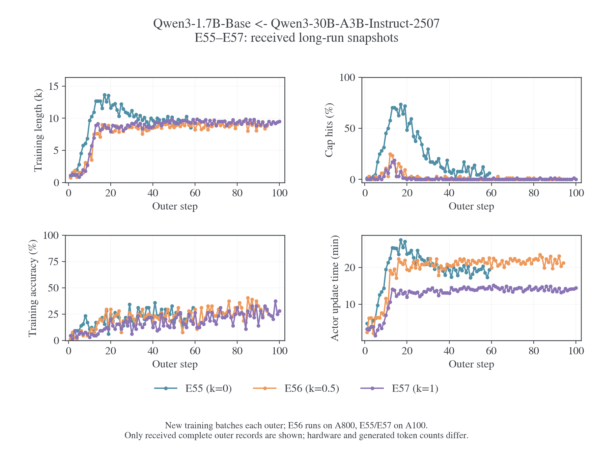
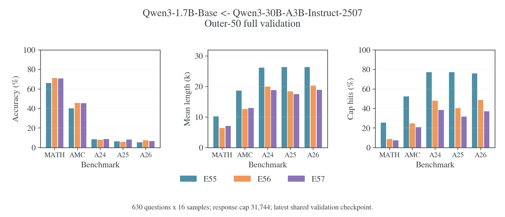
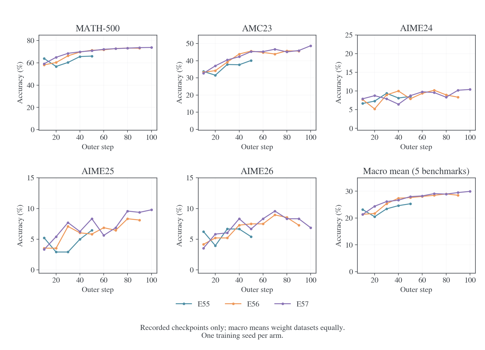
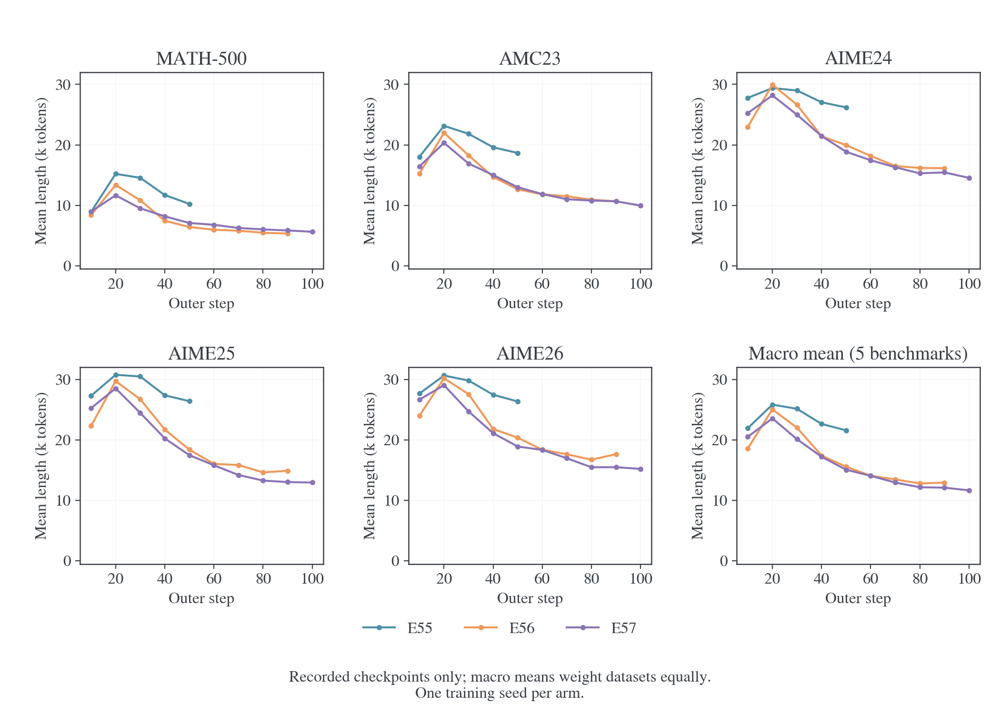
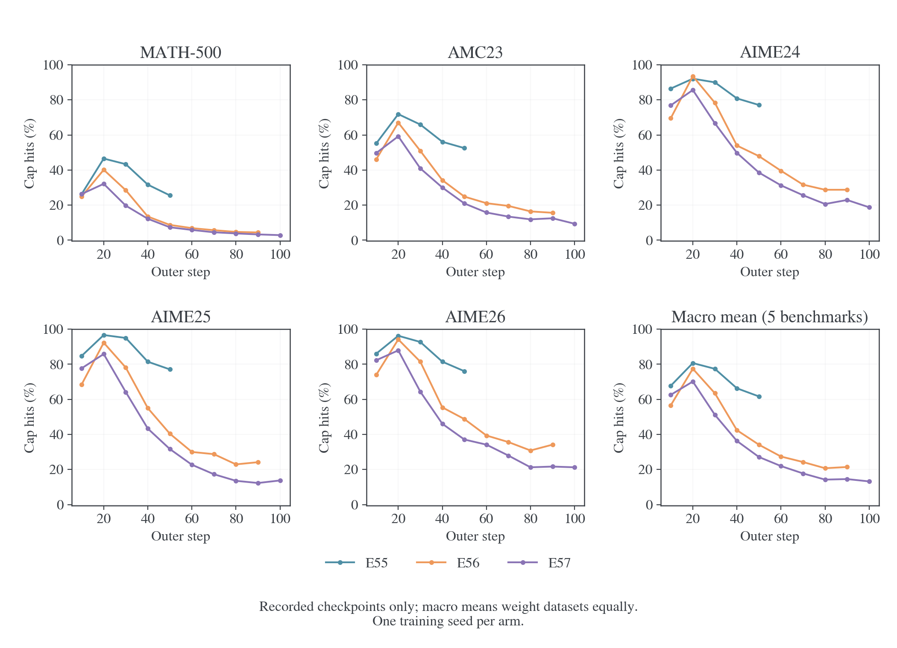
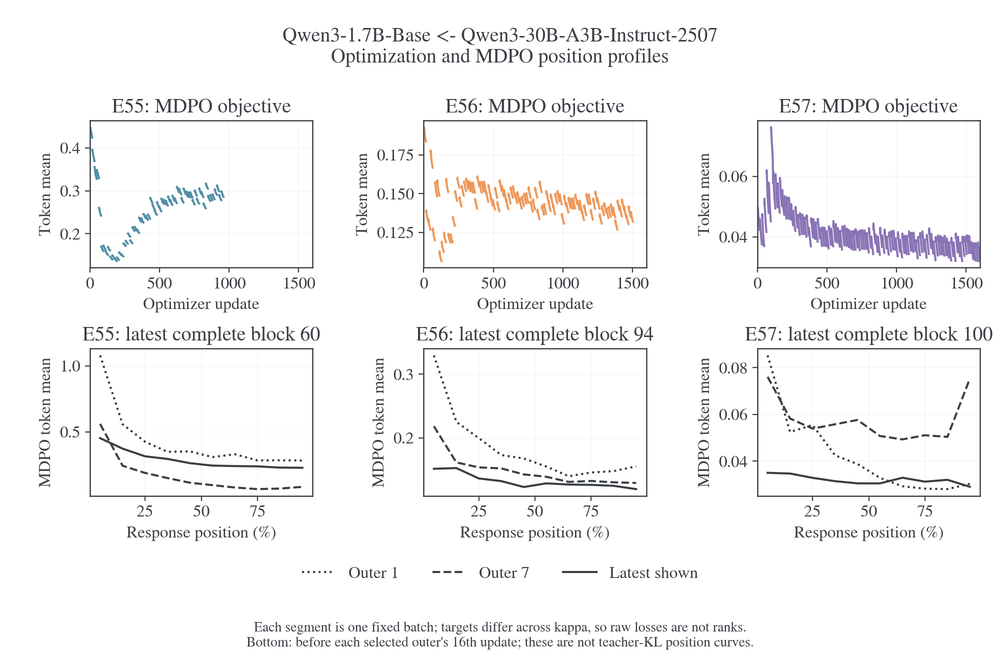

# TOP-D 复现与 κ/η 消融

这里比较本项目的 full-vocab MDPO 与 TOP-D，并分析κ/η改变后的学习表现。E57 采用κ=1、η=0.1：target 形状与 TOP-D 对应，更新算法、样本覆盖、EOS 空间和评测协议仍有差异。11 月 1 日晚间快照中，E57 已正常完成 100 outer，最终五基准宏平均为 29.93%；E55、E56 的更新进度为 60% 和 94%。共同 outer50 下，κ=1 比κ=0 的宏平均正确率高 2.66 个百分点，触顶率低 34.53 个百分点；E57 最终 AIME24/25/26 仍低于论文同师生配对。

参数消融包含两组证据：共同预热起点的十组短程κ/η网格，以及从原始 Base 开始、固定η=0.1 的 E55–E57 长程对照。[精度与 optimizer 实验](../../infra/numerics/optimization/README.md)提供执行与求解依据。

<a id="topd"></a>
<a id="topd-e57-与-top-dkl-拟合任务收益与实现对照"></a>

<a id="topd-3-e57-与-top-d-的精确关系"></a>

## 目标构造与实际更新

<a id="topd-31-相同部分算术混合的-proximal-teacher"></a>

<a id="31-算术混合的-proximal-teacher"></a>

### 算术混合的 proximal teacher

记原 teacher 为 $T$、本轮冻结 student 为 $q$，TOP-D 构造 $m=(1-\alpha)q+\alpha T$，即时信号为 $f=\log(m/q)$。[^topd-paper]

E57 的κ1、η0.1 产生

$$
m=0.9q+0.1T,
\qquad f=\log(0.9+0.1T/q).
$$

在相同 state 和动作空间下，它与 TOP-D 的α0.1 构造对应。E57 还合并了 EOS，数值对照需采用相同动作空间。E57 实际最小化的 full-vocab 标量则为

$$
L_{57}(p)=10D_{\rm KL}(p\Vert m)
=10D_{\rm KL}(p\Vert q)-10\mathbb E_p f.
$$

该式由本仓[目标构造](../../../../../verl/trainer/distillation/targets.py)和[full-vocab 目标](../../../../../verl/trainer/distillation/objectives.py)直接核对，外部缩放由[loss 层](../../../../../verl/trainer/distillation/losses.py)执行。

<a id="topd-32-不同部分完整更新算法"></a>

<a id="32-完整更新算法"></a>

### 完整更新算法

官方`topd`先计算即时 $f_t$，再构造“当前 reward＋后续有效 token 的平均 reward”，随后在同一道 prompt 的全部回答 token 内减均值、除标准差。它将固定 advantages 交给 sampled-token PPO 更新，clip 为 0.2；另提供只用即时信号的`naive_topd`。[^topd-algos][^topd-common]

| 实现环节         | 官方 TOP-D                     | E57                                |
| ---------------- | ------------------------------ | ---------------------------------- |
| Proximal teacher | 概率算术混合                   | 相同形状，η0.1                     |
| 动作积分         | 已生成 token 上的 sampled 估计 | 给定前缀完整词表求和               |
| 信号             | 即时项＋后续平均 return        | 当前状态的 KL residual             |
| 归一化           | Prompt 组内 token 标准化       | 无该组内标准化                     |
| 更新             | 固定 advantage 的 PPO clipping | 直接 scaled target KL              |
| Anchor 作用      | PPO 信赖域近似                 | 目标内有显式 $D_{KL}(p\Vert q)$ 项 |
| 整体尺度         | 官方 advantage 标准化          | 保留 $1/\eta=10$                   |
| 终止支持         | 原始 token 分别评分            | 合并两个 EOS 动作后构造目标        |

从 E57 的标量自行求导，令 $\psi=\nabla\log p$：

$$
\nabla L_{57}
=10\mathbb E_p\left[(\log(p/q)-f)\psi\right].
$$

在理想起点 $p=q$，它与未裁剪、仅即时 $f$ 的期望策略梯度同方向，梯度尺度相差 10。实际 Adam 步幅还取决于自适应矩、epsilon、clipping 与优势标准化。离开起点后，E57 保留 anchor KL 的梯度；完整 TOP-D 还有 return、组内标准化和 clipping。所以 E57 应称为 **TOP-D-style proximal target 的 full-vocab MDPO 变体**，也与官方`naive_topd`的有限步更新有区别。

Full-vocab 精确化的是已访问前缀上的动作积分；后续轨迹的信用分配仍是独立设计。TOP-D 的 future return 与 E57 的条件 KL 反向传播在这一点上具有不同语义。

<a id="grid-6-与-top-d-的关系和实现边界"></a>

### κ/η 与 EOS 的实现约定

一般κ/η的目标及 normalizer 由[镜像理论](../../theory/mirror-descent/objectives.md#weighted)定义。κ=1、η=α时得到 TOP-D 的算术 target；完整更新的对应关系见上表。κ=0、η=0.1 的目标包含 9 倍 anchor KL，因此它是有近端约束的形状对照；纯 Full-RKL 对应η=1。

κ=1 的即时信号在 T/q 趋近零时下界为 log(1−η)，MDPO 再按 1/η缩放。停止状态上的反向 KL 梯度还取决于 student 给予 EOS 的概率。

EOS 适配先分别合并 student、anchor、teacher 的停止概率，再构造 target；幂均值与合并的次序会影响结果。梯度按 student 类内概率分回两个 logits，teacher 与 anchor 保持冻结。该路径已按独立 FP64 概率参考及实际词表 BF16 CUDA 核对；本组 teacher/anchor KL 使用合并后的动作空间。

<a id="topd-4-16-次更新与实际训练预算"></a>

## TOP-D 与本项目的预算和评测

论文§5.1 把 512 道 prompt、每题 8 条回答组成 4096 条轨迹，再分成 16 个不同 mini-batch、每个 256 条，执行一个 epoch。[^topd-paper]

| 预算口径          | 论文设置                       | 官方当前单机配方          | E57                         |
| ----------------- | ------------------------------ | ------------------------- | --------------------------- |
| 每次生成的 prompt | 512                            | 128                       | 64                          |
| 每题回答          | 8                              | 8                         | 1                           |
| 独立新轨迹／outer | 4096                           | 1024                      | 64                          |
| 更新 mini-batch   | 32prompt×8=256 条              | 32prompt×8=256 条         | 64 条                       |
| 内部处理方式      | 16 个不同 mini-batch，1epoch   | 4 个 mini-batch／epoch    | 同一 64 条重复 16 次        |
| 数据损失聚合      | 依论文实际实现核对             | seq-mean-token-mean       | 全局 token-mean             |
| 训练回答上限      | 16384                          | 16384                     | 16384                       |
| 验证              | AIME avg@32，T1/p0.7，cap16384 | avg@16，T1/p0.7，cap16384 | avg@16，T0.7/p0.9，cap31744 |

官方 README 明确区分论文与单机默认规模；entry 脚本固定 128/32，common 脚本设置 8 次 rollout 与验证参数。[^topd-readme][^topd-entry][^topd-common]

E57 每个 outer 产生的新轨迹数是论文的 **1/64**；相同“16 次”对应不同样本覆盖与更新历史。两个采样预算下的单次梯度噪声、state 覆盖和 Adam 状态都不同。

双方都使用 DAPO 来源，但官方仓库的数据清单为 17398 行，本地历史训练文件为 17917 行；子集、过滤和采样顺序另按各自文件身份记录。学习率 1e-6 一致，也不使上述更新过程自动相同。[^topd-readme]

## 长程实验条件

<a id="presets-e55e58base-与-moe-的长程目标对照"></a>

### E55–E58 预设

四组均为 Qwen3-1.7B-Base ← Qwen3-30B-A3B-Instruct-2507，从原始 Base 权重开始，使用 full-vocab 蒸馏。E55–E57 固定 $\eta=0.1$ 比较目标形状；E58 是纯 Full-RKL 参考。E55 的 $\kappa=0,\eta=0.1$ 仍有 anchor KL 约束，不等于 E58。短程筛参依据与机制边界见 [E54 诊断](../../infra/model-compatibility/qwen-e54/2026-10-29-E54长度膨胀诊断.md#75-top-d-reward-与-full-vocab-mdpo-的受控比较)。

| 编号 | 方法            |        $\kappa$ | $\eta$ |
| ---- | --------------- | --------------: | -----: |
| E55  | Full-vocab MDPO |               0 |    0.1 |
| E56  | Full-vocab MDPO |             0.5 |    0.1 |
| E57  | Full-vocab MDPO |               1 |    0.1 |
| E58  | Full-RKL        | 不影响 endpoint |      1 |

共同设置为 shared-sync 八卡、DAPO、batch/mini-batch64、每题 1 个 response、reuse16、100 outer，即 1,600 次更新；AdamW 学习率 1e-6、constant、token-mean。Prompt cap 为 1,024，训练 response cap 为 16,384；rollout 温度/top-p 为 1/1，每卡并发 64、显存预算 0.80。计算使用 `precompute`、token chunk512，保留 FP32 RoPE 和终止等价类 `[151643,151645]`。

该配对采用 `data.apply_chat_template_kwargs.enable_thinking=null`，共同前缀停在 `<|im_start|>assistant\n`，不追加旧的空思考段。训练 rollout、teacher 条件评分及训练中验证使用同一输入协议；`E55-valid-student` 至 `E58-valid-teacher` 也继承这个模板选择。E54 及其他既有 Qwen 预设保持原模板。

无初始验证；每 10 outer 使用 trainer 内置验证，完整运行 MATH-500、AMC23、AIME24、AIME25、AIME26，共 630 题。每题 16 次采样，温度/top-p 为 0.7/0.9，response cap31,744；验证结果写入 W&B，样本写入运行目录。第 100 outer 仍正常验证。

**四组均不保存任何 checkpoint**：`SAVE_FREQ=-1`，最终 Hydra 配置为 `trainer.save_freq=-1`，周期保存和最后一步保存均关闭；`resume_mode=disable`。不导出最终模型，也不保存 optimizer 或 dataloader 状态。周期验证直接使用内存中的当前 learner，不依赖保存 checkpoint。

通过同一个入口选择编号，例如预览 E55 的实际命令：

```bash
DRY_RUN=1 bash examples/mirroropd/run_math_opd_ablation_fsdp2.sh E55
```

正式运行前按[通用运行合同](../../infra/training/runtime.md#通用运行合同)设置已分配的 GPU 和 Python 环境，再去掉 `DRY_RUN=1`。E56–E58 只需替换编号；公共环境和末尾 Hydra 参数保留原有覆盖优先级。预设来源在 `launchers/math_experiment.py`，shell 入口的速查表从同一目录生成，不另维护一套参数。

<a id="topd-1-新快照的实验进度"></a>

### 11 月 1 日晚间的实际覆盖

日志源版本为 `dee0d30`，本地合并版本为 `c3b8879`。下表描述已接收日志的覆盖范围；E55/E56 没有退出记录，不能据此确认采集时刻之后的实时状态。

| 实验 |   κ | 最后指标记录，上海时间 | 成功更新／计划 1600 | 更新至 outer | 完整 outer 汇总 | 最后完整验证 | 日志状态             |
| ---- | --: | ---------------------- | ------------------: | -----------: | --------------: | -----------: | -------------------- |
| E55  |   0 | 2026-11-01 20:13:01    |          960（60%） |           60 |              59 |           50 | 部分快照，无退出记录 |
| E56  | 0.5 | 2026-11-01 22:44:10    |         1504（94%） |           94 |              94 |           90 | 部分快照，无退出记录 |
| E57  |   1 | 2026-11-01 15:40:42    |        1600（100%） |          100 |             100 |          100 | 正常结束，exit 0     |

E57 已收齐 100 outer、1,600 次更新、十轮完整验证和正常退出记录。E55 已记录 outer60 的全部 16 次更新，但缺少 outer60 汇总及验证；E56 已有 outer94 汇总。配置仍记录 `9fd276af`，100 个计划 outer、batch64、n=1、reuse16、LR1e-6、η0.1、训练 cap16384、验证 cap31744；不将主仓库后续的 EOS/融合修改视为已部署到这些冻结 run。

| 各组最新验证，avg@16 | MATH-500 |  AMC23 | AIME24 | AIME25 | AIME26 | 五基准宏平均 |
| -------------------- | -------: | -----: | -----: | -----: | -----: | -----------: |
| E55，outer50         |   66.06% | 40.16% |  8.54% |  6.46% |  5.42% |       25.33% |
| E56，outer90         |   73.11% | 45.62% |  8.33% |  8.12% |  7.29% |       28.50% |
| E57，outer100        |   73.83% | 48.75% | 10.42% |  9.79% |  6.88% |       29.93% |

最新点的训练进度不同，不用于 κ 最终排名。五基准宏平均对数据集等权；每个 AIME 是 30 题×16 次生成，宏平均不等于全部 10,080 条回答的合并正确率。三组共同的最后完整验证已推进至 outer50：

| 共同 outer50 | 宏平均正确率 | 宏平均长度 | 宏平均触顶率 |
| ------------ | -----------: | ---------: | -----------: |
| E55          |       25.33% |     21.57k |       61.65% |
| E56          |       27.63% |     15.56k |       34.13% |
| E57          |       27.99% |     15.07k |       27.12% |

共同 outer50，E57 相比 E55 的宏平均正确率高 2.66 个百分点、触顶率低 34.53 个百分点，均长短 6.50k；相比 E56，正确率仅高 0.36 个百分点，触顶率低 7.01 个百分点。长尾改善比准确率差异更明显。E56/E57 在共同 outer90 的宏平均正确率为 28.50%/29.50%，触顶率为 21.42%/14.53%；E57 的 MATH/AMC 只高 0.54/0.31 个百分点。每组只有一个训练 seed，缺少逐题配对记录，不能将这些小分差写成稳定的 κ 排名。

E57 从 outer90 到 100，宏平均正确率提高 0.43 个百分点，触顶率从 14.53% 降至 13.20%，均长从 12.11k 降至 11.67k。MATH/AMC 从 73.65%/45.94% 升至 73.83%/48.75%；AIME24/25 小幅升至 10.42%/9.79%，AIME26 从 8.33% 回落至 6.88%。三个 AIME 的等权平均反而从 9.31% 降至 9.03%，因此末段宏平均上升主要由 MATH/AMC 带动。E56 的 outer70→90 宏平均为 28.47%→28.50%，也没有持续大幅增长。

三组已记录的 4,064 次更新均无跳步或非有限标记，254 个完整复用块的 objective 与 teacher KL 均首尾下降；首尾分别是第 1 与第 16 次更新前的观测，两点之间发生了 15 次更新。E57 最后十批训练仅 1/640 条回答触及 16k 上限，最终验证的宏平均触顶率仍为 13.20%，三个 AIME 平均为 17.92%；训练中的低触顶率没有消除独立难题上的长尾。

E55 最后一次完整验证耗时 6.09 小时；E56/E57 最新验证为 2.37/2.04 小时。E55 的验证长尾仍重，会拉长每十轮一次的评测；三组硬件与生成长度也不同，不把训练进度差直接视为目标计算速度差。E55 的下一项关键证据是 outer60 验证，E56 是 outer100 最终验证与退出记录。





<a id="topd-2-e57-的-accuracy-提升与-kl-拟合"></a>

## 长程拟合与任务表现

<a id="topd-21-对齐时间窗口后两者确有共同改善"></a>

<a id="21-对齐时间窗口后两者确有共同改善"></a>

### 对齐时间窗口后，两者确有共同改善

KL 与 accuracy 使用共同验证窗口 outer10–100 对照。下表列出各验证节点对应批内的首末 teacher KL；不同 outer 的 state 会变化，不能将其直接当作固定状态风险曲线：

| Outer | 批首 teacher KL | 第 16 次观测 teacher KL | 五基准宏平均 avg@16 | 五基准宏平均触顶率 |
| ----- | --------------: | ----------------------: | ------------------: | -----------------: |
| 10    |          0.4765 |                  0.4491 |              21.33% |             62.58% |
| 20    |          0.4477 |                  0.4279 |              24.40% |             70.14% |
| 30    |          0.4122 |                  0.3945 |              26.14% |             51.17% |
| 40    |          0.4170 |                  0.3990 |              26.66% |             36.27% |
| 50    |          0.3975 |                  0.3807 |              27.99% |             27.12% |
| 60    |          0.4031 |                  0.3855 |              28.25% |             21.95% |
| 70    |          0.3966 |                  0.3784 |              29.10% |             17.75% |
| 80    |          0.3758 |                  0.3589 |              28.92% |             14.23% |
| 90    |          0.3939 |                  0.3764 |              29.50% |             14.53% |
| 100   |          0.3775 |                  0.3604 |              29.93% |             13.20% |

Outer10→100，批首 teacher KL 下降 **20.77%**，第 16 次观测下降 **19.76%**，宏平均正确率提高 **8.60** 个百分点。前 10 批与最后 10 批（outer91–100）的批首 KL 均值分别为 0.4642/0.3816。这些均值的 state 随训练变化，不能替代共同固定银行上的风险曲线。

E57 的训练可微目标来自 teacher-conditioned KL，任务判分没有作为 reward 加入 loss。准确率提高是这条蒸馏训练轨迹上的实际学习结果。当前数据展示的是**部分任务相关行为改善，同时师生整体分布仍有较大残差**。

<a id="topd-22-kl-与-accuracy-衡量不同的函数"></a>

<a id="22-kl-与-accuracy-衡量不同的函数"></a>

### KL 与 accuracy 衡量不同的函数

这里的训练 teacher KL 是在 DAPO 在线轨迹上的 token 平均；accuracy 来自独立数学题集、T0.7/top-p0.9、cap31744 的完整回答。输入、生成协议和聚合方式均不同。

即使统一到相同题目和完整回答分布，两者也没有一一对应关系。令 $P$ 为学生、$T$ 为 teacher，$a=P(\mathrm{correct})$、$b=T(\mathrm{correct})$，按正确／错误集合精确分解：

$$
D_{\rm KL}(P\Vert T)
=\operatorname{kl}(a\Vert b)
+aD_{\rm KL}(P_c\Vert T_c)
+(1-a)D_{\rm KL}(P_w\Vert T_w).
$$

Accuracy 只看正确总概率 $a$；KL 还包含正确解法内部、错误输出内部的差异。因此 teacher 监督可以提高成功概率，而整体 KL 的变化较小；给定任务风险的改善也可能被其他输出差异部分抵消。推导与统一条件见[正确率与序列/Token KL](../../theory/accuracy-and-kl.md)。

E57 还有可直接观察的完成行为改善：Outer10→100，MATH 触顶率 26.34%→2.88%，AMC49.69%→9.38%；对应 accuracy59.21%→73.83%、32.66%→48.75%。减少未完成回答、改变生成路径和提高答案概率，都能成为蒸馏收益。其各自贡献需要逐题正确性与 finish reason 的联合读出，现有边际统计保留为同步变化。

所以后续应分别测量：共同固定状态上的分布拟合、当前学生访问分布上的风险、完整任务正确率。训练均值 KL 的平台主要描述整体拟合的累积程度，任务泛化则由独立评测直接观察。

<a id="topd-5-结果能对上到什么程度"></a>

## 与 TOP-D 结果的差距

<a id="topd-51-相同模型对的-aime-数字"></a>

<a id="51-相同模型对的-aime-数字"></a>

### 相同模型对的 AIME 数字

TOP-D 论文 Table3 使用 Qwen3-1.7B-Base ← Qwen3-30B-A3B-Instruct-2507。保留其原始 avg@32 与本地实际 avg@16：[^topd-paper]

| 结果          | AIME24 | AIME25 | AIME26 |
| ------------- | -----: | -----: | -----: |
| 论文 OPD      |  8.96% |  7.50% |  5.94% |
| 论文 TOP-D    | 20.31% | 17.71% | 13.75% |
| E57，outer100 | 10.42% |  9.79% |  6.88% |

**当前 E57 没有复现论文 TOP-D 的 AIME 高分。** 表内还存在训练算法、覆盖、解码、长度和训练节点差异，数字用于定位差距，后续在共同设置下评价相对收益。

<a id="topd-52-哪些现象方向一致"></a>

<a id="52-哪些现象方向一致"></a>

### 哪些现象方向一致

官方 README 报告，30B-A3B-Instruct-2507 这个 MoE teacher 下，TOP-D 能减轻回答长度膨胀；并提示完整 TOP-D 通常优于 naive 变体。E57 已有后续正确率提高、长尾恢复，和这条定性观察相容。[^topd-readme]

本地 E55 是κ0、η0.1，优化 $D_T+9D_q$，同样有 anchor 约束；它与论文的纯 OPD 基线不同。本轮 E55–E57 快照仍没有同协议 E58 纯 Full-RKL 结果，所以本地已经测到的是**三种带 anchor 的 target 形状差异**，尚未形成论文“TOP-D 相对 OPD”的对应比较。

<a id="topd-53-差距的可核验来源与尚未分离的原因"></a>

<a id="53-差距的可核验来源与尚未分离的原因"></a>

### 差距的可核验来源与尚未分离的原因

当前 E57 相对论文 Table3 的差距约为 9.9/7.9/6.9 个百分点。比较对象明确为 1.7B Base 学生，不使用论文 8B 学生表格。下面各项配置差异均已核对，但它们分别造成多少 accuracy 损失，现有数据没有受控分解。

训练覆盖是首先需要控制的量。E57 到 outer100 累计生成 6,400 条新轨迹、执行 1,600 次更新；6,400 也是 prompt 抽取次数，不等于去重题目数。论文每轮为 512×8=4,096 条新轨迹，公开单机默认配方也有 128×8=1,024 条，分别是本地的 64/16 倍。Full-vocab 消除给定前缀上的动作采样误差，不能补出没有访问过的 reasoning state，也不能用重复处理同一条轨迹代替新增路径覆盖。论文未在表中给出对应结果 checkpoint 的完整累计采样量，不能把相同 outer 或 optimizer step 直接当作等总预算比较。[^topd-paper][^topd-readme]

更新算法也没有只差一个动作估计器。完整 TOP-D 将后续 token 的平均 reward 回传给当前 token，再做 prompt 组内标准化和 PPO clipping；本地只优化已访问前缀上的条件 KL，内层偏离 anchor 后仍有显式 drift 项。前者能利用后续 teacher 评分作信用分配，后者的全词表求和没有补上未来 rollout 的信用分配。缺少这些机制是否正是本地 AIME 短板，需要 naive/full TOP-D 以及 return、标准化、clipping 的同预算消融；不能从当前曲线单独证明。[^topd-algos]

损失聚合带来了另一项确定的权重差异。设第 i 条回答长度为 L_i，逐 token 损失为 l_it，则本地 token-mean 为

$$
\mathcal L_{\rm token}=\frac{\sum_i\sum_t l_{it}}{\sum_jL_j}
=\sum_i\frac{L_i}{\sum_jL_j}\bar l_i,
\qquad
\mathcal L_{\rm seq}=\frac1N\sum_i\bar l_i.
$$

官方配方使用后一个 seq-mean-token-mean 聚合方式。相同平均 token 损失下，16k 回答在前者中是 2k 回答的八倍权重，在后者中两条回答权重相同。两边逐 token 目标本来就不同，此式只说明聚合层的权重差异，不将它们视为同一个 loss。当前没有逐轨迹的 loss／正确性联合记录，不能断言坏长回答实际承担了多少梯度。[^topd-common]

评测的 avg@16 与 avg@32 都是平均正确率，不是 pass@k。在相同生成分布下，增加回答数不会使其期望分数翻倍，只会改变估计精度；因此不能用“论文采样更多”解释这十个百分点。真正需要对齐的是 T0.7/p0.9/cap31744 与论文 T1/p0.7/cap16384，以及题目、verifier 和终止协议。较大的 cap 也不能保证更高准确率，已经给出答案后继续生成可能影响最终答案提取。当前缺逐题回答，无法将本地结果换算成论文协议。[^topd-paper][^topd-readme]

E57 的三个 AIME 平均触顶率从 outer10 的 78.96% 降至 outer100 的 17.92%，正确率仍只有约 7%–10%。所以“仍有长尾”是真实限制，但不能把全部差距只归于回答过长。EOS 合并、teacher/student 模板和数据子集也不同，均需要实际输入和同协议读出来核对。

现有记录显示批内目标下降、teacher KL 后期下降、无非有限或跳步，尚无证据把分数差距归因于一个已确定的数值错误。原冻结路径的 FP64 Torch 回退解释算力成本，并不自动解释相同训练预算下的任务差距。当前 run 设置 `save_freq=-1`，本地没有这些 checkpoint 和完整逐题回答；同协议复评必须在保留的相同权重上真实执行，不能由现有摘要反推。









<a id="topd-6-理论保证对应什么量"></a>

### 理论保证的适用对象

对任意相同前缀，若学生精确实现算术混合目标 $p_{k+1}=(1-\alpha)p_k+\alpha T$，由 KL 对第一变量的凸性可自行得到

$$
D_{KL}(p_{k+1}\Vert T)
\leq(1-\alpha)D_{KL}(p_k\Vert T).
$$

这是固定状态、精确执行目标的收缩。神经网络在有限状态上只近似拟合 $m_k$ 时，优化误差和其他状态的拟合误差都会进入整体迭代。

论文 Theorem4.4 显式包含近似误差；§4.3 式 15 的内层 KL 对象是固定 proximal teacher。它不直接要求日志中在不断变化前缀上计算的原 teacher token 均值逐 outer 单调下降。[^topd-paper]

E57 每批 target KL 净下降，与其近端目标的局部拟合一致；outer10→100 的 teacher KL 和 accuracy 也有共同改善。下一步应以共同固定银行、当前访问状态与任务结果三类读出，继续测量误差如何传播。

<a id="grid"></a>
<a id="grid-qwen3-base--moemdpo-参数对照与长度恢复"></a>

## κ/η短程消融

十组对照使用同一份两步预热模型，每组再训练三轮。固定η=0.1 时，κ=1 的长尾指标优于κ=0，准确率差的题目配对区间跨零。网格属于探索性比较，评测题曾参与筛参。

<a id="grid-1-结论与适用范围"></a>

<a id="grid-2-实际训练和评测协议"></a>

### 短程设置

| 项目           | 实际设置                                                                                     |
| -------------- | -------------------------------------------------------------------------------------------- |
| 共同起点       | 四卡 Full-RKL 的第 2 outer，预热 cap7,168；恢复同一模型、Adam、数据位置                      |
| 参数网格       | κ=0 的 η=0.1/0.2；κ=0.5/1 的 η=0.05/0.1/0.2/0.3，共 10 组                                    |
| 新增训练       | 第 3–5 outer，共 48 次更新；每组累计 80 次                                                   |
| 批与复用       | DAPO，batch=mini-batch=64，n=1，reuse16，token-mean                                          |
| 优化器         | AdamW，LR=1e-6，constant，weight decay=0.01，梯度裁剪=1                                      |
| Rollout        | 当前 student，temperature/top-p=1/1，seed42；每卡并发 64、显存预算 0.8                       |
| 长度           | Prompt cap1,024，训练 response cap16,384                                                     |
| 输入协议       | 保留旧共同前缀中的空 `<think>…</think>` 段；未切换原生前缀                                   |
| 固定修复与实现 | FP32 RoPE；EOS 等价类 `[151643,151645]`；四卡 shared-sync、full-vocab `precompute`、chunk512 |
| 验证           | 仅最终 outer5；MATH-500 与未用于这五批训练的 DAPO 各 64 题，每题一次，cap31,744              |
| 验证采样       | MATH temperature/top-p=0.7/0.9；DAPO=1/1                                                     |

十组第 3–5 批的训练题目集合一致，评测的 prompt IDs、题目 ID 和逐题 seed 一致。独立复算确认 480 次新增更新、1,280 条判分记录完整；没有跳步或非有限 loss，所有 `finish_reason=stop` 的回答都实际结束于两个合法 EOS ID 之一。空文本和角色起始 token 151644 在这 1,280 条回答中均为零；这个样本内结果不证明旧模板在所有状态上无副作用。

相同问题和 seed 不保证不同参数组生成相同轨迹，更不等于耦合了 vLLM 的随机流。因此，首批更新前的自然输出也存在差异；不同组的 teacher KL 是在各自生成的状态上测量，不能直接按横向绝对值排名。

参数扩展由先验固定的预算筛选触发：在首轮某个共同 η 下，正确总数不减、判对且停止至少增加 4 条、触顶至少减少 4 条，均长和重复不增加，单题集正确数最多减少 2 条。η=0.1 达到该条件后扩展了其余六组。该条件不是显著性检验；评测题目被重复用于筛选和排名，后续结论属于探索性比较。

<a id="grid-3-完整参数结果"></a>

### 参数网格的完整结果

下表的长度和重复比例对两题集等权平均。触顶与判对且停止的分母为 128；每题集正确率的分母为 64。1k=1,000 token。

|   κ |    η | MATH 正确率 | DAPO 正确率 | 合并平均长度 |   触顶 | 判对且停止 | 重复 8-gram |
| --: | ---: | ----------: | ----------: | -----------: | -----: | ---------: | ----------: |
|   0 |  0.1 |      68.75% |      15.63% |        9.21k | 23/128 |     54/128 |      39.29% |
|   0 |  0.2 |      75.00% |      21.88% |       10.62k | 35/128 |     61/128 |      40.72% |
| 0.5 | 0.05 |      70.31% |      10.94% |        7.78k | 14/128 |     49/128 |      36.06% |
| 0.5 |  0.1 |      68.75% |      20.31% |        7.06k | 14/128 |     56/128 |      35.23% |
| 0.5 |  0.2 |      73.44% |      20.31% |        8.21k | 22/128 |     58/128 |      35.77% |
| 0.5 |  0.3 |      71.88% |      18.75% |       10.16k | 29/128 |     56/128 |      38.38% |
|   1 | 0.05 |      70.31% |      21.88% |        6.43k | 12/128 |     59/128 |      34.45% |
|   1 |  0.1 |      70.31% |      20.31% |        6.65k | 12/128 |     58/128 |      32.40% |
|   1 |  0.2 |      68.75% |      21.88% |        8.87k | 24/128 |     56/128 |      34.99% |
|   1 |  0.3 |      65.63% |      18.75% |        8.82k | 22/128 |     54/128 |      33.66% |


灰格表示没有测试该组合，不以零补齐。κ=0、η=0.2 的合并正确数最高，为 62/128，但触顶 35 条、均长 10.62k；κ=1、η=0.05 的判对且停止为 59/128，触顶 12 条、均长 6.43k。二者体现了成绩与长尾的不同取舍，不宜仅以正确率或长度单指标选优。

短程探索选择η=0.1 作为后续共同值。κ=0.5 在 η=0.05 时 DAPO 仅 7/64 判对，η=0.1 时为 13/64；更大的 η=0.3 又伴随更长回答。κ=1 的 η=0.05 虽是有希望的单独候选，但相比 0.1 只多判对 1 题，且重复占比略高。当前证据不足以让三种 κ 都改用 0.05。

历史 16k Full-RKL 参考在同一题集上的合并均长为 19.21k、触顶 69/128、判对且停止 40/128；本轮十组的触顶为 12–35/128。这个变化比同 η 下改变 κ 的差异更大，但历史运行使用较旧的实现与数值路径，不作为严格的新增因果对照。尤其 κ=0 的 MDPO 也有 anchor 正则，不能把所有改善都归给 TOP-D 形状。E58 的作用正是补充同协议纯 Full-RKL 参考。

<a id="grid-4-配对不确定性与具体失败"></a>

### 配对结果与代表样本

按题目 ID 配对，在 MATH、DAPO 内分别有放回抽样，再等权合并；固定 seed20261029，重采样 10,000 次。下面是 κ=1 减 κ=0、η=0.1 的差异：

| 指标             |     差异 |      95% 配对区间 |
| ---------------- | -------: | ----------------: |
| 正确率           | +3.13 pp |  [−3.13,+9.38] pp |
| 判对且停止比例   | +3.13 pp |  [−3.13,+9.38] pp |
| 触顶率           | −8.59 pp | [−15.63,−1.56] pp |
| 平均长度         |   −2.56k |    [−4.63,−0.54]k |
| 重复 8-gram 比例 | −6.88 pp | [−12.10,−1.75] pp |

区间按已观测题目重采样；训练 seed、重复生成、多重比较和筛参效应未纳入。长尾改善的证据比准确率提升更清楚。


κ=1、η=0.1 相比 κ=0、η=0.1，有 11 题由错变对、7 题由对变错；16 条原先触顶的回答变成正常停止，但其中只有 2 条同时被判对，另有 5 条原先未触顶的回答新增触顶。净触顶减少不等于这些题都被正确解决。

| 同题样本                           | κ=0、η=0.1                      | κ=1、η=0.1                      | 观察                                           |
| ---------------------------------- | ------------------------------- | ------------------------------- | ---------------------------------------------- |
| MATH-500:249，模 23 的逆元         | 31.74k，触顶，判错，重复 92.19% | 1.45k，EOS，判对，重复 14.79%   | 有限复查后给出 17 并结束                       |
| MATH-500:108，椭圆与相切圆         | 31.74k，触顶，判错，重复 91.55% | 2.94k，EOS，判对，重复 29.42%   | 给出 2 并结束；判分不保证推导完整正确          |
| MATH-500:470，带和约束的乘积最大化 | 2.22k，EOS，判对                | 20.10k，EOS，判错，重复 87.31%  | 错误方程推导被反复展开，停止也不代表答案完整   |
| DAPO train-3217，2018×4 染色       | 2.12k，EOS，判错                | 31.74k，触顶，判错，重复 87.25% | 后段仍在重复“标准杨表”说法，编号延伸到 Step464 |

这些病例按结果选取，用于解释变化机制。完整评测中，MATH-500:110、352、422 在全部十组都触顶；这直接排除了“这组设置已完全消除不收束”的表述。选定病例的头尾摘录及其余 κ 的同题结果保存在[聚合数据](../../infra/model-compatibility/qwen-e54/figures/e54-mdpo-20261029/data.json)，原始完整文本和 token 在证据归档中。

<a id="grid-5-训练目标下降与生成行为"></a>

### 拟合、长度与停止行为


每个 outer 都换成新问题和新生成回答。κ=1、η=0.1 的平均长度为 4.47k、7.17k、6.18k；κ=0.5、η=0.3 的最后一批达到 9.13k、24/64 触顶。短程没有统一的单调收缩趋势；模型仍可能在后续访问更长、更难收束的状态。

已完成十组都执行了 48 次新增更新。每批开始 anchor KL 为零，并随 learner 更新增加；目标归一化项在同一批保持恒定，符合冻结 anchor/teacher 的实现。κ=1、η=0.1 三批 MDPO objective 首尾分别下降 10.84%、13.13%、16.00%，teacher KL 也都下降。

当 κ<1 时，objective 包含常数项：

$$
L_{\mathrm{MDPO}}=\frac{KL_{\mathrm{target}}-\log Z}{\eta}.
$$

例如 κ=0.5、η=0.05 的最后一批 objective 只下降 1.50%，但 target KL 下降 21.82%。同一批的常数下界压低了 objective 的相对降幅；这不足以证明没有学习。跨 κ 的绝对 objective 与跨批的 loss 跳变也不直接可比。


底行记录的是 `distill/mdpo/objective_position`，不是 teacher KL 的分位置曲线。`p90_100` 表示每条回答最后 10% 的 token，而非单独 EOS。κ=1、η=0.1 的十个位置区间在三批中均首尾下降；κ=0、η=0.1 的第 4 批有两个后段区间小幅上升。给定状态上的拟合进展与独立生成质量是不同读数，需要同时保留。

十组 W&B run 均已结束；云端各有完整的 48 个更新点和 3 个长度点，MDPO objective、teacher KL、末段位置指标及长度与本地核对一致，见[云端核验](../../../../../../wandb-logs/MirrorOPD-verl/analysis/e54-mdpo-20261029/wandb-final-audit.json)。最终独立评测没有回传 W&B；本轮也没有采集 teacher KL 的位置分桶，这两个观测缺口仍需在后续训练中处理。

<a id="topd-7-最有区分力的后续对照"></a>

## 复现差距的后续核对

在相同模型、数据、终止协议、生成／评测预算下，保留四个分支：纯 Full-RKL、E57 式 full-vocab MDPO、官方 naive TOP-D、官方完整 TOP-D。先区分目标形状与完整更新，再分别控制 future return、组内标准化、clipping 及每题回答数。

公平预算同时记录独立 prompt、新轨迹／token、重复训练 token、真实 optimizer 更新和计算成本。这样可以判断本地差距来自条件动作积分、信用分配、数据覆盖，还是目标约束。

<a id="topd-8-来源与复核"></a>

## 来源与复算

- [最新版本、官方源码 SHA 与 E57 逐节点汇总](data/e55-e57-20261101-2259/topd-comparison.json)；[10 月 31 日旧提取](../../progress/data/topd-20261101/comparison.json)保持冻结。
- [完整原始检索报告](../../progress/data/topd-20261101/paper-search.md)与[原样检索诊断](../../progress/data/topd-20261101/search-stderr.log)。
- 官方代码快照保留在仓库`runs/topd-comparison-20261101/source/`；下方引用均固定到已核对的 commit。
- 新快照的[完整绘图输入](data/e55-e57-20261101-2259/data.json)记录 raw SHA-256、实际配置与逐更新边界；[10 月 31 日阶段报告](../../archive/experiments/weighted-target/2026-10-31-E55至E57阶段快照.md)保持原输入范围。
- [新快照来源与脚本身份](data/e55-e57-20261101-2259/provenance.json)、[完整汇总](data/e55-e57-20261101-2259/summary.json)和[分析／绘图脚本](../../../research/studies/termination/analyze_e55_e57.py)支持复算；11 月 1 日白天及更早快照保持冻结。
- 六组图的 PDF 与 PNG 同目录，每张图附 `*-audit.json`；已通过绘图审计并目检。数据仅使用本地原始日志，不使用云端重放行重复计数。[云端关键指标核验](data/e55-e57-20261101-2259/cloud-audit.json)确认三个 run 的唯一步数完整、指标一致；W&B append 产生的前缀重放行不作为新增更新。

<a id="topd-参考文献"></a>

### 参考文献

[^topd-paper]: Xie et al. Trust Region Policy Distillation. arXiv:2607.04751v2, 2026. §3、§4、§5.1、Table3 及 AppendixD。[论文正文](https://arxiv.org/html/2607.04751v2)。

[^topd-algos]: xie-lab-ml. TOP-D `core_algos.py`, commit 9a2716cba22cab508825ad3be3f78327bb8139e5. [reward、return 与 prompt 归一化](https://github.com/xie-lab-ml/TOP-D/blob/9a2716cba22cab508825ad3be3f78327bb8139e5/verl/verl/trainer/ppo/core_algos.py)。

[^topd-common]: xie-lab-ml. TOP-D 共同配方，同一 commit。[聚合、PPO 与采样设置](https://github.com/xie-lab-ml/TOP-D/blob/9a2716cba22cab508825ad3be3f78327bb8139e5/recipe/opd/run_qwen3_1p7b_base_qwen3_teacher_dapo17k_common.sh)。

[^topd-entry]: xie-lab-ml. TOP-D α0.1 单机入口，同一 commit。[batch 与 mini-batch 定义](https://github.com/xie-lab-ml/TOP-D/blob/9a2716cba22cab508825ad3be3f78327bb8139e5/recipe/opd/run_qwen3_1p7b_base_qwen3_30a3b_teacher_dapo17k_topd_alpha0p1_16k_kl0.sh)。

[^topd-readme]: xie-lab-ml. TOP-D README，同一 commit。[公开说明与单机默认边界](https://github.com/xie-lab-ml/TOP-D/blob/9a2716cba22cab508825ad3be3f78327bb8139e5/README.md)。

<a id="grid-7-长程验证与证据复算"></a>

### 短程输入与图表

短程采用旧空思考段与共享预热；长程采用原始 Base 和原生 assistant 前缀。两组的实际设置分别见上文。

[独立复算脚本](../../../research/studies/termination/summarize_e54_mdpo.py)从[完整归档](../../../../../../wandb-logs/MirrorOPD-verl/analysis/e54-mdpo-20261029/runs)读取实际配置、逐次指标、训练题目、完整生成和判分，核对计数、EOS、重复率、配对关系并计算区间；[绘图脚本](../../../research/studies/termination/plot_e54_mdpo.py)只读取[聚合数据](../../infra/model-compatibility/qwen-e54/figures/e54-mdpo-20261029/data.json)。无需加载模型即可复算本报告的表格和图。

已完成实验的中间模型、优化器分片与评测导出权重已清理。配置、tokenizer、训练状态元数据、源码和全部文本证据保留；这些目录不再支持直接续训或重新执行模型前向。权重可用性见[清理记录](../../../../../../wandb-logs/MirrorOPD-verl/analysis/e54-mdpo-20261029/checkpoint-cleanup.json)。后续 E55–E58 从原始模型开始，不依赖这些已清理权重。

图的 PDF：[参数网格](../../infra/model-compatibility/qwen-e54/figures/e54-mdpo-20261029/final-evaluation.pdf)、[配对区间](../../infra/model-compatibility/qwen-e54/figures/e54-mdpo-20261029/paired-intervals.pdf)、[训练长度](../../infra/model-compatibility/qwen-e54/figures/e54-mdpo-20261029/training-length.pdf)、[优化与位置](../../infra/model-compatibility/qwen-e54/figures/e54-mdpo-20261029/optimization.pdf)。

<a id="grid-参考文献"></a>

#### 参考文献
