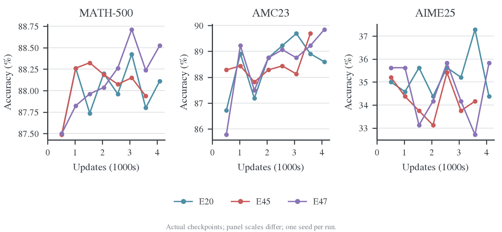
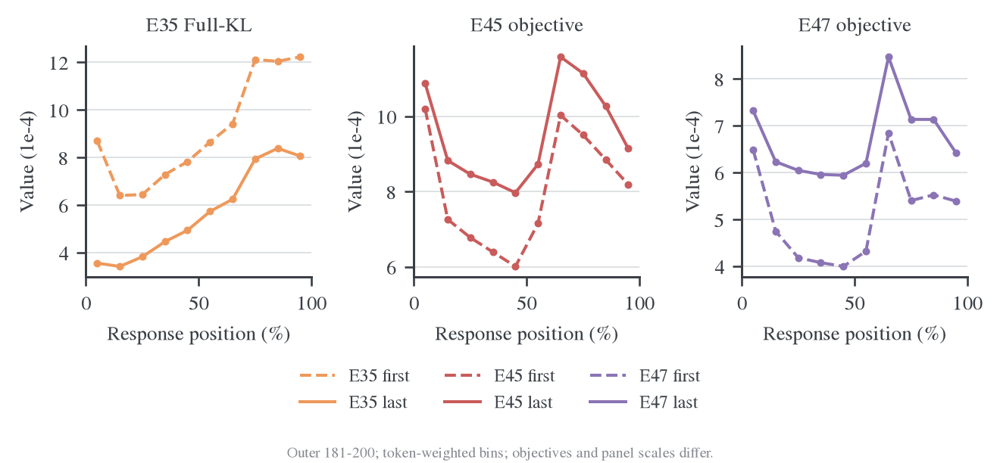
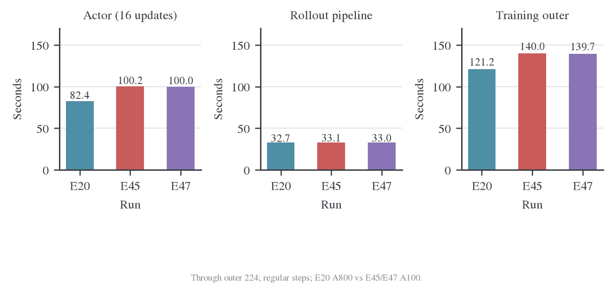

# E35 长窗口与 E45/E47 镜像目标对照

E35 的长窗口显著减少训练回答截断，在十个共同验证点上，AIME25 有八次高于短窗口 E17；共同 outer 200 的 mean accuracy 提高 3.96 个百分点，同时生成 token 增加 22.71%、记录的训练时间增加 45.18%。这支持把长窗口视作有成本的候选改进，但不是严格单因素或多 seed 结论。

E45/E47 相比 Full-KL E20 的任务收益尚不一致。三组共同 outer 224 上，MDPO 的 MATH/AMC 略高，AIME 更低；E47 到 outer 256 又反超 E20。更明确的观察是：后期 MDPO 的固定 target KL 在第一步更新后跳高，后续虽下降，内层末次仍高于本批起点。下一轮应优先核查内层步长与优化器状态，而不是仅凭 teacher KL 下降认定 MD 子问题已经拟合好。

## 1. 数据来源、同步与完整性

本地 `wandb-logs` 的两个分析归档提交与远端三个日志提交已通过 merge `080cd7f244182cee6023aff8c7fdac0f225427e2` 合并并推送。原始二进制日志由日志仓库自己的读取器解码，本报告没有使用 API 采样 history，也没有把网页状态当作退出证据。

| Run | 方法与长度 | 完整 outer / 更新 | 本地退出证据 | 最后验证 outer | 硬件 |
| --- | --- | --- | --- | --- | --- |
| E17 / cix5i2x2 | Full-KL，7168，reuse16 | 200 / 3200 | finished，exit=0 | 200 | 8×A100 80GB |
| E20 / lwgb5eex | Full-KL，7168，reuse16 | 256 / 4096 | finished，exit=0 | 256 | 8×A800 80GB |
| E35 / ntzdb4o7 | Full-KL，15360，reuse16 | 250 / 4000 | finished，exit=0 | 250 | 8×A800 80GB |
| E45 / 625vw4ob | MDPO，κ=0、η=0.3，7168，reuse16 | 244 / 3904 | partial_snapshot，无退出记录 | 224 | 8×A100 80GB |
| E47 / e7pkdbtg | MDPO，κ=0.5、η=0.3，7168，reuse16 | 256 / 4096 | finished，exit=0 | 256 | 8×A100 80GB |

E45 的 244 个完整 outer 和 3904 次更新均连续；未完成的尾部记录保留在原始日志中。它不能被标记为完成 256 outer，也不能因云端曾显示 failed 就判定发生了数值崩溃。E35/E47 的退出记录则已经补齐，之前网页快照中的 failed 不再适合作为本报告的运行状态。

五组共核对 19296 次更新，已记录的 loss/梯度非有限标记和跳过更新数均为 0。全部已记录验证均完成 8000/640/480 条回答，materialized/observed/expected 计数一致，failed/nonfinite score 计数为 0。答案解析缺失仍单独保留，不能与生成失败混为一谈。

[完整统计](../../../../../../wandb-logs/MirrorOPD-verl/analysis/length-mirror-20261026/analysis.json)、[逐字段目录](../../../../../../wandb-logs/MirrorOPD-verl/analysis/length-mirror-20261026/metric-catalog.csv)可复查全部数值。完整原始横轴序列保留在同目录 series.json.gz 中，缺测不补零。

## 2. 对照组选择

| 问题 | 主要对照 | 精确共同验证点 | 解释边界 |
| --- | --- | --- | --- |
| 训练窗口 7k→15k 的作用 | E35 vs E17 | outer 20、40、…、200；update 320、640、…、3200 | 模型、batch、LR、reuse、验证长度相同；硬件、代码版本、初始验证及总预算不同 |
| 长窗结果对另一条短窗基线是否一致 | E35 vs E20 | outer 160 / update 2560 | 两者同为 A800、同 backend/chunk；验证频率不同，不插值构造其他共同点 |
| MDPO 相比直接教师 KL 的作用 | E45/E47 vs E20 | outer 32、64、96、128、160、192、224 | E20 为 A800、precompute/chunk512；MDPO 为 A100、fused/chunk128；源码版本和保存频率也不同 |
| κ=0→0.5 的形状作用 | E45 vs E47 | 同上七个共同点 | 两者硬件、记录的源码提交、预算和 backend 一致，配置差异主要是 κ 与运行身份，但仍只有一个 seed |

共同模型为 R1-Distill-Qwen-1.5B / JustRL-DeepSeek-1.5B，DAPO，seed=42，global batch=mini-batch=64，n=1，AdamW、LR=1e-6、constant、零 warmup、clip norm=1。任务 reward 仅监控，不进入蒸馏 loss。验证均为 MATH-500/AMC23/AIME25、每题 16 条、temperature=0.7、top-p=0.9、response cap=31744。

E17/E20/E35/E45/E47 记录的 Git 基点分别为 df93f4d、376e818、fb37e02、8c3dda8、8c3dda8；Git 字段不能证明部署工作区无额外修改。配置中的 rollout max_model_len 也有 35841/35840 的差别。E35 开启初始验证，其余四组没有；本报告不把 E35 的 step 0 结果移植为其他 run 的真实初始观测。所有配置逐项保存在[配置数据](../../../../../../wandb-logs/MirrorOPD-verl/analysis/length-mirror-20261026/configurations.json)，差异位于完整统计的 comparisons 字段。

E35 的长窗 sampled 对照 E34、长窗 reuse1 Full-KL 对照 E24，以及 MDPO 的同版本正式 Full-KL E44 尚无本次日志来源覆盖的正式结果。因此现有数据不能单独回答“长窗口中 Full-KL 是否优于 sampled”或“新增耗时全部由 mirror 算法造成”。本机 E44/E45/E46 的四轮观察属于基础设施证据，不替代这些正式质量对照。

## 3. E35：截断减少，AIME 有正向信号，成本增加

在共同 outer 200 / update 3200，两组都新生成 12800 条回答：

| Run | MATH mean | AMC mean | AIME mean | AIME pass@16 | AIME majority@16 |
| --- | --- | --- | --- | --- | --- |
| E17 | 88.2625% | 89.6875% | 33.5417% | 56.6667% | 37.7778% |
| E35 | 88.6500% | 88.9063% | 37.5000% | 63.3333% | 43.5714% |
| E35−E17 | +0.3875 pp | −0.7812 pp | +3.9583 pp | +6.6667 pp | +5.7937 pp |

十个共同验证点的描述性均值，E35−E17 为 MATH +0.0925、AMC +0.4063、AIME +1.5625 个百分点；逐点高于 E17 的次数分别为 6/10、6/10、8/10。连续 checkpoint 相互相关，这些点不能当作十次独立训练重复。

同为 A800 的补充对照也有一致方向：outer 160 时 E35 相比 E20 的 MATH/AMC/AIME 分别为 +0.1750/+0.3125/+1.2500 pp。两条短窗参照都没有在这个点上反转 AIME 的方向，但仍不能替代同版本、同硬件的新 E17。

| 共同 outer 1–200 的工作量或计时 | E17 | E35 |
| --- | --- | --- |
| 新 response token | 73.18M | 89.80M（+22.71%） |
| 训练回答触及长度上限的比例 | 40.14% | 4.55% |
| 记录的训练时间 | 6.79 h | 9.86 h（+45.18%） |
| 记录的验证时间 | 4.15 h | 4.07 h |
| 普通 outer 平均 rollout pipeline | 32.70 s | 68.19 s |
| 普通 outer 平均 actor，16 次更新 | 83.00 s | 102.40 s |

普通 outer 排除首轮、验证轮和保存轮。累计时间仅汇总不重叠的训练 outer 与验证 timer；checkpoint 已在 outer 内，不能再相加。独立的初始验证、模型启动和进程清理不包含在这张累计表中；它不是完整作业墙钟。

E35 的平均训练长度由前 20 轮的 7333 降至末 20 轮的 6908，没有持续膨胀到 15360。outer 181–200 的训练 score 为 0.6953，E17 为 0.5805，但这个指标也受到截断减少影响，不能把它全部解释为同预算能力提升。训练 response token 只增加 22.71%，生成阶段耗时却约翻倍，与更长的完成尾部相符；缺少逐请求时间对照，不能把差额完全归因于某一个调度机制。

E35 在 outer 200 的 AIME 验证平均长度为 9962，E17 为 10697；验证 cap 相同。因而这里的 AIME 分数提高没有伴随更长的平均验证回答。答案解析缺失分别为 6/480、7/480，验证长度停止分别为 7/480、10/480，这些差异也不足以单独解释准确率差距。

E35 最终 outer 250 的 MATH/AMC/AIME 为 88.4750/87.8125/37.2917%；相比 outer 200，没有出现持续的任务分数崩塌。它没有复现本条 Full-KL 路径的长窗后期崩溃，不代表 sampled/top-k 的长窗问题已经被排除。

## 4. E45/E47：任务收益混合，终点排序会反转

三组共同的最后验证预算是 outer 224 / update 3584：

| Run | MATH mean | AMC mean | AIME mean | AIME pass@16 | AIME majority@16 | AIME all-correct@16 |
| --- | --- | --- | --- | --- | --- | --- |
| E20 | 87.8000% | 88.9063% | 37.2917% | 60.0000% | 48.3333% | 16.6667% |
| E45 | 87.9375% | 89.6875% | 34.1667% | 60.0000% | 40.0000% | 13.3333% |
| E47 | 88.2375% | 89.2188% | 32.7083% | 56.6667% | 40.0000% | 10.0000% |

E45 在 AIME 上与 E20 的 pass@16 相同，但 mean、majority 和 all-correct 更低。它们衡量的是候选覆盖、平均正确率和回答稳定性的不同侧面，不能只报告相同的 pass@16 就称为等效。E47 在这个点上候选覆盖和回答稳定性也较低。AIME 的答案解析缺失为 E20/E45/E47 的 7/7/4 条；E47 的解析缺失更少，却仍有更低 mean，因此本点差距不是简单的格式失败增加。

七个共同 checkpoint 的描述性均值为：

| Run | MATH | AMC | AIME |
| --- | --- | --- | --- |
| E20 | 87.9821% | 88.4821% | 35.3869% |
| E45 | 88.0607% | 88.4375% | 34.2560% |
| E47 | 88.0768% | 88.3259% | 34.4643% |

在这段共同轨迹中，两种 MDPO 的 MATH 略高，AIME 均值低约 0.92–1.13 pp，没有逐集合一致收益。E45/E47 的平均训练长度与 E20 接近，outer 1–224 的 response token 只分别多 0.34%/0.30%，训练长度停止率均约 40%；任务差别不能直接归因于某组多生成了大量训练数据。

E47 的最终 outer 256 结果又高于 E20：

| Run | MATH mean | AMC mean | AIME mean |
| --- | --- | --- | --- |
| E20，outer 256 | 88.1125% | 88.5938% | 34.3750% |
| E47，outer 256 | 88.5250% | 89.8438% | 35.8333% |
| 差值 | +0.4125 pp | +1.2500 pp | +1.4583 pp |

224 与 256 的 AIME 排序反转，说明只挑终点或最好 checkpoint 容易改变结论。E45 没有 256 的验证记录，不能拿其 224 分数填入这张表。

AIME 仅有 30 题。共同 outer 224 的 mean 95% 题目 bootstrap 区间为 E20 [23.57,52.32]、E45 [19.11,48.88]、E47 [17.73,48.33]%。这些区间很宽；区间重叠不是等效性检验。当前日志不含可供本分析使用的跨 run 逐题联合回答记录，也没有重复 seed，不能做配对显著性或跨 seed 稳定性结论。

## 5. 收敛机制：teacher KL 下降与 MD 子问题拟合并非同一件事

新批起点 teacher KL 在全部 run 中总体下降，但存在个别批次尖峰。它是在各自当前策略生成的前缀上测量，不是固定 held-out 前缀上的泛化 KL；下一批起点与上一批末点也不能直接解释为同一个输入的 loss 反弹。

E35 在 outer 25 的 teacher KL 从 0.10678 降至 0.01979，该批最大梯度范数为 1.4001；E45 在 outer 243 从 0.005468 降至 0.003117，最大梯度范数为 0.09518。两批都没有非有限观测，且批内能够下降。20 批滑动均值会把这样的高值展宽成台阶，不能把图中的台阶直接判断为持续发散。E45 的最后验证在 224，尚无这次尖峰后的任务验证，不能判断其下游影响。

共同后期窗口 outer 205–224 的逐批首末观测为：

| Run | teacher KL 首次 → 第16次 | 逐批相对降幅均值 | target KL 首次 → 第16次 | 逐批 target KL 相对变化均值 |
| --- | --- | --- | --- | --- |
| E20 | 6.855e-4 → 3.733e-4 | −45.36% | 不适用 | 不适用 |
| E45 | 8.058e-4 → 5.751e-4 | −28.27% | 7.142e-5 → 1.162e-4 | +66.44% |
| E47 | 7.604e-4 → 5.541e-4 | −27.21% | 6.326e-5 → 1.155e-4 | +83.42% |

表中的首末值先分别对 20 批取平均；相对变化先在每批计算再平均，因此不等于两个表中均值的比值。第 1、16 次都是产生各自梯度的前向观测，两个观测之间执行了 15 次更新；日志没有同批第 16 次 optimizer 更新后的额外测量。

在这 20 批中，两种 MDPO 都有以下事实：

- target KL 的最小观测都在第 1 次，即开始本轮更新之前。
- 第 2 次观测，也就是第一步更新之后，target KL 全部升高。
- E45 的平均 target KL 为 7.142e-5 → 1.576e-4 → 1.162e-4；E47 为 6.326e-5 → 1.567e-4 → 1.155e-4，依次对应第 1、2、16 次观测。
- 同时 teacher KL 继续下降，anchor KL 从约 3.3e-7 增至约 1.6e-4。

早期 outer 1–20 的情况不同：两组 target KL 的逐批首末降幅约 48.36%/47.04%，最低观测都在第 16 次。到 outer 81–100，两个 run 的 20 批已经全部变成“起点最好，末次更差”。这是一种随训练阶段改变的内层拟合行为，不是整个训练从第一批就完全不下降。

E45 的 κ=0 目标给出直接的分解：

$$
L_{\mathrm{MDPO}}=\mathrm{KL}(p\Vert T)+\frac73\mathrm{KL}(p\Vert q).
$$

在上述后期窗口，第一步之后 teacher KL 约下降 3.16e-5，anchor 惩罚约增加 3.19e-4，净 objective 上升。只监控 teacher KL 会遗漏这种固定目标拟合退化。

统计还验证了以下一致性：

| 检查 | E45 | E47 |
| --- | --- | --- |
| 同批 target log Z 的最大变化 | 0 | 0 |
| $\eta L=\mathrm{KL}(p\Vert m)-\log Z_m$ 最大绝对误差 | 4.69e-9 | 1.99e-9 |
| E45 几何目标分解最大绝对误差 | 6.39e-8 | 不适用 |
| 位置 sum/count 重建全局 objective 最大绝对误差 | 1.62e-8 | 7.02e-9 |

这些误差远小于观测到的 target KL 跳升，支持把它视作真实的优化轨迹，而非目标常数刷新或指标换算错误。它们没有验证参数梯度的高精度参考，也不能排除低精度计算对更新方向的影响。

κ=0 时，在 p=q 起点，anchor KL 的一阶梯度为零；第一步并不会因为存在 anchor 正则就自动成为受约束的精确 mirror step。固定 LR、跨 outer 保留的 Adam 动量/二阶矩与越来越近的 target 距离可能不匹配，但现有日志没有参数更新范数、方向夹角或优化器状态对照，不能据此认定具体根因。

## 6. 相对位置：长窗尾段更难拟合，MDPO 的目标反弹并不限于尾段

这里使用 outer 181–200 的窗口，并分别汇总每批第 1、16 次观测的 bucket sum/count。位置按每条原始回答实际长度划分十等份，保留 mask 空洞；长回答按有效 token 数贡献权重。

E35 的首个 10% 桶从 8.688e-4 降至 3.562e-4，末个 10% 桶从 1.222e-3 降至 8.058e-4。十个桶全部下降，但尾段残余 KL 较高；末次尾桶约为首桶的 2.26 倍。整个 run 的总 KL、梯度和验证走势没有给出“后缀开始崩溃”的证据。E17/E20 的历史日志没有位置字段，不能从它们的全局 KL 重建短窗的同类曲线。

E45/E47 的十个桶在这个窗口中全部呈现末次 objective 高于首次。E45 各桶相对增幅约 6.6%–32.6%，E47 约 12.8%–48.6%，中段相对增幅更明显；它不是仅发生在最后 10% 的现象。

三个面板的纵轴含义不同：E35 是原教师 KL，E45/E47 是各自的 MDPO objective。两种 MDPO 也有不同 target 常数，不能按图中高度比较优劣。当前没有 teacher/anchor/target KL 的位置分桶，因此还不能分辨每个位置的 objective 增加究竟由哪一项贡献。补齐这些分桶比继续仅查看 raw objective 曲线更有解释力。

## 7. 梯度、成本与系统观测

全体已记录更新中，非有限 loss/梯度与跳过更新数均为 0。E17/E20/E35/E45/E47 的 norm>1 次数分别为 24/23/20/19/8；E35 最后一次在 update 390，其余均集中在最初 24 次以内。后期 MDPO target KL 退化不伴随梯度裁剪频繁触发或 NaN。

在 outer 205–224，第 16 次观测的平均梯度范数为 E20 0.00768、E45 0.01868、E47 0.01999。MDPO 的梯度尺度保持得更高，但目标不同，不能把更大的梯度范数当成更好的学习信号。

| 通过 outer 224 | E20 | E45 | E47 |
| --- | --- | --- | --- |
| 新 response token | 81.76M | 82.04M | 82.01M |
| 训练时间 | 7.57 h | 8.74 h | 8.72 h |
| 验证时间 | 2.90 h | 2.86 h | 2.89 h |
| 普通 outer 平均 actor，16 次更新 | 82.40 s | 100.20 s | 100.04 s |
| 普通 outer 平均 rollout pipeline | 32.71 s | 33.14 s | 33.03 s |
| 普通训练 outer 平均时间 | 121.20 s | 139.97 s | 139.66 s |

MDPO 的已记录训练时间增加约 15%，计入验证后增加约 10.9%。E45/E47 彼此的耗时接近；与 E20 的硬件、backend、chunk 和代码不同，这张表不能隔离 mirror 的纯算法额外成本。Actor 是主要增量阶段，但其中同时包含 anchor 准备、backbone、额外投影、IO 与日志，不能把差额全部算作 anchor。

全程周期性 GPU 显存采样峰值约 54.69–55.03 GiB/卡。按完整训练窗口近似对齐、首尾各裁 10 秒后的平均 GPU busy 约为 E17 88.95%、E20 90.20%、E35 85.50%、E45 86.37%、E47 86.36%。这些是周期采样和近似阶段边界，不是 CUDA trace，也不能用总显存峰值判断关闭 checkpointing 是否安全。

## 8. 下一轮最有信息量的对照

1. **先诊断 MDPO 的第一步更新。** 在同一 checkpoint、同一批固定前缀和相同 q/T 上，只改变 optimizer LR，比较第一步 target KL 跳升、后续恢复及实际参数更新。η 和外部 1/η 保持原目标定义。当前数据不支持优先增加 reuse 来解决问题。
2. **把学习率影响与动量影响拆开。** 若小步长仍不能解释，再对照保留/重建优化器状态；不要同时改 κ、η、LR 和 Adam 状态后归因。
3. **补同版本基线。** 长窗实验补同版本 E17；MDPO 补 E44。已有四卡短测可帮助性能归因，但不能替代正式质量曲线。
4. **先补 teacher/anchor/target 的位置分桶。** 现有 raw objective 分桶已经证明问题覆盖多个相对位置；额外诊断用于判断是哪一项主导，而不是重新计算一遍 backbone。
5. **把 E45 跑完并增加 seed。** 现有 E47 终点优于 E20，但共同轨迹的 AIME 均值更低且排序反转；在这些条件下不应直接选 κ=0.5 为最优配置。BPO 的正式质量结果也仍缺失。

这些是后续实验建议，本次只做日志同步与分析，没有启动训练、改变优化器或覆盖运行中的配置。

## 9. 复算与观测边界

数据入口为[日志证据说明](../../../../../../wandb-logs/MirrorOPD-verl/analysis/length-mirror-20261026/README.md)。统计脚本 [analyze_length_mirror.py](../scripts/analyze_length_mirror.py) 复用现有轴归一化、完整更新检查和成本统计；[plot_length_mirror.py](../scripts/plot_length_mirror.py) 生成六张 PNG/PDF。图表已执行 figure-viz 审计并目检；独立数据集/目标的纵轴差异为显式设计，不通过统一坐标掩盖量级差异。

五组覆盖 2235/2235/2265/2270/2270 个数值字段，绝大多数是同一验证的不同统计形式，不代表同等数量的独立证据。位置、熵、NLL、IS/ESS、固定 held-out KL、参数更新范数和逐题配对回答的可用性分别检查，缺失值不补零。所有结论限于当前模型对、单 seed、日志中的前缀分布与已记录预算。
