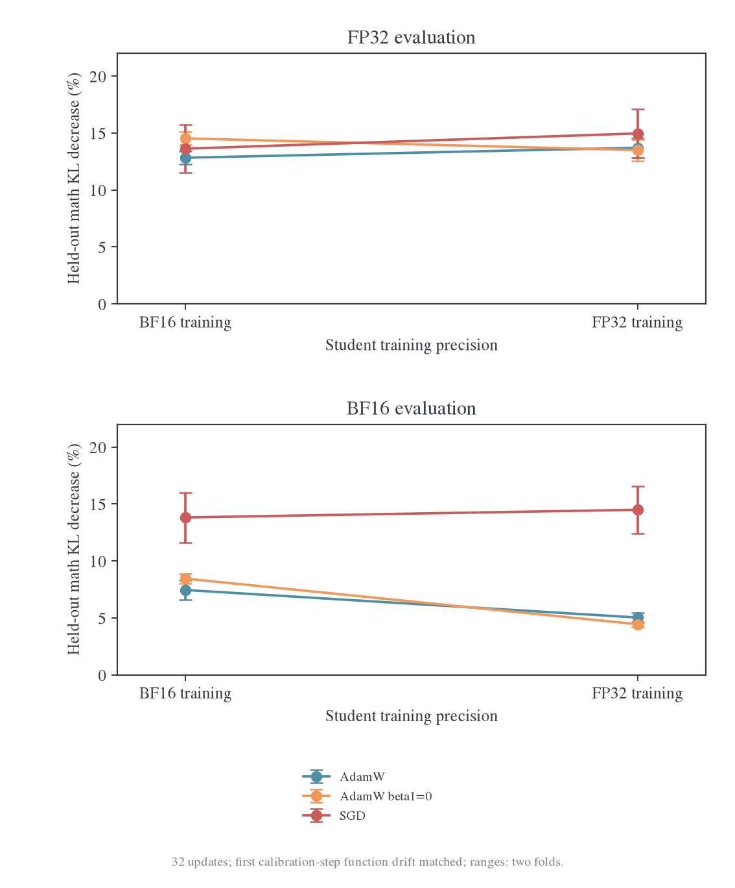
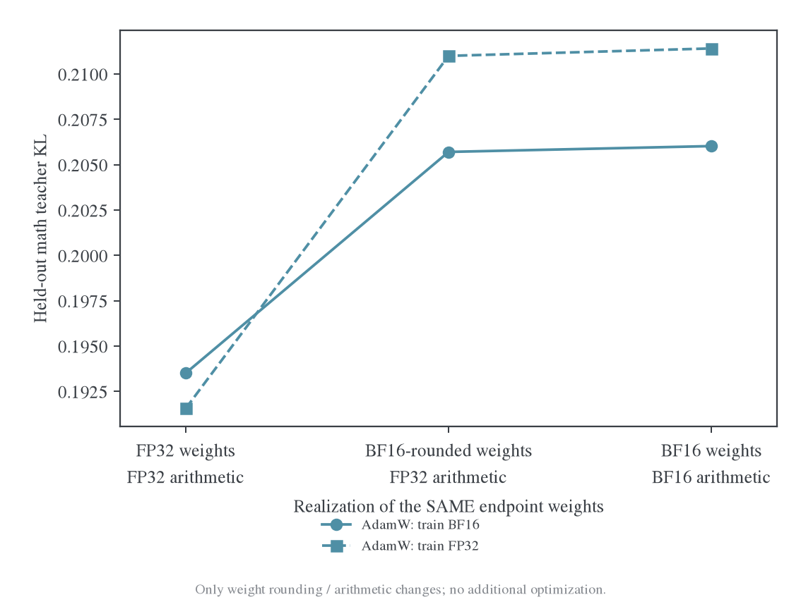
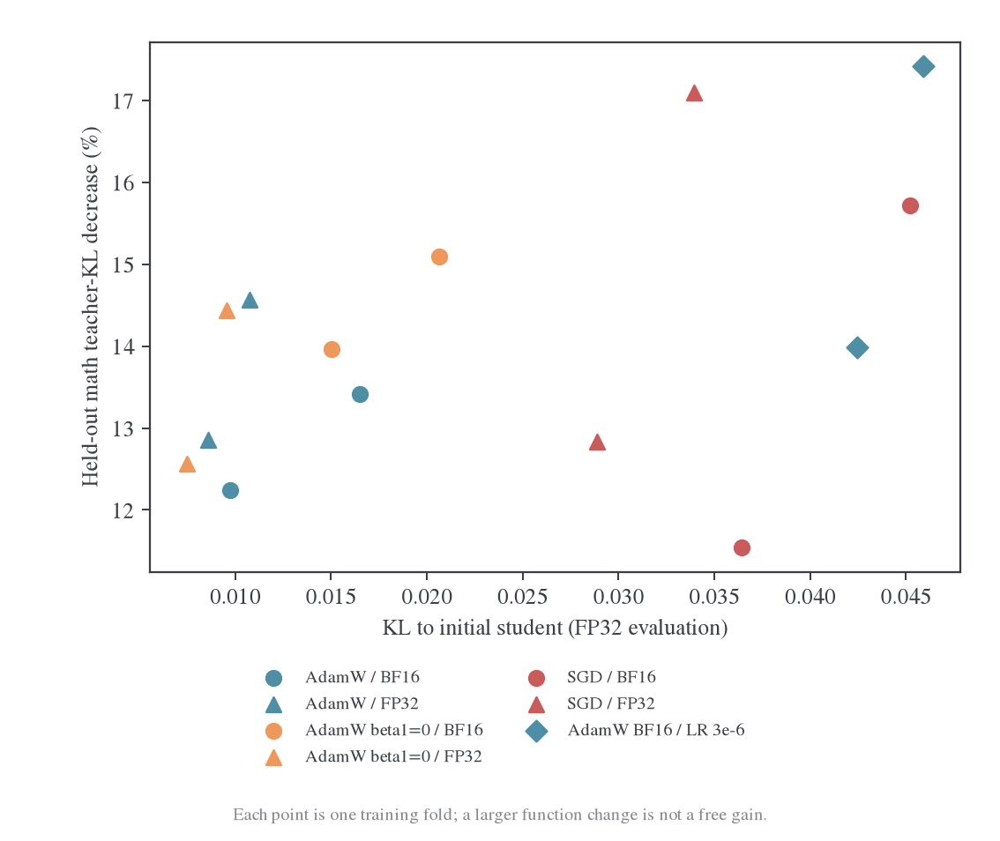
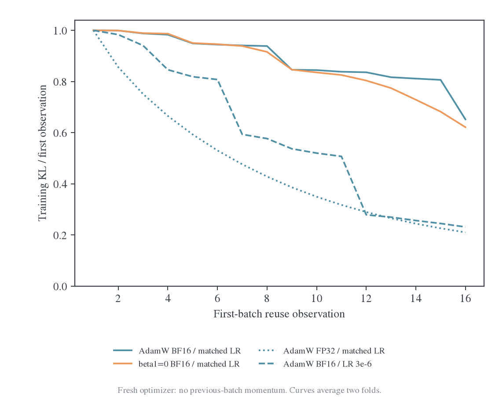

# Polaris 跨 state 拟合的优化器与精度对照

日期：2026-10-27。Student 为 DeepSeek-R1-Distill-Qwen-1.5B，teacher 为 Polaris-7B。完成 22 条全参数短训练轨迹、592 次 optimizer 更新，以及 teacher 精度和同权重读出对照。[冻结结果与复算入口](../../../../../../wandb-logs/MirrorOPD-verl/analysis/polaris-optimizer-precision-20261027/README.md)。

结论是：**改变有效步幅或 optimizer 可以改善 BF16 下的拟合，但 FP32 并没有自动消除已训练模型的跨 state 瓶颈。** 冷启动下，BF16 AdamW 将 LR 从约 1e-6 提高到 3e-6，固定 held-out 数学前缀 KL 的平均降幅从 7.45% 提高到 16.93%；无动量 SGD 为 13.82%。但在训练过的权重上，对齐初始工作策略后，FP32 虽使当前批 KL 下降 78.81%，held-out 仅下降 0.75%。更大的 BF16 AdamW 步幅也只有约 0.31% 的 held-out 改善。

精度确实参与了问题，主要证据指向**小参数更新如何被权重舍入和前向实现**，而不是 KL 标量算错、teacher 的 BF16 评分噪声，或仅仅梯度累计用了 BF16。另一方面，更快拟合当前批不等于更强的跨 state 泛化，这个差距在 FP32 中仍然存在。

## 1. 实验隔离了什么

| 条件 | 设置 |
| --- | --- |
| 参数 | 全部 1,777,088,000 个 student 参数；没有 LoRA 或仅训 head |
| 目标 | 完整词表 reverse KL；teacher 额外输出行保留完整归一化 |
| Teacher | 冻结 BF16 backbone/权重、FP32 head 投影，提前缓存原始 logits；全部训练臂复用同一份监督 |
| 输入 | 从已有冻结 student 轨迹选取；输入 token IDs、位置和 teacher logits 全部固定 |
| 初始模型主实验 | 2 组互不重叠训练题，每组 12 道数学题；分成 A/B 两批，每批 6 题，各复用 16 次，共 32 更新 |
| 训练位置 | 每题前 256 个以内的全部 response 位置；保留原来完整、最多 1024-token 的前缀输入，不用截短输入制造位置差异 |
| Held-out | 48 道数学、8 道代码、8 道 IF；另有 16 道数学题的 teacher 来源参考，单独统计 |
| Held-out 位置 | 原轨迹每 16 个 token 取一个位置；先按题平均，再跨题平均；不能当成完整在线序列 KL |
| 精度 | 工作权重与模型前反向为 BF16 或 FP32；所有主副本和 optimizer states 始终 FP32、存于 CPU |
| 共同实现 | 两种精度均使用 SDPA math，TF32 关闭；原始位置编码等 buffers 保持 FP32，改变权重精度时不转换 buffers |
| 优化器 | AdamW(.9,.999)、AdamW(0,.999)、无动量 SGD；共同 wd=0、clip=1 |
| 校准 | 4 道独立预留题，匹配首步 FP32 主副本的函数变化；不使用 held-out 的 teacher KL 选 LR |

主矩阵共 12 条：3 种 optimizer×2 种精度×2 组训练题。另有两条 BF16 AdamW LR=3e-6 对照、一条 FP32 梯度累计对照、四条暖权重续训，以及三条对齐工作权重后的暖启动对照。两组训练题不是两个独立完整训练 seed。

这里的 BF16 是本实验明确构造的 BF16 工作权重及算术，不是仅把 loss 张量转成 BF16。FP32 分支的权重、backbone 及梯度均为 FP32，TF32 关闭。两者 loss/head 输出都使用 FP32 数值路径。主 BF16 臂在工作梯度 dtype 下累计 microbatch 梯度；另加 FP32 累计控制，以核对这一点与生产 FSDP 的差别。

这是 HF 受控实现，不是 E48 的 FSDP2 端到端重放。已有暖 checkpoint 来自另一组 Polaris 蒸馏的**64 次参数更新**，不是 E48 第 64 个 outer，更不是其 4096 更新终点；其原训练使用混合精度，不能将本实验定义的 BF16 读出自动等同于其原始实现。所有暖启动臂重建 fresh optimizer，因为该 checkpoint 不含原 optimizer 状态。

## 2. 学习率校准与比较边界

先在 4 道预留校准题上，以初始 FP32 student 的冷启动 AdamW、LR=1e-6 产生参考更新。将该更新前后的平均条件 student KL 作为函数步幅目标：0.00263824。各 optimizer/精度的首步方向在这个校准集上匹配到该目标，容差 1.5%。

| Optimizer | BF16 训练 LR | FP32 训练 LR |
| --- | ---: | ---: |
| AdamW | 1.01815e-6 | 9.95513e-7 |
| AdamW beta1=0 | 同上 | 同上 |
| SGD，无动量 | 0.0140746 | 0.0138237 |

冷启动 Adam 的 bias correction 使首步与 beta1 无关，所以同精度的两个 Adam 分支共享校准 LR。SGD 与 Adam 不能共用数值相同的 LR。上述 SGD LR 是这组小实验专用的校准结果，不应直接复制到 E48 的 batch64 长回答负载。

这只对齐**首步、校准集、FP32 主副本**的函数变化，不保证之后每一步或所有 held-out state 的函数变化相同。真实训练轨迹的参数位移和函数漂移均另行记录，不能据此宣称全部 32 步的优化预算已经完全公平。

主实验 wd=0，避免 SGD 与 AdamW 采用相同 wd 数值却产生不同实际衰减。额外 native FP32 检查中，LR=1e-6 时 AdamW 的 wd=.01 与 wd=0 首步结果相同；这不是对所有实现和学习率的普遍声明。3e-6 是观察到步幅/舍入现象后加入的机制控制，不是经独立 dev 选出的最优生产配方。

## 3. 冷启动：优化器与精度的收益取决于读出方式

下表是 32 次更新后、48 道未训练数学题上的条件 KL 相对降幅，取两个训练 fold 平均。每一列都与同一种读出方式的 step0 基线比较。FP32 基线 KL 约 0.22200，BF16 基线约 0.22261；这些百分比不是准确率。

| 训练配置 | 用完整 FP32 主副本评估 | 用 BF16 工作副本评估 |
| --- | ---: | ---: |
| AdamW，BF16，约 1e-6 | 12.83% | 7.45% |
| AdamW，FP32，约 1e-6 | 13.71% | 5.03% |
| AdamW beta1=0，BF16 | 14.53% | 8.45% |
| AdamW beta1=0，FP32 | 13.50% | 4.44% |
| SGD，BF16 | 13.63% | 13.82% |
| SGD，FP32 | 14.97% | 14.49% |
| AdamW，BF16，LR=3e-6 | 15.70% | **16.93%** |

统一 FP32 评估下，几种方法的 held-out 改善都约 13%–15%，没有出现换 optimizer 就产生数量级改善。标准 AdamW 的 FP32 训练相对 BF16 训练只多约 0.88 个百分点。在 BF16 工作副本上，SGD 和更大步幅的 AdamW 则明显优于标准 AdamW。

去掉一阶动量只带来有限改善：BF16 读出从 7.45% 到 8.45%，FP32 训练后以 FP32 评估则没有改善。因此不能将跨 state 瓶颈全部归为 beta1=0.9。

BF16 读出下的跨领域结果为：

| BF16 训练配置 | Math | Code | IF |
| --- | ---: | ---: | ---: |
| AdamW，约 1e-6 | 7.45% | 3.54% | 2.25% |
| AdamW beta1=0 | 8.45% | 3.69% | 2.11% |
| SGD | 13.82% | 4.23% | 11.24% |
| AdamW，3e-6 | 16.93% | 8.25% | 5.20% |

没有逐领域一致的赢家。Code/IF 各仅 8 题，SGD 的 IF 结果在两个训练 fold 间也有较大变化。不能把分布距离的改善称为代码执行或指令遵循准确率改善。

## 4. 同一份参数，只改变其实现方式：主要差别来自权重舍入

对每个 endpoint 执行三种只读评估，teacher 和 state 完全相同，不再更新参数：

1. 原始 FP32 主副本，FP32 算术。
2. 参数舍入为 BF16 可表示值后再转回 FP32，以 FP32 算术前向。
3. BF16 工作权重，以 BF16 模型算术前向。

第二种只改变权重舍入，不改变 buffers 或 FP32 算术。它与第三种的差别才是额外的前向算术影响。

以 FP32 训练的 AdamW 为例：完整 FP32 评估改善 13.71%，只舍入权重后只剩 4.95%，完整 BF16 评估为 5.03%。**只舍入权重就几乎重现了改善损失。** 它不是把 KL 最后的求和改成 FP32/FP64 就能补救的问题。

BF16 训练的 AdamW 主副本也有类似现象：FP32 读出改善 12.83%，只舍入后为 7.34%，BF16 读出为 7.45%。SGD 的三种读出更接近，表示其获得的 teacher 拟合收益在这个实验中更能保留到 BF16 工作副本。

这并不意味着“变化的参数越多就越好”。标准 AdamW 首步虽有非零 FP32 参数位移，只有约 0.77% 的参数改变了 BF16 可见值；SGD 可见参数比例更低，却产生更大的函数变化。参数位置的重要性不同，单一的可见比例、参数 L2 或舍入误差 L2 都不能代替直接函数测量。

FP32 主副本本来就一直存在，所有 optimizer 状态也一直是 FP32。真正改变的是哪些参数值和算术被用于前向，不能把“已经保留 FP32 master”当成已消除低精度问题。

## 5. SGD 的收益还伴随更大的函数变化

在统一 FP32 评估下，BF16 训练的 SGD 最终对初始 student 的 KL 约 0.04081，标准 AdamW 约 0.01310。两者的 teacher 拟合改善却为 13.63% 和 12.83%。FP32 训练中也有类似差别：SGD 约 0.03142，AdamW 约 0.00968。

所以不能把 SGD 在 BF16 读出下的优势全部称为“更好的跨 state 学习几何”。它同时改变了更新方向、坐标分配和训练中实际产生的函数变化。初始校准没有让后续 32 步的函数漂移一直相等，也没有替代独立学习率搜索。

增大 AdamW LR 也能产生明显改善，是一个更简单的反事实：至少在冷启动下，问题不要求更换 optimizer 才能缓解。但更大的漂移不等于更高任务能力，还需要独立任务评测和长期稳定性检查。

## 6. “前几步慢”不能只归因于上一批 Adam 动量

在第一组训练题的**第一批**中，optimizer 历史为空。以前 4 个相邻操作和后 4 个相邻操作的平均训练 KL 降幅比较：

| 配置 | 前 4 次平均降幅 | 后 4 次平均降幅 |
| --- | ---: | ---: |
| AdamW BF16，约 1e-6 | 0.00358 | 0.01100 |
| AdamW beta1=0，BF16 | 0.00349 | 0.01079 |
| AdamW FP32，约 1e-6 | 0.02360 | 0.00462 |
| AdamW BF16，3e-6 | 0.01099 | 0.00301 |
| SGD BF16 | 0.01747 | 0.00456 |

标准 BF16 AdamW 的“前慢后快”在没有上一批历史时已出现，beta1=0 也保留该形状；FP32 或更大步幅则改变了它。这与小更新需要累积到足以改变 BF16 工作权重的解释一致，并有同权重舍入干预作为支持。

它没有证明 E48 的全部批初延迟由精度导致。换批后，历史方向、二阶矩和曲率仍会参与。只是不能再将完整 E48 中的同类曲线形状专门解释为“上一批一阶动量拖累新批”。

## 7. 梯度累计和 teacher 精度的控制

主 BF16 分支在工作 dtype 累计 microbatch 梯度。额外控制将每个 microbatch 的叶子梯度转换为 FP32 再累计，其他条件不变。第一 fold 的数学 KL 改善为：

| AdamW BF16 控制 | FP32 读出改善 | BF16 读出改善 |
| --- | ---: | ---: |
| 原累计方式 | 12.246% | 6.594% |
| FP32 累计 | 12.249% | 6.549% |

该差别很小，不能解释权重舍入造成的明显差距。生产 FSDP 的 reduce dtype 等细节仍与本实验不同，不能据此声称所有低精度梯度路径都已验收。

另将 Polaris 本身改为真正 FP32，在 80 条相同参考轨迹上做只读比较。为适应共享显存，FP32 参数存于 CPU，按模块搬到 GPU 执行，运算仍是 GPU FP32；不将 CPU 后端差异混入这项对照。数学 student-state 上 teacher BF16→FP32 KL 约 0.0001565，top-1 一致率 99.48%。

仅比较 teacher 自身距离仍不足以判断对 student 的影响，因此又在 16 道数学、4 道代码、4 道 IF 上，用同一个初始 student 加权计算目标差：

| 固定 student/state | Teacher BF16 时 student KL | Teacher FP32 时 student KL |
| --- | ---: | ---: |
| Math | 0.185994 | 0.183902 |
| Code | 0.281243 | 0.281658 |
| IF | 1.261345 | 1.256392 |

数学只变化约 1.13%，代码还略增。在这些参考 state 上，单纯提高 teacher 评分精度没有把高残差变成接近零。这个结果不穷尽 7K 及更长晚期轨迹，但将当前排查重点放在 student 更新的实现方式更有依据。

## 8. 暖权重：直接切精度会改变起始函数

对既有 64 次更新的 checkpoint，在本实验定义的三种读出下，数学 held-out 初值是：FP32 原主副本 0.208820、BF16 舍入后 FP32 算术 0.180408、完整 BF16 工作副本 0.180538。原 checkpoint 来自另一套混合精度实现；这里不能将某一列自动称为它原训练实现的准确复现。

这个事实本身已说明：**读取同一个 checkpoint 的 FP32 主副本，不保证保留指定 BF16 工作副本的函数。** “高精度更好”不能只按 bit 数判断。

继续 16 次更新，保持初始实验选定的 LR，不在已拟合的旧校准题上重新放大学习率：

| 暖权重续训 | 最终 FP32 评估 KL | 最终 BF16 评估 KL |
| --- | ---: | ---: |
| AdamW BF16 | 0.207748 | 0.180161 |
| AdamW FP32 | 0.193199 | 0.179655 |
| SGD BF16 | 0.208936 | 0.181788 |
| SGD FP32 | 0.185667 | 0.188045 |

FP32 SGD 相对它的 FP32 初值有 11.09% 的下降，但它仍高于切换前指定 BF16 读出的 0.180538，转回 BF16 后甚至更差。不能仅报告 11.09% 就称为改进了原工作策略。SGD 在冷启动的优势也没有自动延续到这个暖权重。

## 9. 对齐起始工作权重后：局部拟合改善，跨 state 仍弱

为排除上面的起点差异，将暖 checkpoint 参数先舍入到同一 BF16 可表示值，再存为 FP32 主副本；位置编码 buffers 不变。两分支从完全相同的数值参数、fresh optimizer 和新训练题开始。它对齐的是**本实验指定的 BF16 工作副本**，不是声称复现了原 E48 晚期精度链路。

两种算术下初始 held-out KL 分别为 0.180408 和 0.180538，差别已很小。新增的一批有 6 个未用于该 checkpoint 原训练的数学 prompt；只更新 16 次：

| 配置 | 当前训练批 KL 降幅，按训练精度评估 | Held-out 数学 KL 降幅，按训练精度评估 |
| --- | ---: | ---: |
| AdamW BF16，约 1e-6 | 44.99% | 0.11% |
| AdamW BF16，3e-6 | 73.88% | 0.31% |
| AdamW FP32，约 1e-6 | 78.81% | 0.75% |

FP32 的当前批末 KL 约 0.03119，BF16 标准步幅为 0.08099；精度对局部优化确实有很大影响。但未训练前缀仍几乎不动。FP32 训练的 endpoint 若再用 BF16 读出，held-out 改善仅约 0.13%。

这个控制是回答后期平台问题最重要的结果：**即使起始工作策略对齐、当前批明显更能拟合，仍没有看到相应的跨 state 收益。** 更大步幅也没有把它变成明显改善。因此现有实验不支持把后期弱迁移完全解释为“梯度太小”或“只要 FP32 就会泛化”。

它也不证明永久的容量下界。这里只用一个暖 checkpoint、一批新题和 16 次更新，没有原 E48 的 4096-step 参数及 optimizer 状态，不能排除更多 state 覆盖、不同目标函数或更合适的长期更新方案。

## 10. 对 E48 的实际判断

1. **可以优先正式验证 BF16 AdamW 的有效步幅。** 3e-6 在两个冷启动训练 fold 上都改善了 held-out，且比直接更换 optimizer 更简单；它未在暖权重上消除平台，也未经过独立任务 dev 选参，不能直接宣布为最优配方。
2. **去掉一阶动量不是充分修复。** beta1=0 收益有限，且 BF16 第一批延迟在没有跨批历史时依然存在。
3. **SGD 值得保留为控制组，不应直接替换生产设置。** 它在 BF16 中保留了更多拟合收益，也带来更大的函数变化；暖权重续训不保证改善。当前约 0.014 的 LR 不可直接外推到 batch64/7K 回答。
4. **FP32 研究需要同时定义工作权重、算术和读出。** FP32 loss、FP32 master、FP32 梯度累计均不等于 FP32 前向；训练 FP32 后再转 BF16 也可能丢掉收益。切换已有 checkpoint 时必须先检查起始函数变化。
5. **跨 state 瓶颈仍需研究目标与 state 覆盖。** 起点对齐后的暖实验已经把“当前批拟合不够”与“未训练前缀不改善”分开；仅提高局部优化能力没有解决后者。相关但独立的[KL 方向对照](../polaris-transfer/2026-10-27-E48后期平台与Forward-KL及知识迁移.md)不能混算成本实验的 optimizer 效果。

## 11. 限制与复现

这里测的是固定、未训练前缀上的条件分布拟合，不是当前模型重新生成后的 state 分布，也没有最终数学/代码/IF 准确率评测。训练题少、最多 1024-token 输入、梯度裁剪频率与 E48 后期不同；冷启动只有两组训练题，暖实验只有一组。结果支持机制判断和挑选正式对照，不能作为完整优化器排行榜或 E48 已被修复的证据。

核心数值检查与独立 dense FP64 参考的 loss 误差约 1.78e-15、梯度最大误差约 2.22e-16。全部 22 条训练完整结束、loss/梯度有限；输入分割、逐 step 顺序、同 state 同 view 配对、起点舍入恒等式和功能对齐均通过独立检查。`verification.json`保留逐臂裁剪次数与显存峰值。

GPU0–3 参与实验，GPU4–7 未使用。为兼容其他作业，FP32 主副本和 optimizer state 放 CPU；这些耗时不能用于比较生产吞吐。没有修改原始模型或启动大型 E48 重跑。原始数据、数值源码副本和完整命令见[冻结证据目录](../../../../../../wandb-logs/MirrorOPD-verl/analysis/polaris-optimizer-precision-20261027/README.md)。
