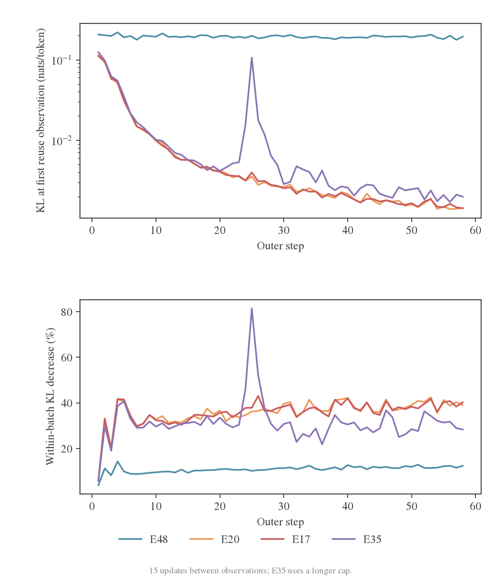
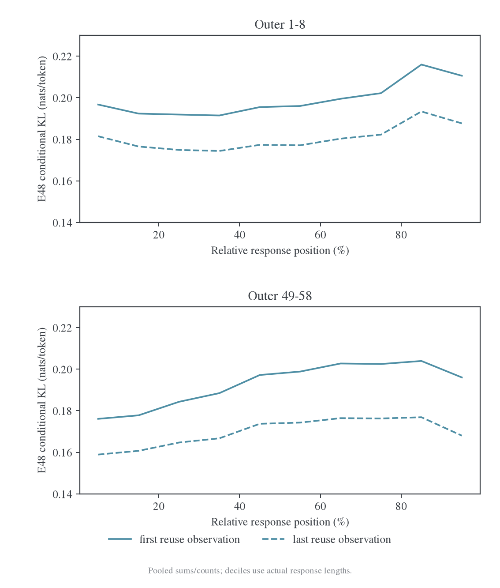
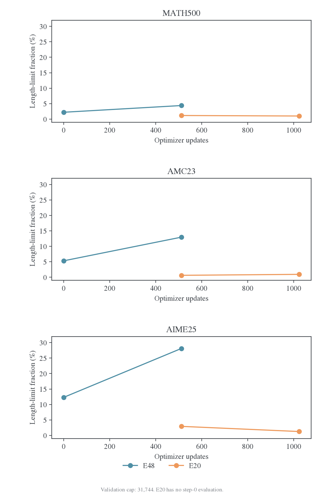

# E48 异源教师收敛诊断：批内可优化，新轨迹拟合停滞

分析日期：2026-10-26。目标 run：`grcuotmi`，`math-opd-E48-20261026-180739-2571`。完整证据和逐字段统计保存在[冻结数据目录](data/polaris-grcuotmi-20261026/README.md)。

E48 确实没有呈现同源实验那样快速的 KL 收敛。其表现是：每批固定前缀上的 KL 都能持续下降，但新一批学生轨迹上的起点 KL 一直在约 0.19；同预算的 E20 已经降到约 0.0015。已有证据支持把主要问题定位为跨源分布的拟合与迁移困难，而非 optimizer 没有更新、梯度裁剪阻断学习、词表错位或额外输出行造成的常数下界。

这个判断同时包含两条边界。第一，E48 有任务收益，不能称为“完全没有学到”：512 次更新后，MATH-500、AMC23、AIME25 的 mean accuracy 分别提高 3.825、6.719、3.750 个百分点。第二，当前只有一次训练后验证，没有固定 held-out 前缀跨 checkpoint 的观测，也没有 E48 checkpoint 可供本机重放，尚不能把剩余 KL 唯一归因于模型容量、前缀迁移或某个 optimizer 超参数。

## 1. 数据边界与公平对照

本地 `.wandb` 解码得到 987 条 history、928 条逐更新观测、58 条 outer 摘要和 1816 条周期性系统监控。最后完整 outer 为 58，最后真实 optimizer 更新为 928；验证在 outer 0 和 32，分别对应 0 和 512 次更新。原始日志最后一条完整训练输出为北京时间 22:02:21，尾部是 `partial_snapshot`，没有退出记录。

北京时间 23:12 的只读 API 核对返回 `state=failed`、`lastHistoryStep=986`、outer 58 / optimizer 928，与本地边界一致。控制台尾部停在正常的第 58 轮完成输出，没有给出停止原因。`failed` 不等于 loss 发散，也不能由当前日志认定 OOM、人工终止或基础设施故障。云端页面见 W&B[^run]。

运行记录中的代码提交为 `71a969c207213ea9013ad57b0dc9f0bd94c2fe0f`；该记录不能证明运行目录没有未提交修改。日志仓库基准提交为 `b7ba279bef7943ef0d9145f0aea3cff7354161d0`；分析时源码 HEAD 为 `c4b5812bbaa32b17f957c2be4403162c8bef686a`，工作区原有其他修改保留。

| 项目 | E48 | 主对照 E20 |
| --- | --- | --- |
| Run ID | `grcuotmi` | `lwgb5eex` |
| Student | DS-R1-Distill-Qwen-1.5B | 相同 |
| Teacher | Polaris-7B-Preview | **JustRL-DeepSeek-1.5B** |
| 数据 / prompt batch / rollout n | DAPO / 64 / 1 | 相同 |
| 训练回答上限 | 7168 token | 相同 |
| Reuse / 每批真实更新 | 16 / 16 | 相同 |
| LR / 调度 / grad clip | 1e-6 / constant / 1 | 相同 |
| 优化器 | AdamW，β=(0.9,0.999)，weight decay=0.01 | 相同 |
| 目标 | full-vocab reverse KL | 相同 |
| Backend / token chunk / vocab chunk | precompute / 512 / 8192 | 相同 |
| Teacher 评分 token budget | 32768 | 相同 |
| 训练采样 | temperature=1、top-p=1 | 相同 |
| 验证 | 500/40/30 题，各 16 答，cap=31744，T=0.7、top-p=0.9 | 相同 |
| 初始验证 | 有 | 无 |
| 配置接口 | mirror / MDPO，κ=0、η=1 | full_reverse_kl |

E20 的 teacher 不是 DS-7B。它与 student 均是 hidden=1536、28 层、151936 个输出行的 1.5B 模型；Polaris 的 hidden=3584、28 层、152064 个输出行。E20 在架构上存在一个直接可表示的 teacher 参数解；对 7B teacher，1.5B student 是否能表示全部条件分布并无同样保证。这是容量差异的依据，不能据此宣称 0.17 就是不可降低的容量下界。

检查 run 对应版本的 dispatcher 后，E48 的 `η=1 + full_vocab` 确实进入 `teacher_only_kl` 分支，调用与传统 Full-KL 相同的计算路径；没有 anchor 正则，没有 mirror target 混合。它与 [E45/E47](../length-mirror-comparison/2026-10-26-E35长窗口与E45E47镜像目标对照.md) 的 η=0.3 子问题不同，不能直接拿那些 run 的 raw objective 高度比较。

完整配置差异保存于 `config-differences.json`。除 teacher、接口和初始验证外，还存在代码版本、reward 模块路径迁移及 max_model_len 的 1 token 差异。初始验证可能改变采样 RNG 消耗，因此即使 seed 都是 42，也不能认定两组生成轨迹逐条一致。以下以相同 optimizer/outer 预算作描述性比较，不宣称单变量随机对照。

## 2. Loss 的问题发生在跨批迁移



所有 loss 都是 token 均值。每个 outer 先生成一批学生回答，再固定前缀复用 16 次；第 1、第 16 条 KL 分别来自对应更新之前的前向，两条观测之间只有 **15 次** optimizer 操作。日志没有同批第 16 次操作完成后的额外 loss。

| 观察窗口 | E48 首次 → 第16次 KL | E20 首次 → 第16次 KL | E48 批内相对降幅 | E20 批内相对降幅 |
| --- | ---: | ---: | ---: | ---: |
| Outer 1–8 | 0.199065 → 0.180524 | 0.049896 → 0.037397 | 9.26% | 29.64% |
| Outer 49–58 | 0.192789 → 0.169676 | 0.001541 → 0.000930 | 11.99% | 39.56% |

表中首末 KL 先分别跨批平均；降幅先逐批计算再平均。早期窗口已经包含学习，不能将第一行的两种起点均值当成初始模型距离。真正第一批首次 KL 为 E48 0.206262、E20 0.113520。最后一批首次 KL 分别为 0.194405、0.001450：E48 从第一批到第 58 批仅降低 5.75%，E20 降低 98.72%。按更平滑的 1–8 与 49–58 窗口比较，新批起点下降分别为 3.15% 和 96.91%。这些前缀都随策略和题目改变。

E48 的 58/58 批首末 KL 都下降，870/870 个批内相邻观测也都下降。Outer 49–58 的每批绝对降幅平均为 0.023113，甚至高于早期的 0.018541；更新在实际移动模型。相同窗口的残余 KL 则约是 E20 的 182 倍，起点约是 125 倍。

将批内收益和下一批的变化分开后，这个特征更明显。记 $A_j$ 为第 j 批首次 KL，$B_j$ 为其第 16 次观测，则前 57 个批间边界满足：

$$
A_{58}-A_1=-\sum_{j=1}^{57}(A_j-B_j)+\sum_{j=1}^{57}(A_{j+1}-B_j).
$$

| Run | 批内下降总和 | 下一批起点差值总和 | 后者 / 前者 |
| --- | ---: | ---: | ---: |
| E48 | 1.198111 | 1.186254 | 99.01% |
| E20 | 0.157858 | 0.045789 | 29.01% |
| E17 | 0.159027 | 0.048549 | 30.53% |

这是描述性恒等式，单位是逐批 KL 差的和，不能称为“99% 参数学习被遗忘”。下一批同时换题、换轨迹，并且夹着未单独观测的第 16 次更新；只有重测旧批、固定 held-out 批和新 rollout 才能拆开遗忘、泛化和分布漂移。它足以表明，E48 的批内下降没有同等地体现在后续新轨迹的起点上。

其他实验提供了边界对照：E17 在相同 928 次更新处的首次/末次 KL 为 0.001444/0.000863，与 E20 接近；长窗 E35 为 0.002006/0.001439。Reuse32 的 E19 在 928 次更新处为 0.001582/0.000655；reuse64 的 E18 最接近且不超预算的完整批为 896 次更新，0.001776/0.000450。E18/E19 消耗的新 prompt 数不同，不能用相同 outer 比较更新效率，但其结果也显示同源 teacher 的迅速拟合不是 E20 单条曲线的偶然现象。

## 3. 位置指标：整段存在差距，末段略难



按 bucket 的 sum/count 合并后，outer 49–58 的首个 10% 桶为 0.176093 → 0.158922，最后 10% 为 0.196011 → 0.168027；残余最高的 80–90% 桶为 0.176876。最后一个桶只比第一个桶高约 5.73%，最高残余桶高约 11.30%。十个桶都能在批内下降，也都保留很大的绝对差距。

前 10% 桶的首次 KL 从早期窗口的 0.196690 降到 0.176093，约降 10.47%；总体只有小幅改善。当前证据不支持把 0.17 的残余 KL 解释成“只有极少数最后位置崩了”。相对位置桶各覆盖约 10% token，单纯让回答更长、改变早尾桶的 token 权重也解释不了全部差距。

位置是相对每条实际回答长度定义的，最后一桶通常是截断前的推理，未必是最终答案或 EOS。现有日志没有按绝对位置、`</think>` 前后、正确/错误回答、stop/length 分组的 KL，也没有 token KL 分位数。因此无法从这十桶直接定位哪种语义片段产生残差。E17/E20 缺位置字段，不补造同口径位置曲线。

逐更新用十桶 sum/count 重建全局 KL，928 次观测的最大绝对误差为 `1.62e-8`；位置归约或显示误差解释不了当前量级。

## 4. 优化器、数值与系统状态

928 次更新全部实际执行。Loss 和裁剪前梯度非有限次数均为 0；梯度 norm>1 只有 8 次，全部位于最初 8 个 outer，49–58 窗口为 0。LR 始终是 1e-6，无 warmup 或衰减，也没有 entropy bonus、task reward 或额外 KL penalty。

| Outer 49–58 | E48 | E20 |
| --- | ---: | ---: |
| 第一次梯度范数均值 | 0.227650 | 0.032668 |
| 第16次梯度范数均值 | 0.142798 | 0.011535 |
| 全部更新梯度范数均值 | 0.178744 | 0.017840 |

E48 仍有可测梯度和连续批内下降，不符合“梯度消失到数值噪声”的表现。仅凭更大的梯度不能推断调大学习率就能解决问题；Adam 的参数位移还取决于历史一阶、二阶矩，日志没有参数更新范数或梯度方向一致性。

同步 rollout 的 trajectory staleness 全为 0、version span 为 1，没有 aborted/unknown finish reason，也没有空 loss mask。这说明外层生成使用了预期版本；它没有衡量同一轨迹在 16 次复用期间相对不断更新的 student 的前缀分布陈旧性。

正式 run 的硬件是 **8 张 A100 80GB**，不是本机短测的 H800。前 58 outer 共生成 23.382M response token，按 16 次复用为约 374.112M response-token 训练访问。平均每 outer，E48/E20 的 actor 时间为 104.44/83.08 秒，teacher 前向为 5.29/1.84 秒，rollout pipeline 为 33.79/33.03 秒，完整训练 outer 为 150.37/123.04 秒。E48 相同更新数下更贵，不是实际少做了更新。

E48 已记录训练 outer 时间之和为 2.423 小时，两次验证计时为 0.605 和 0.731 小时。它们是日志阶段计时，不能与内部嵌套 timer 再相加。全程周期采样各卡 GPU busy 均值为 87.84%–90.44%，显存观测峰值约 54.35 GiB，未纠正显存错误计数为 0。系统采样包含训练、验证和切换阶段，并非连续 trace；不能据此证明停止前后没有瞬时故障。

## 5. 下游表现：有收益，但长回答与预算浪费增加

以下使用唯一共同训练后验证点：outer 32 / optimizer 512。E48 的初始验证是它自己的基线，不借用其他 run 的 step 0。

| 数据集 | E48 初始 mean | E48 512 更新 mean | E20 512 更新 mean | E48 相对初始 |
| --- | ---: | ---: | ---: | ---: |
| MATH-500 | 82.750% | 86.575% | 87.488% | +3.825 pp |
| AMC23 | 68.906% | 75.625% | 86.719% | +6.719 pp |
| AIME25 | 23.958% | 27.708% | 35.000% | +3.750 pp |

任务效果与逐 token 分布拟合并非一一对应：E48 在约 0.19 的新轨迹 KL 平台上仍能提高准确率。但它在此预算下没有显示超越同源 teacher 的收益，尤其 AMC23 和 AIME25 落后约 11.09 和 7.29 pp。AIME 只有 30 题；E48/E20 的 mean 跨题 bootstrap 95% 区间为 [12.66%,41.64%]/[19.79%,50.63%]，不是训练 seed 的误差范围。当前无重复 seed 或已归档的 E48 逐题联合记录，不能给出跨 seed 显著性判断。

| AIME25 指标 | E48 初始 | E48 512 更新 | E20 512 更新 |
| --- | ---: | ---: | ---: |
| pass@16 | 46.667%（14/30） | 43.333%（13/30） | 60.000%（18/30） |
| majority@16 | 37.037% | 37.778% | 38.571% |
| all-correct@16 | 3.333%（1/30） | 13.333%（4/30） | 16.667%（5/30） |

E48 的 AIME 平均正确率和全对题数提高，但 16 次采样覆盖的可解题目数少了 1 题。它更像部分题目回答更稳定，同时探索覆盖和长尾完成率没有改善，不能仅凭 mean 上升宣称全面迁移成功。MATH-500 的 pass@16 为 95.4%→96.2%，AMC23 为 92.5%→97.5%；其他 k 的曲线全部保留于原始 history 和指标目录，不将同一组 16 答产生的多个 k 当作独立证据。



| 数据集 | E48 初始平均长度 → 512 更新 | E20 512 更新长度 | E48 初始触顶 → 512 更新 | E20 512 更新触顶 |
| --- | ---: | ---: | ---: | ---: |
| MATH-500 | 5328 → 6265 | 4604 | 2.21% → 4.39% | 1.16% |
| AMC23 | 9524 → 11526 | 6839 | 5.31% → 12.97% | 0.63% |
| AIME25 | 16095 → 20244 | 10952 | 12.29% → 28.13% | 2.92% |

E48 三个集合的验证平均长度分别增加约 17.58%、21.02%、25.78%。AIME 512 更新时 135/480 条触及 31744 token 上限，127/480 条未解析出答案；初始分别为 59 和 53。AMC23 未解析答案从 31/640 增至 78/640；MATH-500 从 166/8000 增至 345/8000。三个集合的 `failed_count` 均为 0：这里是已完成评分的回答缺少可解析答案，不能误称为评测基础设施丢失样本。聚合数据不足以判断长度触顶和解析缺失是否逐条重合。

训练侧，E48 前 58 outer 的真实 length finish 占 65.03%，E20 为 41.78%；平均回答长度为 6299/5760 token。DAPO 的平均 score 为 0.3944/0.5528。任务 score 不参与 loss，所以纯 OPD 没有直接奖励“更快给出正确最终答案”；它受到回答长度和截断的共同影响。E48 训练长度在早期与后期窗口约为 6362/6255，没有持续膨胀；更明显的恶化发生在 cap 更长的验证侧。训练 cap 限制了观测到的长度，不能由训练均值稳定排除长尾生成问题。

这给出一个有数据支持的风险链条：更难的跨源条件分布拟合，伴随更长的生成和更多截断；训练又大量停在推理中途，答案完成与自然停止位置的训练曝光有限。当前没有 E48 训练文本和重复度统计，**不能把长回答直接判成循环退化**，也不能确定这个链条各环节的单向因果。

## 6. 本机固定前缀实验

### 6.1 协议与范围

使用已保存的初始 DS-distill-1.5B 验证回答，按原始顺序各取 2 个短（<2048）、中（2048–7167）、长（≥7168）回答，prompt 去重。六个回答的原始长度为 1393、2219、21986、3924、26357、1627；前缀最多保留 7168 个 response token。在位置 0、32、128、512、2048、4096、7000 及所保留末端附近各取连续 8 个 next-token 状态，去重后共 304 个位置。

所有模型看到完全相同的 token 序列。三个 backbone 在 CPU 用 BF16 前向，选定 hidden 的输出投影和 softmax 用 FP32，8 个 CPU 线程，不占用其他任务的 GPU。输入从历史保存的文本重新分词；该实验测量初始模型在小组固定前缀上的分布差异，**不是 E48 训练后模型的测量，不是 DAPO 全体 token 的无偏均值，不是同协议教师能力评测**。每位置结果、输入及执行记录位于 `probe/`。

| 同一批 304 个位置 | JustRL-1.5B | Polaris-7B |
| --- | ---: | ---: |
| Student→teacher 平均 reverse KL | 0.081112 | 0.277708 |
| Teacher 条件熵 | 0.344261 | 0.230835 |
| Student 条件熵（共同） | 0.355558 | 0.355558 |
| 师生 top-1 一致率 | 92.43% | 90.46% |
| 已发生 token 的 teacher 平均负 log-prob | 0.305859 | 0.308995 |
| KL 最大的 31 个位置贡献比例 | 70.98% | 72.18% |
| top-1 相同位置贡献的 KL 比例 | 58.88% | 48.72% |
| Student top-32 之外的绝对 logit 梯度质量占比 | 0.342% | 0.769% |

Polaris 在这六条回答上都给出比 JustRL 更高的平均 KL，其总体距离为 3.42 倍。两个 teacher 对实际发生 token 的平均 log-prob 却接近；只盯 sampled-token likelihood 会遗漏它们对其他可能动作的明显不同判断。Polaris 更尖锐，部分 KL 来自“首选 token 相同，但备选概率差很大”，不能把全部 KL 当成推理能力差距。

例子：一个长回答的 response 7167 位置，student 和 Polaris 的 top-1 都是 `)(`。Student entropy 为 0.7788，teacher entropy 约 `8.07e-6`，reverse KL 却为 4.2915。另一个位置，两者的 top-1 分别是 `x` 和 `0`，KL 为 6.7100。这些例子仅解释概率差异，不裁定哪一个局部数学动作正确。

梯度质量使用精确的局部 logit 导数：

$$
\frac{\partial\mathrm{KL}(p\Vert q)}{\partial z_i}
=p_i\left[\log p_i-\log q_i-\mathrm{KL}(p\Vert q)\right].
$$

表中尾部比例先跨位置累计绝对梯度再除以总体，不把各位置的比例简单平均；它是 logit 梯度的 L1 质量，**不是模型参数梯度范数**。Student top-32 之外的平均概率质量仅约 0.0601%，Polaris 的绝对 logit 梯度尾部不足 1%。因此这个小实验不支持“主要精力都浪费在巨量无关低概率词表尾巴”的解释，也不能仅据此认定 top-k 截断会改善训练。

### 6.2 词表支持与数值内核

实际比较三个 tokenizer 的 151665 项 token→ID 映射及 chat template，全部相同；EOS ID 均为 151643。Student 151936 行、Polaris 152064 行的输出 head 差异是额外输出行，并不意味着有效词的 token ID 错位。

令 S 为 student 支持集，teacher 在额外行的概率质量为 m，则：

$$
\mathrm{KL}(p\Vert q)
=\mathrm{KL}(p\Vert q(\cdot\mid S))-\log(1-m).
$$

因此额外行可以产生固定前缀上的不可消除项 $-\log(1-m)$。304 个位置测得 Polaris 的 m 平均为 `2.07e-10`、最大为 `3.55e-8`，远小于 0.17。代码保留 teacher 全词表归一化，并把这个常数修正加回 loss；梯度按共同支持计算。该支持差异不能解释这组 probe 的高 KL，也没有证据表明它是训练平台的主因。

对 **run 记录的提交版本**，在不同 hidden 宽度、teacher 额外词表行的合成输入上，将 dense/precompute/streaming/cached/recompute 与直接完整 teacher-softmax 参考比较。生产使用的 precompute 在 FP32 的 loss 绝对误差为 0，梯度最大绝对误差 `9.54e-7`；FP64 梯度误差为 `1.33e-15`。这是小张量 CPU 数值检查，不替代 A100 BF16 完整训练路径验收。另运行当前工作区相关 Full-KL 与位置归约检查，46 项通过。

### 6.3 Teacher 温度的离线反事实

保持 student 和固定前缀不变，只令 teacher logits 除以 τ 后重新归一化：

| Teacher τ | Polaris KL | Polaris entropy | JustRL KL |
| --- | ---: | ---: | ---: |
| 1.00 | 0.277708 | 0.230835 | 0.081112 |
| 1.25 | 0.203481 | 0.295013 | 0.073237 |
| 1.50 | 0.166299 | 0.385284 | 0.091039 |
| 2.00 | 0.186375 | 0.953024 | 0.258659 |

Polaris 在 τ=1.5 时 KL 比 τ=1 低 40.12%，top-1 不变；τ=2 又变差。这个结果说明置信度校准差异确实参与了当前 probe 的分布距离，支持把 teacher smoothing 纳入后续小规模消融。**它改变了 teacher 目标，没有执行训练，不能声称已经解决 40% 的 E48 训练残差或证明 τ=1.5 最优。** 训练后必须同时报告原始 τ=1 teacher KL 和软化目标 KL，否则只是换了更容易下降的纵轴。

此处的 τ 是蒸馏评分 logits 的温度，不是 student rollout temperature，也不是验证 temperature。当前 full-vocab 路径是否暴露该温度需单独实现核对，不能通过修改 `actor_rollout_ref.rollout.temperature` 冒充这项消融。

### 6.4 自然结束位置反查

对六条回答中未超过 7168 token 的四条，在完整回答后的下一 token 位置另做三模型前向。Student 的 EOS 概率均大于 0.999995，JustRL 至少 0.99999988，Polaris 四个位置在 FP32 显示为 1.0；三者 top-1 都是 ID 151643。Polaris 对应 KL 为 `2.60e-6` 至 `3.00e-5`。原始结果位于 `terminal-probe/`。

因此不能直接搬用 [E41 的 EOS 类别错配诊断](../e41-base-short/2026-10-26-终止动作与循环退化诊断.md)：E48 的配置无该类词义错位，小样本自然结束前缀也没有 teacher 拒绝 EOS 的现象。四个已正确完成的初始回答不覆盖训练后困难、截断或循环前缀；长期生成何时到达结束状态仍是另一个问题。这也解释了为什么“在已完成答案后愿意停止”与“实际生成经常长到触顶”可以同时存在。

## 7. 为什么 Full-KL 可以批内下降，却迟迟不能对齐新轨迹

每个 outer 的训练实际上优化固定前缀经验目标。用 $\mu_j$ 表示该批有效 token 前缀的等权经验分布，$q$ 为 teacher：

$$
L_j(\theta)=\mathbb E_{s\sim\mu_j}\left[\mathrm{KL}\big(p_\theta(\cdot\mid s)\Vert q(\cdot\mid s)\big)\right].
$$

Full-vocab 对动作维度精确求和，降低了 sampled-action 估计噪声；它没有让前缀分布 $\mu_j$ 对参数反向传播，也没有为每次 inner update 重新生成前缀。第 16 次更新仍在第 1 次更新前生成的那些 token 状态上拟合。

对于固定长度 T 的完整轨迹，令 $d_\theta(s)$ 为上述条件 KL。真正把当前策略诱导的前缀分布也计入目标时：

$$
J(\theta)=\mathbb E_{a_{1:T}\sim p_\theta}\left[\sum_{t=1}^{T}d_\theta(s_t)\right],
$$

$$
\nabla J=
\mathbb E\left[\sum_t\nabla d_\theta(s_t)
+\sum_t d_\theta(s_t)\sum_{i<t}\nabla\log p_\theta(a_i\mid s_i)\right].
$$

第一项更新每个当前前缀上的动作分布；第二项描述早期动作如何改变未来前缀及其 KL。固定前缀 Full-KL 只显式优化第一项。这个固定长度推导用来解释两种梯度的差别；实际变长、停止和 token-mean 归一化还带来边界与长度权重问题，不能直接把公式中的 J 等同于日志标量。

另做了一个标为示意的两状态数值例子：第一步 student 与 teacher 都以 0.5 选择 A/B，下一步条件 KL 分别为 0/1。第一步的固定前缀局部梯度为 0，考虑未来状态占用的真实导数为 −0.25。它证明局部条件 KL 的优化不自动保证整体轨迹目标同方向变化，不证明 E48 的全部问题由缺少该项造成。

结合实测，最有依据的解释是：同源 JustRL 的条件策略可由同架构 student 表示，更新的收益迅速延伸到新前缀；Polaris 更大的、明显更尖锐的跨源条件分布需要在更多状态上重新拟合，批内下降难以转化为新 rollout 的同等下降。长回答和高截断进一步减少完整解答阶段的学习曝光。这里“条件分布迁移困难”有直接指标支持；“具体哪一部分由容量、前缀分布或优化器造成”仍需下面的对照辨别。

## 8. 后续实验优先级

| 优先级 | 最小对照 | 要回答的问题 | 必须同时保留的判断指标 |
| --- | --- | --- | --- |
| P0 | 同一 checkpoint 固定训练批继续拟合 16/64/256 次；另设固定 held-out 前缀，只评分 | 训练集是否也存在明显下界，还是主要不能迁移到未训练前缀 | 固定 train/held-out KL、grad、原始 teacher KL、位置/长度分组 |
| P0 | 每个 outer 同时重测上一批、固定 held-out 批和新 rollout | 批间差值来自旧批遗忘、题目差异还是新轨迹分布改变 | 三套前缀各自的 update 后 KL，不混成一条曲线 |
| P1 | Teacher τ=1/1.25/1.5，保持 student 生成温度和更新预算相同 | 更温和的 teacher 概率是否改善迁移而不只是降低目标数值 | τ=1 原始 KL、软目标 KL、mean/pass/majority、触顶和解析率 |
| P1 | Reuse=4 与 16，按实际 optimizer 数对齐，另报 prompt/token 成本 | 更频繁刷新前缀能否改善新轨迹拟合 | 新批 KL、固定 held-out KL、每更新收益与新数据量 |
| P1 | 在固定批和 held-out 上比较 LR=1e-6 与适度更大的 LR | 当前步长是否限制可拟合部分的速度 | 参数更新范数、梯度方向、训练/held-out gap，不能只看总 loss |
| P2 | 训练 cap=7168/15360，保持验证协议不变 | 完整回答与停止位置的曝光是否缓解验证长尾 | 完整结束率、absolute-position KL、答案后 EOS、验证触顶率与成本 |
| P2 | 同协议独立评测 Polaris，并与初始 student、JustRL 比较 | Teacher 在本套 cap/温度下究竟有多少可迁移能力 | 500/40/30 题×16 答的完整指标及生成长度 |

P0 优先于直接把复用次数从 16 提到 64。当前批内还有下降空间，更多 reuse 可能降低训练批 KL，但已有 99% 的批间差值抵消现象并不支持仅凭这个下降就认为全局拟合会改善。E18/E19 的同源效果不能直接外推到 Polaris。

延长训练窗口也不能作为已证实的修复。E35 在同源 teacher 上没有复现长窗 loss 崩溃，且 AIME 有一定收益；E48 验证触顶已经更严重，必须同时检查长答质量和重复度，避免只提高 cap 而把同一问题推到更远的位置。

最需要补充的日志是：固定前缀跨 checkpoint KL；student/teacher entropy；top-1 一致率和 KL 分位数；按 `</think>`、最终答案、自然停止、截断及重复度分组的 KL；绝对位置桶；参数更新范数和跨批梯度方向。当前 `mirror.diagnostics=false`，也没有 raw current/behavior pair、ESS 或 per-layer gradient，不能由已有 staleness=0 推断这些量正常。

## 9. 复算与交付

已读取的 2270 个不同 history 字段中，2145 个是评测指标，其余包含 52 个 rollout、31 个 distill、23 个 perf、12 个 optim、1 个 advantage、3 个训练坐标和 3 个 W&B 元字段。`E48-metrics.csv` 保存每个有限数值字段的观测数、首末值、范围、均值与 outer 覆盖；原始稀疏行不补零。上述正文覆盖各类独立诊断含义，不把 pass@1=mean 等重复统计反复当作额外证据。

输入、逐更新统计、配置差异、云端边界核对、CPU probe、数值检查及系统汇总均在[冻结目录](data/polaris-grcuotmi-20261026/README.md)。本目录只保存报告、PNG/PDF、绘图审计及专用脚本，不修改训练实现或启动正式训练。

从源码仓库根目录执行：

```bash
ANALYSIS=examples/mirroropd/docs/experiments/polaris-transfer/data/polaris-grcuotmi-20261026
PY=/root/.local/share/mirroropd/venvs/profile-cu128/bin/python

python3 -m examples.mirroropd.research.transfer.analyze_transfer --logs-repo ../wandb-logs --out "$ANALYSIS"
CUDA_VISIBLE_DEVICES='' "$PY" -m examples.mirroropd.research.transfer.check_run_kernel --repo . --out "$ANALYSIS/kernel-checks.json"

# CPU 模型 probe，logits 缓存放 derived，不归档到报告证据。
SOURCE=outputs/full-validation-20261022/valid-full-wall-s64-20261022-a/training/validation/0.jsonl
CACHE=outputs/polaris-transfer-cache/polaris-probe-20261026
OPENBLAS_NUM_THREADS=8 OMP_NUM_THREADS=8 "$PY" -m examples.mirroropd.research.transfer.probe_teachers \
  --models ../model --responses "$SOURCE" --out "$ANALYSIS/probe" --logits-cache "$CACHE"
"$PY" -m examples.mirroropd.research.transfer.summarize_probe --probe "$ANALYSIS/probe" --cache "$CACHE"
OPENBLAS_NUM_THREADS=8 OMP_NUM_THREADS=8 "$PY" -m examples.mirroropd.research.transfer.probe_teachers \
  --models ../model --responses "$SOURCE" --terminal-only --out "$ANALYSIS/terminal-probe"

FIGURE_VIZ_MPL=../dotfiles/.agents/skills/figure-viz/assets/mpl "$PY" -m examples.mirroropd.research.transfer.plot_transfer \
  --data "$ANALYSIS" --out examples/mirroropd/docs/experiments/polaris-transfer/figures/grcuotmi-20261026
```

复算会重写派生统计和 probe 结果，不替换冻结的训练 history。若用于新证据，应选择新目录并明确新的边界。源模型和历史响应需要本机资产；跨机器传递报告证据与图表即可阅读，不必传输 logits 缓存。没有创建离线传输包或修改开发机训练任务。

### 参考文献

[^run]: W&B. math-opd-E48-20261026-180739-2571. 2026. [grcuotmi 运行页面](https://forge.coreweave.com/wandb/wncfht/MirrorOPD-verl/runs/grcuotmi)。正文使用本地完整事件和只读 API 边界核对。
