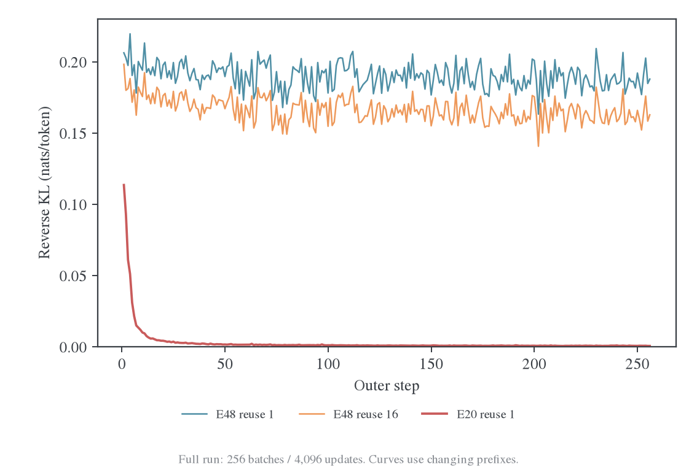
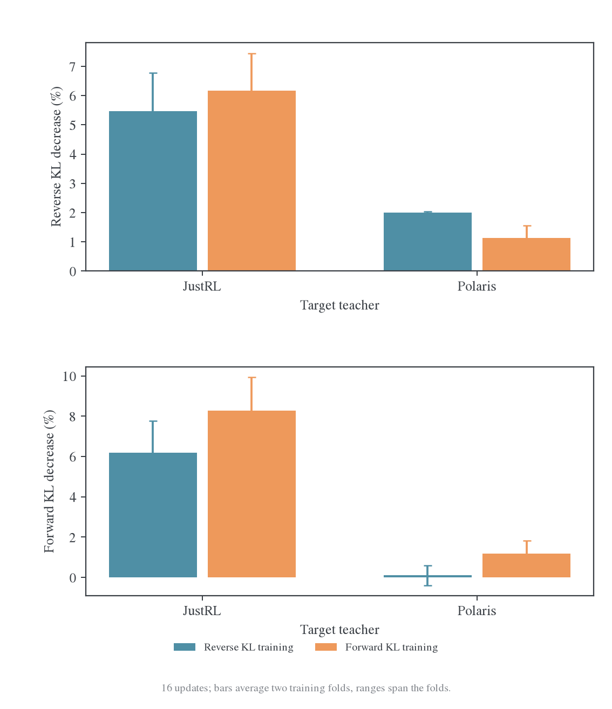
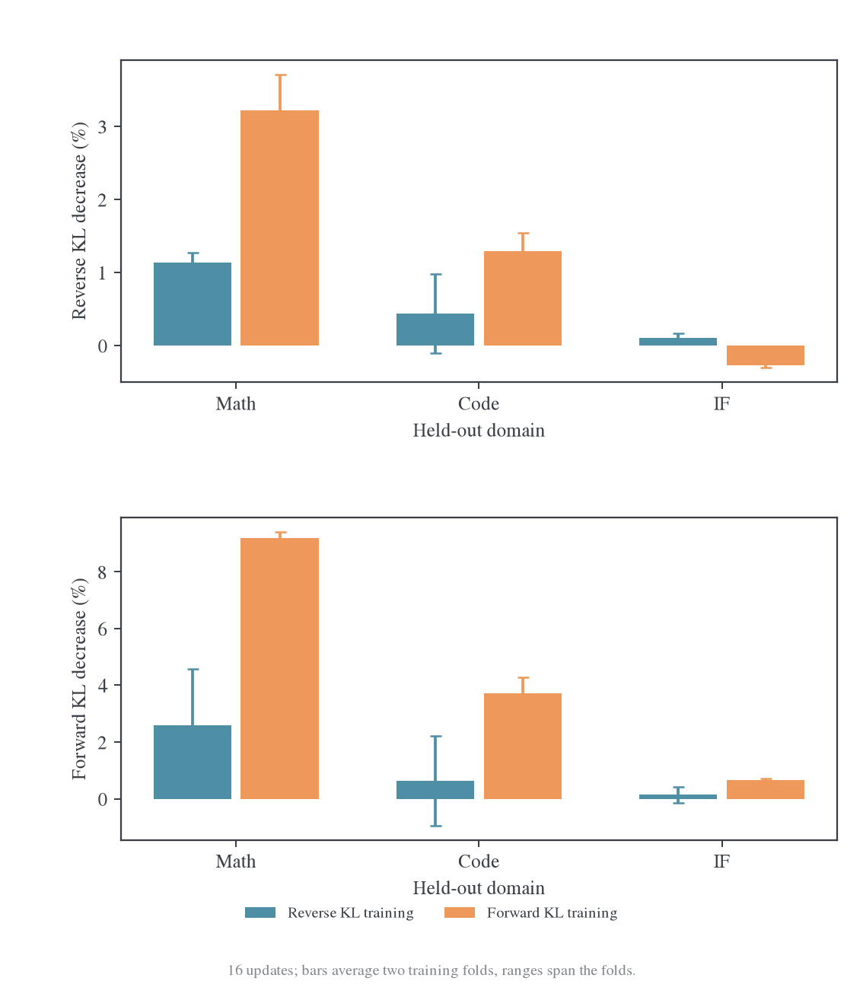

# E48 后期平台、Forward KL 与知识迁移

日期：2026-10-27。本报告读取 E48 `grcuotmi` 的完整 256 outer / 4096 更新日志，核对相关论文，并执行 12 组、每组 16 次的 Full-vocab KL 方向对照。[冻结证据与复算入口](data/forward-kl-study-20261027/README.md)包含原始日志、逐 state 指标、训练结果和原文来源。

结论是：**Forward KL 有明确的机制依据，也有直接文献和本机实验支持，值得作为正式对照；现有证据仍不足以断言它能让 E48 完全吸收 Polaris。** “RL 学来的可以吸收、SFT 学来的不可以”不是正确的二分法。更接近证据的区分是：teacher 要求的概率变化是否位于 student 可学习的范围内，监督是否暴露新增信息，以及 KL 方向是否给这些差异合适的梯度。

E48 的 teacher Polaris 本身就是 RL 后训练模型，却没有在跨源 1.5B student 上完成分布对齐；文献中又存在同源 SFT teacher 和 SFT 学得的组合技能被 OPD 有效迁移的结果。模型来源、能力类型、训练方法和蒸馏目标需要分开分析。

## 1. 完整 E48 日志：是持续的拟合平台，尚不能认定为随机噪声底

本地日志已正常结束，exit code 为 0，包含 4353 条 history、4096 条逐更新观测和 8018 条系统监控。2026-10-27 的只读云端核对为`finished`、`lastHistoryStep=4352`、optimizer4096。上一轮 58 outer 及云端 failed 只描述当时快照，不能延用为当前运行状态。

| Outer 窗口 | 每批首次 KL 均值 | 每批第 16 次 KL 均值 | 首次 KL 跨批标准差 | 更新梯度范数均值 |
| --- | ---: | ---: | ---: | ---: |
| 1–16 | 0.197617 | 0.178764 | 0.009703 | 0.309853 |
| 49–64 | 0.190038 | 0.167113 | 0.009972 | 0.178293 |
| 113–128 | 0.187917 | 0.163984 | 0.006835 | 0.177160 |
| 177–192 | 0.187237 | 0.162604 | 0.007776 | 0.178497 |
| 241–256 | 0.187482 | 0.162752 | 0.007883 | 0.178799 |

全部 256 批的首末 KL 下降，批内 3840 对相邻观测也全部下降。没有非有限 loss/梯度，没有跳过更新；仅最初 8 次更新触发 grad clip。后期仍有梯度，也仍能在每批首次到第 16 次观测间降低约 13.20%。这两个观测之间是 15 次更新，不包含第 16 次操作后的额外测量。

新批起点从第 49–64 批到最后 16 批只下降约 1.34%。完整运行的批间差值总和约抵消 99.69% 的已观测批内下降；其定义与[前一报告](2026-10-26-E48异源教师收敛诊断.md)相同，包含换题、换轨迹和未单独观测的最后一次更新，不能解释为 99.69% 的参数学习被遗忘。

末段的跨批标准差约 0.0079，远小于 0.1875 的残余均值。我们看到的是“新数据上的残差不再继续减小”，不是已经测得“同一固定输入反复前向有 0.16 随机误差”。最后 16 批中，首个位置十分桶的首末 KL 为 0.166832→0.149342，末桶为 0.196645→0.165253，最高残余在 80–90% 桶，约 0.176123。差距仍遍及整段，不是只出在少数最后位置。

同预算 E20 的最后 16 批首次/末次 KL 约为 0.000670/0.000366。E48 的对应值约为 280 倍/445 倍。Teacher 不同，因此这不是任务难度归一化后的能力比；它显示两个师生函数的拟合进度有数量级差异。

### 1.1 Full-vocab 只消除了一层估计噪声

在固定 state 上，Full-vocab 精确计算动作词表求和，消除了抽样一个动作来估计该 KL 的 Monte Carlo 噪声。它不会同时消除：

- prompt 与整条轨迹的抽样差异；同一回答中的 token 还高度相关。
- 策略改变后访问 state 分布的变化，以及同批 16 次复用的前缀陈旧性。
- 不同 state 对共享参数提出的冲突要求、student 容量约束与非凸优化。
- Adam 历史、有限学习率和 BF16 前向对实际参数更新的影响。

这些因素不意味着都已被证明是 E48 根因。当前日志支持的是稳定的批内优化与跨批平台；并没有逐 token forward KL、entropy、overlap、teacher 质量覆盖或实际参数位移指标，不能据此把平台唯一归因于“缺知识”或某个 KL 方向。

### 1.2 平台并不等于没有任务收益

| 数据集 | E48 初始 mean | E48 最终 mean | E20 最终 mean | E48 最终 pass@16 |
| --- | ---: | ---: | ---: | ---: |
| MATH-500 | 82.750% | 87.825% | 88.113% | 96.4% |
| AMC23 | 68.906% | 79.688% | 88.594% | 97.5% |
| AIME25 | 23.958% | 28.750% | 34.375% | 50.0% |

E48 的 AIME mean 在 outer96 达到 31.458%，随后没有持续增加，最终 majority@16 为 36.667%。最终 AIME 平均长度 18364，92/480 条触及 31744 上限，87/480 条未解析答案。相比初始的 59 条触顶、53 条解析缺失仍较差；但比 outer32 的 135 条触顶有所恢复，不能继续描述为整个训练阶段单调恶化。

末 16 批训练平均长度 6210、length finish 占 62.60%，任务 score 均值 0.4229。完整知识或能力吸收不能用一条 KL、一个终点 accuracy 或一个 pass 指标替代。当前也没有已核实的同协议 Polaris 独立 teacher 评测可用于计算准确的能力回收率。

## 2. 文献证据：更像能力类型和目标函数问题，不是 RL/SFT 标签定律

### 2.1 最直接的新证据：2610.09639

*On-Policy Distillation Teaches New Skills but Not New Knowledge*构造同源教师，独立增加随机查表事实、组合树执行技能或两者。教师通过 completion cross-entropy 训练；蒸馏使用**full-vocab** reverse KL。新组合技能能明显迁移，新增事实迁移较弱；改变 KL 方向后，单步事实准确率如下。[^skills]

| 模型；student prefixes | Reverse KL | Forward KL |
| --- | ---: | ---: |
| Qwen3-4B | 10.95% | 54.10% |
| Gemma-2-2B | 32.95% | 94.10% |

该实验不是 RL teacher 对 SFT teacher 的比较：两类能力都来自监督训练。它直接支持“full-vocab RKL 也可能对新增事实不敏感，FKL 可以改善”。限制是合成任务、单训练 seed、LoRA rank16 和 256-token 训练 rollout；结果不能直接等同于 E48。标题的绝对措辞也不是不可学习定理，RKL 的事实迁移本身就并非严格为零。[^skills]

### 2.2 同源 SFT 教师并非一定不能吸收

2608.16647v3 图 9 比较 DS-distill-7B 对应的 Polaris RL teacher 与 Light-R1-7B SFT teacher。两者均可使 student 达到接近 teacher 的任务表现，虽然 overlap 轨迹不同。此前图 3 又显示，同源的跨域影响也可能是负迁移。它反对“只有 RL 能力可迁移”的绝对判断，也提醒“接近 teacher accuracy”不等于完整分布或所有能力已恢复。[^coin]

### 2.3 RL 增益也不保证完全传递

2610.05974 比较 GRPO 前后 teacher 与不同 student 大小。它报告 RL 后的 teacher 更有用，但迁移缺口和 mean/pass 收益仍依模型与问题类型变化；单纯 forward 或 reverse 均非普遍最优。其 TS-OPD 对需要新解法的问题使用 forward 方向，对巩固问题使用 reverse 方向，并加入 token gating。该论文的 forward 实现是 teacher top-k partition，reverse 分支含 sampled 目标，不能当成我们的 full-vocab 复现。[^ts]

### 2.4 Forward KL 有更广的实证支持，也存在反例和适用边界

| 来源 | 与本问题相关的证据 | 不能推成的结论 |
| --- | --- | --- |
| GKD，ICLR 2024 | 独立选择 rollout 来源与 divergence，使用 student rollout + forward KL，并发现最优方向依任务而异 | OPD 的定义必然是 reverse KL |
| MiniLLM，ICLR 2024 | reverse KL 在其生成与指令任务上改善质量、校准等指标 | forward 在所有生成任务上更好 |
| 2609.35259 | 主实验本来就是 full-vocab；forward 对 rollout 来源更稳健，KL 方向与 LR 影响很大；Numina-MATH 附录中 online reverse 又有较强结果 | Full-KL 以后 KL 方向不再重要，或 forward 普遍获胜 |
| 2609.28145v2 | Qwen3-VL 的 student-prefix 比较中，RKL/FKL 蒸馏后均分 60.66/60.17，继续 RL 后为 63.02/64.87 | 蒸馏结束时的 accuracy 足以预测后续学习价值 |
| 2610.11291 | 冻结初始 student 轨迹可以优于 online 更新，也优于纯 teacher 轨迹 | 换 KL 方向就不必研究 state 来源和完整推理覆盖 |

上述来源分别见 GKD[^gkd]、MiniLLM[^mini]、受控动力学研究[^dynamics]、RL 初始化研究[^pre-rl]与 Semi-OPD[^semi]。它们使用的模型、优化预算和评测不同，适合共同确定对照因素，不适合把不同论文的百分点拼成算法排名。

Thinking Machines 的生产案例也将新知识训练与恢复既有后训练行为分开处理：它支持“OPD 适合恢复或转移策略行为”的经验观察，不证明 SFT 获得的知识永远不能经蒸馏传递。[^tml]

此外，2609.38666 分析多教师聚合的算术/几何目标，指出 reverse 对极低 teacher 概率和长程续写更敏感；E48 只有一个 teacher，不能把其多教师聚合机制直接作为本 run 的因果解释。[^aggregate]

## 3. 为什么 Full-vocab Reverse KL 仍可能学不到某些差异

固定 state，记 student 分布为 p，teacher 为 q，student logits 为 z：

$$
L_R=\sum_i p_i\log\frac{p_i}{q_i},
\qquad
\frac{\partial L_R}{\partial z_i}
=p_i\left(\log\frac{p_i}{q_i}-L_R\right),
$$

$$
L_F=\sum_i q_i\log\frac{q_i}{p_i},
\qquad
\frac{\partial L_F}{\partial z_i}=p_i-q_i.
$$

Full-vocab 计算了所有 i，却没有去掉 RKL 梯度前面的$p_i$。如果 teacher 偏好的动作在 student 下极不可能，$p_i\log p_i\to0$，RKL 在这个 logit 上的直接信号变弱，FKL 则仍有约$-q_i$的信号。反过来，student 给某动作较大概率、teacher 给它极小概率时，RKL 的 log-ratio 可以产生很强惩罚；FKL 每个 logit 坐标的导数限制在[-1,1]。

例如二元分布中，正确动作的$p=10^{-6}$、$q=0.9$，其 RKL logit 导数约$-1.60\times10^{-5}$，FKL 导数约$-0.9$。这比较的是原始 logit 梯度，**不是 Adam 实际参数位移的倍数**；共享参数、其他 state、历史二阶矩都会改变实际作用。

这给出两个合理的 FKL 作用路径：增强 teacher 支持但 student 很弱的动作；减小 teacher 极低概率引起的异常强惩罚。两者都保留在精确 full-vocab 计算中，不是换掉 sampled estimator 就能消除的性质。

但在共同支持、容量足够的条件下，两种 KL 都有$p=q$的零损失最优解。因而“某类能力不可能通过 OPD 获得”不是这些公式的结论。更准确的是：在给定 state 覆盖、参数化与有限预算下，一种目标可能难以高效学到某些差异。

### 3.1 Student-state FKL 不等于整个序列的 Forward KL

有限长度序列的 forward KL 链式分解在 teacher 诱导的前缀上取期望：

$$
\mathrm{KL}(Q\Vert P_\theta)
=\mathbb E_{y\sim Q}\sum_t\mathrm{KL}\big(q(\cdot\mid s_t)\Vert p_\theta(\cdot\mid s_t)\big).
$$

继续使用 student rollout 而只改 token 损失，实际是 student-state 上的局部 FKL 目标。它可以帮助概率匹配，但不会自动补上没有访问到的 teacher 推理路径。因此 KL 方向与 rollout 来源仍应分开消融。

## 4. 现有师生分布是否符合“缺失 teacher 动作”的情形

复用上一轮冻结的 72 条轨迹、3376 个 state，固定初始 student，分别计算完整 RKL/FKL 及精确 logit 梯度。以下数学 student-state 面板各有 768 个位置。

| 指标 | JustRL | Polaris |
| --- | ---: | ---: |
| RKL 均值 | 0.09314 | 0.18650 |
| FKL 均值 | 0.09696 | 0.14832 |
| Teacher 质量落在 student top-16 之外 | 0.5667% | 0.4896% |
| Teacher 质量满足$p<10^{-4},q>0.01$ | 0.0056% | 0.0229% |
| 出现上述弱 student/强 teacher 动作的 state 数 | 3/768 | 5/768 |
| 拼接各 state logit 梯度后的 R/F cosine | 0.8552 | 0.7468 |

Polaris 确有更大的概率差异与梯度方向差异，但这批初始数学前缀并不是“teacher 主要质量完全落在 student 不会考虑的动作上”。强 teacher/弱 student 的动作存在，平均质量却较小。这限制了将 E48 整体平台直接解释为“新增事实都在 student 支持集之外”的说法。稀有动作仍可能对完整任务重要，平均概率质量不能证明它们不重要。

另一项更明显的差异是梯度尾部：

| Polaris target；logit 梯度范数 | RKL p99 / max | FKL p99 / max |
| --- | ---: | ---: |
| Student-state | 1.110 / 1.730 | 0.842 / 1.074 |
| Polaris-state | 2.839 / 7.908 | 0.856 / 1.146 |

RKL 在跨源 teacher 自己的 state 上出现更强的单位置梯度尾部。这里是**确定性梯度在不同 state 间的差异**，不是重复前向的测量噪声，也不是全参数梯度方差。它支持进一步检查状态间优化冲突与极端 log-ratio，而不能直接证明原 run 的 0.16 平台由这些位置造成。

这些观测来自初始模型及冻结小面板，不是 E48 第 4096 次更新的 logits。当前 E48 日志没有相应指标，也没有本机可重放的原 E48 后期 checkpoint；后期是否产生了更严重的 teacher 模式遗漏仍待验证。

### 4.1 一个不能省略的支持集细节

Student head 有 151936 行，Polaris 有 152064 行。若把 student 在额外 128 行的概率定义为 0、teacher 仍有正概率，则严格的 native full-vocab FKL 为无穷大。不能直接删掉这些项后仍称其为原始 FKL。

本机对照明确采用$q_S=q(\cdot\mid S)$，将 teacher 在 student 输出支持上重新归一化。有效 token 映射已核对一致；这批数学 student-state 的 teacher 额外行最大质量约$1.35\times10^{-8}$。RKL 也使用同一$q_S$保证目标口径一致；去掉的 teacher 支持常数不改变 RKL 的 student 梯度。正式实现必须把这个支持选择写进配置与指标。

## 5. 真正执行 Forward/Reverse 全参数短训练

每组使用同样的四道数学题、前段 32 个位置/题、同一完整冻结前缀输入；held-out 为 8 道数学、4 道代码、4 道 IF，并保留三种固定 rollout 来源。初始模型对照为两 teacher×两方向×两训练 fold，共 8 组；另从本机 Polaris 蒸馏 64 步的同一 checkpoint 出发做两方向×两 fold，共 4 组。

全部使用 fresh AdamW、LR=1e-6、β=(0.9,0.999)、wd=0.01、clip=1，每组 16 步。所有 1777088000 个 student 参数参与更新；FP32 master、BF16 backbone、FP32 head 投影。优化器状态在 GPU，记录实际参数步幅。模型、原始数据及正式训练实现未改写。

每一对 R/F 实验的 step-0 全部 3376 个 state 记录逐项完全相同。训练和评估的前向输入长度也保持一致，避免改变 attention 分块混入前后差值。下面的相对降幅均使用同一评估指标作前后比较，不拿 FKL 的绝对数值与 RKL 直接比高低。

### 5.1 初始 student：改善部分指标，没有消除跨源迁移差距

16 步后的 held-out 数学前段，两个训练 fold 平均：

| Teacher / 训练目标 | RKL 下降 | FKL 下降 | JS 下降 | TV 下降 |
| --- | ---: | ---: | ---: | ---: |
| JustRL / RKL | 5.48% | 6.19% | 5.36% | 2.85% |
| JustRL / FKL | 6.17% | 8.27% | 6.59% | 3.64% |
| Polaris / RKL | 2.00% | 0.10% | 1.20% | 1.78% |
| Polaris / FKL | 1.13% | 1.18% | 1.29% | 1.70% |

Polaris 的 FKL 训练改善了 held-out FKL 和部分 JS，却没有让 RKL 下降更多，也没有达到 JustRL 的迁移幅度。在训练过的前缀上，两种方向都能大幅拟合：Polaris 的 RKL 训练使训练 RKL 下降 69.87%；FKL 训练使训练 RKL/FKL 分别下降 72.69%/77.40%。问题仍主要体现在向未训练 state 推广。

### 5.2 已训练 64 步的本机 checkpoint：切换方向更有希望

该 checkpoint 来自[扩大前缀实验](2026-10-27-交集采样与扩大前缀评估.md)的 Polaris/student 组，**不是原 E48 后期 checkpoint**。已核对原 128 道训练题与此次 24 道 probe 题没有标准化 prompt 交集。两种方向从同一参数、相同 fresh optimizer 重新开始。

| 固定 held-out 面板 / 后续目标 | RKL 下降 | FKL 下降 | JS 下降 | TV 下降 |
| --- | ---: | ---: | ---: | ---: |
| Math / 继续 RKL | 1.14% | 2.59% | 1.68% | 0.89% |
| Math / 切换 FKL | 3.22% | 9.20% | 4.97% | 2.24% |
| Code / 继续 RKL | 0.44% | 0.63% | 0.60% | 0.10% |
| Code / 切换 FKL | 1.29% | 3.72% | 2.33% | 1.06% |
| IF / 继续 RKL | 0.10% | 0.14% | 0.05% | −0.09% |
| IF / 切换 FKL | −0.28% | 0.65% | 0.04% | −0.09% |

Math 和 Code 上，FKL 的改善同时出现在 RKL、JS 和 TV，说明并非仅因换了一个更有利的 loss 纵轴。IF 则没有全面改善。这使“在已有 RKL checkpoint 处分叉比较 FKL”比单凭静态梯度提出猜想更有依据。

它仍不是任务能力或新知识吸收的证明：没有运行完整数学准确率或新增事实评测，也没有延续原 checkpoint 的 Adam 历史。相同 LR 不保证相同参数步幅；例如 fold0 的第 16 步，R/F 参数位移范数约 0.01495/0.01591，均已记录。两个 fold 是两组小训练题，不是完整训练 seed。

全部 12 组共 192 次更新完成，loss 与 gradient 有限。初始 student 组均触发 clip；已有 checkpoint 组后期部分更新不触发。这与 E48 真实 batch64 长回答不同，不能把表中的降幅当成生产学习速度。解析 logit 梯度与独立 FP64 autograd 的最大误差小于$3\times10^{-16}$。

## 6. 对“同源/异源有深刻联系”的当前解释

### 6.1 补测 7B 基座：E48 要求 student 同时拟合两种变化

Polaris 模型卡明确将 DeepSeek-R1-Distill-Qwen-7B 列为基础模型。[^polaris] 我在同一组初始 student 轨迹上另加载该 7B 模型，比较 student、名义 RL 前基座和 Polaris。Tokenizer 映射与模板一致。各领域观测位置数分别为 768、192、171：

| 固定 student-state | Student→DS-7B RKL | Student→Polaris RKL | Polaris→DS-7B RKL |
| --- | ---: | ---: | ---: |
| Math | 0.11170 | 0.18650 | 0.02239 |
| Code | 0.20888 | 0.27170 | 0.01795 |
| IF | 1.05287 | 1.23891 | 0.02061 |

**许多分布差异在 Polaris 的 RL 之前就已存在。** E20 从相同 1.5B 起点匹配其 RL 后的 JustRL；E48 却要同时吸收 7B 基座与 1.5B student 之间的差异，以及 7B 后续 RL 带来的变化。尤其 IF 上的大差距不能主要归为 Polaris 新增的 RL 行为。

这三个 KL 没有可相加的三角分解，不能用 0.02239/0.18650 计算“RL 知识占比”。为了做一个精确定义的局部分解，令$q_B$为 7B 基础模型、$q_R$为 Polaris，$g_B,g_R$为初始 student 对应 RKL 的 logit 梯度，则：

$$
g_R-g_B=-p\odot\left[\delta-\mathbb E_p\delta\right],
\qquad \delta=\log q_R-\log q_B.
$$

在拼接的数学 logit 梯度空间中，$\langle g_B,g_R\rangle/\Vert g_R\Vert^2=0.6023$，剩余增量投影为 0.3977；Code/IF 的基座投影为 0.8002/0.8539。该量可为负或超过 1，且这里**不是参数梯度、训练成本或能力的因果百分比**。它表明目标的直接 logit 监督含有大量基座适配要求，而不只是 RL 增量。恒等式数值误差小于$3.7\times10^{-7}$。

一个有区分力的后续诊断对照，是冻结初始 student $p_0$，只把 teacher 相对其基座的 log-prob 变化施加到 student 本来的分布：

$$
\widetilde q(\cdot\mid s)
\propto p_0(\cdot\mid s)\exp\!\left[\beta\big(\log q_R(\cdot\mid s)-\log q_B(\cdot\mid s)\big)\right].
$$

当同源且$q_B=p_0,\beta=1$时，它退化为原 teacher 目标；跨源时，它移除“必须复制 7B 基座分布”的直接要求。在$p=p_0$起点，匹配该目标的 RKL 梯度只含 teacher 增量；后续还含对$p_0$的约束。这是**尚未训练的诊断对照**，不是本报告已证明有效的新算法。它也明确不打算转移 7B 基座本来就有而 student 缺少的能力，不能被称为完整 teacher 吸收。

### 6.2 能力、监督暴露与可学习性需要共同判断

同源 RL teacher 经常是在 student 附近调整已有行为的概率，因而可能存在一组可共享的参数修正，在数学、代码等不同 state 上都有效。SFT 既可能引入远离 student 的事实和行为，也可能训练与 student 兼容的组合技能；RL 同样可能产生小 student 难以表示的新策略。因此训练方法标签只是分布变化的一种线索。

本组证据支持三个相互独立的瓶颈：

1. **监督暴露**：visited states 能否让 teacher 提供所需的新信息；换目标不会自动补出未访问的推理分支。
2. **目标和优化**：teacher 希望的变化是否被当前 KL 充分加权，极端 log-ratio 是否使少量 state 影响过大，更新能否推广到其他 state。
3. **可表示性与能力评估**：student 能否同时拟合这些条件分布，以及拟合改善是否转化为正确性、覆盖和完成行为。

Full-vocab 主要处理动作求和的估计问题。当前实验提示第 2 项值得干预，并给出部分积极结果；没有证明第 1、3 项已经消失，也没有把 E48 平台唯一定位成新增事实学习失败。

## 7. 下一步正式对照与应补的指标

优先从**同一份真实 E48 checkpoint**分叉，固定 prompt 顺序、rollout 预算与实际更新预算：继续 full RKL、改为公共支持上的 full FKL、以及需要时的明确混合目标。不能只比较各自训练 loss；每个分支都要同时记录 RKL、FKL、JS、TV 和 entropy。

建议保留两层对照：一层延续同一 Adam 历史，回答“当前 run 切换是否有用”；另一层都重置 optimizer 并记录实际参数步幅，回答“目标方向本身的作用”。重置单边、只匹配 LR 而不看参数位移，会混入优化器历史差异。

另应在相同 state 床上比较 DS-7B 与 Polaris 两个 teacher，以及上节的增量目标。这样才能判断瓶颈主要来自跨基座适配、RL 增量迁移，还是两者共同作用；仅比较 JustRL 与 Polaris 不能隔离这些因素。

最有区分力的额外指标是：

- Teacher top-k 质量在 student top-k 外的部分；按$q_i/p_i$、student 概率和 teacher 置信度分桶，而不只看集合 overlap。
- Teacher 高概率但 student 低概率动作的质量，以及 R/F logit 梯度在这些动作上的贡献。
- 每 token KL 与梯度代理的 p95/p99/max，按绝对位置、推理/答案阶段、正确/错误、stop/length 分组。
- 固定 S0-state、固定 teacher-state 和 fresh student-state 三套风险；旧批在后续更新后是否退化。
- 完整 mean/pass@16/majority、答案解析、长度停止、重复度，以及同协议 teacher 参考。

如果要检验“新增知识是否吸收”，还必须另建 teacher 已知而 student 初始未知的事实测试，控制 prompt 覆盖和训练泄漏。DAPO/MATH 的总体 accuracy 不能独立区分事实记忆、计算能力和推理策略。可以参考 2610.09639 的受控拆分，但应增加全参数与多 seed 验证，而非仅复制其 LoRA 单 seed 设置。

FKL 正式训练是优先级较高的实验，尤其值得在平台 checkpoint 处分叉；当前不建议把“改成 forward”直接标记为解决方案。也不能把 FKL 在 warm64 上的优势推广为“OPD 现在能吸收所有 SFT 知识”。

## 8. 交付与复算

`analyze_forward_study.py`重算完整 run 和短训练统计；`kl_direction_probe.py`提供静态梯度诊断和两方向训练；`plot_forward_study.py`生成图表。输入与命令见[证据 README](data/forward-kl-study-20261027/README.md)。原有短实验、E48 历史冻结报告保持原口径，新增报告使用完整日志边界。

### 参考文献

[^skills]: Yixuan Tang, Yi Yang. *On-Policy Distillation Teaches New Skills but Not New Knowledge*. arXiv:2610.09639v1, 2026. [原文](https://arxiv.org/html/2610.09639v1)。重点核对§3–4、附录 B.5/C，full-vocab、LoRA 和 teacher 训练方式。
[^coin]: Zhaoyi Li et al. *Every Coin Has Two Sides: On the Dual Nature of Generalization in On-Policy Distillation of Large Language Models*. arXiv:2608.16647v3, 2026. [原文](https://arxiv.org/abs/2608.16647v3)。图 9 的同源 SFT/RL teacher 对照。
[^ts]: Xiaoyu Chen et al. *Transfer-Stratified On-Policy Distillation for RL-Improved Reasoning Teachers*. arXiv:2610.05974v1, 2026. [原文](https://arxiv.org/abs/2610.05974v1)。核对主结果、routing 和附录目标实现。
[^gkd]: Rishabh Agarwal et al. *On-Policy Distillation of Language Models: Learning from Self-Generated Mistakes*. ICLR 2024. [原文](https://arxiv.org/abs/2306.13649)。GKD 独立选择 state 来源与 divergence。
[^mini]: Yuxian Gu et al. *MiniLLM: On-Policy Distillation of Large Language Models*. ICLR 2024；arXiv v6, 2026. [摘要与原文入口](https://arxiv.org/abs/2306.08543v6)。本文只作为 reverse KL 有适用优势的背景证据。
[^dynamics]: Julianna Piskorz, Antonin Berthon, Mihaela van der Schaar. *On-Policy or Off-Policy Learning? A Systematic Study of Distillation Dynamics*. arXiv:2609.35259v1, 2026. [原文](https://arxiv.org/html/2609.35259v1)。核对梯度公式、full-vocab 主设置及 Numina-MATH 附录。
[^pre-rl]: Shuai Dong et al. *RL Starts before RL: On Policy Distillation for Better Reinforcement Learning*. arXiv:2609.28145v2, 2026. [原文](https://arxiv.org/abs/2609.28145v2)。KL 方向比较使用 VL 配对，不是 Polaris 数学设置。
[^semi]: Siyan Zhao et al. *When Do We Need On-Policy Distillation? Distilling on Offline Student Rollouts Is Often Better*. arXiv:2610.11291v1, 2026. [原文](https://arxiv.org/abs/2610.11291v1)。前一轮已核对的 state 来源对照。
[^tml]: Kevin Lu et al. *On-Policy Distillation*. Thinking Machines Lab, 2025. [原文](https://thinkingmachines.ai/blog/on-policy-distillation/)。同初始化行为迁移和新知识训练后的行为恢复案例。
[^aggregate]: *Understanding Off- vs On-Policy Distillation: A Tale of Distinct Training Objectives*. arXiv:2609.38666, 2026. [原文](https://arxiv.org/abs/2609.38666)。多教师聚合理论，仅作适用边界补充。
[^polaris]: POLARIS Project. *Polaris-7B-Preview model card*. [模型卡](https://huggingface.co/POLARIS-Project/Polaris-7B-Preview)。确认 RL 方法和 DS-R1-Distill-Qwen-7B 基础模型，不把模型卡的 benchmark 数字混入本实验协议。
