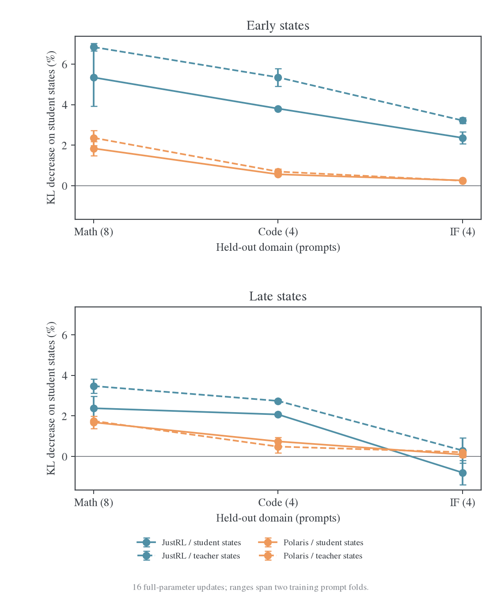
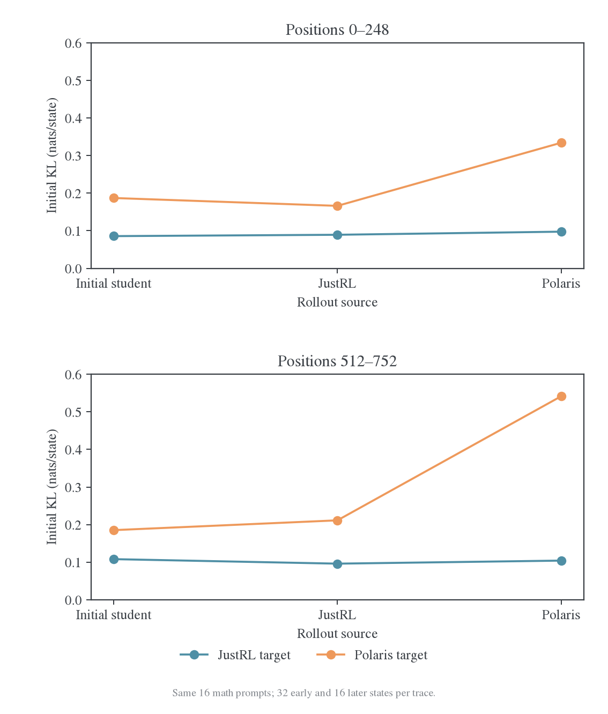

# State 分布与跨源迁移：论文核对和受控短实验

日期：2026-10-27。接续 [E48 诊断](2026-10-26-E48异源教师收敛诊断.md)。[数据与复算入口](data/state-transfer-20261027/README.md)保存全部原始轨迹、逐 state 指标、更新结果、梯度分段统计和验证记录。

受控实验支持一个比上一轮更明确、也更有限的结论：**Polaris 在训练过的固定前缀上完全可以被优化，但有限更新向未训练前缀的迁移较弱；换成纯 teacher rollout 只能小幅改善，不能单独消除这个差距。** “异源教师无法跨 state 迁移”过强，“主要是 student rollout 不够 teacher-on-policy”也没有被这些结果证实。

十组全参数短训练各完成 16 次更新，另有一次 LR=0 的数值对照。两组互不重叠的训练题得到相同方向：使用 student 轨迹训练时，同源 JustRL 的 held-out 数学、代码、IF 前缀 KL 分别平均下降 5.34%、3.81%、2.36%；异源 Polaris 为 1.84%、0.56%、0.26%。两者在真正参与训练的前缀上分别下降 75.26% 和 69.80%。这些是固定条件分布的拟合指标，**没有运行最终任务准确率评测**。

## 1. 三篇论文分别证明了什么

### 1.1 2610.11291：冻结初始 student，比纯 teacher rollout 更有支持

*When Do We Need On-Policy Distillation?* 的主要对照是当前 student rollout 与初始 student 的固定 rollout cache。论文在 17 个师生对中报告后者在 14 对上更好；初始 top-64 overlap 与相对收益相关。[^semi]

用户提到的 rollout-source 实验是图 5a/b：固定初始 student rollout 优于纯 teacher rollout。图 5c/d 在总训练 token 数对齐后显示，完整推理阶段覆盖优于只使用回答前段。图 9 的 handoff 实验进一步显示，在低 overlap 的配对中，即使从较好的固定-cache checkpoint 启动，切回 online OPD 后能回到接近原 online OPD 的表现。[^semi]

因此论文支持“兼顾 student 分布、teacher 可监督性和推理阶段覆盖”，没有给出“teacher-on-policy 越强越好”的单调规律。论文主要使用 sampled-token 目标，并补充了 top-k 目标；我们的 E48 是 full-vocab，不能将该结论当作 E48 的直接因果证据。

还有一个估计器区别：直接把 sampled-token OPD 的动作从 student 改成 teacher，会同时改变 state 分布和动作采样分布。没有相应校正时，局部梯度的期望也改变。Full-KL 则可以固定每个 state 的完整动作分布目标，只改变训练 state 来源。本报告采用后一种对照，隔离这个混杂。

### 1.2 2608.16647 图 3：模型来源影响很大，但领域并未失去作用

固定核对 v3。图 3 中同源教师通常使学生在不同 prompt 领域训练后都接近该教师；异源教师在目标领域直接训练的结果，明显好于跨领域训练。它支持“同源的领域依赖较弱、异源的领域依赖较强”，不是“异源即使同域训练也没有收益”。[^coin]

图 3c 还是一个必要的反例：数学教师 JustRL 可使学生的科学成绩下降。广泛迁移意味着教师影响不局限于训练 prompt 领域，并不意味着所有领域的能力都会提升。论文 v3 的图 9 还显示，同源 SFT/RL 教师都能有任务收益，但 overlap 的提升幅度不同；overlap 与准确率不是一一对应关系。[^coin]

所以“模型来源比粗粒度领域标签更能预测 broad transfer”是合理概括；“领域与 state 不重要”则超出了证据。

### 1.3 2604.13016 图 8：SFT 的优势不能全部归给后续 OPD

图 8 使用 Qwen3-1.7B-Base 和 Qwen3-4B Non-thinking，先在约 200K teacher 回答上做一轮全参数 SFT，再启动 OPD。SFT 曲线在 OPD 的 step 0 就已有明显准确率优势；后续 OPD 仍有收益，但幅度较小且有波动。高初始 overlap、已有能力、不同参数位置、额外数据和计算一起变化，不能单凭这张图证明 overlap 是唯一原因。[^rethink]

2610.11291 又给出对已能生成有意义回答的 student 做 SFT cold start 不一定改善最终结果的例子。两者并不矛盾：从 base 模型补足生成能力，与对已经过指令/推理蒸馏的模型继续改写行为，是不同的干预。[^semi]

2604.13016 还提出“不同位置的梯度相互抵消”作为失败解释，但原文明确表示没有直接验证。下面除了实际参数更新，也单独测量了这一点。[^rethink]

## 2. 把“迁移”拆成可识别的问题

State 在这里指文本前缀 $s=(x,y_{<t})$。同一个文本前缀可以同时交给不同模型；所谓 student/teacher-on-policy，是该前缀由哪一个策略分布产生，不是 state 自身携带的固定标签。

至少需要区分四件事：

1. **固定 state 的可拟合性**：同一批前缀反复更新后，KL 能降多少。
2. **固定未训练 state 的迁移**：不改变输入，观察其 KL 是否随训练下降。
3. **轨迹分布反馈**：更新后的 student 会走向哪些新前缀，这些前缀是否更难监督。
4. **任务能力迁移**：完整生成的正确率、覆盖率、完成率是否改善。

上一轮的“99% 抵消”把换题、换轨迹、最后一次未测的更新等合在一起，只是第 3 类现象的描述。它没有独立测量第 2 类，更不能直接代替第 4 类。本报告直接干预第 1、2 类和 rollout 来源；长程第 3、4 类留给后续正式实验。

令单 state 损失为 $d_s(\theta)=\mathrm{KL}(p_\theta(\cdot\mid s)\Vert q(\cdot\mid s))$。在训练集合 A 做一个小 SGD 步，对评估集合 B 的一阶影响是：

$$
L_B(\theta-\alpha g_A)-L_B(\theta)
\approx-\alpha g_B^\top g_A,
\qquad g_A=\nabla L_A,\quad g_B=\nabla L_B.
$$

对于 Adam，真正相关的是 $g_B^\top\Delta\theta$，其中 $\Delta\theta$ 包含动量和预条件。**Overlap 衡量候选 token 集合的重合，迁移取决于一次参数更新能否同时改善其他 state。两者有联系，但不是同一个量。**

写成 logit Jacobian 后，这个差别更直接：

$$
g_s=J_s^\top v_s,\qquad
v_s=p_s\odot\left(\log p_s-\log q_s-d_s\mathbf 1\right),
$$

$$
g_a^\top g_b=v_a^\top J_aJ_b^\top v_b.
$$

迁移同时取决于不同 state 的参数响应 $J_aJ_b^\top$，以及 teacher 要求的概率调整方向 $v_a,v_b$。Top-k 集合相似不保证这个内积为正；同域也不保证为正，跨域也不保证为负。

## 3. 小实验的设置与边界

| 项目 | 实际执行 |
| --- | --- |
| Student | DeepSeek-R1-Distill-Qwen-1.5B；每组都重新从初始权重加载 |
| Target teacher | JustRL-DeepSeek-1.5B / Polaris-7B-Preview |
| Prompt | DAPO 数学 16 题、TACO 代码 4 题、MultiIF 英文 4 题；seed=20261027；prompt 32–384 token；排除中文、外部 URL 和交互式代码题 |
| Rollout 来源 | 初始 student / JustRL / Polaris；相同 24 题，各一条，共 72 条 |
| 生成 | temperature=1、top-p=1、top-k=0（不截断 top-k）、cap=768；共同 student 模板 |
| 固定观测位置 | 前段 0,8,…,248；后段 512,528,…,752；超过实际长度的位置不补造 |
| 实际 state 数 | 3376；每个都由两种 target teacher 评分，共 6752 条初始比较 |
| 两个训练 fold | 数学 prompt 0–3 / 4–7；每组四题；仅其前段 32 个位置参与 loss，共 128 个位置/更新 |
| 固定 held-out | 数学 8–15 共 8 题；代码 4 题；IF4 题；同一轨迹后段另列 |
| 主训练臂 | teacher 两种 × source 为 student/对应teacher × 两个训练 fold，共 8 组 |
| 补充臂 | Polaris teacher 温度 1.5，student state，两个 fold，共 2 组 |
| 更新 | 各 16 次全参数 AdamW；LR=1e-6，β=(0.9,0.999)，wd=0.01，clip=1 |
| 数值对照 | Polaris、student state、LR=0，1 次完整前向/反向/optimizer 调用 |
| 计算 | 用户授权的本机 GPU0–3 剩余显存；FP32 参数与 CPU AdamW 状态、BF16 backbone、FP32 输出投影；每进程 allocator 上限 20GiB，启动前检查物理余量 |

同一学生的全部参数参与更新，不是仅训练 lm_head 或 LoRA。优化器状态在 CPU，更新后的 FP32 参数复制回 GPU；没有修改正式训练实现或原始模型目录。初始评分模型用 BF16 权重，短训练用 FP32 master，因此所有更新前后比较另有**相同 FP32-master 实现的 step-0 基线**，不混用两种初始读数。

LR=0 对照中，3376 个 state 的更新前后 KL 最大差值为 **0**。8 个主臂、2 个温度臂、1 个无更新对照共 161 次完整调用；训练梯度和 loss 有限。GPU0 有新增共享任务后，一个早期尝试被中断并从初始模型在 GPU2 重跑；不计入最终训练臂，记录单独保存在 `attempts/`。

这个规模适合检查局部拟合与迁移，不是论文级复现。数学和代码轨迹都达到 768 cap；不能由这些短前缀比较完整解题或 EOS 学习。前段稀疏 128 位置的训练负载也远小于 E48 的 64 条长回答，因而不能把下面的批内百分比当成 E48 会达到的收敛率。两 fold 是两组训练题，不是两个独立长训练 seed。

小 batch 的梯度明显大于 E48 后期：十组短训练的 160 次非零学习率更新全部触发 clip=1，LR=0 对照也触发裁剪；E48 后期则不触发。所有臂使用相同规则，但这仍是外推到正式 run 的重要限制。后续应加入实际参数位移匹配、裁剪与未裁剪的对照，不能把本表当成生产 batch 的定量学习速度。

## 4. 直接固定-input 检验：迁移确实较弱，但并非没有迁移

下表是 16 次更新后的**原始 teacher、τ=1 KL 相对降幅**，先在每个 fold 内对同组固定 state 统计，再对两 fold 平均。Held-out 列统一在初始 student 的固定轨迹上评估。

| Target / 训练 state 来源 | 参与训练的前段 | 相同训练轨迹的后段 | Held-out 数学前段 | Held-out 代码前段 | Held-out IF 前段 |
| --- | ---: | ---: | ---: | ---: | ---: |
| JustRL / student | 75.26% | 4.74% | 5.34% | 3.81% | 2.36% |
| JustRL / JustRL | 77.99% | 5.49% | 6.85% | 5.35% | 3.22% |
| Polaris / student | 69.80% | 2.48% | 1.84% | 0.56% | 0.26% |
| Polaris / Polaris | 76.04% | 5.57% | 2.36% | 0.69% | 0.24% |

图中范围只表示两个训练 fold 的最小值和最大值，不是置信区间。数值文件另保存按 held-out prompt 配对 bootstrap 的区间；题目少，且固定训练模型条件下的区间不能代表跨训练 seed 不确定性。

仅比较 student-source 的两组：JustRL 的 held-out 数学前段降幅为 6.76%/3.93%，Polaris 为 2.19%/1.49%；代码为 3.84%/3.77% 对 0.61%/0.51%；IF 为 2.07%/2.65% 对 0.26%/0.25%。在这两组训练题中，排序一致。

这个实验支持“跨源 teacher 的局部更新更难泛化到未训练 state”。它也修正了两种过强解释：

- 两者在固定训练前缀上的 KL 都下降约七成，Polaris 不存在不可优化的 0.17 数值下界。剩余差距不能简单解释为参数完全学不动。
- 即便同源，训练前段下降 75%，同一回答后段也只下降约 5%。同源并不意味着一次局部更新会无损传播到任意 state；原来的长程 E20 使用大量新题和新 state，其效果不能等同于四题短更新。

换成 teacher 自己的 state 后，Polaris 的 held-out 数学降幅从 1.84% 到 2.36%，有小幅改善，但跨领域收益仍很小；JustRL 也受益。纯 teacher-state 不是在本设置下专门修复异源困难的充分干预。对两种 teacher 的 KL 分别归一化，是比较拟合进度，不是比较绝对任务能力。

## 5. Teacher-on-policy state 为什么不一定更容易学

下面完全固定初始 student，只改变生成 state 的模型；相同 16 道数学题，位置对齐。每个 state 仍计算同一个 full-vocab reverse KL。

| Target | State 来源 | 前段 KL | 后段 KL | 前段 overlap@64 | 后段 overlap@64 |
| --- | --- | ---: | ---: | ---: | ---: |
| JustRL | student | 0.0857 | 0.1081 | 83.15% | 82.32% |
| JustRL | JustRL | 0.0893 | 0.0961 | 82.93% | 82.17% |
| JustRL | Polaris | 0.0975 | 0.1042 | 83.29% | 80.13% |
| Polaris | student | 0.1871 | 0.1853 | 65.34% | 68.94% |
| Polaris | JustRL | 0.1662 | 0.2114 | 65.23% | 68.86% |
| Polaris | Polaris | 0.3343 | 0.5417 | 62.73% | 56.38% |

Polaris 在自己的后段 state 上，比在 student 的后段 state 上有更高 KL。16 个 prompt 中 14 个如此；按 prompt 配对，KL 差均值为 +0.3565，95% bootstrap 区间为[+0.1900,+0.5516]。Overlap@64 在 16/16 题上都更低，均值差−12.56pp，区间[−14.65,−10.44]pp。这不是某一道高 KL 题单独造成的。

Polaris 在自己后段 state 上的 entropy 只有 0.2207；在 student 后段 state 上为 0.5246。初始 student 在这些 Polaris state 上的 entropy 为 0.4908。Teacher 熟悉自己的轨迹，可以给出非常尖锐的条件分布，但 student 不一定具备表示或预测这些细节的能力。

因此“teacher 更熟悉 state”“student 更容易拟合 teacher”“更新能迁移到其他 state”是三个不同问题。Teacher-on-policy 可以改善监督的语义可靠性，但不会自动消除学生侧的表示与优化难度。本实验未对这批 teacher 续写作完整正确率评测，不能把较尖锐的分布直接当成更正确的监督。

这也解释了为什么 2610.11291 的中间选择值得优先验证：保留初始 student 可到达的完整轨迹，同时避免在线生成逐步漂移，可能比直接切到纯 teacher 轨迹更合适。但这个长期反馈优势尚未由本报告的短训练证明。

## 6. Overlap 的哪些部分容易误导判断

### 6.1 低集合 overlap 不等于缺失大部分概率质量

在数学 student 前段 state 上，JustRL/Polaris 的 overlap@16 为 83.91%/69.62%，但共享 top-16 集合承载的 student 质量为**99.67%/99.49%**，teacher 质量为 99.71%/99.56%。Polaris 的集合交集确实更小，却不是与 student 几乎没有概率质量交集。

对于这批数学 state，“扩张几乎不相交的支持集”不是最直接的数据描述。主要还需要考虑共享候选之间的权重差、少数关键 state、以及这些概率修正在参数空间是否可共同实现。平均 overlap 会让大量容易预测的语法 token 与少数决定推理方向的 state 混在一起；建议同时按 student entropy、最大 token KL、推理/答案阶段和绝对位置分组。

单纯的“双方高度自信但 top-1 相反”也不足以解释这些样本：在数学 student-state 和 Polaris-state 的各 768 个观测位置中，Polaris target 都没有出现双方 max probability 均>0.95 且 top-1 相反的位置。不能把常见的饱和错误模式直接套成本组已证实的主因。

### 6.2 正信号比例不是跨 teacher 通用的质量分数

数学 student 前段中，sampled token 满足$q(y)>p(y)$的比例，JustRL 为 55.08%，Polaris 为 69.53%。Polaris 有更高的正信号比例，却有更弱的 held-out 迁移。换成 Polaris 自己的轨迹，该比例进一步升到前段 87.30%、后段 91.41%。

采样来源本身会改变这个比例：从 q 生成的动作本来就更可能被 q 偏好。它不是“teacher 认为该条推理正确”的概率，也不是对 state 可监督性的充分度量。完整动作分布上的$\sum_i p_i\mathbf1[q_i>p_i]$能消除已发生动作的抽样差异，但依然不能衡量正确性或跨 state 梯度方向。

这不否定 2610.11291 中同一师生对随训练比较正信号比例的观察；它限制的是把该指标推广为跨 teacher、跨 rollout 来源的单调评价标准。

### 6.3 论文的 overlap-token advantage 不是有正负之分的任务优势

2604.13016 将交集 C 内重新归一化的分布用于该指标。按其定义：

$$
\frac1{|C|}\sum_{i\in C}\bar p_i(\log\bar q_i-\log\bar p_i)
=-\frac{\mathrm{KL}(\bar p_C\Vert\bar q_C)}{|C|}.
$$

它总是不大于零，趋零意味着交集内部条件分布接近；值的变化还受到交集大小分母影响。它没有直接测量跨 state 梯度冲突，不能独立证明 teacher 监督方向对任务正确率有益。

### 6.4 温度对照：overlap 完全不变，原始 teacher 的 held-out 拟合却变了

对 Polaris logits 除以正温度，不改变 token 排序，因而所有初始 top-k 集合 overlap 保持不变。实际短训练后，统一回到原始τ=1 teacher 评分：

| 训练 teacher 温度；student state | 训练前段原始 KL 降幅 | Held-out 数学前段 | Held-out 代码前段 | Held-out IF 前段 |
| --- | ---: | ---: | ---: | ---: |
| τ=1 | 69.80% | 1.84% | 0.56% | 0.26% |
| τ=1.5 | 64.28% | 0.51% | 0.55% | 0.04% |

上一轮静态 probe 中，τ=1.5 让初始 KL 下降约 40%；现在执行更新后，它没有改善对原始 teacher 的迁移。这是需要修正的建议：**温度软化目前只是待研究的目标变换，不是已有证据支持的修复。** 这里只试了相同 LR 和 16 步，没评测准确率，不能排除重新调参后对任务表现的帮助，也不应因原始 KL 较差就断言其任务效果一定更差。

## 7. 梯度抵消：测到了什么，尚不能解释什么

先在训练初始点，对每个 prompt 的完整 128 位置目标中的四个样本分别得到全参数梯度。再对 8 条 student 轨迹逐条切成四个连续 64-token 区间，每区间评分 8 个位置，单独求全参数梯度。分段对照保持相同的 248-token response 前缀输入，只改变评分位置，避免改变 attention 分块形状混入数值差异。这里测的不是 logit 梯度，也不是仅 lm_head 梯度。

对四个梯度定义：

$$
C=\frac{\left\Vert\sum_{i=1}^{4}g_i\right\Vert^2}{4\sum_i\Vert g_i\Vert^2},
\qquad
\rho=\frac{\left\Vert\sum_i g_i\right\Vert^2-\sum_i\Vert g_i\Vert^2}
{(\sum_i\Vert g_i\Vert)^2-\sum_i\Vert g_i\Vert^2}.
$$

$C=0.25$对应两两正交；更低表示存在净抵消。$\rho$是按梯度范数乘积加权的 pairwise cosine，不是所有 pair 余弦的简单平均。

| 检查 | JustRL | Polaris |
| --- | ---: | ---: |
| Student-source，跨 prompt C，两个 fold | 0.2677 / 0.2533 | 0.2598 / 0.2743 |
| Student-source，初始 batch 梯度范数，两个 fold | 4.71 / 2.86 | 7.41 / 5.42 |
| 同一轨迹内四段 C，8 题均值 | 0.26750 | 0.25154 |
| 同一轨迹内四段ρ，8 题均值 | 0.03500 | 0.00456 |
| 同一轨迹内ρ<0 的题数 | 1/8 | 2/8 |

序列内分段结果在 6/8 题上是 JustRL 方向更一致，与论文提出的局部几何解释相容。但跨 prompt 排序随训练 fold 反转；Polaris 初始整体梯度也更大，不能复述为“异源信号大但梯度几乎相消为零”。

而且这些 C 对相同梯度能量对应的聚合范数因子只相差几个百分点，不能单独解释所有 held-out 迁移差距。样本只有 8 题，且 raw 梯度的余弦没有包含 Adam 预条件；该结果提供了一个局部线索，尚未建立充分的因果机制。

还有两项训练状态不能与文本 state 混淆。其一，本实验每组从 fresh Adam 开始，没有重现 E48 跨 outer 保留的动量与二阶矩。其二，BF16 前向下很小的参数变化可能表现为阶梯式输出变化；小实验的训练前向只保留所需前段，而固定评估前向包含后段，所以不直接将训练模式下的 scalar 与评估模式下的 scalar 相减。所有迁移量都在相同评估输入、同一前向方式下作前后配对，LR=0 也验证了零漂移。

仓库已有[MDPO 优化器历史与前向精度对照](../../mirror-descent/2026-10-27-MDPO优化器历史与前向精度因果对照.md)，说明当前梯度、Adam 实际参数位移和低精度前向不能互相替代。该报告研究的是η=0.3、约 1e-5 量级的 target KL 反弹；E48 是η=1、约 0.19 的 teacher KL 平台，不能把它的因果比例直接移用。对 E48 仍应保存真实 checkpoint 的参数与 optimizer 状态，分别重放保留历史、清一阶矩、fresh Adam 和范数匹配的更新。

## 8. 领域与模型来源共同作用

如果领域完全无关，同一师生对在不同领域 state 上的差距应当比较接近。我们的初始 student 轨迹中，即使只保留`</think>`之前的推理 state：

| 推理阶段 state | JustRL KL / overlap@64 | Polaris KL / overlap@64 |
| --- | ---: | ---: |
| Math | 0.094 / 82.97% | 0.188 / 66.74% |
| Code | 0.151 / 84.28% | 0.272 / 71.17% |
| IF | 0.147 / 85.35% | 1.267 / 54.44% |

JustRL 的 overlap 跨这几类 state 相近；Polaris 在 IF 上差得更多。这里只各有 4 个 code/IF prompt，且 prompt 长度和内容仍不同，不足以估计总体领域效应；但它足以反对从图 3 推出“领域几乎没有关系”。

一个更有解释力、仍待验证的模型是“共享参数修正”。对于同源 teacher，若$\theta_T=\theta_0+\delta$，在局部近似成立时，各 state 的目标 logit 变化共享同一个参数方向：

$$
z_T(s)-z_0(s)\approx J_0(s)\delta.
$$

不同领域的训练 state 可能都在识别这组共有修正，所以数学 prompt 也能影响代码或 IF。异源 teacher 没有同样的“由同一 student 参数附近的一组修正产生”保证；局部可拟合的目标在其他 state 上可能要求不同的参数变化。

这是对模型来源效应的机制假设，不是由“同源”定义直接推出的定理。局部线性化是否准确、目标变化是否低维、训练 state 是否足以识别相关参数方向，都需要实测。它比把一切归为“思维模式不同”更可检验，也保留了领域和 state 覆盖的作用。

## 9. 正式实验怎么继续

最优先的不是直接增加 reuse 或先做大规模 SFT，而是用同一套训练代码实现下面的主对照：

| Teacher | A：当前 student online rollout | B：初始 student 固定 cache | C：固定 teacher cache |
| --- | --- | --- | --- |
| JustRL | 同源在线基线 | 同源 Semi-OPD | 同源 teacher-state 对照 |
| Polaris | E48 路径 | **最优先的跨源对照** | 检验 teacher-on-policy 是否足够 |

第一轮六组都保留 full-vocab、相同 prompt 顺序、batch64、reuse16、LR 和真实更新预算。B/C 缓存使用相同生成温度和 cap，每题一条；报告新生成 token、复用 token 和实际更新数。训练目标不换成未经校正的 teacher-sampled PG，否则混入动作估计器变化。需要多个训练 seed 才能评价任务效果稳定性；短 probe 的两 fold 不能替代它。

每个 checkpoint 必须同时测：

- **固定 S0-state、固定 teacher-state、固定 held-out prompt 上的新 student-state**。前两套测可比较的拟合变化，最后一套测访问分布反馈。
- **同一批旧 state 在更新后和下一批更新后各重测一次**。这能把遗忘与新 state 变难分开。
- **同题的不同来源轨迹、不同题、同一轨迹前后段**。不能再全部混进 outer KL。
- **按绝对位置、推理/答案阶段、stop/length、正确/错误、重复度分层**。报告完整轨迹覆盖，不能把 768-token probe 外推到 7K–31K。
- **原始 teacher KL、overlap 的集合和概率质量、条件 KL、student/teacher entropy，以及实际 Adam 更新方向对 held-out 梯度的投影**。
- **同协议 teacher/student 完整任务评测**：mean、pass@16、majority、长度停止率和答案解析率。接近 teacher 分布不保证接近更好的任务表现，尤其 teacher 的非主领域。

若 B 明显优于 A，同时 A 在固定 state 上的 KL 仍下降、fresh-state 和验证长尾变差，才更有力地支持“online 访问分布反馈是主瓶颈”。若 A/B/C 在固定训练 state 上都难拟合，才应优先研究容量或优化；若都能拟合训练 state 但 held-out 很弱，则转向表示与共享修正的可学习性。若 C 改善 teacher-state 而不改善 student-state，下一步才是 student 前缀+teacher 续写或渐进混合的 bridge-state 对照。

训练 cap=7168/15360 以及前缀截断/完整轨迹覆盖应作为后续独立因素。2610.11291 已有证据表明“更短”与“覆盖完整推理阶段”必须分开；把所有样本直接截短不能复现其固定 cache 优势。温度、forward-KL/JS、SFT warm start 也应在固定 state 与目标口径清楚之后再做，不先把它们当成已经找到的答案。

## 10. 复算与验证

脚本 `state_transfer_probe.py` 提供 `prepare/generate/score/diagnose/train/geometry`；`summarize_state_transfer.py`做 prompt 配对统计；`plot_state_transfer.py`生成 PNG/PDF。命令、缓存位置和完成边界见[证据目录 README](data/state-transfer-20261027/README.md)。GPU 脚本会等待物理显存余量，不占用整卡服务池；运行前应按实际资源设置`CUDA_VISIBLE_DEVICES`。

没有启动上述六组长训练，也没有替用户部署、同步或提交代码。现在交付的是完成的机制小实验、原始证据与可复算脚本；正式训练方案需要在现有 trainer 中明确接入不同来源的固定 cache，不能仅靠改一个 teacher 路径完成。

### 参考文献

[^semi]: Siyan Zhao et al. *When Do We Need On-Policy Distillation? Distilling on Offline Student Rollouts Is Often Better*. arXiv:2610.11291v1, 2026. [论文](https://arxiv.org/abs/2610.11291v1)。核对 LaTeX 正文、rollout-source、handoff 及训练设置。
[^coin]: Zhaoyi Li et al. *Every Coin Has Two Sides: On the Dual Nature of Generalization in On-Policy Distillation of Large Language Models*. arXiv:2608.16647v3, 2026. [论文](https://arxiv.org/abs/2608.16647v3)。核对图 3、图 6、图 9 及附录；已有[逐图笔记](../../research/2026-10-26-策略蒸馏泛化的双重性实验与设置.md)。
[^rethink]: Yaxuan Li et al. *Rethinking On-Policy Distillation of Large Language Models: Phenomenology, Mechanism, and Recipe*. arXiv:2604.13016v2, 2026. [论文](https://arxiv.org/abs/2604.13016v2)。核对图 8、overlap 定义、cold-start 设置及未验证的 anisotropy 假设。
