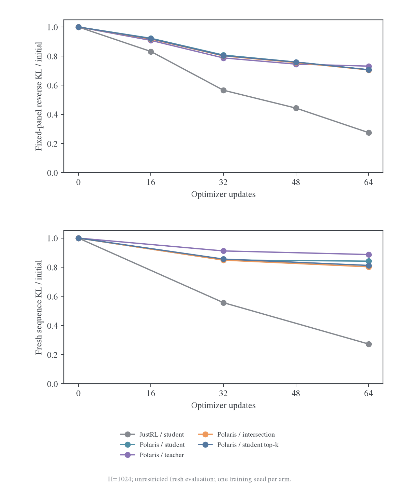
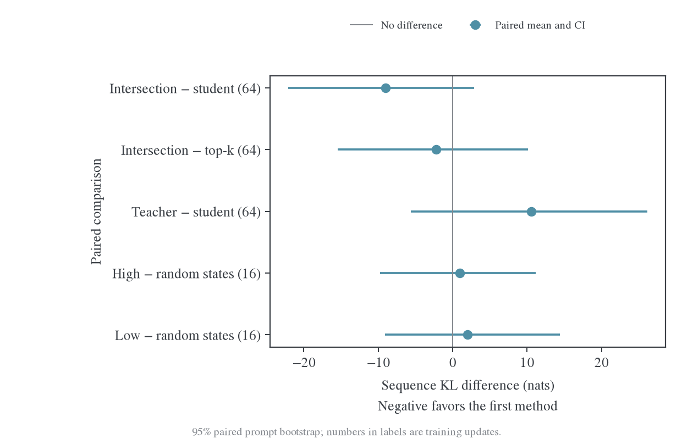

# 交集采样与扩大前缀评估：固定风险、实际访问分布与任务表现

日期：2026-10-27。接续[上一轮 state 迁移实验](2026-10-27-State分布与跨源迁移的受控实验.md)。[完整数据与复算入口](data/intersection-study-20261027/README.md)保留轨迹、逐 token 分类、训练记录、独立评估、checkpoint 位置与验证结果。

扩大实验后，“JustRL 在 student rollout 上训练，能较好迁移到其他 state”在这个配对中仍成立。64 次更新后，同源组在固定数学、代码、IF 面板上的 reverse KL 分别下降 72.51%、67.32%、39.67%；Polaris/student 组为 29.35%、14.36%、7.58%。实际 student 重新生成时的有限长度序列 KL，同源组从 115.20 降到 31.44，Polaris 组从 232.21 降到 195.41。

交集解码让训练中被选 token 的交集命中率达到 100%，但没有提高所访问 state 的平均集合 overlap。它的 fresh 序列 KL 为 186.41，普通 student top-16 控制为 188.62；两者差异的配对区间包含 0。直接挑高-overlap state 训练也没有显示稳定优于随机 state 的收益。

更重要的新现象是：**在完全相同的 student 参考前缀上，teacher-state 训练可以使 reverse KL 下降，同时使 JS 和 TV 变差。** 因此需要同时明确“在哪些 state 上平均”和“用哪一种概率距离”，再将分布对齐与任务能力分开。

## 1. 上一轮 held-out 后面的 state 究竟怎样固定

上一轮先生成完整回答并保存 token IDs。评估第 t 个位置时，始终输入原来的 prompt 和原来的前 t−1 个 response token；更新后的 student 不会替换其中任何 token。评估后段时，也仍然使用这条旧回答的前段。

所以那项实验测的是固定输入上的条件分布变化：

$$
d_\theta(s)=\mathrm{KL}\big(p_\theta(\cdot\mid s)\Vert q(\cdot\mid s)\big),
\qquad s=(x,y_{<t}^{\mathrm{fixed}}).
$$

这能直接测“前段训练是否影响另一组固定前缀”，但不是“新 student 自己生成后会到达什么 state”。如果旧参考回答已经结束，更新后的 student 却继续生成，旧参考面板不会自动包含这些额外 state。

训练使用 teacher state，held-out 也使用 teacher state，**只要 prompt 独立，并不自动构成泄漏**。它是 teacher 诱导的 state 分布上的泛化测试。问题在于，如果只报告这一列，就不能据此推断 student 实际部署时访问的 state 也改善了。因此，本实验固定三列参考来源，所有训练方法都看完全相同的三列，而不为每个方法选择最有利的 held-out。

## 2. Overlap、union、intersection 与实际选中 token 是不同对象

对同一个文本 state，使用两个模型各自的完整、未截断 softmax 分布定义：

$$
S_k(s)=\mathrm{TopK}(p_\theta(\cdot\mid s)),\quad
T_k(s)=\mathrm{TopK}(q(\cdot\mid s)),\quad
C_k=S_k\cap T_k,\quad U_k=S_k\cup T_k.
$$

本系列报告的集合 overlap 始终是：

$$
\mathrm{Overlap@k}(s)=\frac{|C_k(s)|}{k}.
$$

若用 union 作分母，则是另一个指标 Jaccard：

$$
\mathrm{Jaccard@k}(s)=\frac{|C_k|}{|U_k|}
=\frac{|C_k|}{2k-|C_k|}.
$$

例如 k=16、交集 12 个 token 时，前者为 75%，后者为 60%。不能混用名称或曲线。

“选 student top-k、teacher top-k、union、intersection”通常是在指定**采样支持集或 loss 支持集**。本实验只改变采样支持，训练 loss 一直是完整词表 reverse KL，没有把 intersection 上的条件 KL 冒充完整目标。

对实际选出的 token a，另统计四个互斥事件：

| 类别 | 集合条件 |
| --- | --- |
| 两边都在 | a∈S_k∩T_k |
| 仅 student | a∈S_k\T_k |
| 仅 teacher | a∈T_k\S_k |
| 两边都不在 | a∉S_k∪T_k |

这四类是一次动作的成员关系，不能代替整个 state 的集合 overlap。即使每次都从交集选择一个 token，交集仍然可能只有 k 个候选中的少数几个。

同时保存四个集合分别承载的 P/Q 概率质量，以及$P(C_k)$、$Q(C_k)$。集合重合与概率权重一致也不同：两个分布可以有相同 top-k 集合，却在这些 token 之间分配完全不同的概率。

不依赖 k 的点态指标包括：

$$
\mathrm{TV}(p,q)=\tfrac12\sum_v|p(v)-q(v)|,
\qquad \sum_v\min(p(v),q(v))=1-\mathrm{TV}(p,q),
$$

$$
\mathrm{JS}(p,q)=\tfrac12\mathrm{KL}(p\Vert m)
+\tfrac12\mathrm{KL}(q\Vert m),\qquad m=(p+q)/2.
$$

这些量仍然需要指定在哪个 state 分布上平均。换一个点态指标，不能自动解决 state 覆盖问题。

## 3. 三种评估对象与主指标

### 3.1 固定参考风险：比较同一输入上的拟合

Held-out 扩大到 64 道数学题、16 道代码题、16 道 IF 题。每题预先生成初始 student、JustRL、Polaris 各一条参考，共 288 条，所有模型版本复用同一组 token IDs。参考生成 cap 为 1024，来源与结果均在训练前固定。

每个领域单独计算：

$$
R_{\mu_d}(\theta)=\frac1{|X_d|}\sum_{x\in X_d}
\frac13\sum_{o\in\{S_0,J,P\}}
\frac1H\sum_{t=1}^{L_{x,o}}d_\theta(s_{x,o,t}),\qquad H=1024.
$$

题目和来源等权，EOS 后的参考位置贡献零；不会因为某条回答较短就把该来源从后段统计中删除。同时保留每个来源、位置桶的独立结果，以及按有效 token 计算的辅助均值。主风险的相对降幅是“先平均风险再求比值”，不是三个来源百分比的简单平均。

同一参考床还计算 JS、TV 和 entropy。这样可以辨别 loss 下降是否伴随其他概率关系改善。

### 3.2 Fresh 序列 KL：检查 student 实际会访问的 state

取预先指定的 32 道 held-out 数学题，每题两条采样，seed 固定为 91730/91731。在 0、32、64 更新时，从该 checkpoint 的 student 重新生成。**无论训练时是否使用 intersection 或 top-k，fresh 评估都取消这些限制，使用 temperature=1、top-p=1 的完整 student 分布。**

以同一 EOS 和固定截断 H 定义停止后的有限序列分布$P_\theta^H,Q^H$。EOS 以后是吸收状态，因而：

$$
\log\frac{P_\theta^H(y\mid x)}{Q^H(y\mid x)}
=\sum_{t\le\min(T_{\mathrm{EOS}},H)}
\log\frac{p_\theta(y_t\mid s_t)}{q(y_t\mid s_t)}.
$$

对 student 采样取期望，再对每个实际访问 state 中的动作取条件期望，得到链式法则：

$$
J_H(\theta)
=\mathbb E_x\mathrm{KL}(P_\theta^H\Vert Q^H)
=\mathbb E_{x,y\sim P_\theta^H}
\sum_{t\le\min(T_{\mathrm{EOS}},H)}d_\theta(s_t).
$$

因此整条 fresh 轨迹上完整条件 KL 的**和**，可以估计指定 prompt 分布和 H 下的序列 KL。另记录实际采样 token 的 log-ratio 之和，作为高方差的交叉检查。训练中的 token 均值、同一旧批第 16 次 reuse 的 loss，都不能直接替代 J_H。

J_H 在这里是评估指标。当前训练仍把已采样 state 及长度 mask 当作常量，优化条件 KL；它没有对 state 访问分布随参数变化的部分反向传播。因此，full-vocab 消除了动作维度的采样误差，并不使这套训练自动成为精确的序列 KL 梯度。Fresh 评估正是用来检查局部更新是否改善了实际序列分布。

这里“全局”有明确范围：这个有限 prompt 评测分布、这个 H 和这套生成协议。它不是对全部语言、全部任务和任意长上下文的全局保证。本实验 H=1024，不能把结果外推到 E48 的 7K 训练与 31K 验证范围。

### 3.3 任务与完成行为：检查目标是否有用

另外固定 32 道 MATH-500 题，与训练和固定参考 prompt 无完全相同的标准化文本。初始 student 和五个 endpoint 各生成一次，cap=4096、temperature=1、不使用 intersection 限制。采用仓库数学 grader，保留正确数、实际 stop、长度和原始输出。

这是预算受限的完成行为检查，不是标准 MATH-500 全量准确率，也不足以评价几个百分点的能力差异。Code/IF 仍只测分布拟合，没有宣称完成了代码或指令遵循任务的功能评测。

## 4. 训练设置与执行范围

| 项目 | 执行设置 |
| --- | --- |
| Student | 初始 DeepSeek-R1-Distill-Qwen-1.5B；每个主臂重新加载 |
| Teacher | JustRL-DeepSeek-1.5B 或 Polaris-7B-Preview，始终冻结 |
| 训练题 | 128 道独立数学 prompt；与 96 个 held-out prompt 分离 |
| 调度 | 4 个 outer，每批 32 题，各复用 16 次，共 64 次真实更新 |
| Rollout | 每个 outer 使用当时 student 参数；cap=1024，T=1、top-p=1 |
| 优化 | 全参数 AdamW，LR=1e-6，betas=(0.9,0.999)，wd=0.01，clip=1 |
| Loss | 全部有效 response 位置、完整词表 reverse KL、token mean |
| 主臂 | JustRL/student；Polaris/student、teacher、intersection16、student-top16，共5组 |
| 补充 | 同一固定 student 轨迹上 high/low/random state 选择，共 3 组×16 更新 |
| 数量 | 主训练 320 更新，选择对照 48 更新，总计 368 更新；不含丢弃模型的工程 smoke |
| 硬件 | 用户授权的 GPU0–3，H800 80GB；各臂独立占用一张卡，第 5 组排队运行；GPU4–7 未参与 |

Intersection 实际采样策略是：

$$
r_C(a\mid s)=\frac{p_\theta(a\mid s)\mathbf1[a\in C_{16}(s)]}{P_\theta(C_{16}(s))}.
$$

先从原始 p 提出 token；若不在 C 中，再按 p 在 C 上的条件分布重采。proposal 与重采使用独立随机流。空交集时回退到 student top-16 并明确计数；本实验空交集次数为 0。Top-k 控制使用$p_\theta(\cdot\mid S_{16})$。两者都保留支持集内的 student 相对概率，不是 teacher 加权或均匀采样。Teacher 模式在 student 可输入的输出行上采样 teacher，以兼容 head 宽度差异；loss 和所有 teacher 评分仍保留 teacher 原生全词表归一化。

Student 使用 FP32 master 参数与 FP32 LM head 投影，backbone 使用 BF16 autocast；teacher 用 BF16 权重与 FP32 输出投影。固定参考轨迹由 BF16 HF 生成器生成，来源标签指初始 checkpoint；它们作为固定评测输入，不要求与 fresh 采样实现逐位相同。Fresh 序列 KL 在实际采样时使用同一套概率直接计算。该独立 HF 实验没有冒充生产 FSDP2 run 的逐位复现。

四个非 intersection 主臂各产生 131072 个新 response token、2097152 次训练 token 访问；intersection 为 130744 和 2091904，差约 0.25%。每组题数和更新数相同，长度差异保留。主臂的 clip 次数依次为 JustRL/student 30、Polaris/student 25、teacher 56、intersection 26、top-k 25，均为 64 次中的次数；不再像上一轮微型实验那样每次都裁剪。全部 loss 和梯度有限，已完成 endpoint 保存。

## 5. 扩大 held-out 以后，同源迁移结论仍成立

下表是 64 次更新后，相对各自初始 teacher 风险的降幅。三个领域的固定风险均使用相同的三来源参考面板。

| Teacher / 训练 state 来源 | 数学固定 RKL↓ | Code 固定 RKL↓ | IF 固定 RKL↓ | Fresh J_1024 初始→最终 |
| --- | ---: | ---: | ---: | ---: |
| JustRL / student | 72.51% | 67.32% | 39.67% | 115.20 → 31.44 |
| Polaris / student | 29.35% | 14.36% | 7.58% | 232.21 → 195.41 |
| Polaris / teacher | 26.89% | 11.82% | 8.63% | 232.21 → 205.98 |
| Polaris / intersection | 29.47% | 13.89% | 7.50% | 232.21 → 186.41 |
| Polaris / student top-k | 29.36% | 13.89% | 7.49% | 232.21 → 188.62 |

JustRL 的改善不局限于某一种参考来源，也不局限于训练领域。Polaris 有真实下降，但速度和跨域幅度明显较小。这支持这个具体师生对上的条件分布迁移差异，不把“共享来源”单独识别为唯一原因；teacher 大小、后训练经历等也同时不同。

Fresh 评估中，初始 student、JustRL/student 和 Polaris/teacher 的平均长度均为 1024；Polaris 的 student、intersection 和 top-k 三组均为 1020.59。因此，intersection 相对普通 student 的 J 差异不是简单由平均回答更短造成的。所有这些采样仍主要受 1024 cap 限制，不能解释长程自然停止。

## 6. 如果只看 teacher 来源的 held-out，会得到不同印象

仅看数学、分别保留三种固定参考来源：

| 训练方法 | 初始 student 参考 | JustRL 参考 | Polaris 参考 |
| --- | ---: | ---: | ---: |
| JustRL / student | 73.30% | 71.14% | 72.95% |
| Polaris / student | 20.58% | 23.37% | 36.18% |
| Polaris / teacher | 8.14% | 10.84% | **42.90%** |
| Polaris / intersection | 20.12% | 22.78% | 36.88% |
| Polaris / student top-k | 20.28% | 22.94% | 36.52% |

Teacher-state 训练确实最擅长改善 Polaris 来源的参考前缀，但在 student 来源上只降 8.14%，而普通 student-state 训练降 20.58%。只看最后一列，就会高估它对实际 student 分布的改善。这个现象不是 held-out 泄漏，而是评测分布不同。

JustRL 一行在三种参考来源上接近，提供了较强的广泛拟合证据。Code/IF 上的数字仍然只是向该 teacher 的分布靠近；它不保证任务能力一定提高，尤其 teacher 在非主领域可能并不更强。

## 7. 实际 token 有多少在交集、并集或两者之外

初始 fresh 评估中，两种 teacher 下的 student 生成路径逐条完全一致，共 65536 个 token。因此下面是在同一组 state 和同一组实际动作上比较两个 teacher，k=16：

| 实际 token 类别 | JustRL：数量 / 比例 | Polaris：数量 / 比例 |
| --- | ---: | ---: |
| 两边都在 | 64805 / 98.8846% | 64630 / 98.6176% |
| 仅 student top-k | 259 / 0.3952% | 434 / 0.6622% |
| 仅 teacher top-k | 66 / 0.1007% | 75 / 0.1144% |
| 两边都不在 | 406 / 0.6195% | 397 / 0.6058% |

两组“不在 student top-k”的数量相同，均为 472，因为 student 和路径相同。Polaris 下不在 teacher top-k 的 token 为 831，即 1.2680%。因此，交集限制删除的是一小部分原始 student 采样质量，并非把大量完全不共享的动作改成共享动作。

同一组 Polaris 比较改变 k 后，结果如下：

| k | 两边都在 | 仅 student | 仅 teacher | 两边都不在 | 集合 overlap@k |
| --- | ---: | ---: | ---: | ---: | ---: |
| 8 | 96.8353% | 1.3275% | 0.2930% | 1.5442% | 73.6036% |
| 16 | 98.6176% | 0.6622% | 0.1144% | 0.6058% | 71.6010% |
| 64 | 99.7421% | 0.1434% | 0.0183% | 0.0961% | 67.1508% |

k 增大时，被选 token 的交集命中率更高，集合 overlap 的比例却更低。不同 k、不同分母及不同归约方式的曲线不能直接互换。

对应的初始平均集合 overlap@16 为 JustRL 82.43%、Polaris 71.60%；$P(C_{16})$约 98.96%/98.66%，$Q(C_{16})$约 99.05%/99.24%。完整词表的$1-\mathrm{TV}$则约 89.14%/87.50%。这些数值不同是正常的：交集很重，不代表交集内部概率分配一致。

整个四个 outer 中，Polaris 普通 student 组的实际 token 交集命中率为 99.16%、state 集合 overlap 为 71.79%；intersection 组分别为 100% 和 71.31%；student-top-k 组为 99.57% 和 71.55%。Teacher-source 组实际交集命中率高达 99.86%，state 集合 overlap 却只有 66.68%。

这直接说明：**把被采样 token 限制在交集，没有使整个 state 的候选分布更重合。** Intersection 在 130744 个有效生成 token 中拒绝并重采 945 个 proposal，约 0.723%；没有发生空交集。逐 token 类别、被拒位置及 overlap 轨迹均有保存；k=8、16、64 的统计分别存在，不能把 intersection@16 的保证套到 k=8。

64 次更新后，取消所有采样限制重新生成，Polaris 两组各有 65318 个有效 token：

| 类别 | 普通 student 训练组 | Intersection 训练组 |
| --- | ---: | ---: |
| 两边都在 | 65104 / 99.6724% | 65118 / 99.6938% |
| 仅 student | 152 / 0.2327% | 145 / 0.2220% |
| 仅 teacher | 13 / 0.0199% | 10 / 0.0153% |
| 两边都不在 | 49 / 0.0750% | 45 / 0.0689% |

这些 fresh state 的集合 overlap@16 分别只有 70.48% 和 70.34%。JustRL 组的实际交集命中率为 99.37%，反而略低，但集合 overlap 达到 88.42%，序列 KL 也低得多。实际动作命中交集的比例不能用作跨方法的整体对齐排名。

## 8. Intersection 有额外收益，但当前证据够不够

Polaris 普通 student 组的 fresh J 为 195.41，intersection 为 186.41，top-k 控制为 188.62。点估计上 intersection 最好，但其相对普通 student 的差为−9.00 nats，95% 配对 prompt bootstrap 区间为[−22.09,+2.90]；相对 top-k 控制为−2.21，区间[−15.43,+10.11]。

这些区间包含 0，不能宣布 intersection 稳定优于普通 student，更不能把它的全部点估计收益归给 teacher 交集：普通 student top-k 已得到接近的结果。区间只刻画这组训练模型条件下的 prompt 不确定性，不包含跨训练 seed 变动，也不是等效性检验。

本实验只检验了$p(\cdot\mid C)$。若改成$q(\cdot\mid C)$、均匀分布或$p^{1-\alpha}q^\alpha$在 C 上的归一化，即使支持集相同，也会产生不同 state 分布。当前结果不能推广为所有 intersection 策略无效；它说明“保证 token 在交集”本身不是充分条件。

## 9. 直接挑高-overlap state，是否更容易迁移

从完全相同的初始 student 第一批 32 条轨迹中，每条取 256 个位置。High/low 按初始 overlap@16 排序，随机打破 ties；random 均匀抽取。三组输入始终保留完整轨迹，只改变 loss 位置；每次 8192 个训练位置，各做 16 次更新，fresh 评估不受选择规则约束。

| 选择规则 | 初始 overlap@16 | 初始 KL | Student entropy | 平均参数步幅 | Fresh J_1024 最终 |
| --- | ---: | ---: | ---: | ---: | ---: |
| High | 86.27% | 0.2107 | 0.8814 | 0.03514 | 218.97 |
| Random | 72.41% | 0.2187 | 0.6272 | 0.03492 | 218.01 |
| Low | 56.62% | 0.2057 | 0.3666 | 0.03405 | 219.99 |

三组共同初始 J 为 232.21。High−random 的差为 +0.97，配对区间[−9.76,+11.15]；low−random 为 +1.98，区间[−9.12,+14.37]。没有看到高-overlap 组稳定更好的迁移。

这里 high 并非只选了低 loss、低 entropy 的容易位置：初始 KL 与其他组接近，entropy 反而更高。固定 k 会把一个几乎确定的 token 和其后的许多低质量候选一起计数；高集合 overlap 可能偏向候选更多、两模型不确定性更高的 state。这是一个需要与 overlap 分开控制的因素。

选择规则还改变了其他 state 属性，因此它是“高-overlap 筛选策略”的实验，不能孤立证明 overlap 本身无因果作用。当前 16 步、单个 32 题训练池、统一 LR 与裁剪，也不能排除更长训练或其他选择规则的收益。三组均触发 16 次裁剪；实际参数步幅相近，结果不是某一组完全没有更新。

## 10. 更严格地分解固定 state 拟合与访问分布变化

对相同 32 道 held-out 题及两个采样 seed，保存初始模型产生的 state 分布 d0 和 endpoint 产生的 d1。然后重新做完整交叉评分：初始/最终参数，分别在旧/新 state 上计算 KL。四格均使用相同 teacher-forcing 评分实现。

记$L_{ij}=\mathbb E_{s\sim d_j}\sum_t d_{\theta_i}(s_t)$，则按初始 state 为参照：

$$
\underbrace{L_{00}-L_{11}}_{\text{净下降}}
=\underbrace{L_{00}-L_{10}}_{\text{旧 state 上的参数拟合收益}}
-\underbrace{(L_{11}-L_{10})}_{\text{新访问分布的代价}}.
$$

| 方法 | 初始参数/旧 state | 最终参数/旧 state | 最终参数/新 state | 参数拟合收益 | 新访问分布代价 |
| --- | ---: | ---: | ---: | ---: | ---: |
| JustRL/student | 115.22 | 31.33 | 31.44 | 83.90 | +0.12 |
| Polaris/student | 232.20 | 185.94 | 195.40 | 46.26 | +9.45 |
| Polaris/teacher | 232.20 | 214.89 | 205.93 | 17.31 | −8.96 |
| Polaris/intersection | 232.20 | 186.89 | 186.54 | 45.31 | −0.35 |
| Polaris/top-k | 232.20 | 186.73 | 188.41 | 45.47 | +1.68 |

这批样本中，JustRL 对旧 state 的下降基本保留到了新 state。Polaris/student 的访问分布代价点估计为 9.45；intersection 与 top-k 并没有提高旧 state 拟合收益，点估计上的 fresh 优势主要出现在访问分布项。这比把两个不同训练 batch 的 loss 相减更可解释，因为 prompt、评估参数和评分方式都被明确固定。

但 Polaris/student 访问代价的配对区间为[−2.50,+22.17]，仍包含 0。不能将点估计解释为已确证的全局漂移惩罚。该分解也依赖参照顺序，不是唯一的因果百分比分解；完整四格数据同时保存，便于使用新 state 作另一种参照。

旧报告的“99% 抵消”是另一条 run、另一种长度预算、不同 batch 之间的描述性恒等式，不能称为泛化失败比例。本实验点估计约 20% 的旧 state 收益未保留到新 state，既不能替代原 run 的数值，也不能与 99% 直接比较。

交叉评分与生成时在线累计 KL 之间，各组对角线均值最大差为 0.215 nats，远小于主要变化。该数是跨组均值误差的最大值，不是每个单样本的最大误差。

## 11. 同一 state 上，RKL 下降也可能伴随 JS/TV 变差

这项检查不涉及新旧 state 切换。只看固定数学 student 参考前缀，对 Polaris：

| 训练 state 来源 | RKL 变化 | JS 变化 | TV 变化 | Student entropy 初始→最终 | Teacher entropy |
| --- | ---: | ---: | ---: | ---: | ---: |
| Student | −20.58% | −2.99% | −6.03% | 0.5919 → 0.4087 | 0.4639 |
| Teacher | −8.14% | **+23.47%** | **+7.18%** | 0.5919 → 0.3096 | 0.4639 |
| Intersection | −20.12% | −1.83% | −5.44% | 0.5919 → 0.4020 | 0.4639 |

在 Polaris 自己的参考 state 上，teacher-state 训练后的 student entropy 为 0.2504，接近 teacher 的 0.2416；但在 student 参考 state 上，它比 teacher 更尖锐。这与“在 teacher-state 上学到的置信度模式并不适合其他 state”的解释相符，尚不是对唯一根因的证明。

这里 reverse KL 的下降是真实的，不是计算错误。它只能说明这个非对称风险降低，不能表述为所有分布关系都改善。对固定三来源均衡数学面板，teacher-state 组的 RKL 下降 26.89%，JS 却上升 8.78%，TV 只下降 1.79%；JustRL/student 则分别下降 72.51%、69.85%、48.06%。

JS 与 TV 实现另外使用独立的扩展支持集表达式核对，最大绝对误差分别约 5.96e-8 和 1.19e-7。两模型 head 大小不同的 teacher 额外行被明确计入，并非因截掉 teacher 尾部而得到这些关系。

## 12. 分布对齐不等于数学能力已经提高

独立 32 题、每题一答、4096 cap 的结果为：

| 模型/训练方式 | 正确数 | 自然 stop 数 | 平均 response 长度 |
| --- | ---: | ---: | ---: |
| 初始 student | 21/32 | 21/32 | 2819 |
| JustRL/student | 22/32 | 23/32 | 2558 |
| Polaris/student | 20/32 | 18/32 | 2931 |
| Polaris/teacher | 23/32 | 22/32 | 2372 |
| Polaris/intersection | 22/32 | 18/32 | 2815 |
| Polaris/top-k | 21/32 | 18/32 | 2766 |

各方法相对初始 student 的正确率差异配对区间均包含 0。Teacher-state 的序列 KL 不是最好的，正确题数点估计却最高；这不能证明它最优，但足以说明不能用一条 loss 曲线代替任务评测。

Grader 会对非 boxed 答案做 fallback 判分；空`pred`不一定意味着回答判错，正确数与自然 stop 也不要求相等。所有原始回答和 grader 结果保留，不把缺失的标准化预测冒充系统评分失败。

## 13. 建议长期保留的指标与判断规则

| 问题 | 应保留的观测 | 不应使用的替代判断 |
| --- | --- | --- |
| 固定输入是否拟合得更好 | 固定来源×领域×位置的 RKL、JS、TV、entropy | 下一批训练 loss 更低 |
| 是否改善实际 student 分布 | unrestricted fresh J_H、长度、EOS 与 sampled log-ratio 核对 | 仅 teacher-state held-out 更好 |
| 是否只是选择了容易 state | 同一评测床、固定预算、选择组的初始 KL/entropy 与参数步幅 | 训练集高 overlap 或低 loss |
| 交集策略是否有额外价值 | Student top-k 控制；完整采样权重定义；paired fresh 差异 | 被选 token 全部在交集 |
| 是否迁移了任务能力 | 同协议、足够题数/采样数的功能评测 | 任一概率距离下降 |

对当前这组模型，结论可以收紧为：同源 teacher 的条件分布改善更广；Polaris 的局部拟合收益较难覆盖实际 student 访问分布；交集和 top-k 干预的点估计有小幅 fresh 收益，但尚无稳健的额外交集优势；高集合 overlap 不是可靠的单独 state 选择规则；teacher-state 还可能引入跨 state 置信度不匹配。

下一步若研究“更好的 state”，应明确比较$p(\cdot\mid C)$、$q(\cdot\mid C)$或几何混合等不同权重，并保留相同的独立评测床。若用 held-out 梯度来选择 state，还需再留一份最终未用于选择的 test，避免把筛选指标本身优化成成绩。更长 H、更多独立训练 seed 和完整功能评测仍然必要；本实验没有找到一种只凭 overlap 就能保证良好迁移的构造。

## 14. 交付与复算

专用脚本为 `intersection_study.py`、`summarize_intersection.py`、`analyze_intersection_controls.py`、`audit_intersection_study.py`、`plot_intersection_study.py`。数据和运行命令见[冻结证据目录](data/intersection-study-20261027/README.md)。五个主臂 endpoint 保存在日志仓库`outputs/polaris-transfer-cache/intersection-study-20261027/checkpoints/`；未覆盖原始模型。

训练/held-out 划分、288 条固定参考完整性、无约束 fresh 评估、四类 token 及概率质量归约、368 次更新、相等 state 选择预算、交叉分解恒等式和六组任务输出均通过独立核验。概率质量四类之和的最大归一化误差约 1.51e-7。图表提供 PNG/PDF 和审计结果，训练过程与评估完整落盘，没有上传 W&B 或改动开发机任务。
