# 双来源 Rollout 的跨批次迁移：重跑协议与历史证据

更新：2026-10-27。**状态：协议已确定，R 系列尚未实现、生成数据或启动训练与测试；等待用户通知有卡后执行。** 新研究比较初始学生与教师两种固定 rollout 训练来源，JustRL 和 Polaris 各重跑两个分支，共四个训练分支。旧 L 系列只作为历史证据，不通过补测旧 checkpoint 充当新实验。

原[研究总览](2026-10-27-跨源蒸馏泛化研究总览.md)第四节的全部表格、曲线、跨批矩阵，以及 L 的设置、第五节来源对照和相关复算说明已迁入本文；原文保留研究结论及专题链接。已有图和原始证据继续使用原路径，没有建立归档副本。本文第 1–6 节是待执行的 R 协议，第 7–10 节是已完成的历史实验，二者的预算与结果分开记录。

| 阅读目的 | 位置 |
| --- | --- |
| 确认四个训练分支及预算 | [研究问题](#protocol)、[训练](#training) |
| 确认 20×2×2 评估布局、固定与自由 rollout | [数据与来源](#banks)、[指标与评估频率](#metrics) |
| 判断来源是否改善跨题目迁移 | [诊断与判据](#diagnostics) |
| 后续上机执行和结果交付 | [执行与保存](#execution) |
| 查看原 40 批实验设置 | [L 设置](#series-l) |
| 查看逐批 KL 曲线和矩阵 | [B1 跨批结果](#transfer)、[L 单遍结果](#long-pass) |
| 查看已有自由 rollout 结果 | [L 的 fresh 评估](#historical-fresh) |
| 查看早期 teacher 来源对照 | [S/I 来源对照](#state-source) |

<a id="protocol"></a>
## 1. 研究问题与四个重跑分支

主问题是：在相同题目、相同训练预算和同一初始学生下，改用固定 teacher rollout，能否让 Polaris 的更新更持续地改善未训练题的 student state，并让收益保留到当前 student 自由生成中？“教师来源”仅指 state 的生成器；训练目标始终是原生 full-vocabulary reverse KL（RKL），不改为 SFT 或 forward KL（FKL）。

| 分支 ID | 固定目标 teacher | 训练轨迹来源 | 初始参数与优化器 | 完整预算 |
| --- | --- | --- | --- | --- |
| R-J-S | JustRL-DeepSeek-1.5B | 初始 student S0 | 原始 student，新的 AdamW | 20 批×16 更新=320 更新 |
| R-J-T | JustRL-DeepSeek-1.5B | 固定 JustRL | 同上，独立训练 | 同上 |
| R-P-S | Polaris-7B-Preview | 初始 student S0 | 同上，独立训练 | 同上 |
| R-P-T | Polaris-7B-Preview | 固定 Polaris | 同上，独立训练 | 同上 |

Student 为 `DeepSeek-R1-Distill-Qwen-1.5B`，实际参数量 1,777,088,000。两种 teacher 的参数量和后训练历史不同；J/P 对照不能单独识别“同源”这一因素的因果效应。新研究真正受控的干预是：**同一个 teacher 下，改变训练 state 来源 S/T。** 两种 teacher 共用 S0 参考，自己的 T 参考不同；跨 teacher 的主要比较放在共同 S0 state 上。

四个分支从头训练，总计 **1,280 次逻辑 optimizer 更新**。旧 L 的 640 次更新不计入 R。训练 seed 固定为 42，只有一个题目顺序和一个训练 seed；轨迹重复与 prompt bootstrap 不替代独立训练重复。

<a id="banks"></a>
## 2. 题目、两种固定轨迹与当前学生自由轨迹

### 2.1 固定 40 批题目

复用旧 L 的 `prompts.json` 中 640 道题的 ID、prompt token IDs、分组和顺序。它们已排除旧 S/I/B 用题；R 与 L 共享题目，故不是独立题目复现。新训练过程中不筛题、不按模型表现重排、不补充“容易收敛”的题目。

| 分组 | 批次 | 每批题数 | 总题数 | 是否进入 optimizer |
| --- | --- | ---: | ---: | --- |
| 训练 math | A–T，20 批 | 16 | 320 | 是，各批只进入一个连续训练区间 |
| 留出 math | M01–M12，12 批 | 16 | 192 | 否 |
| 留出 code | Code01–Code04，4 批 | 16 | 64 | 否 |
| 留出 IF | IF01–IF04，4 批 | 16 | 64 | 否 |

来源数据为 DAPO/TACO/英文 MultiIF。复用已冻结的 student chat template 与 prompt IDs，teacher 收到相同的 prompt，禁止给 teacher 单独增加系统提示或换模板。训练与留出按标准化 prompt 文本互斥。留出已经用于历史诊断，本文将其称为诊断性 holdout，不宣称是未被研究过程接触的最终封存测试集。

### 2.2 三套物理银行、每个 teacher 的两套评估银行

新实验统一生成器实现与数值路径，**重新生成** S0、JustRL、Polaris 三套固定银行，每套 640 条，每题一条，共 1,920 条主参考轨迹。S0 银行只生成一次，四个分支共用；J/P 各自的 teacher 银行由对应的两个分支共用。旧 L 的 `bank.json` 不作为 R 的训练输入，避免旧 BF16 HF 生成器与新来源解码路径不一致。

固定采样协议：temperature=1，top-p=1，不做 top-k 截断、不做交集约束；最大 response 长度 H=1024，遇共同 student tokenizer 的 EOS 停止，EOS 本身计入有效 response 位置，EOS 后不评分。使用 BF16 backbone 与 FP32 head 投影的同一自回归实现，记录模型加载 dtype、实际投影 dtype、EOS ID、采样支持集和库版本。初始学生与固定 teacher 的权重都来自各自原始 checkpoint；当前 student 自由生成使用训练中的 FP32 主权重。

Polaris 输出 head 比学生多 128 行。教师采样使用其在学生输出支持集上的条件分布 $q_c(v\mid s)=q(v\mid s)/\sum_{u\in V_p}q(u\mid s)$，$v\in V_p$；这些 ID 必须能输入双方模型。训练和原生 RKL 评分仍保留教师全 head 的 softmax 归一化。因而 Polaris 的 T 银行严格称为“共享支持上的 teacher rollout”，不称为未修改的完整 teacher 分布。额外行的概率质量单独统计。保留所有合法模型 token ID，包括输出 head 的占位行；逐条记录 tokenizer 无文本映射的生成 ID 数，不静默改写 token 或丢弃轨迹。

为消除分卡和生成批次顺序对随机流的影响，每题单独使用 RNG。令 i 为冻结 prompt 表中的全局行号 0–639，来源编号 c 为 S0=0、J=1、P=2，轨迹编号 r 为主轨迹 0、独立诊断轨迹 1，则固定生成 seed 为 `31000000 + 100000*c + 10*i + r`。不同来源同题是配对设计，不要求它们采到相同 token。

对每个 teacher，每个训练分支每次固定评估的规模为：

$$
20\text{批}\times2\{\text{训练题、留出题}\}\times2\{S_0,T\}=80\text{个批次—来源组合}.
$$

两来源必须分别报告，不先平均成一个“全局 KL”。两来源等权平均只作次要摘要；它不是 student 或 teacher 自己的访问分布风险。

### 2.3 同题独立轨迹：区分轨迹记忆与来源依赖

预先选定 224 道诊断题：训练 A–T 每批前 8 题，共 160 题；数学留出每批前 4 题，共 48 题；code/IF 每批前 2 题，共 16 题。各来源再生成 r=1 的一条独立轨迹，共 **672 条新增固定轨迹**。它们仅用于评分，永不进入训练或样本选择。每个分支评估其中 S0 与对应 T 的 448 条。

每次批次边界同时测量主银行和独立诊断银行。当前训练题可以分为：实际训练轨迹、同来源同题独立轨迹、另一来源同题轨迹。再与未训练题的对应两种来源比较，区分轨迹特异性、来源特异性与跨题目迁移。所有三类的比较使用相同诊断题子集，避免把子集差异当作轨迹效应。

### 2.4 当前 student 无约束自由 rollout

完成第 0、5、10、15、20 批时，对全部 **320 道 holdout 题，每题两条**，用当前 student 重新生成；包括 192 math、64 code、64 IF。H、temperature、EOS 和解码实现与固定银行一致，不施加 teacher/top-k/intersection 筛选。每题 seed 为 `41000000 + 10*i + r`，r=0/1，各检查点与各分支共用；相同随机流不保证生成轨迹相同。

每个分支每个时间点 640 条，逻辑上共 4×5×640=12,800 条。四个分支的初始模型相同，初始轨迹物理上生成一次、按两个 teacher 分别评分；去除这一重复后实际生成 **10,880 条**。这些轨迹从不进入 optimizer。

终点对每个 teacher 做 **3×3 参数—轨迹交叉评分**：参数为初始、S 训练终点、T 训练终点；轨迹为初始、S 训练终点自由生成、T 训练终点自由生成。每格同一 320 题×2 条。所有格使用同一完整前缀 scorer，不混用 KV-cache 在线评分与 teacher-forcing 评分来做相减。这样既能比较初始到终点的访问代价，也能比较两个训练来源终点是否只是在访问不同的 state。

<a id="training"></a>
## 3. 训练设置与一遍的含义

| 项目 | R 系列固定设置 |
| --- | --- |
| 顺序 | A→B→…→T；四个分支相同 |
| 每批训练输入 | 当前批的 16 道题，每题仅训练来源对应的一条主参考轨迹 |
| 批内更新 | 连续 16 次全批更新，每次覆盖全部有效 response 位置 |
| 更新预算 | 每分支 320；四分支共 1,280 |
| 有效 optimizer batch | 16 条；双卡各累积 8 条，逐条 microbatch=1 |
| Loss | 原生 full-vocab RKL，固定分母 16×1024；prompt 与 padding 不计入 |
| Optimizer | AdamW；LR=1e-6，betas=(0.9,0.999)，eps=1e-8，weight decay=0.01，全局 grad clip=1 |
| Scheduler / warmup | constant / 0；不开展学习率搜索 |
| 参数与算术 | 全参数训练；学生 FP32 主权重/head，BF16 backbone autocast；teacher 冻结 BF16 权重、FP32 head 投影 |
| Attention / 投影 | 固定 FlashAttention 2；FP32 head、log-softmax 与距离计算关闭 autocast；显式关闭 TF32，分组累计使用 FP64 |
| 模型状态 | 关闭 dropout 等随机训练层；训练 forward 的梯度开启；解码和评估为 eval/no-grad |
| 跨批状态 | 参数、Adam 一阶/二阶矩、step、RNG 连续保留；不重置 optimizer |
| 通信 | 每 rank 的样本 loss 除以全局 16H，梯度 SUM all-reduce，再全局裁剪并同步更新 |
| 轨迹刷新 | 训练中不刷新，S0 和 teacher 均固定；没有第二轮 A–T |

“一遍”指每个批次只进入一个连续训练区间，不是每条轨迹只反向一次。每条实际训练轨迹参与 16 次更新，每分支共处理 5,120 条轨迹访问；按长度上限计算最多 5,242,880 个 response token 访问，四分支最多 20,971,520 个。记录实际 token 数；不同来源的自然 EOS 会造成实际训练 token 不同。

主比较按相同题数、更新次数和 16H 归一化，不按结果自适应增加 teacher 分支步数。同时画累计实际训练 token 横轴，报告分来源长度及各位置有效样本数；这不是严格的同 token 随机干预。若长度差明显，结论限定为整个来源方案的效果，不把差异全部归因于某一前缀几何性质。

在相同 state $s=(x,y_{<t})$ 上，定义：

$$
\ell_q(s;\theta)=\sum_{v\in V_p}p_\theta(v\mid s)\log\frac{p_\theta(v\mid s)}{q(v\mid s)},\qquad
\mathcal L_b(\theta)=\frac{1}{16H}\sum_{i\in b}\sum_{t=1}^{L_i}\ell_q(s_{i,t};\theta).
$$

轨迹、有效位置 mask 和 teacher 均固定；不对采样过程反向，也不使用 sampled-token KL 代替全词表 KL。所有未来批、留出题和额外诊断轨迹都不进入 optimizer。只读梯度探针结束后清空梯度，重新计算训练梯度；评估保存并恢复训练 RNG，确保加评估不会改变训练路径。

<a id="metrics"></a>
## 4. 评估指标、频率与统计

### 4.1 固定风险与逐批影响

每个分支在初始及每完成一批后，共 21 个检查点，完整评分 40 批×两来源；每来源得到一张 **21×40 风险矩阵**。每条轨迹保存以下三个量：KL 总和、有效 token 数、固定 H 归一化风险。主指标为先逐题除以 H 再按题平均；每有效 token 指标使用总 KL 除以总有效 token 数，明确与逐题平均比值的区别。

记 $R^{a,q}_{b,e}(k)$ 为分支 a、teacher q、批 b、评估来源 e 在训练完 k 批后的风险。所有下降取“之前减之后”，正值表示改善。

| 指标 | 定义与用途 |
| --- | --- |
| 固定风险与相对下降 | 原始 $R(k)$；$1-R(k)/R(0)$；每个 teacher 使用自己的初始风险 |
| 逐块影响 | $\Delta_{k,b,e}=R_{b,e}(k-1)-R_{b,e}(k)$；另画除以该列初始风险的影响矩阵 |
| 直接拟合 | 当前训练批在实际训练来源上的 $\Delta$ |
| 未见批迁移 | 尚未进入训练的 math 批在更新前后的变化；最后一批之后该集合为空，记录 NA |
| 永久留出迁移 | math/code/IF 分领域报告，数学 192 题为主；不让 IF 的较大初始 KL 主导合并值 |
| 首次训练前收益 | 每批轮到自己前相对 step0 的下降，两个来源都测 |
| 已训练批保持 | 每块对以前训练批的影响；终点与刚训练完的风险比较，报告回升幅度而非只报次数 |
| 迁移收益比例 | 同一块 holdout 的平均绝对下降/当前训练来源的局部下降；同时列分子与分母。分母≤1e-8 时记 NA；阶段汇总使用下降量之和的比值 |
| 后期平台 | 固定比较 0→5、5→10、10→15、15→20 四阶段，报告绝对下降、相对阶段起点下降、当前批下降和 holdout 改善比例 |
| 泛化差距 | 同一评估来源上的训练池与永久 math 留出风险，兼报原值与各自初始归一化值 |

四个分支主银行共 **107,520 条逐轨迹检查点评分记录**（4×21×40×2×16），另有独立诊断银行 37,632 条（4×21×448）。统计预算不等于物理模型前向次数：相同参数和输入可以复用，但结果必须保留对应的分支、teacher、来源和题目身份。

### 4.2 分布距离、支持集与 overlap

下表所有指标在主银行及独立诊断银行的 21 个检查点均计算。Fresh 的每个时间点也计算同样的逐 state 指标，并额外报告序列指标。

| 指标 | 明确口径 |
| --- | --- |
| 原生 RKL | $D_{KL}(p\Vert q)$，q 保留全 teacher head 的归一化 |
| 共享支持 FKL | $D_{KL}(q_c\Vert p)$，q_c 条件化到学生输出支持；原生 FKL 若 q 在学生支持外有正质量则无穷，不报作有限值 |
| JS / TV | 在双方输出支持的并集上计算，学生缺失行概率为 0 |
| Entropy | 学生与原生 teacher 的 entropy、二者差；按有效 state 平均 |
| 支持外质量 | 原生 q 在学生 head 之外的总质量，另报生成中的无文本映射 ID 数 |
| 集合 overlap | k=8/16/32/64；$O_k=\lvert S_k\cap T_k\rvert/k$；S/T 各自在完整原生 head 上取 top-k，ties 按 token ID 排序 |
| Jaccard | 同一交集除以并集大小，与 overlap 分列 |
| 交集概率质量 | $P(C_k)=\sum_{v\in C_k}p_v$ 与 $Q(C_k)=\sum_{v\in C_k}q_v$，$C_k=S_k\cap T_k$；不重归一化 |
| 实际 token 命中 | 保存该轨迹实际 token 属于交集、仅 S、仅 T、两者之外的比例；排名用当前参数在该 state 的分布。固定轨迹 token 不是当前学生新采样 |
| KL 残差分配 | 使用非负项 $d_v=p_v\log(p_v/q_v)-p_v+q_v$，双方并集上求和等于 RKL；p=0 的项为 q。按 k=16 四类候选分配，不使用可能为负的裸 $p\log(p/q)$ 分摊比例 |

### 4.3 位置、长度和风险分布

Response 按 1–256、257–512、513–768、769–1024 四段固定划分。每段保存有效 token 数、KL 总和、有效 token 平均距离、entropy 和 overlap；同时按该段 token 数/H 给出对整条风险的贡献。无有效 token 的区间标 NA，不填零当作“学会了”。另按是否已出现 `</think>` 标记推理/之后的位置，未闭合和无法识别单列；这只作描述，不替代固定位置主分析。

各来源和领域报告平均/中位长度、EOS 比例、达到 H 的截断比例、每题风险的中位数/P90/P95、KL 最高 10% 题目贡献比例。困难题的迁移使用初始风险分位数固定分组，不在每个检查点重选最高风险题。所有 token 在各自题内相关，置信区间不把 token 当独立样本。

### 4.4 当前访问分布与参数—state 交叉评分

Fresh 主指标为各领域序列风险：

$$
J_H(\theta;q)=\mathbb E_{x,\,y\sim p_\theta}\sum_{t=1}^{\min(T,H)}\ell_q(x,y_{<t};\theta).
$$

这里不除以 H。相同 EOS 和截断约定下，它估计学生访问分布上的截断序列 RKL。Teacher 固定轨迹上的平均条件 RKL 则只是该参考分布上的风险，不能称为学生序列 RKL。Fresh 的 KL 降低必须连同长度/EOS/截断率一起解释。

终点 3×3 交叉表按 teacher、领域分别报告。令 $L_{u,v}$ 为参数 u 在生成器 v 的冻结轨迹上的平均 KL 总和，则对 S/T 任一终点 a：

$$
L_{0,0}-L_{a,a}=(L_{0,0}-L_{a,0})-(L_{a,a}-L_{a,0}).
$$

右侧分别是初始 state 上的参数收益与该路径下的访问代价。同时报告交叉表其他格，特别是 S 参数在 T 分支自由轨迹上的表现及反向情况；分解有参照顺序依赖，不称为唯一因果贡献。Teacher 的固定 T 参考与 T 训练分支的终点学生自由轨迹是两套不同银行，文件名与图例必须区分。

### 4.5 主比较与不确定性

预先指定三项主要结果：同一 teacher 下 T 训练相对 S 训练的终点 math holdout S0 风险差；两分支在第 15→20 批对该固定风险的下降差；终点 math fresh 序列风险差。定义 `T − S`，风险差为负表示 T 更低，下降量差为正表示 T 的后期收益更大。Teacher-state、code/IF、独立轨迹、overlap 和梯度指标用于解释主结果。

每项报告点估计及按 prompt 配对 bootstrap 的 95% 区间，10,000 次重采样，seed=2026102712；同一次重采样索引用于所有待比较分支、检查点与来源。Fresh 先平均同题两个随机流，再以题为单位重采样；相对下降每次重算“组均值之比”，不把绝对差区间机械缩放。额外提供按 16 题批次聚类的 bootstrap 作为敏感性分析，按领域分别做，code/IF 仅 4 批须注明区间不稳定。

这些区间刻画固定训练路径下的评估题目不确定性，不包含训练顺序或训练 seed 变异。所有比较预先列出，不从大量格子中挑显著项宣布成功；不使用区间是否跨零代替效应大小。H1024 可能截断解题，因此此协议不将分布指标或未完成输出的解析率当作完整 Math/Code/IF 任务准确率；完整任务 benchmark 是后续独立实验，不混入当前主结论。

<a id="diagnostics"></a>
## 5. 实际更新诊断与解释判据

### 5.1 每批首步与末步的真实更新

每批第 1 和第 16 次更新，使用 M01–M04 的 64 道 math holdout 主轨迹，分别在 S0/T 两种来源上计算只读梯度。保存当前训练梯度与两组留出梯度的 norm、raw cosine，以及实际 AdamW 位移 $\Delta\theta$ 的 norm、$g_H^\top\Delta\theta$、下降方向对齐 $-g_H^\top\Delta\theta/(\|g_H\|\|\Delta\theta\|)$。随后用相同评分路径记录该次更新前后的真实风险差。

每分支 40 次实际更新探针，每次两个评估来源，共 80 组投影；四分支共 320 组。一次实际 optimizer 更新供两个来源共用，不为探针额外更新参数。保存 head 与逐 transformer block 的点积、norm 作为全参数量的可加分解，但不将层间数值差异直接解释为语义 feature 的缺失。

每次 optimizer 更新都记录训练 loss、裁剪前 norm、clip 系数、实际参数位移 norm、Adam step、有效 token 数、非有限值与跳过更新标志。混合精度下线性预测和实际有限下降可能不同，主要证据是实际风险变化；只测首/末步不能代表中间所有步的方向。留出梯度不写入 Adam，不用于调参、选数据或提前停止。

### 5.2 结果模式对应的结论

| 观测模式 | 支持的解释与边界 |
| --- | --- |
| 当前训练轨迹降，同题同来源新轨迹不降 | 局部轨迹特异性较强；不能只归因为 teacher/student 来源差异 |
| 同题同来源新轨迹降，另一来源同题不降 | 对来源或前缀路径敏感，需结合长度与位置分层 |
| 同题两来源都降，未见题两来源不降 | 主要缺口在跨题目覆盖或可共享修正 |
| T 训练只改善未见题 T，S0 和 fresh 不改善 | 学到了 teacher 参考上的迁移，尚未改善学生访问分布 |
| T 训练使未见题 S0/T、后期改善量和 fresh 同时受益 | 支持训练来源改善可迁移学习；仍须多 seed 和完整任务评估确认 |
| 固定多来源都改善，fresh 不改善 | 检查参数—state 交叉表与长度；访问分布可能消耗了参数收益 |
| RKL 降，但 FKL/JS/TV 恶化且 entropy 变尖 | 目标特定的改善，不能称为全面概率对齐 |
| 两来源训练均局部可拟合、留出平台 | 固定来源替换不足以修复；再研究覆盖、表示或共享参数响应，不能直接宣称容量下界 |

Teacher 来源不是预设的修复方案。历史 S/I 已有来源依赖证据；R 的新增价值是匹配预算的长程四分支、完整双来源矩阵、同题独立轨迹，以及更大的当前学生自由生成面板。

<a id="execution"></a>
## 6. 后续执行、检查点、数据与图表交付

### 6.1 执行顺序与资源

本机工作区为 `/mnt/tidalfs-bdsz01/dataset/llm_dataset/zkn_data/fht_data`，解释器使用 `/root/.local/share/mirroropd/venvs/profile-cu128/bin/python`，模型取工作区 `model/` 下上述三个目录；题目表取工作区 `wandb-logs/MirrorOPD-verl/analysis/twenty-batch-pass-20261027/prompts.json`。保留冻结 prompt IDs，不重新读数据集抽题。

收到用户可用卡通知后才进入实现和运行。计划仅使用物理 GPU0–3：第一轮 GPU0–1 跑 R-J-S、GPU2–3 跑 R-P-S；第二轮相同分配跑 R-J-T、R-P-T。每组两个 rank；固定银行准备可使用四卡分片，随机流仍按 prompt 定义。训练、生成和梯度诊断不与同一 GPU 上其他研究任务争抢资源，GPU4–7 不使用。

执行顺序为：冻结四分支 resolved protocol 与运行环境；准备主银行和诊断银行；检查题目/ID/支持集/长度；实现并验证双来源评分；四分支初始评分；完成每分支 A 批并核对更新数与双卡归一化；沿原 Adam 状态继续 B–T；完成 fresh 与交叉评分；汇总及绘图。A 批的验证直接算正式第 1 批，恢复后从 B 继续，不重复 A。协议未要求中途提前停训，不根据 holdout 曲线选择训练长度。

本次仅写协议，不声称旧脚本已经具备双来源输入、全部指标或新评估能力。后续实现以现有 [long_batch_transfer.py](../../../research/transfer/long_batch_transfer.py)、[prepare_long_batch_transfer.py](../../../research/transfer/prepare_long_batch_transfer.py)、[cross_score_long_transfer.py](../../../research/transfer/cross_score_long_transfer.py) 为基础，使用独立 R 入口与输出目录，保留旧实验复算能力。

### 6.2 全部批次边界保存

每个分支在每批后保存一次完整 checkpoint，共 20 个，含学生主权重、tokenizer、完整 Adam 状态、RNG、已完成批次与更新数、训练输入身份及解析配置。初始模型共用原始资产，初始 RNG/配置另存。各批次 Adam step 应为 16、32、…、320。保存 rank0 的完整状态，并核对另一 rank 的参数一致性；两副本无需重复落盘完整模型。

按旧 checkpoint 约 21 GB 粗估，四分支 80 个完整检查点约 1.7 TB，另需轨迹、诊断与缓存空间；这是存储估算，不是已经分配。上机时先检查容量，不静默缩减 checkpoint 保留策略，不自动删除旧 L 权重。完整词表 logits 不逐位置落盘；保留 token IDs、逐位置标量指标、分组累计量及可复算模型状态，避免无必要的 TB 级 logits。

### 6.3 输出组织与必须通过的核对

未来原始证据放工作区同级日志仓库 `wandb-logs/MirrorOPD-verl/analysis/dual-source-transfer-<实际运行日期>/`，临时可重建缓存放 `wandb-logs/derived/MirrorOPD-verl/dual-source-transfer-<实际运行日期>/`；仓库只保存 MirrorOPD 专用脚本、报告和图。当前不创建假结果或完成标记。

| 输出 | 必须包含 |
| --- | --- |
| protocol / environment | 四分支设置、模型本地路径与版本信息、prompt 表、采样支持集、精度、随机流、软件与 GPU 环境；不生成文件 hash 清单 |
| fixed banks | source、prompt ID、replicate、完整 prompt/response IDs、seed、长度、结束原因；主/诊断用途分开 |
| training | 每更新记录、20 批顺序、每题参与 optimizer 次数、实际 token 预算与恢复位置 |
| fixed scores | teacher、arm、checkpoint、group、source、replicate、prompt ID、逐位置量与风险分母 |
| fresh / cross scores | 实际输出 token、生成 checkpoint、seed、完整评分路径；两 teacher 各 3×3 交叉表 |
| update probes | 首末步两个来源的梯度/实际位移及有限变化、分层分解；只读与清梯度记录 |
| summaries | 每领域曲线、两来源风险/影响矩阵、阶段统计、独立轨迹差距、bootstrap 配对区间及原始绘图表 |
| verification | 640 唯一题、训练/留出互斥；每条训练轨迹恰好 16 次且连续；额外轨迹 optimizer 访问为 0；四分支各 320 更新；矩阵完整；teacher 不变；诊断不污染训练 |

银行缓存键必须至少含 `(teacher, source, prompt_id, replicate)`，fresh 再含生成分支、生成 checkpoint 与 seed，避免同题不同轨迹误用 teacher hidden。数值核对包括：主风险由逐位置和精确重建；两来源共享题目顺序；固定 teacher entropy 在同一轨迹上不随学生更新而漂移；双卡更新与全局分母一致；cross 分解恒等式成立；非有限值明确报错，禁止静默跳过题目。

### 6.4 预定图表

1. 四分支的固定风险曲线：按评估 S0/T 与 math/code/IF 分面，兼报原值与初始归一化值。
2. 八张 21×40 风险矩阵及八张 20×40 逐块影响矩阵：四分支×两评估来源，标出当前训练批。
3. 当前轨迹、同题同来源独立轨迹、同题另一来源、永久 holdout 的学习曲线。
4. 首次训练前收益、旧批保持与四阶段迁移收益比例；展示原始分子/分母。
5. 全 holdout fresh 序列风险、配对区间和长度/EOS/截断率，按领域分面。
6. 两 teacher 各 3×3 参数—轨迹交叉表及参数收益/访问代价。
7. RKL/FKL/JS/TV、entropy、四个位置区间和初始风险分位组的变化。
8. top-k 集合 overlap、交集 P/Q 质量、实际 token 四类命中、非负 KL 四类残差。
9. 首/末步 raw cosine、实际更新对齐和真实风险变化，区分评估来源与早晚阶段。

图从冻结统计文件生成 PNG/PDF，保留 CSV/JSON 绘图数据；使用 figure-viz/matplotlib 审计并逐图检查。当前协议不绘制虚构曲线。完成后在本文新增 R 结果节，历史 B/L/S/I 的设置、数值和图保持历史身份。

<a id="series-l"></a>
## 7. 历史 L 设置：40 批输入、20 批只走一遍

| 项目 | 实际执行 |
| --- | --- |
| 输入银行 | 40 批×16 题=640 题；训练 A–T 为 320 道数学题；永久留出 M01–M12 为 192 道数学，Code01–Code04 为 64 道代码，IF01–IF04 为 64 道 IF |
| 题目与轨迹 | 从 DAPO/TACO/MultiIF 按 seed2026102711 抽取，标准化文本去重并排除旧 S/I/B 研究用题；初始学生预生成共同 H1024 轨迹，T1、不截断采样；训练中不重生成 |
| 训练 | 两个 teacher 各从原始学生开始，严格 A→B→…→T；每批一个连续训练区间，区间内 16 次更新，然后永不回访；每 teacher320 次全参数更新 |
| 优化器 | LR1e-6、AdamW(.9,.999)、wd.01、clip1；跨批保留完整 momentum 与二阶矩；固定分母 16H、FP32 学生主权重/head、BF16 backbone |
| 四卡分工 | GPU0–1 运行 JustRL，GPU2–3 运行 Polaris；每个 teacher 两个数据并行副本，每 rank 处理 8 题并除以全局 16H，梯度 SUM all-reduce 后得到全局平均 |
| 固定评估 | 初始加每批结束，共 21 次，每次全部 640 题、全部 response 位置；形成每 teacher 一张 21×40 风险矩阵，包含已训练、未来训练和永久留出批 |
| L2 首步诊断 | 每批首步前只读计算 M01–M04 共 64 道留出题的梯度，清空后重新计算当前训练梯度，再做 Adam 更新；记录 raw cosine、实际参数位移投影、相同 64 题的真实一步风险变化 |
| Fresh 与 L3 交叉评分 | 完成 0/5/10/15/20 批时，无约束学生生成 M01/M02 共 32 题，每题两条；两个 rank 分别用 77101/77102 与 78101/78102。终点再做初始/最终参数×初始/最终 fresh 轨迹的完整 2×2 只读评分 |
| Checkpoint | 第 1/5/10/15/20 批保存模型、tokenizer、完整 Adam 状态及 RNG；先校验 A 批，再从同一 optimizer 状态续跑 B–T，未重训 A 或重置优化器 |

L 的两个分支共 640 次逻辑更新，每 teacher 实际训练访问 5,217,040 个 response token。40 个首步诊断和 8 格交叉评分不产生额外 optimizer 更新。初始 fresh 路径在两个 teacher 下逐条相同；两 rank 的模型参数在保存点逐参数比较完全相同，Adam 的 step 为 16/80/160/240/320。固定 teacher 的 entropy 在全部重复评分中漂移为 0。

这里“只走一遍”是 20 个批次各进入训练一次，并非把原来的批内 16 次更新也改成一次。与 B1 相比保留 batch16、H1024 和 LR，只延长独立批次序列并取消回访；这是更长的优化路径，不是 H7168 的生产重放。留出梯度只用于诊断，不用于样本选择或参数更新；训练配方与顺序没有根据中途结果调整。

<a id="transfer"></a>
## 8. 历史跨批结果：迁移缺口在同域跨批次已经出现

旧 B1 的完整预算与其他分支见[总览 B 设置](2026-10-27-跨源蒸馏泛化研究总览.md#series-b)。本节数值属于已完成的旧实验。

B1 只训练 A 的 16 条数学轨迹 128 次，其他批次不参与梯度。下图是各自初始固定 RKL 的相对下降；B–D 按合并风险计算。


| 固定评估组 | JustRL RKL 下降 | Polaris RKL 下降 |
| --- | ---: | ---: |
| 训练 A | 98.56% | 86.18% |
| 未训练 B / C / D | 73.31% / 74.43% / 75.10% | 20.39% / 19.70% / 22.83% |
| 新数学 E–H | 73.31% | 22.13% |
| Code | 68.14% | 12.44% |
| IF | 44.31% | 4.15% |

Polaris 独立数学 KL 为 0.24607→0.19161，训练 A 却能到 0.02891。差距不仅是初始 KL 更高：已见 state 能被大幅拟合，未见 state 的改进比例明显更小。最初 A16 也有正迁移，Polaris 对 B/C/D 下降 6.22%/5.57%/7.55%，JustRL 为 15.68%/16.18%/16.37%，因此“完全不迁移”不符合数据。

S1 的小探针得到同方向结果，但量级不同：J/student 训练前段下降 75.26%、数学/Code/IF 留出下降 5.34%/3.81%/2.36%；P/student 为 69.80%、1.84%/0.56%/0.26%。同轨迹后段仅下降 4.74% 与 2.48%。这些数值来自四题、稀疏位置、16 步，不能与 B1 百分比横向排行，也说明同源迁移并非对任意局部 state 都无损。

下面保留只训练 A 时的完整变化曲线，用来区分“当前批仍在拟合”和“未见批次已经变平”。这张图始终只用 A 训练；后面的多批实验才按 A/B/C/D 依次更新。

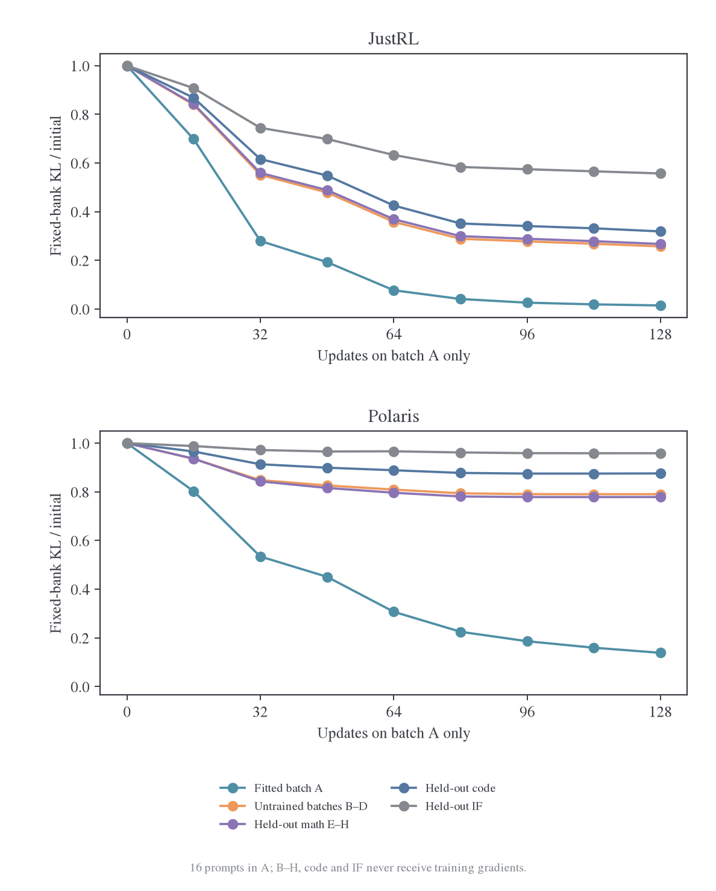

<a id="retention"></a>
### 8.1 依次训练 A/B/C/D，同时复测所有批次

这一组是 B1 的 blocked 条件。A–D 各含 16 道不同数学题，每题一条初始学生生成的固定轨迹；E–H 另有 64 道独立数学题，始终不参与梯度。两个 teacher 分别从相同初始学生重新训练，模型参数、Adam 动量和二阶矩在块之间连续保留，只有训练批次改变。

| 完成的更新 | 刚训练的批次 | 下一块训练批次 | 每个边界复测 |
| --- | --- | --- | --- |
| 0 | 尚未训练 | A | A–H、Code、IF 全部固定前缀 |
| 16 / 32 / 48 / 64 | A / B / C / D | B / C / D / A | 同一组 A–H、Code、IF |
| 80 / 96 / 112 / 128 | A / B / C / D | B / C / D / 结束 | 同一组 A–H、Code、IF |

每块 16 次 optimizer 更新，每次整个当前批的 16 条轨迹、全部 response 位置参与 loss，固定除以 16H，H=1024。两轮结束时 A–D 每条轨迹访问 32 次。**跨块没有重新生成轨迹**，因此这些图隔离了固定输入下的参数变化，不混入 E48 那样的新学生 rollout 反馈。每 16 步才评估一次，连线连接实际观测点，不代表逐步连续监测。

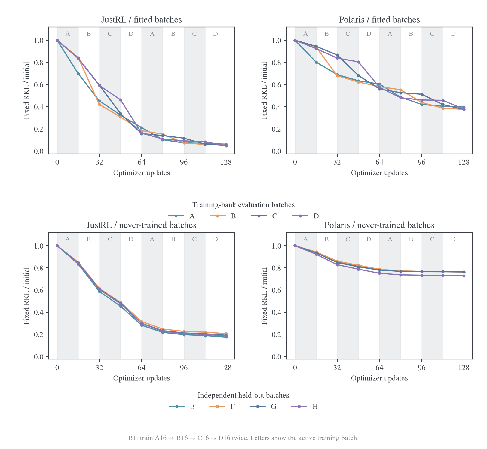

上排为 A–D，既会被训练，也会在其他批次更新后复测；下排为从未训练的 E–H。每条曲线除以自己 step0 的 KL，避免批次初始难度不同主导相对变化。上方字母和背景区间标明正在优化哪个批次。两种 teacher 使用相同坐标范围。

JustRL 中，A 以外的批次在 A 阶段已经明显改善，后续曲线整体继续下降；Polaris 也有正迁移，但 A–D 在轮到自己时下降更明显，E–H 在后半程越来越平。需要同时看上、下两排：已训练批的保持能力与对真正未见 state 的泛化能力，不是同一个问题。

<a id="batch-matrix"></a>
### 8.2 每个 16 步训练块改善了哪些批次

下面恢复逐块影响热图。每行是某 16 步训练块，每列是一个固定评估批次。格子的数值为该列初始 KL 归一化后的下降百分点：

$$
M_{k,j}=100\,\frac{R_j(\theta_{16(k-1)})-R_j(\theta_{16k})}{R_j(\theta_0)}.
$$

正值表示改善，负值才表示这一块使该组退步。分母始终是 step0，不是上一个块的风险；因此同一列的八行可以相加，得到该列总下降百分比。不同列的初始风险不同，数值相同不表示绝对 KL 下降相同。

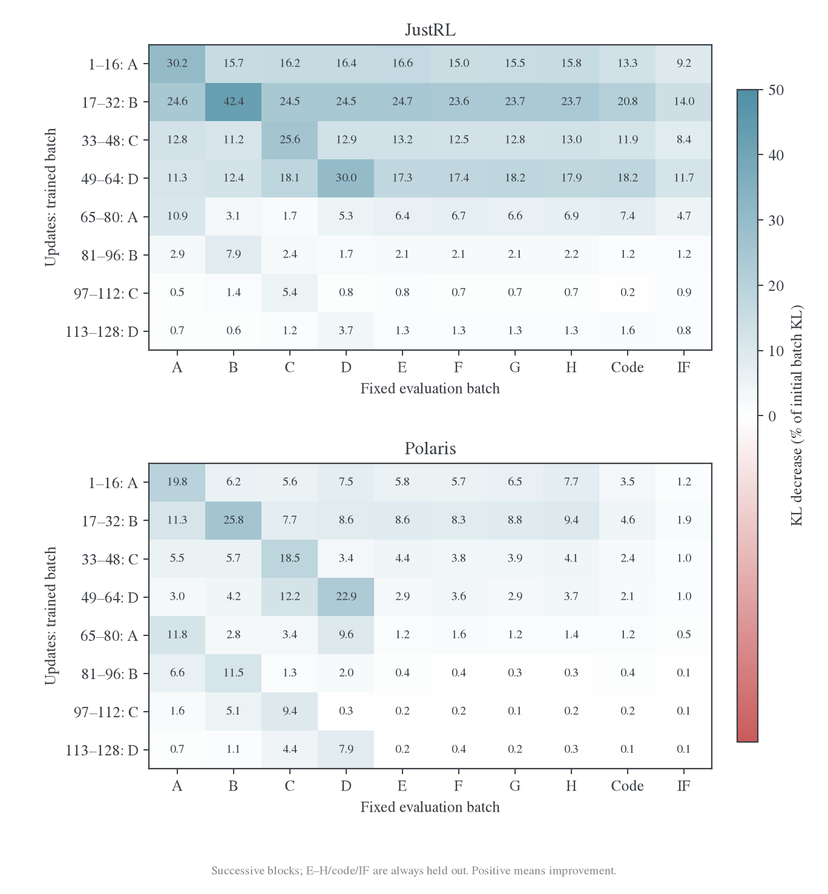

读图时可分别检查三类位置：当前训练批对应的格子；还没轮到第一次训练的其他数学批；已经训练过的旧批。E–H、Code 与 IF 则在八行中都不参与训练。最后几行对 E–H 的影响，直接反映新增更新能否继续改善独立 state。

第一块 A16 之后，Polaris 对 B/C/D 下降 6.22%/5.57%/7.55%，JustRL 为 15.68%/16.18%/16.37%。D 第一次被直接训练要到第 49 步：在此之前，JustRL 对 D 已经下降约 53.8%，Polaris 约 19.5%。所以异源 teacher 有向未来批次的迁移，只是更弱。

第二轮差异更鲜明：Polaris 在自己的训练块仍有明显下降，但对 E–H 每块仅贡献约 0.1–1.6 个初始 KL 百分点；JustRL 的改进更广。热图中的每行沿同一训练路径发生，参数和 Adam 状态不断变化，不能当成从同一个 checkpoint 分叉出来的八个独立因果干预。

<a id="batch-values"></a>
### 8.3 每个训练批及独立数学留出的绝对 KL

下面保留全部 16 步边界的原始风险，口径为每题 KL 总和除以 H1024 再取均值。E–H 为 64 道独立数学题的均值；它不属于 A–D 训练池。初始各批风险不同，所以“新批值高于旧批末尾”本身不能判断优化退步。

**JustRL**

| 更新数 | 刚训练 | A | B | C | D | E–H 留出 |
| ---: | --- | ---: | ---: | ---: | ---: | ---: |
| 0 | 初始 | 0.11366 | 0.11330 | 0.11510 | 0.11404 | 0.11800 |
| 16 | A | 0.07933 | 0.09553 | 0.09648 | 0.09538 | 0.09943 |
| 32 | B | 0.05141 | 0.04750 | 0.06830 | 0.06744 | 0.07121 |
| 48 | C | 0.03684 | 0.03484 | 0.03884 | 0.05268 | 0.05600 |
| 64 | D | 0.02401 | 0.02080 | 0.01806 | 0.01842 | 0.03513 |
| 80 | A | 0.01160 | 0.01724 | 0.01605 | 0.01235 | 0.02727 |
| 96 | B | 0.00831 | 0.00833 | 0.01332 | 0.01042 | 0.02475 |
| 112 | C | 0.00779 | 0.00671 | 0.00712 | 0.00955 | 0.02387 |
| 128 | D | 0.00702 | 0.00607 | 0.00569 | 0.00534 | 0.02231 |

**Polaris**

| 更新数 | 刚训练 | A | B | C | D | E–H 留出 |
| ---: | --- | ---: | ---: | ---: | ---: | ---: |
| 0 | 初始 | 0.20915 | 0.22969 | 0.22038 | 0.21654 | 0.24607 |
| 16 | A | 0.16781 | 0.21540 | 0.20811 | 0.20020 | 0.23027 |
| 32 | B | 0.14421 | 0.15619 | 0.19105 | 0.18161 | 0.20869 |
| 48 | C | 0.13261 | 0.14306 | 0.15035 | 0.17432 | 0.19878 |
| 64 | D | 0.12639 | 0.13349 | 0.12342 | 0.12467 | 0.19073 |
| 80 | A | 0.10170 | 0.12695 | 0.11592 | 0.10395 | 0.18740 |
| 96 | B | 0.08787 | 0.10056 | 0.11295 | 0.09970 | 0.18656 |
| 112 | C | 0.08450 | 0.08886 | 0.09229 | 0.09895 | 0.18622 |
| 128 | D | 0.08304 | 0.08627 | 0.08257 | 0.08175 | 0.18558 |

<a id="batch-retention"></a>
### 8.4 新批跳高、旧批保持和迁移的区别

以 Polaris 从 A 切到 B 为例：step16 时 A 为 0.16781，B 为 0.21540，看起来有明显跳高；但 B 已从初始 0.22969 下降。训练 B16 之后，旧 A 又从 0.16781 降到 0.14421；继续训练 C/D，A 再降到 0.13261/0.12639。这个例子同时包含“新批比旧批更难”“新批已获得正迁移”“旧批没有被遗忘”。

我们检查每个 16 步块结束时，所有已经训练过、但该块没有直接训练的旧批。JustRL 与 Polaris 各有 18 次这样的检查，**全部继续下降**。这只排除了所观测边界上的旧批退步，不排除区间内波动，也不意味着对从未见过的 E–H 有同样强的迁移。

还可把每列总下降按更新发生的时间分成三部分：直接训练该批期间、尚未第一次训练该批而训练其他批期间、已训练过该批后再训练其他批期间。三部分严格加回该批的总下降。


例如 A 的全部“其他批期间”下降都发生在它已被训练之后；D 则还包含前三个块提供的未见批次收益。JustRL 的 A 在其他批期间累计下降 0.05990，超过 A 自己两块提供的 0.04673；Polaris 对应 0.06008 与 0.06602。两种教师的绝对起点不同，图里统一按各自初始值展示，不能仅用这两个绝对数比较迁移强弱。

这是一种路径记账，不是独立数据的因果贡献：Adam 动量保留了前面批次的信息，“更新 B 期间 A 下降”不能全部归给 B 的新梯度。它仍能直接回答实际训练路径上旧批是否退步；若要进一步识别当前批的信息贡献，需要同参数、同 optimizer 状态分叉，并加入零新梯度但保留动量的控制，见[后续方向](2026-10-27-跨源蒸馏泛化研究总览.md#next)。

### 8.5 第二轮继续拟合训练池，却几乎不改善 Polaris 的独立批次

第一轮到 step64 时，A–D 每批都已训练 16 次；第二轮到 step128 时，四批各再训练 16 次。固定训练池与独立留出的变化如下，百分比均相对 step64 的风险：

| 教师 | 训练 A–D 均值：64→128 | 训练池下降 | E–H 留出：64→128 | 留出下降 |
| --- | --- | ---: | --- | ---: |
| JustRL | 0.02032→0.00603 | 70.33% | 0.03513→0.02231 | 36.48% |
| Polaris | 0.12699→0.08341 | 34.32% | 0.19073→0.18558 | 2.70% |

Polaris 后半程仍有充分的训练集下降，独立留出的下降却只有 2.70%。这比只看相邻 batch 的 loss 跳变更直接地支持“局部拟合继续、未见 state 收益趋于平台”。新批次梯度并没有全部相消为零，有限更新的收益越来越集中于训练过的 state。

平台也不只来自后段位置。B1-blocked 的独立数学留出，按相同固定前缀的位置分层如下。这里是每个区间的**有效 token 均值**，与整条轨迹固定 H 归一化的主风险分母不同：

| Response 位置 | JustRL：初始→128 步 | Polaris：初始→128 步 |
| --- | --- | --- |
| 1–256 | 0.09760→0.01508 | 0.24929→0.19079 |
| 257–512 | 0.12443→0.02166 | 0.26111→0.19441 |
| 513–1024 | 0.12699→0.02668 | 0.24075→0.18145 |

Polaris 三个位置区间都下降，但都保留较大残差。这个结果不排除更长推理阶段的问题；它只说明当前 1K 窗口内的差距不能全归为“后半段没学到”。

<a id="batch-order"></a>
### 8.6 改变批次顺序会改变中途轨迹，但没有修复最终平台

为了检验连续 reuse 是否是充分解释，B1 还比较三种匹配访问量的调度：blocked 每批连续 16 步，roundrobin 每步轮换 A/B/C/D，mixed 每步各取四批中的 4 题并轮换子组。三种方式在每 64 步使用相同轨迹多重集，最终每条访问 32 次，固定 token 权重一致；途中某个 16 步边界的样本分配并不相同。

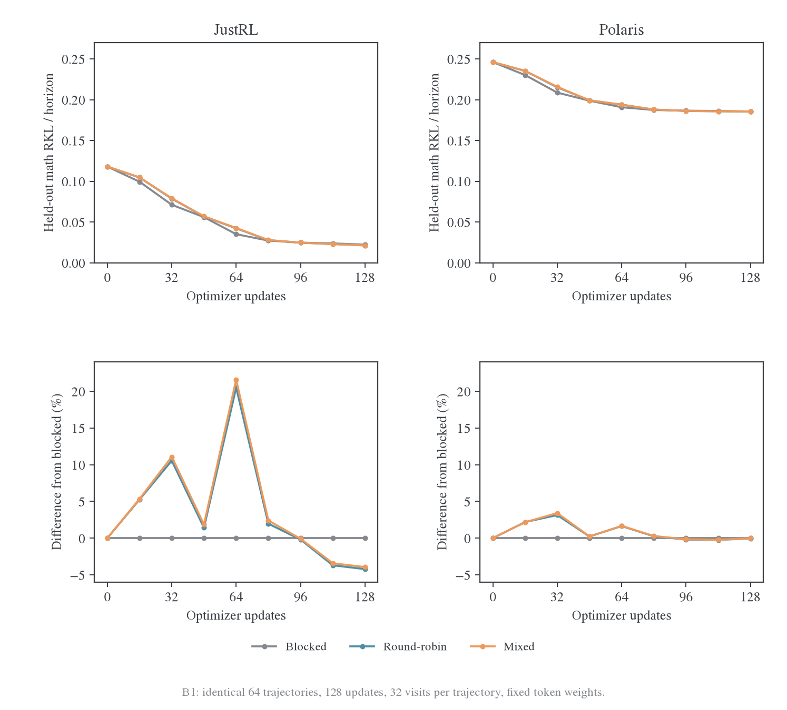

上排是相同 E–H 留出风险，下排是相对 blocked 的风险差，正值表示比 blocked 更高。JustRL 的中期顺序效应不小：step64 的 roundrobin/mixed 风险比 blocked 高约 20.5%/21.6%，但到 step128 略低约 4.2%/3.9%。因此不能用某一个中途 checkpoint 宣布某种顺序普遍更好。

| 教师 | blocked 最终留出 KL | roundrobin 最终留出 KL | mixed 最终留出 KL |
| --- | ---: | ---: | ---: |
| JustRL | 0.022313 | 0.021372 | 0.021435 |
| Polaris | 0.185583 | 0.185509 | 0.185573 |

Polaris 最终 roundrobin−blocked 差为−0.000074，95% 配对区间[-0.000377,0.000179]；mixed−blocked 区间也包含零。只打乱同一个 64 题池没有明显解除泛化平台；[扩大独立覆盖](2026-10-27-跨源蒸馏泛化研究总览.md#geometry)带来的收益应与这种重排分开。

I1 提供了另一个较大、但口径不同的检验：在线 64 步、三来源固定面板上，J/student 的数学/Code/IF 风险下降 72.51%/67.32%/39.67%，P/student 为 29.35%/14.36%/7.58%；fresh J 分别 115.20→31.44、232.21→195.41。它支持迁移差距并非 B1 单个固定训练池独有，但不能与 B1 拼成同一学习曲线。跨域结果仍只是 math→Code/IF 的概率迁移，未验证代码执行或指令遵循正确率。

<a id="long-pass"></a>
### 8.7 L：20 个新训练批次走完后，泛化缺口仍然明显

这组扩大实验专门排除“必须循环回访旧批才会出现平台”的解释。两个 teacher 使用完全相同的 640 题银行，只在 A–T 这 20 批数学题上依次训练，剩余 20 批永久不进入优化器。以下均为固定 H1024 归一化的风险。

| 固定银行 | JustRL 初始→最终 | JustRL 下降 | Polaris 初始→最终 | Polaris 下降 |
| --- | --- | ---: | --- | ---: |
| 训练 A–T，320 题 | 0.11427→0.00688 | 93.98% | 0.21497→0.09619 | 55.25% |
| 永久数学，192 题 | 0.11463→0.00734 | 93.60% | 0.21888→0.16269 | 25.67% |
| 永久 Code，64 题 | 0.14543→0.01413 | 90.28% | 0.24627→0.20282 | 17.64% |
| 永久 IF，64 题 | 0.09785→0.04743 | 51.53% | 0.79862→0.73586 | 7.86% |

初始训练与数学留出风险很接近：J 为 0.11427/0.11463，P 为 0.21497/0.21888。最终 P 的训练银行已到 0.09619，独立数学仍为 0.16269；J 两者则接近 0.00688/0.00734。后来的差距不能简单归为留出题初始平均风险特别高，尽管一个固定抽样仍不足以代表全部数据分布。

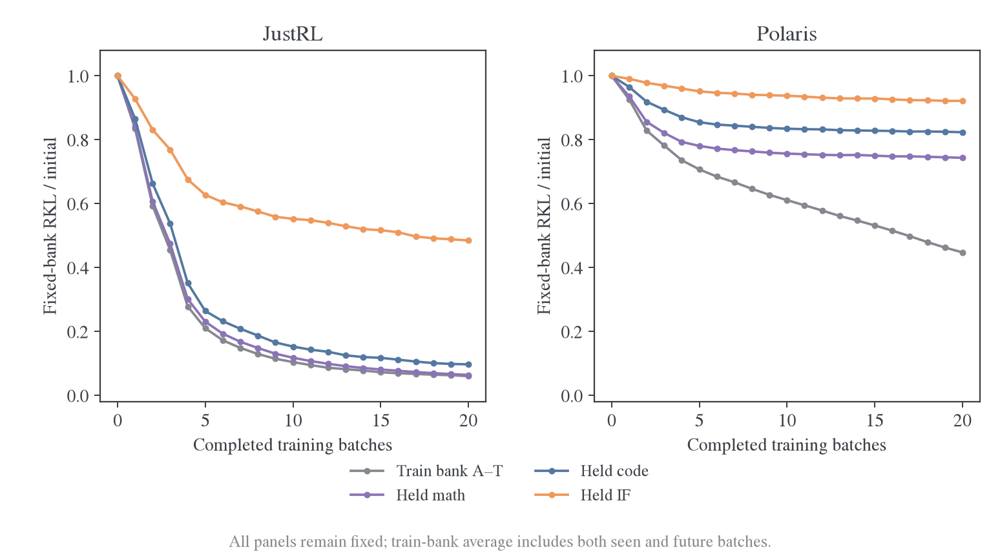

灰线是整个固定 A–T 银行的均值，途中包含尚未轮到训练的批次，并非只平均“已训练集合”。紫线、蓝线、橙线分别始终对应同一 192 题数学、64 题 Code、64 题 IF。P 的训练银行持续下降，独立银行在前几批以后明显放缓；J 的数学和代码改善更广。

### 8.8 一个新批次第一次进入训练之前，已经获得多少迁移

对每批分别记录其初始风险、第一次训练前的风险，以及 16 步后的风险。分母使用该批在原始学生上的风险，避免不同批次难度造成假趋势。

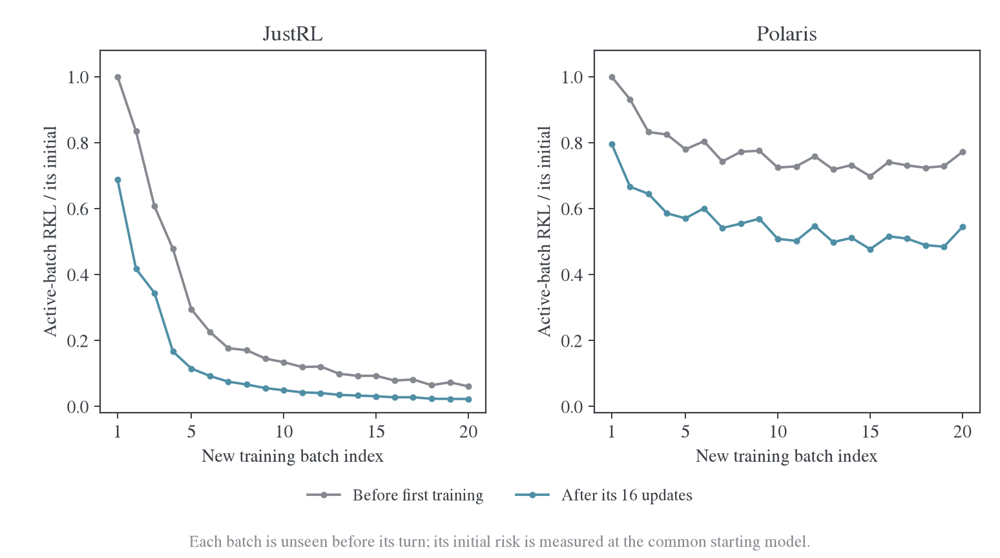

最后一批 T 在前 304 次更新中从未参与梯度。JustRL 对它的 KL 已经从 0.10555 降到 0.00639，即尚未直接训练就下降 93.94%；再训练 16 步到 0.00235。Polaris 对同一批的 KL 从 0.19421 降到 0.14986，前向迁移仅 22.84%；直接训练后到 0.10565。最后 5 批首次训练前的平均相对下降分别为 J 的 92.85%、P 的 26.10%。

这组结果直接区分“当前 batch 能不能下降”和“前面其他 batch 的更新能不能提前改善它”。P 仍然可以拟合新的训练批，但并没有让后面新批次的起点持续大幅降低。这个结论无需通过不同题之间的训练 loss 跳变来推断。

### 8.9 初始及每批结束后的全部 40 批矩阵

每张风险图有 21 行：初始加 20 个训练边界；40 列按 A–T、12 个数学留出、4 个 Code、4 个 IF 排列。颜色是每列相对其初始 KL 的剩余比例，框线标出该行刚训练的批次。右侧 20 列始终未训练，左侧对角线右边是在该行尚未训练的未来批次。两 teacher 共用色标。

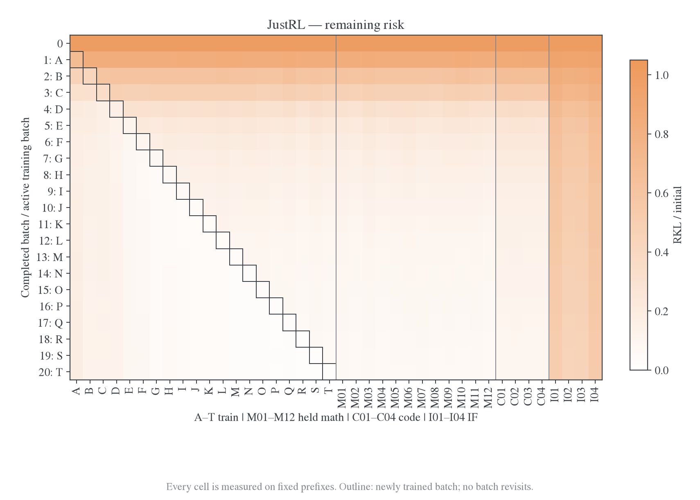

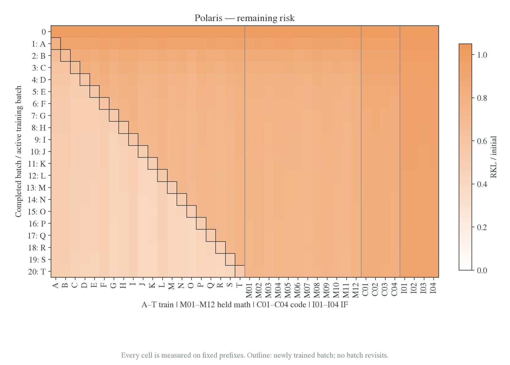

J 在对角线右侧、即尚未训练的数学批次上就逐渐变浅；P 的明显下降更集中在已经进入训练的对角线及其左侧。永久留出列的差异与汇总曲线一致，不是单个留出批主导。

逐块影响图进一步展示 $100(R_j(\theta_{b-1})-R_j(\theta_b))/R_j(\theta_0)$。正值为这一块带来的改善，负值是同一固定批次的回升，分母始终为该列的初始值。所有格子均实际评分，不对未来训练批填预测值。

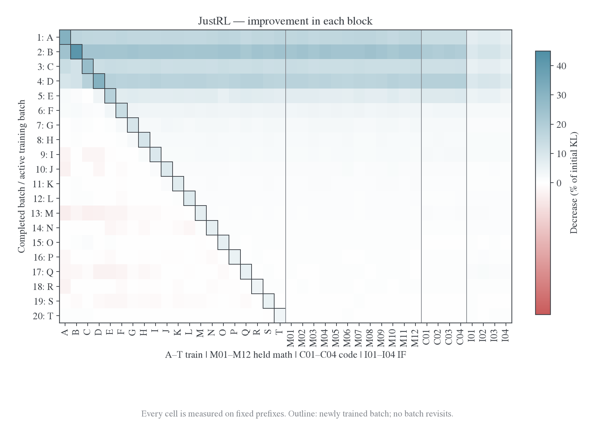


精确数值可逐格查看[JustRL CSV](../../../../../../wandb-logs/MirrorOPD-verl/analysis/twenty-batch-pass-20261027/justrl-risk-matrix.csv)和[Polaris CSV](../../../../../../wandb-logs/MirrorOPD-verl/analysis/twenty-batch-pass-20261027/polaris-risk-matrix.csv)。图中没有把 190 次相关的旧批检查当作 190 个独立训练重复。

### 8.10 后期每个新批仍明显下降，独立留出获得的收益越来越小

下面按每 5 批划分阶段，阶段内仍全部是新题。“批内下降”是五个当前批各自 16 步相对下降的均值；“留出下降”相对该阶段开始的同一 192 题风险。两者的评估输入不同，不能直接当成同一种成功率。

| Teacher | 阶段 | 数学留出起点→终点 | 本阶段留出下降 | 平均批内下降 |
| --- | --- | --- | ---: | ---: |
| JustRL | 1–5 批 | 0.11463→0.02643 | 76.94% | 50.16% |
| JustRL | 6–10 批 | 0.02643→0.01350 | 48.94% | 60.64% |
| JustRL | 11–15 批 | 0.01350→0.00928 | 31.26% | 65.52% |
| JustRL | 16–20 批 | 0.00928→0.00734 | 20.92% | 65.57% |
| Polaris | 1–5 批 | 0.21888→0.17086 | 21.94% | 25.44% |
| Polaris | 6–10 批 | 0.17086→0.16558 | 3.09% | 27.43% |
| Polaris | 11–15 批 | 0.16558→0.16418 | 0.85% | 30.28% |
| Polaris | 16–20 批 | 0.16418→0.16269 | 0.91% | 31.25% |

P 最后 5 批仍使各自训练批平均下降 31.25%，独立数学仅下降 0.91%。它不是严格不下降，也没有证明不可突破的硬下界；这里观察到的是相对于持续的局部拟合，独立收益明显趋于平台。

定义一块的经验迁移比为独立数学平均 KL 下降除以当前训练批平均 KL 下降。它使用同一批前后两次完整评估，不是跨不同 batch 起点的抵消比，也不是概率；可以为负或大于 1。

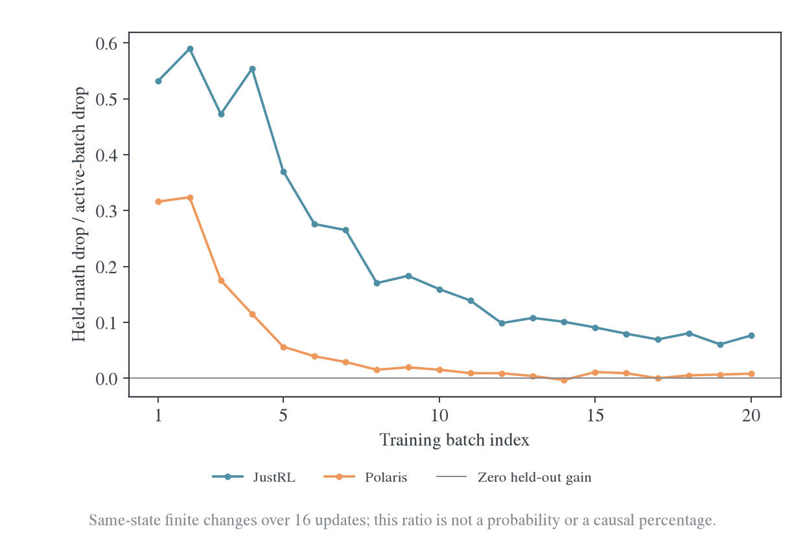

按阶段累计下降计算，P 的迁移比从前 5 批 0.197 降到后 5 批 0.00584，约下降 34 倍；J 为 0.520→0.07325。P 后期每观察到 1 单位当前批 KL 下降，只对应约 0.0058 单位独立数学风险下降。这个比值是有限银行上的描述，不是通用的因果“泛化百分比”。

### 8.11 本机已经记录实际 Adam 更新，不能再仅凭 raw cosine 解释

每批首步，在固定 M01–M04 共 64 题上计算验证梯度，清空后用当前训练批梯度执行 AdamW。比较 $\cos(g_B,g_H)$、实际位移与验证下降方向的余弦 $-g_H^\top\Delta\theta/(\|g_H\|\|\Delta\theta\|)$，并复测同一 64 题的真实一步风险变化。

| Teacher / 阶段 | raw 训练—验证 cosine 均值 | 实际更新—验证下降方向 cosine 均值 | 验证梯度范数 | 参数步幅 L2 |
| --- | ---: | ---: | ---: | ---: |
| JustRL / 1–5 批 | 0.8437 | 0.08381 | 1.0263 | 0.02893 |
| JustRL / 16–20 批 | 0.1385 | 0.01746 | 0.1581 | 0.01102 |
| Polaris / 1–5 批 | 0.5680 | 0.06127 | 0.8218 | 0.02899 |
| Polaris / 16–20 批 | 0.1196 | 0.00298 | 0.3794 | 0.02212 |

后期 raw cosine 的 J/P 均值已经相近（0.138/0.120），所以只看这一项不足以解释明显不同的泛化结果。实际更新的方向一致性则为 0.01746/0.00298；P 仍有较大验证梯度和参数位移，不能简单描述为完全没有更新。


两个限制必须保留。第一，只测了每个新批的**首步**，其中包含上一批的 Adam 历史，不能代表 16 步全部更新，也不能把低投影全部归给当前批的信息。第二，混合精度 autograd 梯度给出的线性预测与真实有限变化并不总一致，初始首步甚至有明显尺度差异；BF16 舍入、曲率与预条件尚未被这项只读诊断分别识别。因此，全块固定风险矩阵是主要结论，投影提供机制线索，不能单独证明优化器或某个 feature 是唯一根因。

### 8.12 更长窗口出现局部回升，但不是 Polaris 平台的主要表象

20 批形成每 teacher190 次“更新新批、复测已训练旧批”的边界检查。以绝对回升超过 1e-6 计，J 为 92 次、P 为 10 次；最大单次回升分别 0.000595 和 0.000202。它们没有经过多重比较校正，也不能用次数对两个 teacher 的整体质量排名。

再把最终风险与每批刚训练结束时比较：J 只有 3/20 批略高，最差也保留了当时局部下降的 98.63%；P 全部 20 批不高于刚训练完的风险。也就是说，P 的局部拟合大多保留着，但向永久未见 state 的收益很弱；J 允许少量局部波动，同时获得明显更低的独立风险。旧 B1 四批窗口的 0/18 检查仍是当时的事实，不能无限外推为所有后续阶段都不会回升。

<a id="historical-fresh"></a>
### 8.13 当前学生的访问分布又损失了一部分参数拟合收益

两种 teacher 的无约束 fresh 评估均为同一 32 题×两个随机流，初始和最终平均长度都是 1024；下面的差异不是由平均长度缩短造成。J 的序列 KL 从 123.46 到 8.75，P 从 230.81 到 191.95，二者相对起点的配对区间都支持净改善，但幅度明显不同。

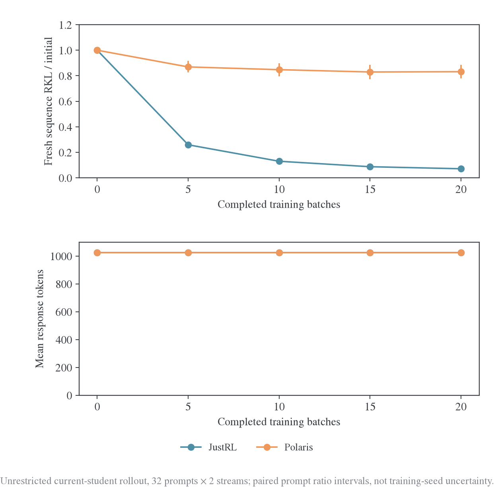

终点另用同一 teacher-forcing 路径计算参数×state 四格。以下“旧 state 参数收益”为 $L_{00}-L_{10}$，“访问代价”为 $L_{11}-L_{10}$，同一个参照路径下二者相减得到净下降。

| Teacher | 初始参数/初始 state | 初始参数/最终 state | 最终参数/初始 state | 最终参数/最终 state | 参数收益 | 访问代价及 95% 配对区间 |
| --- | ---: | ---: | ---: | ---: | ---: | --- |
| JustRL | 123.47 | 112.56 | 8.09 | 8.76 | 115.37 | +0.66 [-0.05, 1.38] |
| Polaris | 230.77 | 281.25 | 173.17 | 191.92 | 57.59 | +18.75 [6.89, 31.07] |

P 的访问代价 18.75 nats，区间[6.89,31.07]，约抵消这条分解路径下 32.6% 的参数收益；J 的代价 0.66，区间含零。交叉评分与生成时累计 KL 的对角线均值差最大约 0.048 nats，远小于 P 的访问代价。这里的比例依赖参照顺序，并非唯一因果分解。

所有训练 state 从头到尾固定，因此这并不是“在线训练反馈有害”的直接干预证明；它测到的是最终学生在自己访问的新 state 上风险更高。同时，固定永久留出本身已经趋于平台，故访问分布变化也不能解释全部泛化缺口。

同一 192 题固定数学银行上的其他指标同样需要保留：

| Teacher | RKL 下降 | 共享支持 FKL 变化 | JS 下降 | TV 下降 | 学生 entropy 初始→最终 | 固定 teacher entropy |
| --- | ---: | ---: | ---: | ---: | --- | ---: |
| JustRL | 93.60% | 下降 93.65% | 92.85% | 76.22% | 0.5975→0.5906 | 0.5921 |
| Polaris | 25.67% | 上升 15.95% | 8.41% | 9.85% | 0.5975→0.4289 | 0.4715 |

Entropy 按有效 token 平均，其余固定风险按 H 归一化。P 的 RKL 下降并未让 FKL 同时改善，学生在固定前缀上还比 teacher 更尖锐。不能把这一组结果称为全面概率对齐；也没有评测完整数学、代码或 IF 任务准确率。


### 8.14 这轮更新了哪些判断

L 直接支持三点：即使每批只进入训练一次，P 的后期独立收益仍明显减弱；当前新批可以继续拟合，并且旧批收益大多保留；最终访问分布还会消耗一部分固定 state 上的参数收益。因此，循环回访旧批、灾难性遗忘或完全没有参数更新，都不是解释这些观测所必需的条件。

更符合当前数据的机制图景是：早期可以吸收跨 state 共有的修正，后期仍有较大残差，但新增更新越来越集中于当前批的条件概率。理想的同架构、同数值实现下，同源 teacher 函数可由学生的一组参数表示；更大异源 teacher 没有同样的可实现性保证。不过，局部可拟合与全局可实现性的差别仍需表示和目标干预来识别，不能由当前平台直接推出容量下界。

它尚未唯一证明缺少特定 feature、模型容量不足或 Adam 预条件是根因。只有一个固定题目顺序与训练 seed，H1024 仍是短回答窗口；本机 HF 混合精度实现不是 E48 的 FSDP2/H7168 重放。后续更值得做的是在同一起点和优化器状态上拆分“新题/同题新轨迹”、固定/刷新的生成器，以及实际更新的预条件与表示响应；不应只继续看当前批 loss 或集合 overlap。

<a id="state-source"></a>
## 9. 历史 S/I 来源对照：训练来源、验证来源与访问分布

S/I 的完整训练预算、精度与数据关系见[总览 S 设置](2026-10-27-跨源蒸馏泛化研究总览.md#series-s)和[I 设置](2026-10-27-跨源蒸馏泛化研究总览.md#series-i)。

S1 将 P 的训练 state 改为 teacher 自生成后，数学留出下降从 1.84% 变为 2.36%，没有消除与 J 的差距。S 的初始探针还发现：同一个初始学生在 P 自己的后段 state 上 KL 为 0.5417，在 S0 后段为 0.1853；对应 overlap@64 为 56.38% 与 68.94%。Teacher 熟悉自己的 state、student 容易拟合该 state、更新能迁移到其他 state，是不同问题。

I1 在同样的 64 道数学留出题上，分开三个参考来源后得到：

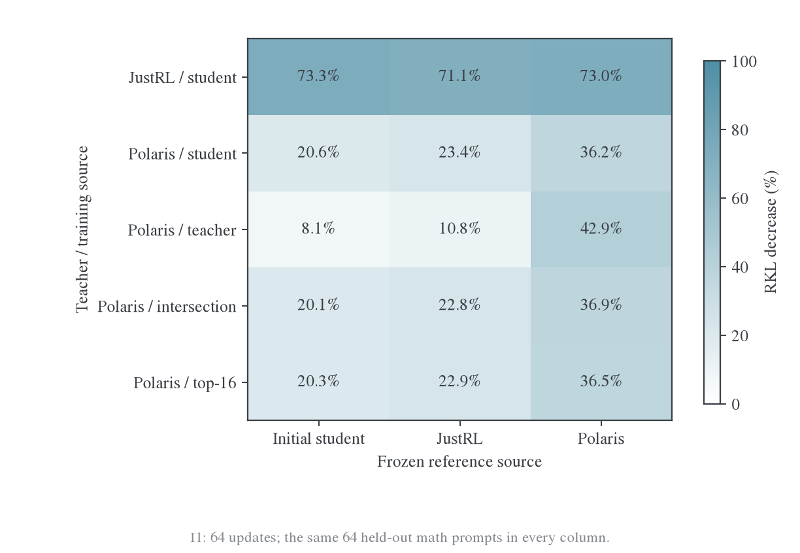

P/teacher 训练对 P 参考的 RKL 下降 42.90%，对 S0 参考仅 8.14%；P/student 分别下降 36.18% 和 20.58%。只报告 teacher 来源的 held-out，会高估对学生实际使用分布的改善；这不是 prompt 泄漏，而是评估分布不同。J/student 在三来源上下降 73.30%/71.14%/72.95%，更接近广泛迁移。

S 的初始诊断也保留了领域差异：仅看`</think>`之前的推理 state，初始学生与 J/P 的 KL 及 overlap@64 如下。代码和 IF 各只有 4 题，不能估计总体领域效应，但不支持“领域完全无关”。

| 推理 state 领域 | JustRL KL / overlap@64 | Polaris KL / overlap@64 |
| --- | --- | --- |
| Math | 0.094 / 82.97% | 0.188 / 66.74% |
| Code | 0.151 / 84.28% | 0.272 / 71.17% |
| IF | 0.147 / 85.35% | 1.267 / 54.44% |

### 9.1 固定前缀上的下降未必完整保留到新访问分布

I3 固定同一批 prompt 和 seed，将旧/新学生参数与旧/新轨迹交叉评分。记 $L_{ij}$ 为参数 $\theta_i$ 在冻结轨迹 $d_j$ 上的平均 KL 总和，以旧 state 作参照：

$$
L_{00}-L_{11}=(L_{00}-L_{10})-(L_{11}-L_{10}).
$$

右侧分别为旧 state 上的参数拟合收益和新访问分布代价；分解顺序改变会改变分量，不是唯一因果比例。

| I1 训练方式 | 旧 state 参数收益 | 新访问分布代价 | 最终 fresh J（交叉评分） |
| --- | ---: | ---: | ---: |
| J/student | 83.90 | +0.12 | 31.44 |
| P/student | 46.26 | +9.45 | 195.40 |
| P/teacher | 17.31 | −8.96 | 205.93 |
| P/intersection | 45.31 | −0.35 | 186.54 |
| P/top16 | 45.47 | +1.68 | 188.41 |

Intersection 的点估计优势主要出现在访问分布项，旧 state 拟合并未更强。但 P/student 访问代价的 95% 区间为[-2.50,22.17]，尚不能称作已确证的漂移惩罚；这里约 20% 的点估计抵消也不能替换生产“99%”这个不同口径的数值。

I1 在固定 S0 数学参考上还出现距离方向不一致：P/teacher 训练使 RKL 下降 8.14%，JS 上升 23.47%、TV 上升 7.18%；学生 entropy 从 0.5919 降到 0.3096，低于教师 0.4639。P/student 的 RKL 下降 20.58%，JS/TV 只下降 2.99%/6.03%。这些是同一输入上的真实差异，不能归因于新旧 state 切换。

<a id="historical-reproduction"></a>
## 10. 历史证据与图表复算

旧 B 的原始证据位于工作区 `wandb-logs/MirrorOPD-verl/analysis/batch-transfer-20261027/`；旧 L 位于 `wandb-logs/MirrorOPD-verl/analysis/twenty-batch-pass-20261027/`，缓存和完整检查点位于 `wandb-logs/derived/MirrorOPD-verl/twenty-batch-pass-20261027/`。这些是历史数据路径，不是 R 的输出目录。

L 的 `risk-summary.json`、`transfer-matrix.json`、`incoming-batches.json`、`retention.json`、`within-block-summary.json`、`fresh-summary.json`、`cross-summary.json` 和 `verification.json` 分别保留风险、跨批矩阵、新批预先收益、旧批保持、块内变化、自由生成、参数—state 交叉评分与完成核验。旧 L 每 teacher 的 21×40 矩阵已完成，但完整模型只保存第 1/5/10/15/20 批；这正是新协议改为每批保存的原因。R 将完整重跑，不补评分旧 checkpoint。

本文迁入的单批与来源汇总图仍由 [plot_transfer_synthesis.py](../../../research/transfer/plot_transfer_synthesis.py) 复算，共用图的来源索引见[总览复算说明](2026-10-27-跨源蒸馏泛化研究总览.md#reproduction)。下述命令只复算已有历史图，不执行新实验。

多批细节图另由[plot_batch_transfer_detail.py](../../../research/transfer/plot_batch_transfer_detail.py)复算，保存[完整曲线与路径分解数据](figures/batch-transfer-detail-20261027/plot-data.json)及[图形审计](figures/batch-transfer-detail-20261027/audit.json)。同样在 MirrorOPD-verl 仓库根目录运行：

```bash
FIGURE_VIZ_MPL="$PWD/../dotfiles/.agents/skills/figure-viz/assets/mpl" \
/root/.local/share/mirroropd/venvs/profile-cu128/bin/python \
  -m examples.mirroropd.research.transfer.plot_batch_transfer_detail \
  --data ../wandb-logs/MirrorOPD-verl/analysis/batch-transfer-20261027 \
  --out examples/mirroropd/docs/experiments/polaris-transfer/figures/batch-transfer-detail-20261027
```

L 系列的[九幅结果图及审计](figures/twenty-batch-pass-20261027/audit.json)由[plot_long_batch_transfer.py](../../../research/transfer/plot_long_batch_transfer.py)读取冻结汇总数据生成。双卡归一化、20 批单遍、640 次全局更新、21×40 固定银行、40 个只读首步诊断、640 条 fresh 输出和完整 Adam 状态连续性均通过[独立核验](../../../../../../wandb-logs/MirrorOPD-verl/analysis/twenty-batch-pass-20261027/verification.json)。每组首步 loss 与此前固定评分的最大差低于 6e-9，两副本参数在五个 checkpoint 处完全相同。全部 GPU 训练及交叉评分已经结束。
