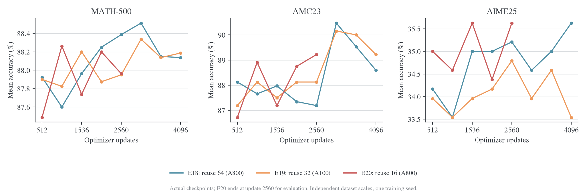
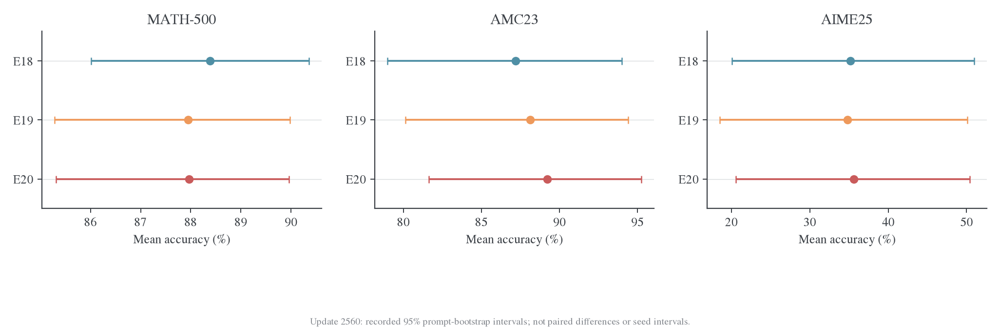
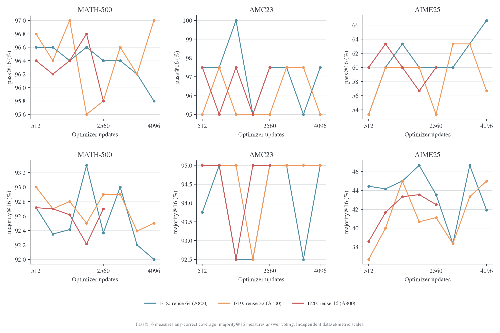
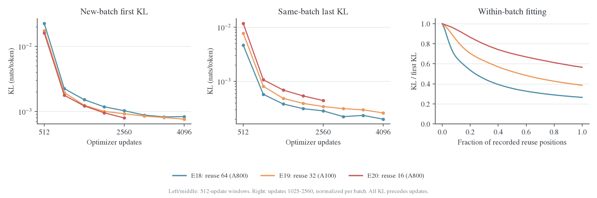
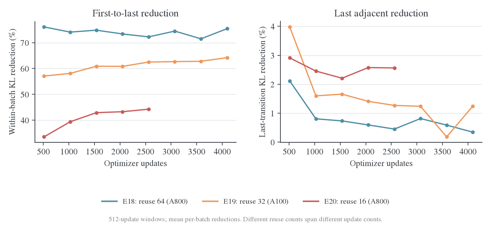
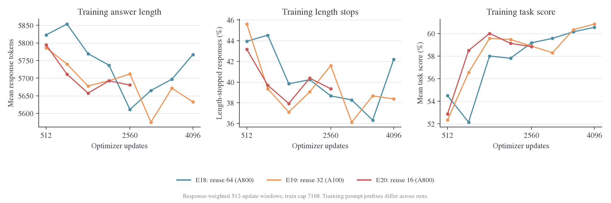
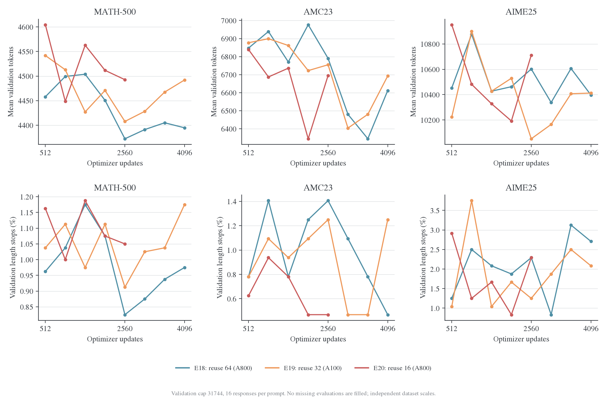
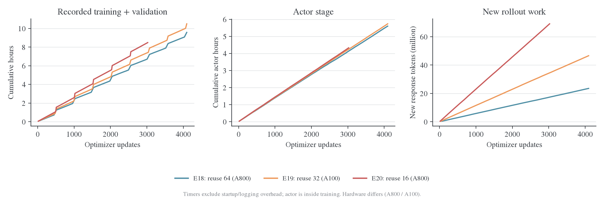
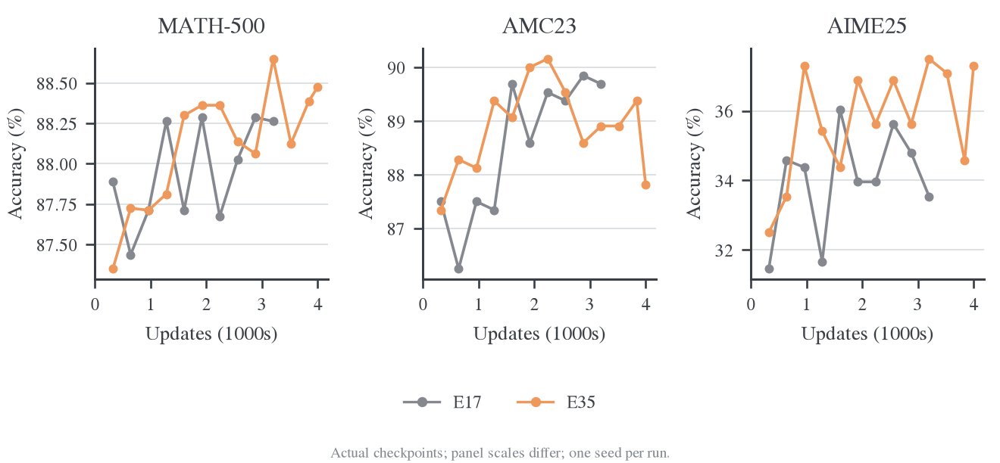

# 复用、新轨迹与回答长度的预算比较

本页比较三种预算安排：固定生成批数时增加 reuse，固定更新数时增加新轨迹，以及扩大回答窗口。每种比较保留自己的快照和实际工作量，主要观察任务成绩、批内拟合、新批起点和成本。

E16/E17说明更多复用仍能降低同批KL；E18–E20说明深度复用与增加新轨迹的收益不同；E35长窗口提高部分难题成绩，同时增加生成和训练成本。详细条件与结果按下面三组展开。

<a id="within-batch"></a>
<a id="within-batch-e16e17-位置指标与后期收敛"></a>

<a id="within-batch-setting-与实验设计"></a>

## 固定生成量：E16/E17 的观测条件

<a id="within-batch-1-当前日志能观察什么"></a>

<a id="1-当前日志能观察什么"></a>

### 当前日志能观察什么

| 指标                                                | 实际含义                                                       | 能否回答位置问题                                   |
| --------------------------------------------------- | -------------------------------------------------------------- | -------------------------------------------------- |
| `distill/full_kl`                                   | 一次更新前，全批有效 response token 的完整条件 reverse KL 均值 | 只有总体均值，不能分离前缀／后缀                   |
| `optim/actor/loss`、`optim/actor/distillation_loss` | 当前两组纯 Full-KL 的优化目标                                  | 与上述 KL 数值一致至浮点聚合误差，不是独立的新诊断 |
| `rollout/response_length/p50,p95,p99`               | 回答长度在样本之间的分位数                                     | 不能表示这些位置以前的 KL                          |
| `policy/*/log_ratio_p01,p50,p99`                    | sampled 路径中的 log-ratio 数值分布；E16/E17 没有这些记录      | 数值分位数，不是 token 位置分位数                  |
| `eval/*/acc/prefix_mean@k`                          | 固定 sample index 顺序下前 k 个**回答**的准确率均值            | 不是一条回答前 k 个 token 的 loss                  |
| `rollout/data_reuse/epoch_index`、`update_index`    | 同一批轨迹在第几轮复用／更新                                   | 可以分析批内 loss 下降，不能分解到词元位置         |

E16/E17 的实际 `distill/` 字段都只有 `distill/full_kl`。完整字段清单已保存在[数据目录](../../../../../../wandb-logs/MirrorOPD-verl/analysis/position-convergence-20261024/README.md)。不能从总体均值和长度分位数反推出前 25%、中间区间或尾部的 KL。

代码中原本计算过每 token 的 KL，但没有保留位置统计：[precompute_rows](../../../../../verl/trainer/distillation/full_vocab.py) 的 `kl = (p * lp).sum(-1)` 随后直接累加为 `total`；[engine 输出](../../../../../verl/workers/engine/fsdp/transformer_impl.py) 只有 `full_kl_sum/full_kl_count`；[loss 分支](../../../../../verl/trainer/distillation/losses.py) 汇总成全局 token mean。该函数名中的 token chunk 是计算分块，不是每条回答的位置区间。

<a id="within-batch-2-两个-run-的身份与可见边界"></a>

<a id="2-两个-run-的身份与可见边界"></a>

### 两个 Run 的身份与可见边界

| 项目                                  | E16                                        | E17                                |
| ------------------------------------- | ------------------------------------------ | ---------------------------------- |
| Run ID                                | `ujy2qx5d`[^within-batch-e16]              | `cix5i2x2`[^within-batch-e17]      |
| Student／teacher                      | R1-Distill-Qwen-1.5B／JustRL-DeepSeek-1.5B | 同左                               |
| 目标                                  | Full reverse KL，`precompute`，token-mean  | 同左                               |
| LR／prompt batch／rollouts per prompt | 1e-6／64／1                                | 同左                               |
| 每批复用次数                          | 4                                          | 16                                 |
| 训练 response cap                     | 7168                                       | 7168                               |
| 解码状态                              | `finished`，exit code 0                    | `partial_snapshot`，文件末条不完整 |
| 成功解码 history 事件                 | 1000                                       | 3025                               |
| 完整 outer 汇总                       | 200                                        | 177                                |
| update 记录                           | 800；outer 200 的第 4 条                   | 2848；outer 178 的第 16 条         |
| 最后验证 outer                        | 200                                        | 160                                |

E17 的 outer 178 有完整 16 条更新观测，可以用于批内比较，但没有该批 outer 汇总。当前快照不能说明远端作业是否已经结束。W&B `_step` 是事件编号；本报告使用日志定义的 `step/update` 和 `step/outer`，没有把 3025 条事件当作 3025 个 outer。

两组全部已解码的更新都报告成功，无 skipped update。`optim/actor/loss` 与 `distill/full_kl` 的最大绝对差分别约为 $1.33\times10^{-8}$、$1.48\times10^{-8}$。

<a id="within-batch-实验结果"></a>

## 批内收敛与新批起点

日期：2026-10-24。依据本地 `.wandb` 事务日志重新导出，未读取云端采样曲线。**这两个历史 run 没有按 response token 位置分桶的 KL/loss 指标。两组后期完整条件 KL 都还在下降；E17 的同批复用下降仍明显，不能把锯齿曲线的下沿当作新轨迹上的收敛水平。**

<a id="within-batch-3-后期的-loss-仍在下降"></a>

<a id="3-后期的-loss-仍在下降"></a>

### 后期的 Loss 仍在下降


左图和中图分别展示全程对数轴与后期线性轴，曲线为 20 批滚动均值；实线是每批第 1 次更新前 KL，虚线是最后一次更新前 KL。右图固定 outer 141–160，先将每批 KL 除以该批首个观测，再跨 20 批取均值。它显示重复使用同一批前缀时仍能下降，不是按 token 位置分桶的图。

<a id="within-batch-31-每组最后-20-个有完整更新记录的批次"></a>

<a id="31-每组最后-20-个有完整更新记录的批次"></a>

#### 每组最后 20 个有完整更新记录的批次

| 指标                                              | E16，outer 181–200 | E17，outer 159–178 |
| ------------------------------------------------- | -----------------: | -----------------: |
| 每批第 1 次更新前 KL 均值                         |         0.00159928 |         0.00076594 |
| 每批最后一次更新前 KL 均值                        |         0.00149275 |         0.00041153 |
| 逐批首末相对下降的均值                            |              6.63% |             45.89% |
| 逐批最后相邻两个观测的相对下降均值                |              2.91% |              2.49% |
| 相比前一个不重叠 20 批窗口，第 1 次更新前均值下降 |             11.35% |              6.86% |
| 相比前一个不重叠 20 批窗口，末次更新前均值下降    |             11.65% |             11.14% |
| 最后一个单点 KL                                   |         0.00144728 |         0.00040642 |
| 最后一个单点梯度范数，pre-clip                    |            0.02343 |            0.00834 |

单位为 nats/token。前一个不重叠窗口分别是 E16 的 161–180、E17 的 139–158。相对降幅逐批计算再平均，不能用表中两个均值的比值替代。

**这些 loss 都在对应 optimizer 更新之前测量。** E16 的第 1→第 4 条覆盖 3 次已执行更新，E17 的第 1→第 16 条覆盖 15 次；日志没有最后一次更新之后同批额外 forward 的结果。故不能把末点写成“做完 4/16 次更新后的 loss”。

E16 后期仍较稳定地下行。E17 的新批次起点下降更慢，局部接近平台，但旧批次上的优化仍有显著空间；末次相邻观测还能降约 2.5%，并非同批目标已经不变。非零梯度或训练 loss 继续下降都不保证验证收益。

<a id="within-batch-32-同一-outer-区间比较"></a>

<a id="32-同一-outer-区间比较"></a>

#### 同一 Outer 区间比较

| Outer 141–160          |        E16 |        E17 |
| ---------------------- | ---------: | ---------: |
| 第 1 次更新前 KL 均值  | 0.00198573 | 0.00082887 |
| 最后一次更新前 KL 均值 | 0.00186135 | 0.00046412 |
| 批内相对下降均值       |      6.26% |     43.85% |

相同 outer 下 E17 的优化次数是 E16 的 4 倍，生成的具体回答也不同。上表用于描述实际运行，不是等计算预算或固定同一前缀的算法优劣结论。

<a id="within-batch-33-换批后的起点明显高于旧批最低值"></a>

<a id="33-换批后的起点明显高于旧批最低值"></a>

#### 换批后的起点明显高于旧批最低值

E17 最后窗口中，对相邻批计算“下一批第 1 条 KL／上一批最后一条 KL”，平均约 **1.85**；E16 约 **1.07**。E17 的旧批次拟合明显深于下一批的初始 loss，因此全局曲线形成较大的锯齿。

这里换了题目、生成回答及前缀测度，不能把上跳称为同一输入上的 loss 反弹，更不能仅凭它断言过拟合。应分别追踪新批次起点和同批末次，不把所有 update 点直接平滑成一条线来判定整体收敛。

最后窗口的训练回答均长约为 E16 的 5738、E17 的 5719 token，未见整体长度持续膨胀来解释 loss 下降。E17 长度统计只覆盖 159–177 的 19 批，因为 178 没有 outer 汇总。均长稳定仍不能排除位置分布、题目难度和回答质量的变化。

<a id="within-batch-34-验证没有随-loss-单调变化"></a>

<a id="34-验证没有随-loss-单调变化"></a>

#### 验证没有随 Loss 单调变化

| Run／outer | MATH-500 |    AMC23 |   AIME25 |
| ---------- | -------: | -------: | -------: |
| E16／160   | 87.7625% | 87.3438% | 34.1667% |
| E16／180   | 87.9875% | 86.4063% | 33.5417% |
| E16／200   | 87.5875% | 89.3750% | 35.8333% |
| E17／120   | 88.2875% | 88.5938% | 33.9583% |
| E17／140   | 87.6750% | 89.5313% | 33.9583% |
| E17／160   | 88.0250% | 89.3750% | 35.6250% |

这是各 checkpoint 的 avg@16 点估计，不是跨 seed 显著性结果。当前证据支持“继续优化条件 KL”，尚不能证明任务分数会持续接近教师。

<a id="within-batch-分析与下一步"></a>

### 位置观测的覆盖

<a id="within-batch-4-已选择的后续观测相对位置十分桶"></a>

<a id="4-已选择的后续观测相对位置十分桶"></a>

#### 已选择的后续观测：相对位置十分桶

后续按用户选择只采用 response 相对位置，每 10% 一桶，保存 KL 总和、有效 token 数与均值。前 30% 可用前三桶的 sum/count 精确重建，不另存累计指标。当前代码已接入 Full-KL；该历史快照仍没有这些数据。具体位置定义、mask 边界、后端支持和验收结果见[KL 精度与相对位置分桶](../../settings/指标口径.md#budget-4-已接入相对位置十分桶)。

仍按 outer/update/epoch_index 区分新批起点与同批复用。后续可用“outer × 相对位置桶”观察剩余误差集中在哪一段；固定 held-out prefix probe 是进一步区分前缀分布变化的可选诊断，当前未实现。

<a id="equal-updates"></a>
<a id="equal-updates-等更新预算下的复用与新轨迹"></a>

<a id="equal-updates-1-实际-setting-与可比性"></a>

## 固定更新量：E18–E20 的设置

| 实验 / run                           | 每批复用 | 完整 outer / 更新 | 验证轮数 / 最后 update | 本地结束证据                 | 硬件             |
| ------------------------------------ | -------: | ----------------- | ---------------------- | ---------------------------- | ---------------- |
| E18 / `9hx3uegm`[^equal-updates-e18] |       64 | 64 / 4096         | 8 / 4096               | finished，exit=0             | 8×A800-SXM4-80GB |
| E19 / `d6jhh378`[^equal-updates-e19] |       32 | 128 / 4096        | 8 / 4096               | finished，exit=0             | 8×A100-SXM4-80GB |
| E20 / `lwgb5eex`[^equal-updates-e20] |       16 | 189 / 3024        | 5 / 2560               | partial_snapshot，无退出记录 | 8×A800-SXM4-80GB |

共同配置为 student `DeepSeek-R1-Distill-Qwen-1.5B`、teacher `JustRL-DeepSeek-1.5B`、DAPO、seed=42、shuffle、global batch=mini-batch=64、每题一条训练回答。Full-KL 使用 `precompute`，async write/prefetch 开启；AdamW、LR=1e-6、constant scheduler、零 warmup、weight decay=0.01、grad clip=1，按有效 token 聚合；任务奖励不进入 loss。

训练 prompt/response 上限为 4096/7168。验证使用 MATH-500/AMC23/AIME25 的 500/40/30 题，每题 16 条回答，temperature=0.7、top-p=0.9、response cap=31744。三组都无 step 0 验证，每 512 updates 验证，每 1024 updates 保存，计划各运行 4096 updates。预算关系为：

$$
U=E\,B,\qquad N_{\mathrm{new}}=64B=64U/E,
$$

其中 $E$ 是每批复用次数，$B$ 是已完成 outer 数，$U$ 是成功 optimizer 更新数。相同 $U$ 下，新回答数按 E18:E19:E20=1:2:4 改变；不同运行的具体回答和前缀也随训练改变。

[实际配置差异](../../../../../../wandb-logs/MirrorOPD-verl/analysis/equal-update-budget-20261025/config-differences.json)共 11 项，包含 epochs、outer 总步数、验证／保存频率、名称与目录，以及继承的 critic 配置；三组使用 GRPO 优势配置，没有 critic 更新指标。记录的 Git commit 均为 `376e8185e`；requirements 均列出 Torch 2.11.0+cu128、vLLM 0.25.1+cu129、Transformers 5.12.1、Triton 3.6.0。Git 字段不证明部署工作区没有额外修改。硬件型号来自每个 run 自身的 environment 记录，E19 与另两组不同；耗时差异不全是复用次数的因果效果。

<a id="equal-updates-2-指标覆盖与数据边界"></a>

### 统计口径

| 家族      | 每组字段数 | 主要观测及用途                                                                     |
| --------- | ---------: | ---------------------------------------------------------------------------------- |
| eval      |       2145 | 三个数据集的 mean／CI、pass/majority/all-correct 的 k 曲线、长度、格式、终止与缺失 |
| rollout   |         52 | 每批新回答、token、长度、结束原因、任务分数、复用位置及版本 staleness              |
| perf      |         24 | 训练／验证及嵌套阶段计时、吞吐、MFU、allocator 内存、负载均衡                      |
| optim     |         12 | 逐更新 loss、梯度、LR、执行／跳过与非有限标记；`lr_next` 只在批末出现              |
| distill   |          1 | `distill/full_kl`，全批有效 response token 的完整条件 reverse KL                   |
| advantage |          1 | 任务信号是否用于 loss；本组为零                                                    |
| 合计      |   **2235** | 不含 W&B 内部字段与三个 `step/*` 坐标                                              |

E18/E19/E20 分别有 4160/4224/3213 条 history 事件，不能把事件数当作更新数。绝大部分字段是验证预算展开，acc/reward/score 还包含同一数学评分的重复信息，2235 个字段不等于 2235 个独立结论。常量字段分别为 323/311/314 个；常量零保留其实际语义，缺失字段不补零。

**三组都没有 `distill/full_kl_position/*`、policy ratio/ESS、teacher/student entropy 或固定 held-out prefix probe。** 当前代码和字典支持某些字段，不代表这些历史 run 已经记录。本文不能回答误差集中在回答的前 30% 还是后 30%，也不能由小 KL 推出高 behavior ESS。字段语义见[指标字典](../../settings/指标口径.md)。

所有已记录验证的预期／实际／有效回答数一致，每轮都是 9120 条；failed 和非有限评分计数为零。原始日志的 artifact 流为空，附属文件只有 requirements，没有逐题 `validation/records`。因此可以使用已记录的题目 bootstrap CI，但不能补做跨 run 的逐题配对 bootstrap 或 McNemar 检验。

<a id="equal-updates-setting-与实验设计"></a>

预设选择与更新数验收统一见[启动指南](../../infra/training/launch.md#budget-presets)。这三组使用的 DAPO 含重复题面和标签冲突，核对明细见[数据设置](../../settings/数据设置.md#budget-labels)。

<a id="equal-updates-实验结果"></a>

## 相同更新数下的效果与成本

更新：2026-10-25。本文分析三组 Full-KL 训练的完整已归档 history，比较每批复用 64／32／16 次在相同 optimizer 更新数下的效果。E18/E19 各完成 4096 updates；E20 只有 3024 updates 的本地快照，最后验证在 2560。**三组共同可比较的验证预算是 512、1024、1536、2048、2560；4096 的终点比较只包含 E18/E19。**

当前证据支持保留 E18 的高复用配方作为节省生成的基线。在 update 2560，E18 相比 E20 少生成 **74.77%** 的 response token，记录的训练＋验证时间少 **19.56%**，三个数学集的 mean accuracy 差分别为 **+0.4250／−2.0313／−0.4167 个百分点**。这是一组单 seed 的工程取舍：现有结果没有显示更多新轨迹带来稳定的逐集合优势，也不足以证明三个配方等效。

最清楚的优化差异是：**高复用把同批前缀拟合得更深，更多新轨迹使新批起点 KL 更低。** 两种排序相反，因此不能用整条 update 曲线的最低 loss 判断训练分布上的收敛，更不能直接替代任务指标。后期 KL 仍下降，但首个验证点已接近末点水平，之后提升不一致；继续降低训练 KL 尚未转化为一致的验证收益。

归档数据保留三组全部 **2235 个数值指标**；正文使用静态图表。完整数值见[统计结果](../../../../../../wandb-logs/MirrorOPD-verl/analysis/equal-update-budget-20261025/analysis.json)、[验证表](../../../../../../wandb-logs/MirrorOPD-verl/analysis/equal-update-budget-20261025/evaluation.csv)、[字段目录](../../../../../../wandb-logs/MirrorOPD-verl/analysis/equal-update-budget-20261025/metric-catalog.csv)和[覆盖表](../../../../../../wandb-logs/MirrorOPD-verl/analysis/equal-update-budget-20261025/metric-coverage.csv)。

<a id="equal-updates-3-相同更新预算下的验证效果"></a>

<a id="3-相同更新预算下的验证效果"></a>

### 相同更新预算下的验证效果



图中仅连接实际 checkpoint，三个数据集使用独立纵轴。三组共同的最后一个验证点是 update 2560：

| Update 2560 | Outer / 新回答数 | MATH mean | AMC mean | AIME mean |
| ----------- | ---------------- | --------: | -------: | --------: |
| E18         | 40 / 2560        |  88.3875% | 87.1875% |  35.2083% |
| E19         | 80 / 5120        |  87.9500% | 88.1250% |  34.7917% |
| E20         | 160 / 10240      |  87.9625% | 89.2188% |  35.6250% |

这一个点上，E18 的 MATH 最高，E20 的 AMC/AIME 最高。E20 相比 E18 多使用四倍新回答，AMC 高 2.0313 个百分点，AIME 高 0.4167 个百分点；MATH 低 0.4250 个百分点。不能由末点混合排序宣布某个复用次数全面占优。

<a id="equal-updates-31-共同-checkpoint-的趋势"></a>

<a id="31-共同-checkpoint-的趋势"></a>

#### 共同 checkpoint 的趋势

| 512–2560 的五个共同 checkpoint，描述性均值 |     MATH |      AMC |     AIME |
| ------------------------------------------ | -------: | -------: | -------: |
| E18                                        | 88.0250% | 87.6563% | 34.5833% |
| E19                                        | 87.9500% | 87.8125% | 34.0833% |
| E20                                        | 87.9300% | 88.1563% | 35.0417% |

E20 的 AMC/AIME 在这段轨迹均值上略高，MATH 三组差不到 0.1 个百分点。这里的 checkpoint 来自同一次训练、彼此相关；均值只是描述整段轨迹，不能把五个点当成五次独立重复。

首个验证已在 update 512，三组 MATH 为 87.49%–87.93%。从首个点到各自末次验证，E18 的 MATH/AMC/AIME 变化为 +0.2125/+0.4688/+1.4583 个百分点，E19 为 +0.2875/+2.0313/−0.4167，E20 为 +0.4750/+2.5000/+0.6250。三个集合的提升并不单调；E18/E19 的 AMC 都在 update 3072 到达更高点，随后回落。没有早于 512 的验证，不能判断它们在最初几百次更新中的任务收益轨迹。

<a id="equal-updates-32-已完成的-4096-update-终点"></a>

<a id="32-已完成的-4096-update-终点"></a>

#### 已完成的 4096-update 终点

| Update 4096 | MATH mean | AMC mean | AIME mean |
| ----------- | --------: | -------: | --------: |
| E18         |  88.1375% | 88.5938% |  35.6250% |
| E19         |  88.1875% | 89.2188% |  33.5417% |

E19 相对 E18 为 +0.0500/+0.6250/−2.0833 个百分点；使用两倍新回答仍没有逐集合一致的终点优势。E20 最后验证对应 2560 updates，不能把它的 35.6250% AIME 填进这个 4096-update 表。

<a id="equal-updates-33-题目不确定性"></a>

<a id="33-题目不确定性"></a>

#### 题目不确定性



| Update 2560，日志中 mean accuracy 的 95% CI | MATH             | AMC              | AIME             |
| ------------------------------------------- | ---------------- | ---------------- | ---------------- |
| E18                                         | [86.01%, 90.35%] | [78.96%, 94.00%] | [20.08%, 50.96%] |
| E19                                         | [85.28%, 89.98%] | [80.12%, 94.41%] | [18.54%, 50.10%] |
| E20                                         | [85.31%, 89.96%] | [81.62%, 95.25%] | [20.57%, 50.42%] |

CI 来自 256 次题目 bootstrap；AMC 只有 40 题，AIME 只有 30 题，区间很宽。区间覆盖范围说明点排序的不确定性较大，但区间重叠本身既不能证明无差异，也不是配对显著性检验。当前证据应支持下一轮配方选择，而非显著性或等效性声明。

<a id="equal-updates-4-采样覆盖投票和回答稳定性"></a>

<a id="4-采样覆盖投票和回答稳定性"></a>

### 采样覆盖、投票和回答稳定性



在共同 update 2560，mean、pass@16 和 majority@16 给出的排序并不完全相同：

| 数据集 / run |     Mean |  Pass@16 | Majority@16 | All-correct@16 |
| ------------ | -------: | -------: | ----------: | -------------: |
| MATH / E18   | 88.3875% | 96.4000% |    92.3667% |       69.2000% |
| MATH / E19   | 87.9500% | 95.8000% |    92.9000% |       69.4000% |
| MATH / E20   | 87.9625% | 95.8000% |    92.7000% |       67.8000% |
| AMC / E18    | 87.1875% | 97.5000% |    95.0000% |       50.0000% |
| AMC / E19    | 88.1250% | 95.0000% |    95.0000% |       55.0000% |
| AMC / E20    | 89.2188% | 97.5000% |    95.0000% |       50.0000% |
| AIME / E18   | 35.2083% | 60.0000% |    43.5556% |       13.3333% |
| AIME / E19   | 34.7917% | 53.3333% |    41.1111% |       16.6667% |
| AIME / E20   | 35.6250% | 60.0000% |    42.5000% |       16.6667% |

AMC 的三个 majority@16 都为 95%，而 mean 有约两个百分点差异。AIME 中，E18/E20 的 pass@16 都为 60%，投票只有 43.56%/42.50%，说明“候选中出现正确答案”和“投票选中正确答案”仍有明显差距。缺失解析、错误答案的集中程度和平票规则都会影响投票；没有逐回答联合记录，不能把差距全部归因于某一种机制。

<a id="equal-updates-41-aime-的采样预算收益"></a>

<a id="41-aime-的采样预算收益"></a>

#### AIME 的采样预算收益

| Update 2560 | Pass@1 | Pass@4 | Pass@8 | Pass@16 | Majority@16 |
| ----------- | -----: | -----: | -----: | ------: | ----------: |
| E18         | 35.21% | 47.88% | 54.00% |  60.00% |      43.56% |
| E19         | 34.79% | 46.04% | 51.06% |  53.33% |      41.11% |
| E20         | 35.63% | 49.82% | 55.55% |  60.00% |      42.50% |

E19 从 8 到 16 条候选的 pass 增益为 2.28 个百分点，E18 为 6.00，E20 为 4.45。这个差异反映当前 30 题上采样覆盖的形状；单次预算曲线不提供跨题重采样之外的训练随机性证据。`prefix_mean@k` 则按固定回答顺序截取，不能把它当成“多采样必然提高平均正确率”的证据。

<a id="equal-updates-42-4096-update-终点的-aime-排序反转"></a>

<a id="42-4096-update-终点的-aime-排序反转"></a>

#### 4096-update 终点的 AIME 排序反转

| AIME，update 4096 |     Mean |  Pass@16 | Majority@16 | All-correct@16 |
| ----------------- | -------: | -------: | ----------: | -------------: |
| E18               | 35.6250% | 66.6667% |    41.9048% |       16.6667% |
| E19               | 33.5417% | 56.6667% |    45.0000% |       16.6667% |

E18 的 mean 和候选覆盖更高；E19 的投票更高。Pass@16 对应至少一次正确的题目数分别是 20/30、17/30；all-correct@16 均为 5/30。不同使用方式对配方的排序可以不同，不应只选一个更好看的指标汇报。Majority@16 的平票按候选正确性平均，分数可以不是 1/30 的整数倍；该端点的子集 Monte Carlo 误差为零，不等于题目或训练不确定性为零。

<a id="equal-updates-5-full-kl深度复用与新轨迹拟合"></a>

<a id="5-full-kl深度复用与新轨迹拟合"></a>

### Full-KL：深度复用与新轨迹拟合

所有 `distill/full_kl` 都是给定当批学生生成前缀、更新之前的完整条件 reverse KL。对一批复用 $E$ 次，首末两个观测之间只执行了 $E-1$ 次更新。记第 $b$ 批第 $j$ 个更新前观测为 $K_{b,j}$，本文逐批计算：

$$
\Delta_b=1-\frac{K_{b,E}}{K_{b,1}},\qquad
R_b=\frac{K_{b+1,1}}{K_{b,E}}.
$$

先算每批比值，再对窗口内批次平均。$R_b$ 只使用两个端点都在窗口内的相邻批次。它在换题目、回答和前缀后比较两个条件目标，不能解释为同一输入上的 loss 反弹。



图中右侧横轴是各自批内观测位置的相对进度，0→1 分别覆盖 63/31/15 次已执行更新；同一横坐标不表示同样多的更新。左、中图则按相同 512-update 窗口比较。

<a id="equal-updates-51-相同-update-20492560-的窗口"></a>

<a id="51-相同-update-20492560-的窗口"></a>

#### 相同 update 2049–2560 的窗口

| 观测                           |  E18，8 批 | E19，16 批 | E20，32 批 |
| ------------------------------ | ---------: | ---------: | ---------: |
| 新批第 1 次更新前 KL 均值      | 0.00103055 | 0.00092669 | 0.00079778 |
| 同批最后一次更新前 KL 均值     | 0.00028609 | 0.00034462 | 0.00044399 |
| 逐批首末相对降幅均值           |     72.25% |     62.50% |     44.25% |
| 最后两个更新前观测间的降幅均值 |      0.45% |      1.27% |      2.56% |
| 下一批首值 / 上一批末值均值    |      3.66× |      2.61× |      1.79× |
| 窗口内可比较的换批次数         |          7 |         15 |         31 |

单位为 nats/token；每批先按有效 token 求均值，窗口再跨批等权，未将所有 token 合并成一个分母。**按旧批末值排序是 E18 最低，按新批起点排序则是 E20 最低。** 高复用把同一批前缀压得更深；更多新轨迹下，新批初始目标更低。这个现象与“深度拟合已有前缀”和“覆盖更多新前缀”的取舍相容，但三组生成的前缀并不相同，新批目标也不是固定 held-out 测试集，不能直接宣布哪个组泛化更好。

`rollout/staleness/trajectory_staleness/*` 在三组中均为零，表示同步生成时的版本滞后；它没有记录一批回答在第 64 次更新时相对当前策略的完整分布漂移。因此零 staleness 和明显的批内陈旧前缀效应可以同时出现。

<a id="equal-updates-52-后半段仍有优化空间但边际降幅缩小"></a>

<a id="52-后半段仍有优化空间但边际降幅缩小"></a>

#### 后半段仍有优化空间，但边际降幅缩小



在 update 2049–2560，E18 从首个观测到第 16、32、64 个观测的 KL 降幅分别为 50.56%、63.92%、72.25%。后 32 个观测位置继续降低目标，但贡献只有首值的约 8.33 个百分点；最后相邻一步平均下降约 0.45%。E20 做到第 16 个观测时，最后相邻下降仍约 2.56%。这些数值支持不同复用程度处于不同的批内优化阶段；它们不直接给出验证收益最优的停止点。

| 各自末 512 updates   | E18，3585–4096 | E19，3585–4096 | E20，2513–3024 |
| -------------------- | -------------: | -------------: | -------------: |
| 新批起点 KL 均值     |     0.00083635 |     0.00076429 |     0.00075209 |
| 同批末次 KL 均值     |     0.00020138 |     0.00026236 |     0.00041283 |
| 首末降幅均值         |         75.44% |         64.20% |         45.14% |
| 最后相邻观测降幅均值 |          0.34% |          1.25% |          2.72% |
| 裁剪前梯度范数均值   |        0.00794 |        0.00936 |        0.01256 |

此表用于描述各 run 的最后可见阶段；E20 的窗口更早，不是三组同进度比较。E18 在 3073–3584 到 3585–4096 的新批起点均值由 0.00082806 变为 0.00083635，局部已不再单调下降；同批末值仍降低。E19 的新批起点则从 0.00081043 降至 0.00076429。只有 8/16 个新批观测和一条训练轨迹，不足以判定是否到达稳定平台。

末点已到 1e-4 量级，但日志没有同一前缀的高精度基线；loss 与 Full-KL 一致只能核对记录与聚合，不能验证 KL 的绝对数值精度，也不能把剩余值直接认定为低精度数值地板。

更强的结论需要固定 held-out prefixes、位置分桶和行为漂移观测。现有日志只支持“固定当前批次还能优化”以及“更低 KL 没有对应一致的验证提升”；不能证明学生完整序列分布已逼近教师。

<a id="equal-updates-6-训练生成验证长度与格式"></a>

<a id="6-训练生成验证长度与格式"></a>

### 训练生成、验证长度与格式



| 截至 update 2560           |     E18 |     E19 |     E20 |
| -------------------------- | ------: | ------: | ------: |
| 训练新回答均长             | 5758.79 | 5721.86 | 5707.37 |
| 因 7168 上限结束的回答比例 |  41.45% |  40.55% |  40.11% |
| 训练 task score 均值       |  56.33% |  57.36% |  57.87% |

三组平均回答长度接近，长度上限仍截断约四成训练回答。共同预算内最后一个完整 512-update 窗口（2049–2560）的均长分别为 5611/5712/5681 token，未见整体长度膨胀与 KL 下降同步出现。训练 score 的数据是不同长度的 DAPO 题目序列前缀，不能将表中的约 1.5 个百分点差直接当作训练准确率优势。任务奖励不参与 loss，旧数据中的重复与标注冲突也只影响这类诊断，详见附录 C。



| Update 2560                             | E18           | E19           | E20           |
| --------------------------------------- | ------------- | ------------- | ------------- |
| MATH：均长 / p95                        | 4372 / 12385  | 4408 / 12589  | 4493 / 13071  |
| AMC：均长 / p95                         | 6790 / 17899  | 6755 / 18931  | 6695 / 17109  |
| AIME：均长 / p95                        | 10602 / 22419 | 10052 / 20931 | 10712 / 22421 |
| MATH：length 终止 / 解析缺失，分母 8000 | 66 / 64       | 73 / 81       | 84 / 93       |
| AMC：length 终止 / 解析缺失，分母 640   | 9 / 8         | 8 / 5         | 3 / 4         |
| AIME：length 终止 / 解析缺失，分母 480  | 11 / 9        | 6 / 5         | 11 / 10       |

验证 cap 为 31744，截断率远低于训练。共同末点的 MATH length 终止为 0.83%–1.05%，AMC 为 0.47%–1.41%，AIME 为 1.25%–2.29%；所有 checkpoint 中最高的 AIME 截断率为 E19 update 1024 的 18/480=3.75%。没有大规模生成失败，也未出现验证长度持续爆炸。

length 终止与解析缺失计数并不相同，例如 E19 的 MATH 为 73 对 81，E18 的 AMC 为 9 对 8。二者是不同事件；只有聚合数，不能恢复交集，也不能据此认定截断造成了多少错答。共同末点的 AIME format mean 为 98.125%/98.958%/97.917%，而准确率仅约 35%；格式成功率较高，答案正确率和候选选择仍有较大改善空间。

<a id="equal-updates-7-更新健康度与-e20-截断边界"></a>

<a id="7-更新健康度与-e20-截断边界"></a>

### 更新健康度与 E20 截断边界

| 已记录全程                   |        E18 |        E19 |        E20 |
| ---------------------------- | ---------: | ---------: | ---------: |
| 成功更新 / skipped           |   4096 / 0 |   4096 / 0 |   3024 / 0 |
| 梯度范数超过 clip=1 的更新数 |         31 |         25 |         23 |
| 最后一次超过阈值的 update    |         31 |         31 |         23 |
| 最后一条 Full-KL             | 0.00015476 | 0.00027179 | 0.00034655 |
| 最后一条裁剪前梯度范数       |    0.00492 |    0.00525 |    0.00837 |
| loss / gradient 非有限标记   |       全零 |       全零 |       全零 |

LR 全程为 1e-6，裁剪集中在最初 31 次以内；后期没有跳步或梯度爆炸记录。`optim/actor/loss` 与 `distill/full_kl` 的最大绝对差分别约为 8.38e-9、1.62e-8、1.00e-8，符合相同目标不同浮点聚合路径；将两条曲线同时下降当作两份独立收敛证据会重复计数。

三组训练的 empty loss mask、unknown/aborted 终止计数均为零。E20 最后一条控制台记录仍为 `189/256` 的训练进度；已归档控制台没有 Traceback、CUDA OOM、FloatingPointError 或 Killed 标记。**这些证据只说明已看到的 3024 次更新正常，不能确定远端作业的终止原因。** 2026-10-25 09:25 的云端盘点将 E20 标为 failed，而本地仍是截断快照；两种事实分开保留。

现有 E20 归档距配置预算还缺 1072 updates、67 个 outer 的证据；还缺 update 3072、3584、4096 的三个验证节点。应先获取更新的日志和作业退出信息，再决定是否续跑／重跑，不能把归档缺尾直接当成算法失败。

<a id="equal-updates-8-相同更新数的生成与时间成本"></a>

<a id="8-相同更新数的生成与时间成本"></a>

### 相同更新数的生成与时间成本



| 截至 update 2560                        |       E18 |       E19 |       E20 |
| --------------------------------------- | --------: | --------: | --------: |
| 新回答数                                |      2560 |      5120 |     10240 |
| 新 response token                       |  14.742 M |  29.296 M |  58.443 M |
| response token × epochs，复用工作量代理 | 943.519 M | 937.470 M | 935.095 M |
| 训练 outer 累计小时                     |     3.978 |     4.521 |     5.417 |
| 验证累计小时，均 5 轮                   |     2.059 |     2.088 |     2.089 |
| 训练＋验证累计小时                      |     6.037 |     6.609 |     7.505 |
| 八卡名义 GPU 小时                       |     48.30 |     52.88 |     60.04 |
| Actor 阶段平均秒 / update               |     4.945 |     5.069 |     5.153 |

复用工作量代理只相差约 0.9%，说明相同 update 下被重复处理的 response-token 数接近，但新增 rollout 量相差约四倍。它不是实际 loss-mask token 总数或 FLOPs 的直接测量；完整执行还包含 padding、模型状态切换和不同硬件。

E18 与 E20 都记录为 A800，训练＋验证相差约 1.468 小时。其中 rollout pipeline 累计时间为 1327 秒和 5254 秒，差约 3927 秒，约占总计时差的 74%。这是记录阶段的算术分解，支持“减少新生成是主要节省来源”；仍不能排除独立作业的资源环境差异。

E18/E19 完成 4096 updates 时累计为 9.572/10.494 小时，新生成 23.513/46.580 M token，复用工作量代理为 1.505/1.491 B token。E18 节约约 0.921 小时和约一半的新生成量；E19 使用 A100，这段时间差不可直接解释为纯算法加速。

计时只相加 `outer_step_seconds + validation_seconds`。Actor、rollout、teacher 和 checkpoint 已嵌套在 outer；`validation_rollout_seconds` 已嵌套在 validation，不能重复相加。三组已记录运行时长与这项计时和相差约 8/15/22 秒，覆盖较完整，但不代表模型加载前的全部资源占用。

`perf/throughput/tokens_per_gpu_second` 全程均值约为 131/229/382。它把每个 outer 的新 token 除以包含多次更新的时间，高复用自然更低；不能据此否定 E18 在等 update 预算下的成本优势。阶段窗口的 GPU busy 均值约 91%–93%，allocator allocated 峰值约 10.1–10.2 GiB，周期性设备显存峰值约 54.5–54.7 GiB。设备采样约每 15 秒一次；这些统计用于说明观测覆盖，不把 busy 或 MFU 当成 Tensor Core 饱和证明，也不用于诊断未记录的 E20 退出原因。

<a id="equal-updates-分析与下一步"></a>

### 等更新比较的解释

<a id="equal-updates-9-师生参考可下结论与后续优先级"></a>

<a id="9-师生参考可下结论与后续优先级"></a>

#### 师生参考、可下结论与后续优先级

历史 One-Shot-OPD 的原始 student mean 为 83.25%/72.03%/23.75%，teacher 为 89.11%/89.38%/39.17%，来源及协议差异见[师生参考报告](../learning-signal/sampled-full.md#reference)。E18/E19 最终 MATH 已在 88.1% 附近，AIME 与该 teacher 参考仍相差约 3.54/5.63 个百分点。旧评测的输入／执行管线不同，只能作背景参考；它不能替代这些 run 的 step 0，也不能定义严格的蒸馏上限。

| 判断                                                | 证据                                                            | 决策或下一步                                                                      |
| --------------------------------------------------- | --------------------------------------------------------------- | --------------------------------------------------------------------------------- |
| 高复用明显节省新增轨迹，当前未见一致的任务劣化      | 等 2560 updates 下新 token 约 1:2:4；三个验证集混合排序         | 保留 E18 作为节省生成的基线，并在同硬件、同源码下复测                             |
| 更多新轨迹降低新批起点 KL，但未稳定提高所有任务指标 | 2049–2560 起点 KL：E20 最低；共同 checkpoint 分数差小且波动     | 将新批起点与旧批末值分别监控，不按最小 loss 选配方                                |
| 64 次复用后半段存在边际递减                         | 第 32→64 个观测再降低首值约 8.33 个百分点，末次相邻下降约 0.45% | 可设计固定输入的 reuse16/32/64 消融；现有跨轨迹数据不能直接给最优停止阈值         |
| “采到”与“选出”的瓶颈不同                            | AIME 终点 mean/pass 排序与 majority 相反                        | 根据实际使用方式预先确定 mean、pass 或 majority 主指标，避免事后挑选              |
| 三臂 4096-update 比较尚缺证据                       | E20 无后三个验证点                                              | 先补齐 E20 日志／退出信息，再完成等预算终点比较                                   |
| 单 seed 和小验证集限制结论强度                      | AIME 题目 CI 很宽；无逐题配对数据                               | 保存完整 validation records、使用相同 seed 集合复测，再报告配对与跨 seed 不确定性 |

对于“低 KL 是否还值得继续训练”，当前回答是：已有优化空间，但从约 update 512 起任务收益较小且不稳定；进一步降低同批目标尚未形成一致的任务收益。下一轮最有价值的新增观测是同协议原始师生评测、固定 held-out prefix KL、位置十分桶，以及跨 run 可配对的逐题记录。当前指标字典已定义的功能也要检查真实 run 是否实际发出，不能仅凭配置入口存在就认为覆盖完成。

<a id="length"></a>
<a id="length-e35长窗口与生成预算"></a>

<a id="length-2-setting-与实验设计"></a>

## 长回答窗口：E35 的设置

R1-Distill-Qwen-1.5B ← JustRL-DeepSeek-1.5B，DAPO，batch64、reuse16、AdamW LR1e-6。E35 的 response cap 为 15360，E17/E20 为 7168；验证统一 cap31744、每题 16 答、T0.7/top-p0.9。E35 实际 250 outer/4000更新，E17为200/3200，主比较固定到共同outer200；E20在共同outer160作补充。E35开启初始验证，E17/E20没有，且硬件与代码不同。没有将250轮末点与200轮末点直接混比。

<a id="length-3-实验结果"></a>

## 长窗口的任务收益与成本



在共同 outer 200 / update 3200，两组都新生成 12800 条回答：

| Run     | MATH mean  | AMC mean   | AIME mean  | AIME pass@16 | AIME majority@16 |
| ------- | ---------- | ---------- | ---------- | ------------ | ---------------- |
| E17     | 88.2625%   | 89.6875%   | 33.5417%   | 56.6667%     | 37.7778%         |
| E35     | 88.6500%   | 88.9063%   | 37.5000%   | 63.3333%     | 43.5714%         |
| E35−E17 | +0.3875 pp | −0.7812 pp | +3.9583 pp | +6.6667 pp   | +5.7937 pp       |

十个共同验证点的描述性均值，E35−E17 为 MATH +0.0925、AMC +0.4063、AIME +1.5625 个百分点；逐点高于 E17 的次数分别为 6/10、6/10、8/10。连续 checkpoint 相互相关，这些点不能当作十次独立训练重复。

同为 A800 的补充对照也有一致方向：outer 160 时 E35 相比 E20 的 MATH/AMC/AIME 分别为 +0.1750/+0.3125/+1.2500 pp。两条短窗参照都没有在这个点上反转 AIME 的方向，但仍不能替代同版本、同硬件的新 E17。

| 共同 outer 1–200 的工作量或计时  | E17     | E35               |
| -------------------------------- | ------- | ----------------- |
| 新 response token                | 73.18M  | 89.80M（+22.71%） |
| 训练回答触及长度上限的比例       | 40.14%  | 4.55%             |
| 记录的训练时间                   | 6.79 h  | 9.86 h（+45.18%） |
| 记录的验证时间                   | 4.15 h  | 4.07 h            |
| 普通 outer 平均 rollout pipeline | 32.70 s | 68.19 s           |
| 普通 outer 平均 actor，16 次更新 | 83.00 s | 102.40 s          |

普通 outer 排除首轮、验证轮和保存轮。累计时间仅汇总不重叠的训练 outer 与验证 timer；checkpoint 已在 outer 内，不能再相加。独立的初始验证、模型启动和进程清理不包含在这张累计表中；它不是完整作业墙钟。

E35 的平均训练长度由前 20 轮的 7333 降至末 20 轮的 6908，没有持续膨胀到 15360。outer 181–200 的训练 score 为 0.6953，E17 为 0.5805，但这个指标也受到截断减少影响，不能把它全部解释为同预算能力提升。训练 response token 只增加 22.71%，生成阶段耗时却约翻倍，与更长的完成尾部相符；缺少逐请求时间对照，不能把差额完全归因于某一个调度机制。

E35 在 outer 200 的 AIME 验证平均长度为 9962，E17 为 10697；验证 cap 相同。因而这里的 AIME 分数提高没有伴随更长的平均验证回答。答案解析缺失分别为 6/480、7/480，验证长度停止分别为 7/480、10/480，这些差异也不足以单独解释准确率差距。

E35 最终 outer 250 的 MATH/AMC/AIME 为 88.4750/87.8125/37.2917%；相比 outer 200，没有出现持续的任务分数崩塌。它没有复现本条 Full-KL 路径的长窗后期崩溃，不代表 sampled/top-k 的长窗问题已经被排除。

<a id="length-4-分析与边界"></a>

### 长度与覆盖的解释

长窗口降低训练截断，并在这组单 run 对照中给出 AIME 正向信号，代价是更多生成 token 和更长墙钟。它没有复现这条 Full-KL 路径的长窗后期崩溃；尚缺匹配的 E34 sampled 与 E24 reuse1 对照，不能推成 full-vocab 已普遍消除长窗失效。

<a id="equal-updates-10-数据复算与审计"></a>

## 数据与复算

原始 `.wandb` 留在 `wandb-logs`。本文使用日志仓库提交 `188690d` 中的原始 run；三个原始文件最后一次更新来自 `ff8b9f0`。分析保存的是统计、原始横轴的指标序列和配置差异，不再复制三套完整原始日志。源目录、读取器版本、文件大小／修改时间、事件计数和 E20 截断错误保存在[统计来源](../../../../../../wandb-logs/MirrorOPD-verl/analysis/equal-update-budget-20261025/analysis.json)中；解码前后未改变训练资产或源码实现。

```bash
# 从仓库根目录生成新的分析；本页冻结快照见上方来源链接。
for RUN_ID in 9hx3uegm d6jhh378 lwgb5eex; do
  ../wandb-logs/.venv/bin/python ../wandb-logs/tools/wandb_local.py decode \
    --project MirrorOPD-verl --run "$RUN_ID"
done

ANALYSIS=runs/equal-budget-reanalysis
python3 -m examples.mirroropd.research.studies.production.analyze_equal_budget \
  --logs-repo ../wandb-logs --out "$ANALYSIS"

# 使用现有分析 Python；可按本机安装位置覆盖。
ANALYSIS_PY=/root/.local/share/mirroropd/venvs/profile-cu128/bin/python
export FIGURE_VIZ_MPL=/mnt/tidalfs-bdsz01/dataset/llm_dataset/zkn_data/fht_data/dotfiles/.agents/skills/figure-viz/assets/mpl
"$ANALYSIS_PY" -m examples.mirroropd.research.studies.production.plot_equal_budget \
  --data "$ANALYSIS" --out "$ANALYSIS/figures"
```

这些命令只分析与绘图，不启动训练。后续原始日志变化时应使用新的分析日期目录，并保留本文的输入边界。八组图均提供 PNG/PDF 和实际机器审计记录；不同数据集或指标使用独立纵轴的警告已结合图面检查，CI 图的端帽和横线被审计器重复计为系列，实际只有三个实验。没有 error 级图形审计问题。字段与预算的统计校验见 `tests/utils/test_equal_budget_analysis_on_cpu.py`；更新计数另由附录 D 的预算验收工具核对。

<a id="within-batch-5-复核入口"></a>

### E16/E17冻结读出

数据、图、审计文件与复现命令见[数据目录](../../../../../../wandb-logs/MirrorOPD-verl/analysis/position-convergence-20261024/README.md)，分析脚本为 [analyze_convergence_positions.py](../../../research/studies/production/analyze_convergence_positions.py)。正文的首末下降与历史[批内收敛补充报告](../learning-signal/sampled-full.md#reference)一致，这里进一步拆分了新批起点、同批末点及位置指标覆盖范围。

<a id="within-batch-参考文献"></a>

#### 参考文献

[^within-batch-e16]: 用户指定的 E16 run，本文读取本地原始日志。[W&B ujy2qx5d](https://forge.coreweave.com/wandb/wncfht/MirrorOPD-verl/runs/ujy2qx5d)。

[^within-batch-e17]: 用户指定的 E17 run，本文读取本地已成功解码部分。[W&B cix5i2x2](https://forge.coreweave.com/wandb/wncfht/MirrorOPD-verl/runs/cix5i2x2)。

<a id="length-5-证据与复算"></a>

### E35 输入

本报告按问题提取自[冻结联合分析](../../archive/experiments/length-mirror/2026-10-26-E35长窗口与E45E47镜像目标对照.md)。原始数值位于 `wandb-logs/MirrorOPD-verl/analysis/length-mirror-20261026/`，展示图仍由同一脚本和冻结输入生成。

<a id="equal-updates-参考文献"></a>

[^equal-updates-e18]: W&B. math-opd-E18-20261024-145055-2568. [E18 运行页面](https://forge.coreweave.com/wandb/wncfht/MirrorOPD-verl/runs/9hx3uegm)。正文使用本地原始日志。

[^equal-updates-e19]: W&B. math-opd-E19-20261024-161857-2568. [E19 运行页面](https://forge.coreweave.com/wandb/wncfht/MirrorOPD-verl/runs/d6jhh378)。正文使用本地原始日志。

[^equal-updates-e20]: W&B. math-opd-E20-20261025-003534-2563. [E20 运行页面](https://forge.coreweave.com/wandb/wncfht/MirrorOPD-verl/runs/lwgb5eex)。只分析成功解码的完整记录。
