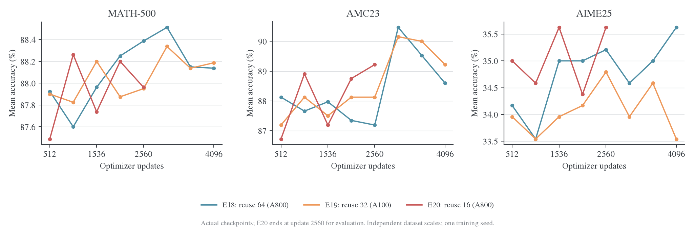
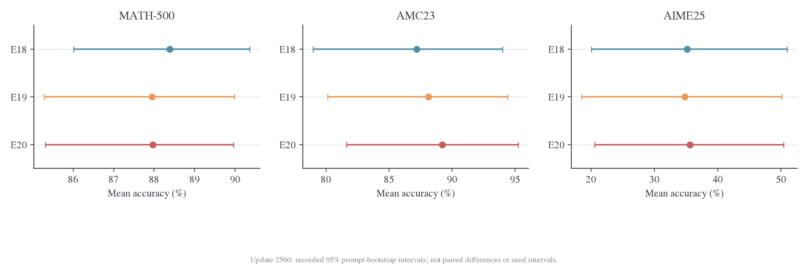
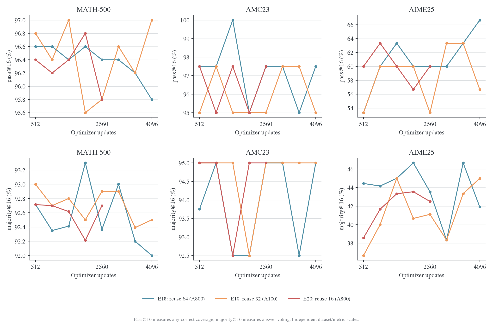
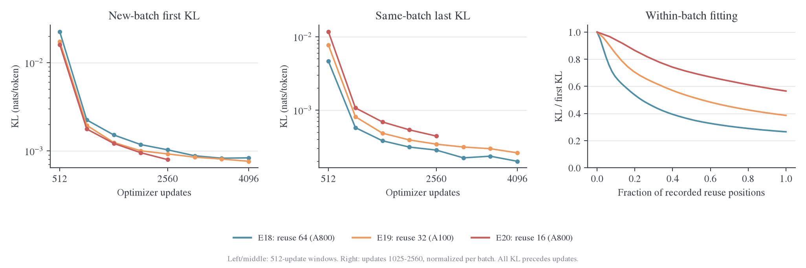
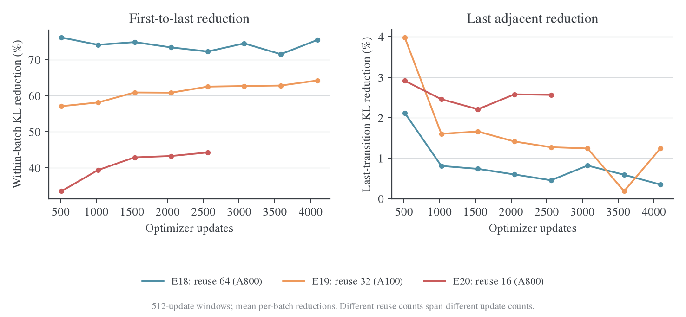
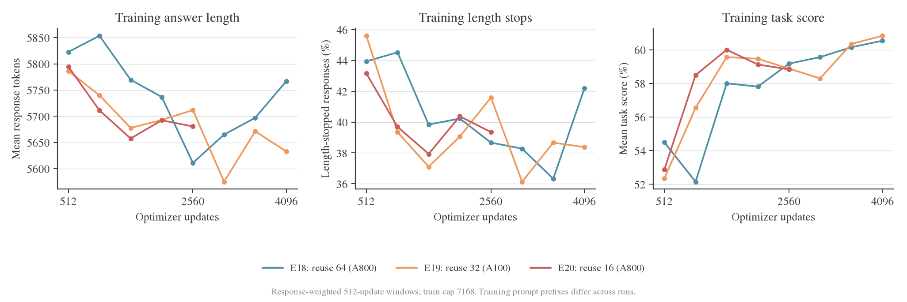
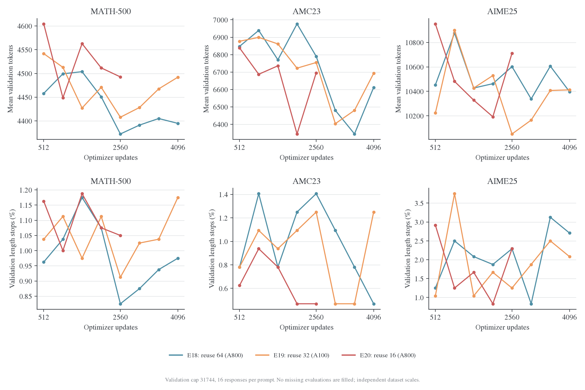
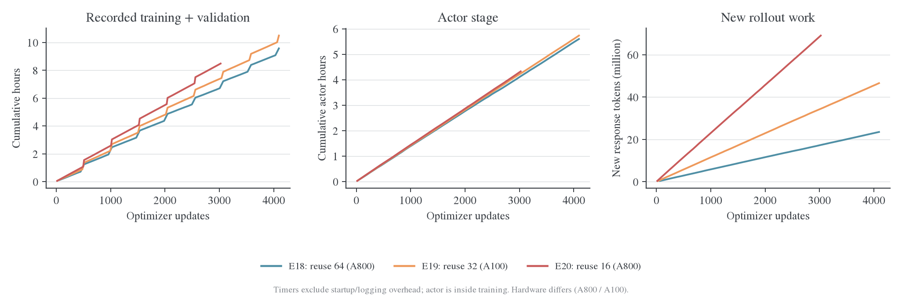

# E18–E20：等更新预算下的复用、收敛与验证表现

## 背景与 motivation

固定成功更新数时，提高reuse会减少新增轨迹，降低生成成本，但也减少新前缀覆盖。本实验比较reuse64/32/16，在共同更新预算上分别观察同批拟合、新批起点与任务收益。本文仍使用原冻结边界，不用后续日志回填。

## Setting 与实验设计

### 1. 实际 setting 与可比性

| 实验 / run | 每批复用 | 完整 outer / 更新 | 验证轮数 / 最后 update | 本地结束证据 | 硬件 |
| --- | ---: | --- | --- | --- | --- |
| E18 / `9hx3uegm`[^e18] | 64 | 64 / 4096 | 8 / 4096 | finished，exit=0 | 8×A800-SXM4-80GB |
| E19 / `d6jhh378`[^e19] | 32 | 128 / 4096 | 8 / 4096 | finished，exit=0 | 8×A100-SXM4-80GB |
| E20 / `lwgb5eex`[^e20] | 16 | 189 / 3024 | 5 / 2560 | partial_snapshot，无退出记录 | 8×A800-SXM4-80GB |

共同配置为 student `DeepSeek-R1-Distill-Qwen-1.5B`、teacher `JustRL-DeepSeek-1.5B`、DAPO、seed=42、shuffle、global batch=mini-batch=64、每题一条训练回答。Full-KL 使用 `precompute`，async write/prefetch 开启；AdamW、LR=1e-6、constant scheduler、零 warmup、weight decay=0.01、grad clip=1，按有效 token 聚合；任务奖励不进入 loss。

训练 prompt/response 上限为 4096/7168。验证使用 MATH-500/AMC23/AIME25 的 500/40/30 题，每题 16 条回答，temperature=0.7、top-p=0.9、response cap=31744。三组都无 step 0 验证，每 512 updates 验证，每 1024 updates 保存，计划各运行 4096 updates。预算关系为：

$$
U=E\,B,\qquad N_{\mathrm{new}}=64B=64U/E,
$$

其中 $E$ 是每批复用次数，$B$ 是已完成 outer 数，$U$ 是成功 optimizer 更新数。相同 $U$ 下，新回答数按 E18:E19:E20=1:2:4 改变；不同运行的具体回答和前缀也随训练改变。

[实际配置差异](../../../../../../../wandb-logs/MirrorOPD-verl/analysis/equal-update-budget-20261025/config-differences.json)共 11 项，包含 epochs、outer 总步数、验证／保存频率、名称与目录，以及继承的 critic 配置；三组使用 GRPO 优势配置，没有 critic 更新指标。记录的 Git commit 均为 `376e8185e`；requirements 均列出 Torch 2.11.0+cu128、vLLM 0.25.1+cu129、Transformers 5.12.1、Triton 3.6.0。Git 字段不证明部署工作区没有额外修改。硬件型号来自每个 run 自身的 environment 记录，E19 与另两组不同；耗时差异不全是复用次数的因果效果。

### 2. 指标覆盖与数据边界

| 家族 | 每组字段数 | 主要观测及用途 |
| --- | ---: | --- |
| eval | 2145 | 三个数据集的 mean／CI、pass/majority/all-correct 的 k 曲线、长度、格式、终止与缺失 |
| rollout | 52 | 每批新回答、token、长度、结束原因、任务分数、复用位置及版本 staleness |
| perf | 24 | 训练／验证及嵌套阶段计时、吞吐、MFU、allocator 内存、负载均衡 |
| optim | 12 | 逐更新 loss、梯度、LR、执行／跳过与非有限标记；`lr_next` 只在批末出现 |
| distill | 1 | `distill/full_kl`，全批有效 response token 的完整条件 reverse KL |
| advantage | 1 | 任务信号是否用于 loss；本组为零 |
| 合计 | **2235** | 不含 W&B 内部字段与三个 `step/*` 坐标 |

E18/E19/E20 分别有 4160/4224/3213 条 history 事件，不能把事件数当作更新数。绝大部分字段是验证预算展开，acc/reward/score 还包含同一数学评分的重复信息，2235 个字段不等于 2235 个独立结论。常量字段分别为 323/311/314 个；常量零保留其实际语义，缺失字段不补零。

**三组都没有 `distill/full_kl_position/*`、policy ratio/ESS、teacher/student entropy 或固定 held-out prefix probe。** 当前代码和字典支持某些字段，不代表这些历史 run 已经记录。本文不能回答误差集中在回答的前 30% 还是后 30%，也不能由小 KL 推出高 behavior ESS。字段语义见[指标字典](../../../settings/指标口径.md)。

所有已记录验证的预期／实际／有效回答数一致，每轮都是 9120 条；failed 和非有限评分计数为零。原始日志的 artifact 流为空，附属文件只有 requirements，没有逐题 `validation/records`。因此可以使用已记录的题目 bootstrap CI，但不能补做跨 run 的逐题配对 bootstrap 或 McNemar 检验。

### 附录 B：E18–E20 预设与运行入口

入口仍为 [run_math_opd_ablation_fsdp2.sh](../../../../run_math_opd_ablation_fsdp2.sh)。三组默认如下：

| 预设 | PPO epochs | Outer steps | 更新数 | 消费数据记录数 | TEST_FREQ | SAVE_FREQ |
| --- | ---: | ---: | ---: | ---: | ---: | ---: |
| E18，高复用 | 64 | 64 | 4096 | 4096 | 8 | 16 |
| E19，中复用 | 32 | 128 | 4096 | 8192 | 16 | 32 |
| E20，更多新轨迹 | 16 | 256 | 4096 | 16384 | 32 | 64 |

频率单位为 outer step。三组都在 update 512、1024、……、4096 验证，在 update 1024、2048、3072、4096 保存；保留四份 checkpoint。默认不做训练前验证，原始 student 的独立验证作为共享参考。

共同条件：`TOTAL_EPOCHS=1`，全局 batch=mini-batch=64，每题一条训练回答，seed=42，constant LR=1e-6、零 warmup、与 E17 相同的 AdamW 和梯度裁剪。Full-KL 使用 `precompute`、async write 和 prefetch；不额外加入 sampled-token IS 或 PPO clipping。动态分组筛选和失败补采关闭，采用同步训练。

数据仍是原始 `math/DAPO/train.parquet`，没有派生去重文件。已有 17917 条记录，当前长度配置过滤后数量不变，最多 279 个完整 batch。E20 的 256 个 batch 消费 16384 条，留有 1533 条余量。三组使用同一文件、同一 data seed、`train_max_samples=-1` 和现有独立随机 sampler，较短实验读取较长实验的题目序列前缀；相同题目后续生成的回答不要求一致。

```bash
# 三条命令分别用于独立作业，不自动申请或争用同一组 GPU。
STUDENT_GPUS=8 bash examples/mirroropd/run_math_opd_ablation_fsdp2.sh E18
STUDENT_GPUS=8 bash examples/mirroropd/run_math_opd_ablation_fsdp2.sh E19
STUDENT_GPUS=8 bash examples/mirroropd/run_math_opd_ablation_fsdp2.sh E20

CONFIG_ONLY=1 bash examples/mirroropd/run_math_opd_ablation_fsdp2.sh E20
```

所有预设仍允许环境变量及末尾 Hydra 覆盖，方便小规模 smoke。覆盖 batch、epochs、outer 或数据后，原表的 4096 updates 和单遍容量不再自动成立，应重新计算。没有增加通用 trainer 预算约束，也没有改变数据耗尽后的既有行为；正常预设通过单数据 epoch 和足够的样本容量避免回绕。

### 附录 C：原数据重复和标注冲突

按完整 prompt 内容精确比较，17917 条记录有 17255 个不同 prompt，多出的重复记录为 662 条，约 3.69%。这是三组共有的数据条件，不宣称每条记录对应唯一问题。

其中 12 组相同题目有不同 ground truth，共 24 条记录。已回查本机上游原始 parquet，题面和标签与处理后的记录一致，冲突并非本地转换引入。逐题核对后的答案如下，ID 省略 `DAPO-`：

| ID 对 | 原标签 | 核对答案 |
| --- | --- | ---: |
| 35 / 179 | 64 / 6 | 64，6 是指数 |
| 282 / 7665 | 15 / 25 | 25 |
| 2040 / 8017 | 99 / 21 | 99 |
| 2129 / 7414 | 30 / 12 | 30 |
| 3470 / 8382 | 36 / 248 | 248 |
| 4850 / 7807 | 239 / 48 | 239 |
| 5785 / 10267 | -1 / 554 | 554 |
| 5885 / 9921 | -1 / 230 | 230 |
| 5915 / 10714 | -1 / 683 | 683 |
| 5937 / 8582 | -1 / 913 | 913 |
| 7694 / 7708 | 108 / 180 | 180 |
| 11659 / 11771 | -2 / -1 | -2 |

保留第一条不能自动保证正确：其中第一条正确 5 组，第二条正确 7 组。这轮不修改标签或去重。纯 Full-KL 的 `use_task_rewards=False`，这些 ground truth 不参与蒸馏梯度，但影响对应训练题的正确率诊断；不能用这项训练集发现推断验证集标签质量。

### 附录 D：实际更新预算验收

新增 [verify_math_update_budget.py](../../../../tools/verify_math_update_budget.py)，只读现有日志导出，不重新实现 .wandb 解码。它检查最终配置、完整逐更新记录、每个 outer 的完成记录，以及验证节点的成功更新坐标。出现跳步、非有限 KL、缺失末步汇总或缺失最终验证时返回非零状态。

```bash
# 日志先通过既有本地导出流程处理；替换 RUN_ID 和新输出目录。
python3 -m examples.mirroropd.research.analysis.legacy.analyze_run export \
  --run wncfht/MirrorOPD-verl/RUN_ID --out ../wandb-logs/derived/MirrorOPD-verl/RUN_ID-analysis

"${PYTHON_BIN:-.venv-native/bin/python}" examples/mirroropd/tools/verify_math_update_budget.py \
  --config ../wandb-logs/derived/MirrorOPD-verl/RUN_ID-analysis/config.json \
  --history ../wandb-logs/derived/MirrorOPD-verl/RUN_ID-analysis/history.jsonl \
  --expected-updates 4096
```

也接受 `resolved_config.yaml` 和未压缩 `history.jsonl`。导出文件的实际扩展名以导出目录为准。只有成功更新数相等，才把三组标记为等更新预算；验收不证明 checkpoint 文件完整、数据唯一或模型效果收敛。效果比较继续同时看 update、生成 token 和实际耗时，相同 update 数不等于相同算力消耗。

#### 参考文献

[^e18]: W&B. math-opd-E18-20261024-145055-2568. [E18 运行页面](https://forge.coreweave.com/wandb/wncfht/MirrorOPD-verl/runs/9hx3uegm)。正文使用本地原始日志。
[^e19]: W&B. math-opd-E19-20261024-161857-2568. [E19 运行页面](https://forge.coreweave.com/wandb/wncfht/MirrorOPD-verl/runs/d6jhh378)。正文使用本地原始日志。
[^e20]: W&B. math-opd-E20-20261025-003534-2563. [E20 运行页面](https://forge.coreweave.com/wandb/wncfht/MirrorOPD-verl/runs/lwgb5eex)。只分析成功解码的完整记录。

## 实验结果

更新：2026-10-25。本文分析三组 Full-KL 训练的完整已归档 history，比较每批复用 64／32／16 次在相同 optimizer 更新数下的效果。E18/E19 各完成 4096 updates；E20 只有 3024 updates 的本地快照，最后验证在 2560。**三组共同可比较的验证预算是 512、1024、1536、2048、2560；4096 的终点比较只包含 E18/E19。**

当前证据支持保留 E18 的高复用配方作为节省生成的基线。在 update 2560，E18 相比 E20 少生成 **74.77%** 的 response token，记录的训练＋验证时间少 **19.56%**，三个数学集的 mean accuracy 差分别为 **+0.4250／−2.0313／−0.4167 个百分点**。这是一组单 seed 的工程取舍：现有结果没有显示更多新轨迹带来稳定的逐集合优势，也不足以证明三个配方等效。

最清楚的优化差异是：**高复用把同批前缀拟合得更深，更多新轨迹使新批起点 KL 更低。** 两种排序相反，因此不能用整条 update 曲线的最低 loss 判断训练分布上的收敛，更不能直接替代任务指标。后期 KL 仍下降，但首个验证点已接近末点水平，之后提升不一致；继续降低训练 KL 尚未转化为一致的验证收益。

归档数据保留三组全部 **2235 个数值指标**；正文使用静态图表。完整数值见[统计结果](../../../../../../../wandb-logs/MirrorOPD-verl/analysis/equal-update-budget-20261025/analysis.json)、[验证表](../../../../../../../wandb-logs/MirrorOPD-verl/analysis/equal-update-budget-20261025/evaluation.csv)、[字段目录](../../../../../../../wandb-logs/MirrorOPD-verl/analysis/equal-update-budget-20261025/metric-catalog.csv)和[覆盖表](../../../../../../../wandb-logs/MirrorOPD-verl/analysis/equal-update-budget-20261025/metric-coverage.csv)。

### 3. 相同更新预算下的验证效果



图中仅连接实际 checkpoint，三个数据集使用独立纵轴。三组共同的最后一个验证点是 update 2560：

| Update 2560 | Outer / 新回答数 | MATH mean | AMC mean | AIME mean |
| --- | --- | ---: | ---: | ---: |
| E18 | 40 / 2560 | 88.3875% | 87.1875% | 35.2083% |
| E19 | 80 / 5120 | 87.9500% | 88.1250% | 34.7917% |
| E20 | 160 / 10240 | 87.9625% | 89.2188% | 35.6250% |

这一个点上，E18 的 MATH 最高，E20 的 AMC/AIME 最高。E20 相比 E18 多使用四倍新回答，AMC 高 2.0313 个百分点，AIME 高 0.4167 个百分点；MATH 低 0.4250 个百分点。不能由末点混合排序宣布某个复用次数全面占优。

#### 3.1 共同 checkpoint 的趋势

| 512–2560 的五个共同 checkpoint，描述性均值 | MATH | AMC | AIME |
| --- | ---: | ---: | ---: |
| E18 | 88.0250% | 87.6563% | 34.5833% |
| E19 | 87.9500% | 87.8125% | 34.0833% |
| E20 | 87.9300% | 88.1563% | 35.0417% |

E20 的 AMC/AIME 在这段轨迹均值上略高，MATH 三组差不到 0.1 个百分点。这里的 checkpoint 来自同一次训练、彼此相关；均值只是描述整段轨迹，不能把五个点当成五次独立重复。

首个验证已在 update 512，三组 MATH 为 87.49%–87.93%。从首个点到各自末次验证，E18 的 MATH/AMC/AIME 变化为 +0.2125/+0.4688/+1.4583 个百分点，E19 为 +0.2875/+2.0313/−0.4167，E20 为 +0.4750/+2.5000/+0.6250。三个集合的提升并不单调；E18/E19 的 AMC 都在 update 3072 到达更高点，随后回落。没有早于 512 的验证，不能判断它们在最初几百次更新中的任务收益轨迹。

#### 3.2 已完成的 4096-update 终点

| Update 4096 | MATH mean | AMC mean | AIME mean |
| --- | ---: | ---: | ---: |
| E18 | 88.1375% | 88.5938% | 35.6250% |
| E19 | 88.1875% | 89.2188% | 33.5417% |

E19 相对 E18 为 +0.0500/+0.6250/−2.0833 个百分点；使用两倍新回答仍没有逐集合一致的终点优势。E20 最后验证对应 2560 updates，不能把它的 35.6250% AIME 填进这个 4096-update 表。

#### 3.3 题目不确定性



| Update 2560，日志中 mean accuracy 的 95% CI | MATH | AMC | AIME |
| --- | --- | --- | --- |
| E18 | [86.01%, 90.35%] | [78.96%, 94.00%] | [20.08%, 50.96%] |
| E19 | [85.28%, 89.98%] | [80.12%, 94.41%] | [18.54%, 50.10%] |
| E20 | [85.31%, 89.96%] | [81.62%, 95.25%] | [20.57%, 50.42%] |

CI 来自 256 次题目 bootstrap；AMC 只有 40 题，AIME 只有 30 题，区间很宽。区间覆盖范围说明点排序的不确定性较大，但区间重叠本身既不能证明无差异，也不是配对显著性检验。当前证据应支持下一轮配方选择，而非显著性或等效性声明。

### 4. 采样覆盖、投票和回答稳定性



在共同 update 2560，mean、pass@16 和 majority@16 给出的排序并不完全相同：

| 数据集 / run | Mean | Pass@16 | Majority@16 | All-correct@16 |
| --- | ---: | ---: | ---: | ---: |
| MATH / E18 | 88.3875% | 96.4000% | 92.3667% | 69.2000% |
| MATH / E19 | 87.9500% | 95.8000% | 92.9000% | 69.4000% |
| MATH / E20 | 87.9625% | 95.8000% | 92.7000% | 67.8000% |
| AMC / E18 | 87.1875% | 97.5000% | 95.0000% | 50.0000% |
| AMC / E19 | 88.1250% | 95.0000% | 95.0000% | 55.0000% |
| AMC / E20 | 89.2188% | 97.5000% | 95.0000% | 50.0000% |
| AIME / E18 | 35.2083% | 60.0000% | 43.5556% | 13.3333% |
| AIME / E19 | 34.7917% | 53.3333% | 41.1111% | 16.6667% |
| AIME / E20 | 35.6250% | 60.0000% | 42.5000% | 16.6667% |

AMC 的三个 majority@16 都为 95%，而 mean 有约两个百分点差异。AIME 中，E18/E20 的 pass@16 都为 60%，投票只有 43.56%/42.50%，说明“候选中出现正确答案”和“投票选中正确答案”仍有明显差距。缺失解析、错误答案的集中程度和平票规则都会影响投票；没有逐回答联合记录，不能把差距全部归因于某一种机制。

#### 4.1 AIME 的采样预算收益

| Update 2560 | Pass@1 | Pass@4 | Pass@8 | Pass@16 | Majority@16 |
| --- | ---: | ---: | ---: | ---: | ---: |
| E18 | 35.21% | 47.88% | 54.00% | 60.00% | 43.56% |
| E19 | 34.79% | 46.04% | 51.06% | 53.33% | 41.11% |
| E20 | 35.63% | 49.82% | 55.55% | 60.00% | 42.50% |

E19 从 8 到 16 条候选的 pass 增益为 2.28 个百分点，E18 为 6.00，E20 为 4.45。这个差异反映当前 30 题上采样覆盖的形状；单次预算曲线不提供跨题重采样之外的训练随机性证据。`prefix_mean@k` 则按固定回答顺序截取，不能把它当成“多采样必然提高平均正确率”的证据。

#### 4.2 4096-update 终点的 AIME 排序反转

| AIME，update 4096 | Mean | Pass@16 | Majority@16 | All-correct@16 |
| --- | ---: | ---: | ---: | ---: |
| E18 | 35.6250% | 66.6667% | 41.9048% | 16.6667% |
| E19 | 33.5417% | 56.6667% | 45.0000% | 16.6667% |

E18 的 mean 和候选覆盖更高；E19 的投票更高。Pass@16 对应至少一次正确的题目数分别是 20/30、17/30；all-correct@16 均为 5/30。不同使用方式对配方的排序可以不同，不应只选一个更好看的指标汇报。Majority@16 的平票按候选正确性平均，分数可以不是 1/30 的整数倍；该端点的子集 Monte Carlo 误差为零，不等于题目或训练不确定性为零。

### 5. Full-KL：深度复用与新轨迹拟合

所有 `distill/full_kl` 都是给定当批学生生成前缀、更新之前的完整条件 reverse KL。对一批复用 $E$ 次，首末两个观测之间只执行了 $E-1$ 次更新。记第 $b$ 批第 $j$ 个更新前观测为 $K_{b,j}$，本文逐批计算：

$$
\Delta_b=1-\frac{K_{b,E}}{K_{b,1}},\qquad
R_b=\frac{K_{b+1,1}}{K_{b,E}}.
$$

先算每批比值，再对窗口内批次平均。$R_b$ 只使用两个端点都在窗口内的相邻批次。它在换题目、回答和前缀后比较两个条件目标，不能解释为同一输入上的 loss 反弹。



图中右侧横轴是各自批内观测位置的相对进度，0→1 分别覆盖 63/31/15 次已执行更新；同一横坐标不表示同样多的更新。左、中图则按相同 512-update 窗口比较。

#### 5.1 相同 update 2049–2560 的窗口

| 观测 | E18，8 批 | E19，16 批 | E20，32 批 |
| --- | ---: | ---: | ---: |
| 新批第 1 次更新前 KL 均值 | 0.00103055 | 0.00092669 | 0.00079778 |
| 同批最后一次更新前 KL 均值 | 0.00028609 | 0.00034462 | 0.00044399 |
| 逐批首末相对降幅均值 | 72.25% | 62.50% | 44.25% |
| 最后两个更新前观测间的降幅均值 | 0.45% | 1.27% | 2.56% |
| 下一批首值 / 上一批末值均值 | 3.66× | 2.61× | 1.79× |
| 窗口内可比较的换批次数 | 7 | 15 | 31 |

单位为 nats/token；每批先按有效 token 求均值，窗口再跨批等权，未将所有 token 合并成一个分母。**按旧批末值排序是 E18 最低，按新批起点排序则是 E20 最低。** 高复用把同一批前缀压得更深；更多新轨迹下，新批初始目标更低。这个现象与“深度拟合已有前缀”和“覆盖更多新前缀”的取舍相容，但三组生成的前缀并不相同，新批目标也不是固定 held-out 测试集，不能直接宣布哪个组泛化更好。

`rollout/staleness/trajectory_staleness/*` 在三组中均为零，表示同步生成时的版本滞后；它没有记录一批回答在第 64 次更新时相对当前策略的完整分布漂移。因此零 staleness 和明显的批内陈旧前缀效应可以同时出现。

#### 5.2 后半段仍有优化空间，但边际降幅缩小



在 update 2049–2560，E18 从首个观测到第 16、32、64 个观测的 KL 降幅分别为 50.56%、63.92%、72.25%。后 32 个观测位置继续降低目标，但贡献只有首值的约 8.33 个百分点；最后相邻一步平均下降约 0.45%。E20 做到第 16 个观测时，最后相邻下降仍约 2.56%。这些数值支持不同复用程度处于不同的批内优化阶段；它们不直接给出验证收益最优的停止点。

| 各自末 512 updates | E18，3585–4096 | E19，3585–4096 | E20，2513–3024 |
| --- | ---: | ---: | ---: |
| 新批起点 KL 均值 | 0.00083635 | 0.00076429 | 0.00075209 |
| 同批末次 KL 均值 | 0.00020138 | 0.00026236 | 0.00041283 |
| 首末降幅均值 | 75.44% | 64.20% | 45.14% |
| 最后相邻观测降幅均值 | 0.34% | 1.25% | 2.72% |
| 裁剪前梯度范数均值 | 0.00794 | 0.00936 | 0.01256 |

此表用于描述各 run 的最后可见阶段；E20 的窗口更早，不是三组同进度比较。E18 在 3073–3584 到 3585–4096 的新批起点均值由 0.00082806 变为 0.00083635，局部已不再单调下降；同批末值仍降低。E19 的新批起点则从 0.00081043 降至 0.00076429。只有 8/16 个新批观测和一条训练轨迹，不足以判定是否到达稳定平台。

末点已到 1e-4 量级，但日志没有同一前缀的高精度基线；loss 与 Full-KL 一致只能核对记录与聚合，不能验证 KL 的绝对数值精度，也不能把剩余值直接认定为低精度数值地板。

更强的结论需要固定 held-out prefixes、位置分桶和行为漂移观测。现有日志只支持“固定当前批次还能优化”以及“更低 KL 没有对应一致的验证提升”；不能证明学生完整序列分布已逼近教师。

### 6. 训练生成、验证长度与格式



| 截至 update 2560 | E18 | E19 | E20 |
| --- | ---: | ---: | ---: |
| 训练新回答均长 | 5758.79 | 5721.86 | 5707.37 |
| 因 7168 上限结束的回答比例 | 41.45% | 40.55% | 40.11% |
| 训练 task score 均值 | 56.33% | 57.36% | 57.87% |

三组平均回答长度接近，长度上限仍截断约四成训练回答。共同预算内最后一个完整 512-update 窗口（2049–2560）的均长分别为 5611/5712/5681 token，未见整体长度膨胀与 KL 下降同步出现。训练 score 的数据是不同长度的 DAPO 题目序列前缀，不能将表中的约 1.5 个百分点差直接当作训练准确率优势。任务奖励不参与 loss，旧数据中的重复与标注冲突也只影响这类诊断，详见附录 C。



| Update 2560 | E18 | E19 | E20 |
| --- | --- | --- | --- |
| MATH：均长 / p95 | 4372 / 12385 | 4408 / 12589 | 4493 / 13071 |
| AMC：均长 / p95 | 6790 / 17899 | 6755 / 18931 | 6695 / 17109 |
| AIME：均长 / p95 | 10602 / 22419 | 10052 / 20931 | 10712 / 22421 |
| MATH：length 终止 / 解析缺失，分母 8000 | 66 / 64 | 73 / 81 | 84 / 93 |
| AMC：length 终止 / 解析缺失，分母 640 | 9 / 8 | 8 / 5 | 3 / 4 |
| AIME：length 终止 / 解析缺失，分母 480 | 11 / 9 | 6 / 5 | 11 / 10 |

验证 cap 为 31744，截断率远低于训练。共同末点的 MATH length 终止为 0.83%–1.05%，AMC 为 0.47%–1.41%，AIME 为 1.25%–2.29%；所有 checkpoint 中最高的 AIME 截断率为 E19 update 1024 的 18/480=3.75%。没有大规模生成失败，也未出现验证长度持续爆炸。

length 终止与解析缺失计数并不相同，例如 E19 的 MATH 为 73 对 81，E18 的 AMC 为 9 对 8。二者是不同事件；只有聚合数，不能恢复交集，也不能据此认定截断造成了多少错答。共同末点的 AIME format mean 为 98.125%/98.958%/97.917%，而准确率仅约 35%；格式成功率较高，答案正确率和候选选择仍有较大改善空间。

### 7. 更新健康度与 E20 截断边界

| 已记录全程 | E18 | E19 | E20 |
| --- | ---: | ---: | ---: |
| 成功更新 / skipped | 4096 / 0 | 4096 / 0 | 3024 / 0 |
| 梯度范数超过 clip=1 的更新数 | 31 | 25 | 23 |
| 最后一次超过阈值的 update | 31 | 31 | 23 |
| 最后一条 Full-KL | 0.00015476 | 0.00027179 | 0.00034655 |
| 最后一条裁剪前梯度范数 | 0.00492 | 0.00525 | 0.00837 |
| loss / gradient 非有限标记 | 全零 | 全零 | 全零 |

LR 全程为 1e-6，裁剪集中在最初 31 次以内；后期没有跳步或梯度爆炸记录。`optim/actor/loss` 与 `distill/full_kl` 的最大绝对差分别约为 8.38e-9、1.62e-8、1.00e-8，符合相同目标不同浮点聚合路径；将两条曲线同时下降当作两份独立收敛证据会重复计数。

三组训练的 empty loss mask、unknown/aborted 终止计数均为零。E20 最后一条控制台记录仍为 `189/256` 的训练进度；已归档控制台没有 Traceback、CUDA OOM、FloatingPointError 或 Killed 标记。**这些证据只说明已看到的 3024 次更新正常，不能确定远端作业的终止原因。** 2026-10-25 09:25 的云端盘点将 E20 标为 failed，而本地仍是截断快照；两种事实分开保留。

现有 E20 归档距配置预算还缺 1072 updates、67 个 outer 的证据；还缺 update 3072、3584、4096 的三个验证节点。应先获取更新的日志和作业退出信息，再决定是否续跑／重跑，不能把归档缺尾直接当成算法失败。

### 8. 相同更新数的生成与时间成本



| 截至 update 2560 | E18 | E19 | E20 |
| --- | ---: | ---: | ---: |
| 新回答数 | 2560 | 5120 | 10240 |
| 新 response token | 14.742 M | 29.296 M | 58.443 M |
| response token × epochs，复用工作量代理 | 943.519 M | 937.470 M | 935.095 M |
| 训练 outer 累计小时 | 3.978 | 4.521 | 5.417 |
| 验证累计小时，均 5 轮 | 2.059 | 2.088 | 2.089 |
| 训练＋验证累计小时 | 6.037 | 6.609 | 7.505 |
| 八卡名义 GPU 小时 | 48.30 | 52.88 | 60.04 |
| Actor 阶段平均秒 / update | 4.945 | 5.069 | 5.153 |

复用工作量代理只相差约 0.9%，说明相同 update 下被重复处理的 response-token 数接近，但新增 rollout 量相差约四倍。它不是实际 loss-mask token 总数或 FLOPs 的直接测量；完整执行还包含 padding、模型状态切换和不同硬件。

E18 与 E20 都记录为 A800，训练＋验证相差约 1.468 小时。其中 rollout pipeline 累计时间为 1327 秒和 5254 秒，差约 3927 秒，约占总计时差的 74%。这是记录阶段的算术分解，支持“减少新生成是主要节省来源”；仍不能排除独立作业的资源环境差异。

E18/E19 完成 4096 updates 时累计为 9.572/10.494 小时，新生成 23.513/46.580 M token，复用工作量代理为 1.505/1.491 B token。E18 节约约 0.921 小时和约一半的新生成量；E19 使用 A100，这段时间差不可直接解释为纯算法加速。

计时只相加 `outer_step_seconds + validation_seconds`。Actor、rollout、teacher 和 checkpoint 已嵌套在 outer；`validation_rollout_seconds` 已嵌套在 validation，不能重复相加。三组已记录运行时长与这项计时和相差约 8/15/22 秒，覆盖较完整，但不代表模型加载前的全部资源占用。

`perf/throughput/tokens_per_gpu_second` 全程均值约为 131/229/382。它把每个 outer 的新 token 除以包含多次更新的时间，高复用自然更低；不能据此否定 E18 在等 update 预算下的成本优势。阶段窗口的 GPU busy 均值约 91%–93%，allocator allocated 峰值约 10.1–10.2 GiB，周期性设备显存峰值约 54.5–54.7 GiB。设备采样约每 15 秒一次；这些统计用于说明观测覆盖，不把 busy 或 MFU 当成 Tensor Core 饱和证明，也不用于诊断未记录的 E20 退出原因。

## 分析与下一步

### 9. 师生参考、可下结论与后续优先级

历史 One-Shot-OPD 的原始 student mean 为 83.25%/72.03%/23.75%，teacher 为 89.11%/89.38%/39.17%，来源及协议差异见[师生参考报告](../../learning-signal/sampled-vs-full/2026-10-24-Full-KL收敛与师生参考评测.md)。E18/E19 最终 MATH 已在 88.1% 附近，AIME 与该 teacher 参考仍相差约 3.54/5.63 个百分点。旧评测的输入／执行管线不同，只能作背景参考；它不能替代这些 run 的 step 0，也不能定义严格的蒸馏上限。

| 判断 | 证据 | 决策或下一步 |
| --- | --- | --- |
| 高复用明显节省新增轨迹，当前未见一致的任务劣化 | 等 2560 updates 下新 token 约 1:2:4；三个验证集混合排序 | 保留 E18 作为节省生成的基线，并在同硬件、同源码下复测 |
| 更多新轨迹降低新批起点 KL，但未稳定提高所有任务指标 | 2049–2560 起点 KL：E20最低；共同 checkpoint 分数差小且波动 | 将新批起点与旧批末值分别监控，不按最小 loss 选配方 |
| 64 次复用后半段存在边际递减 | 第32→64个观测再降低首值约8.33个百分点，末次相邻下降约0.45% | 可设计固定输入的 reuse16/32/64 消融；现有跨轨迹数据不能直接给最优停止阈值 |
| “采到”与“选出”的瓶颈不同 | AIME 终点 mean/pass 排序与 majority 相反 | 根据实际使用方式预先确定 mean、pass 或 majority 主指标，避免事后挑选 |
| 三臂 4096-update 比较尚缺证据 | E20 无后三个验证点 | 先补齐 E20 日志／退出信息，再完成等预算终点比较 |
| 单 seed 和小验证集限制结论强度 | AIME 题目 CI 很宽；无逐题配对数据 | 保存完整 validation records、使用相同 seed 集合复测，再报告配对与跨 seed 不确定性 |

对于“低 KL 是否还值得继续训练”，当前回答是：已有优化空间，但从约 update 512 起任务收益较小且不稳定；进一步降低同批目标尚未形成一致的任务收益。下一轮最有价值的新增观测是同协议原始师生评测、固定 held-out prefix KL、位置十分桶，以及跨 run 可配对的逐题记录。当前指标字典已定义的功能也要检查真实 run 是否实际发出，不能仅凭配置入口存在就认为覆盖完成。

## 证据与复算

### 10. 数据、复算与审计

原始 `.wandb` 留在 `wandb-logs`。本文使用日志仓库提交 `188690d` 中的原始 run；三个原始文件最后一次更新来自 `ff8b9f0`。分析保存的是统计、原始横轴的指标序列和配置差异，不再复制三套完整原始日志。源目录、读取器版本、文件大小／修改时间、事件计数和 E20 截断错误保存在[统计来源](../../../../../../../wandb-logs/MirrorOPD-verl/analysis/equal-update-budget-20261025/analysis.json)中；解码前后未改变训练资产或源码实现。

```bash
# 从源码仓库根目录执行；先刷新三组本地解码。
for RUN_ID in 9hx3uegm d6jhh378 lwgb5eex; do
  ../wandb-logs/.venv/bin/python ../wandb-logs/tools/wandb_local.py decode \
    --project MirrorOPD-verl --run "$RUN_ID"
done

ANALYSIS=../wandb-logs/MirrorOPD-verl/analysis/equal-update-budget-20261025
python3 -m examples.mirroropd.research.analysis.analyze_equal_budget \
  --logs-repo ../wandb-logs --out "$ANALYSIS"

# 使用现有分析 Python；可按本机安装位置覆盖。
ANALYSIS_PY=/root/.local/share/mirroropd/venvs/profile-cu128/bin/python
export FIGURE_VIZ_MPL=/mnt/tidalfs-bdsz01/dataset/llm_dataset/zkn_data/fht_data/dotfiles/.agents/skills/figure-viz/assets/mpl
"$ANALYSIS_PY" -m examples.mirroropd.research.analysis.plot_equal_budget \
  --data "$ANALYSIS" --out examples/mirroropd/docs/experiments/reuse-budget/equal-update-budget/figures/20261025
```

这些命令只分析与绘图，不启动训练。后续原始日志变化时应使用新的分析日期目录，并保留本文的输入边界。八组图均提供 PNG/PDF 和实际机器审计记录；不同数据集或指标使用独立纵轴的警告已结合图面检查，CI 图的端帽和横线被审计器重复计为系列，实际只有三个实验。没有 error 级图形审计问题。字段与预算的统计校验见 `tests/utils/test_equal_budget_analysis_on_cpu.py`；更新计数另由附录 D 的预算验收工具核对。

### 附录 A：原始 Student / Teacher 验证

新增 [run_math_validation_fsdp2.sh](../../../../run_math_validation_fsdp2.sh)，调用既有数学公共脚本和 V1 `_validate()`。`student` 选择 `STUDENT_MODEL`，`teacher` 选择 `TEACHER_MODEL`，然后把所选模型放到 `actor_rollout_ref.model.path` 作为生成模型。默认路径分别为 `MODEL_ROOT/DeepSeek-R1-Distill-Qwen-1.5B` 和 `MODEL_ROOT/JustRL-DeepSeek-1.5B`。

包装脚本设置 `distillation.enabled=False`、`trainer.val_only=True`、`trainer.val_before_train=True`、`trainer.resume_mode=disable`、`trainer.save_freq=-1`；没有蒸馏 teacher worker，也不执行 optimizer 更新。资源变量 `STUDENT_GPUS` 在这里表示被评测模型的共享资源池。沿用现有 trainer 初始化，不新增另一套生成或评分实现。

默认评测预算仍是 MATH-500/AMC23/AIME25 的 500/40/30 题，每题 16 条回答，temperature=0.7、top-p=0.9、回答上限 31744。全量提交、CUDA Graph、TP1、每副本并发 128、显存比例 0.65、调度 token 预算 8192，来自已有公共数学配置，包装脚本不复制这些默认值。

采集现有 mean accuracy、pass@k、majority@k、长度统计、停止原因、截断/答案缺失和完整性指标。逐回答结果沿用 `RUN_DIR/validation/records/0.jsonl`，其他输出及原生环境见[运行与架构](../../../infra/training/2026-10-22-共享八卡运行与架构.md)。生成阶段保持不返回训练专用 log-prob；本轮没有新增 hidden/head 分块或概率重放。

从仓库根目录，在各自已分配 GPU 的作业中运行：

```bash
# CUDA_VISIBLE_DEVICES 使用作业实际获分配的设备；STUDENT_GPUS 与数量一致。
STUDENT_GPUS=8 bash examples/mirroropd/run_math_validation_fsdp2.sh student
STUDENT_GPUS=8 bash examples/mirroropd/run_math_validation_fsdp2.sh teacher

# 检查最终命令或解析配置，不启动 Ray/GPU。
DRY_RUN=1 bash examples/mirroropd/run_math_validation_fsdp2.sh teacher
CONFIG_ONLY=1 bash examples/mirroropd/run_math_validation_fsdp2.sh student
```

本机原有模型、数据、Python 不在默认资产位置时，显式设置：

```bash
export MODEL_ROOT=/mnt/tidalfs-bdsz01/dataset/llm_dataset/zkn_data/fht_data/models
export DATA_ROOT=/mnt/tidalfs-bdsz01/dataset/llm_dataset/zkn_data/fht_data/MD-OPD/data
export PYTHON_BIN=/root/.local/share/mirroropd/venvs/profile-cu128/bin/python
export VERL_USE_UV=0
# 仅在 GPU0–3 空闲、已获得共享使用权时运行本机四卡任务。
export CUDA_VISIBLE_DEVICES=0,1,2,3
export STUDENT_GPUS=4
```

自定义权重可以用 `STUDENT_MODEL` / `TEACHER_MODEL`，或末尾 `actor_rollout_ref.model.path=...` 覆盖。末尾 Hydra 参数仍有最高优先级，包括 val-only 等开关；修改后按实际合成配置判断作业行为。两个模型使用独立实验目录，避免覆盖结果。既有初始化依赖仍会读取训练数据，因此纯 valid 入口也要求正常的数据资产。
