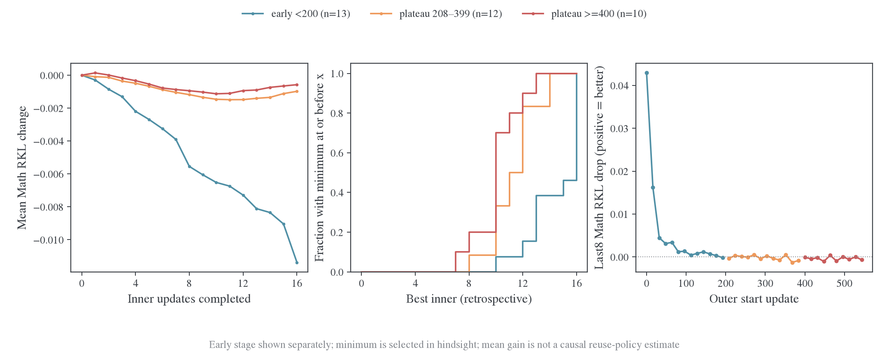
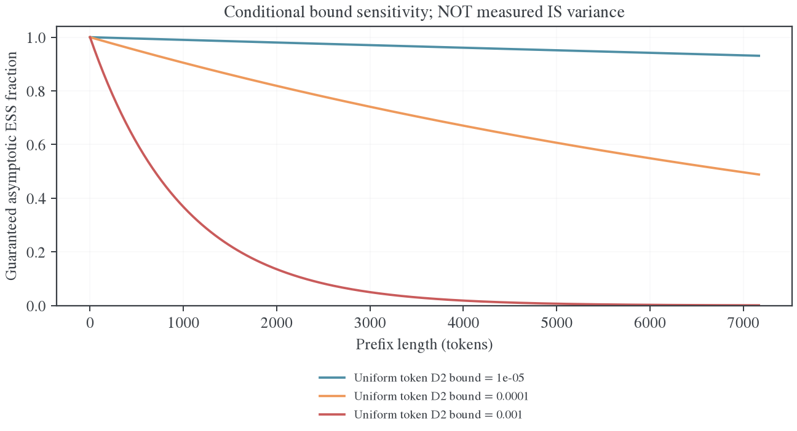

# 平台期批内收益回吐与 prefix IS

在固定 16 次更新的诊断轨迹中，平台期同批训练 loss 仍持续下降，但 initial Math held-out RKL 往往先降后升。现有证据支持测试后期减少 reuse、把节省的更新预算转给新 rollout；尚不能把原因唯一归结为旧策略 prefix 漂移，也没有证明 prefix IS 能解决它。

## 实验与证据入口

Pair 为 Qwen3-1.7B ← Qwen3-4B-Instruct-2507，AdamW LR1e-6，batch64，reuse16，shuffle=true，seed42。每个 inner 更新后评估固定 Math/Code/IF 双 bank。以下主统计冻结于 update560:35 个完整 outer，平台期使用起点≥200 的 22 个 outer（实际起点 208）。后续训练进展不回写这份统计。主指标为 initial bank 的 128 道 Math 问题均值，不含 development_math。

- [回升比例与阶段分布](census.md)：统计定义、六类 bank 及完整相关分析。
- [368/384 同权重对齐与平台期局部分析](plateau.md)：单独冻结于 528 更新、20 个完整平台 outer；用于解释边界，不与 560 截面混算。
- [Prefix IS 理论与方差界](../../../theory/prefix-is.md)：目标、无偏条件、ESS、长前缀界及小 KL 反例。

| 平台期 22 个 outer                      |         结果 |
| --------------------------------------- | -----------: |
| 至少有一次 RKL 回升                     |        22/22 |
| 改善与终点回吐均超过 0.0001             |        21/22 |
| 后 8 次更新合计使 initial Math RKL 变差 | 15/22，68.2% |
| 整轮结束比起点更差                      |  4/22，18.2% |
| 终点回吐占批内最大改善，中位数          |        40.0% |
| 最低点 inner 位置，中位数               |         10.5 |



平台前 8 步平均改善 0.001075，后 8 步平均损害 0.000278。同批 training loss 下降量与终点回吐量 Pearson 相关为 +0.594；换批 rebound 与回吐量相关为−0.064。更值得关注的是“越拟合这一批，跨状态收益越容易回吐”，而非“rebound 越大就必然获得更多有效信号”。这些是单 seed、相关序列的描述；事后最低点存在选择效应，不能用同一 held-out bank 挑停止点再报告无偏提升。

## Prefix 与训练 state：目前能判断什么

自回归模型的 state 就包含 prefix。这里至少有三种不同机制：复用导致当前策略与行为策略的访问分布分离；64 条有限轨迹不能覆盖总体状态；当前训练状态与固定 initial/teacher bank 的目标分布不同。现有曲线无法将三者分解。

条件 full-vocab reverse KL 的方向没有因为回升而变成错误，但“让这个状态上的学生靠近教师”不能保证共享参数使所有其他状态也靠近教师。若更新方向为 $v$、held-out 梯度为 $g_H$，则 $\Delta K_H\approx-\eta\langle g_H,v\rangle$；同批下降不约束这个内积的符号。AdamW 动量及有限步曲率也可能改变方向。尤其是本轮训练 loss 下降幅度早期约 0.05084、400 以后约 0.04967，几乎不变，而后 8 步 bank 收益从早期正值变成负值，说明可迁移收益正在耗尽，不能仅凭训练 loss 继续下降决定多拟合。

teacher Math 平台期只有 7/22 批后 8 步变差，initial Math 则 15/22。这说明结果依赖评估状态分布；它支持研究状态覆盖和梯度冲突，但不是“已经证明行为策略漂移是根因”。纯粹切换 batch 而不改变权重，也不会使固定 bank RKL 立即跳变。

## 后期策略有多接近：能测到什么

这里必须分别回答 student/teacher 与 current/behavior。

| update | initial Math 上的 student→teacher KL | teacher Math 上的 student→teacher KL |
| ------ | -----------------------------------: | -----------------------------------: |
| 0      |                              0.41170 |                              0.42231 |
| 208    |                              0.26376 |                              0.29674 |
| 320    |                              0.25381 |                              0.28796 |
| 480    |                              0.24827 |                              0.28037 |
| 560    |                              0.24622 |                              0.27824 |

这些是固定 bank 上条件 KL 的问题均值，不是序列 KL，也不是 current/behavior KL。它们说明学生还没有在这些状态上匹配教师，不能据此算 prefix 权重或判断学生 16 步内漂移多少。每轮行为策略来自 rollout 时的学生；同轮后续学生漂移需要另外记录。

核查现有冻结指标、generation parquet 与 bank rkl parquet：指标保留教师 KL 和位置分桶；generation 保留 prompt/response token；bank parquet 保留 KL 总和及位置分桶。三者均缺少同轨迹的行为策略和当前策略 sampled-token log-prob。因而 **目前实际 prefix IS 方差、ESS、current/behavior KL 均未测得**；[可复算核查结果](prefix-diagnostics.json)以 null 表示，不能从 teacher KL 填补。

平台 22 批每批首个 inner 的有效训练 token 总数除以 64，平均为 4780 token/回答，各批均值范围4295–5254。它是 loss mask 下的有效长度，不保证等于全部生成长度，也不是单条轨迹长度分布；用于说明本实验面对的是长 prefix。逐批值见[prefix-lengths.csv](prefix-lengths.csv)。

## Prefix IS 是否会有很大方差

精确关系是 $\operatorname{Var}(w)=e^{D_2(P_{\rm current,prefix}\Vert P_{\rm behavior,prefix})}-1$，独立轨迹的大样本 ESS 比例为 $e^{-D_2}$。小平均 KL 不能控制这个二阶矩；长 prefix 上少数罕见 token 的巨大比率也可能主导权重。

若额外假设每个历史的单 token 条件 Rényi-2 divergence 一致≤$\epsilon$，长度为 $h$ 的 prefix 有方差上界 $e^{h\epsilon}-1$、渐近 ESS 比例下界 $e^{-h\epsilon}$。在 4096 token 时，要保证 50% ESS，所需一致条件界约为 0.000169；保证 90% 则约 0.0000257。这些是条件保证，**不是测得的策略距离或实际 ESS**。



所以现在既不能断言 IS 方差一定大，也不能因为 LR 小就断言它安全。更关键的是，它只重新加权已有状态，不能补出未见过的轨迹；若主要问题是有限批过拟合或固定 bank 的梯度冲突，即使权重接近 1，也不解决根因。teacher/student prefix IS 则进一步改变训练目标，不是修正 reuse 的同一个开关。

## 优先验证的简单方案

优先做平台 checkpoint 分支：固定 16 与固定 8 对照，前期相同；比较相同训练 GPU 时间下的双 bank 指标。诊断 bank 评估时间单列扣除，并把 rollout/teacher scoring/actor update 成本分别累计。这个实验直接检验提前换状态的预算收益，避免将事后最佳 inner 当作在线控制器。

第二个对照是在保持更新 batch 定义清楚的前提下扩大 rollout 的不同 prompt 数。若同时扩大 actor batch，需要报告每次更新 token 数和更新次数，区分“更多独立状态”与“更低梯度噪声”。不要把两者与调 LR 混在唯一一条实验里。

Prefix IS 先做轻量观测：保留行为 token log-prob，在 inner1/8/16 重算同轨迹当前 log-prob；按 prefix 长度汇报 log-weight 的分位数、ESS、最大值和截断丢失质量，并保留独立 outer 的分布。它不需要额外题库，但需要同批前向评分成本。若重采样、token 支持或截断使行为概率不能重建，需先修正概率记录协议。只有确认漂移明显且尾部可控，再评估截断/self-normalized IS；它们均有偏，不能宣称精确无偏修复。独立 checkpoint 分支已按[诊断协议与实测结果](prefix-probe.md)完成；原训练未加 IS。

## 复现与证据保存

重要正文、快照、CSV、统计、作图源码与 PNG/PDF 均保存在本目录。原训练保留在 `examples/mirroropd/research-evidence/reuse-and-optimizers/fixed16-inner-bank-20261116`，这里只将其作为来源，不依赖运行目录读取统计。两份分析必须分别使用自己的冻结快照；脚本缺快照会报错，不自动吸收新日志。

在仓库根执行：

```bash
/root/.local/share/mirroropd/venvs/plotting/bin/python examples/mirroropd/docs/experiments/reuse-budget/inner-bank/census/analyze.py
/root/.local/share/mirroropd/venvs/plotting/bin/python examples/mirroropd/docs/experiments/reuse-budget/inner-bank/plateau/analyze.py
/root/.local/share/mirroropd/venvs/plotting/bin/python examples/mirroropd/docs/experiments/reuse-budget/inner-bank/prefix_diagnostics.py
```

依赖 NumPy、Matplotlib 和本机 `dotfiles/.agents/skills/figure-viz/assets/mpl/fvstyle.py`。快照 SHA256 在对应 summary/diagnostics JSON 中；统计可独立于 Trackio 复算。Trackio 项目 `inner-rebound-census` 和 `plateau-rebound-after200` 对应各自静态截面，不代替正式证据文件。

[平台 checkpoint 的 prefix IS 诊断协议](prefix-probe.md)规定从原 inner-bank 模型及 AdamW 状态建立独立 48 更新分支，记录真实行为概率及同评分器对照；已完成 48 次诊断更新；4096-token prefix 的同评分器 ESS/N 在 inner16 为 2.33%–5.08%，三批 initial Math 均在后八次更新回升。尚未把 IS 用于训练。
