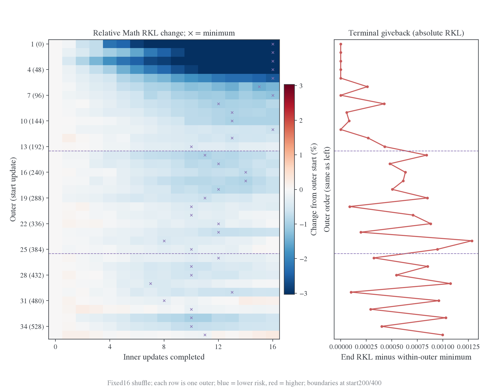
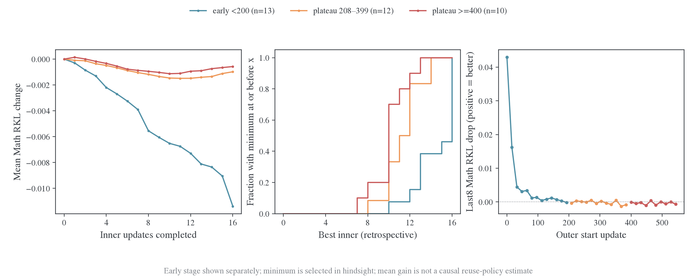
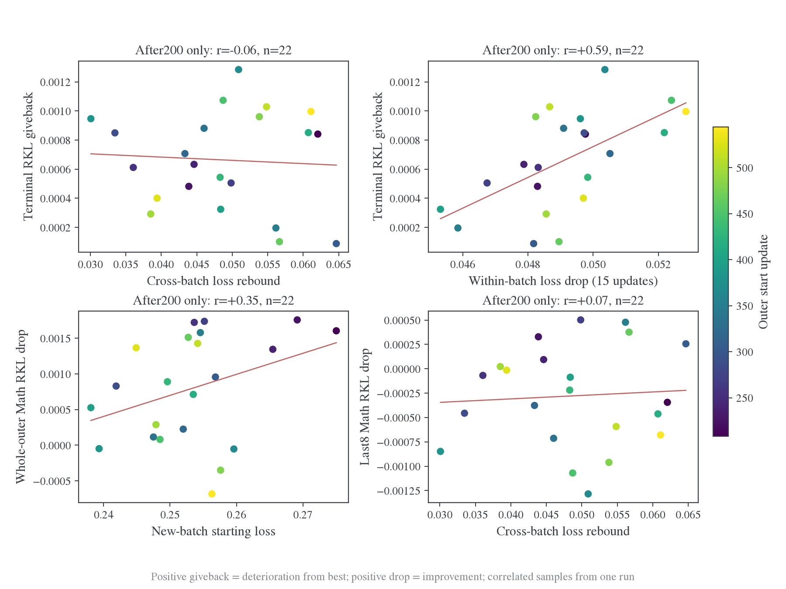

# 固定 16 批内 held-out Math RKL 回升分布

截至快照，训练及 bank 读数都到 update560，共 35 个完整 outer，每个 outer 有起点和 16 次更新后的 17 个 bank 状态。训练仍继续，分析不改变训练。主指标为 `public_initial/dataset/math/question_mean`（128 道题，排除 development_math），pair 为 Qwen3-1.7B ← Qwen3-4B-Instruct-2507，AdamW LR1e-6，batch64，shuffle，seed42。原始快照、逐 outer CSV、完整统计、源码与 PNG/PDF 均在 [census](census/) 目录；Trackio `inner-rebound-census` 为固定快照展示。

## 统计口径

“有回升”指 16 个相邻更新中至少有一次 bank RKL 增加；它包含很小的波动。“收益回吐”指某个更新后曾比起点更好，但终点比批内最低点更差。“整轮变差”指第 16 次更新后比起点更差。三者不能混用。

设该批 bank 风险为 $K_0,\ldots,K_{16}$，最佳位置 $i_*=\arg\min_i K_i$，则峰值改善为 $K_0-K_{i_*}$，终点回吐量为 $K_{16}-K_{i_*}$，回吐比例为二者之比。比例计算仅纳入峰值改善超过 0.0001 的批次，本截面 35 批均符合。最低点是事后选出的，回吐统计会偏向发现损失，不能直接当作在线停止策略的无偏效果。

同时报告 0.0001 和 0.0005 两个绝对 RKL 幅度阈值，避免把一切微小起伏等同于明显过拟合。它们是敏感性阈值，并非通过重复测量校准的噪声下界。

## 频率与比例

| 指标                         |     全部 35 批 | 起点≥200 的 22 批 |
| ---------------------------- | -------------: | ----------------: |
| 任意一步回升                 |   31/35，88.6% |       22/22，100% |
| 有过改善，终点高于批内最低点 |   28/35，80.0% |       22/22，100% |
| 改善与终点回吐均超过 0.0001  |   25/35，71.4% |      21/22，95.5% |
| 改善与终点回吐均超过 0.0005  |   14/35，40.0% |      14/22，63.6% |
| 整个 outer 结束比起点更差    |    4/35，11.4% |       4/22，18.2% |
| 后 8 次更新合计使 RKL 变差   |   16/35，45.7% |      15/22，68.2% |
| 单次更新使 RKL 增加          | 178/560，31.8% |    144/352，40.9% |

平台期的回升具有持续、可观测的幅度；但整轮多数仍有净收益。“存在回升”与“整批都无用”是不同的判断。

## 随 outer 阶段的分布

阶段按 outer 起点划分。早期组含起点 192、终点 208 的跨界批；平台组从 208 开始，完全不混入 200 以前更新。400 组从起点 400 起。

| 阶段         | 批数 |    任意回升 | 后 8 步变差 |    整轮变差 | 最低点位置中位数 | 回吐比例中位数 |
| ------------ | ---: | ----------: | ----------: | ----------: | ---------------: | -------------: |
| 起点<200     |   13 | 9/13，69.2% |  1/13，7.7% |        0/13 |               16 |             0% |
| 起点 208–399 |   12 |       12/12 | 7/12，58.3% | 2/12，16.7% |             11.5 |          33.2% |
| 起点≥400     |   10 |       10/10 | 8/10，80.0% | 2/10，20.0% |               10 |          46.1% |

每行一个 outer，蓝色表示低于起点，红色表示高于起点，叉号标记批内最低点；右图是终点与最低点之差。色阶为对称 95% 分位限制，早期较大下降饱和显示，数值见 CSV。所有点和结论均来自真实读数，没有插值。

平台期 22 批最低点的位置分布：第 7 次 1 批，第 8 次 2 批，第 10 次 8 批，第 11 次 3 批，第 12 次 5 批，第 13 次 1 批，第 14 次 2 批。**22 批均未在第 16 次达到最低点，19/22 批的最低点在第 9–14 次之间。** 允许距最小值 0.0001 以内即视为近似达到最好，中位首次位置为第 10 次；因此位置提前不完全依赖精确挑出一个最低噪声点。

| 阶段         | 前 8 步平均 RKL 下降 | 后 8 步平均 RKL 下降 | 全 16 步平均下降 | 同批训练 loss 下降（前 15 步） |
| ------------ | -------------------: | -------------------: | ---------------: | -----------------------------: |
| 起点<200     |            +0.005547 |            +0.005833 |        +0.011380 |                        0.05084 |
| 起点 208–399 |            +0.001183 |            −0.000203 |        +0.000981 |                        0.04869 |
| 起点≥400     |            +0.000946 |            −0.000369 |        +0.000577 |                        0.04967 |

平台期合计：前 8 步平均改善 0.001075，后 8 步平均损害 0.000278，抵消前 8 步收益约 25.9%。终点相对批内最佳的平均回吐 0.000664，回吐比例中位 40.0%；所有批峰值改善和回吐量分别求和后，比例约 45.4%。这两个比例聚合方法不同，不能混用。

## 与 training loss 和换批 rebound 的关系

为避免早期影响，以下全部只用起点≥200 的 22 批。训练 loss 是更新前观测，`inner1-inner16`覆盖 15 次更新；bank 的回吐和整轮收益覆盖完整 16 次，因而这些是 outer 级描述性相关，并非严格同区间的逐更新因果估计。

| 关系                          | Pearson | Spearman | 控制 outer 时间与 bank 起点后 |
| ----------------------------- | ------: | -------: | ----------------------------: |
| 同批 loss 下降 vs 终点回吐    |  +0.594 |   +0.588 |                        +0.597 |
| 同批 loss 下降 vs 后 8 步改善 |  −0.608 |   −0.626 |                        −0.574 |
| 同批 loss 下降 vs 整轮改善    |  −0.487 |   −0.468 |                        −0.450 |
| 换批 rebound vs 终点回吐      |  −0.064 |   +0.012 |                        −0.065 |
| 换批 rebound vs 后 8 步改善   |  +0.066 |   +0.031 |                        +0.080 |
| 换批 rebound vs 整轮改善      |  +0.027 |   +0.037 |                        +0.030 |

同批 loss 下降与回吐的正相关，逐批剔除任意一批后仍为 +0.541 到 +0.632。以连续 3 个 outer 做环形块重抽样，相关的 95% 区间约[+0.391,+0.783]；与后 8 步收益的相关区间约[−0.817,−0.395]。换批 rebound 与回吐的区间约[−0.529,+0.489]，没有稳定关系。

这些区间只反映这一条相关序列的重抽样敏感性，不能替代独立 seed。相关也可能受 batch 内容、长度、难度、动量等共同因素影响，不能推断“刻意把 loss 降得少一点”一定改善泛化。随快照新增最后两批，rebound 的关系已经明显变化；相较之下，同批下降与回吐的联系更稳定。

## 其他 bank 的交叉核对

| Bank/域      | 平台期后 8 步变差 | 平台期整轮变差 |
| ------------ | ----------------: | -------------: |
| initial/Math |             15/22 |           4/22 |
| teacher/Math |              7/22 |           6/22 |
| initial/Code |             11/22 |          14/22 |
| teacher/Code |              8/22 |          15/22 |
| initial/IF   |             12/22 |          10/22 |
| teacher/IF   |             12/22 |          12/22 |

“后 8 步对 initial Math 平均有害”不能扩展成所有 domain、所有 bank 都如此。teacher Math 的后半段更少变差；若目标是多域共同改善，需要给出多个 bank 上的取舍。

## 对及时 rollout 假设的判断

目前证据支持的具体命题是：**平台期继续对同一批做满 16 次更新，常在已获得较好 initial Math 权重后继续牺牲该 bank 收益；训练 loss 继续下降未能提醒这一转折。** 批内最低点从 16 提前到 10–11、后半段负收益概率上升、回吐比例增加，是一致的三条证据。

这支持测试后期更早停止 reuse、换新 rollout。尚未证明提前换 rollout 的额外计算成本优于其他选择：固定 16 轨迹中间停下可以观察到更好的当时权重，但真正提前 rollout 会改变后续状态分布和参数轨迹。最直接的验证是从同一平台期 checkpoint 分支，在相同训练 GPU 时间下比较继续 reuse16、减少 reuse 并提前 rollout；分别报告 Math/Code/IF 双 bank，诊断评估开销从训练预算中剔除。也应区分“减少无益更新”与“增加 rollout 本身的收益”，可加仅停止额外更新的预算诊断。

不能用这个 held-out bank 选每一轮的最佳停止点再拿同一 bank 报告无偏泛化提升；这些最小值目前仅作诊断。训练信号调制方面，这份数据更值得追踪同批下降和更新阶段，尚不支持用 rebound 幅度直接调节。没有改变当前训练或启动新实验。
