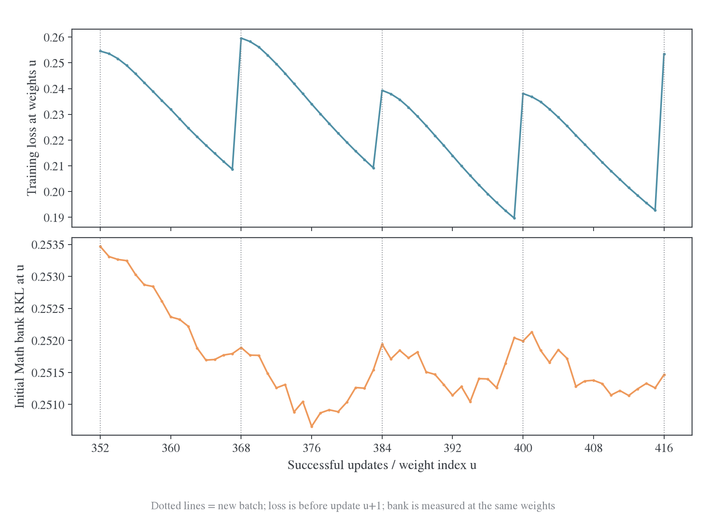
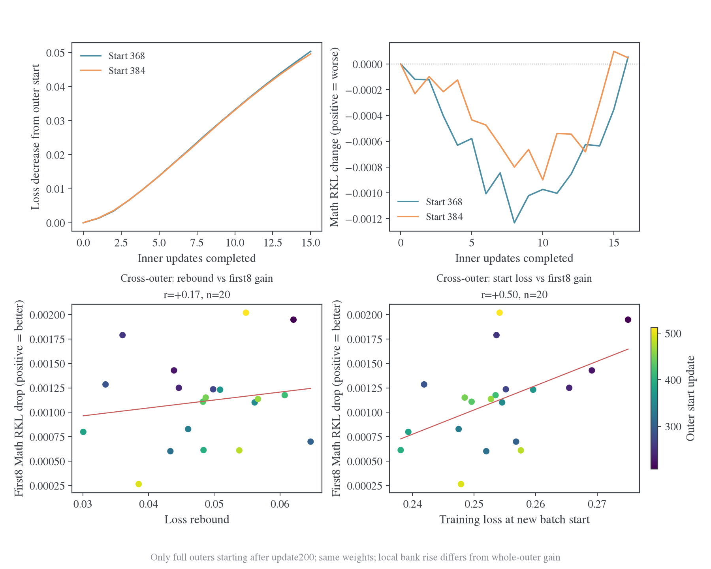
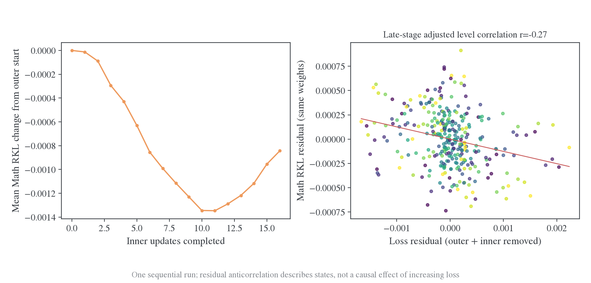

# 平台期 training loss 与 initial Math RKL 的局部反弹

只取更新 200 之后的完整 outer，即起点 208、224、…、512，结束到 528，共 20 个 outer。没有加入早期数据。分析源码为 [plateau/analyze.py](plateau/analyze.py)，冻结指标快照、CSV、统计和 PNG/PDF 在 [plateau](plateau/) 目录；Trackio 项目 `plateau-rebound-after200`，静态分析截面。

上一轮用整轮净改善回答了跨批次局部反弹问题，统计量不够对应。这里分别测量换批 loss 跳升、同批前半段 bank 下降、后半段 bank 回升，并对齐同一权重。

## 368 与 384 的读数

`L(u)` 是权重更新到 u 后、下一次更新前的 training loss；`K(u)` 是同一权重上的固定 initial Math bank RKL（128 道题，不混 development_math）。原日志训练观测标记在更新完成后，显示时应向前移一格；bank 已在正确权重索引上。

| outer 起点 | loss rebound |   起点 K | 第 8 次后 K | 第 16 次后 K | 后 8 次 K 回升 |
| ---------- | -----------: | -------: | ----------: | -----------: | -------------: |
| 368        |    +0.050894 | 0.251889 |    0.250658 |     0.251942 |      +0.001284 |
| 384        |    +0.030076 | 0.251942 |    0.251143 |     0.251991 |      +0.000848 |

368 换新 batch 后，bank 先下降，在 376 附近到低点，再向 384 回升。384 附近看到的升高，很大部分已经在 368 这一批的后半段发生，不能全部归因于 384 新批次。384 新批次的第一步实际使 K 从 0.251942 降到 0.251712；它随后也呈现先下降、后回升。两批的 training loss 15 次下降分别为约 0.05036 和 0.04961，几乎一致；368 的前八步 bank 改善更大，但后八步反弹也更大。

换 batch 的一刻，训练 loss 换了测量分布，能够跳变；固定 bank 的评估函数与权重没有因为换 batch 立即改变，所以不会仅因换数据发生对应跳变。bank 的回升对应已经执行的参数更新。单个边界跳点不能直接表示两种 loss 之间的关系。

## 只看平台期，负相关存在在哪一层

完整 outer 内，先下降的区间和后来反弹的区间混在一起，容易掩盖局部反向变化。

| 条件                                           | loss 与 bank RKL 的同权重水平相关 |
| ---------------------------------------------- | --------------------------------: |
| 所有平台期点，原始值                           |                            +0.386 |
| 扣除每个 outer 的基线                          |                            +0.735 |
| 前半段 inner 0–7，扣除 outer 基线              |                            +0.892 |
| 后半段 inner 8–15，扣除 outer 基线             |                            −0.242 |
| 所有位置，扣除 outer 基线及共同 inner 位置趋势 |                            −0.266 |

前半段两者常一起下降；后半段 loss 继续下降而 bank 回升，出现局部负相关。20 轮中有 13 轮的后八步 bank 变差；平均前八步下降 0.001114，后八步回升 0.000271。按 inner 位置平均的 bank 曲线在第 11 次更新附近最低，此后回升，这是描述性平均位置，不能当作已经验证的最优停止次数。

扣除 outer 与 inner 效应后的 −0.266，表示同一位置、相对该批整体水平，loss 比常见轨迹更低的状态，bank 可能更差。连续 3 个 outer 为块重抽样得到约 [−0.55, −0.001] 的 95% 区间，上界极接近零；样本只有一条轨迹中的 20 批，不能声称稳定因果规律，也不能视为多个独立 seed。

跨 outer 的两个量需要分开：训练 loss 的绝对起点与其反弹幅度。平台期起点 loss 与前八次 Math 改善的原始相关约 +0.50；rebound 幅度与前八次改善只有 +0.17，rebound 与同批 bank 从最低点到终点的回升约 −0.18。起点 loss 关系控制 outer 时间和 bank 起点后也减弱到约 +0.12。因此“新批更难拟合可能有更多有效信号”是候选机制，而“反弹幅度足以预测信号”尚无强证据。

## 原因的工作假设

这些数据与“前几步学习能迁移的部分，后几步越来越适配当前 batch”一致：同批训练目标仍能下降，但固定 Math 分布上的误差开始增加。较高的新批 loss 可能表示尚未拟合的状态，并不保证该批梯度朝有利于 Math bank 的方向。batch 题目组成、回答长度、分布差异，以及 AdamW 动量积累也可能改变方向和转折点。

局部一阶表达更准确：若实际更新为 $\Delta\theta$，训练 loss 下降意味着 $g_{\mathrm{batch}}^\top\Delta\theta<0$，bank 回升意味着 $g_{\mathrm{bank}}^\top\Delta\theta>0$。两个梯度对同一更新方向的投影符号不同，可以同时发生。这解释了为何训练更好而 held-out 更差，并不需要假设新状态本身有害。我们没有直接测量这些梯度，故梯度冲突、batch 适配和动量各占多少仍不能区分。

对调度最直接的依据是后期 bank 的局部转折和后八次平均损失，不是单个 rebound 大小。下一步应在同预算下验证后期减少 reuse、提前刷新 rollout 是否提升 Math/Code/IF 双 bank；当前固定 16 中途权重提供了动机，但不等于实际运行较少 reuse 后的长期轨迹。
