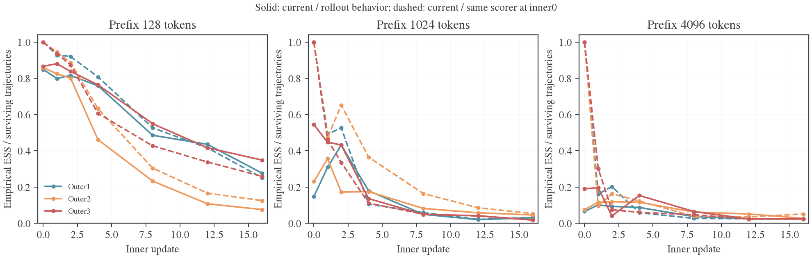
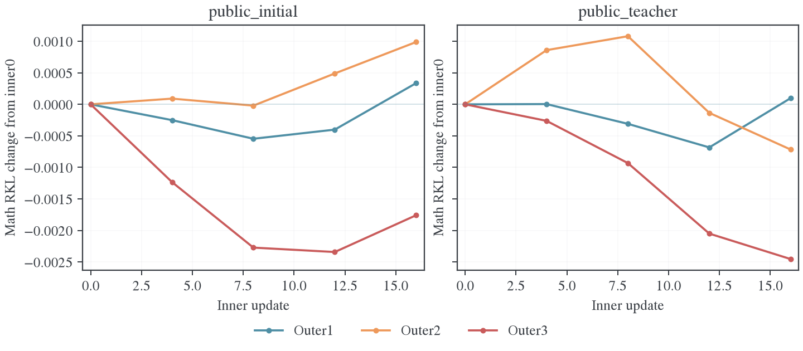

# 平台 checkpoint 的 prefix IS 诊断协议

本诊断使用正在运行的 inner-bank 实验所保存的完整 checkpoint 与 AdamW 状态，在后四卡建立独立续训分支。原实验及其冻结 source、日志、checkpoint 不改写。目的是测量同批 16 次更新后 current/behavior prefix 权重退化，而不是先把 IS 加进训练。

## 起点与对照

选取原实验 update480（`global_step_30`）完整快照，独立保留模型四分片、AdamW 四分片、extra/RNG、dataloader、rollout identity 和 reuse controller。原 experiment 为 Qwen3-1.7B ← Qwen3-4B-Instruct-2507，AdamW LR1e-6、batch64、reuse16、shuffle seed42。常数学习率不改变；保留原参数、优化器状态与题池。独立分支只缩短终止预算为 528（48 次新增更新、3 个连续 outer），在私有控制元数据中显式记录终止预算变更；不把诊断分支当作原 1280 更新实验的完成凭据。

每个 outer 生成 64 条新鲜训练轨迹，同一批继续更新 16 次；三个 outer 分别测量并报告，不将相邻 outer 当作独立 seed。原数据顺序和 dataloader 状态恢复；这是平台状态的诊断分支，不承诺与原训练随机数路径逐位相同。读取和评估开销单列。

## 必须保存的原始观测

保存 prompt/response token IDs、response/loss mask、问题身份、outer 与绝对 update、finish reason、实际采样协议及模型来源。rollout 开启 sampled-token processed log-prob，保留真正行为概率 $\log\beta(y_i\mid s_i)$。在 inner0（更新前）、1、2、4、8、12、16 对同一轨迹重算当前学生概率，保存所有有效 token 的 $\log p_k(y_i\mid s_i)$。

评分必须匹配 rollout 的 tokenizer-ID 支持集、temperature=1、top-p=1、top-k=-1；不能把训练 KL 原生词表的概率不加核对地当成行为概率。保留 vLLM 行为与 FSDP 在相同权重下的差异，另算同一 FSDP 评分器的 $p_k/p_0$ 对照。前者反映实际 current/behavior 权重（含数值引擎差异），后者主要隔离参数更新的漂移；两者不能互相替代。

评分不调用 optimizer.step、不推进 scheduler，不同步或刷新行为权重。显式保存/恢复评分 RPC 的 RNG 状态，核对成功更新计数不变，保持本批 token 身份不变。

## 权重与输出

对第 $t$ 个状态（prefix 含 $h=t-1$ 个回答 token）计算

$$
\ell_h=\sum_{i=1}^{h}(\log p_k(y_i\mid s_i)-\log\beta(y_i\mid s_i)),\quad w_h=e^{\ell_h}.
$$

当前位置的动作不进入 prefix 权重。用 float64 累加、log-sum-exp 算矩，不能为避免溢出悄悄截断原始权重。

| 观测                                                    | 用途                                      |
| ------------------------------------------------------- | ----------------------------------------- |
| 绝对长度 0/32/128/256/512/1024/2048/4096/6144 的 prefix | 比较长程累积，分别报告仍存活轨迹数 N      |
| log-weight 的 min/q01/q10/q50/q90/q99/max               | 看正负尾部及集中程度                      |
| mean(w)、mean(w²)、经验 variance、CV²                   | 看矩与尾部，保留 log-moment 避免溢出      |
| ESS=(Σw)²/Σw²及 ESS/N                                   | 看权重集中，按 outer、inner、长度分别报告 |
| 最大归一化权重与 top10% 权重占比                        | 识别少量轨迹支配                          |
| c=2/5/10 截断后的 ESS 与被截去的样本权重质量            | 估计稳定性与截断影响，不宣称偏差已知      |
| p_k/p_0对照及inner0校准                                 | 区分训练漂移和评分/生成引擎差异           |
| 同批 loss、Math/Code/IF 双 bank RKL                     | 对齐观测风险回吐与权重退化是否同时发生    |

在固定绝对长度处，只有生成到该位置的轨迹进入统计；这是行为策略存活子集上的描述，mean(w) 不必等于 1，也不直接给目标条件存活分布的归一化常数。终止位置的变长权重仅作补充，不能把它和固定长度的 ESS 混合。不同问题是固定训练 batch，不是同一 prompt 的大规模重复采样；64 条样本也可能漏掉罕见尾部。ESS 不是有效梯度样本数的精确值。

## 原因判别与边界

若 inner8→16 的 ESS 明显下降，且该区间出现 bank 回吐，支持进一步研究访问漂移，但相关不证明 IS 能改善泛化。若同评分器 $p_k/p_0$ 仍接近 1，bank 却回吐，状态覆盖不足、有限批适配、动量/曲率和跨状态梯度冲突更值得优先检查。若 inner0 的实际行为比率已高度退化，应先审计支持集与评分数值，而非归因于训练更新。

第一轮不做 IS 梯度调制，不改 LR、不换优化器、不扩大 batch。是否做截断 IS 或增加 sampling，等看到上述分布后决定。大平均 ESS 也不足以证明无尾部风险；低 ESS 同样不证明修正优于及时 rollout。

历史六来源实验 `examples/mirroropd/research-evidence/qwen-prefix-six/banks/S0` 与 `Q` 各 128 条，包含逐 token 行为概率；分别为 128658 与 261389 个 token，Math/Code/IF 数量 64/32/32，已核对概率有限且与 response 长度相等。Pair 与本次相同，但历史支持集/停止协议不同，且历史训练 checkpoint 曾按用户要求清理；它们适合补充 teacher/initial 或 checkpoint/initial 诊断，不能代替本次“同一平台 batch 内”的 current/behavior 观测。TOP-D outer bank 只存 token、未见行为概率，不能单独计算 IS。

## 结果归属

研究协议与最终统计、图保存在本专题；执行日志、独立 source 和恢复快照放 `examples/mirroropd/research-evidence/reuse-and-optimizers/prefix-is-inner-bank-20261116`。未实际完成前不填写 ESS 数字。完成凭据须核对 3 批×7 个 inner 评分、每次 64 条轨迹、48 次成功更新及双 bank 覆盖；任何失败保留原始证据，重试另立 attempt。

实现入口为 [prefix_is_probe.py](../../../../tools/prefix_is_probe.py)；独立 source 在训练循环中加入更新前回调。带诊断标记的概率评分使用原生 hidden/head 回调：在与 vLLM 一致的 tokenizer 支持集上，按 128 个位置分块，以 FP32 投影和 log-sum-exp 计算所选 token 的概率；既不构建全部序列的词表 logits，也不经过普通 sampled-token 概率内核。差异保存在[probe-source.patch](probe-source.patch)。[prefix_is_report.py](../../../../tools/prefix_is_report.py)将原始概率读数保留到本专题 `probe-data/`，生成图并写入本机 Trackio `prefix-is` 项目；绝不上传。原始矩和截断统计仍可从逐 token 概率复算。

执行中的科学设置以独立配置及输入快照为准。已有两次零新增更新的失败：初始 bank 评分后未恢复 rollout residency，以及保存 64 条 rollout 后，普通 sampled-token 评分 RPC 出现 CUDA illegal access。后者的异步 CUDA 根因尚未定位；原生分块投影用于绕过该执行路径。失败不计入训练样本或成功更新。评分后恢复 residency、prefix 动作索引、权重数值稳定性与分块投影等价性均有 CPU 回归检查；GPU 概率读数仍以实际保存的观测为准。执行与清理凭据保留在运行目录。

## 实测结果：update480→528

三批均完成 16 次成功更新，共 48 次；21 次概率评分与 13 次双 bank 评分齐全，Math/Code/IF 及 development Math 全部有限，训练 loss 与 preclip grad 全部有限。逐 token 概率、轨迹与 bank 原始读数保存在 `probe-data/`，输入来源及观测 SHA256 见 [validated-summary.json](probe-data/validated-summary.json)。评分恢复的起点与原实验一致：initial Math RKL 为 0.2482689227，teacher Math RKL 为 0.2803659263。AdamW 四分片已从同一 checkpoint 恢复。

同评分器比率 $p_{16}/p_0$ 的经验 ESS/N 如下。N 是各批生成到相应位置且 loss mask 有效的轨迹数；这些数值不能直接视为总体渐近 ESS。

| Outer | 128-token prefix | 1024-token prefix | 4096-token prefix |
| ----- | ---------------- | ----------------- | ----------------- |
| 1     | 25.13%           | 3.16%             | 2.44%             |
| 2     | 12.48%           | 5.28%             | 5.08%             |
| 3     | 25.88%           | 1.74%             | 2.33%             |

长 prefix 的权重集中已经很强。第一批 4096-token 位置有 41 条存活轨迹，inner16 同评分器比率的 ESS 约为 1，最大归一化权重约为 0.999999997。该子集上的 mean(w) 约为 0.000339，上界截断到 2/5/10 均不能改善 ESS：观察到的集中主要是多数轨迹权重接近零，不是少量已观测权重超过截断值。存活筛选、有限样本和自适应拟合使这个 mean(w) 不能当作总体归一化检验；它也提示 64 条样本无法可靠覆盖重要尾部。

| Outer | Initial Math inner0 | inner8   | inner16  | inner8→16 变化 | Teacher Math inner0→16 |
| ----- | ------------------- | -------- | -------- | -------------- | ---------------------- |
| 1     | 0.248269            | 0.247723 | 0.248606 | +0.000883      | +0.000099              |
| 2     | 0.248606            | 0.248585 | 0.249594 | +0.001009      | −0.000717              |
| 3     | 0.249594            | 0.247322 | 0.247835 | +0.000514      | −0.002454              |

三批的 initial Math 在后八次更新中均回升，第三批的全 outer 净收益仍为正。Teacher Math 在第二、第三批全 outer 内继续改善；低 ESS 与 initial-bank 回吐共现，但并不决定所有 bank 的变化方向。三个连续 outer 不是三个独立 seed，也没有做 IS 加权干预，不能从共现推断 IS 能修复泛化。

### 行为概率校准与解释边界

第一批 inner0 尚未更新时，当前 FSDP 与真实 vLLM 行为比率的 ESS/N 在 128/1024/4096-token 位置已经是 84.85%/14.67%/6.48%。333355 个 token 的 log-prob 差值均值约 −0.000606、标准差约 0.03443，概率日志的相关系数约 0.99919。长乘积放大了这类逐 token 差异；不能将实际行为比率的全部退化归因于复用更新。两者使用相同 tokenizer 支持集和采样设置，仍需进一步审计数值路径与评分复现性。

同评分器 $p_k/p_0$ 减少了生成引擎差异，但没有进行零更新重复评分实验，仍含评分器数值复现误差，不能把其全部下降精确归因于参数变化。它在三个批上均出现随更新累积的强退化，足以否定“LR 小，所以长 prefix 权重必然接近 1”的经验假设。

现有结果优先支持比较平台阶段提前 rollout 与扩大不同 prompt 数的简单对照。直接上完整 prefix IS 的权重集中风险很高；只做上界 clipping 也不能保证可用的 ESS。若继续研究 IS，应先补零更新重复评分校准，再比较短 prefix、分段/截断权重与新 rollout，分别报告偏差和采样成本。
