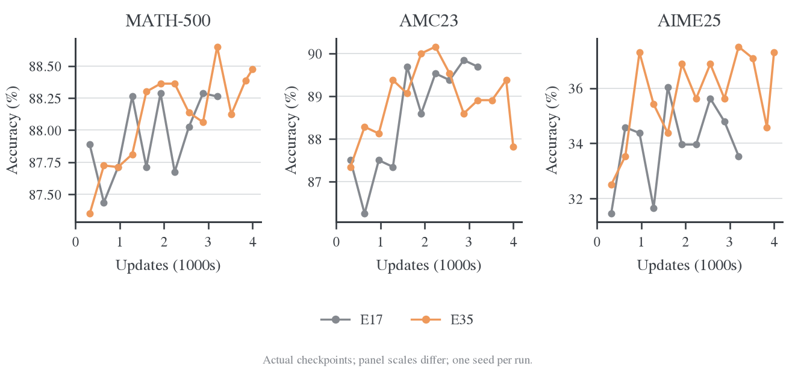

# E35：长回答窗口的收益与生成预算

## 1. 背景与 motivation

7168-token 训练窗口会截断一部分推理，限制完整答案阶段的监督。扩大窗口可能改善难题覆盖，也可能使生成成本上升或出现长序列退化。这里检验长窗口 Full-vocab OPD 的正式运行，不将它与改变镜像目标的 E45/E47 合并解释。

## 2. Setting 与实验设计

R1-Distill-Qwen-1.5B ← JustRL-DeepSeek-1.5B，DAPO，batch64、reuse16、AdamW LR1e-6。E35 的 response cap 为15360，E17/E20为7168；验证统一cap31744、每题16答、T0.7/top-p0.9。E35实际250 outer/4000更新，E17为200/3200，主比较固定到共同outer200；E20在共同outer160作补充。E35开启初始验证，E17/E20没有，且硬件与代码不同。没有将250轮末点与200轮末点直接混比。

## 3. 实验结果

在共同 outer 200 / update 3200，两组都新生成 12800 条回答：

| Run | MATH mean | AMC mean | AIME mean | AIME pass@16 | AIME majority@16 |
| --- | --- | --- | --- | --- | --- |
| E17 | 88.2625% | 89.6875% | 33.5417% | 56.6667% | 37.7778% |
| E35 | 88.6500% | 88.9063% | 37.5000% | 63.3333% | 43.5714% |
| E35−E17 | +0.3875 pp | −0.7812 pp | +3.9583 pp | +6.6667 pp | +5.7937 pp |

十个共同验证点的描述性均值，E35−E17 为 MATH +0.0925、AMC +0.4063、AIME +1.5625 个百分点；逐点高于 E17 的次数分别为 6/10、6/10、8/10。连续 checkpoint 相互相关，这些点不能当作十次独立训练重复。

同为 A800 的补充对照也有一致方向：outer 160 时 E35 相比 E20 的 MATH/AMC/AIME 分别为 +0.1750/+0.3125/+1.2500 pp。两条短窗参照都没有在这个点上反转 AIME 的方向，但仍不能替代同版本、同硬件的新 E17。

| 共同 outer 1–200 的工作量或计时 | E17 | E35 |
| --- | --- | --- |
| 新 response token | 73.18M | 89.80M（+22.71%） |
| 训练回答触及长度上限的比例 | 40.14% | 4.55% |
| 记录的训练时间 | 6.79 h | 9.86 h（+45.18%） |
| 记录的验证时间 | 4.15 h | 4.07 h |
| 普通 outer 平均 rollout pipeline | 32.70 s | 68.19 s |
| 普通 outer 平均 actor，16 次更新 | 83.00 s | 102.40 s |

普通 outer 排除首轮、验证轮和保存轮。累计时间仅汇总不重叠的训练 outer 与验证 timer；checkpoint 已在 outer 内，不能再相加。独立的初始验证、模型启动和进程清理不包含在这张累计表中；它不是完整作业墙钟。

E35 的平均训练长度由前 20 轮的 7333 降至末 20 轮的 6908，没有持续膨胀到 15360。outer 181–200 的训练 score 为 0.6953，E17 为 0.5805，但这个指标也受到截断减少影响，不能把它全部解释为同预算能力提升。训练 response token 只增加 22.71%，生成阶段耗时却约翻倍，与更长的完成尾部相符；缺少逐请求时间对照，不能把差额完全归因于某一个调度机制。

E35 在 outer 200 的 AIME 验证平均长度为 9962，E17 为 10697；验证 cap 相同。因而这里的 AIME 分数提高没有伴随更长的平均验证回答。答案解析缺失分别为 6/480、7/480，验证长度停止分别为 7/480、10/480，这些差异也不足以单独解释准确率差距。

E35 最终 outer 250 的 MATH/AMC/AIME 为 88.4750/87.8125/37.2917%；相比 outer 200，没有出现持续的任务分数崩塌。它没有复现本条 Full-KL 路径的长窗后期崩溃，不代表 sampled/top-k 的长窗问题已经被排除。

## 4. 分析与边界

长窗口降低训练截断，并在这组单run对照中给出AIME正向信号，代价是更多生成token和更长墙钟。它没有复现这条Full-KL路径的长窗后期崩溃；尚缺匹配的E34 sampled与E24 reuse1对照，不能推成full-vocab已普遍消除长窗失效。

## 5. 证据与复算

本报告按问题提取自[冻结联合分析](../../../archive/experiments/length-mirror/2026-10-26-E35长窗口与E45E47镜像目标对照.md)。原始数值位于 `wandb-logs/MirrorOPD-verl/analysis/length-mirror-20261026/`，展示图仍由同一脚本和冻结输入生成。
