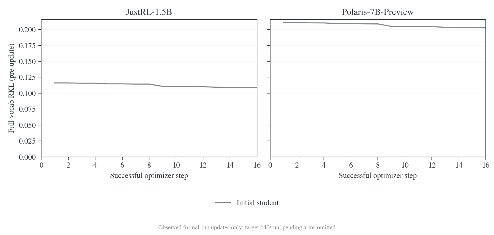
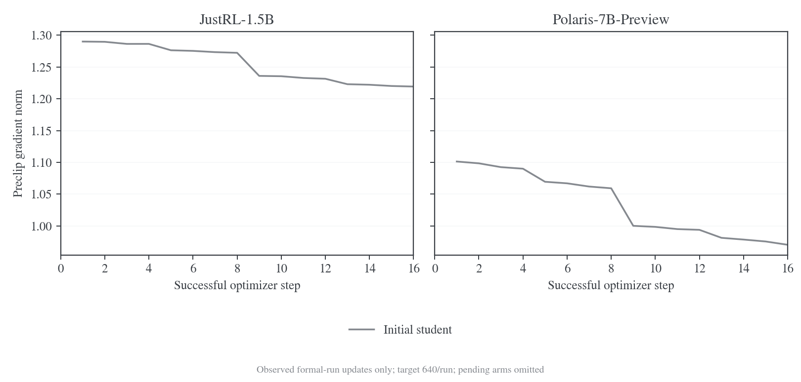

# E20 设置下的五种前缀对照

更新日期：2026-10-30。正式实验已经启动，尚未完成。本文只记录用户指定的两组模型、五种前缀、40 outer × reuse16 对照，不把工程 smoke 或两轮调参预跑当成正式学习结果。

## 问题与实验矩阵

固定 learner、目标 teacher 和学习配方，比较前缀来源对 full-vocab reverse KL（RKL）优化过程的影响。Learner 均从 `DeepSeek-R1-Distill-Qwen-1.5B` 初始化；teacher 分别为 `JustRL-DeepSeek-1.5B`（J）和 `Polaris-7B-Preview`（P）。每组重新加载原始 learner 和新的 AdamW 状态，共十组独立训练。

| 标识 | 生成前缀                                         | 每轮如何生成                                                    |
| ---- | ------------------------------------------------ | --------------------------------------------------------------- |
| S0   | initial student                                  | 用固定的原始 R1 checkpoint 生成；训练中的 learner 仍然更新      |
| S    | current student                                  | 用上一轮完成全部更新后的 learner 生成                           |
| LM   | 0.5 current student + 0.5 teacher，逐 token 融合 | 两侧在同一历史下的 logits 各占一半，再采样一次                  |
| TM   | 0.5 current student + 0.5 teacher，整轨迹混合    | batch64 中 32 条完整轨迹来自 current student，32 条来自 teacher |
| T    | teacher                                          | 用固定 teacher 生成                                             |

完整组名为 `J-S0/J-S/J-LM/J-TM/J-T` 和 `P-S0/P-S/P-LM/P-TM/P-T`。S0 固定的是生成器参数，不是反复使用同一批回答。TM 固定的是请求数比例，teacher 的实际 token 比例会随回答长度变化。

LM 在 temperature=1、无 top-k/top-p 截断时，对应共同合法支持上的归一化几何混合：

$$
\mu_{\mathrm{LM}}(v\mid h)
=\frac{\sqrt{p_{\mathrm{current}}(v\mid h)\,q(v\mid h)}}{\sum_{u\in\mathcal V_{\mathrm{gen}}}\sqrt{p_{\mathrm{current}}(u\mid h)\,q(u\mid h)}}.
$$

这里 $h$ 是已生成的历史，$\mathcal V_{\mathrm{gen}}$ 是双方 tokenizer 一致的合法 token-ID 集合。LM 不是概率的算术平均，TM 也不在一条轨迹内逐 token 切换模型。

所有组的训练目标均指向对应 teacher，融合只改变采样前缀。每个 outer 生成一个新 batch，随后在这些固定前缀上做 16 次更新。

## 实际设置与 E20 的关系

学习设置依据 [E20 原始配置](../../../../../../wandb-logs/MirrorOPD-verl/analysis/batch-transfer-20261027/E20/config.json)，原 run 为 `lwgb5eex`。40 outer、关闭验证/保存、两种 teacher 与五种来源是用户指定的覆盖项；执行实现采用本轮已经做过数值和训练检查的 vLLM/fused KL 路径，不声称复现旧环境的逐位轨迹。

| 项目         | 正式设置                                                                               |
| ------------ | -------------------------------------------------------------------------------------- |
| 数据         | DAPO；保留过长 prompt 过滤；shuffle=true，seed42；关闭 group filtering/refill          |
| 每轮预算     | 64 个生成请求，n=1；optimizer mini-batch=64                                            |
| 学习预算     | 40 outer × reuse16，每组 640 次成功更新；十组共 6400 次                                |
| 长度         | prompt cap4096，response cap7168，context11264                                         |
| 采样         | temperature=1，top-p=1，top-k=-1，R1 EOS151643                                         |
| Loss         | full-vocab RKL，token-mean；不使用 task reward，不加额外 entropy/actor KL 项           |
| Optimizer    | AdamW，LR=1e-6，betas=(0.9,0.999)，weight decay=0.01，grad clip=1                      |
| Scheduler    | constant，warmup=0                                                                     |
| 学习精度     | FP32 主参数、BF16 forward、FP32 梯度归约；保留 activation checkpointing                |
| 执行优化     | `precompute_fused`，token chunk1024，vocab chunk8192；hidden async write/prefetch 开启 |
| 计算微批     | actor/teacher token budget32768；保留参数与 optimizer offload                          |
| 推理         | vLLM 0.25.1/V1、TP1、native BF16、五种来源显式使用 Triton attention                    |
| 并发与 KV    | 每个任务独占一张卡，活跃请求上限 32；LM 的 J/P KV 预算分别为 24/32 GiB                 |
| CPU 执行参数 | Ray32 CPU，agent/reward/storage 各 8，object store16 GiB                               |
| 验证与保存   | 无初始、周期和末轮验证；不保存模型 checkpoint；中断后不从模型 checkpoint 恢复          |
| 产物         | 配置、源码版本、来源计划、每次更新指标、资源曲线、退出状态及结果审计                   |

正式入口的代码版本固定为 `91674e68941c1be634cf62231711a1df753e28a9`。运行时配置与覆盖项分别保存在 [J 队列 manifest](../../../../../../runs/vllm-fusion-20261029/formal-prefix-study-J-01/manifest.json) 和 [P 队列 manifest](../../../../../../runs/vllm-fusion-20261029/formal-prefix-study-P-01/manifest.json)。[运行入口源码快照](data/prefix-40x16-20261030/source/run_fusion_prefix_study_fsdp2.sh)与[完成审计器源码快照](data/prefix-40x16-20261030/source/audit_prefix_study.py)对应独立开发 worktree 的执行代码；快照仅供核对，文件哈希见[源码清单](data/prefix-40x16-20261030/source/manifest.json)。

R1/JustRL 的输出 head 为 151936 行，Polaris 为 152064 行。生成统一使用共同合法 token-ID 支持；训练 RKL 的 student 在完整 151936 行上归一化，Polaris teacher 的分母保留完整 152064 行。不能为对齐生成 head 而把 teacher 额外 128 行从训练目标裁掉。

## 正式运行状态

2026-10-30，用户明确将这十组正式实验提为优先任务，其余扩展工程验收后续补齐。此前已经完成的是短接线与性能预跑；它们验证了运行路径，不能提供本表的 40 轮研究结论。

两卡各运行一个任务：GPU6 执行 J，GPU7 执行 P；每张卡按 S0 → S → LM → TM → T 顺序执行。每组独立初始化。失败记录保留，队列在失败后停止，不通过丢弃失败批次凑满预算。

| 配对            | S0                      | S    | LM   | TM   | T    |
| --------------- | ----------------------- | ---- | ---- | ---- | ---- |
| J：R1 → JustRL  | 1/40 outer，16/640 更新 | 排队 | 排队 | 排队 | 排队 |
| P：R1 → Polaris | 1/40 outer，16/640 更新 | 排队 | 排队 | 排队 | 排队 |

截至 2026-10-30 11:21（北京时间），两组 S0 各记录 16 次成功更新，合计 32/6400；十组均未达到完整验收条件。最新快照见[状态数据](data/prefix-40x16-20261030/snapshot-1124/status.json)，逐次真实观测见[更新 CSV](data/prefix-40x16-20261030/snapshot-1124/updates.csv)。完成条件是 40 轮、640 次实际成功更新、配置和来源版本一致、无验证或 checkpoint 产物，并通过审计器。

## 已观测结果与曲线

以下结果仅来自正式实验首个 outer 的 S0 分支。两组各有 16 条成功更新记录，loss、RKL 和梯度均为有限值，更新编号连续，没有跳步。此处检查的是已写出的更新记录，完整运行审计仍待 40 轮结束。

| 配对 | 第 1 次观测 RKL | 第 16 次观测 RKL | 相对下降 | preclip 梯度范围 | 每次更新的有效 loss-token 数 |
| ---- | --------------- | ---------------- | -------- | ---------------- | ---------------------------- |
| J-S0 | 0.116056        | 0.108779         | 6.27%    | 1.2193–1.2900    | 399135                       |
| P-S0 | 0.210872        | 0.202578         | 3.93%    | 0.9703–1.1013    | 399769                       |

图 1：首轮固定前缀上的逐次更新前 RKL，横轴仅画已观测的 16 次更新。两种 teacher 分面展示；共同纵轴用于读数，不代表两种目标难度相同。[PDF](figures/prefix-40x16-20261030/snapshot-1124/formal-rkl-by-update.pdf) / [SVG](figures/prefix-40x16-20261030/snapshot-1124/formal-rkl-by-update.svg)。

两条曲线在首批 reuse16 内下降，支持“这批固定前缀上的优化已实际推进”。J-S0 与 P-S0 的相对下降分别为 6.27% 和 3.93%；它们对应不同 teacher 和各自生成的前缀，不能据此判断哪种 teacher 更适合迁移。五种来源的对照仍缺少 S、LM、TM、T 的正式数据。

当前配方只含蒸馏目标，日志的总 loss 与 RKL 几乎重合：J 的最大绝对差为 4.66×10⁻⁹，P 为 1.49×10⁻⁸。因此图 1 保留 RKL 一条曲线，两列原始数值均在 CSV 中。16 次更新重复使用同一批 loss tokens，累计参与计算的 token 数分别为 6386160 和 6396304；这些数值包含 reuse，不能当作独立生成 token 数。

图 2：同一批更新的裁剪前梯度范数，纵轴按观测范围显示。[PDF](figures/prefix-40x16-20261030/snapshot-1124/formal-gradient-by-update.pdf) / [SVG](figures/prefix-40x16-20261030/snapshot-1124/formal-gradient-by-update.svg)。

J-S0 的 16 次 preclip 梯度均高于设置中的 clip=1；P-S0 从约 1.10 降到 0.97。两者均没有出现非有限梯度或失败更新，但首批数据不能排除后续长训练中的不稳定。梯度裁剪和有限精度会影响更新幅度，不能把相邻观测下降不均直接归因于前缀策略。

## 分析口径与后续比较

正式数据尚未齐全，不给出五种前缀的最终排序，也不引用预跑的 loss 作为本实验结果。绘图只使用正式运行目录中实际记录的更新；未运行的分支不画零值或模拟曲线。

[导出与绘图脚本](../../../benchmarks/fusion/report_prefix_study.py)保留读取时的指标文件 SHA-256、完整行数、运行状态和逐次更新数据，输出 PNG/PDF/SVG，并运行图形审计。运行中的最后一条未写完 JSONL 不进入快照，已完整写出的异常或失败更新不会被静默删掉。

分析围绕以下问题展开：

1. S0 与 S：固定初始生成器和随 learner 更新的生成器，是否表现出不同的同批 RKL 下降与新批初始 RKL？
2. LM 与 TM：逐 token 几何混合和整轨迹各半，在相同请求与更新预算下，实际 token 数、初始 RKL 及批内下降如何变化？
3. T 与 student 来源：teacher 前缀上的训练 RKL 是否更容易下降？这一现象仅描述对应前缀分布，不等价于泛化更好。
4. reuse16：逐次更新观察是否稳定，是否出现非有限值、跳步或较大的 preclip 梯度？

训练日志记录的是每次更新前的 loss。第 1 次与第 16 次观测之间跨越 15 次更新；第 640 次观测也不是额外执行的更新后评估。比较不同 outer 时，问题和前缀已经改变，不能把新批 loss 上升直接称为遗忘或优化发散。

不同来源在不同前缀分布上测量 KL，单看更低的训练 KL 不能判断任务质量。两种 teacher 也不是相同目标分布，分别分析。除了成功更新数，还要结合实际有效 loss-token 数解释训练工作量；本实验不执行验证，因此不报告由 KL 曲线推断的 accuracy。
