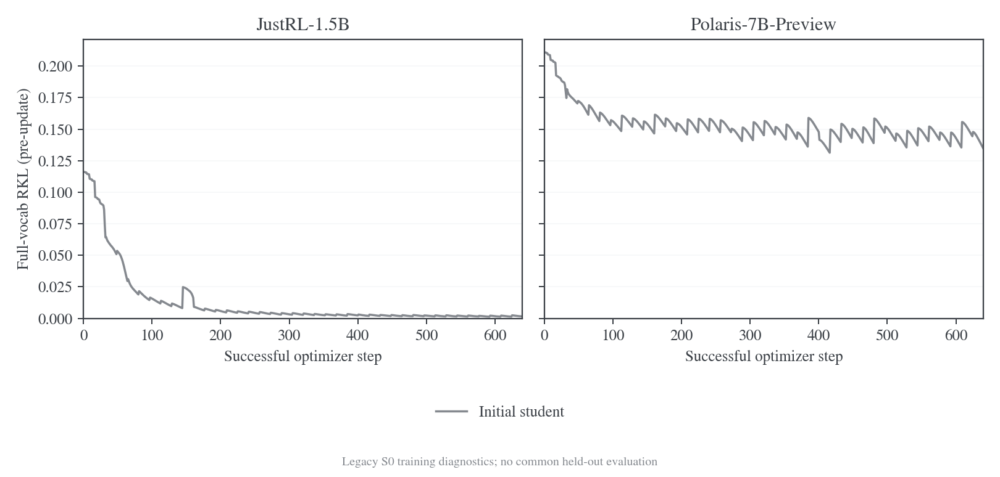
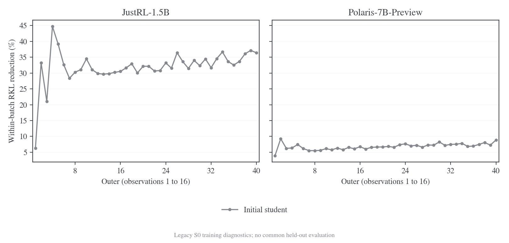
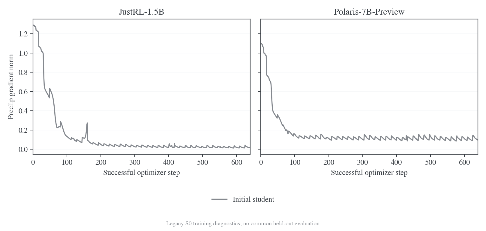

# E20 设置下的六种前缀对照

更新日期：2026-10-30。新版十二组科学对照已确认；数据、固定银行、teacher 缓存和初始固定风险已完成，训练评估生命周期正在 GPU6/7 验证，正式队列在等待通过回执。旧无验证/无保存的 S0 运行保留为优化诊断，不作为不同 rollout 策略优劣的证据。

## 已确认的共同评估协议

保持六种动态训练来源、两个 teacher、40 outer × reuse16。训练仍使用各自策略生成的新回答；共同的是训练题目顺序与评估分布，不把训练改成共同固定 S0 回答。每个条件从相同原始 student 和新的 AdamW 开始，首轮单训练 seed，结论定位为探索性比较。

| 项目         | 新协议                                                                                                                               |
| ------------ | ------------------------------------------------------------------------------------------------------------------------------------ |
| 数据隔离     | 单独保存去重后的 DAPO 训练文件；排除全部保留题及任务评测题，不修改共享源文件                                                         |
| 训练预算     | batch64、40 outer、reuse16、640 次更新/条件，共 7680 次；训练 cap7168、LR1e-6、AdamW、token-mean RKL                                 |
| 共同固定风险 | outer0、5、10…40；Math64、Code32、IF32；S0/对应 teacher 银行分别报告 RKL、JS                                                         |
| 长前缀       | Math32 是主面板的子集；同一完整轨迹取 H1024 和 H7168 视图，outer0/20/40 评分                                                         |
| 任务表现     | 纯 learner 在共同 630 题上 avg@4；temperature0.7、top-p0.9、cap31744、context32768；初始与终点完整评测，outer20 使用 Math64 开发子集 |
| 权重与恢复   | 只读 FP32 权重供评估，长期保留 outer20/40；另保留滚动可恢复 checkpoint，评估不更新 Adam 或训练 RNG                                   |
| 统计         | 各任务 acc 与 macro5；固定风险先逐题按固定 H 归一化；按 prompt 配对 bootstrap，不把 token 或同题回答当独立样本                       |
| Fresh 诊断   | 终点小面板及参数—state 交叉评分；与固定风险分开，不直接把原生 full-head 风险称作实际采样轨迹 KL                                      |

设计依据为 teacher-transfer 的[共同状态协议](data/scientific-v2-20261030/sources/teacher-transfer-protocol.md)、[双来源设计](../teacher-transfer/transfer-mechanism/rollout-sources/2026-10-28-双来源Rollout四分支实验方案.md)和[R1 任务评测](data/scientific-v2-20261030/sources/r1-report.md#6-任务评测与-gaprecovery)。工作区中尚未提交的两份来源以冻结快照保存，原路径和 SHA-256 见[来源清单](data/scientific-v2-20261030/sources/manifest.json)。双来源设计原文仍标为待执行；此处借鉴评估方法，不借用它的未执行结果。Code/IF 的分布风险不是代码正确率或指令任务成功率。

已生成的[数据回执](../../../../../../runs/prefix-fusion-scientific-v2/prepared-03/complete.json)记录：原始 17917 行，排除 215 行评估重叠与 716 行训练重复后保留 16986 道题；预先固定 2560 道训练访问题的顺序。共同评分面板 128 题，另有 192 道保留题不进入训练；Math32 长面板是 Math64 的子集，不算额外独立题。具体参数见[机器可读协议](../../../../../../runs/prefix-fusion-scientific-v2/prepared-03/protocol.json)。去重口径是规范化 user 文本，不能保证没有语义近重复或上游预训练污染。

PM 的 JustRL/Polaris 两组真实 graph 采样探针均通过原 2e-6 FP64 oracle 门槛，源码为 `4b2a23c5`；这只证明对应短采样位置的数学实现，不代替训练与评估生命周期验收。三套固定银行已生成，每套 128 条，分别为 [S0](../../../../../../runs/prefix-fusion-scientific-v2/banks/S0/complete.json)、[JustRL](../../../../../../runs/prefix-fusion-scientific-v2/banks/J/complete.json)、[Polaris](../../../../../../runs/prefix-fusion-scientific-v2/banks/P/complete.json)。两组 teacher 缓存和初始 student 的 H1024/H7168 评分均已完成，见 [J 标准评分](../../../../../../runs/prefix-fusion-scientific-v2/baseline-risk/J/standard/complete.json)、[J 长评分](../../../../../../runs/prefix-fusion-scientific-v2/baseline-risk/J/long/complete.json)、[P 标准评分](../../../../../../runs/prefix-fusion-scientific-v2/baseline-risk/P/standard/complete.json)及[P 长评分](../../../../../../runs/prefix-fusion-scientific-v2/baseline-risk/P/long/complete.json)。初始只读导出已分别与原始 student 的 339 个张量精确比对，最大误差为 0，见 [J 导出检查](../../../../../../runs/prefix-fusion-scientific-v2/initial-J-readout-equality.json)和[P 导出检查](../../../../../../runs/prefix-fusion-scientific-v2/initial-P-readout-equality.json)。这些属于评估接线证据，未产生策略优劣结论。正式队列固定在独立科学 worktree 的 `4ca59327`，实际派发和结果以运行目录回执为准。

## 旧协议与分组沿革

最初将两种 fusion 排成 LM 与 TM，缺少用户要求的概率 p 融合；用户随后明确保留 PM、LM、TM 三种，共十二个条件。旧两组 S0 已按无验证/无保存配置完成全部 40 轮，控制进程已退役，其他旧协议条件不再派发。以下设置和曲线保留旧协议的实际执行情况，不能作为新版科学对照结果；其运行目录中的 formal 标签仅代表旧预算验收。

## 问题与实验矩阵

固定 learner、目标 teacher 和学习配方，比较前缀来源对 full-vocab reverse KL（RKL）优化过程的影响。Learner 均从 `DeepSeek-R1-Distill-Qwen-1.5B` 初始化；teacher 分别为 `JustRL-DeepSeek-1.5B`（J）和 `Polaris-7B-Preview`（P）。每组重新加载原始 learner 和新的 AdamW 状态，共十二组独立训练。

| 标识 | 生成前缀                                             | 每轮如何生成                                                  |
| ---- | ---------------------------------------------------- | ------------------------------------------------------------- |
| S0   | initial student                                      | 用固定的原始 R1 checkpoint 生成；训练中的 learner 仍然更新    |
| S    | current student                                      | 用上一轮完成全部更新后的 learner 生成                         |
| LM   | 0.5 current student + 0.5 teacher，逐 token 融合     | 两侧在同一历史下的 logits 各占一半，再采样一次                |
| PM   | 0.5 current student + 0.5 teacher，逐 token 概率融合 | 同一历史下分别归一化得到概率，再作算术平均并采样              |
| TM   | 0.5 current student + 0.5 teacher，整轨迹混合        | batch64 中 32 条完整轨迹由 student 生成，32 条由 teacher 生成 |
| T    | teacher                                              | 用固定 teacher 生成                                           |

完整组名为 `J-S0/J-S/J-PM/J-LM/J-TM/J-T` 和 `P-S0/P-S/P-PM/P-LM/P-TM/P-T`。S0 固定的是生成器参数，不是反复使用同一批回答。PM 与 LM 都逐 token 融合；PM 的 0.5 是条件概率的混合权重，不是整条轨迹的来源配额。

LM 在 temperature=1、无 top-k/top-p 截断时，对应共同合法支持上的归一化几何混合：

$$
\mu_{\mathrm{LM}}(v\mid h)
=\frac{\sqrt{p_{\mathrm{current}}(v\mid h)\,q(v\mid h)}}{\sum_{u\in\mathcal V_{\mathrm{gen}}}\sqrt{p_{\mathrm{current}}(u\mid h)\,q(u\mid h)}}.
$$

这里 $h$ 是已生成的历史，$\mathcal V_{\mathrm{gen}}$ 是双方 tokenizer 一致的合法 token-ID 集合。PM 的定义为 $\mu_{\mathrm{PM}}(v\mid h)=0.5p_{\mathrm{current}}(v\mid h)+0.5q(v\mid h)$，其中两侧概率均在共同合法支持上归一化。LM 是归一化几何平均，PM 是算术平均，整轨迹混合属于另一个实验因素。

所有组的训练目标均指向对应 teacher，融合只改变采样前缀。每个 outer 生成一个新 batch，随后在这些固定前缀上做 16 次更新。

## 旧优化诊断的实际设置

学习设置依据 [E20 原始配置](../../../../../../wandb-logs/MirrorOPD-verl/analysis/batch-transfer-20261027/E20/config.json)，原 run 为 `lwgb5eex`。40 outer、关闭验证/保存、两种 teacher 与六种来源是用户指定的覆盖项；执行实现采用本轮已经做过数值和训练检查的 vLLM/fused KL 路径，不声称复现旧环境的逐位轨迹。

| 项目         | 正式设置                                                                               |
| ------------ | -------------------------------------------------------------------------------------- |
| 数据         | DAPO；保留过长 prompt 过滤；shuffle=true，seed42；关闭 group filtering/refill          |
| 每轮预算     | 64 个生成请求，n=1；optimizer mini-batch=64                                            |
| 学习预算     | 40 outer × reuse16，每组 640 次成功更新；十二组共 7680 次                              |
| 长度         | prompt cap4096，response cap7168，context11264                                         |
| 采样         | temperature=1，top-p=1，top-k=-1，R1 EOS151643                                         |
| Loss         | full-vocab RKL，token-mean；不使用 task reward，不加额外 entropy/actor KL 项           |
| Optimizer    | AdamW，LR=1e-6，betas=(0.9,0.999)，weight decay=0.01，grad clip=1                      |
| Scheduler    | constant，warmup=0                                                                     |
| 学习精度     | FP32 主参数、BF16 forward、FP32 梯度归约；保留 activation checkpointing                |
| 执行优化     | `precompute_fused`，token chunk1024，vocab chunk8192；hidden async write/prefetch 开启 |
| 计算微批     | actor/teacher token budget32768；保留参数与 optimizer offload                          |
| 推理         | vLLM 0.25.1/V1、TP1、native BF16、六种来源显式使用 Triton attention                    |
| 并发与 KV    | 每个任务独占一张卡，活跃请求上限 32；LM 的 J/P KV 预算分别为 24/32 GiB                 |
| CPU 执行参数 | Ray32 CPU，agent/reward/storage 各 8，object store16 GiB                               |
| 验证与保存   | 无初始、周期和末轮验证；不保存模型 checkpoint；中断后不从模型 checkpoint 恢复          |
| 产物         | 配置、源码版本、来源计划、每次更新指标、资源曲线、退出状态及结果审计                   |

旧 S0 的入口代码版本固定为 `91674e68941c1be634cf62231711a1df753e28a9`；新版科学队列使用独立版本和数据目录。运行时配置与覆盖项分别保存在 [J 队列 manifest](../../../../../../runs/vllm-fusion-20261029/formal-prefix-study-J-01/manifest.json) 和 [P 队列 manifest](../../../../../../runs/vllm-fusion-20261029/formal-prefix-study-P-01/manifest.json)。[运行入口源码快照](data/prefix-40x16-20261030/source/run_fusion_prefix_study_fsdp2.sh)与[完成审计器源码快照](data/prefix-40x16-20261030/source/audit_prefix_study.py)对应独立开发 worktree 的执行代码；快照仅供核对，文件哈希见[源码清单](data/prefix-40x16-20261030/source/manifest.json)。

R1/JustRL 的输出 head 为 151936 行，Polaris 为 152064 行。生成统一使用共同合法 token-ID 支持；训练 RKL 的 student 在完整 151936 行上归一化，Polaris teacher 的分母保留完整 152064 行。不能为对齐生成 head 而把 teacher 额外 128 行从训练目标裁掉。

## 旧 S0 优化诊断的完整结果

旧队列只执行了 J-S0 和 P-S0，两组各完成 40 outer、640 次成功更新，控制进程退出码为 0，并通过旧协议的配置、来源版本和逐次更新审计。随后两条旧队列均退役，S、LM、PM、TM、T 不再按无评估协议派发。旧运行的 `formal` 标签指旧预算验收，不代表新版科学对照。

| 配对         | 已完成的旧条件  | 成功更新 | 其余旧条件 |
| ------------ | --------------- | -------- | ---------- |
| R1 → JustRL  | S0，40/40 outer | 640/640  | 不再派发   |
| R1 → Polaris | S0，40/40 outer | 640/640  | 不再派发   |

[最终状态快照](data/prefix-40x16-20261030/final-S0-reviewed/status.json)、[逐次观测](data/prefix-40x16-20261030/final-S0-reviewed/updates.csv)和[四十轮统计](data/prefix-40x16-20261030/final-S0-reviewed/full40-summary.json)包含全部 1280 次有效更新。两组均无跳步，loss、RKL 与梯度观测有限。[J 完成审计](../../../../../../runs/vllm-fusion-20261029/formal-prefix-study-J-01/S0-audit.json)与[P 完成审计](../../../../../../runs/vllm-fusion-20261029/formal-prefix-study-P-01/S0-audit.json)核对了 40 轮来源计划；每轮 64 个 student 请求，生成器绑定原始 R1 checkpoint，learner 版本随每轮 16 次更新推进。固定初始生成器仍会随题目与采样产生不同回答。

### 训练 RKL 与同批下降

| 配对 | 首批第 1 次 RKL | 第 40 批第 1 次 RKL | 第 40 批第 16 次 RKL | 第 40 批内下降 |
| ---- | --------------- | ------------------- | -------------------- | -------------- |
| J-S0 | 0.116056        | 0.002404            | 0.001529             | 36.39%         |
| P-S0 | 0.210872        | 0.147808            | 0.134689             | 8.88%          |



图 1：两组各 640 次更新前的 full-vocab RKL。不同 teacher 分面展示，共用纵轴；未运行的条件不补零。[PDF](figures/prefix-40x16-20261030/final-S0-reviewed/formal-rkl-by-update.pdf) / [SVG](figures/prefix-40x16-20261030/final-S0-reviewed/formal-rkl-by-update.svg)。

J 的训练 RKL 在前几批下降较快，后续继续下降到较小量级。P 在早期下降后，换批起点持续波动，图中形成明显的批内下降、换批回升。跨 outer 的题目和前缀变化，因此首尾读数之差不能解释为共同 held-out 分布上的改进，也不能据此判断 teacher 的迁移价值。

当前配方只含蒸馏目标。全部 640 次记录中，总 loss 与 RKL 最大绝对差分别为 J 的 6.52×10⁻⁹、P 的 1.86×10⁻⁸；图中保留 RKL 一条曲线，两列原始观测均在 CSV 中。最后一条是第 640 次更新前的观测，不是最终参数的独立读出。

每批用第 1、16 次更新前的观测计算相对下降，覆盖中间 15 次实际更新。40 批均出现端点下降，但不保证每一步严格单调。

| 配对 | 批内下降中位数 | 四十批范围   | 第 16 次低于第 1 次的批数 | 批内相邻观测上升次数 |
| ---- | -------------- | ------------ | ------------------------- | -------------------- |
| J-S0 | 32.24%         | 6.27%–44.71% | 40/40                     | 5/600                |
| P-S0 | 6.78%          | 3.93%–9.26%  | 40/40                     | 0/600                |



图 2：逐批 RKL 端点相对下降，原始端点见[逐批数据](figures/prefix-40x16-20261030/final-S0-reviewed/outers.csv)。连线仅帮助定位相邻 outer，不把不同 batch 当作同一评估集。[PDF](figures/prefix-40x16-20261030/final-S0-reviewed/formal-within-batch-reduction.pdf) / [SVG](figures/prefix-40x16-20261030/final-S0-reviewed/formal-within-batch-reduction.svg)。

J 的 5 次批内上升都很小，最大绝对增量为 2.83×10⁻⁵。结果支持这套配置能在已采样前缀上持续执行 RKL 优化；缺少其他 reuse 预算，不能判断 reuse16 是否最优。32.24% 与 6.78% 也不能作为两种 teacher 的质量排名，因为目标分布和所访问状态不同。

### 梯度与实际 token 预算



图 3：每次更新的裁剪前梯度范数。[PDF](figures/prefix-40x16-20261030/final-S0-reviewed/formal-gradient-by-update.pdf) / [SVG](figures/prefix-40x16-20261030/final-S0-reviewed/formal-gradient-by-update.svg)。

| 配对 | 640 次 preclip 梯度范围 | 高于 clip=1 的次数 | 各批有效 loss tokens 之和，未计 reuse | 含 reuse 的训练 token 次数 |
| ---- | ----------------------- | ------------------ | ------------------------------------- | -------------------------- |
| J-S0 | 0.0137–1.2900           | 29/640             | 15639603                              | 250233648                  |
| P-S0 | 0.0861–1.1013           | 9/640              | 15664797                              | 250636752                  |

两组超过裁剪阈值的观测都出现在前 160 次更新，之后梯度保持有限。梯度范数描述优化状态，不能替代模型质量评估。相同请求和更新预算仍产生略有差异的有效 token 数；包含 reuse 的次数是计算工作量，不是独立样本数。

[首轮快照](data/prefix-40x16-20261030/snapshot-1124/status.json)和[前十轮阶段统计](data/prefix-40x16-20261030/snapshot-1221/common-first10-summary.json)保留历史观测。旧运行未保存可用于共同读出的 learner 权重，不能事后补出对应 held-out 风险曲线或终点 accuracy；新版十二组会从原始 student 重新开始。

## 分析口径与后续比较

新版科学结果尚未齐全，不给出六种前缀的最终排序。以上三图只读取旧 S0 运行的真实观测；新版将分别呈现共同状态风险、纯 student 任务准确率和训练诊断，避免混合不同口径。

[导出与绘图脚本](../../../benchmarks/fusion/report_prefix_study.py)保留读取时的指标文件 SHA-256、完整行数、运行状态和逐次更新数据，输出 PNG/PDF/SVG，并运行图形审计。运行中的最后一条未写完 JSONL 不进入快照，已完整写出的异常或失败更新不会被静默删掉。

绘图目录另存 `outers.csv`：逐 outer 记录第 1、16 次 RKL、相对下降和含 reuse 的 loss-token 总数。只有 16 次有效记录及完整 reuse 索引同时满足时才计算端点下降；不完整或失败批次保留状态，端点比较留空。`formal-within-batch-reduction` 图单独展示这一指标，避免把换批后的 KL 跳变当作同批优化效果。

冻结快照可以独立重画，不需要访问运行中的模型、配置或指标文件。在仓库根目录执行以下命令，`--figures` 应指向尚不存在的新目录；将 `FIGURE_VIZ_MPL` 设置为 figure-viz 的 `assets/mpl` 路径，并使用安装了 matplotlib 与 PyYAML 的 Python 环境。

```bash
python examples/mirroropd/benchmarks/fusion/report_prefix_study.py \
  --replot \
  --snapshot examples/mirroropd/docs/experiments/rollout-policy/data/prefix-40x16-20261030/final-S0-reviewed \
  --figures /tmp/prefix-study-replot
```

新导出在 `status.json` 中保存更新 CSV 的 SHA-256，重画时验证该哈希与记录数；早期不含 CSV 哈希的快照仍可读取，并检查记录数。重画不覆盖原有数据或图形目录。

分析围绕以下问题展开：

1. S0 与 S：固定初始生成器和随 learner 更新的生成器，是否表现出不同的同批 RKL 下降与新批初始 RKL？
2. LM、PM 与 TM：逐 token 几何融合、概率算术融合与整轨迹混合，在相同请求与更新预算下，实际 token 数、初始 RKL 及批内下降如何变化？
3. T 与 student 来源：teacher 前缀上的训练 RKL 是否更容易下降？这一现象仅描述对应前缀分布，不等价于泛化更好。
4. reuse16：逐次更新观察是否稳定，是否出现非有限值、跳步或较大的 preclip 梯度？

训练日志记录的是每次更新前的 loss。第 1 次与第 16 次观测之间跨越 15 次更新；第 640 次观测也不是额外执行的更新后评估。比较不同 outer 时，问题和前缀已经改变，不能把新批 loss 上升直接称为遗忘或优化发散。

不同来源在不同前缀分布上测量 KL，单看更低的训练 KL 不能判断任务质量。两种 teacher 也不是相同目标分布，分别分析。除了成功更新数，还要结合实际有效 loss-token 数解释训练工作量；本实验不执行验证，因此不报告由 KL 曲线推断的 accuracy。
