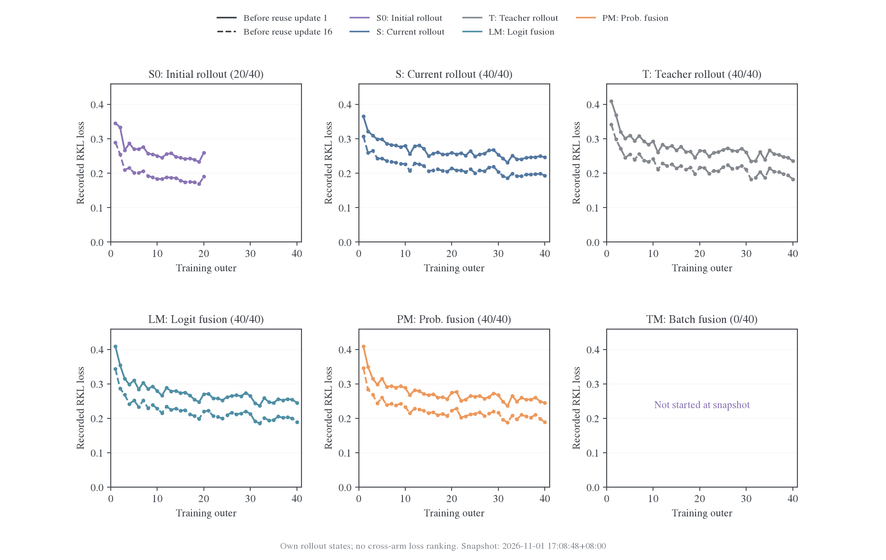
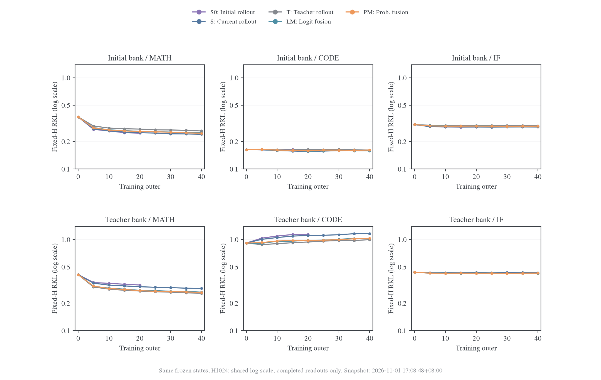
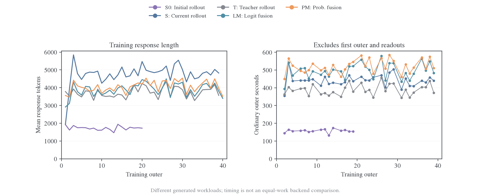
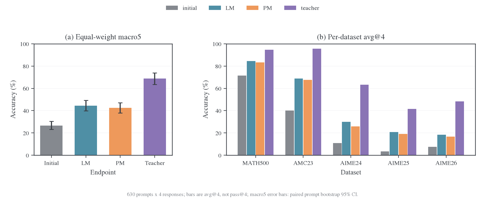
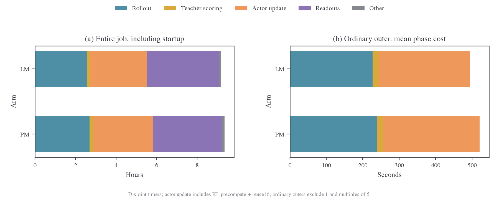

# Qwen3 非思考模式六种前缀对照

## 问题与完成范围

固定 learner 为 Qwen3-1.7B（non-thinking）、监督 teacher 为 Qwen3-4B-Instruct-2507，比较 current、initial、teacher、logit token fusion（LM）、probability token fusion（PM）和 batch fusion（TM）六种训练前缀。所有组从同一初始 learner 和新的 Adam 状态开始。两种 token fusion 及 batch fusion 的 teacher 权重始终为 0.5，batch fusion 每批给两侧各分配 32 条完整轨迹。

2026-11-01 的完整结果目前覆盖 **LM、PM 两组**：各 40 outer、640 次成功更新，共同状态读出、630 题×4 的最终纯 student 评测及保存均通过审计。截至 17:08 的新快照中，current 与 teacher 已完成全部更新、正在终点评估，S0 完成 20 轮，TM 尚未启动；不能据 LM/PM 两组判断混合是否优于其他训练来源。下文的 initial accuracy 是**未训练模型基线**，不是使用 initial 前缀训练后的 S0 条件。

训练访问的状态随来源改变，训练 RKL 不单独用于比较泛化。两组在相同冻结 initial 和 teacher 状态上另测 RKL/JS，以纯 learner 的任务 accuracy 比较终点。结果来自单个训练 seed，题目抽样区间不代表训练 seed 之间的不确定性。

## 实际设置与证据

| 项目           | 设置                                                                                                                                       |
| -------------- | ------------------------------------------------------------------------------------------------------------------------------------------ |
| 学习预算       | 40 outer × reuse16，每组 640 次成功更新；batch64、n=1                                                                                      |
| 目标与优化器   | E20 派生的完整原生词表 reverse KL、token-mean；AdamW、LR1e-6、constant、无 warmup；任务奖励不进入 loss                                     |
| 精度与卸载     | FP32 master、BF16 backbone、FP32 梯度归约；FSDP2、参数及优化器 CPU 卸载、gradient checkpointing                                            |
| 训练长度与采样 | prompt cap4096、response cap7168；temperature1、top-p1、top-k-1；seed42                                                                    |
| 提示与停止     | 全部来源共用 student 的 `enable_thinking=false` 模板；停止集合 151645、151643；full-vocab 目标不额外屏蔽终止动作                           |
| 数据           | DAPO 排除 320 道 held-out 及 630 道任务题的规范化文本交集后去重，保留 16986 题；各组相同 sampler 顺序                                      |
| 执行配置       | 每组 TP1；fusion 并发 16、每卡 KV48 GiB、decode graph、Triton attention；普通 single 并发 16；fused full-vocab precompute、token chunk1024 |
| 计算资源参数   | actor 与 teacher 的动态 token budget 均为 16384；每作业 Ray 声明 24 CPU、8 个 agent worker；参数不是性能最优性结论                         |
| 评估与保存     | 每 5 outer 共同固定 RKL/JS；0/20/40 长状态；20 轮 Math64 avg@4；40 轮 630 题 avg@4；20/40 轮保留 FP32 读出与可恢复状态                     |

共同短状态面板为 Math64、Code32、IF32，每题将实际前缀 RKL 之和除以固定 H1024，短回答未补写 token；长状态为 Math32、H7168。短面板从同一完整银行切片。Accuracy 使用 temperature0.7、top-p0.9、response cap31744、独立种子，先平均每题 4 次回答，再计算各数据集均值及五集等权宏平均，属于 avg@4 而非 pass@4。

正式运行固定为 `462e3f3a`，环境为 vLLM 0.25.1+cu129、Torch 2.11.0+cu129，LM/PM 分别使用 GPU6/7 的一张 H800 80GB。初次短检查的共享 embedding/head 同步失败及修复后的检查都保留在运行目录，失败尝试不计入 40 轮。准备阶段的四卡安排随后收敛为两个通道：GPU6 按 LM→current→initial 执行，GPU7 按 PM→teacher→batch fusion 执行；每个条件先通过自己的短检查，再启动正式预算。2026-11-01，S0 从 GPU6 的待办中提前交由 GPU0 执行，仍使用同一冻结版本、单卡配置和独立初始 Adam 状态。两轮接线检查通过后启动正式预算；共享的阶段独占回执阻止原队列重复派发。当前分配与排队情况以[合并活动状态](../../../../../runs/qwen-prefix-six-20261031/dispatch-status.json)为准，交接依据见[S0 派发清单](../../../../../runs/qwen-prefix-six-20261031/initial-dispatch-20261101/manifest.json)。

[LM 审计](../../../../../runs/qwen-prefix-six-20261031/recovery-20261101/stages/science-LM-audit.json)和[PM 审计](../../../../../runs/qwen-prefix-six-20261031/recovery-20261101/stages/science-PM-audit.json)核对各 640 次更新及规定读出。本文分析直接读取冻结运行的 metrics、评分和资源记录，不修改运行中的 worktree。所有数值的输入 SHA-256 见[来源清单](data/qwen-prefix-20261101/sources.json)，派生值见[汇总](data/qwen-prefix-20261101/summary.json)。

## 五组训练与共同状态快照

数据截止于 **2026-11-01 17:08:48（北京时间）**。快照包含五组的 2880 次实际更新；全部更新的 loss 与梯度有限，没有跳步。训练完成与终点评估完成分别记录，曲线不补齐尚未发生的轮次。原始指标读取范围与 SHA-256 见[快照来源](data/qwen-prefix-progress-20261101-170847/sources.json)，汇总见[快照摘要](data/qwen-prefix-progress-20261101-170847/summary.json)。

| 条件                   | 已完成训练轮数 | 成功更新 | 已有共同 RKL | 最终 accuracy 与审计 |
| ---------------------- | -------------: | -------: | ------------ | -------------------- |
| S0：initial 来源       |          20/40 |  320/640 | 到 outer20   | 尚未到终点           |
| S：current 来源        |          40/40 |  640/640 | 到 outer40   | 仍在评估，未完成审计 |
| T：teacher 来源        |          40/40 |  640/640 | 到 outer40   | 仍在评估，未完成审计 |
| LM：logit fusion       |          40/40 |  640/640 | 到 outer40   | 完成                 |
| PM：probability fusion |          40/40 |  640/640 | 到 outer40   | 完成                 |
| TM：batch fusion       |           0/40 |    0/640 | 未开始       | 未开始               |

### 自身 rollout 上的 loss



实线和虚线分别是在每个 batch 的第 1 次、第 16 次更新之前记录的蒸馏 loss，两点之间跨越 15 次更新。全部 **180/180 个已完成 batch** 的末次记录低于首次记录。S0 的自身 loss 较低，但它的前缀分布和长度也不同；跨来源的效果比较应使用共同状态和纯 student accuracy。不同 batch 的锯齿还包含新题目与新轨迹的变化，不直接等同于遗忘。完整逐更新记录见[updates.csv](data/qwen-prefix-progress-20261101-170847/updates.csv)。

### 共同状态 RKL 与来源差异



六个面板使用同一对数纵轴范围；Initial bank 和 Teacher bank 指冻结评估轨迹的生成模型，曲线指接受训练的 learner。每个题目的原始 RKL 之和仍除以固定 H1024，再按题平均，未改为有效 token 归一化。只纳入 `fixed/complete.json` 已完成且哈希核对通过的读出，逐题身份及前缀长度在各组间一致；即使同轮 accuracy 尚未结束，已完成的 RKL 也可以独立纳入。

以下在相同的 **outer20／320 次更新** 处比较，避免把 S0 中途状态与其他组终点混为一谈：

| 训练来源 | Initial-Math RKL | Teacher-Math RKL | Teacher-Code RKL |
| -------- | ---------------: | ---------------: | ---------------: |
| S0       |           0.2465 |           0.3161 |           1.1331 |
| S        |           0.2493 |           0.3027 |           1.1035 |
| T        |           0.2733 |           0.2717 |           0.9362 |
| LM       |           0.2579 |           0.2760 |           0.9757 |
| PM       |           0.2576 |           0.2739 |           0.9720 |

S0 在 Initial-Math 状态上的读数较低，在 Teacher-Math 上却高于其他来源；较低的自身训练 loss 没有转化成所有共同状态上的优势。Current 在 outer40 的 Initial-Math 为 0.2396，Teacher-Math 为 0.2901；teacher 来源的两项终点读数为 0.2607、0.2570，排序同样随评估状态改变。

Teacher-Code 的初始 RKL 约为 0.9120；S0 到 outer20 升至 1.1331，current 到 outer40 升至 1.1596，LM/PM 终点为 1.0204/1.0262。数学状态上的拟合改善伴随部分代码状态上的拟合退化。这里没有执行代码任务终点评测，不能把 RKL 上升直接称为代码 accuracy 下降。IF 两套银行的变化较小。所有数据点见[固定风险 CSV](data/qwen-prefix-progress-20261101-170847/fixed-risk.csv)。

### 生成长度与普通轮成本



普通轮排除首次启动轮和每 5 轮的读出；下表使用相同的 outer2–19 非评估轮窗口，各组 15 轮。响应长度取这些轮的均值，耗时取中位数，不将正在评估的 outer 当作普通训练样本。

| 来源 | 普通轮响应长度均值 | 普通 outer 中位数 |
| ---- | -----------------: | ----------------: |
| S0   |         1712 token |          158.1 秒 |
| S    |         4764 token |          438.2 秒 |
| T    |         3673 token |          379.3 秒 |
| LM   |         3838 token |          493.1 秒 |
| PM   |         3976 token |          504.0 秒 |

S0 的回答明显更短，且仅需单模型生成，因此普通轮成本较低。它与其他来源的工作量不同，不能把墙钟比例解释成同负载的引擎加速。图中训练轮数指已写出完整 outer 指标的轮次；current／teacher 的第 40 轮更新已完成，但 outer 总计时会等终点评估结束后才发布。评估成本未包括在上表，完整作业成本仍需等待终点。原始轮级记录见[outers.csv](data/qwen-prefix-progress-20261101-170847/outers.csv)。

## 最终纯 student 准确率



| 模型 / 训练条件   | MATH-500 |  AMC23 | AIME24 | AIME25 | AIME26 | 五集宏平均 |
| ----------------- | -------: | -----: | -----: | -----: | -----: | ---------: |
| 未训练 initial    |   71.55% | 40.00% | 10.83% |  3.33% |  7.50% |     26.64% |
| LM 训练后 student |   84.60% | 68.75% | 30.00% | 20.83% | 18.33% |     44.50% |
| PM 训练后 student |   83.20% | 67.50% | 25.83% | 19.17% | 16.67% |     42.47% |
| 原始 teacher      |   94.70% | 95.63% | 63.33% | 41.67% | 48.33% |     68.73% |

以题目为单位、在各数据集内共同重采样 10000 次，再做五集等权平均，得到以下配对差值。四次回答先在题内平均，未将 2520 条回答当成独立题目。

| 比较         |      宏平均差值 | 配对 bootstrap 95% 区间 |
| ------------ | --------------: | ----------------------: |
| LM − initial | +17.86 个百分点 |        [+13.90, +22.10] |
| PM − initial | +15.83 个百分点 |        [+11.93, +19.97] |
| LM − PM      |  +2.03 个百分点 |          [−1.11, +5.33] |

两组都高于未训练模型；LM 与 PM 的差值区间跨零，不能宣布 LM 显著优于 PM。PM 在共同数学状态上 RKL 略低、LM 的 accuracy 点估计更高，进一步表明这两个指标承担不同的判断任务。Current 等对照的最终 accuracy 尚未完成，混合相对纯 student rollout 的收益仍未确定。按题聚合数据见[accuracy-per-prompt.csv](data/qwen-prefix-20261101/accuracy-per-prompt.csv)。

## 速度、显存与完整成本



普通轮定义为 outer2–40 中非 5 的倍数的 31 轮，排除了首次引擎准备和周期评估。下表总耗时取中位数，各阶段取均值；均值阶段可相加，中位数不能与阶段均值相加混用。

| 指标                                           |                    LM |                    PM |
| ---------------------------------------------- | --------------------: | --------------------: |
| 完整作业，包括启动、40 轮、读出和最终 accuracy |             9.18 小时 |             9.35 小时 |
| 普通 outer 中位耗时                            | 493.9 秒（8.23 分钟） | 513.9 秒（8.56 分钟） |
| 普通 outer 平均 rollout 成本                   |              226.7 秒 |              239.5 秒 |
| 普通 outer 平均 teacher 评分成本               |               16.7 秒 |               17.2 秒 |
| 普通 outer 平均 actor 更新成本（含 reuse16）   |              251.4 秒 |              263.6 秒 |
| 普通轮生成吞吐中位数                           |          1127 token/s |          1104 token/s |
| 更新成本 / 每批唯一 response token             |              1.006 ms |              1.013 ms |
| current refit 中位耗时（outer2–40）            |               2.36 秒 |               2.34 秒 |
| 整个作业 NVML 采样峰值                         |             67.05 GiB |             66.65 GiB |
| 整个进程树 RSS 之和的采样峰值                  |            102.91 GiB |            101.79 GiB |

Rollout 成本使用 `rollout_policy_batch_seconds`，已经包含准备、refit、生成、审计和释放，不能再与这些子计时相加。Teacher 评分为 transfer＋forward；actor 更新包含 KL 预计算及 16 次复用更新，不能解释成纯 optimizer 或单个 kernel 耗时。更新的 token 分母只计一次 batch 响应，按复用次数展开的 token 成本还需除以 16。训练侧生成吞吐以完整 session 执行墙钟为分母，包含客户端调度和发布等待，不能解释成纯 decode kernel 吞吐。每轮明细见[outers.csv](data/qwen-prefix-20261101/outers.csv)。

图左的完整作业分解使用互斥项：rollout、teacher 评分、actor 更新、checkpoint、读出，以及启动/退出和未归属时间。Outer0 读出在训练 step 计时之外，单独加回；outer5–40 读出已包含在对应 step 里，不能再次加到总墙钟。资源峰值包括初始化和评估；进程树 RSS 相加可能重复计算共享页，不能当作独占物理内存。机器其他 GPU 同期有占卡或作业，共享 CPU/I/O 负载保存在资源 metadata 中。

### 最终评估为何耗时较长

| 被评估模型     | 2520 条回答平均长度 | 达到 31744 cap 的回答 | 有效生成 token 总数 | 完整 accuracy 耗时 | 有效 token/s |
| -------------- | ------------------: | --------------------: | ------------------: | -----------------: | -----------: |
| 未训练 initial |                1343 |           13（0.52%） |              338 万 |          0.75 小时 |         1257 |
| LM 终点        |                4561 |          130（5.16%） |             1149 万 |          2.77 小时 |         1152 |
| PM 终点        |                4415 |          109（4.33%） |             1112 万 |          2.62 小时 |         1178 |
| 原始 teacher   |                2887 |           74（2.94%） |              728 万 |          3.44 小时 |          587 |

LM 终点相对 initial 的回答 token 量增加约 3.40 倍，完整 accuracy 墙钟增加约 3.71 倍，有效 token 吞吐下降约 8.4%。评估耗时增长主要伴随输出变长，同时存在更长历史和尾部请求的影响；不能将 3.71 倍墙钟直接解释为引擎退化。训练后长回答及截断增加也值得后续检查，但尚不能只凭长度判定为无效重复。

全部读出占 LM 作业的 38.60%、PM 的 36.65%；其中绝大多数是 outer20/40 的 accuracy。Checkpoint 合计仅约 73/72 秒，不是主要成本。当前评估实现以每 64 条请求为一批调用 `llm.generate`，等整批结束后才提交下一批；learner 活跃并发 16，teacher 并发 8。这个批间屏障会让未完成的长请求限制补入新请求，是明确的优化候选；尚未用逐请求时间线量化其空闲占比，不能预报确定加速倍数。

### 已有加速证据与比较边界

此前同一批 64 条冻结 prompt、cap7168、同模型与精度的独立 logit 生成筛选提供以下数据；每档为一次预热后的单次筛选，配置变化可能改变自然轨迹。完整输入与测量见[历史汇总](../../../../../runs/token-fusion-tuning-20261031/summary.json)。

| 单卡活跃并发 / KV 预算 | 完整 batch 耗时 | 有效 token/s | 独立进程峰值 |
| ---------------------- | --------------: | -----------: | -----------: |
| 8 / 24 GiB             |        362.6 秒 |          787 |    37.71 GiB |
| 16 / 48 GiB            |        258.1 秒 |         1122 |    61.71 GiB |
| 32 / 60 GiB            |        189.4 秒 |         1399 |    73.71 GiB |

并发 8→16 的观测吞吐提高约 42.5%，16→32 提高约 24.7%。正式训练采用 16 并发，稳定生成吞吐 1104–1127 token/s，与这档筛选相近；这是对候选配置落地的支持，不能用跨prompt、跨训练版本的时间差证明新的代码加速。更早的固定步数eager/graph比较见[热点测量](../../infra/performance/inference/2026-11-01-Token融合热点与并发测量.md#84-token-fusion-的受控热点测量)，其短负载收益也不能外推成完整 outer 的同倍加速。

目前缺少同一冻结 learner、同一批真实轨迹、同一评估协议下的端到端旧/新版本对照；修复前的 Qwen 正式训练尚未开始，因此不能声称共享权重修复带来了某个百分比的训练加速。LM 和 PM 普通轮相差约 20 秒，同时 PM 共生成了 1039 万训练 token，LM 为 995 万；单位 token 的更新成本只差约 0.7%，不能把整轮差异归因于融合公式。

### 后续优化顺序

1. **先测 accuracy 的连续请求调度。** 保留题目、每题 4 次、seed 派生、温度、停止集合和 cap，去掉每 64 条的全批屏障；保留逐请求身份、原始答案及时落盘和错误可见性。可再比较空闲资源上的两个 TP1 评估副本。先以冻结终点做开发集对照，核对完整请求、概率/停止协议和资源，再测正式面板；执行形状变化可能改变自然采样轨迹，新结果单独留档。
2. **再测正式训练并发 32/KV60 的驻留。** 独立生成已有约 24.7% 的吞吐提升，但 73.71 GiB 只是不带训练 actor 的峰值。不能把当前完整生命周期约 67 GiB 简单加减 KV 预算后宣布可用；需要真实 refit、长生成、评分、更新与读出切换检查。双卡 TP2 也是已有生成候选，但增加 GPU 成本，且不能替代科学读出的多 rank 验证。
3. **按 profile 再优化 actor 更新。** 普通轮约一半时间在更新；先分离 full-vocab 预计算、backbone 前反向和搬运，再决定 token budget 或算子候选。当前每批 16 次复用、loss 及精度合同保持不变。

仅作敏感性计算：若全部读出成本减半，LM 完整作业理论上约从 9.18 降到 7.41 小时；若仅 rollout 成本减半，约降到 7.91 小时。它们是其他成本保持不变的条件推算，不是已测收益。Refit 约 2.3 秒，相对普通轮不足 0.5%，继续优先压缩它难以显著改善总耗时。本报告没有改动正在运行的科学配置，也没有新增 GPU 实验。

## 图表与复现

[分析和绘图代码](../../../research/studies/prefix_fusion/report_qwen.py)先核对 40 轮/640 次更新、请求数、按题回答完整性、官方 accuracy 均值和阶段计时残差，再导出 CSV、统计区间与图形。此前 LM/PM 完整结果的四张图均调用 figure-viz 审计并进行目检，[图形审计记录](figures/qwen-prefix-20261101/figure-audit.json)无错误或警告。PNG 之外，同目录保留可缩放的 PDF、SVG；原始实验日志和回答不复制进正文。

在主仓库根目录运行；`FIGURE_VIZ_MPL` 指向本机 figure-viz 技能的 `assets/mpl` 目录，`PYTHON_BIN` 使用已安装 numpy、matplotlib 的环境。输出放新的运行目录，避免覆盖本文冻结快照。

```bash
"$PYTHON_BIN" examples/mirroropd/research/studies/prefix_fusion/report_qwen.py \
  --root runs/qwen-prefix-six-20261031 \
  --out runs/qwen-prefix-report-rebuild/data \
  --figures runs/qwen-prefix-report-rebuild/figures \
  --style "$FIGURE_VIZ_MPL"
```

新增的[中途快照脚本](../../../research/studies/prefix_fusion/report_qwen_snapshot.py)允许不同分支处于不同进度，核对更新序列、固定状态成员和 H1024 口径。三张新增图的[审计记录](figures/qwen-prefix-progress-20261101-170847/figure-audit.json)与 PNG/PDF/SVG 一同保存。快照输入保持冻结；重画直接读取 CSV，不再读取仍在增长的训练日志：

```bash
"$PYTHON_BIN" -m examples.mirroropd.research.studies.prefix_fusion.report_qwen_snapshot \
  --replot \
  --out examples/mirroropd/docs/experiments/rollout-policy/data/qwen-prefix-progress-20261101-170847 \
  --figures runs/qwen-prefix-snapshot-replot/figures \
  --style "$FIGURE_VIZ_MPL"
```

新快照使用同一脚本的 `--root runs/qwen-prefix-six-20261031`，省略 `--replot`，并指定新的 `--out` 和 `--figures` 目录。脚本拒绝覆盖现有输出；收集器的原始版本指纹见来源清单，渲染版本及 CSV 哈希见[渲染回执](figures/qwen-prefix-progress-20261101-170847/render-provenance.json)。
