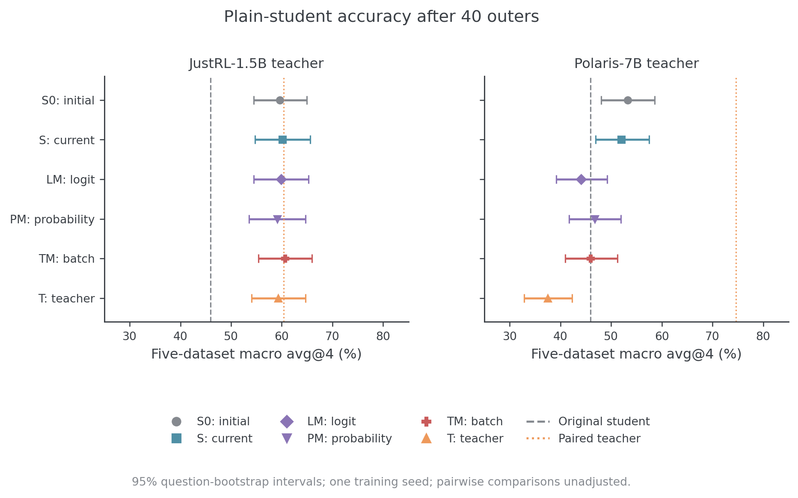
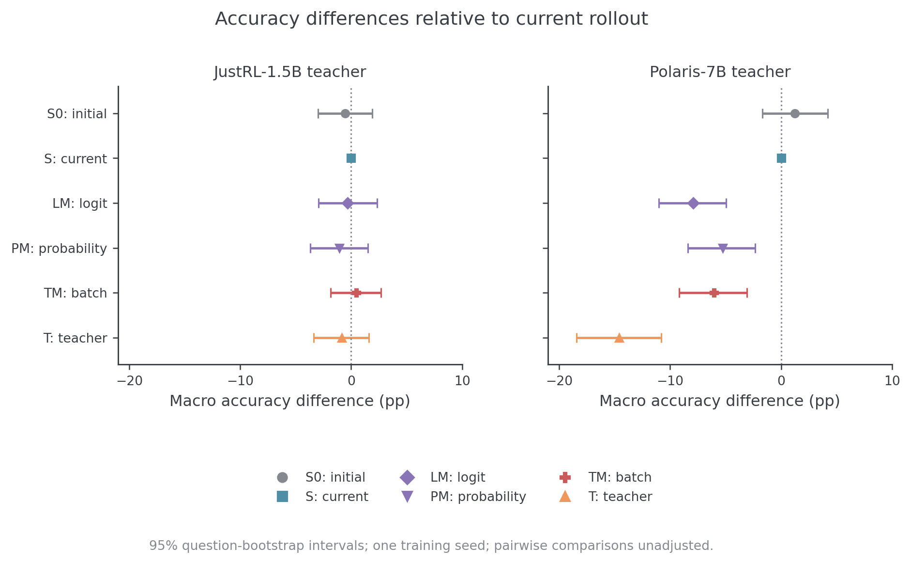
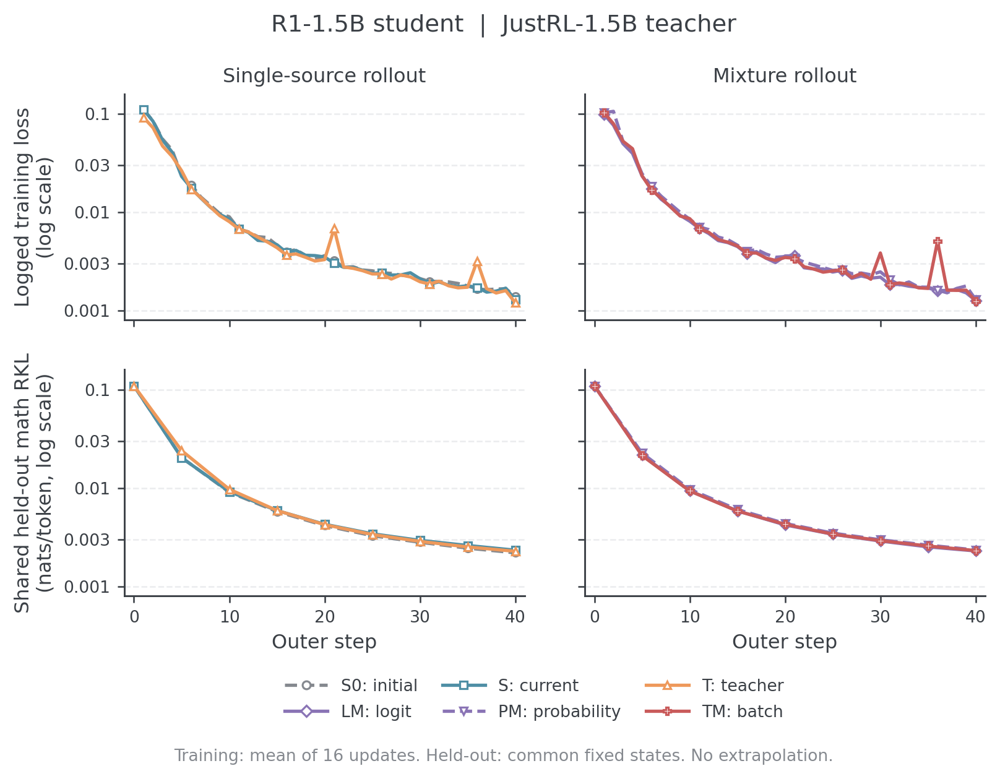
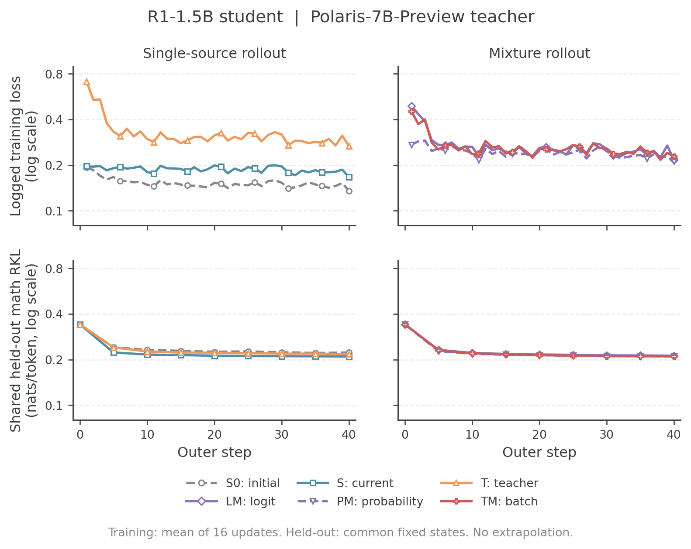
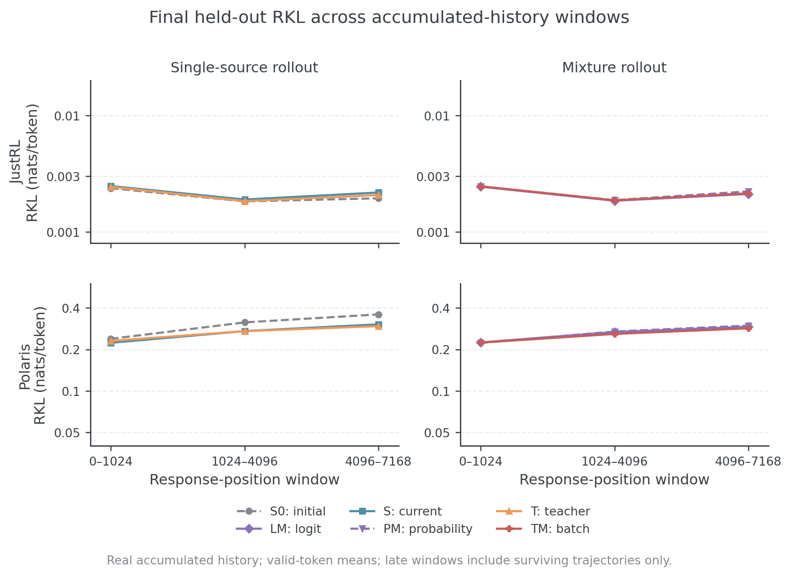
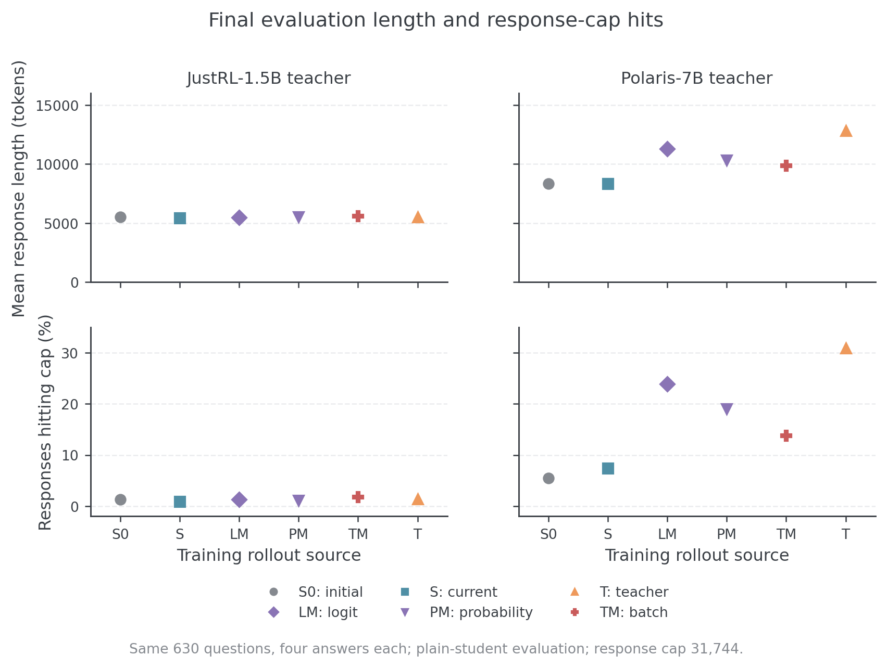

# E20 设置下的六种前缀对照

更新日期：2026-11-01。本文集中维护 R1-1.5B 配 JustRL-1.5B、Polaris-7B 的十二组共同评估协议与完成结果。执行源码为 `c52e3eb6`；各组完成 40 outer/640 次更新与最终纯 student 评测。旧无评估 S0 诊断单独[归档](archive/2026-10-30-S0无评估优化诊断.md)；本报告的历史 full-head、固定 H 口径不改写为新原生框架口径。

## 已确认的共同评估协议

保持六种动态训练来源、两个 teacher、40 outer × reuse16。训练仍使用各自策略生成的新回答；共同的是训练题目顺序与评估分布，不把训练改成共同固定 S0 回答。每个条件从相同原始 student 和新的 AdamW 开始，首轮单训练 seed，结论定位为探索性比较。

| 项目         | 实际协议                                                                                                                             |
| ------------ | ------------------------------------------------------------------------------------------------------------------------------------ |
| 数据隔离     | 单独保存去重后的 DAPO 训练文件；排除全部保留题及任务评测题，不修改共享源文件                                                         |
| 训练预算     | batch64、40 outer、reuse16、640 次更新/条件，共 7680 次；训练 cap7168、LR1e-6、AdamW、token-mean RKL                                 |
| 共同固定风险 | outer0、5、10…40；Math64、Code32、IF32；S0/对应 teacher 银行分别报告 RKL、JS                                                         |
| 长前缀       | Math32 是主面板的子集；同一完整轨迹取 H1024 和 H7168 视图，outer0/20/40 评分                                                         |
| 任务表现     | 纯 learner 在共同 630 题上 avg@4；temperature0.7、top-p0.9、cap31744、context32768；初始与终点完整评测，outer20 使用 Math64 开发子集 |
| 权重与恢复   | 只读 FP32 权重供评估，长期保留 outer20/40；另保留滚动可恢复 checkpoint，评估不更新 Adam 或训练 RNG                                   |
| 统计         | 各任务 acc 与 macro5；固定风险先逐题按固定 H 归一化；按 prompt 配对 bootstrap，不把 token 或同题回答当独立样本                       |
| Fresh 诊断   | 终点小面板及参数—state 交叉评分；与固定风险分开，不直接把原生 full-head 风险称作实际采样轨迹 KL                                      |

设计依据为 teacher-transfer 的[共同状态协议](data/scientific-v2-20261030/sources/teacher-transfer-protocol.md)、[双来源设计](../teacher-transfer/mechanisms/双来源待执行协议.md)和[R1 任务评测](data/scientific-v2-20261030/sources/r1-report.md#6-任务评测与-gaprecovery)。当时工作区中尚未提交的两份来源以冻结快照保存，原路径和 SHA-256 见[来源清单](data/scientific-v2-20261030/sources/manifest.json)。双来源设计原文仍标为待执行；此处借鉴评估方法，不借用它的未执行结果。Code/IF 的分布风险不是代码正确率或指令任务成功率。

已生成的[数据回执](../../../../../../runs/prefix-fusion-scientific-v2/prepared-03/complete.json)记录：原始 17917 行，排除 215 行评估重叠与 716 行训练重复后保留 16986 道题；预先固定 2560 道训练访问题的顺序。共同评分面板 128 题，另有 192 道保留题不进入训练；Math32 长面板是 Math64 的子集，不算额外独立题。具体参数见[机器可读协议](../../../../../../runs/prefix-fusion-scientific-v2/prepared-03/protocol.json)。去重口径是规范化 user 文本，不能保证没有语义近重复或上游预训练污染。

PM 的 JustRL/Polaris 两组真实 graph 采样探针均通过原 2e-6 FP64 oracle 门槛，源码为 `4b2a23c5`；这只证明对应短采样位置的数学实现，不代替训练与评估生命周期验收。三套固定银行已生成，每套 128 条，分别为 [S0](../../../../../../runs/prefix-fusion-scientific-v2/banks/S0/complete.json)、[JustRL](../../../../../../runs/prefix-fusion-scientific-v2/banks/J/complete.json)、[Polaris](../../../../../../runs/prefix-fusion-scientific-v2/banks/P/complete.json)。两组 teacher 缓存和初始 student 的 H1024/H7168 评分均已完成，见 [J 标准评分](../../../../../../runs/prefix-fusion-scientific-v2/baseline-risk/J/standard/complete.json)、[J 长评分](../../../../../../runs/prefix-fusion-scientific-v2/baseline-risk/J/long/complete.json)、[P 标准评分](../../../../../../runs/prefix-fusion-scientific-v2/baseline-risk/P/standard/complete.json)及[P 长评分](../../../../../../runs/prefix-fusion-scientific-v2/baseline-risk/P/long/complete.json)。初始只读导出已分别与原始 student 的 339 个张量精确比对，最大误差为 0，见 [J 导出检查](../../../../../../runs/prefix-fusion-scientific-v2/initial-J-readout-equality.json)和[P 导出检查](../../../../../../runs/prefix-fusion-scientific-v2/initial-P-readout-equality.json)。这些属于评估接线证据，未产生策略优劣结论。两组均完成两轮共 32 次成功更新，三次固定状态读出、保存、再次生成和任务生成审计通过，见 [J 生命周期](../../../../../../runs/prefix-fusion-scientific-v2/smoke-J-readout-v1-audit.json)和[P 生命周期](../../../../../../runs/prefix-fusion-scientific-v2/smoke-P-readout-v1-audit.json)。任务评分改为在已有 CPU worker 内直接执行同一套 boxed/math-verify 判定，避免嵌套进程冷启动误计入 30 秒超时；两组原始答案均已重评，见 [J 重评](../../../../../../runs/prefix-fusion-scientific-v2/smoke-task-regrade/J/complete.json)和[P 重评](../../../../../../runs/prefix-fusion-scientific-v2/smoke-task-regrade/P/complete.json)。短 cap 的准确率只检查接线，不计入科学结果。

早期两卡队列、无评估 S0 诊断与后续扩展队列分开记录，见文末[冻结执行沿革](#冻结执行沿革)；正式结果只计入 `c52e3eb6` 上的十二组完成审计。

## 问题与实验矩阵

固定 learner、目标 teacher 和学习配方，比较前缀来源对 full-vocab reverse KL（RKL）优化过程的影响。Learner 均从 `DeepSeek-R1-Distill-Qwen-1.5B` 初始化；teacher 分别为 `JustRL-DeepSeek-1.5B`（J）和 `Polaris-7B-Preview`（P）。每组重新加载原始 learner 和新的 AdamW 状态，共十二组独立训练。

| 标识 | 生成前缀                                             | 每轮如何生成                                                  |
| ---- | ---------------------------------------------------- | ------------------------------------------------------------- |
| S0   | initial student                                      | 用固定的原始 R1 checkpoint 生成；训练中的 learner 仍然更新    |
| S    | current student                                      | 用上一轮完成全部更新后的 learner 生成                         |
| LM   | 0.5 current student + 0.5 teacher，逐 token 融合     | 两侧在同一历史下的 logits 各占一半，再采样一次                |
| PM   | 0.5 current student + 0.5 teacher，逐 token 概率融合 | 同一历史下分别归一化得到概率，再作算术平均并采样              |
| TM   | 0.5 current student + 0.5 teacher，整轨迹混合        | batch64 中 32 条完整轨迹由 student 生成，32 条由 teacher 生成 |
| T    | teacher                                              | 用固定 teacher 生成                                           |

完整组名为 `J-S0/J-S/J-PM/J-LM/J-TM/J-T` 和 `P-S0/P-S/P-PM/P-LM/P-TM/P-T`。S0 固定的是生成器参数，不是反复使用同一批回答。PM 与 LM 都逐 token 融合；PM 的 0.5 是条件概率的混合权重，不是整条轨迹的来源配额。

LM 在 temperature=1、无 top-k/top-p 截断时，对应共同合法支持上的归一化几何混合：

$$
\mu_{\mathrm{LM}}(v\mid h)
=\frac{\sqrt{p_{\mathrm{current}}(v\mid h)\,q(v\mid h)}}{\sum_{u\in\mathcal V_{\mathrm{gen}}}\sqrt{p_{\mathrm{current}}(u\mid h)\,q(u\mid h)}}.
$$

这里 $h$ 是已生成的历史，$\mathcal V_{\mathrm{gen}}$ 是双方 tokenizer 一致的合法 token-ID 集合。PM 的定义为 $\mu_{\mathrm{PM}}(v\mid h)=0.5p_{\mathrm{current}}(v\mid h)+0.5q(v\mid h)$，其中两侧概率均在共同合法支持上归一化。LM 是归一化几何平均，PM 是算术平均，整轨迹混合属于另一个实验因素。

所有组的训练目标均指向对应 teacher，融合只改变采样前缀。每个 outer 生成一个新 batch，随后在这些固定前缀上做 16 次更新。

## 完成结果与分析

### 完成审计

十二组使用 `c52e3eb6`，每组 batch64、40 outer×reuse16、LR1e-6、Full-vocab RKL，共完成 7680 次更新。来源定义与共同协议见上文。

最终评测始终使用纯 student checkpoint，每组在 MATH500、AMC23、AIME24/25/26 共 630 题生成 2520 条回答，T0.7、top-p0.9、cap31744。主指标为五集合等权宏平均 avg@4。已完成 30240 条终点回答、三套原始模型基线，以及 108 份短固定状态和 36 份长前缀读出。

### 最终任务正确率

图 RQ3-1：各来源训练后纯 student 的五集宏平均及题目 bootstrap 95% 区间。灰虚线为原始 student，橙点线为该组 teacher。

| 来源         | JustRL teacher | Polaris teacher |
| ------------ | -------------: | --------------: |
| S0           |         59.64% |          53.28% |
| S            |         60.16% |          52.02% |
| PM           |         59.11% |          46.75% |
| LM           |         59.86% |          44.09% |
| TM           |         60.63% |          45.96% |
| T            |         59.32% |          37.45% |
| 原始 teacher |         60.36% |          74.67% |
| 原始 student |         45.96% |          45.96% |

**JustRL 六种来源均达到约 59%–61%，接近 teacher；Polaris 中 S0/S 达到 53.28%/52.02%，三种混合为 44.09%–46.75%，纯 teacher 来源为 37.45%。** 教师原始成绩更高，并未使教师来源的训练前缀自动成为更好的选择。

图 RQ3-2：每题四条回答一起重采样，按数据集分层进行 10000 次配对 bootstrap。区间描述单条训练轨迹下的题目不确定性，各来源比较未作多重校正。

JustRL 各来源相对 S 的差值区间均跨零。Polaris 的 PM、LM、TM、T 相对 S 分别为 **−5.28、−7.93、−6.07、−14.58** 个百分点，对应区间均低于零；S0 相对 S 为 +1.26，区间为 [−1.70,+4.21]。本轮最清楚的来源效应出现在 Polaris 配对。

### 共同状态上的拟合程度

图 RQ3-3：上排是各来源自身训练状态上的 loss；下排是两套共同冻结数学银行等权平均的 RKL。

JustRL 的共同状态数学 RKL 从 **0.109590** 降到 **0.002190–0.002343**，降幅约 97.9%–98.0%。不同来源最终条件拟合与任务结果都较接近。

图 RQ3-4：所有来源共享下排的固定数学评估状态。训练 loss 的绝对值随生成来源改变，策略比较使用共同状态读出。

Polaris 的共同状态 RKL 从 **0.341886** 降到 **0.209544–0.222568**，降幅约 34.9%–38.7%；后 20 轮改善很小。Current 来源固定风险最低，initial 来源 accuracy 点估计最高。混合来源的固定风险接近 current，任务表现却明显更低。

### 长前缀与生成行为

图 RQ3-5：真实累计历史的 0–1024、1024–4096、4096–7168 窗口。每题按窗口有效 token 平均，提前结束的轨迹退出后续空窗口。

Polaris 中 TM 的整段长历史 RKL 最低，而 accuracy 仍低于 S0/S。短状态风险、长前缀拟合和最终正确率给出了不同排序。

图 RQ3-6：与 accuracy 完全相同的 630 题×4 回答。JustRL 各组均长约 5.4k–5.6k；Polaris 的 S0/S 约 8.35k，token 混合约 10.3k–11.3k，T 约 12.9k。

Polaris T 的触顶率为 **30.91%**，LM/PM 为 **23.93%/19.01%**。更低 accuracy 与长尾同时出现，下一项解释重点是 EOS、重复、答案形成与训练覆盖。该组 **7680 次更新全部 applied，480/480 批首末 loss 净下降，NaN/Inf 为零**；机制分析继续区分局部优化和自由生成行为。

本节的图、配对统计与完成审计已固定到[结果快照](../../progress/data/20261101/rq3-results.json)、[准确率](../../progress/data/20261101/rq3-accuracy.csv)、[共同状态](../../progress/data/20261101/rq3-heldout.csv)、[长前缀](../../progress/data/20261101/rq3-long-risk.csv)。Fresh 终点参数×新轨迹交叉评分仍是下一项独立读出。

## 版本与比较边界

十二组均为单训练 seed；题目 bootstrap 区间不表示跨训练 seed 的不确定性。完整执行沿革与失败重启记录见下节。新 E63–E68 面向 Qwen 配对并使用原生 source/history/public 评估，另建基线，不能与这里的 Math/Code/IF、固定 H 结果合并。Qwen 旧协议结果由[独立报告](qwen-sources.md)维护。

## 冻结执行沿革

最早五种来源方案漏列概率融合，随后扩为 PM、LM、TM 三种混合，共十二组。旧 S0 无评估运行的结果与配置见[诊断归档](archive/2026-10-30-S0无评估优化诊断.md)，不用于策略 accuracy 比较。

早期两卡队列曾固定在独立科学 worktree 的 `73b30f06`，当时采用已测的 32 活跃请求与 fused full-vocab RKL。GPU7 的 worker 先计算 Polaris 任务基线，再执行六组训练；GPU6 先从短检查的第 1 轮 checkpoint 恢复，核对 Adam、RNG、FP32 参数和题目顺序，再自动进入 S0/JustRL 基线与六组训练。任务基线均为 630 题 × 4 次采样，正式训练仍为 40 outer × reuse16。运行失败会停止对应 worker，实际派发和结果以[运行状态](../../../../../../runs/prefix-fusion-scientific-v2/live-status.json)及运行目录回执为准。

本文记录 R1-1.5B 配 JustRL-1.5B（J）、Polaris-7B-Preview（P）的十二组 40 outer × reuse16 实验。数据与固定前缀已冻结，S0/J/P 三套 630 题 × 4 次任务基线已完成并通过[复用检查](../../../../../../runs/prefix-fusion-scientific-v2/expansion-20261030/baseline-reuse-audit.json)。旧无验证/无保存的 S0 运行只作优化诊断。

带共同评估的两卡 v3 队列曾因共享模型路径迁移失败，J-S0/P-S0 分别保留 160/144 次成功更新，均未到可恢复 checkpoint 的保存点。这 304 次更新和原始证据[单独保留](../../../../../../runs/prefix-fusion-scientific-v2/expansion-20261030/pre-expansion-failures.json)；扩展版十二组均从原始 student 和新的 Adam 状态开始，活动进度不累计旧失败尝试。模型已改用研究目录自有绑定，20 个文件内容与冻结清单一致，四份模型回执保持不变，见[路径迁移证明](../../../../../../runs/prefix-fusion-scientific-v2/expansion-20261030/model-binding-relocation-v1.json)。

科学执行源码固定为 `c52e3eb6`。历史扩展队列的六个独立 TP1 通道使用物理 GPU 0、1、2、3、6、7，首轮分配如下；余下 LM/TM/T 条件由空闲通道独占领取。当时 GPU 4、5 用于[工程验收](../../infra/rollout/README.md)。资源和路径迁移不改变学习、采样、题目顺序或评估预算，每个条件均保留配置差异和模型身份检查。

| GPU  | 首轮条件   | 训练前缀                                       |
| ---- | ---------- | ---------------------------------------------- |
| 0、1 | J-S0、P-S0 | 初始冻结 student                               |
| 2、3 | J-S、P-S   | 当前 student                                   |
| 6、7 | J-PM、P-PM | current student 与 teacher 的逐 token 概率混合 |

[扩展执行清单](../../../../../../runs/prefix-fusion-scientific-v2/expansion-20261030/manifest.json)固定版本、输入和条件身份；[实时状态](../../../../../../runs/prefix-fusion-scientific-v2/live-status.json)分别记录前置检查、训练、失败与完成，不以通道分配或进程启动代替成功更新。失败会停止对应通道，保留 claim 和证据，不自动重试。上文结果按已完成的逐组审计纳入；运行状态文件可继续记录后处理，不替代冻结结果快照。
