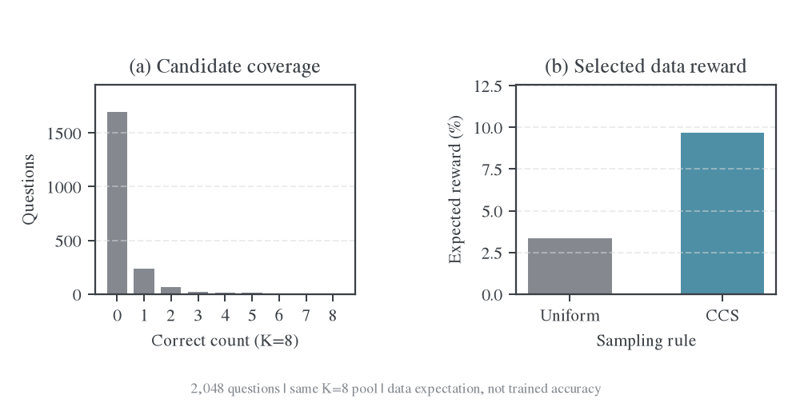
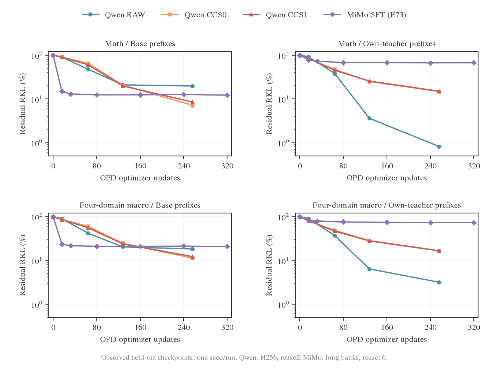
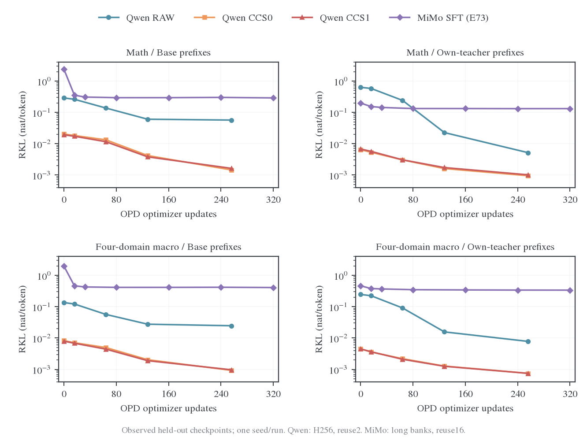
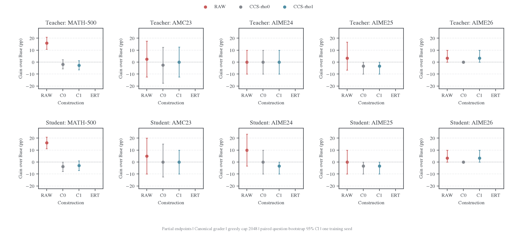
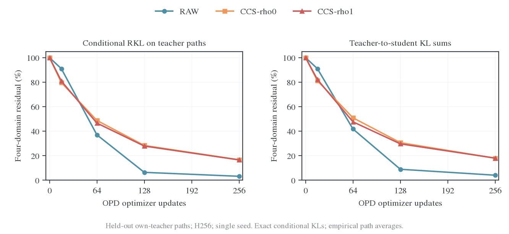
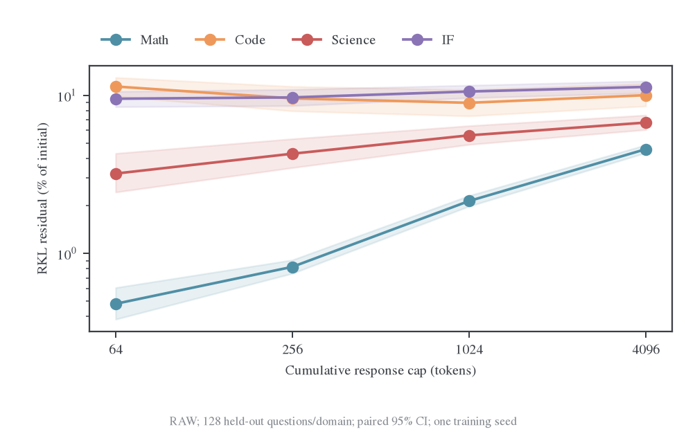
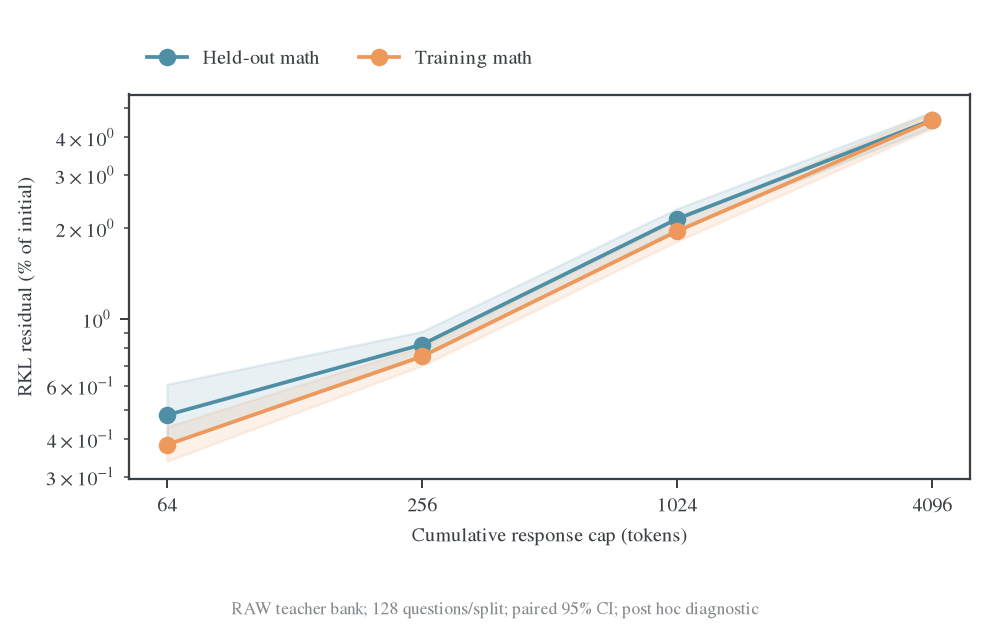

# 专家数据中心化与教师吸收对照设计

更新日期：2026-11-08。研究问题是：外部专家的知识经过不同训练路径写入同一个 Base 后，哪些增量能被重新初始化的学生通过 on-policy distillation（OPD）吸收。本文同时维护已完成的 Qwen 对照、历史 SFT teacher 的比较和下一轮受控设计；[同架构近邻假设](2026-11-08-同架构OPD近邻假设的理论与实验设计.md)提供参数与分布几何的背景。

当前结论有三点：RAW teacher 的数学增益已经传给 OPD student，长前缀与 held-out 补测也保留了高吸收；CCS 的低绝对残差伴随接近 Base 的能力，尚未产生可确认的新能力增量；RAW 与历史 MiMo-SFT 的主要差距在 teacher 前缀上，Base 前缀上的四域相对下降接近。下一轮应先在同一模型内建立稳定的吸收困难，再判断中心化是否改善。

## 1. 已完成实验的实际设置

### 1.1 模型与两阶段训练

记外部专家为 $A$、冻结初始学生为 $B$、构造方法为 $m$。先从 $B$ 训练 teacher $T_m$，再将 student 重置为 $S_{m,0}=B$，对固定 $T_m$ 做 OPD。专家只提供文本或评价信号；teacher 与 OPD student 的架构、初始化和 tokenizer 相同。

$$
A\longrightarrow\text{示范或奖励}\longrightarrow T_m,
\qquad B=S_{m,0}\xrightarrow{\mathrm{OPD}(T_m)}S_{m,k}.
$$

| 项目               | 实际首轮协议                                                                                                                  |
| ------------------ | ----------------------------------------------------------------------------------------------------------------------------- |
| Base $B$           | `Qwen/Qwen3-1.7B-Base`，revision `ea980cb0a6c2ae4b936e82123acc929f1cec04c1`                                                   |
| 专家 $A$           | `Qwen/Qwen3-30B-A3B-Instruct-2507`，revision `0d7cf23991f47feeb3a57ecb4c9cee8ea4a17bfe`                                       |
| 输入               | Base 使用裸题面加 `Answer:`；专家使用原生 non-thinking chat template；两者词表映射已核对一致                                  |
| Teacher 数据       | 2,048 道 DAPO 数学题，各方法共用                                                                                              |
| OPD 数据           | 另 2,048 道 DAPO 数学题；按原文本规则划分，后续问题身份审计见 §4                                                              |
| 开发集与永久留出集 | 两套独立题表，均为 Math/Code/Science/IF 各 128 题、共 512 题                                                                  |
| SFT teacher        | RAW、CCS-ρ0、CCS-ρ1；各 128 updates，32 question/update，两个 question epoch；AdamW LR3e-6、WD0                               |
| OPD                | 每条路径重新加载 $B$ 和 fresh optimizer；256 updates，16 question/batch、reuse2；每两步刷新当前学生回答，共 128 批新 rollout  |
| OPD 目标与优化     | full-vocab $\mathrm{KL}(p\Vert T_m)$；response cap1024；AdamW LR1e-6、WD0.01、clip1                                           |
| 数值执行           | FP32 master/head/gradient/Adam moments，BF16 backbone autocast，TF32 关闭；使用 response-aligned hidden 与 full-vocab RKL VJP |
| 固定 bank 主读出   | Shared-Base 与 Own-Teacher，各取至多 256 response token；永久留出读出 0/16/64/128/256，开发集另有 step4                       |
| 能力评估           | MATH-500、AMC23、AIME24/25/26，共 630 题；greedy、response cap2048、canonical grader                                          |
| 随机性             | 每条训练路径一个 seed；文中 bootstrap 区间只反映评估题抽样误差                                                                |

训练代码见 [teacher_construction_llm.py](../../../research/studies/fixed_transfer/teacher_construction_llm.py)，冻结配置和数据 hash 见 [protocol.json](../../../../../runs/teacher-construction-20261108/llm-v1/protocol.json)。完整更新、模型与 optimizer/RNG 检查、逐题评分和 token 成本保存在[RAW256 归档](data/teacher-construction-20261108/opd-raw256-v1/archive-receipt.json)及[CCS256 归档](data/teacher-construction-20261108/opd-step256-ccs-v1/archive-receipt.json)。数值执行检查见 [gpu-gate.json](../../../../../runs/teacher-construction-20261108/llm-v1/gpu-gate.json)。

### 1.2 数据构造与实际成本

RAW 每题用专家生成一条回答，temperature0.7、top-p0.8、top-k20、cap4096，**保留全部回答，不按 verifier 正确性过滤**。CCS 从 Base 每题生成八条回答，temperature1、top-p1、不截 top-k、cap1024，再按仓库 DAPO verifier 的二值分数计算权重。ρ0 在同一候选池均匀抽样；ρ1 使用 Pearson 预算 1、权重范围 0.05–4；每次题目呈现重新按 $w_i/8$ 抽一条做 SFT。全失败组保持均匀。

这里实际运行的是 verifier-only、K8、重采样 SFT。后文完整 CCS 设计使用专家分级评分、K16 与全候选 weighted CE。对同一候选池与权重，重采样和 weighted CE 的期望目标一致；候选数、评分信号与有限样本噪声则分别影响实际更新。ERT-verifier 从 $B$ 直接做 RLOO：16 题×8 个 fresh candidates/update、reuse1、LR1e-6、WD0、固定原始 Base 的 sequence-KL 系数 0.02，无专家 rationale CE。其目标是 128 updates；已归档的能力读出为 step16，最终 teacher 与二次 OPD 尚未形成端点结果。

| 路径   | SFT response token 呈现次数 | 每次呈现平均 token | SFT 梯度裁剪步数 | OPD 新生成 response token |
| ------ | --------------------------: | -----------------: | ---------------: | ------------------------: |
| RAW    |                  11,391,102 |           2,781.03 |          128/128 |                 1,995,520 |
| CCS-ρ0 |                   3,137,538 |             766.00 |           22/128 |                 1,576,206 |
| CCS-ρ1 |                   3,131,938 |             764.63 |           23/128 |                 1,576,085 |

SFT 损失是 response CE 之和除以共同常数 $32\times1024$，RAW 超过 1024 的 token 仍参与 CE。OPD 损失除以 $16\times1024$，reuse2 使 token 呈现次数为新生成量的两倍。相同 update 数对应不同 token 成本、裁剪频率与有效优化轨迹；这组比较固定更新预算，没有匹配能力或计算量。[SFT 重放审计](data/teacher-construction-20261108/prefix-length-v1/pipeline-audit/sft-replay-audit.json)逐步核对了题目选择、token 计数和梯度裁剪。

Base 候选池共 16,384 条、12,519,174 token；551 条获 verifier 正分，353/2,048 题至少有一个正候选，1,695 题全失败。均匀抽样与 CCS-ρ1 的期望分数为 0.033630 和 0.096587。专家语料共 5,695,590 token，平均 2,781.05；868/2,048 条触及 cap4096，323 条获 verifier 正分。这个分数受答案提取格式影响，相关诊断见 §4。



候选数据、权重和图表来源见[候选图归档](figures/teacher-construction-20261108/archive-receipt.json)、[权重期望](../../../../../runs/teacher-construction-20261108/llm-v1/candidate-weight-expectations.json)与[RAW 语料归档](data/teacher-construction-20261108/raw-corpus-v1/archive-receipt.json)。初始专家生成曾使用 T1、cap1024，64 条中 56 条被截断；该诊断在 teacher 更新前促成 cap4096 的协议修订，原回答与修订记录保存在 [length-diagnostic](../../../../../runs/teacher-construction-20261108/llm-v1/length-diagnostic/summary.json)。

### 1.3 RKL 与吸收的定义

RKL 始终指学生到 teacher 的条件 KL。Bank 决定状态来源：Shared-Base 使用冻结 $B$ 的回答；Own-Teacher 使用每个 $T_m$ 自己的回答。对题集 $D$、bank $b$、response 上限 $H$，令 $\ell_i=\min(H，|y_i^b|)$：

$$
K_{D,b,H}(S,T)=\frac1{|D|}\sum_{i\in D}\frac1{\ell_i}
\sum_{t=1}^{\ell_i}\sum_v S(v\mid x_i,y^b_{i,<t})
\log\frac{S(v\mid x_i,y^b_{i,<t})}{T(v\mid x_i,y^b_{i,<t})}.
$$

先取每题有效 token 均值，再取域均值。Macro4 先平均四域的绝对风险，再计算残余 $r_k=K(S_k,T)/K(B,T)$；吸收下降比例为 $1-r_k$。正文端点使用原始风险，未做 floor 扣除。在线训练 loss 的前缀随 actor 变化，且使用固定预算分母，单独记录；**主要泛化结论来自固定 held-out bank**。OPD 实际训练题的固定 bank 用于判断训练—留出差距，见 §3。

数学留出题测同域新题迁移，代码、科学与指令题测跨 prompt 分布迁移，Own-Teacher 另测前缀分布迁移。域外 RKL 是对 teacher 分布的拟合；域外能力需要相应 benchmark，首轮尚只有数学能力评估。

辅助诊断保存双向 KL、完整词表 $\chi^2(T\Vert p)$ 和中心化 log-ratio 方差；密度比尾部用 FP64 累加。候选使用 vLLM BF16，训练读出使用 HF FP32 master/head；均匀 CCS 的偏移同时包含有限候选、两遍离线训练与执行精度差异，权重分布保证的相同采样分布假设需单独核验。

固定前缀衡量共同状态上的条件分布拟合；完整回答行为的距离还要匹配前缀来源、KL 方向与长度求和。设当前学生为 $P$、teacher 为 $Q$，采用共同 cap、EOS 规则与支持集，链式法则给出：

$$
D_{\mathrm{KL}}(P^H\Vert Q^H)
=\mathbb E_{Y\sim P}\sum_{t\le H}D_{\mathrm{KL}}(P_t\Vert Q_t),
\qquad
D_{\mathrm{KL}}(Q^H\Vert P^H)
=\mathbb E_{Y\sim Q}\sum_{t\le H}D_{\mathrm{KL}}(Q_t\Vert P_t).
$$

| 读出                 | 前缀来源与方向                                       | 解释                                              |
| -------------------- | ---------------------------------------------------- | ------------------------------------------------- |
| 现有 Shared-Base RKL | 冻结 Base 前缀，$P_t\Vert Q_t$                       | 各 teacher 的共同状态拟合；固定参考测度           |
| 现有 Own-Teacher RKL | 各自 teacher 前缀，$P_t\Vert Q_t$                    | teacher 访问状态上的条件拟合；跨 teacher 测度不同 |
| 当前策略序列 RKL     | 每个 checkpoint 的学生前缀，$P_t\Vert Q_t$，逐步求和 | 学生实际行为相对 teacher 的距离                   |
| 教师序列 FKL         | 固定 teacher 前缀，$Q_t\Vert P_t$，逐步求和          | teacher 行为被学生覆盖的程度                      |

Own-Teacher RKL 不等于序列 FKL；逐题 token 均值也不等于序列 KL。后续行为主读出采用表中后两项，固定 Base/teacher/公共混合 bank 保留为状态诊断。每项分开报告绝对值、相对 step0 的残余和长度；能力增量另用 benchmark 判断。完整[链式推导与执行条件](../../theory/teacher-learnability.md#sequence-distance)说明了 EOS、随机长度及采样/评分策略一致性的要求。

### 1.4 代码来源与协议复用

首轮采用新写的研究驱动，训练循环不经过原生 verl trainer。底层张量路径有复用，数据构造、SFT/RLOO 循环、bank 汇总与初版能力调度有新实现；核对代码时须区分这两层。

| 环节                           | 来源                                         | 已核对的范围                                                                                           |
| ------------------------------ | -------------------------------------------- | ------------------------------------------------------------------------------------------------------ |
| 模型与 response-aligned hidden | 复用 `research/backends/hf_models.py`        | FP32 master、BF16 decoder、response token 对齐                                                         |
| OPD full-vocab VJP             | 复用 `research/backends/hf_rkl.py`           | 完整 head 的 KL 与梯度；训练循环另外实现                                                               |
| RAW/CCS 数据构造与 SFT         | 新写 `teacher_construction_llm.py`           | 候选重采样、CE 归约、chunked CE VJP；CPU 测试覆盖 tied/untied head 梯度                                |
| ERT-verifier                   | 同一研究驱动内新写 RLOO                      | Fresh candidates、LOO、sequence-KL；并非直接复用已有 PPO/GRPO trainer                                  |
| 初版能力读出                   | 新写 greedy 调度，复用 canonical 数学 grader | n1、cap2048；没有沿用正式四域采样预算                                                                  |
| 多 SFT 曲线                    | 新写分析脚本，复用 MiMo loader 与绘图组件    | 冻结逐题记录独立复算，无新训练                                                                         |
| 长预算重测                     | 新写调度器，复用原生评估组件                 | `GenerationProtocol`、`TokenizerSupport`、`verify_sample`、`summarize_accuracy` 与 checkpoint 内容身份 |

重测并未直接运行既有 `fixed_transfer.evaluate` 全流程：该入口统一数学 avg@4，四域协议的各 benchmark 则使用不同 n。研究调度器保留可变 n，复用原生的逐题 seed、答案通道、评分与完整覆盖检查；数学同时保存 canonical 与原生评分器的结果，分别观察生成预算和判分器变化。[重测源码](../../../research/studies/fixed_transfer/teacher_construction_reeval.py)与[恢复/评分测试](../../../../../tests/examples/research/test_teacher_construction_reeval_on_cpu.py)提供可检查的实现。

## 2. 四种 SFT teacher 的 OPD 对比

### 2.1 当前 Qwen 与历史 MiMo 的比较范围

新增对比包含三个受控 Qwen SFT teacher 和历史 MiMo-7B-SFT（E73）。两套实验均采用 full-vocab RKL、题内 token 均值和四域等权平均；MiMo 使用其实际长 bank，全程有七个已保存读出点。

| 设置                        | Qwen RAW / CCS-ρ0 / CCS-ρ1                | MiMo-SFT，E73                                             |
| --------------------------- | ----------------------------------------- | --------------------------------------------------------- |
| Student / teacher           | 共同 Qwen3-1.7B-Base / 从该 Base 短程 SFT | MiMo-7B-Base / 公开 MiMo-7B-SFT                           |
| Teacher 构造历史            | 本实验共同题池，128 updates               | 公开成熟 SFT checkpoint，未在此重训                       |
| OPD batch / reuse / updates | 16 / 2 / 256                              | 128 / 16 / 320                                            |
| 新 rollout 批数             | 128                                       | 20                                                        |
| 训练 response cap           | 1,024                                     | 7,168                                                     |
| 固定 bank 生成 cap          | 256                                       | 数学/代码/科学 24,576，IF 8,192                           |
| Teacher-bank 平均长度       | 至多 256                                  | 数学 5,881.91，代码 12,107.66，科学 8,332.96，IF 1,561.98 |
| 读出点                      | 0/16/64/128/256                           | 0/16/32/80/160/240/320                                    |

Qwen 三组可以比较同一 Base 与 OPD 协议下的路径差异。MiMo 是历史参照：模型、题目群、精度实现、teacher 历史、前缀长度、batch 和 reuse 均不同，横轴只对齐 optimizer update，未对齐 token 或 GPU 小时。原始 MiMo 数据及协议见[吸收诊断](fixed-state-results/absorption-diagnostics.md)。

### 2.2 相对残余与绝对风险曲线



纵轴为相对各自 step0 的残余百分比，对数坐标，越低越好。左列为 Base 前缀，右列为各自 teacher 前缀；上排数学，下排四域 macro。每个点都是实际 checkpoint，连线连接相邻观测。四条曲线各来自一个训练 seed。

| Teacher     | OPD updates | Base-bank 数学残余 | Own-Teacher 数学残余 | Base-bank macro4 残余 | Own-Teacher macro4 残余 |
| ----------- | ----------: | -----------------: | -------------------: | --------------------: | ----------------------: |
| Qwen RAW    |         256 |             19.66% |            **0.82%** |                18.20% |               **3.17%** |
| Qwen CCS-ρ0 |         256 |              7.14% |               14.79% |                11.26% |                  16.63% |
| Qwen CCS-ρ1 |         256 |              8.50% |               14.98% |                12.20% |                  16.54% |
| MiMo-SFT    |         320 |             12.18% |               66.87% |                20.78% |                  72.87% |

RAW 与 MiMo 的 Base-bank macro4 分别消除 81.80% 与 79.22% 的初始风险；数学 Base-bank 上，MiMo 的相对下降还高于 RAW。差异集中在 Own-Teacher：RAW 的数学/四域相对下降为 99.18%/96.83%，MiMo 为 33.13%/27.13%。因此历史“吸收不好”的现象有明确的状态分布条件。

RAW 在 step16 的四域相对残余高于两个 CCS，step64 反而更低；到最终端点，Base-bank 是 CCS 更低，Own-Teacher 是 RAW 更低。初始标量距离和早期下降都没有给出与预算、bank 无关的最终排序。



绝对 RKL 与上图采用相同面板和实体配色。CCS 的初始偏移与最终误差都较小；RAW 的相对拟合更充分之处，仍可能保留更大的绝对误差。四域端点如下，单位为 nats/token。

| Teacher     | Base-bank：初始 → 最终 | Own-Teacher：初始 → 最终 |
| ----------- | ---------------------: | -----------------------: |
| Qwen RAW    |    0.135517 → 0.024670 |      0.245784 → 0.007802 |
| Qwen CCS-ρ0 |    0.008256 → 0.000930 |      0.004496 → 0.000748 |
| Qwen CCS-ρ1 |    0.007938 → 0.000969 |      0.004503 → 0.000745 |
| MiMo-SFT    |    1.967694 → 0.408868 |      0.463225 → 0.337572 |

[比较数据与来源 hash](data/teacher-construction-20261108/sft-comparison-v1/provenance.json)包含 220 行曲线、40 行域别端点及图审计；[绘图源码](../../../research/studies/fixed_transfer/compare_sft_teachers.py)从冻结 Qwen 逐题 JSONL 独立重算风险，核对摘要、步数和 macro 归约，并校验两套输入 hash。[PDF 残余图](figures/teacher-construction-20261108/sft-comparison-v1/residual_percent.pdf)与[PDF 绝对风险图](figures/teacher-construction-20261108/sft-comparison-v1/rkl.pdf)可用于排版。

### 2.3 吸收是否传递了任务增益

下表为相同 630 题、相同生成与主评分器的正确率，每题 greedy 一次、cap2048。T 为 SFT teacher128，S 为 OPD student256；“题数”指独立题目数，采样次数均为 n1。这组读数保留为短预算结果。

| Benchmark | 题数 |   Base |  RAW T |  RAW S | CCS-ρ0 T | CCS-ρ0 S | CCS-ρ1 T | CCS-ρ1 S |
| --------- | ---: | -----: | -----: | -----: | -------: | -------: | -------: | -------: |
| MATH-500  |  500 | 42.60% | 58.60% | 58.80% |   40.80% |   38.80% |   40.00% |   39.60% |
| AMC23     |   40 | 25.00% | 27.50% | 30.00% |   22.50% |   25.00% |   25.00% |   25.00% |
| AIME24    |   30 |  3.33% |  3.33% | 13.33% |    3.33% |    3.33% |    3.33% |    0.00% |
| AIME25    |   30 |  3.33% |  6.67% |  3.33% |    0.00% |    0.00% |    0.00% |    0.00% |
| AIME26    |   30 |  0.00% |  3.33% |  3.33% |    0.00% |    0.00% |    3.33% |    3.33% |



RAW 的 MATH-500 teacher 增益为 16.00pp（配对 95% CI 10.80–20.80），student 为 16.20pp（11.20–20.80）；student−teacher 为 0.20pp（−3.60–3.80）。相对 Base 的增益恢复率为 101.25%（80.32–128.89），这是 15 个路径×benchmark 组合中唯一分母稳定的恢复比例。Teacher-only 正确 41 题、student-only 42 题、共同正确 252 题、共同错误 165 题；能力增量恢复与逐题行为一致性是两个读出。

CCS-ρ0/ρ1 的 MATH-500 teacher 增益分别为 −1.80pp（−5.60–2.00）和 −2.60pp（−6.40–1.20），student 为 −3.80pp（−7.80–0.00）和 −3.00pp（−7.00–1.00）。候选池的分数增量没有转化为可确认的能力提升。其余小 benchmark 的 teacher 增益区间也覆盖零；RAW student 的 AIME24 读数来自 4/30 题。

区间使用 2,000 次配对题目 bootstrap，未作多重比较校正。完整评分、区间、长度与计算来源见[三路径能力归档](data/teacher-construction-20261108/three-arm-capabilities-v1/archive-receipt.json)。MATH-500 平均长度 Base/RAW T/RAW S 为 804.51/1,141.89/1,208.03，截断率为 17.40%/36.60%/38.00%；共同 cap2048 下的实际推理 token 消耗不同。

### 2.4 按教师序列方向重新归约

已有逐题记录同时保存了 FKL 和有效 token 数，可从 teacher 轨迹的 $Q_t\Vert P_t$ token 均值乘回长度，再按题平均。这个求和与截断序列 KL 的链式方向一致；它复用 H256、每题一条教师轨迹，实际仍受原 HF batch/cache/全长评分数值漂移影响。不同 teacher 的轨迹分别固定。

| Teacher | 数学序列 FKL 残余 | 四域序列 FKL 残余 | 四域序列 FKL，最终 nats/sequence |
| ------- | ----------------: | ----------------: | -------------------------------: |
| RAW     |             1.51% |             4.06% |                         1.759885 |
| CCS-ρ0  |            15.58% |            17.92% |                         0.158980 |
| CCS-ρ1  |            16.41% |            18.01% |                         0.160514 |



RAW 的四域残余由原条件 RKL 的 3.17% 变为该序列方向估计的 4.06%；方向和归约改变了量值，但未消除该短时域的高相对下降。RAW 的绝对残差仍高于两个 CCS。新归约不补出缺失的 current-student 序列 RKL，也不代表整段长回答已经等价。[逐域端点与曲线](data/teacher-construction-20261108/sequence-direction-v1/endpoints.csv)、[来源绑定](data/teacher-construction-20261108/sequence-direction-v1/provenance.json)与[生成源码](../../../research/studies/fixed_transfer/teacher_construction_distance.py)保留三种不同归约：逐题 token 均值、逐题 KL 求和、pooled token 均值。

### 2.5 恢复历史采样预算的能力重测

四域正式协议与旧固定状态研究分别定义不同的采样预算。重测采用[四域各 benchmark 的 n](protocols/online-four-domain.md)及后续阶段实际使用的长度上限；MATH-500 额外生成四次，sample0 作为正式 avg@1，avg@4 作为补充。两者使用同一冻结题表，不按正确率选择样本。

| Benchmark        |  题数 |              采样 n | Response cap |
| ---------------- | ----: | ------------------: | -----------: |
| MATH-500         |   500 | 4，主读数取 sample0 |       24,576 |
| AMC23            |    40 |                  16 |       24,576 |
| AIME24 / 25 / 26 | 各 30 |               各 16 |       24,576 |
| GPQA-Diamond     |   198 |                   4 |       24,576 |
| LCBv5            |   279 |                  10 |       24,576 |
| IFEval           |   541 |                   1 |        8,192 |

共同设置为 T1、top-p0.95、top-k 不截断、Base 裸题面加 `Answer:`、逐题逐 sample 固定 seed、EOS151643、原生重复停止。正确率报告 avg@n，不是 best-of-n 或 pass@n。MATH-500、AMC、AIME 共 4,080 条回答/模型；OOD 三域共 4,123 条回答/模型。

重测覆盖 Base、三个 SFT teacher128、三个 OPD student256，均测全部八项 benchmark；另测 RAW student64、student128 与 ERT-verifier teacher16 的五项数学 benchmark。总计 17 个模型/阶段作业、69,661 条回答。该范围用于端点比较及 RAW 过程检查，ERT16 是预先指定的早期诊断，不当作成熟 RL teacher 端点。

新协议与权重内容 hash 已记录在[重测计划](../../../../../runs/teacher-construction-20261108/capability-reeval-v2/plan.json)。运行与完成状态见[续接入口](../../../../../runs/teacher-construction-20261108/capability-reeval-v2/CONTINUE.md)；长预算结果完成前，§2.3 的数字仍只支持原 greedy 协议的结论。新的跨域任务正确率与当前学生序列距离需要分别读出，不能由四域固定 bank 的 RKL 相互替代。

## 3. RAW 的长前缀与训练—留出验证

事后补测保持 RAW teacher128 与 student256 不变，延续原 512 条 held-out teacher 前缀至 cap4096，另在 128 道实际 OPD 训练题上生成 teacher 回答。原始 teacher 前缀由 HF FP32-head sampler 生成，延续使用 vLLM BF16、T1/top-p1；累计上限包含自然结束的短回答。数学平均长度 3,671.91，119/128 题到达 1024 之后、112/128 到达 2048 之后、106/128 触及 cap4096。

| Own-Teacher 域 | H256 残余 | H1024 残余 | H4096 残余 |
| -------------- | --------: | ---------: | ---------: |
| 数学           |     0.82% |      2.15% |      4.57% |
| 代码           |     9.57% |      8.97% |     10.03% |
| 科学           |     4.27% |      5.58% |      6.73% |
| 指令           |     9.71% |     10.58% |     11.31% |
| macro4         |     3.18% |      5.03% |      7.20% |



H4096 的数学残余为 4.57%（95% CI 4.33–4.86），macro4 为 7.20%（6.74–7.81）。只看数学 2048–4096 后段，112 题残余为 8.13%（7.62–8.69）；代码/科学/IF 到达该段的题数为 63/42/54。后段更难拟合，但长前缀仍保留了较高的 held-out 风险下降。

| OPD 题集    |    H | 初始 RKL | 最终 RKL |  残余 |
| ----------- | ---: | -------: | -------: | ----: |
| 训练 128 题 |  256 | 0.640568 | 0.004810 | 0.75% |
| 留出 128 题 |  256 | 0.631056 | 0.005188 | 0.82% |
| 训练 128 题 | 1024 | 0.318302 | 0.006213 | 1.95% |
| 留出 128 题 | 1024 | 0.321439 | 0.006896 | 2.15% |
| 训练 128 题 | 4096 | 0.187956 | 0.008554 | 4.55% |
| 留出 128 题 | 4096 | 0.200743 | 0.009166 | 4.57% |



训练题按实际 OPD 顺序每隔 16 题选一题，覆盖整个训练过程；它们与 SFT teacher 的训练题集有区别。H4096 的训练题区间为 4.28%–4.83%，与留出点估计接近；排除已确认同题的四道留出数学题后，残余为 4.56%。这两项结果削弱了“只记住 OPD 训练题”对高吸收的解释。

长度扩大还改变初始风险分母：held-out 数学初始风险从 0.631056 降至 0.200743，最终风险从 0.005188 升至 0.009166；macro4 最终风险从 0.007806 升至 0.008529。残余比例的增长同时包含分母下降和误差增加。H4096 的高下降使短前缀成为部分解释，仍不足以重现历史 MiMo 的 teacher-bank 平台。

完整[补测归档](data/teacher-construction-20261108/prefix-length-v1/archive-receipt.json)包含逐题固定轨迹、训练/留出配对、位置窗口和独立复算，最大归约差异为 $2.22\times10^{-16}$。全长 forward 对原前 256 token 的评分存在上下文执行漂移：2,048 个对照的最大差为 0.006888 nats/token；截回 256 的核查题精确复现原短序列值，见[上下文核查](data/teacher-construction-20261108/prefix-length-v1/context-probe.json)。原 Base bank 只有 H256，H1024 别名已从汇总排除；actor replay 支持 H1024，范围见[测量修正](data/teacher-construction-20261108/prefix-length-v1/measurement-corrections.json)。MiMo 已有初始短前缀重评分，但最终权重六个分片缺失，长度对齐比较止于初始阶段，见[缺失回执](data/teacher-construction-20261108/prefix-length-v1/mimo-final-unavailable.json)。

## 4. 数据与评分管线的影响

### 4.1 问题身份去重

原划分只做归一化文本去重。后续题面与人工核查确认 41 组跨集合重叠：teacher–OPD 32 组、teacher–dev 2 组、OPD–dev 2 组、teacher–eval 1 组、OPD–eval 3 组、teacher–benchmark 1 组。公开 benchmark 有七道同题与两道相关题；永久评估有四道数学同题。

MATH-500 排除审计清单确认的三道同题/相关题后，497 题的 Base/RAW T/RAW S 正确率为 42.86%/58.75%/58.95%。H256 数学 Base-bank 残余由 19.66% 变为 19.55%，teacher-bank 由 0.820% 变为 0.813%。去重缺口需要修复，但已识别重叠没有消除 RAW 的增益和吸收现象。审计覆盖目前确认的问题身份，不包含所有翻译或深度改写。

### 4.2 Verifier 的格式偏差

RAW teacher 在 MATH-500 的 canonical 正确率为 58.60%，DAPO verifier 只有 3.40%，276/500 题分歧均为前者判对、后者判错。DAPO 先查末 300 字符的 `Answer:` 单行答案，仅提取值为 `[INVALID]` 才进入末 100 字符的 boxed 分支。RAW 常输出 `Final Answer:` 后换行，空提取结果阻止了 boxed fallback。

276 个分歧中，199 题末尾已有与 ground truth 完全一致的 boxed 字符串，46 题有 boxed 但字符串不同，31 题没有完整末尾 boxed。仅对存量文本允许前分支判错后继续 strict-box，诊断分数由 3.40% 升为 43.20%。Base 同类被阻止的精确 boxed 正答只有一题，两个 CCS teacher 为零；RAW student 的 DAPO 分数为 4.60%，与主评分器的分歧占 54.20%。

这个缺陷影响 CCS 权重、ERT 奖励和语料质量检查。RAW 未用该分数筛选 SFT 回答，其 canonical 增益仍有直接证据；CCS/ERT 实际优化的信号则混合了数学正确性与答案格式偏好。冻结首轮保留原奖励，修复奖励进入独立新运行。详细逐题依据与 CE/VJP 对齐核查见[管线审计](../../../../../runs/teacher-construction-20261108/llm-v1/pipeline-audit-20261108/2026-11-08-数据与SFT管线审计.md)。

### 4.3 初始距离的尾部

数学开发 bank 的初始指标如下，均按每题等权。RKL 方向为 $B\Vert T$，FKL/Pearson 方向为 $T\Vert B$；括号为最大一道题对指标总和的贡献。

| 指标                  | RAW：均值（最大题贡献） |             CCS-ρ0 |             CCS-ρ1 |
| --------------------- | ----------------------: | -----------------: | -----------------: |
| RKL                   |       0.293795（9.72%） | 0.023953（53.04%） | 0.022481（51.50%） |
| FKL                   |       0.328341（6.93%） | 0.016690（43.64%） | 0.015863（42.27%） |
| Pearson $\chi^2$      | 2,043,683.384（95.67%） | 2.119991（88.24%） | 0.318084（43.54%） |
| 中心化 log-ratio 方差 |       0.387071（4.22%） | 0.043995（52.74%） | 0.040449（50.17%） |

RAW Pearson 的题目 bootstrap 区间为 47,311–5,986,536，贡献集中度对应的有效题数为 1.09；CCS 两组区间为 0.0831–6.0272、0.0781–0.6765。CCS 最大 RKL 贡献来自含 U+000C 的六 token 回答，而最大 Pearson 贡献来自另一条 256-token 回答；token 加权的数学初始 RKL 为 0.011632/0.011262，主结果仍用原题均值。完整[尾部统计](figures/teacher-construction-20261108/raw-initial-v1/initial-feature-tails.csv)及[前缀核查](figures/teacher-construction-20261108/initial-distances-v1/selected-prefix-audit.json)保留身份、长度和来源。

RAW 极大的 Pearson 与后续高吸收同时存在。该指标测量密度比尾部，稳定性和预算条件化预测价值需要分别检验；现有三条路径不足以拟合跨 teacher 的可靠预测器。

## 5. RAW 高吸收的解释与下一步判别

### 5.1 已被证据约束的解释

RAW 是高吸收 SFT teacher 的真实例子：它有 held-out 分布风险下降，也有 MATH-500 增益恢复。数据错误、训练题记忆和 H256 的短窗口各解释了部分测量差异，现有敏感性分析没有消除这个结果。因而“外部专家数据做 SFT 就会产生难吸收 teacher”不适合作为实验前提。

当前最值得检验的是 **teacher 的构造深度与学生训练访问到的状态是否共同决定可恢复的更新方向**。RAW 从 OPD 完全相同的 Base 只做 128 次 SFT，学生又在同域题池、每两步刷新 rollout；历史 MiMo teacher 有更长的累计训练历史，OPD reuse16 且评价教师前缀显著更长。前者更容易让训练梯度持续覆盖目标行为，是可检验的机制假设。这里仍缺少同模型、同数据、同长度下的单变量干预，128 updates 本身也不能证明神经网络处于精确线性邻域。

四条曲线给出的直接线索是两种 bank 的分离：MiMo 已在 Base 前缀上快速消除多数风险，teacher 前缀随后平台；RAW 在 teacher 前缀上继续下降，Base 前缀晚期反而平台。目标偏移在什么状态上被纠正，比一个全局初始散度更接近这里要解释的现象。完整预测理论与同散度反例见[teacher learnability](../../theory/teacher-learnability.md#absorption-prediction)。

CCS 则暴露出另一侧问题：低半径候选重加权能保持 Base 附近，但成功信号只覆盖 17.24% 的题，当前奖励还有格式偏差。其低最终 KL 首先反映较小的 teacher 增量，没有建立“同等新能力更易吸收”的比较。

### 5.2 下一轮优先干预

| 干预                 | 固定条件                                                | 需要回答的判别问题                                                |
| -------------------- | ------------------------------------------------------- | ----------------------------------------------------------------- |
| RAW teacher 强度扫描 | 同一 Base、专家语料、损失归约、OPD 设置与统一长 bank    | 随 SFT 累积，在哪些状态首先出现持续残差；难度是否只随初始距离变化 |
| OPD reuse 扫描       | 固定 teacher，分别做 update 匹配与新 rollout/token 匹配 | 增加状态刷新是否改善 teacher-bank；区分刷新、生成量与更新量       |
| 公共混合 bank        | 所有 teacher 在同一组 Base/RAW/CCS/ERT 前缀上评分       | Own-Teacher 排序有多少来自不同的测度                              |
| 修正奖励与语义去重   | 新运行独立保存，重建共同题池、候选和奖励                | CCS/ERT 的负能力结果有多少来自奖励与覆盖                          |
| 能力匹配和三 seed    | 只用开发集选择 teacher 强度，再冻结测试                 | 中心化在相同能力档是否改善跨域、长前缀吸收                        |

执行顺序是先用 RAW 强度扫描建立同模型内的困难条件，再控制 reuse 与 bank，最后开展能力匹配的完整方法矩阵。两阶段各保留 seed、题目/模板/tokenizer hash、候选与权重、实际 attempted/applied/skipped updates、token 与 GPU 小时。所有“吸收多少”同时报告绝对风险、相对下降和任务增量，沿用开放的完全蒸馏定义。

ERT 的 step16 teacher 已完成同一能力评估：MATH-500 为 42.40%，相对 Base −0.20pp（−3.80–3.00）；AMC23 22.50%，AIME24/25/26 为 3.33%/0%/0%。该读出预先指定最早 checkpoint，尚未做二次 OPD。历史 MiMo 中 RL-Zero 的 teacher-bank macro4 下降 95.68%，带 SFT 历史的 RL 下降 27.53%；[阶段结果](fixed-state-results/absorption-diagnostics.md)提示 RL 训练路径也要连同其父 checkpoint 历史一起分析。

### 5.3 当前设置的有效范围与修正优先级

| 问题                                             | 对当前解释的影响                                                | 对应处理                                                           |
| ------------------------------------------------ | --------------------------------------------------------------- | ------------------------------------------------------------------ |
| Greedy n1、cap2048 偏离历史任务预算              | 短回答能力与长预算能力混合，跨实验数字不可直接比较              | §2.5 独立重测，旧结果保留                                          |
| 固定 bank 只测状态条件风险                       | “RKL 消除百分比”不足以代表实际回答策略接近                      | §1.3 区分四类读出，§2.4 先重算教师方向；学生方向尚需新轨迹         |
| Teacher 增量与训练成本未匹配                     | RAW 使用 CCS 约 3.63 倍 CE token；相同 updates 不构成等强度干预 | 新轮固定归约，分别做 token/能力匹配；保留裁剪统计                  |
| CCS 奖励有格式偏差、成功题覆盖不足               | 低 KL 同时可能来自 teacher 没有学到新能力                       | 修正 verifier 后单列新运行，先验收奖励和 teacher 增益              |
| 原始文本去重不足                                 | 部分训练—留出关系不独立，可能高估泛化                           | 保留已识别重叠敏感性分析；新题表按语义题源去重                     |
| 与 MiMo 的模型、训练历史、长度和刷新频率共同变化 | 历史差异无法归因于 SFT/RL 标签或中心化                          | 先做同模型 RAW 强度和 reuse 干预，再跨模型验证                     |
| 仅单 seed，且永久留出已用于机制探索              | 题目 bootstrap 不涵盖训练波动；现有留出属于探索性验证           | 三 seed 与新锁定确认集进入下一轮，选择过程只用开发集               |
| 采样、评分的精度与支持定义未完全统一             | 执行差异可能改变前缀分布和很小的条件 KL                         | 单独核验 HF/vLLM、FP32/BF16 head、全 head/合法 tokenizer ID 的差异 |

这些检查支持的判断是：首轮已经构造出可被短程 OPD 大幅拟合的 RAW-SFT teacher；它尚未构成“同能力的中心化方法比 RAW 更易吸收”的因果验证。RL teacher 的方法标签也不保证完全吸收，需要成熟 teacher 端点、正的能力增量，以及相同预算下的双向策略距离和 held-out 能力读出。

## 6. 方法动机与文献关系

### 6.1 RL’s Razor：底座偏好的正确监督

RL’s Razor 的 oracle SFT 用受控分类环境中的低 KL 正确标注检验数据分布与遗忘的关系。本文将其动机操作化为 $B$ 自采样、verifier 接受、保留所有被接受样本的 rejection-SFT；有多个正确回答时不按最低 NLL 取唯一解。[^razor]

实现时固定 KL 方向。本文使用的理想正确分布是 $Q_C=B(\cdot\mid C)$，最小化 $D_{\mathrm{KL}}(Q\Vert B)$。论文 v1 的 oracle 段落将目标印为 $D_{\mathrm{KL}}(\pi_0\Vert q)$，同时要求 $q$ 对正确标签赋总质量 1；若 $\pi_0$ 对错误标签有正质量，该方向为无穷大。本文采用可明确求解的正向投影定义。[^razor]

论文附录表 1 的 forward KL 明确定义为 $\mathrm{KL}(B\Vert T)$，在本项目中与初始 OPD RKL 的概率方向相同；它预测的是旧任务遗忘。$R^2=0.96\pm0.01$ 和 reverse KL 的 $0.93\pm0.01$ 是 MNIST 的二次拟合，正文 LLM 拟合为 0.71。本文保留该距离为经验基线，同时单独检验有限预算吸收比例。关于两种预测对象、局部几何和 OOD 条件的完整说明见[理论 §11.9–11.10](../../theory/teacher-learnability.md#razor-and-ood)。

### 6.2 Finetuning with Sampling：信息保持的轨迹变换

论文用专家轨迹初始化，朝 $B(\cdot\mid C)$ 做 projection sampling。理想 MH 要包含目标似然与双向 proposal 概率；实际低成本版本采用更偏好高底座似然候选的近似接受规则。精确 MH 的单调 KL 定理以完整接受比为条件。[^sampling]

后续矩阵将论文实用版本作为文献基线，另在短回答子集运行精确 MH。重写模型条件于专家信息时，其 proposal 是 $H(y\mid x,e)$，不是裸 prompt 下的 $B(y\mid x)$；“用 Base 重写”不等于“来自 Base 原分布”。

### 6.3 SFT Conflicts：中心化需要落到真实更新

该文研究多任务 SFT/RL 的干扰与保持。本文使用它提出的梯度比较动机，沿用[已有条件分析](../../theory/teacher-learnability.md)：合法 scalar baseline 不改变精确期望梯度；跨任务正交还需要 score 残差结构等额外条件。[^conflicts]

固定状态上，SFT 目标分布为 $Q$，当前学生为 $p$，score 为 $\psi=\nabla\log p$。支持一致时，

$$
u_{\mathrm{SFT}}=\mathbb E_Q\psi
=\mathbb E_p\left[\left(\frac Qp-1\right)\psi\right],
\qquad \mathbb E_p\left[\frac Qp-1\right]=0.
$$

SFT 已经能写成中心化形式。可改变的是 $Q/p-1$ 的二阶矩、前缀来源与更新半径。特别地，

$$
\mathbb E_p\left[\left(\frac Qp-1\right)^2\right]
=\chi^2(Q\Vert p).
$$

本文第一条方法直接约束候选权重的二阶矩；第二条方法直接优化学生自身回答的专家评价。两种设计分别干预监督分布与在线训练目标。

## 7. 方法一：带 Pearson 预算的中心化候选采样

### 7.1 生成规则

称为 centered candidate sampling，缩写 CCS。这里的中心化指每道题内部、相对 $B$ 候选分布的权重中心。

对同一题 $x$，从裸 prompt 的冻结 $B$ 独立采样 $K$ 条完整回答。专家 $A$ 先生成参考解 $e_x$，再配合 verifier 对候选作语义评分 $u_i\in[0,1]$。参考解只用于评分，不进入候选生成输入。求解：

$$
\begin{aligned}
\max_{w_1,\ldots,w_K}\quad&\frac1K\sum_iw_i u_i\\
\text{s.t.}\quad&\frac1K\sum_iw_i=1,\\
&\frac1K\sum_i(w_i-1)^2\le\rho,\\
&\epsilon\le w_i\le M.
\end{aligned}
$$

设计默认 $K=16,\rho=1,M=4,\epsilon=0.05$；开发集扫描 $\rho\in\{0.25,1,4\}$，其余不动。候选评分相同则取 $w_i=1$。一般情形的 KKT 形式为

$$
w_i=\operatorname{clip}\left(1+\alpha(u_i-c),\epsilon,M\right).
$$

用内层一维求根使平均权重为 1，外层调节 $\alpha$ 满足 Pearson 预算；若 box 约束已先达到最优，则预算可不耗尽。对每题抽取 $I\sim w_i/K$，将 $y_I$ 写入普通非负监督数据。也保留全部候选、分数与权重，供 weighted-CE 使用；一次按权重抽样与全部候选加权 CE 的期望目标一致，有限样本噪声不同。主实验固定使用加权 CE，避免抽样丢失候选信息；交付的重采样数据用于确认算法确实可以变成普通 SFT 数据集。

候选权重进入实际监督目标。训练目标明确为 $L=-\frac1{NH}\sum_{x=1}^N\sum_{i=1}^K\frac{w_i}{K}\log P_\theta(y_i\mid x)$，其中 $N$ 是题数，$H$ 是固定 response cap；RAW 每题只有一条回答、权重为 1。每条回答的 token log-prob 先求和，分母不随候选长度或权重变化，才能保持上述序列分布目标及初始梯度身份。实际 token-mean 另作日志读出；如果使用每条回答除长度、或每 batch 除实际有效 token 数的优化归约，需单列，因为随机长度分母可能改变期望梯度。

### 7.2 有限候选下的分布保证

保证直接针对有限候选算法的边缘输出分布。假设候选独立同分布于 $B$，求权重和并列处理对候选排列对称，输出 $I$ 按 $w_i/K$ 抽样。令边缘输出分布为 $Q$，则

$$
\begin{aligned}
Q(y)&=\sum_{i=1}^K\mathbb E\left[\frac{w_i}{K}\mathbf1\{Y_i=y\}\right]\\
&=B(y)\,\mathbb E[w_1\mid Y_1=y].
\end{aligned}
$$

记 $r(y)=Q(y)/B(y)$。因为每一组都满足权重约束，排列对称给出 $\mathbb E w_1=1$，条件 Jensen 不等式给出

$$
\begin{aligned}
\mathbb E_B(r-1)^2
&=\mathbb E\left[\bigl(\mathbb E[w_1-1\mid Y_1]\bigr)^2\right]\\
&\le\mathbb E(w_1-1)^2\\
&=\mathbb E\left[\frac1K\sum_i(w_i-1)^2\right]\le\rho.
\end{aligned}
$$

因此

$$
\chi^2(Q\Vert B)\le\rho,\qquad
\epsilon\le Q/B\le M,\qquad
D_{\mathrm{KL}}(Q\Vert B)\le\log(1+\rho).
$$

最后一个不等式由 $D_{\mathrm{KL}}(Q\Vert B)=\mathbb E_Q\log r\le\log\mathbb E_Qr=\log\mathbb E_Br^2$ 得到。连续回答空间将求和换成积分；算法的 token 与停止规则冻结，按离散回答处理。

该保证适用于重新采候选和输出的算法边缘分布。有限语料的经验分布与拟合后的神经网络 teacher 是另外两个对象。神经网络共享参数、未充分拟合、长度归约与离线重复都会引入偏离，所以必须实际测 $T_m$ 相对 $B$ 的 KL。

在固定 $\alpha$、线性且未触及 box 约束的情形，$w_i=1+\alpha(u_i-\bar u)$。独立候选给出

$$
Q(y)=B(y)\left[1+\alpha\left(1-\frac1K\right)(u(y)-\mathbb E_Bu)\right].
$$

在初始化 $p=B$，省略共同的固定 $1/H$ 因子，SFT 的期望更新恰为

$$
u_{\mathrm{SFT}}=\alpha\left(1-\frac1K\right)\mathbb E_B[(u-\mathbb E_Bu)\nabla\log B].
$$

这是初始化处与奖励策略梯度的一次方向对应，带有限组 $1-1/K$ 因子。多步离线更新、clipping 和自适应 $\alpha$ 均会改变这个线性关系。

### 7.3 正确率、困难知识与参考回放

CCS 的正权重下限保留一部分底座回答，包含错误回答。严格的分解为 $w_i=\epsilon+(w_i-\epsilon)$：固定的 $\epsilon$ 质量是全体 Base 候选的均匀 reference replay，剩余质量是评价重加权；后者也可能包含错误回答。只有前一个均匀部分在初始化点的期望 score 为零，其余错误回答也参与评价重加权。输出正确性标签、reference 权重和重加权权重，分别报告 token 数；产物包含带标签的错误回答。加入只有正确回答的数据版本时，必须重新声明权重约束与可行性。

设 $C$ 是正确或保留指定专家信息的回答集合，$z=B(C)$。任何满足 $Q(C)=a$ 的分布，由条件 Jensen 或把回答映射为成功/失败，必有

$$
\chi^2(Q\Vert B)\ge\frac{(a-z)^2}{z(1-z)}.
$$

等号在成功集合与失败集合内分别保持 $B$ 相对比例时达到。若要求全部正确，最小代价为 $1/z-1$。例如 $z=0.01$、目标正确率 $a=0.9$，最小 Pearson 代价约为 80；不存在同时满足 $\rho=1$ 与该正确率的生成分布。中心化不能无成本注入底座几乎不会的知识。

有限 $K$ 还会遗漏成功：$P(\text{至少一条正确})=1-(1-z)^K$。$z=0.01,K=16$ 时仅约 14.9%。所有候选评分相同且都失败的题，权重保持 1，记录为零有效评价信号；固定预算结果保留这些题。

为检验真正在学新知识，另设 **CCS-bridge**：这些题由 $A$ 提供专家解，先用条件于该解的 $B$ proposal 做信息保持重写，再训练。Bridge 的候选来自 $H$ 而非 $B$，上述相对 $B$ 的保证不适用，单独报告预算和距离。Bridge 单列为低覆盖时的能力补充对照。

### 7.4 与既有数据方法的区别

Rejection-SFT 使用“正确”作为硬筛选，没有显式控制候选密度比；projection sampling 追求信息约束下接近底座的轨迹分布。RAFT 采用奖励排序、筛选候选再微调的框架。[^raft] CCS 的研究对象是有限候选上的显式 Pearson/box 约束、边缘分布保证、分级评分和有标记的参考回放，以及这些因素对 teacher 跨域干扰和二次吸收的影响。

## 8. 方法二：专家评价、留一中心化与累计参考约束

### 8.1 不经过示范 SFT 的 teacher 构造

称为 expert-reward trust-region training，缩写 ERT。它组合已有的留一 REINFORCE/RLOO、专家评价与累计 Base 约束，用二次 OPD 检验训练路径的影响。[^rloo] Actor 从 $B$ 初始化，每轮从当前 $\pi_\theta$ 在裸题面上独立生成 $K=16$ 条回答。$A$ 的参考解只给 grader；actor 不看参考解，也不对专家回答做 CE。使用和 CCS 相同的评分函数 $u_A(x,y)$。

优化目标是

$$
J(\theta)=\mathbb E_{x,Y\sim\pi_\theta}[u_A(x,Y)]
-\beta\mathbb E_xD_{\mathrm{KL}}(P_{\pi_\theta}(\cdot\mid x)\Vert P_B(\cdot\mid x)).
$$

这里 $P$ 是按公共 cap、EOS 和重复停止规则定义的完整截断回答分布。每条样本的序列 log-ratio 为

$$
\ell_i=\sum_{t\le L_i}\log\frac{\pi_\theta(y_{it}\mid x,y_{i,<t})}{B(y_{it}\mid x,y_{i,<t})}.
$$

只对 response 求和，不把 prompt 概率计入。定义 $f_i=u_i-\beta\ell_i$，留一中心化权重为

$$
\widehat a_i=f_i-\frac1{K-1}\sum_{j\ne i}f_j,
\qquad
\widehat g=\frac1K\sum_i\operatorname{sg}(\widehat a_i)\nabla\log P_{\pi_\theta}(Y_i\mid x).
$$

同题样本相互独立，留一项与当前回答条件独立，故它不改变期望梯度。KL 导数中的额外常数 1 由 score 零均值消去；在严格当前策略采样、$\beta$ 本轮冻结时，上式是 $J$ 的无偏梯度估计。把样本自身包含在平均 baseline 内会引入 $(K-1)/K$ 缩放；组内除标准差、advantage clipping 或复用旧样本都另行改变估计器，主分支保持原始留一估计器。

用 $-(KH)^{-1}\sum_i\operatorname{sg}(\widehat a_i)\log P_\theta(Y_i)$ 做一次反向，$H$ 为固定 response cap，只缩放目标，随后刷新全部样本，reuse=1。每条回答的 log-prob 按序列求和；改用逐回答长度归一化会改变目标。长短偏差由奖励定义、固定 cap 与单列长度分析处理。

### 8.2 两种距离与更新控制

ERT 同时记录相邻更新距离与累计参考距离。相邻 trust region 约束 $\pi_{r+1}$ 相对 $\pi_r$，累计参考始终是最初的 $B$；每轮重置 reference 会失去“近底座 teacher”的控制。

默认 actor AdamW、weight decay=0、gradient clip=1；开发 LR 网格为 $\{10^{-6},3\times10^{-6},10^{-5}\}$。每次采样后最多执行一个 optimizer update；在独立冻结开发前缀上测 full-vocab KL，步长回退只用于相邻更新预算 $\delta\in\{0.002,0.01\}$ nats/token。保存回退前参数与 optimizer 状态，拒绝后两者一起恢复。拒绝步计入 attempted compute，不自动补足 applied updates。步长约束的适用测度是冻结开发前缀。

累计参考目标使用序列预算 $\kappa_{\rm seq}\in\{8,32,128\}$ nats/response，开发集预注册后冻结。$\beta$ 从 0.1 起，用 $\beta\leftarrow\max(0,\beta+\eta_\beta(\widehat K_{\rm seq}-\kappa_{\rm seq}))$ 更新，$\eta_\beta=10^{-3}$。这些参数作为后续开发集调节的初值。还报告实际有效 token 均值与固定 bank KL；序列与 token 平均分别归约。

设置 ERT-no-ref：$\beta=0$，保留相同留一估计器和相邻步长控制，分离累计近底座约束的贡献。GRPO 对照共享题目、奖励和当前样本预算，并分别记录组标准差归一化、clipping 与 reuse。

ERT 能直接用 $A$ 训练 student 得到 teacher，但奖励不能注入候选中从未出现的技能。与 CCS 相同的零成功问题要记录；专家分级评价能提供中间进展信号，却不保证其方向能提升最终正确率。Bridge 或提示 curriculum 单设分支。

## 9. 后续完整方法矩阵

以下保留完整方法设计与原预算，适用于新运行；首轮实际执行的是 §1 的 K8、128 teacher updates、reuse2 协议。原 256 题/64 步流程 pilot 已由 2,048 题首轮替代，新的扩展先执行 §5 的判别干预，再冻结最终矩阵。

### 9.1 共同输入与语义奖励

模型沿用 §1 登记身份，训练、评分、OPD 与留出的 Base 裸 prompt 一致，专家继续使用原生 non-thinking 模板。共同上下文 32768，prompt cap2048、训练 response cap7168；Base 与专家本地 EOS 分别为 151643 和 151645，实际停止配置分别保存。两者 head vocab size 为 151936，Base/专家 context 配置分别为 32768/262144；身份与模板入口见[模型配对](../../settings/模型与师生配对.md)。

专家每题生成两条参考解，T0.7、top-p0.95、cap7168，固定保留第一条通过 verifier 的解；全部失败记录为覆盖缺失。数学主要 reward 为最终答案 verifier，分级版本为

$$
u_A(x,y)=0.8\,\mathbf1\{\text{答案正确}\}+0.2v_A(x,y),
\qquad v_A\in\{0,0.5,1\}.
$$

三个分级对应无可验证进展、存在正确中间步骤、关键论证完整；最终正确而推理含错的记录单列，格式相似度不计入过程分。纯二值 reward 为消融。Code 用测试通过比例，Science 用答案 verifier 加关键事实 rubric，IF 用规则约束通过比例。Science/过程评分冻结 grader prompt、版本、参考解与 T0，随机盲审 100 条，评分者看不到方法与模型名。

所有方法共享缓存参考解；额外候选评价、projection 重写、重打分分别计 token 和调用次数。修正后的 verifier 先在固定格式与等价答案集上核验，再生成新奖励缓存。

### 9.2 方法臂与覆盖控制

| ID          | Teacher 构造                            | 判别对象                                    |
| ----------- | --------------------------------------- | ------------------------------------------- |
| RAW-correct | 通过修正 verifier 的专家原解 SFT        | 正确专家监督基线；与首轮未过滤 RAW 分开登记 |
| RAZOR-RS    | $B$ 候选中全部正确回答 SFT              | 保留底座偏好的正确轨迹                      |
| FWS         | 专家解引导的 projection sampling 后 SFT | 信息保持重写                                |
| CCS         | Pearson/box 权重与 weighted CE          | 候选重加权二阶矩                            |
| RLOO        | 专家评价、留一 baseline、$\beta=0$      | 无 SFT 的直接奖励训练                       |
| ERT         | 同 RLOO，加固定 $B$ 的累计 KL 控制      | 累计参考约束                                |
| RAW-replay  | RAW-correct 加裸 $B$ 回答回放           | 均匀回放的贡献                              |

RAW-replay 在开发集匹配 CCS 的正确/失败监督 token 占比，再固定混合比例；另保留与 CCS 固定 $\epsilon$ 均匀 reference 质量相同的版本。CCS-uniform 使用相同候选池、$w=1$，作为均匀自训练检查；CCS-bridge 和 FWS-exact-MH 先用短回答子集。

各方法在固定题池与 K16 候选预算下报告覆盖失败，另在共同覆盖题目交集上比较。前者包含方法覆盖差异，后者检验相同可监督题目的吸收。专家失败、候选全失败均保留缺失或无信息标记，额外补采样计入独立预算。

FWS 实用版扫描 $N_{\mathrm{MCMC}}\in\{0,2,8\}$、block size256。精确 MH 子集使用独立 proposal $H(\cdot\mid x,e)$、cap1024、top-p1，从通过 verifier 的专家轨迹开始，接受率为

$$
\min\left\{1,\frac{B(y')\mathbf1_C(y')H(y\mid x,e)}{B(y)\mathbf1_C(y)H(y'\mid x,e)}\right\}.
$$

目标和 proposal 均包括 EOS/截断事件概率，拒绝违背信息约束的候选；链同时保留被拒绝后的重复状态。分别记录逐步 rubric 保信息与最终答案正确，有限步结果同时报告接受率与混合诊断。只按 token 平均 NLL 的接受规则有长度偏好，单独作为近似版本。

### 9.3 划分、预算与 teacher 匹配

| 集合               |    原流程 pilot |       扩展主实验 | 用途                     |
| ------------------ | --------------: | ---------------: | ------------------------ |
| Teacher 数学训练题 |             256 |             4096 | 参考、候选、teacher 训练 |
| Teacher 开发题     |              64 |              256 | 超参和匹配               |
| OPD 数学训练题     |             256 |             2560 | 独立二次训练             |
| OPD 开发题         |              64 |              128 | 平台窗口、延长选择       |
| 永久四域 RKL 留出  | 每域 32，共 128 | 每域 128，共 512 | 冻结最终评价             |

数学来自 DAPO-Math-17K 清洗池，其他来源沿用[四域协议](protocols/online-four-domain.md)。统一 dataset ID、规范化题面/答案与近重复复核，在切分前排除 benchmark；保存 manifest、阈值和复核清单。先训练数学 teacher、评估四域，扩展时各域独立构造 teacher。

SFT 用全参数 AdamW、LR 网格 $\{10^{-6},3\times10^{-6},10^{-5}\}$、WD0、clip1、3% warmup 后常数 LR。主预算 256 updates、128 个题级候选组/update，checkpoint 0/16/32/64/128/256；原 pilot 为 64 updates、32 组/update。每题候选总权重为 1，微批与梯度累积实现相同更新；实际 token/FLOPs 和所有 LR 尝试的成本分别记录。

RLOO/ERT 主预算 256 attempted updates、128 题×16 条新回答、reuse1；原 pilot 为 64 updates、32 题×8 条。固定 update/题覆盖之外，再按总 GPU 小时或总 forward/backward token 画 Pareto 曲线，包含 rollout、grader、reference 与回退。SFT 另做累计有效 loss-token 匹配，最后一批用预定 mask 对齐 token，总 update 数据实报告。

只用开发集选择 LR，并在共同可达范围内分别匹配三个能力档与三个初始 KL 档；匹配最近 checkpoint，列实际差值与区间。能力匹配和距离匹配是两套分析；无交集的档位记录为不可匹配。主结果同时保留最终预算 teacher 与开发匹配 teacher，测试在选择冻结后执行。

### 9.4 OPD、随机性与评估

原扩展方案沿用 [E91](post-training-stages.md#e91)的预算结构，作为 §5 reuse 干预的一档：主实验 20 outer×128 新题、reuse16、320 updates，原 pilot 为 4 outer×64、64 updates；跨 outer 无放回，每题一条当前学生回答，T1/top-p1。Objective 为 full-vocab RKL、训练 token-mean；AdamW LR1e-6、WD0.01、clip1，student master FP32、teacher/rollout BF16。Prompt cap2048，主/pilot response cap7168/1024；读出 0/1/16/32/64/128/192/256/320，原 pilot 止于 64。

固定 teacher，分别加入 reuse2 与 reuse16 的受控比较；同时给 update 匹配及 rollout/token 匹配的结果。代表 RAW/CCS/ERT 若开发曲线在 320 末仍下降，按事先冻结规则延至 1280。每 outer 刷新一次意味着批内是样本复用，teacher 构造的 reuse1 单独登记。

主矩阵使用三个独立 teacher seed，各配一个 OPD seed；代表组再固定 teacher 改三个 OPD seed，区分两阶段随机性。保存最终 teacher/student 和用于匹配的 teacher checkpoints。生成、validation 与 evaluator 统一重复检测：16–128 token 片段连续重复八次停止，保留已生成 token，分别记录 stop/length/repetition/unknown。

RKL 继续使用 §1 的题均值与域宏平均，并额外报告 token 加权、KL 累和与长度。固定 Base、Own-Teacher bank 主/pilot cap8192/1024，同时保留 H1024 公共窗口。Shared-Mixture 用每域 32 题×RAW/CCS/ERT 各一条，共 384 轨迹，在 teacher seed0 构造结束、OPD 开始前冻结；所有方法/seed 评分同一前缀，缺失保留并给公共交集。当前 student bank 在 0/64/128/320 另生成，描述访问分布变化。

在各固定 bank 上测 teacher-copy 执行 floor $\varepsilon_{m,b}$；同时报告原风险、扣 floor 残余、log 下降与任务增量恢复：

$$
R_{m,b}(k)=\frac{K_b(S_{m,k},T_m)-\varepsilon_{m,b}}{K_b(B,T_m)-\varepsilon_{m,b}},
\qquad
G_{m,d}(k)=\frac{\operatorname{Acc}_d(S_{m,k})-\operatorname{Acc}_d(B)}{\operatorname{Acc}_d(T_m)-\operatorname{Acc}_d(B)}.
$$

接近执行 floor 或能力分母区间覆盖零时，保留绝对值与误差，比例留空；负恢复与超过 1 的稳定比例按原值保留。Teacher 的域外负增量用 Base/teacher/student 的绝对表现展示。无有效 response 标记缺失；位置窗口为 0–255、256–511、512–1023，之后每 1024 一段，各给有效题数。

能力 suite 为 MATH500/AMC23/AIME24/25/26、LCBv5、GPQA-Diamond、IFEval，avg@n 口径沿用四域协议。Base、最终/matched teacher 和 student 完整评一次；训练中只用开发小集。数学/代码/科学 cap24576、IF8192，T1/top-p0.95，与 RKL 的 top-p1 分开登记。原 pilot 每域 32 题×一次生成作流程读出；均记录长度、停止原因、avg@n、pass@k 和采样数。

开发与测试分别按 prompt 聚类 bootstrap，跨方法共享题 ID，主实验用 10,000 次配对重采样，三个 seed 另列点值与均值/标准差。

### 9.5 梯度机制诊断

在 $B$、各 teacher 与 OPD 的 0/32/320 点，固定 16 组独立提示、每组 8 题、同一 Shared-Base 轨迹与归约。记录候选权重均值、Pearson 二阶矩、最大权重、有效样本数 $(\sum w)^2/\sum w^2$、全失败/全成功比例、双向条件 KL、跨域梯度 cosine/负内积比例/Gram、独立同域与异域提示的一步收益。随机投影先在小层子集核验误差；head-only/LoRA 诊断与全参数结果分别列出。

同一 teacher 的跨 batch 共享方向和不同任务的梯度关系分别分析。判别依赖独立提示的一步收益与完整 OPD 留出曲线，单个范数或 cosine 只作几何描述。

| 观察                                      | 支持的解释                    | 对照                           |
| ----------------------------------------- | ----------------------------- | ------------------------------ |
| 能力匹配后 CCS/ERT 初始 KL 更小、吸收更高 | 数据/目标改变了增量的可传递性 | 长度、题目覆盖、RAW-replay     |
| 初始 KL 匹配后仍有差异                    | 距离大小不足以解释难度        | 方向、覆盖、优化谱、评分噪声   |
| CCS 与 RAW-replay 接近                    | 均匀参考回放贡献较大          | 同均匀质量、同正确 token 占比  |
| ERT 与无参考 RLOO 接近                    | 累计约束收益有限              | 约束激活程度、实际距离         |
| Base-bank 下降，teacher/mixture-bank 平台 | 对目标状态的覆盖不足          | 更长训练、teacher rollout、FKL |
| 低成功率题丢失而均值改善                  | 方法偏好已有能力              | Bridge、新技能子集、固定覆盖   |

## 10. 已完成的小实验与可复算产物

### 10.1 CPU 验算范围

脚本 [teacher_construction_toy.py](../../../research/studies/fixed_transfer/teacher_construction_toy.py)仅使用 CPU/FP64。数学检查包括：SFT 的密度比中心化身份；有限候选 Pearson 约束传到边缘分布；一般评分下权重求解；独立 MH 的平稳性与 KL 收缩；RLOO 无偏与包含自身的组均值缩放。

小训练实验使用四个合成 domain，每域 64 训练点和 64 独立留出点；共享 10 维特征、4 个输出动作，所有 teacher 和 student 都是同一个线性 softmax 参数化、同一初始权重。两个动作正确，专家强烈偏好底座很少选择的那个正确动作。Teacher 训练 120 次 Adam、LR0.04；重新初始化 student 后以 full-action RKL 训练 64 次、LR0.03；5 个随机种子。这里没有自回归状态覆盖、真实数学/代码技能，也没有公平匹配 teacher 正确率。

比较 raw-expert SFT、Base 正确条件分布 SFT、指数倾斜 SFT、CCS SFT 与直接 reward-KL。CCS 使用二值 reward 下有限 16 候选的精确边缘分布，以隔离有限语料噪声；直接 reward-KL 使用完整动作精确积分。指数倾斜与 reward-KL 在自由分布下共享最优点，用于检查两条训练路径的终点一致性。

以下为 5 个 seed 的均值；成功率按策略分布对正确动作的概率求和，不是有限次生成的 empirical accuracy。残余比例先逐 seed/domain 计算再平均。

| Toy teacher           | Teacher 成功率 | OPD student 成功率 | 初始 RKL | 64 步残余 RKL | 剩余比例 |
| --------------------- | -------------: | -----------------: | -------: | ------------: | -------: |
| 原始专家偏好 SFT      |         92.18% |             63.51% | 2.096628 |      0.962071 |   45.89% |
| Base 正确条件分布 SFT |         96.89% |             88.84% | 1.891192 |      0.069191 |    3.66% |
| 指数倾斜 SFT          |         74.35% |             75.92% | 0.454883 |      0.000832 |   0.183% |
| CCS SFT               |         71.35% |             72.92% | 0.404883 |      0.000808 |   0.202% |
| 直接 reward-KL        |         74.37% |             75.93% | 0.455172 |      0.000831 |   0.183% |

初始 Base 成功率为 29.57%。这张表同时改变了 teacher 能力和分布；Base 正确分布 SFT 的 teacher 成功率更高、残差更小，是 SFT 容易吸收的受控例子。CCS 与直接 reward-KL 的 student 成功率略高于各自 teacher，且分布仍有残差，展示了任务表现与分布拟合的区别。

另做一个**严格相同成功率**的单状态对照：Base 分布为 $(0.30,0.01,0.45,0.24)$，前两个动作正确；两种 teacher 都将正确总质量设为 0.8。一种保留 Base 在正确集合内的相对偏好，另一种将该质量分成 $(0.04,0.76)$。两者均有完整支持，student 同样从 Base 开始，使用 Adam、LR0.03、64 步 full-action RKL：

| 80% 成功率 teacher | KL(teacher ∥ Base) | 初始 RKL | 64 步残余 RKL | 剩余比例 | Student 成功率 |
| ------------------ | -----------------: | -------: | ------------: | -------: | -------------: |
| 保留 Base 偏好     |           0.510757 | 0.560586 |      0.000193 |  0.0344% |         80.78% |
| 偏好稀有正确动作   |           2.963086 | 1.415642 |      0.461548 |   32.60% |         47.45% |

相同任务成功率仍可对应不同的有限预算吸收。这个单状态对照同时改变距离与方向，两个 teacher 均为同参数化的可实现点；64 步残差描述优化速度。

身份检查的最大 SFT 重写误差为 $5.6\times10^{-17}$，RLOO 期望梯度误差为 $2.8\times10^{-17}$。有限 4 候选枚举中，组内 Pearson 预算为 1，边缘分布实测为 0.497803，成功质量从 0.31 升至 0.636313；这与上界一致。精确 MH 的最大 KL 增加为 $1.5\times10^{-16}$ 量级，即浮点误差。指数倾斜 SFT 与直接 reward-KL 最终概率的最大差为 0.000693，符合其共享理想最优点、有限优化尚有误差的设置。

[冻结结果与身份检查](data/teacher-construction-20261108/results.json)、[100 行端点 CSV](data/teacher-construction-20261108/endpoints.csv)、[逐 seed 汇总均值与标准差](data/teacher-construction-20261108/summary.csv)、[来源 hash 与完整曲线位置](data/teacher-construction-20261108/provenance.json)和[运行时源码快照](data/teacher-construction-20261108/source.py)一起保留。完整 6500 行曲线留在 `runs/teacher-construction-20261108/toy-v3/results.csv`。

### 10.2 复算

在仓库根目录运行，使用新输出目录避免覆盖原始证据：

```bash
OMP_NUM_THREADS=1 OPENBLAS_NUM_THREADS=1 python -m examples.mirroropd.research.studies.fixed_transfer.teacher_construction_toy --output runs/teacher-construction-recheck
```

论文 TeX 与来源 hash 见[paper-sources.json](../../../../../runs/teacher-construction-20261108/paper-sources.json)。此命令只验算 toy，不会启动 GPU；真实 Qwen 的实现与实际协议见 §1。

### 参考文献

[^razor]: Idan Shenfeld, Jyothish Pari, Pulkit Agrawal. _RL’s Razor: Why Online Reinforcement Learning Forgets Less_. arXiv:2509.04259v1, 2025. [正文及 oracle 附录](https://arxiv.org/html/2509.04259v1)。

[^sampling]: Aayush Karan, Sitan Chen, Yilun Du. _Finetuning with Sampling: SFT Learns Better Than You Think_. arXiv:2610.02140v1, 2026. [§4、Algorithm 1 与 Further Experimental Details](https://arxiv.org/html/2610.02140v1)。

[^conflicts]: Kejian Zhu et al. _SFT Conflicts, RL Coexists: A Theoretical and Empirical Analysis of Multi-Task Learning for LLMs_. arXiv:2608.03573v2, 2026. [正文与附录](https://arxiv.org/html/2608.03573v2)。

[^rloo]: Arash Ahmadian et al. _Back to Basics: Revisiting REINFORCE-Style Optimization for Learning from Human Feedback in LLMs_. ACL 2024. [论文](https://arxiv.org/abs/2402.14740)。

[^raft]: Hanze Dong et al. _RAFT: Reward rAnked FineTuning for Generative Foundation Model Alignment_. 2023. [论文](https://arxiv.org/abs/2304.06767)。
