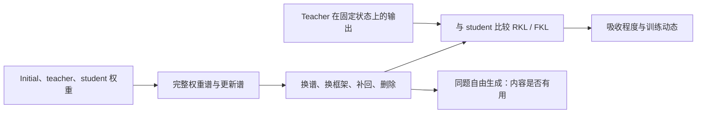

# OPD 到底学到了什么

OPD 在 student 自身访问的状态上学习 teacher 的输出行为，并沿 student 可利用的参数方向实现这些变化。跨 R1-Distill、Qwen、Llama、MiMo 的实验给出三条清晰结果：**函数拟合可以通过不同于 teacher 的参数路径完成；已学行为主要随奇异框架保留；后期吸收差异指向残余请求的函数响应与跨状态传播，SFT/RL 标签和低秩程度都不足以单独预测。**

## 一张图读懂测量关系

权重谱描述参数怎么变化；编辑权重后重测 KL，才能确定这些变化的函数作用。生成正确率再回答被复制的行为是否有用。三类测量各有分工。

## 核心结论

| 判断                                             | 最直接的证据                                                                                                        | 含义                                           |
| ------------------------------------------------ | ------------------------------------------------------------------------------------------------------------------- | ---------------------------------------------- |
| OPD 没有复制 teacher 的完整参数更新              | Llama CoReward-I/GT 的历史 RKL 剩约 2.5%/2.4%，参数残差能量仍为 teacher 增量的 1.384/1.356 倍；Qwen GRPO 也有此现象 | 参数距离不能直接定义分布吸收                   |
| 已学行为主要由奇异框架保留                       | 16 个配对条件恢复 initial 完整权重奇异值，RKL 基本保留；反向恢复 initial 框架，拟合明显变差                         | 完整权重谱变化不是这些行为的主要承载量         |
| 较小更新与较低残差相关，单一谱指标不足以预测结果 | 多家族中较大 teacher 增量伴随较高残差；Samsung SFT 比 GRPO 的部分模块更集中，仍更难拟合；JustRL κ 很高，仍持续下降  | 应研究更新在 student 函数中的作用              |
| 部分遗漏仍能在 endpoint 上起作用                 | Missing off 在 initial-prefix bank 改善 15/16 条件；等范数 Gaussian 与同谱随机框架明显更差                          | 残差并非全部是不可达内容，方向身份具有功能意义 |
| 对 teacher 拟合得更好不等于答题更好              | Qwen SFT 补回 off 后新增 72 题从 39 对降到 23 对，teacher 为 17 对                                                  | KL 衡量吸收，任务成绩衡量被吸收内容的效用      |
| Polaris 平台更符合低效传播，而非全局响应丧失     | 后期仍能拟合当前 batch；updates240 单位剩余 KL 的响应效率，JustRL 为其 4.66 倍；初始请求的响应保持                  | 要定位当前残余请求与 Jacobian 的匹配及实际更新 |

这些判断对应不同协议。主要对照、模型身份、题数、归约和已知缺项在[设置与指标](设置与指标.md)集中说明。

## 阅读顺序

| 文档                                   | 主要内容                                                                            |
| -------------------------------------- | ----------------------------------------------------------------------------------- |
| [设置与指标](设置与指标.md)            | Initial/teacher/endpoint、DAPO 训练与诊断 bank、RKL/FKL、矩阵范围、谱指标与干预公式 |
| [跨模型结果](跨模型结果.md)            | 全部 16 条件的绝对风险、长训练动态、全层谱、ISO 谱交换、missing 与压缩              |
| [机制分析](机制分析.md)                | 方向敏感性、阶段与层深、PAC 和真实传播、任务效用、假设取舍及下一步                  |
| [附录：实验细节](附录-实验细节.md)     | 先导筛查、祖先差、十二项传播实验、局部更新与负结果                                  |
| [附录：定义与复算](附录-定义与复算.md) | 数学推导、历史协议、训练设置纠正、实现、耗时、文献与完整附件                        |

正文聚焦改变判断的实验。探索性筛查与较小面板放附录；逐题数据、图源、审计和来源清单分别归入本目录的 `data/`、`figures/`。重画正文图只需这些附件，不依赖运行目录。

## 当前主假设与实验取舍

主假设是：**OPD 优先累积在 student 上容易产生函数响应、并在训练状态之间形成有效净更新的 teacher 请求；后期留下的请求可能仍有响应，却难以通过同一更新传播到新状态。** teacher 的数据与训练过程通过实际请求和参数方向起作用，训练方法标签只提供背景。

当前最有判别力的工作是把残余请求、真实 rollout 梯度、Adam 位移与下一窗口的 heldout 降幅连接起来。继续扫描更多静态谱指标的优先级低于这一验证。固定谱训练值得作为参数化对照，但必须使用正确 DAPO 数据、对齐原训练预算并匹配函数步长；12 题 calibration pilot 已从正式训练证据中移出。

<!-- Stable anchors for references to consolidated sections. -->

