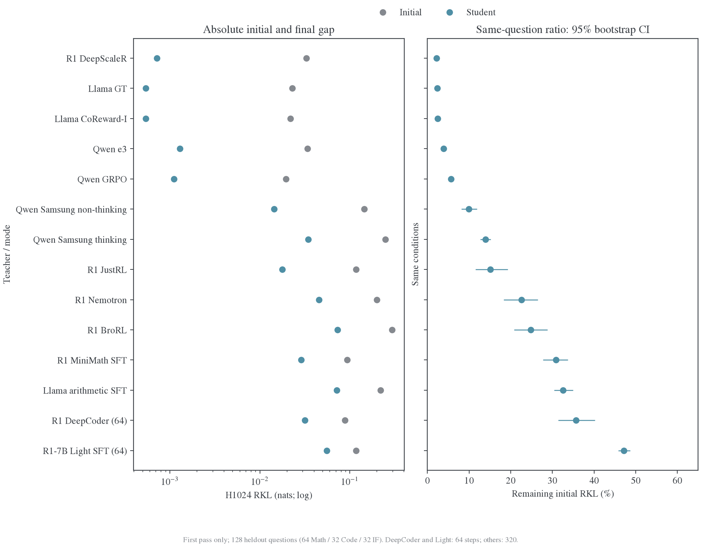

# OPD 吸收：输出差距、训练动态与参数路径

**OPD 可以沿另一条参数路径逼近 teacher 输出。吸收差异需要同时看绝对 RKL、剩余比例与训练动态；teacher 的 RL／SFT 标签、更新低秩和完整权重保谱都不足以单独解释。**

## 现有结果

当前主分类使用本地历史前向的 H1024、Math64／Code32／IF32 共 128 道 heldout，重新读取原始逐题结果，只分析首遍 0–320 步；DeepCoder、Light 仅 64 步。没有新增 GPU 测量，重复训练池的后续阶段已撤出分析。

| 观察分组     | 条件                                                          | 终点绝对 RKL    | 剩余比例    |
| ------------ | ------------------------------------------------------------- | --------------- | ----------- |
| 输出残差很低 | DeepScaleR、Qwen GRPO／e3、Llama CoReward-I／GT               | .000540–.001298 | 2.2%–5.7%   |
| 部分吸收     | JustRL、Samsung 两种模式                                      | .014366–.034588 | 9.9%–15.1%  |
| 剩余比例较高 | MiniMath、BroRL、Nemotron、Llama arithmetic、DeepCoder、Light | .028692–.072881 | 22.6%–47.2% |

MiMo 保留在 16 条件全层参数几何和独立功能面板，不混入 H1024 分类。原 H128 面板每域只有 12 道 heldout，适合大量配对干预，不能独自代表整体吸收；H128 与 H1024 的题目和 bank 也不同。

## 动力学给出的判断

| 测量                        | 结果                                                                                | 当前解释                                   |
| --------------------------- | ----------------------------------------------------------------------------------- | ------------------------------------------ |
| 完整 W frame，16 条件       | Student 右主空间相对 initial 的移动普遍较小，teacher 差异更大                       | 主体权重保留，不代表更新方向固定           |
| 累计更新 frame，九轨迹      | 三来源密集九阶段：step64 k 平均角约 49°，rank128 仍约 45°–46°；历史好吸收 pair 更稳 | 早期空间未固定；当前用离线新增更新捕获验证 |
| 更新谱，16 条件端点及六轨迹 | Student top16 比例均更高；动态可下降，也可先升后降                                  | 相对集中度与绝对幅度分开解释               |
| 参数残差，16 条件           | GRPO／e3 首遍更新幅度超过 teacher，R 约 2.24／2.58，但输出风险只剩 5.7%／3.8%       | 输出吸收可以通过替代参数路径完成           |
| 功能干预与任务生成          | 真实 missing 补回通常降低 KL；Qwen SFT 新 72 题却从 39 对降至 23 对                 | 拟合 teacher 行为与获得任务能力分别测量    |

新增三来源密集轨迹中，step64 右 rank128 只能捕获最后 240→320 步新增 k 更新的 **36%–37%**、v 的 **45%–46%**，只达到这些增量自身最优 rank128 捕获的约 50%–64%。早期方向承载部分后续更新，尚未覆盖完整学习路径。三来源 frame 动态接近，但 initial／teacher-prefix 的 RKL 明显分化；**frame 稳定性不能独立解释吸收好坏**。

“较好吸收伴随更稳定 frame”的直接证据目前集中在两组 Qwen 对比，其中 GRPO/Samsung 直接父模型匹配，e3/Thinking-Space 含父阶段差异；尚无跨 R1、Llama、MiMo 的同窗口复现。逐层与多 rank 核对见[跨模型结果](跨模型结果.md#吸收与稳定性的逐项核对)。

更有依据的机制候选是：**teacher 的残余请求与 student 函数响应、实际更新的匹配，以及训练状态到 heldout 的传播。** 下一轮优先补密集 checkpoint 与真实训练状态，串联角度、位移和固定 bank 的风险下降。

## 阅读与数据

| 文档                                   | 内容                                                                |
| -------------------------------------- | ------------------------------------------------------------------- |
| [设置与指标](设置与指标.md)            | 模型、训练题与 heldout、H 与题数、矩阵对象、归约                    |
| [跨模型结果](跨模型结果.md)            | 完整风险表、阶段角度与增量捕获、frame／spectrum／参数残差及功能对照 |
| [机制分析](机制分析.md)                | 敏感性、对齐、传播、能力效用与下一项实验                            |
| [附录：实验细节](附录-实验细节.md)     | 更多条件、负结果与细分实验                                          |
| [附录：定义与复算](附录-定义与复算.md) | 数学推导、实现、协议与文献                                          |

数据、图片和图源均在本目录：[首遍数据](data/first-pass-20261112/analysis.json)、[逐题记录](data/first-pass-20261112/question-risks.json.gz)、[图源](data/first-pass-20261112/plot_first_pass.py)。新增角度数据和十张图的[复算入口](data/right-frame-20261112/summary.json)、[完整角度与增量](data/right-frame-20261112/measurements.json.gz)、[图源](data/right-frame-20261112/plot_right_dynamics.py)也在本目录。更大统一 H1024 题库和更长序列位置的功能验收仍待测。

<!-- Stable anchors for references to consolidated sections. -->

