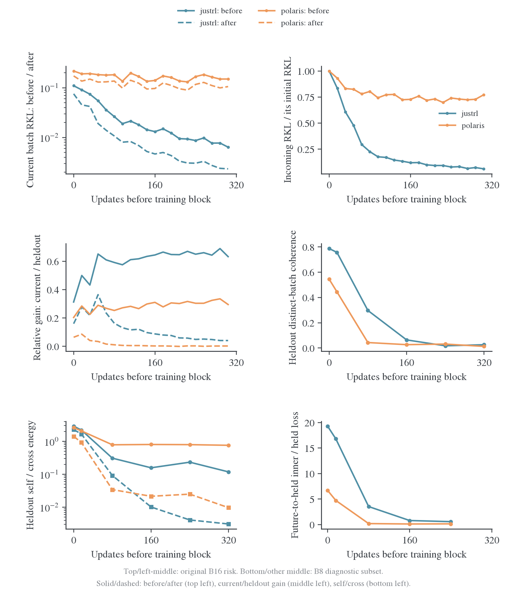
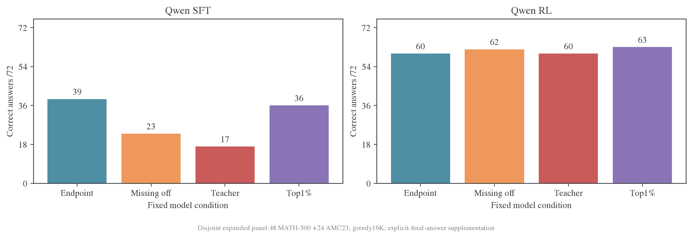

# 机制分析：方向响应、传播与任务效用

[总览](README.md) · [设置与指标](设置与指标.md) · [跨模型结果](跨模型结果.md)

## OPD 在学什么：可响应且能积累的输出请求

我们目前最支持的解释是：OPD 把 teacher 在访问状态上的输出请求，转成 student 可实现的函数变化。它选中了有结构的参数方向，但这些方向和 teacher 的完整更新并不相同。方向是否敏感、沿该方向是否下降、不同状态的信号是否累积、复制行为是否有任务价值，是四个不同的问题。

| 机制问题                | 直接实验                                    | 当前判断                                       |
| ----------------------- | ------------------------------------------- | ---------------------------------------------- |
| 哪些方向容易改变输出    | 等范数 JVP、Gaussian、同谱随机框架          | 已学真实方向在 initial 已有强响应              |
| 有响应的方向能否降低 KL | 精确 RKL/FKL 方向导数、missing 有限补回     | 方向符号随层、状态和阶段改变；幅度还受曲率影响 |
| 训练更新是否传到新状态  | 完整轨迹 PAC、跨 batch Gram、真实 Adam 位移 | Polaris 后期批内学习保持、跨新批传播弱         |
| 拟合改变是否有益        | 同题自由生成、teacher/base、删除与随机控制  | 部分 teacher 行为会破坏 student 已有正确答案   |

权重谱负责描述与选择候选方向，函数读出负责判断这些方向做了什么。这一分工比把“低秩”“保谱”直接解释成学习机制更符合全部结果。在局部线性模型中，学习速度取决于 Jacobian 的奇异值以及 teacher 请求在对应输出方向上的投影；权重更新的 rank 没有给出这两个量。[推导与受限子空间公式](附录-定义与复算.md#局部线性模型与函数像空间)明确区分了这两种谱。

## 敏感性先于 OPD，对齐随训练变化

在相同 prefix 上，对每个选中参数矩阵的单位 Frobenius 范数方向 d 测 $J_Sd$。原深入三组使用 k_proj 0/13/27 层、64 题×3 位置，共 576 行/配对；对比等范数 Gaussian 和三 seed 同谱随机框架。

| 位置                                       |     Qwen GRPO | Qwen Samsung SFT |     R1 JustRL |
| ------------------------------------------ | ------------: | ---------------: | ------------: |
| Initial 上 final-learned 响应能量/Gaussian |     约 249 倍 |        约 550 倍 |     约 236 倍 |
| Endpoint 上 learned 响应能量/Gaussian      |     约 249 倍 |        约 477 倍 |     约 240 倍 |
| 同谱随机框架/Gaussian，initial 各 seed     | 约.76–1.19 倍 |    约.76–1.19 倍 | 约.76–1.19 倍 |

**真实方向的优势来自方向与函数映射的匹配，奇异值本身不足以保留优势。** 这些 final 方向是训练后选定的，结果确定了优势的存在时间；预测下一段实际更新还需用独立状态检验。

SFT 在新生成状态上仍有方向优势，但同一方向的 endpoint/base 响应能量比为 learned .411、off .346、null .315；early64/base 的比值已降至.566/.521/.513。相对 Gaussian 仍强与绝对响应收缩同时成立。相比之下，早期与终点同方向响应比较中，GRPO 更接近 1。该差异值得跟踪，但现有干预尚未证明响应收缩导致任务流失。

### 净方向信号：状态、层深和阶段分别比较

原三组将每个位置、每层沿 missing off 的方向导数记为 a，跨位置和三层聚合后的净保留比为 $|\sum a|/\sum|a|$。数值越小，正负贡献抵消越强：

| 配对      | Train Math | Heldout Math |  Code |    IF |
| --------- | ---------: | -----------: | ----: | ----: |
| Qwen GRPO |      78.7% |        39.6% | 25.3% | 2.39% |
| Qwen SFT  |      57.2% |        12.0% | 7.36% | 1.60% |
| JustRL    |      25.9% |        29.6% | 13.9% | 15.6% |

固定层再聚合，SFT heldout Math 在 layer0/13/27 保留 47.7%/54.4%/59.5%，IF 为 63.3%/14.5%/33.3%。总 IF 的 1.6% 主要包含层间标量符号抵消，不能全归因同层状态冲突。不同层是互不重叠的参数坐标；此处跨层相加的是沿指定组合方向的标量贡献。

全层扩展分别测梯度向量和沿固定方向的标量。令 $g_i$ 为状态位置 i 的梯度，d 为固定组合参数方向：

$$
V=\frac{\|\sum_i g_i\|}{\sum_i\|g_i\|},\qquad
C_d=\frac{|\sum_i\langle g_i,d\rangle|}{\sum_i|\langle g_i,d\rangle|}.
$$

V 衡量向量聚合后的范数保留，$C_d$ 衡量指定方向的符号抵消；二者都在 0–1 之间。下表取 initial bank Math、每域两题首末位置。后文 PAC 的 C 按题梯度平方能量定义，与这里的 $C_d$ 分开。

| 条件/阶段          | 向量一致性 V | 沿 off 标量一致性 $C_d$ |   导数和 | 判断                   |
| ------------------ | -----------: | ----------------------: | -------: | ---------------------- |
| Qwen SFT64         |         .731 |                    .464 | −.040989 | 局部下降               |
| Qwen SFT320        |         .733 |                    .270 | +.003820 | 投影冲突增强且局部上升 |
| Qwen GRPO320       |         .997 |                    .997 | +.000964 | 一致但局部上升         |
| JustRL initial     |         .423 |                    .800 | +.000637 | 局部上升               |
| JustRL80           |         .332 |                   1.000 | −.000567 | 局部下降               |
| JustRL320          |         .759 |                    .999 | −.001656 | 局部下降               |
| Light SFT64        |         .899 |                   1.000 | −.121767 | 一致且局部下降         |
| MiMo SFT→SFT+RL320 |        1.000 |                   1.000 | −.000858 | 一致且局部下降         |

**一致性强不等于朝下降方向；状态冲突也不是所有平台的统一原因。** Qwen GRPO 局部 off 导数为正而β=1 补回改善，MiMo 局部导数为负而β=1 恶化，提示状态覆盖与非线性都需控制。下一项应在完全相同题目和位置做小β有限差分，再测整条β曲线。[全层、模块与阶段数据](data/function-controls/gradients.json.gz)。

## 传播瓶颈：Polaris 仍能学当前 batch，但难以改善新 batch

R1 两条路径从相同 initial 出发，按相同 A–T 数学组训练，每组 16 次更新、共 320 次。真实风险矩阵区分当前批、已见批、未来批和永久 heldout。Polaris 后期当前 batch 继续下降，新批首次更新前风险与 heldout 却维持高位；JustRL 收益持续传到新批。

完整轨迹 PAC 使用固定 S0、H1024、heldout Math96 题。令 P 为 logit 请求能量，A 为单位请求的题梯度能量，C 为题间聚合保留的能量比例。固定目标的欧氏梯度流有：

$$
q=\frac{\|\nabla L\|^2}{L}=\frac PL AC.
$$

| Teacher | Updates | 剩余 KL |   P/L |      A |      C |     q |
| ------- | ------: | ------: | ----: | -----: | -----: | ----: |
| JustRL  |      80 |  .02633 | .3912 | 180.95 | .05908 | 4.182 |
| Polaris |      80 |  .17006 | .4795 |  75.13 | .01588 |  .572 |
| JustRL  |     240 |  .00912 | .3992 | 498.35 | .01280 | 2.545 |
| Polaris |     240 |  .16355 | .4529 |  84.32 | .01432 |  .547 |
| JustRL  |     320 |  .00714 | .3989 | 322.72 | .01381 | 1.778 |
| Polaris |     320 |  .16215 | .4533 |  82.51 | .01194 |  .446 |

Updates240，JustRL/Polaris 的 q 比为 **4.66=0.881×5.91×0.894**。后期 C 已经接近，关键差距落在 A：剩余请求经过当前 Jacobian 后产生的参数响应效率不同。去掉同面板自内积后，共同能量/KL 比仍为 3.18；未来 batch 到独立 heldout 的交叉块也支持传播差异。

这里 q 是固定目标下的局部量，实际 Adam 更新另测。保存的 Adam 位移与 heldout 下降方向 cosine 均值，JustRL/Polaris 为.01746/.00298；其 raw gradient cosine 为.1385/.1196。优化器位移的对齐提供了额外差异，不能只看原始梯度夹角。

### A 的差距在哪里：token 响应更弱，普遍题内负抵消不成立

| Updates240 heldout | 主面板 A | 主面板 token 响应 | 题内聚合 HR_agg | 补充面板 A | 最大单题 U 占比（主/补） |
| ------------------ | -------: | ----------------: | --------------: | ---------: | -----------------------: |
| JustRL             |   498.35 |            361049 |           1.413 |     583.10 |          62.54% / 74.60% |
| Polaris            |    84.32 |             64923 |           1.330 |     106.89 |            6.57% / 8.99% |

主面板 A 比 5.91 主要来自 token 响应比 5.56，题内聚合比仅 1.063。两个独立面板的题内非对角贡献均为正，因此低 A 不能归结为整条轨迹普遍的负向 token 抵消。JustRL 响应呈明显重尾；高均值并非每道题都高。

冻结 initial 请求经过当前 Jacobian 仍保持响应，Polaris 当前请求约 91% 可由 initial 请求的逐位置正缩放解释。**全局 Jacobian 响应塌缩和请求整体大幅旋转都不是当前主解释。** 更值得解释的是剩余请求的幅度重分配与分量间干扰。

### 跨面板分量干扰已经复现，改善更新尚未成功

将请求拆成 initial 平行分量和垂直残差，再展开 train→heldout 传播：

| Updates240 | 主面板净传播/四项绝对和 | 独立补充面板 |
| ---------- | ----------------------: | -----------: |
| JustRL     |                  19.50% |       14.46% |
| Polaris    |                    .96% |        1.17% |

Polaris 两组都只留下约 1% 净传播，支持分量干扰这一结构判断。等位移真实更新中，垂直方向对 Polaris 原 test KL 有小幅改善，但没有稳定优于 native；有限 batch 标量重加权也未改善独立 test。**几何诊断已经定位瓶颈，尚未给出优于原更新的算法。** 十二项传播实验、完整区间和交叉 target 对照保留在[附录](附录-实验细节.md)。MiMo 在 initial 上 SFT 的 C 反而高于 RL-Zero，进一步排除了“所有 SFT 都因低 C 失败”的解释。

## 拟合与任务效用分开：teacher 行为会改变原有正确答案

新增 72 题（MATH48、AMC24）、greedy、16K，显式最终答案补充评分：

| 条件                     | MATH/48 | AMC/24 | 总正确/72 |
| ------------------------ | ------: | -----: | --------: |
| 共同 initial             |      44 |     21 |        65 |
| Samsung SFT 路径 step64  |      32 |     11 |        43 |
| Samsung SFT 路径 step320 |      31 |      8 |        39 |
| SFT320 + missing off     |      18 |      5 |        23 |
| SFT teacher              |      15 |      2 |        17 |
| SFT top1%                |      28 |      8 |        36 |
| Qwen RL 路径 step64      |      42 |     19 |        61 |
| RL 路径 step320          |      43 |     17 |        60 |
| RL320 + missing off      |      44 |     18 |        62 |
| RL teacher               |      43 |     17 |        60 |
| RL top1%                 |      44 |     19 |        63 |

SFT 补回 off 后少 16 题，丢失 19 道 student 独有成功、只恢复 1 道 teacher 独有成功；Math 配对差 95% 区间[−43.75,−10.42]个百分点。在同一推理协议下，该 teacher 本身较弱，朝 teacher 靠近会改变原有正确行为。RL 多 2 题的区间跨零。

原 grader 漏掉末行`#### 答案`，补充评分修复部分漏判；SFT off 原 16/72 修正为 23/72，teacher14/72 修正为 17/72。追加 boxed 指令仍未恢复多数差距，延长 cap 的同轨迹比较也未救回 SFT off。格式、截断和算术错误的逐题例子见附录。KL 仍然是吸收的主要指标，准确率则揭示被吸收内容是否值得复制。

### 删除反例：已学 off 并非总是有益内容

Own-update off 删除与 missing 补回作用于不同矩阵。逐矩阵等范数 Gaussian、一个 seed 的 72 题对照为：

| 目标        | 未编辑 | 实际 off 删除 | Gaussian |
| ----------- | -----: | ------------: | -------: |
| SFT teacher |     17 |            22 |       19 |
| SFT student |     39 |            45 |       36 |
| RL teacher  |     60 |            59 |       60 |
| RL student  |     60 |            63 |       57 |

SFT student 删除比 Gaussian 多 9 题，配对区间 +1.39 至 +23.61 个百分点；比未编辑多 6 题，区间−4.17 至 +19.44。删除结果推翻了“已学 off 全部有益”的预测。下一步用独立题目和多个随机 seed 检验收益是否来自特定方向，再决定是否发展为任务增强方法。[配对数据](data/teacher-spectrum-20261110/delete-gaussian-paired-009.json)。

## 已排除、仍支持和下一步

| 假设                                   | 判断         | 依据                                                   |
| -------------------------------------- | ------------ | ------------------------------------------------------ |
| SFT 天然难吸收、RL 天然容易            | 否定统一解释 | 同标签内部差异大，MiniMath 可低于 BroRL 残差           |
| 权重谱越集中，OPD 必然越容易           | 否定单调关系 | Samsung 比 GRPO 部分模块更集中、残差更高               |
| SFT 平台主要是完整奇异值学不动         | 当前结果反对 | 恢复 base 谱后 SFT 残余 RKL 基本不变                   |
| 早期形成子空间后完全锁死               | 反对         | 晚期增量进入新方向、全层 top16 下降                    |
| 未吸收变化在 student 上完全无效        | 反对         | 跨家族真实 missing 补回降低 KL                         |
| 残余请求的响应与跨状态传播决定后期速度 | 当前主假设   | PAC、真实风险矩阵、分量干扰和实际 Adam 对齐            |
| 已经测出了不可约风险下界               | 未建立       | 有限状态/局部方向及 32/72 题功能读出不足以给出全局下界 |

后续按判别力安排：

1. **真实训练更新验证。** Qwen SFT/GRPO与R1 JustRL/Polaris，在平台前后取真实DAPO rollout，固定题目与归约，测残余请求、分模块投影梯度、Adam 位移和下一 64 步 heldout 下降。先在完全相同位置做导数/有限差分验收。该实验直接检验主假设。
2. **尺度与谱形状解耦。** 完成现有离线控制，检验 JustRL 的大谱漂移是否主要是函数影响较小的统一尺度；保留 SFT 作为反例，不按κ预设答案。
3. **正确设置的短训练。** 生产 full-vocab KL 已接入，先解决 frame 回缩占 98.6% 时间的瓶颈，再以 DAPO、原 batch/reuse/长度设置运行少量参数化对照。calibration 匹配初始函数位移，heldout 固定报告；不延续 12 题 pilot 的配方结论。
4. **有益内容复核。** 对 SFT 删除在独立题集和多个随机 seed 复测，核对 teacher 原生模板与停止协议。若方向特异性保持，再定位模块；若收益消失，结束算法化扩展。

新 teacher 预测应冻结候选特征、以 teacher/家族为留出单位。参数谱用于匹配幅度和选择对照，最终检验目标是绝对 RKL 动态与实际函数收益。

<!-- Stable anchors for references to consolidated sections. -->

