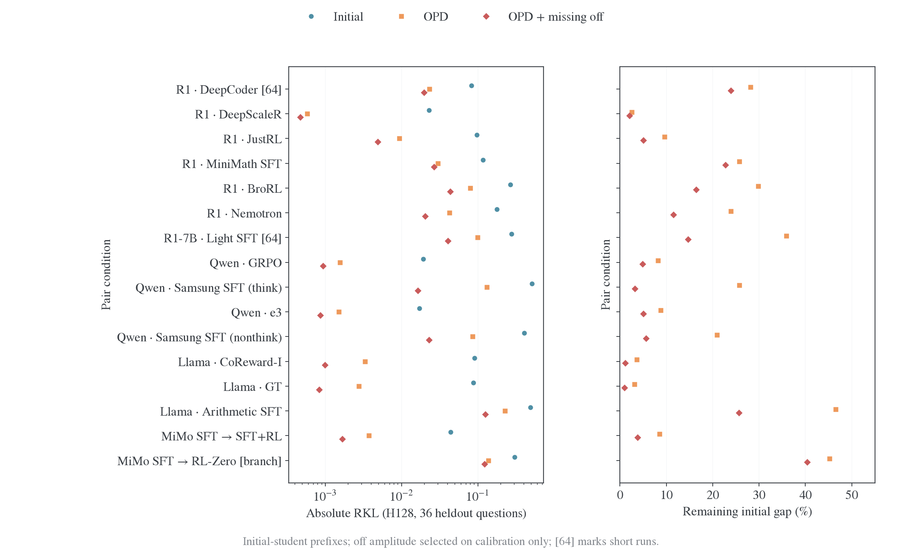
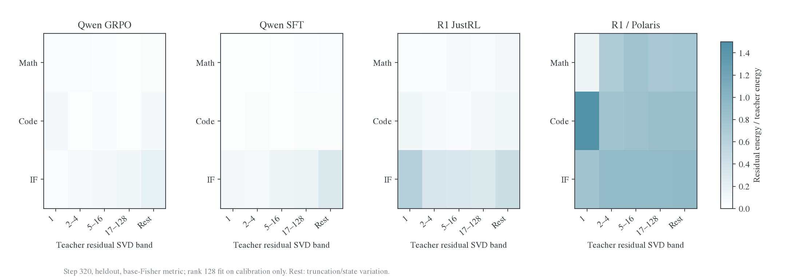
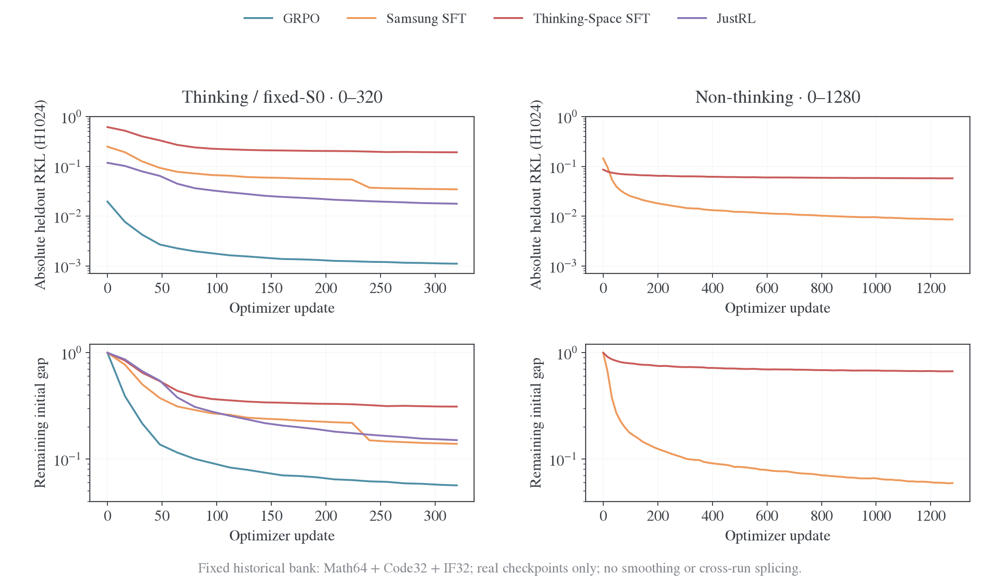
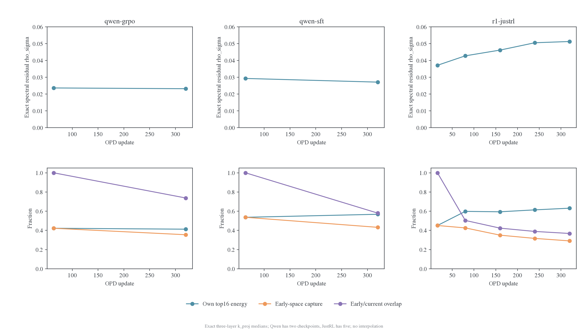
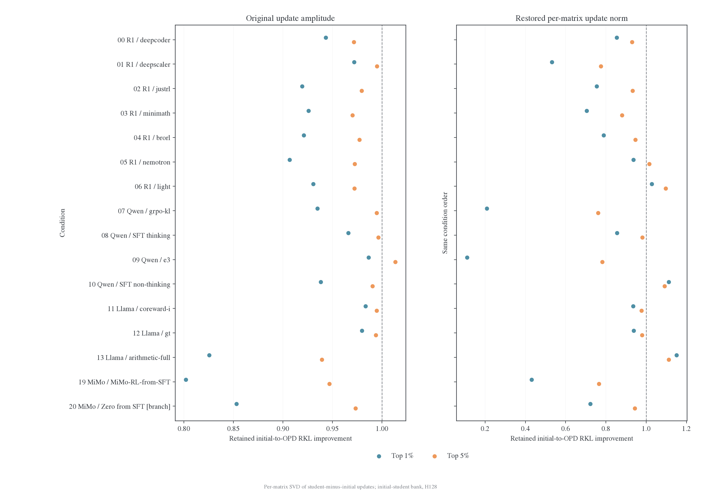

# 跨模型结果：吸收动态、参数几何与功能干预

[总览](README.md) · [设置与指标](设置与指标.md) · [机制分析](机制分析.md)

## 全部 16 条件：绝对残差和吸收比例要一起看

下表统一使用 **initial-student prefix、Math/Code/IF 各 12 道 heldout 题、固定 H128 全词表 RKL**。每条配对比较相同题目及位置；off/null 幅度仅由 calibration 选择。DeepCoder 和 Light 只训 64 步，其余 320 步。该表覆盖全部可执行功能条件，MiMo 缺失导出另在设置中列出。

| 条件                          | Step | Initial RKL |  OPD RKL | 剩余比例 | 补回 off 后 | 补回 null 后 |
| ----------------------------- | ---: | ----------: | -------: | -------: | ----------: | -----------: |
| R1 DeepCoder                  |   64 |    0.082545 | 0.023245 |    28.2% |    0.019712 |     0.008054 |
| R1 DeepScaleR                 |  320 |    0.023055 | 0.000584 |     2.5% |    0.000471 |     0.000440 |
| R1 JustRL                     |  320 |    0.096930 | 0.009332 |     9.6% |    0.004915 |     0.003176 |
| R1 MiniMath SFT               |  320 |    0.116888 | 0.030099 |    25.7% |    0.026609 |     0.019432 |
| R1 BroRL                      |  320 |    0.265671 | 0.079307 |    29.9% |    0.043724 |     0.014280 |
| R1 Nemotron                   |  320 |    0.177527 | 0.042392 |    23.9% |    0.020452 |     0.007087 |
| R1-7B Light SFT               |   64 |    0.278275 | 0.099824 |    35.9% |    0.040803 |     0.026644 |
| Qwen GRPO                     |  320 |    0.019240 | 0.001572 |     8.2% |    0.000938 |     0.000946 |
| Qwen Samsung SFT thinking     |  320 |    0.512825 | 0.131954 |    25.7% |    0.016462 |     0.014359 |
| Qwen e3                       |  320 |    0.017175 | 0.001514 |     8.8% |    0.000859 |     0.000868 |
| Qwen Samsung SFT non-thinking |  320 |    0.407708 | 0.085448 |    21.0% |    0.022884 |     0.020103 |
| Llama CoReward-I              |  320 |    0.090800 | 0.003321 |     3.7% |    0.000992 |     0.001629 |
| Llama GT                      |  320 |    0.087952 | 0.002772 |     3.2% |    0.000834 |     0.001152 |
| Llama arithmetic SFT          |  320 |    0.489622 | 0.227837 |    46.5% |    0.125531 |     0.133425 |
| MiMo SFT→SFT+RL               |  320 |    0.043986 | 0.003761 |     8.6% |    0.001679 |     0.001749 |
| MiMo SFT→RL-Zero（分支）      |  320 |    0.304853 | 0.137824 |    45.2% |    0.123080 |     0.124380 |

左图同时放 initial、OPD 和 off 补回后的绝对风险；右图显示剩余初始差距。同一行的对比有明确意义；不同家族的状态 bank 来自各自模型，不把跨行绝对值当作统一任务难度排名。[逐行数据](data/synthesis/model-absorption.csv)。

**同源 RL 条件中确实出现了深度吸收，但 RL 和 SFT 没有统一分界。** DeepScaleR 剩约 2.5%，Qwen GRPO 约 8.2%；R1 BroRL 仍剩 29.9%，高于 MiniMath SFT 的 25.7%。Samsung 两种模式剩约 25.7%/21.0%；Llama arithmetic 剩 46.5%。同家族差异足够大，需要解释具体 teacher 更新与输出请求。

Qwen Samsung thinking 的初始 RKL 约为 GRPO 的 26.7 倍，endpoint 差距扩大为约 84 倍。初始距离解释了一部分难度，但单位初始差距的吸收也不同。MiMo 分支剩 45.2%，连续 SFT→SFT+RL 剩 8.6%，实际起点和训练增量决定比较对象。

## 深入 H1024 面板：跨尺寸与跨域残差

该原生全词表面板使用各配对自己的固定 bank 与 H1024，题数和新 H128 总表不同。两个面板各自比较同题前后变化，数值分别解释。定义剩余比例 $r_t=L(p_t,q_T)/L(p_0,q_T)$。最终结果如下，区间是题目配对 bootstrap。

| 配对         | Heldout 题数 | Base KL | Step320 KL | 剩余比例 | 95% 区间     |
| ------------ | -----------: | ------: | ---------: | -------: | ------------ |
| Qwen GRPO    |           80 | .019958 |    .001081 |    5.42% | 4.83–6.10%   |
| Qwen SFT     |           80 | .248452 |    .033097 |   13.32% | 11.98–14.81% |
| R1 JustRL    |          160 | .113325 |    .013489 |   11.90% | 10.16–14.03% |
| R1 / Polaris |          160 | .327046 |    .273882 |   83.74% | 81.84–85.40% |

Polaris 的 train KL 从 .213637 降到 .096879，heldout 从 .327046 降到 .273882，分布内拟合和跨状态迁移明显分离。同源 teacher 也存在域差异：native Math 剩余比例依次为 4.27%、10.22%、6.20%、74.46%，IF 为 10.99%、26.67%、40.94%、92.16%。

### 输出谱的覆盖：主方向吸收不等于整体覆盖

输出谱使用固定 base-Fisher 度量，表示剩余输出变化能量相对 teacher 变化能量的比例。它与上表 native KL 是不同读出，二者都指出 IF 更难匹配，Polaris 的大残差跨域存在。

Rank128 框架在 heldout 捕获的 teacher 变化能量约为 GRPO 54.8%、SFT 45.3%、JustRL 48.2%，在 calibration 则为 94.3%、88.6%、74.0%；同 rank 随机框架约为 .08%。三 seed 随机 SVD 的 heldout 捕获极差小于 .11 个百分点。teacher 输出变化具有稳定结构，但同一个小框架对新状态的覆盖明显降低。

Polaris 的 top1 方向在早期 rank64 诊断中吸收系数约 .667，剩余能量比 .138，却只占 teacher heldout 能量的 1.29%；框架外 complement 占 77.05%，剩余比 .867。学会最强方向，与覆盖主要变化，并不是同一件事。

度量也会改变重点：GRPO/SFT/JustRL 的 centered-logit 剩余能量比分别约 9.48%/16.34%/44.53%，base-Fisher 下为 6.02%/9.69%/13.43%。JustRL 在低 base 概率区域仍有较大变化，需进一步给这些变化做行为标注。

数据：[最终逐题、域、band 与阶段汇总](data/teacher-spectrum-20261110/final-scientific-data-010.json)。

## 长训练：部分 SFT 是真平台，部分仍持续下降

以下使用另一套**历史 H1024 完整面板，Math64/Code32/IF32，共 128 题**。固定 bank 与 checkpoint 完整对应，与前面的 16 条件 H128 总表分别报告。

| 原始路径                        |   Step0 |  Step64 | Step320 | Step640 | Step1280 |
| ------------------------------- | ------: | ------: | ------: | ------: | -------: |
| Qwen GRPO-KL thinking           | .019611 | .002257 | .001109 |       — |        — |
| Samsung SFT thinking            | .248817 | .077738 | .034588 |       — |        — |
| Thinking-Space SFT thinking     | .616008 | .270061 | .191977 |       — |        — |
| JustRL fixed-S0                 | .117835 | .044780 | .017768 |       — |        — |
| Samsung SFT non-thinking        | .144801 | .032766 | .014366 | .011134 |  .008607 |
| Thinking-Space SFT non-thinking | .085970 | .070152 | .063103 | .059917 |  .057597 |

**Thinking-Space 后期更接近留出平台；Samsung 更符合持续改善但速度下降。** 640→1280，Samsung 训练池下降 63.88%、heldout 下降 22.69%；Thinking-Space 训练池下降 48.66%、heldout 仅下降 3.87%。最后 1216→1280，Thinking-Space heldout 从.057696 到.057597，配对差 95% 区间[−.000245,.000035]覆盖零；训练池仍下降 3.72%。

在 256→320 相同 64 步窗口，Thinking-Space、Samsung、JustRL、GRPO 的 heldout 相对下降分别为 1.04%、5.09%、8.51%、7.34%；绝对下降分别为.002010、.001855、.001652、.000088。越接近 teacher，绝对下降可以很小而相对下降仍明显，因此两列都保留。[曲线](data/synthesis/learning-dynamics.csv)与[窗口配对统计](data/teacher-spectrum-20261110/report-clean-v1/historical-windows.csv)可复算。

JustRL 独立 E35 在线长训中，新批首次更新前 RKL 从 outer101–125 的.001214 降至 201–225 的.000830、226–250 的.000803，低风险保持并继续改善。这是不断变化的 online 状态，单独作为长训传播证据。MiMo-SFT 的 initial-prefix 风险 1.967694→.408868，teacher-prefix .463225→.337572，后者 160→320 仅降 1.56%；prefix 来源本身影响观察到的难度。

## 全层谱：集中度、尺度和方向必须拆开

全 16 条件精确扫描覆盖全部七类投影。下表的δΣ、ρΣ、κ和 top16 为**逐矩阵中位数**；绝对范数是全层平方范数之和开根号。top16 分解对象为 teacher/student 相对 initial 的**增量矩阵**。绝对范数不能直接跨尺寸比较。

| 条件                          | teacher 更新绝对范数 | teacher δΣ | teacher ρΣ | teacher κ | teacher / student top16 能量 |
| ----------------------------- | -------------------: | ---------: | ---------: | --------: | ---------------------------: |
| R1 DeepCoder                  |                2.498 |    3.6e-05 |     0.0256 |      1.31 |                32.5% / 54.7% |
| R1 DeepScaleR                 |                1.784 |    2.5e-05 |     0.0257 |      1.36 |                33.5% / 49.1% |
| R1 JustRL                     |                6.599 |    0.00204 |     0.4517 |    386.12 |                26.9% / 46.5% |
| R1 MiniMath SFT               |               39.489 |   0.000387 |     0.0222 |      1.44 |                 7.0% / 43.7% |
| R1 BroRL                      |                7.877 |   0.000106 |     0.0253 |      1.22 |                23.5% / 52.7% |
| R1 Nemotron                   |                6.541 |   8.35e-05 |     0.0249 |      1.16 |                17.5% / 49.6% |
| R1-7B Light SFT               |               23.744 |   0.000474 |     0.0427 |     16.40 |                11.5% / 29.6% |
| Qwen GRPO                     |                0.703 |   1.15e-05 |     0.0216 |      1.01 |                15.1% / 33.4% |
| Qwen Samsung SFT thinking     |                9.698 |   0.000158 |     0.0214 |      1.06 |                27.2% / 39.3% |
| Qwen e3                       |                0.666 |   1.06e-05 |     0.0215 |      1.01 |                19.0% / 35.5% |
| Qwen Samsung SFT non-thinking |                9.698 |   0.000158 |     0.0214 |      1.06 |                27.2% / 46.3% |
| Llama CoReward-I              |                1.155 |   1.46e-05 |     0.0178 |      1.03 |                17.5% / 43.2% |
| Llama GT                      |                1.212 |   1.52e-05 |     0.0177 |      1.03 |                16.1% / 41.8% |
| Llama arithmetic SFT          |               49.687 |   0.000941 |     0.0210 |      2.00 |                 9.8% / 33.0% |
| MiMo SFT→SFT+RL               |                4.145 |   0.000237 |     0.0675 |     20.47 |                11.1% / 21.4% |
| MiMo SFT→RL-Zero（分支）      |              236.325 |     0.0112 |     0.0589 |    173.46 |                 2.9% / 21.4% |

**16/16 条件的 student 更新 top16 能量高于 teacher。** 这是逐矩阵集中度的结果；后面的截断实验进一步检验可压缩性。集中度不能单独预测吸收难度。Qwen Samsung 的 teacher top16 高于 GRPO，endpoint 残差却高得多。JustRL teacher κ约 386，仍能持续吸收；Samsung κ约 1.06，与 GRPO 约 1.01 接近。κ能识别更新的坐标几何，不能单独识别训练方法或可学习性。

全层幅度也有一致线索：R1 MiniMath、Llama arithmetic、MiMo Base→SFT 的 teacher 更新分别约为 initial 范数的 2.736%、4.847%、19.636%；对应同源 RL 往往小得多。历史 11teacher 留出预测中，在初始 KL 与家族基础上加入中层五模块 rank16 特征，ln-RKL RMSE 从.772 降到.447；57 项探索指标的组内置换 BH 校正均未达到 q<.05。**集中度提供预测线索，但还没有前瞻验证的单指标。** 完整筛查及共同祖先分析见[附录实验](附录-实验细节.md)。

### 后期方向仍在进入，早期没有完全锁死

原三组全层同 196 矩阵的 early→endpoint top16 中位数为 GRPO37.11%→33.38%、SFT48.68%→39.32%、JustRL51.22%→46.66%。同一阶段三层 k_proj 的局部集中度可以上升，全层总体却下降。范围差异解释了先导结果与全层结果的不同。

JustRL 三层 k_proj 从 step16 到 320，最早右 top16 捕获后续更新能量从 45.1% 降到 29.1%，最早/当前子空间重叠降到.368；最后 240→320 增量被最早 top16 仅捕获 11.94%。Qwen GRPO/SFT的64→320最早/当前重叠为.738/.580。**训练后期继续采用新方向，集中更新和子空间移动同时发生。**

### 拟合 teacher 输出并不要求靠近 teacher 参数

Llama CoReward-I/GT在历史原协议的功能RKL剩约2.5%/2.4%，全层参数残差能量却为teacher更新的1.384/1.356倍，更新cosine只有.176/.174。Qwen GRPO/e3的参数残差为2.244/2.584倍，GRPO在early→endpoint参数更远而KL继续下降。参数轨迹存在替代解。

## ISO 谱交换：16 条件均指向奇异框架

对完整权重做两个互补编辑：$U_1\Sigma_0V_1^\top$ 保留 endpoint 框架、恢复 initial 谱；$U_0\Sigma_1V_0^\top$ 保留 endpoint 谱、恢复 initial 框架。七投影以外参数保持 endpoint。**以下仅取 initial-prefix 的 heldout Math12 题、H128**，以同题未编辑 endpoint 为 1。

左图放大 0.88–1.12 范围，看换谱后的微小变化；右图用对数轴展示换框架后的倍数损害。虚线都是未编辑风险 1，两个面板的刻度不同。[16 条件精确表](data/synthesis/spectrum-versus-frames.csv)。

| 条件             | Endpoint RKL | 恢复 base 谱 | 恢复 base 框架 |
| ---------------- | -----------: | -----------: | -------------: |
| JustRL           |      .003804 |      .003785 |        .078141 |
| Qwen GRPO        |      .001602 |      .001735 |        .017147 |
| Qwen Samsung SFT |      .122876 |      .122926 |        .481885 |
| Llama CoReward-I |      .001907 |      .001950 |        .221394 |
| MiMo SFT→SFT+RL  |      .002253 |      .002257 |        .040841 |
| MiMo SFT→RL-Zero |      .059880 |      .059830 |        .181128 |

**已学输出主要随奇异框架保留。Qwen SFT 平台的主要残差并不由完整奇异值漂移造成。** 这是在完整参数上编辑后测函数得到的结论，比“ρΣ小所以保谱”更直接。它不要求 teacher 自己的参数变化也能由小的固定谱位移解释。

四类 rank-r 重构也支持框架移动。r=floor(.9q) 时，只在旧双侧 span 内混合留下约 81%–87% 的参数变化范数；允许双侧框架移动、固定旧谱，Qwen GRPO/SFT和Llama CoReward 留下的中位数仅.0174/.0189/.0152。JustRL 为.398，明显较大，但其换谱后的函数风险仍几乎不变。**参数几何误差与输出误差并不成正比。**

JustRL 径向更新能量中位数 20.53%；对奇异值拟合最佳统一缩放后，残余谱距离只剩原漂移的 4.70%。这是尺度变化的重要线索；尺度与归一化谱形状的独立功能控制随完成项进入附录，未完成项不计入机制结论。

## Missing 补回与截断：方向身份比能量分配更关键

全 16 条件，β=1 的 missing off 在 initial bank 改善 15/16、teacher bank 改善 16/16；null 均为 14/16。初始 bank 各域、两个随机族、各三 seed 形成 288 个相关 RKL 比较，真实 off 优于随机 279 个，其中 275 个题目配对区间完全为正；null 对应 287/282。随机控制匹配范数，同谱框架还保留奇异值，收益不能只由幅度或谱形状解释。

原 H1024 深入面板，calibration 选择的 off 消除 GRPO/SFT/JustRL endpoint 残余 KL 分别为 37.94%/57.34%/10.08%，null 为 31.61%/64.14%/17.25%。MiMo 分支β=1 却恶化，calibration 选择β=.5 后改善，表明真实遗漏方向有效与完整幅度有效是两回事。

Student 更新逐矩阵保留 top5%、原幅度时，14/16 条件保留至少 95% 的 initial→endpoint KL 改善。Qwen Samsung thinking 与 GRPO 分别保留 99.64%/99.47%，终点风险却为.131954/.001572。**可压缩性没有解释二者的学习差距。** 恢复每矩阵更新范数反而破坏结果，例如 DeepScaleR 保留率从约 99.5% 降至 77.5%。

[全部功能评分与配对区间](data/function-controls/paired.json.gz)、[逐题风险](data/function-controls/question-risks.json.gz)与[ISO 完整聚合](data/iso-20261111/summary.json.gz)保留正文未列的域、prefix 和固定条件。

<!-- Stable anchors for references to consolidated sections. -->

