# 跨模型结果：输出吸收、子空间、谱与参数路径

[总览](README.md) · [设置与指标](设置与指标.md) · [机制分析](机制分析.md)

## 长 bank 统一复训：实时读出

E94–E111 使用同一新协议：DAPO Math batch64、current rollout、reuse16、40 outer，单 seed42；Math128／Code64／IF64 的 initial／teacher 双固定 bank 均重新生成，response cap7168，每个 outer 计算全部有效 response token 的全词表 RKL。每域先做逐题 token 均值，`all` 再对三个域等权平均。训练设置见[设置与指标](设置与指标.md#本轮-18-组e94e111)。

下图随已完成读出自动更新，是训练中的曲线；图中只显示已经开始的 pair，各曲线保留自身实际结束位置。E94 对应 R1-1.5B→DeepScaleR，E95 对应 R1-1.5B→JustRL。双 bank 的 prefix 来源不同，均计算反向 KL；teacher-prefix 不表示改成 FKL。新协议与下文历史 H1024 的题数、长度、预算均不同，分别报告。

E94–E102 已完成预定 outer40（每组 640 次更新）。下面报告固定终点，不按 heldout 最低值选择 checkpoint。九组的 outer0–40 各有 41 次完整读出，每次双 bank 共 512 条有效记录；每组九个预定 FP32 导出均通过 native 重载 gate。该 gate 比较四条 initial-bank 参考上的 RKL，误差均为零；独立 Hugging Face 前向重载尚未测。逐题原始和终点汇总见[终点数据](data/long-bank-20261112/endpoint-summary-nine.json)。

| Pair                                 | Prefix bank | 初始 RKL | outer40 RKL | 剩余比例 | Math 终点 | Code 终点 |  IF 终点 |
| ------------------------------------ | ----------- | -------: | ----------: | -------: | --------: | --------: | -------: |
| E94：R1-1.5B → DeepScaleR            | initial     | 0.031559 |    0.000485 |    1.54% |  0.000257 |  0.000317 | 0.000879 |
| E94：R1-1.5B → DeepScaleR            | teacher     | 0.029294 |    0.000465 |    1.59% |  0.000221 |  0.000291 | 0.000884 |
| E95：R1-1.5B → JustRL                | initial     | 0.140498 |    0.036147 |   25.73% |  0.002111 |  0.005379 | 0.100952 |
| E95：R1-1.5B → JustRL                | teacher     | 0.188188 |    0.083373 |   44.30% |  0.001851 |  0.004566 | 0.243702 |
| E96：R1-1.5B → MiniMath              | initial     | 0.106977 |    0.026982 |   25.22% |  0.006378 |  0.010934 | 0.063636 |
| E96：R1-1.5B → MiniMath              | teacher     | 0.143652 |    0.030234 |   21.05% |  0.008202 |  0.011333 | 0.071166 |
| E97：R1-1.5B → Nemotron v1           | initial     | 0.282231 |    0.062280 |   22.07% |  0.003560 |  0.037996 | 0.145283 |
| E97：R1-1.5B → Nemotron v1           | teacher     | 0.220142 |    0.052348 |   23.78% |  0.001784 |  0.056659 | 0.098600 |
| E98：R1-1.5B → Nemotron BroRL        | initial     | 0.342910 |    0.091095 |   26.57% |  0.004788 |  0.050969 | 0.217527 |
| E98：R1-1.5B → Nemotron BroRL        | teacher     | 0.319461 |    0.121539 |   38.05% |  0.004688 |  0.067555 | 0.292374 |
| E99：Qwen3-1.7B → GRPO-KL            | initial     | 0.024022 |    0.000629 |    2.62% |  0.000332 |  0.000551 | 0.001005 |
| E99：Qwen3-1.7B → GRPO-KL            | teacher     | 0.028487 |    0.000675 |    2.37% |  0.000342 |  0.000611 | 0.001071 |
| E100：Qwen3-1.7B → e3                | initial     | 0.041702 |    0.000958 |    2.30% |  0.000337 |  0.000754 | 0.001783 |
| E100：Qwen3-1.7B → e3                | teacher     | 0.036365 |    0.000863 |    2.37% |  0.000343 |  0.000698 | 0.001549 |
| E101：Qwen3-1.7B → Qwen3-Math        | initial     | 0.208970 |    0.017931 |    8.58% |  0.017099 |  0.011986 | 0.024709 |
| E101：Qwen3-1.7B → Qwen3-Math        | teacher     | 0.576422 |    0.042121 |    7.31% |  0.009104 |  0.031871 | 0.085389 |
| E102：Qwen3-1.7B → Qwen3-4B-Instruct | initial     | 0.933446 |    0.846753 |   90.71% |  0.252773 |  0.896765 | 1.390720 |
| E102：Qwen3-1.7B → Qwen3-4B-Instruct | teacher     | 0.947179 |    0.990329 |  104.56% |  0.274474 |  1.356494 | 1.340019 |

**长 bank 下，已完成九组的剩余差异主要表现为域间差异。** DeepScaleR 在三个域、两种 prefix 上均达到低绝对残差。JustRL 的 Math、Code 在两种 bank 上均只剩初始 RKL 的约 2% 和 4.6%，但 IF 分别仍剩 52.2% 和 65.2%；在 E95 中，IF 占终点三域等权总残差的 93.1% 和 97.4%。MiniMath 与 Nemotron v1 的两种 bank 总 RKL 剩余约 21%–25%，IF 也分别是各自三域中绝对值最大的终点残差。因此，JustRL 在此预算下的总体残差主要来自 IF，不能用数学域吸收良好概括全部域，也不能仅凭总体剩余比例推断训练停止改善。teacher-prefix IF 残差更高，表示 prefix 分布会改变差距的读出；其原因还需结合行为和后续 frame 测量分析。本轮未测 acc，上述数值描述输出分布拟合，不据此宣称任务能力恢复。

Qwen3-1.7B→Qwen3-Math（E101）的总体剩余比例为 8.58%／7.31%，但 Math 终点为 0.01710／0.00910，高于 JustRL。按总体残差与按 Math 残差得到的排序因此不同。吸收分组应同时保留域指标与绝对残差，不能用一个总体比例替代所有任务域。

Qwen3-1.7B→Qwen3-4B-Instruct（E102）是这九组中最明确的困难对照：initial-bank 总 RKL 仍为 0.84675，保留 90.71%；teacher-bank 总 RKL 为 0.99033，升至初始的 104.56%。两个 bank 的 Math 终点也仍有 0.25277／0.27447，差距并非只来自 IF。它适合与 E99/E100 的低残差路径比较 student 自身的 frame 动态；teacher 尺寸不同，参数残差与 teacher frame 不做同坐标比较。

Nemotron BroRL 在相同预算下也留下明显的域间差异：Math 的绝对残差约 0.005，Code 约 0.05–0.07，IF 约 0.22–0.29；两种 bank 的总体剩余比例仍高于 v1。v1 与 BroRL 是不同 RL 路径的 teacher 对照，这组结果支持把 teacher 的来源路径和域覆盖单独分析，不能将所有 RL teacher 归为一种吸收行为。

Qwen3-1.7B→e3（E100）提供了另一个家族的低残差例子：两种 bank 总 RKL 分别为 0.000958、0.000863，只剩初始的 2.30%、2.37%，Math／Code／IF 三域均下降。IF 终点约 0.0015–0.0018，仍高于 Math，但没有出现 R1→JustRL、MiniMath、Nemotron 对照中 0.06 以上的 IF 绝对残差。Qwen3-1.7B→GRPO-KL（E99）的双 bank 总 RKL 为 0.000629／0.000675，剩余 2.62%／2.37%；Math、Code、IF 三域的绝对残差均不超过 0.0011。低残差拟合已在 R1→DeepScaleR、Qwen→GRPO-KL 和 Qwen→e3 三组出现，覆盖两个 student 家族。这三组同时具备低绝对残差与低相对残差。

后半程仍有改善，但不同域的下降速度不同。outer20→40，DeepScaleR 的双 bank 总 RKL 再下降 27.5%／26.3%；JustRL 再下降 13.6%／13.0%。JustRL 的 Math 在后半程再下降约 48%／47%，Code 约 31%／30%，IF 约 11%／12%。因此，在 640 次更新处观察到的是 IF 残差较高且改善较慢，不能把这条曲线描述成后期完全停止学习。这里的百分比以 outer20 为分母，完整逐 outer 数值见下方曲线数据。

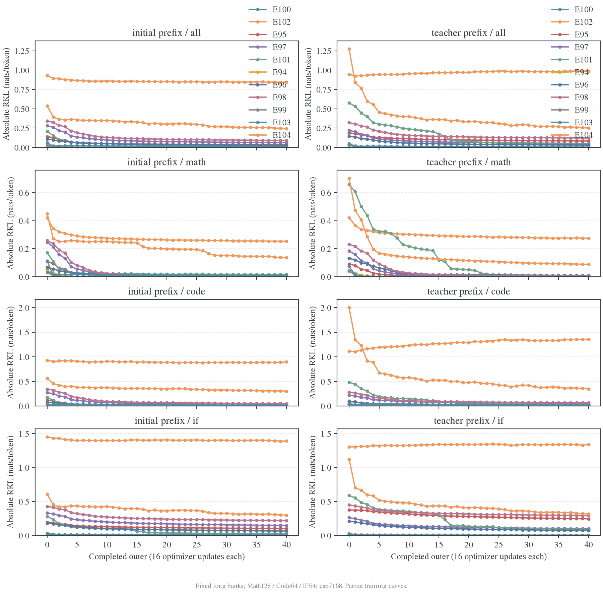

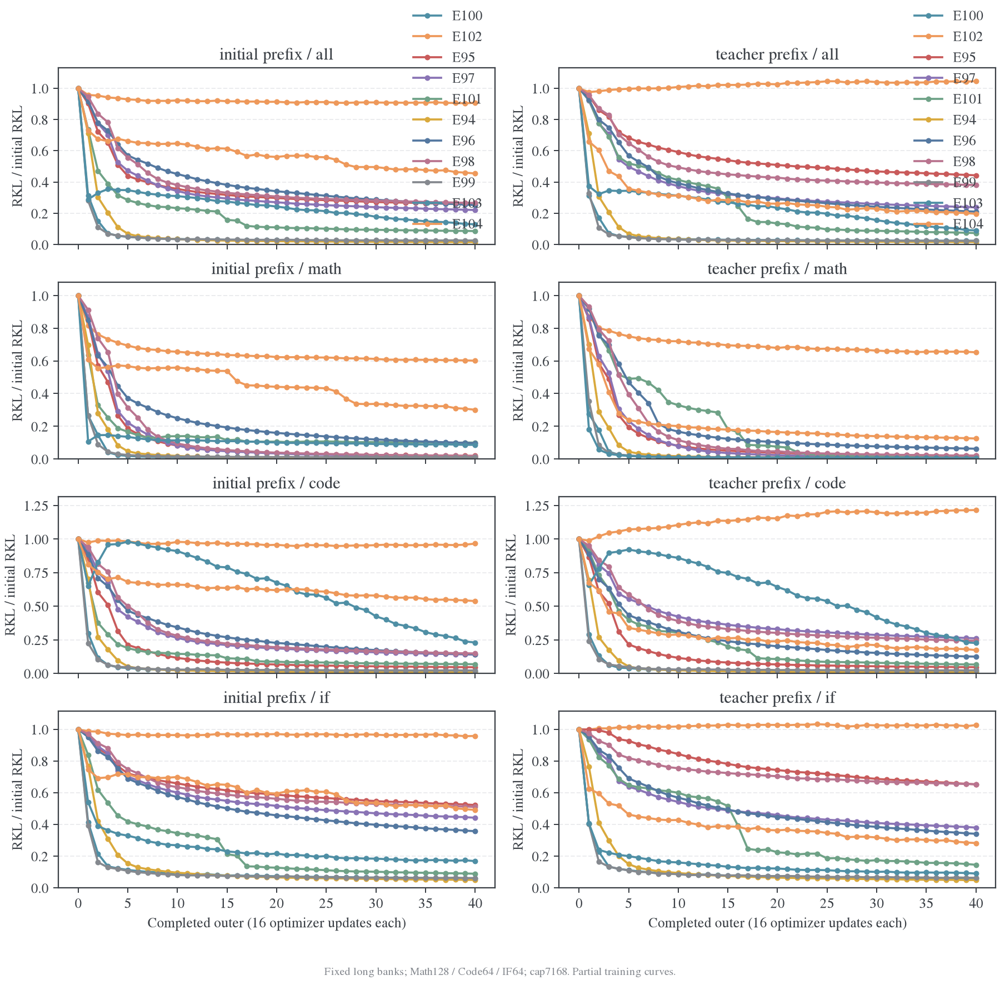

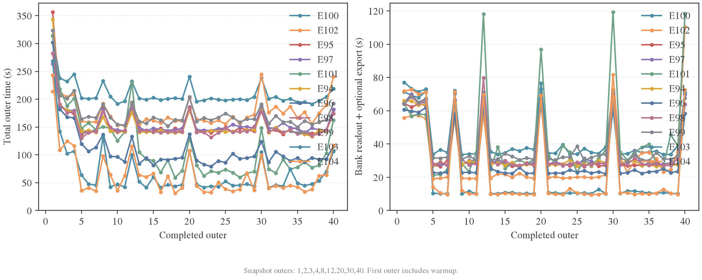

全长双 bank 评分属于前向读出，快照 outer 的读出时间还包含 FP32 导出和重载校验。各曲线数值、outer 与计时来自本地完整曲线数据 `figures/long-bank-20261112/curve-data.json`（[文件哈希与归档说明](../checkpoint-dynamics/data/artifact-inventory.json)），生成入口为 [readouts.py](../../../../research/studies/absorption_dynamics/readouts.py)。

## 1. 用 H1024 首遍数据比较吸收

本节重新读取本地实验的原始逐题全词表评分，覆盖 R1-Distill、Qwen、Llama 的 14 个条件；没有新增 GPU 前向，也没有引用论文数值。每条件是 Math64／Code32／IF32 共 128 道 heldout 题，固定 initial-student prefix，题内 KL 累和除以 1024，再按题平均。MiMo 没有同协议读出，保留在参数几何和独立功能面板中。

**只分析首遍 0–320 步**，DeepCoder 与 Light 只有 64 步。每条曲线从一个来源目录读取，重复保存的首遍只取一次；续训、重访训练池及以晚期权重为参考的 frame 比较均不纳入。首遍训练本身是 batch16、reuse16、20 批 A–T；reuse 是实际训练设计，不把它误称为 320 批新题。

### 1.1 绝对残差与剩余比例

| Teacher 条件         | Step | 初始 RKL | 终点 RKL | 剩余比例 |
| -------------------- | ---: | -------: | -------: | -------: |
| R1 DeepScaleR        |  320 | 0.032978 | 0.000716 |     2.2% |
| Llama GT             |  320 | 0.022932 | 0.000540 |     2.4% |
| Llama CoReward-I     |  320 | 0.021832 | 0.000541 |     2.5% |
| Qwen e3              |  320 | 0.033804 | 0.001298 |     3.8% |
| Qwen GRPO            |  320 | 0.019611 | 0.001109 |     5.7% |
| Qwen SFT nonthinking |  320 | 0.144801 | 0.014366 |     9.9% |
| Qwen SFT thinking    |  320 | 0.248817 | 0.034588 |    13.9% |
| R1 JustRL            |  320 | 0.117835 | 0.017768 |    15.1% |
| R1 Nemotron          |  320 | 0.200227 | 0.045246 |    22.6% |
| R1 BroRL             |  320 | 0.293644 | 0.072881 |    24.8% |
| R1 MiniMath SFT      |  320 | 0.093081 | 0.028692 |    30.8% |
| Llama arithmetic SFT |  320 | 0.219375 | 0.071417 |    32.6% |
| R1 DeepCoder (64)    |   64 | 0.088564 | 0.031569 |    35.6% |
| R1-7B Light SFT (64) |   64 | 0.117059 | 0.055215 |    47.2% |

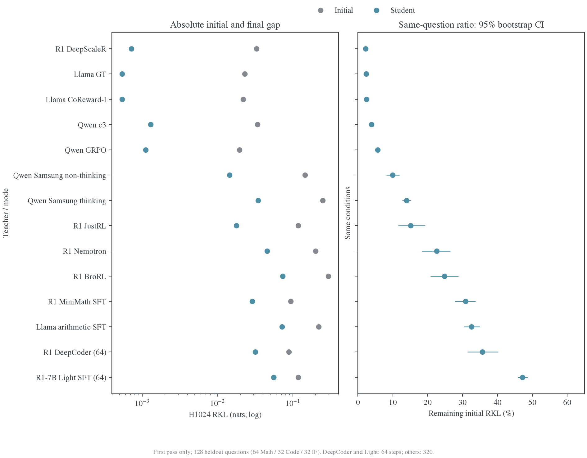

按这套面板，可以作以下观察分组：

| 观察分组     | 条件                                                          | 绝对终点 RKL    | 剩余初始风险 |
| ------------ | ------------------------------------------------------------- | --------------- | ------------ |
| 输出残差很低 | DeepScaleR、Qwen GRPO／e3、Llama CoReward-I／GT               | .000540–.001298 | 2.2%–5.7%    |
| 部分吸收     | JustRL、Samsung 两种模式                                      | .014366–.034588 | 9.9%–15.1%   |
| 剩余比例较高 | MiniMath、BroRL、Nemotron、Llama arithmetic、DeepCoder、Light | .028692–.072881 | 22.6%–47.2%  |

这是当前状态、题目与预算下的分组。中间组与较高组的绝对风险有重叠，例如 MiniMath 的绝对残差小于 Samsung thinking，但剩余比例更高。64 步两条件的训练预算还明显偏短。

**RL 标签不能决定可学习性。** 同属 R1 路径，DeepScaleR 剩 2.2%，JustRL 剩 15.1%，BroRL 剩 24.8%；teacher 的具体更新、初始差距和输出请求比标签更有区分力。低 RKL 表示分布拟合，任务能力是否转移另由生成实验判断。

### 1.2 首遍内的学习动态

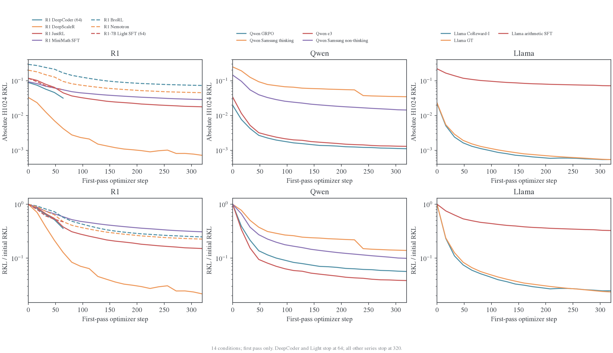

每条曲线按自身初始风险归一化，同时保留绝对风险。Qwen GRPO／e3 与 Llama 两组进入很低的残差区；Samsung、MiniMath、Llama arithmetic 留下更多差距。JustRL 在首遍内仍持续改善，不应由 step320 宣称达到最终吸收上限。现有数据支持比较首遍的速度和剩余量，不能回答重复训练多轮后的最终极限。

### 1.3 H128 的用途与样本量

原 H128 面板是大量截断、框架恢复、补回和随机对照使用的短前缀功能诊断。每域 16 题中 calibration4、heldout12，三个域只有 **36 道独立 heldout 题**；initial／teacher 两种 prefix 不会把题数翻倍。它适合配对检验干预是否改变输出，不适合独自承担整体吸收分类。

H1024 的 128 题更适合作为当前主表，但仍是诊断规模。两个面板同时改变了题目与状态 bank，因此 JustRL 的 9.6%→15.1% 等差异不能只归因于 horizon。它们都来自本地模型前向；本轮新增的是读取、身份核对、bootstrap 与作图。更大统一题库、H1024 与更长位置的配对前向尚未完成。

## 2. 三种矩阵对象分别解释

| 对象                          | 每个线性投影测什么              | 含义                                |
| ----------------------------- | ------------------------------- | ----------------------------------- |
| 完整权重 $W_t$                | 奇异值与左右主子空间            | 线性层本身的输入／输出框架是否变化  |
| 累计更新 $\Delta W_t=W_t-W_0$ | 更新奇异值、集中度和子空间      | 训练改了哪些方向、幅度多大          |
| Teacher 参数残差 $W_T-W_t$    | 与 teacher 增量比较的范数、余弦 | Student 是否回到 teacher 的参数位置 |

所有 q/k/v/o、gate/up/down 矩阵独立计算，不把整个模型拼成一张 SVD 矩阵。对 $y=Wx$，右框架 V 对应输入方向，左框架 U 对应输出方向。完整权重 W 的 frame 与更新 ΔW 的 frame 是不同对象。

## 3. Frame：完整权重变化很小，更新方向仍在移动

### 3.1 16 条件完整权重的右主角度

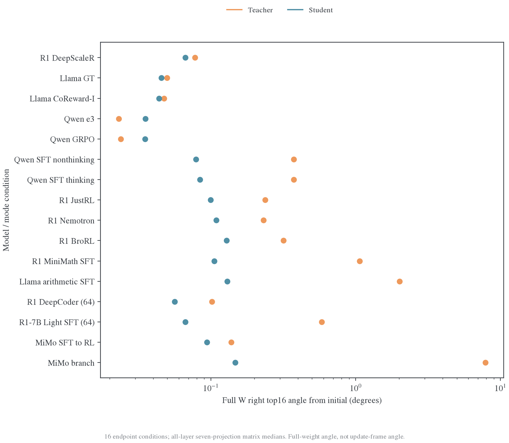

每点先取一个矩阵的 16 个主角均值，再取全部层七投影的中位数。正文统一看右侧输入空间 V。Teacher 相对 initial 的右空间角度，从 GRPO／e3 约 .023°，到 MiniMath 约 1.064°、Llama arithmetic 约 2.005°、MiMo 分支约 7.865°；对应 student 约 .035°、.105°、.129°、.147°。Student 完整权重的主空间移动普遍较小，teacher 的改变则差异很大。

W 的主体由 initial 权重主导，微小角度也可以承载有效输出变化。不能据此推断 ΔW 的方向从早期起不再移动，下面直接测 ΔW。

### 3.2 九条轨迹的实际 checkpoint 覆盖

新增离线计算覆盖 **219 个矩阵条件、25,245 行阶段对角度、20,034 行后续增量捕获和 567 行完整 W 角度**。使用现有 safetensors，CPU FP64 精确 SVD，无新增训练。与既有计算可重合的 1,676 个 checkpoint／矩阵记录逐一核对 tensor SHA 和更新能量，全部一致。角度分布、所有阶段对和谱隙均保留在[完整记录](data/right-frame-20261112/measurements.json.gz)。

| 轨迹                                              | 现有非零 step                          | 矩阵覆盖                                              | 比较目的                       |
| ------------------------------------------------- | -------------------------------------- | ----------------------------------------------------- | ------------------------------ |
| E63 Current、E64 Initial、E65 Teacher rollout     | 16、32、48、64、80、128、160、240、320 | 各 61 矩阵：全 28 层 k/v，加第 13 层 q/o/gate/up/down | 密集阶段、全部层 k/v、来源对照 |
| JustRL                                            | 16、80、160、240、320                  | 第 0/13/27 层 k/v，共 6 矩阵                          | 补全中间阶段角度分布           |
| GRPO、Samsung、e3 原 lineage、DeepMath 原 lineage | 64、320                                | 各第 0/13/27 层 k/v                                   | 比较相同窗口的方向稳定性       |
| Light                                             | 32、64                                 | 第 0/13/27 层 k/v                                     | 较短训练窗口                   |

E63–E65 是**同一个 initial Qwen3-1.7B→Qwen3-4B-Instruct-2507 teacher 的三种 rollout 来源**，不是三个独立 teacher。训练 batch64、reuse16，与前面历史 batch16 的面板分开。只读首遍至 step320；不使用 640→1280。跨尺寸 teacher 不做参数相减，这里的 ΔW 都是同尺寸 student 减自己的 initial。

历史六轨迹的角度分布重新测量上述六个矩阵；已有更广的全层重叠仍在补充数据中。JustRL 动态 batch20 与主表端点、e3 原 lineage 与主表 e3run 各有独立存储身份，不能逐权重拼接。[核对记录](data/layer-review/expanded-dynamics-identity.json)保留其区别。

### 3.3 主角分布：扩大 rank 后仍有持续移动

对累计更新 ΔW_t 的右 top-k 框架 V_k(t)，计算 V_k(t)ᵀV_k(s) 的奇异值，再取 arccos 得 k 个主角。0° 表示相同方向，90° 表示正交方向。均值描述整体移动，p90 揭示移动较大的方向；内部换基不会改变这些角度。

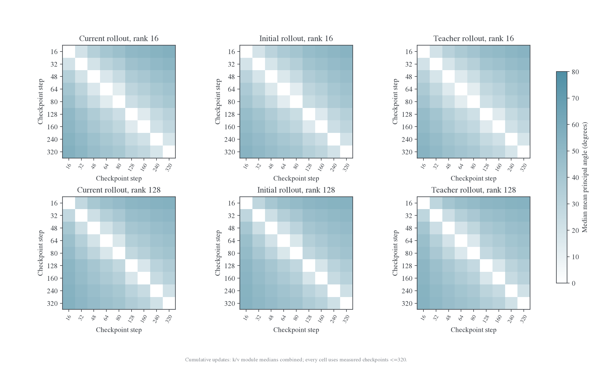

每格先按层取中位数，再合并 k/v 的模块中位数；横纵坐标是已有 checkpoint 的等距类别，实际 step 间隔不等。对角线接近 0 是自比较恒等式。看非对角区域，逐步接近 step320 的同时，许多阶段之间仍有明显转角。

| 来源    | 模块 | step16→320 均值／p90 | step64→320 均值／p90 | step160→320 均值／p90 |
| ------- | ---- | -------------------- | -------------------- | --------------------- |
| Current | k    | 60.4°／84.9°         | 49.1°／75.3°         | 33.1°／50.7°          |
| Initial | k    | 59.2°／84.6°         | 49.7°／75.1°         | 34.6°／52.9°          |
| Teacher | k    | 58.5°／84.5°         | 48.9°／74.4°         | 33.3°／49.4°          |
| Current | v    | 51.9°／83.6°         | 35.8°／67.3°         | 22.8°／40.2°          |
| Initial | v    | 48.1°／83.1°         | 36.6°／67.8°         | 24.4°／42.6°          |
| Teacher | v    | 49.2°／84.1°         | 34.5°／66.3°         | 22.4°／42.3°          |

表为 rank16，每个矩阵先求角度统计，再取 28 层中位数。v 比 k 更接近参考空间，这一差异在三种来源中复现。来源间差异则远小于 k/v 的差异。

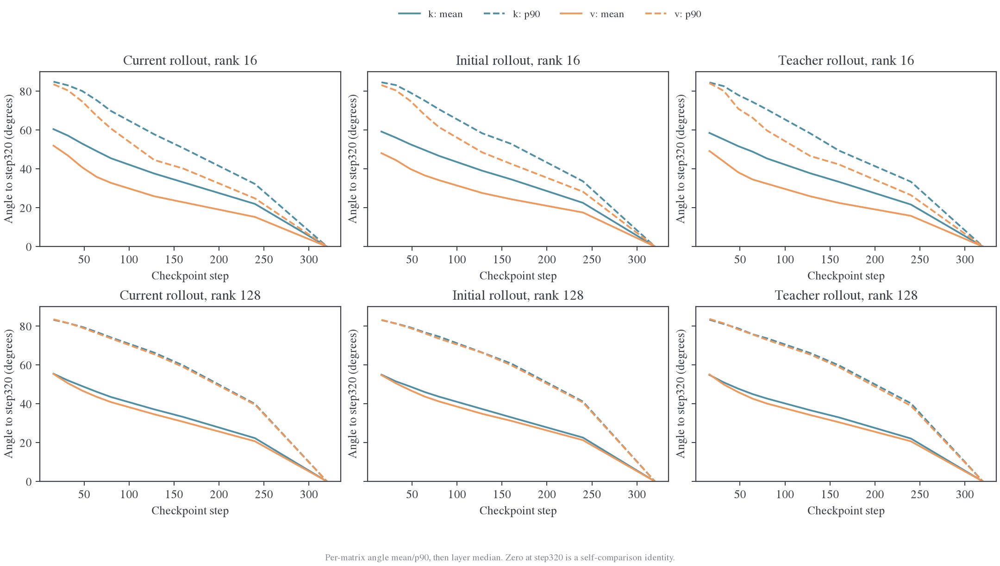

将 k 从 16 扩到 128，step64→320 的 k 均值仍为 **45.0°–46.2°**，v 为 **42.6°–43.7°**。v 的大 rank 空间反而转得更多：少量最强方向较稳，加入更多较弱方向后移动更明显。因此不能把 rank16 的结论原样外推到更大的更新空间。

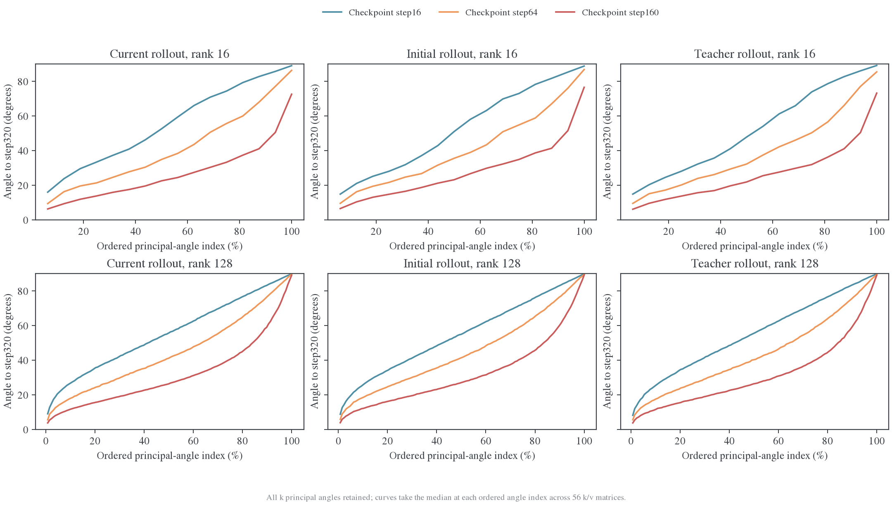

step16 的分布尾部接近 90°；step160 后仍有明显尾部。top16 截断边界的相对谱隙在 Current／Initial step64 约 .024／.025，较弱方向的身份容易变化。下面用实际增量能量捕获检验：这些转角是否只发生在无关紧要的弱方向。

### 3.4 早期空间只能覆盖部分后续新增更新

累计更新包含之前所有更新，两个阶段的累计 ΔW 接近，会混入共享历史的影响。这里另外取相邻 checkpoint 的新增更新 D=W_b−W_a，测它投影到更早 anchor 的右空间后保留多少平方范数：

$$
C_k(a,b;t)=\frac{\Vert (W_b-W_a)V_k(t)V_k(t)^\top\Vert_F^2}{\Vert W_b-W_a\Vert_F^2},\qquad t\leq a.
$$

再除以该新增更新自身最优 rank-k 的能量捕获，区分“更新本身高秩”与“anchor 方向不合适”。两种比例都是参数空间量。

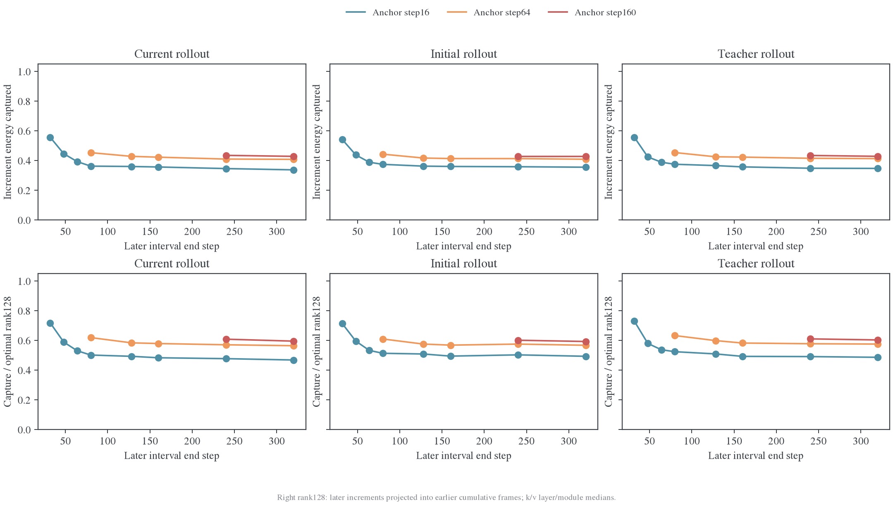

| 来源    | 模块 | anchor16 捕获 240→320 | anchor64 捕获 240→320 | anchor160 捕获 240→320 | 新增更新自身最优 rank128 捕获 |
| ------- | ---- | --------------------: | --------------------: | ---------------------: | ----------------------------: |
| Current | k    |                 31.0% |                 36.2% |                  37.7% |                         71.8% |
| Initial | k    |                 32.4% |                 36.3% |                  37.8% |                         71.7% |
| Teacher | k    |                 32.1% |                 37.1% |                  37.8% |                         71.1% |
| Current | v    |                 36.4% |                 45.4% |                  48.0% |                         72.4% |
| Initial | v    |                 38.6% |                 45.4% |                  47.7% |                         71.8% |
| Teacher | v    |                 37.3% |                 45.5% |                  47.9% |                         70.7% |

step64 的 k 空间只达到最优 rank128 捕获的约 **50%–51%**，v 约 **63%–64%**。这比单独看角度更有判别力：早期方向确实承载部分后续更新，但方向未对准造成的能量损失仍很大。各区间长度不同，图中捕获率不能解释为每步更新速度。

**在这组三来源 OPD 设置中，现有 checkpoint 不支持“到分析窗口前 20%（step64）主要右空间已经固定”。** 这是现有无约束训练的几何结果；未来若施加约束，模型能否找到功能等价的替代更新，仍由训练干预回答。当前不开展该训练。

### 3.5 模块与层：k/v 差异大于粗略深度差异

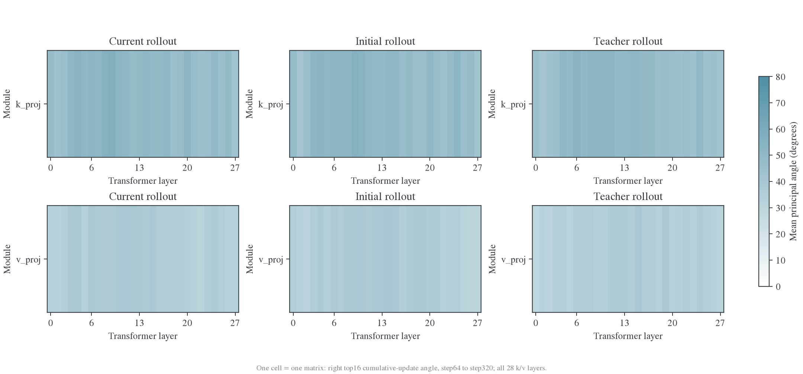

按 0–8／9–18／19–27 层分组，三来源的 k 平均角度中位数约为 49°–52°／50°／45°–47°，v 约为 34°–37°／36°–38°／34°–35°。较深 k 层略接近参考，但没有从浅到深统一单调的趋势。比起“浅层与顶层”，**先区分 k/v 模块更能解释当前差异**。

中层其他模块也有持续变化。第 13 层 step64→320 的 rank16 平均角度，三来源 q 为 45°–49°、o 为 30°–31°、gate 为约 27°、up 为 30°–35°、down 为 38°–41°。MLP 的结果来自一个中层，后续应在新训练的保存方案中扩大覆盖。

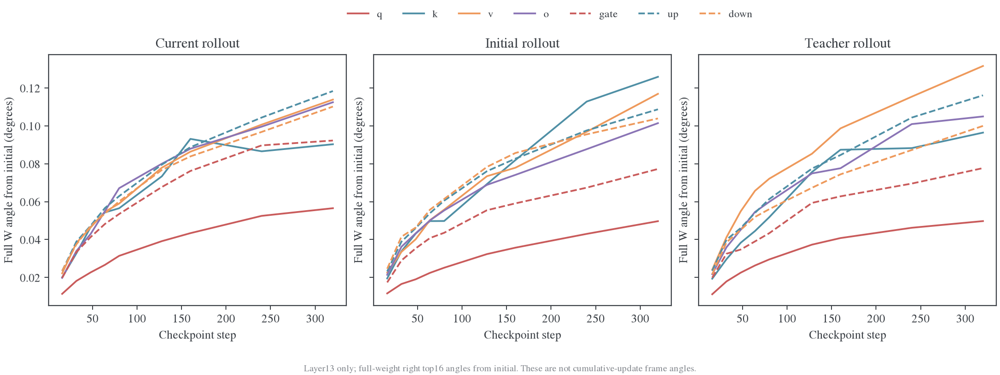

同一组三来源，第 13 层七投影的完整 W 右 top16 从 initial 到 step320 只转约 **.050°–.132°**，而累计更新 frame 可以转几十度。完整 W 的主体保留与新增方向持续调整同时成立；因此完整权重的 angle／spectrum 不能代替更新空间的动态。

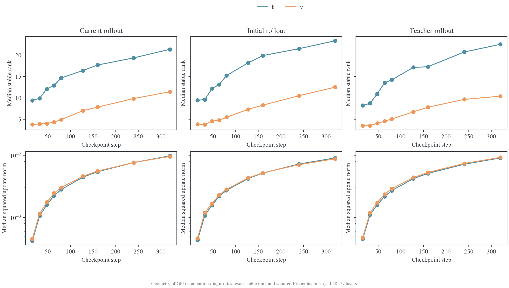

Current 的 k 稳定秩从 step16 的 9.4 增至 step320 的 21.3，v 从 3.8 增至 11.4；Initial／Teacher 也上升。当前测量窗口中，谱的有效维数在扩展。稳定秩只用奇异值，不记录方向；应与角度、捕获率一起看。2606 的 OPD 窄带稳定秩轨迹在这组本地设置中没有直接复现。

### 3.6 历史 teacher 轨迹：好吸收 pair 更稳定的线索保留

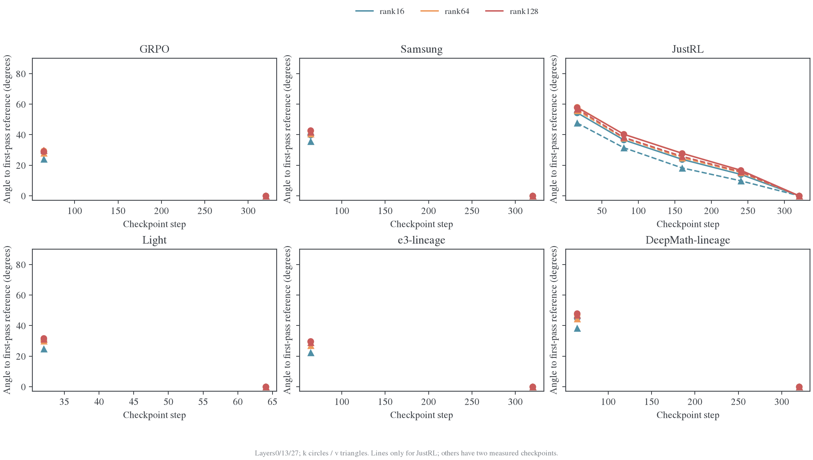

| 轨迹与窗口                 | k rank16 均值／p90 | v rank16 均值／p90 |
| -------------------------- | ------------------ | ------------------ |
| GRPO 64→320                | 28.7°／53.2°       | 24.1°／40.1°       |
| Samsung 64→320             | 39.7°／66.7°       | 35.8°／67.2°       |
| JustRL 16→320              | 54.4°／78.8°       | 47.7°／72.7°       |
| Light 32→64                | 30.5°／45.7°       | 24.8°／50.1°       |
| e3 原 lineage 64→320       | 29.6°／49.9°       | 22.5°／40.5°       |
| DeepMath 原 lineage 64→320 | 45.1°／71.8°       | 38.3°／70.7°       |

这里统一取第 0/13/27 层的中位数。同窗口的 GRPO 比 Samsung、e3 原 lineage 比 Thinking-Space（DeepMath 训练来源）更稳定，这一线索在角度尾部也成立。JustRL 的早期点只到 5% 进度，Light 则已到自身训练中点，不按表中大小给所有 teacher 排名。除 JustRL 外，这些历史轨迹只有两个保存点；目前无法补出未保存的形成过程。

#### 吸收与稳定性的逐项核对

当前直接支持“较好吸收伴随更稳定更新空间”的是两组 Qwen 对比。统一取首遍 64→320、右空间；风险与 frame 来自对应运行。下面的重叠扣除了 k/d 随机基线，数值越大越接近 step320。

| 对比                          | step320 绝对 H1024 RKL／剩余比例 | k 右 top16 重叠 | v 右 top16 重叠 | 可比性                                                                       |
| ----------------------------- | -------------------------------- | --------------- | --------------- | ---------------------------------------------------------------------------- |
| GRPO／Samsung thinking        | .001109／5.7% 对 .034588／13.9%  | .699 对 .519    | .780 对 .647    | 相同 initial、窗口、题序与固定 bank；teacher 均从 Qwen3-1.7B 继续训练        |
| e3 原 lineage／Thinking-Space | .001263／3.7% 对 .191977／31.2%  | .724 对 .429    | .816 对 .612    | 风险与各自 frame 同运行；teacher 父阶段不同，Thinking-Space 从 Base 分支训练 |

两组均在 7 类投影×7 个 rank（8–512）的 49 个模块/rank 中位数比较中保持同一排序。q/o 只覆盖 5 层，MLP 只覆盖中层，不能称这些模块已做全层复现。GRPO 在 top16 的 k 中有 26/28 层更稳，v 为 25/28 层；反向层是 k 的 1、2 层及 v 的 0、1、2 层。扩大到 rank128 后 k/v 均为 28/28。e3/Thinking-Space 在 rank16 和 128 的 k/v 均为 28/28。

这些是同一模型内部的重复测量，不是 49 个独立 teacher 或 28 个训练 seed。GRPO/Samsung 的初始风险还相差约 12.7 倍，e3/Thinking-Space 约 18.2 倍，当前关联不能排除初始差距和教师训练距离的影响。**结论收窄为：两组 Qwen 对比存在广泛模块/rank 一致的关联，其中只有 GRPO/Samsung 是直接父模型匹配；跨家族预测关系尚未建立。**

JustRL 与 Light 的起点和训练长度不同，不排列早期稳定性。DeepScaleR、MiniMath、BroRL、Llama 与 MiMo 目前缺少可用于该首遍窗口的足够中间权重，不能作为这个关系的正例或反例。三来源 Qwen 几何接近而风险按 bank 分化，则表明仅靠稳定性无法完整解释吸收。[逐模块、rank 核对及来源](data/right-frame-20261112/association-audit.json)。

### 3.7 同样的 frame 动态，对应不同的 heldout 拟合

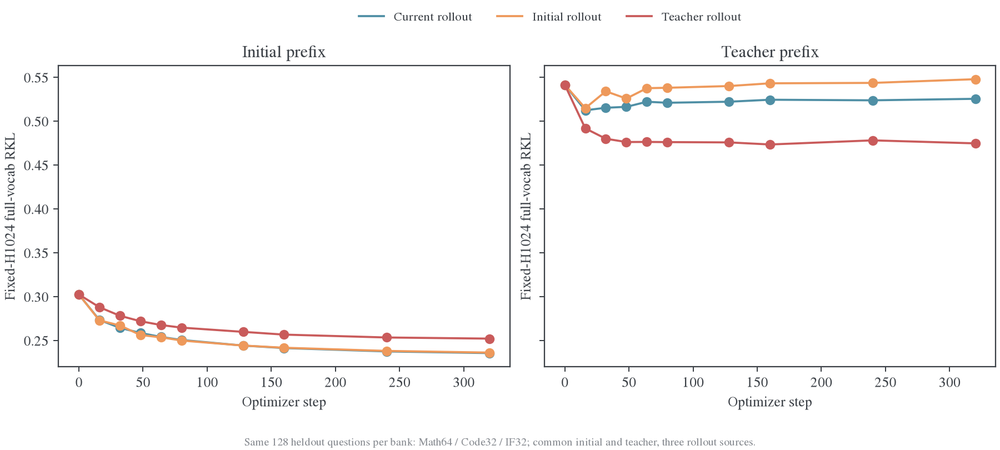

该图复用已完成的逐阶段全词表前向，每 bank 为相同 128 道 heldout：Math64／Code32／IF32。使用 fixed-H1024 归约，原 question-mean 同时保留在[汇总](data/right-frame-20261112/summary.json)。

| 来源    | Initial-prefix step0→64→320 RKL | step320 剩余比例 | Teacher-prefix step0→64→320 RKL | step320 剩余比例 |
| ------- | ------------------------------- | ---------------: | ------------------------------- | ---------------: |
| Current | .302373→.253977→.235564         |            77.9% | .541501→.522106→.525472         |            97.0% |
| Initial | .302373→.253533→.236121         |            78.1% | .541501→.537600→.547845         |           101.2% |
| Teacher | .302373→.267555→.252058         |            83.4% | .541501→.476314→.474690         |            87.7% |

Current／Initial 在 initial-prefix 更好，Teacher 在 teacher-prefix 更好。Current／Initial 的 teacher-prefix 后期回升，而 frame 仍在逐步接近参考。三种来源的空间动态非常接近，绝对函数风险却随 bank 分化。

**角度稳定性可以描述训练路径，却不足以独立决定吸收。** 当前更强的解释是：更新被哪些状态驱动、沿哪些输入特征发生，以及这些改变对目标状态上的 teacher 请求是否有效。下一轮新训练应把密集 checkpoint 与真实训练状态、逐阶段固定 bank 风险配套保存，具体建议见[设置与指标](设置与指标.md#下一轮训练的-checkpoint-保存建议)。

2511 的完整 W 主角与重构、2606 的累计 ΔW 右 Sim 和 stable rank，在这里各按原对象测量。全阶段角度分布、两两阶段图、早期空间对新增更新的捕获由本地扩展实现。论文设置与未测项见[机制分析](机制分析.md#geometry-of-opd-的结论本地覆盖与左右对照设计)。

## 4. Spectrum：覆盖全部 16 条件与六条动态

### 4.1 集中度、谱漂移与幅度

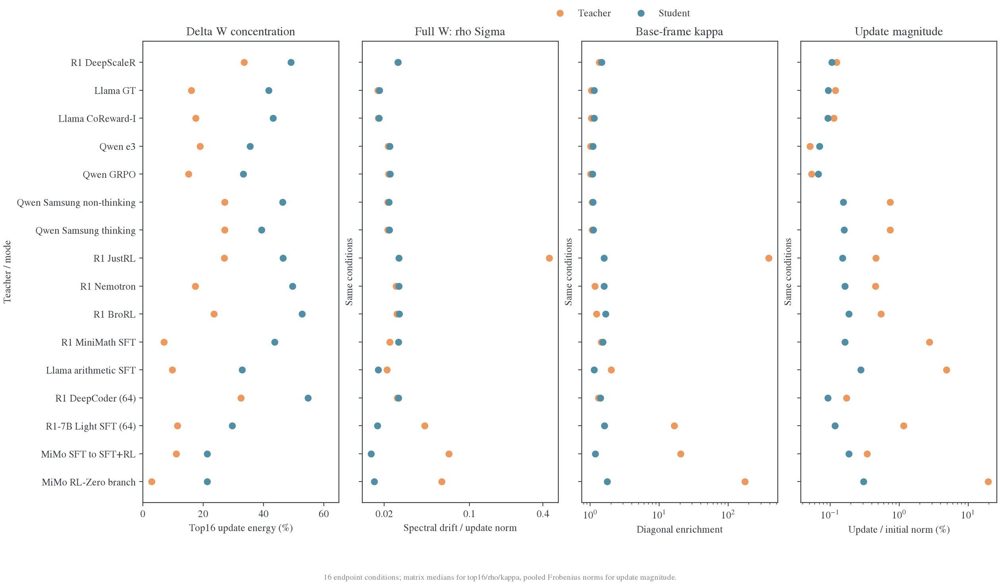

四列分别是 ΔW 的 top16 能量比例、完整权重的谱漂移占更新范数的比例 ρΣ、base-frame 对角富集 κ、更新范数相对 initial 的比例。前三列为逐矩阵中位数，幅度为全层平方能量汇总；完整 δΣ／ρΣ／κ 表在补充测量中保留。

Student 的 top16 比例在 16 条件中都高于 teacher，但这表示**更新更集中**，不表示总能量或吸收能力更大。GRPO teacher top16 约 15.1%，Samsung thinking 约 27.2%，前者却拟合得更好；低秩集中度不能单独预测吸收。

完整权重的谱值漂移也不足以分类。GRPO 与 Samsung 的 teacher ρΣ 都约 .021，却有明显不同的残差。JustRL teacher 的 κ约 386，不能由高 κ直接推断难吸收；其首遍已消除约 85% 初始风险。MiMo 连续与分支的差异则同时涉及 actual initial、更新幅度和谱形状，应按谱系分别解释。

### 4.2 更新谱随训练的变化

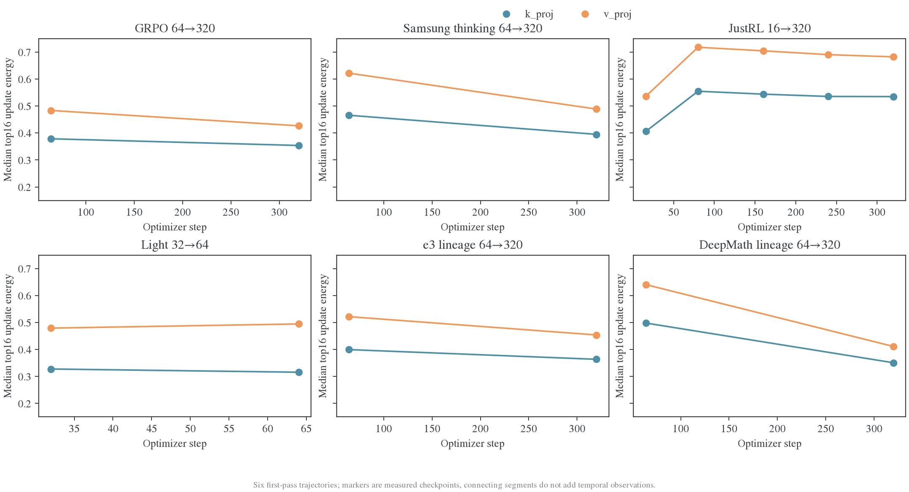

GRPO 的 k top16 从 37.9% 降至 35.4%，Samsung 从 46.6% 降至 39.5%，e3 原 lineage 从 39.9% 降至 36.4%，DeepMath 从 49.8% 降至 35.1%。它们的累计更新逐渐使用更多方向。

趋势并非一律下降。JustRL k 在 step16／80／160／240／320 约为 40.6%／55.5%／54.4%／53.6%／53.5%，先集中再略分散；Light 的 v 从 47.9% 增至 49.5%。不同模块、阶段和采样范围会改变趋势，不能把三层 k 的局部变化概括为全模型定律。

## 5. 参数残差：幅度足够时仍可以远离 teacher

定义两条相对同一 initial 的增量 $\Delta W_S$、$\Delta W_T$，把全部层七类投影的元素视为一个向量，计算：

$$
a=\frac{\Vert\Delta W_S\Vert_F}{\Vert\Delta W_T\Vert_F},\qquad
c=\frac{\langle\Delta W_S,\Delta W_T\rangle}{\Vert\Delta W_S\Vert_F\Vert\Delta W_T\Vert_F},\qquad
R=\frac{\Vert W_T-W_S\Vert_F^2}{\Vert W_T-W_0\Vert_F^2}=1+a^2-2ac.
$$

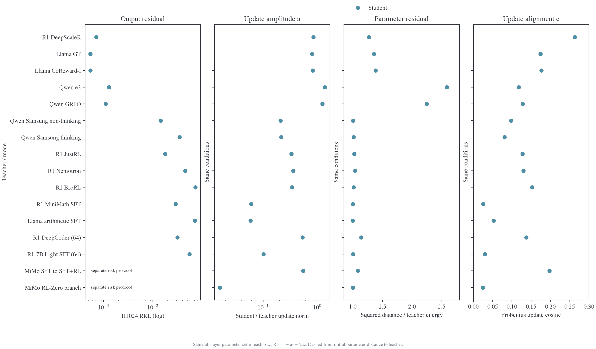

| 条件                 | 更新幅度比 a | 更新余弦 c | 参数残差 R |
| -------------------- | -----------: | ---------: | ---------: |
| R1 DeepScaleR        |        0.848 |      0.263 |      1.273 |
| Llama GT             |        0.796 |      0.174 |      1.356 |
| Llama CoReward-I     |        0.821 |      0.176 |      1.384 |
| Qwen e3              |        1.382 |      0.118 |      2.584 |
| Qwen GRPO            |        1.251 |      0.128 |      2.244 |
| Qwen SFT nonthinking |        0.209 |      0.098 |      1.003 |
| Qwen SFT thinking    |        0.214 |      0.081 |      1.011 |
| R1 JustRL            |        0.332 |      0.127 |      1.026 |
| R1 Nemotron          |        0.360 |      0.130 |      1.036 |
| R1 BroRL             |        0.344 |      0.152 |      1.013 |
| R1 MiniMath SFT      |        0.059 |      0.026 |      1.000 |
| Llama arithmetic SFT |        0.058 |      0.052 |      0.997 |
| R1 DeepCoder (64)    |        0.535 |      0.137 |      1.139 |
| R1-7B Light SFT (64) |        0.101 |      0.030 |      1.004 |
| MiMo SFT to RL       |        0.549 |      0.197 |      1.085 |
| MiMo branch          |        0.016 |      0.025 |      0.999 |

**替代参数路径跨出 Llama，且不依赖重复训练数据。** 首遍 GRPO、e3 的 a≈1.251／1.382，参数残差 R≈2.244／2.584，但 H1024 RKL 只剩 5.7%／3.8%；Llama 两组 a≈.8，R≈1.36–1.38，RKL 只剩约 2.4%。这些 student 已有充分参数位移，并没有走回 teacher。

R 接近 1 则有两种不同情况。MiniMath、Llama arithmetic、MiMo 分支的 a≈.059／.058／.016，确实受小位移影响；BroRL 的 a≈.344，a² 与 2ac 抵消后 R≈1.013，不能说没有更新。参数残差必须和绝对幅度、余弦、函数风险一起看。

## 6. 功能干预与能力读出

| 实验                                           | 当前结果                                                        | 判断                                           |
| ---------------------------------------------- | --------------------------------------------------------------- | ---------------------------------------------- |
| 恢复 initial 完整 W 奇异值、保留 endpoint 框架 | 16 条件基本保留 endpoint 拟合                                   | 小谱值变化不是已学行为的主要载体               |
| 恢复 initial 完整 W 框架、保留 endpoint 奇异值 | Math12 的 H128 RKL 回到初始的 91.4%–99.3%                       | 框架变化有直接函数作用，仍需更大长前缀面板复核 |
| 补回 missing off                               | initial bank 改善 15/16，teacher bank 16/16；等范数随机明显更差 | Student 尚能实现部分原训练遗漏的方向           |
| 每矩阵保留更新 top5%，不恢复范数               | 14/16 保留至少 95% KL 改善                                      | 可压缩性不等于易吸收                           |
| Qwen SFT 72 新题生成                           | Student39 对、off23 对、teacher17 对                            | KL 靠近可以复制 teacher 的无益行为             |

H128 的功能证据保留其题数、位置和协议身份，不由短前缀编辑结果外推完整能力。优先扩展统一 H1024 的更多互斥 heldout 题（建议每域 128 题，共 384 题），同时测 initial／teacher-prefix 的 RKL 和 FKL；再按早中晚位置检查效应是否沿序列保持。题数建议是待测设计，不是已完成数据。

## 7. 当前判断

**输出吸收好的 pair 可以通过另一套参数、较集中的更新实现 teacher 行为；吸收较差的 pair 则留下更大的请求缺口。完整 W 小幅保谱、更新低秩和 early frame 稳定，分别描述不同侧面，没有一个单独给出吸收规律。**

首遍内可检验的候选是：teacher 在 student 上请求改变的函数方向，是否与训练梯度和实际位移匹配，以及这些改变能否推广到未训练状态。下一轮应在同 backbone、相同状态和预算下串联 residual → Jacobian 响应 → Adam 位移 → 下一窗口 heldout 降幅；先用现有 checkpoint 检验阶段方向与新增位移，再决定后续右空间／随机空间训练对照。已有敏感性、传播和生成证据见[机制分析](机制分析.md)。

## 完整测量表与补充对照

以下保留不同面板、更多 rank、模块、深度和干预的完整结果；主线判断以上述对齐窗口的比较为准。

 初始面板：补回后的全部 16 条件 

## 全部 16 条件：绝对残差和吸收比例要一起看

下表统一使用 **initial-student prefix、Math/Code/IF 各 12 道 heldout 题、固定 H128 全词表 RKL**。每条配对比较相同题目及位置；off/null 幅度仅由 calibration 选择。DeepCoder 和 Light 只训 64 步，其余 320 步。该表覆盖全部可执行功能条件，MiMo 缺失导出另在设置中列出。

| 条件                          | Step | Initial RKL |  OPD RKL | 剩余比例 | 补回 off 后 | 补回 null 后 |
| ----------------------------- | ---: | ----------: | -------: | -------: | ----------: | -----------: |
| R1 DeepCoder                  |   64 |    0.082545 | 0.023245 |    28.2% |    0.019712 |     0.008054 |
| R1 DeepScaleR                 |  320 |    0.023055 | 0.000584 |     2.5% |    0.000471 |     0.000440 |
| R1 JustRL                     |  320 |    0.096930 | 0.009332 |     9.6% |    0.004915 |     0.003176 |
| R1 MiniMath SFT               |  320 |    0.116888 | 0.030099 |    25.7% |    0.026609 |     0.019432 |
| R1 BroRL                      |  320 |    0.265671 | 0.079307 |    29.9% |    0.043724 |     0.014280 |
| R1 Nemotron                   |  320 |    0.177527 | 0.042392 |    23.9% |    0.020452 |     0.007087 |
| R1-7B Light SFT               |   64 |    0.278275 | 0.099824 |    35.9% |    0.040803 |     0.026644 |
| Qwen GRPO                     |  320 |    0.019240 | 0.001572 |     8.2% |    0.000938 |     0.000946 |
| Qwen Samsung SFT thinking     |  320 |    0.512825 | 0.131954 |    25.7% |    0.016462 |     0.014359 |
| Qwen e3                       |  320 |    0.017175 | 0.001514 |     8.8% |    0.000859 |     0.000868 |
| Qwen Samsung SFT non-thinking |  320 |    0.407708 | 0.085448 |    21.0% |    0.022884 |     0.020103 |
| Llama CoReward-I              |  320 |    0.090800 | 0.003321 |     3.7% |    0.000992 |     0.001629 |
| Llama GT                      |  320 |    0.087952 | 0.002772 |     3.2% |    0.000834 |     0.001152 |
| Llama arithmetic SFT          |  320 |    0.489622 | 0.227837 |    46.5% |    0.125531 |     0.133425 |
| MiMo SFT→SFT+RL               |  320 |    0.043986 | 0.003761 |     8.6% |    0.001679 |     0.001749 |
| MiMo SFT→RL-Zero（分支）      |  320 |    0.304853 | 0.137824 |    45.2% |    0.123080 |     0.124380 |

左图同时放 initial、OPD 和 off 补回后的绝对风险；右图显示剩余初始差距。同一行的对比有明确意义；不同家族的状态 bank 来自各自模型，不把跨行绝对值当作统一任务难度排名。[逐行数据](data/synthesis/model-absorption.csv)。

**同源 RL 条件中确实出现了深度吸收，但 RL 和 SFT 没有统一分界。** DeepScaleR 剩约 2.5%，Qwen GRPO 约 8.2%；R1 BroRL 仍剩 29.9%，高于 MiniMath SFT 的 25.7%。Samsung 两种模式剩约 25.7%/21.0%；Llama arithmetic 剩 46.5%。同家族差异足够大，需要解释具体 teacher 更新与输出请求。

Qwen Samsung thinking 的初始 RKL 约为 GRPO 的 26.7 倍，endpoint 差距扩大为约 84 倍。初始距离解释了一部分难度，但单位初始差距的吸收也不同。MiMo 分支剩 45.2%，连续 SFT→SFT+RL 剩 8.6%，实际起点和训练增量决定比较对象。

 更细的域、输出 band 与历史窗口 

## 深入 H1024 面板：跨尺寸与跨域残差

该原生全词表面板使用各配对自己的固定 bank 与 H1024，题数和新 H128 总表不同。两个面板各自比较同题前后变化，数值分别解释。定义剩余比例 $r_t=L(p_t,q_T)/L(p_0,q_T)$。最终结果如下，区间是题目配对 bootstrap。

| 配对         | Heldout 题数 | Base KL | Step320 KL | 剩余比例 | 95% 区间     |
| ------------ | -----------: | ------: | ---------: | -------: | ------------ |
| Qwen GRPO    |           80 | .019958 |    .001081 |    5.42% | 4.83–6.10%   |
| Qwen SFT     |           80 | .248452 |    .033097 |   13.32% | 11.98–14.81% |
| R1 JustRL    |          160 | .113325 |    .013489 |   11.90% | 10.16–14.03% |
| R1 / Polaris |          160 | .327046 |    .273882 |   83.74% | 81.84–85.40% |

Polaris 的 train KL 从 .213637 降到 .096879，heldout 从 .327046 降到 .273882，分布内拟合和跨状态迁移明显分离。同源 teacher 也存在域差异：native Math 剩余比例依次为 4.27%、10.22%、6.20%、74.46%，IF 为 10.99%、26.67%、40.94%、92.16%。

### 输出谱的覆盖：主方向吸收不等于整体覆盖

输出谱使用固定 base-Fisher 度量，表示剩余输出变化能量相对 teacher 变化能量的比例。它与上表 native KL 是不同读出，二者都指出 IF 更难匹配，Polaris 的大残差跨域存在。

Rank128 框架在 heldout 捕获的 teacher 变化能量约为 GRPO 54.8%、SFT 45.3%、JustRL 48.2%，在 calibration 则为 94.3%、88.6%、74.0%；同 rank 随机框架约为 .08%。三 seed 随机 SVD 的 heldout 捕获极差小于 .11 个百分点。teacher 输出变化具有稳定结构，但同一个小框架对新状态的覆盖明显降低。

Polaris 的 top1 方向在早期 rank64 诊断中吸收系数约 .667，剩余能量比 .138，却只占 teacher heldout 能量的 1.29%；框架外 complement 占 77.05%，剩余比 .867。学会最强方向，与覆盖主要变化，并不是同一件事。

度量也会改变重点：GRPO/SFT/JustRL 的 centered-logit 剩余能量比分别约 9.48%/16.34%/44.53%，base-Fisher 下为 6.02%/9.69%/13.43%。JustRL 在低 base 概率区域仍有较大变化，需进一步给这些变化做行为标注。

数据：[最终逐题、域、band 与阶段汇总](data/teacher-spectrum-20261110/final-scientific-data-010.json)。

## 首遍训练的域与窗口补充

所有当前风险曲线以开篇 H1024 首遍图为准。原始历史库存保留，重复训练池阶段的数值与以晚期权重为 reference 的空间图不进入当前分析。独立 online 或 MiMo 状态实验按其实际协议解释，不和 fixed-S0 首遍拼接。

 完整权重谱、全层增量与初始框架恢复 

## 全层谱：集中度、尺度和方向必须拆开

全 16 条件精确扫描覆盖全部七类投影。下表的δΣ、ρΣ、κ和 top16 为**逐矩阵中位数**；绝对范数是全层平方范数之和开根号。top16 分解对象为 teacher/student 相对 initial 的**增量矩阵**。绝对范数不能直接跨尺寸比较。

| 条件                          | teacher 更新绝对范数 | teacher δΣ | teacher ρΣ | teacher κ | teacher / student top16 能量 |
| ----------------------------- | -------------------: | ---------: | ---------: | --------: | ---------------------------: |
| R1 DeepCoder                  |                2.498 |    3.6e-05 |     0.0256 |      1.31 |                32.5% / 54.7% |
| R1 DeepScaleR                 |                1.784 |    2.5e-05 |     0.0257 |      1.36 |                33.5% / 49.1% |
| R1 JustRL                     |                6.599 |    0.00204 |     0.4517 |    386.12 |                26.9% / 46.5% |
| R1 MiniMath SFT               |               39.489 |   0.000387 |     0.0222 |      1.44 |                 7.0% / 43.7% |
| R1 BroRL                      |                7.877 |   0.000106 |     0.0253 |      1.22 |                23.5% / 52.7% |
| R1 Nemotron                   |                6.541 |   8.35e-05 |     0.0249 |      1.16 |                17.5% / 49.6% |
| R1-7B Light SFT               |               23.744 |   0.000474 |     0.0427 |     16.40 |                11.5% / 29.6% |
| Qwen GRPO                     |                0.703 |   1.15e-05 |     0.0216 |      1.01 |                15.1% / 33.4% |
| Qwen Samsung SFT thinking     |                9.698 |   0.000158 |     0.0214 |      1.06 |                27.2% / 39.3% |
| Qwen e3                       |                0.666 |   1.06e-05 |     0.0215 |      1.01 |                19.0% / 35.5% |
| Qwen Samsung SFT non-thinking |                9.698 |   0.000158 |     0.0214 |      1.06 |                27.2% / 46.3% |
| Llama CoReward-I              |                1.155 |   1.46e-05 |     0.0178 |      1.03 |                17.5% / 43.2% |
| Llama GT                      |                1.212 |   1.52e-05 |     0.0177 |      1.03 |                16.1% / 41.8% |
| Llama arithmetic SFT          |               49.687 |   0.000941 |     0.0210 |      2.00 |                 9.8% / 33.0% |
| MiMo SFT→SFT+RL               |                4.145 |   0.000237 |     0.0675 |     20.47 |                11.1% / 21.4% |
| MiMo SFT→RL-Zero（分支）      |              236.325 |     0.0112 |     0.0589 |    173.46 |                 2.9% / 21.4% |

**16/16 条件的 student 更新 top16 能量高于 teacher。** 这是逐矩阵集中度的结果；后面的截断实验进一步检验可压缩性。集中度不能单独预测吸收难度。Qwen Samsung 的 teacher top16 高于 GRPO，endpoint 残差却高得多。JustRL teacher κ约 386，仍能持续吸收；Samsung κ约 1.06，与 GRPO 约 1.01 接近。κ能识别更新的坐标几何，不能单独识别训练方法或可学习性。

全层幅度也有一致线索：R1 MiniMath、Llama arithmetic、MiMo Base→SFT 的 teacher 更新分别约为 initial 范数的 2.736%、4.847%、19.636%；对应同源 RL 往往小得多。历史 11teacher 留出预测中，在初始 KL 与家族基础上加入中层五模块 rank16 特征，ln-RKL RMSE 从.772 降到.447；57 项探索指标的组内置换 BH 校正均未达到 q<.05。**集中度提供预测线索，但还没有前瞻验证的单指标。** 完整筛查及共同祖先分析见[附录实验](附录-实验细节.md)。

### 后期方向仍在进入，早期没有完全锁死

原三组全层同 196 矩阵的 early→endpoint top16 中位数为 GRPO37.11%→33.38%、SFT48.68%→39.32%、JustRL51.22%→46.66%。同一阶段三层 k_proj 的局部集中度可以上升，全层总体却下降。范围差异解释了先导结果与全层结果的不同。

JustRL 三层 k_proj 从 step16 到 320，最早右 top16 捕获后续更新能量从 45.1% 降到 29.1%，最早/当前子空间重叠降到.368；最后 240→320 增量被最早 top16 仅捕获 11.94%。Qwen GRPO/SFT的64→320最早/当前重叠为.738/.580。**训练后期继续采用新方向，集中更新和子空间移动同时发生。**

### 拟合 teacher 输出并不要求靠近 teacher 参数

Llama CoReward-I/GT在历史原协议的功能RKL剩约2.5%/2.4%，全层参数残差能量却为teacher更新的1.384/1.356倍，更新cosine只有.176/.174。Qwen GRPO/e3的参数残差为2.244/2.584倍，GRPO在early→endpoint参数更远而KL继续下降。参数轨迹存在替代解。

## ISO 谱交换：16 条件均指向奇异框架

对完整权重做两个互补编辑：$U_1\Sigma_0V_1^\top$ 保留 endpoint 框架、恢复 initial 谱；$U_0\Sigma_1V_0^\top$ 保留 endpoint 谱、恢复 initial 框架。七投影以外参数保持 endpoint。**以下仅取 initial-prefix 的 heldout Math12 题、H128**，以同题未编辑 endpoint 为 1。

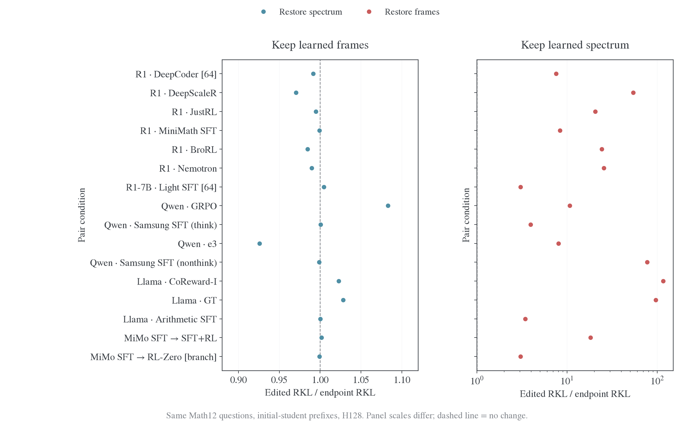

左图放大 0.88–1.12 范围，看换谱后的微小变化；右图用对数轴展示换框架后的倍数损害。虚线都是未编辑风险 1，两个面板的刻度不同。[16 条件精确表](data/synthesis/spectrum-versus-frames.csv)。

| 条件             | Endpoint RKL | 恢复 base 谱 | 恢复 base 框架 |
| ---------------- | -----------: | -----------: | -------------: |
| JustRL           |      .003804 |      .003785 |        .078141 |
| Qwen GRPO        |      .001602 |      .001735 |        .017147 |
| Qwen Samsung SFT |      .122876 |      .122926 |        .481885 |
| Llama CoReward-I |      .001907 |      .001950 |        .221394 |
| MiMo SFT→SFT+RL  |      .002253 |      .002257 |        .040841 |
| MiMo SFT→RL-Zero |      .059880 |      .059830 |        .181128 |

**已学输出主要随奇异框架保留。Qwen SFT 平台的主要残差并不由完整奇异值漂移造成。** 这是在完整参数上编辑后测函数得到的结论，比“ρΣ小所以保谱”更直接。它不要求 teacher 自己的参数变化也能由小的固定谱位移解释。

### 恢复初始框架基本抹去 OPD 的分布匹配收益

恢复初始框架必须与初始模型并列比较。对同一 initial-student prefix、heldout Math12、H128，16/16 条件编辑后的 RKL 为初始值的 91.4%–99.3%。这组条件覆盖五种骨干，Samsung thinking/non-thinking 共用 teacher 权重；16 个条件不是 16 个独立 teacher。编辑只恢复七类投影的框架，仍保留 endpoint 奇异值及其余参数，所以模型不精确等于初始模型。

| 条件                      | 初始 RKL | OPD endpoint | 恢复初始框架 | 恢复后／初始 |
| ------------------------- | -------: | -----------: | -----------: | -----------: |
| JustRL                    |  .084577 |      .003804 |      .078141 |        92.4% |
| Qwen GRPO                 |  .017909 |      .001602 |      .017147 |        95.7% |
| Qwen Samsung SFT thinking |  .485070 |      .122876 |      .481885 |        99.3% |
| Llama CoReward-I          |  .225261 |      .001907 |      .221394 |        98.3% |
| MiMo SFT→SFT+RL           |  .044534 |      .002253 |      .040841 |        91.7% |
| MiMo SFT→RL-Zero 分支     |  .185459 |      .059880 |      .181128 |        97.7% |

扩展到两种 prefix、三个 heldout 域，共 96 个相关条件，恢复后／初始为 85.4%–103.2%。三个条件略高于初始：GRPO teacher-prefix Code 为 103.18%，Samsung thinking initial-prefix Code 为 100.03%，MiMo 分支 teacher-prefix IF 为 100.63%。因此应说“基本回到初始风险”，不要求所有状态都精确回到同一个数值。[96 条件数据](data/layer-review/init-frames-all-domains.json)。

四类 rank-r 重构也支持框架移动。r=floor(.9q) 时，只在旧双侧 span 内混合留下约 81%–87% 的参数变化范数；允许双侧框架移动、固定旧谱，Qwen GRPO/SFT和Llama CoReward 留下的中位数仅.0174/.0189/.0152。JustRL 为.398，明显较大，但其换谱后的函数风险仍几乎不变。**参数几何误差与输出误差并不成正比。**

JustRL 径向更新能量中位数 20.53%；对奇异值拟合最佳统一缩放后，残余谱距离只剩原漂移的 4.70%。这是尺度变化的重要线索；尺度与归一化谱形状的独立功能控制随完成项进入附录，未完成项不计入机制结论。

 左右子空间、扩大 rank、更多模块与训练阶段 

## 逐层与分组分析：全局谱相似不能解释吸收差距

### 全部模型逐层的更新集中度

对每一层的 q/k/v/o、gate/up/down 七个增量矩阵分别做 SVD，下图取七个 top16 能量比例的中位数。橙线为 teacher 相对 initial 的更新，青线为 OPD 相对同一 initial 的更新。横轴是真实层号，不把不同深度模型的层号当作相同功能位置。

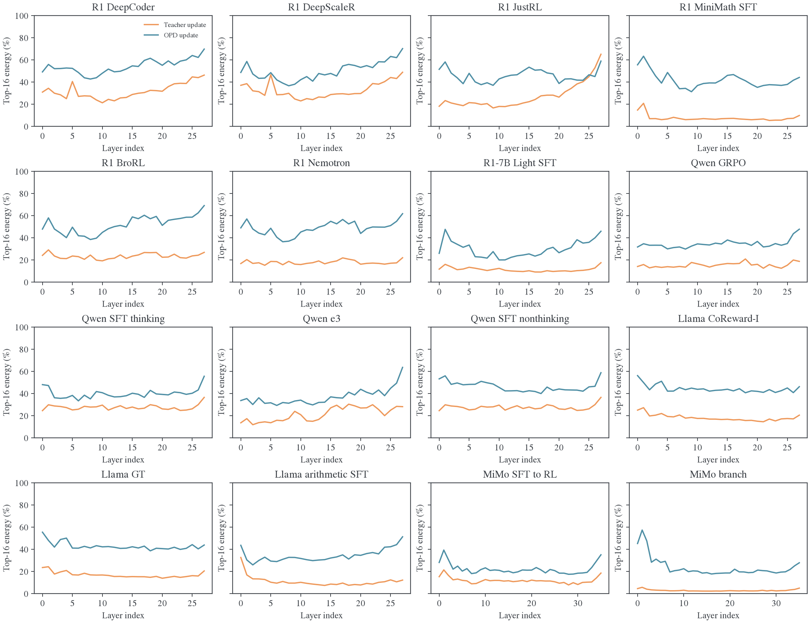

全模型层面 student 比 teacher 集中，逐层形状仍有明显起伏。JustRL teacher 的 layer0/13/27 为 18.1%/19.4%/65.1%，student 为 51.5%/46.6%/58.9%；最后一层已经出现 teacher 比 student 更集中的局部反例。Llama arithmetic teacher 的 layer13 为 8.0%，MiMo 分支 layer17 为 2.3%。同一模型的不同模块也会被层中位数隐藏。单独选三层 k_proj 不能代表全部七类投影。完整逐矩阵数据包含层、模块、teacher、endpoint 与现有中间阶段。

### 四种几何限制的逐层比较

令 q 为矩阵较短维度，r=floor(0.9q) 是保留前 90% 的奇异方向数量，不表示保留 90% 能量。下图纵轴为受限重构留下的参数误差范数，除以两个 rank-r 截断权重的变化范数；先逐矩阵计算，再取每层七个模块的中位数。数值越小，限制下能解释的参数变化越多。该几何实验不同于恢复完整权重谱后的功能 RKL。

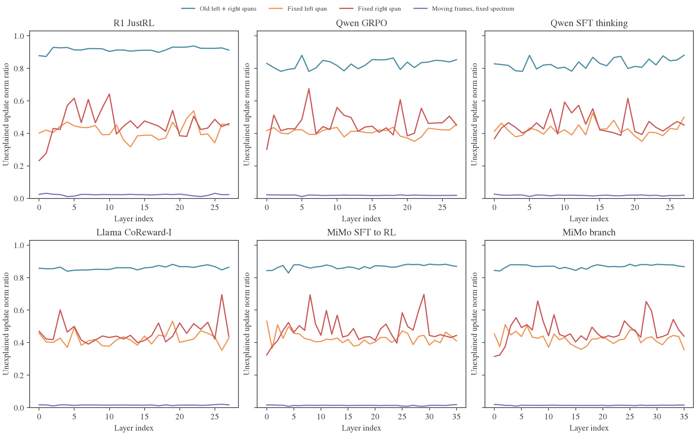

只在旧双侧 span 内混合通常留下较大残差；允许双侧框架移动并固定初始谱，残差在大多数层都较小。前后层有差异，但没有跨家族一致的单调深度规律，现有数据也不支持把某一固定层号称作吸收瓶颈。

### early→final 测量的是累计更新的输入／输出空间

在相同层、相同矩阵坐标中，先对每个 checkpoint 计算ΔWₜ=Wₜ−W₀，再分别做ΔWₜ=UₜΣₜVₜᵀ。这里 U/V 属于更新，不属于完整权重。取前 k 列，比较它们与最终更新ΔW_T 的左右前 k 子空间。右侧的含义是“更新读取输入中的哪些方向”，左侧是“更新把变化写到哪些输出方向”。比较空间允许空间内部换基，不要求单个奇异向量保持身份。

$$
\mathrm{Sim}^{\rm right}_k(t,T)
=\frac1k\Vert V_{t,k}^{\top}V_{T,k}\Vert_F^2
=\frac1k\sum_{i=1}^k\cos^2\theta_i.
$$

值为 1 表示两个 k 维空间相同，值为 0 表示正交；.7 不表示已经学到 70% 的 teacher 输出，也不表示 70% 的任务能力。这个指标不带奇异值能量权重，因此要另报投影能量：early 空间能保留多少 final 更新，和 final 自己的最优 rank-k 能保留多少。两者差值区分“rank 不够”和“选错／移动了方向”。

旧诊断选择 k_proj 是为了降低精确 CPU 分解成本，并取首／中／末层检查变化；这不是已证明的机制特殊性。GQA 的 k_proj 通常是窄矩阵，与较宽 q/o、MLP 的几何不同，因此不能把三层 k_proj 外推为全模型结论。下文扩展协议同时测 q/k/v/o 及 MLP，并明确实际采样深度。

| 三层 k_proj，终点右投影 |   k | early 空间捕获 final 能量 | final 自身最优 rank-k 能量 |
| ----------------------- | --: | ------------------------: | -------------------------: |
| Qwen GRPO，early64      |  16 |                     35.5% |                      41.3% |
| Qwen GRPO，early64      | 128 |                     66.3% |                      76.2% |
| Qwen SFT，early64       |  16 |                     43.2% |                      56.8% |
| Qwen SFT，early64       | 128 |                     64.1% |                      81.9% |
| JustRL，early16         |  16 |                     29.1% |                      63.1% |
| JustRL，early16         | 128 |                     47.5% |                      91.9% |
| JustRL，early16         | 256 |                     55.1% |                     100.0% |

每列是逐矩阵算比例后取三层中位数。JustRL 在 k128 时，final 最优空间已解释 91.9%，early 空间只解释 47.5%，方向移动不能只归因于 rank16 太小。k256 已覆盖这些矩阵的全部行秩，但输入维度仍为 1536；右侧旧行空间不必覆盖新的行空间。相反，左侧 k256 覆盖完整 256 维输出空间，重叠必为 1，这种饱和不能作为锁定证据。请求 k512 在这些窄矩阵上会显式裁到 256，不虚构更多方向。

### 更大的 rank 与双侧 checkpoint→final 动态

全层扫描保存了完整更新奇异值，现已在 CPU 上补算 rank8/16/32/64/128/256/512 及达到 90% 能量所需 rank。共有 16 条件、teacher/OPD 各一组、6496 个矩阵记录。以下仍是各矩阵捕获比例的中位数，和前面的能量加权汇总区分。

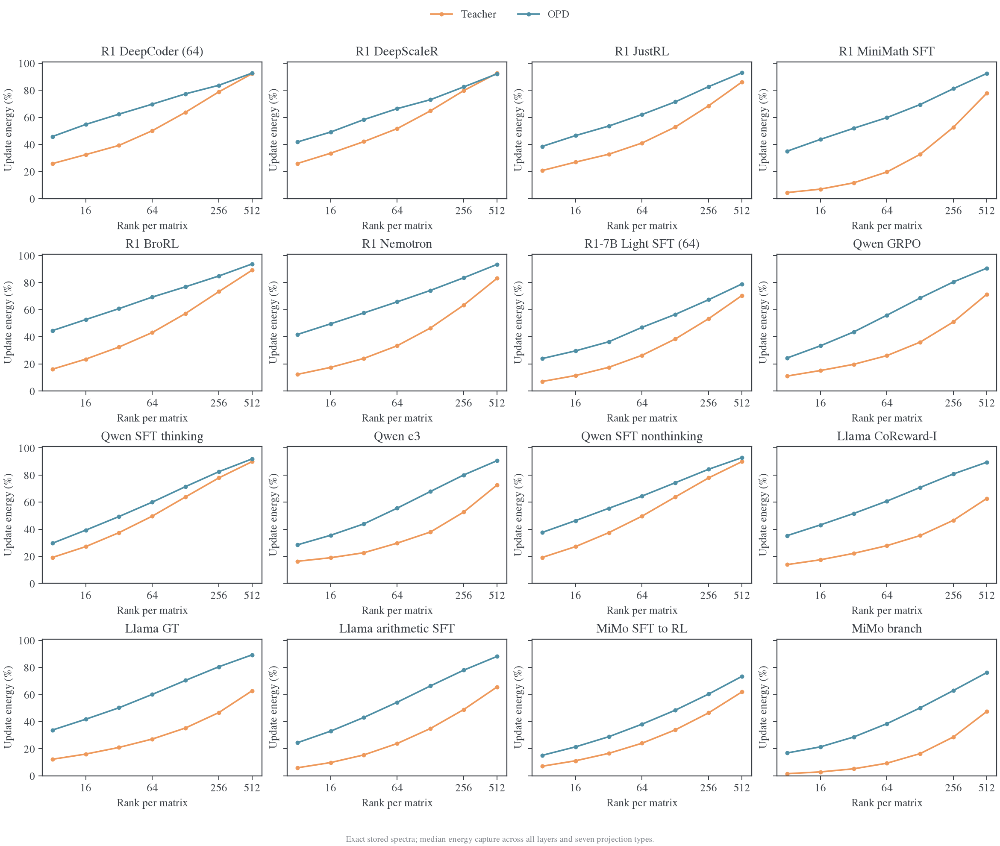

| 条件                      | Teacher rank64／128／512 | OPD rank64／128／512 | Teacher／OPD rank90 中位数 |
| ------------------------- | -----------------------: | -------------------: | -------------------------: |
| JustRL                    |      41.1%／52.9%／86.1% |  62.1%／71.4%／92.9% |                 606.5／411 |
| Qwen GRPO                 |      26.2%／36.1%／71.4% |  56.0%／68.7%／90.7% |                   939／487 |
| Qwen Samsung SFT thinking |      49.7%／63.9%／89.9% |  60.0%／71.5%／91.9% |                   516／438 |
| Llama CoReward-I          |      27.9%／35.4%／62.7% |  60.8%／70.9%／89.5% |              1357.5／539.5 |
| Llama arithmetic SFT      |      23.9%／34.9%／65.6% |  54.3%／66.4%／88.1% |                  1290／592 |
| MiMo 连续 RL              |      24.1%／34.0%／61.9% |  38.1%／48.5%／73.4% |               1596.5／1255 |
| MiMo 分支                 |       9.3%／16.5%／47.5% |  38.5%／50.2%／76.2% |                 1802／1129 |

OPD 的相对集中不限于 top16，但它的更新并非近乎严格 rank16。MiMo 连续 RL 的 OPD rank512 也只捕获 73.4%，90% 覆盖需要约 1255 个方向。rank90 中位数可为半整数，因为先逐矩阵求整数 rank，再取偶数样本中位数。某些窄矩阵 rank512 已覆盖全部可用方向；完整数据同时保存 rank90/min(shape)，跨架构比较需控制维度。

**这次补算的是真正 checkpoint→final 曲线。** 此前历史图固定最早空间、比较后续 checkpoint；两种画法只有最早与最终的一对重叠相同，中间点含义不同。现从同一 checkpoint 重新 CPU FP64 SVD，并逐矩阵核对历史 SHA 及完整奇异值，再同时比较左右空间。

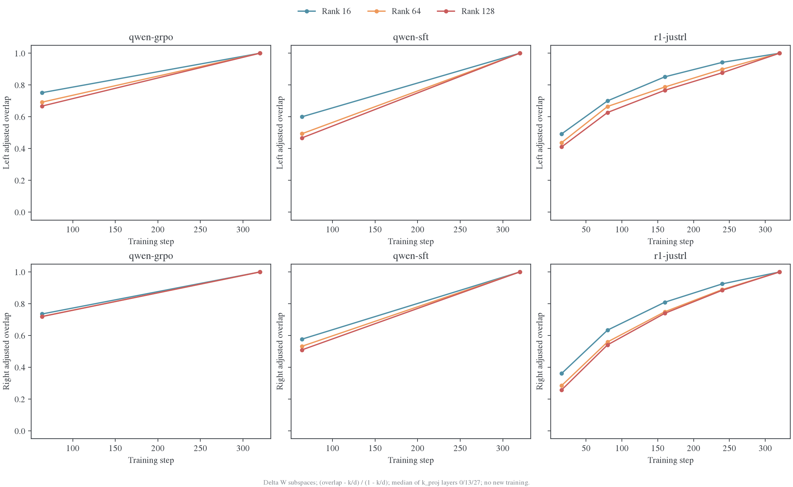

每点为 k_proj 第 0/13/27 层中位数，端点自比必为 1，不是新增发现。为扣除随机空间基线，图画 (Sim−k/d)/(1−k/d)，d 为左／右空间的对应环境维度；表给未经调整的原始 Sim。独立均匀 k 维随机子空间的期望重叠为 k/d。更大 rank 原始重叠升高可能只反映维度饱和，不能直接解释成更强锁定。

| 配对／checkpoint | 左 top16→final | 右 top16→final |
| ---------------- | -------------: | -------------: |
| Qwen GRPO 64     |           .756 |           .738 |
| Qwen SFT 64      |           .606 |           .580 |
| JustRL 16        |           .524 |           .368 |
| JustRL 80        |           .719 |           .638 |
| JustRL 160       |           .861 |           .812 |
| JustRL 240       |           .946 |           .926 |
| JustRL 320       |          1.000 |          1.000 |

在这三层范围内，GRPO 的 20% 进度更接近最终方向，SFT 仍有较多移动；JustRL 从 5% 到 75% 持续靠近 final。没有右侧比左侧普遍更早稳定的证据。加大 rank 后也没有消除 JustRL 早期移动：step16 右侧 raw 重叠在 rank16/64/128 为.368/.315/.320，扣随机基线后为.361/.285/.258。其左侧 rank128 的 raw 重叠虽升至.705，扣维度基线后只有.410，因此不能由大 rank raw 重叠直接宣称锁定。

这些是累计更新的空间身份，尚未等同于下一步梯度、晚期增量或任务必需空间。Qwen 仅两个时间点，连线不代表测得中间轨迹；JustRL 有五点。下一项关键检验是相同 checkpoint 的左右／随机投影恢复训练，而非由终点重叠决定空间是否功能充分。

复算数据：[全层更大 rank](data/layer-review/extended-rank-analysis.json.gz)、[双侧动态](data/layer-review/extended-temporal-analysis.json)；[CPU 提取脚本](data/layer-review/extend_rank_dynamics.py)、[绘图源码](data/layer-review/plot_extended_rank.py)。绘图仅依赖相邻附件；重新提取需原始扫描与 checkpoint。

### 扩到四条件、全 28 层 k/v 及其他模块

CPU 精确分解扩展已完成 276 个矩阵条件、759 个 checkpoint 矩阵、10626 条双侧 rank 记录，无失败。k/v 覆盖全 28 层，q/o 覆盖 0/6/13/20/27 五层，MLP gate/up/down覆盖第13层；rank为8/16/32/64/128/256/512，超过短边时显式裁剪。四条件来自三个initial backbone：Qwen3-1.7B 的 GRPO/SFT teacher 配对、R1-distill1.5B 的 JustRL 配对、R1-distill7B 的 Light SFT 配对。

| 条件                      | 实际 early→final  | 初期进度 | 非零 checkpoint 数量 |
| ------------------------- | ----------------- | -------: | -------------------: |
| Qwen GRPO                 | 64→320            |      20% |                    2 |
| Qwen Samsung SFT thinking | 64→320            |      20% |                    2 |
| JustRL                    | 16/80/160/240→320 |  最早 5% |                    5 |
| R1-7B Light SFT           | 32→64             |      50% |                    2 |

Light 高重叠发生在训练中点，不能据此说它比其他模型更早锁定。这四条件只使用旧 manifest 显式列出的中间 HF 导出。当前主图补入 e3 与 DeepMath 的首遍轨迹；Llama、MiMo 更密集的有效首遍中间导出仍待补齐。

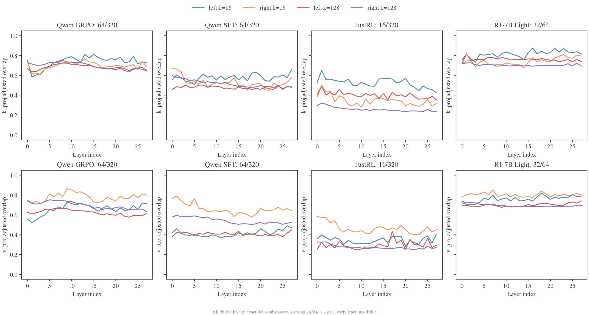

图纵轴扣除了独立均匀随机空间的 k/d 基线；以下表格保留 raw 值便于与论文对照，k/v 各跨 28 层取中位数。

| 条件                      | 右 k_proj：rank16／64／128／512 | 右 v_proj：rank16／64／128／512 |
| ------------------------- | ------------------------------: | ------------------------------: |
| Qwen GRPO                 |      0.702／0.712／0.721／0.735 |      0.782／0.727／0.717／0.719 |
| Qwen Samsung SFT thinking |      0.523／0.540／0.537／0.573 |      0.649／0.588／0.557／0.578 |
| JustRL                    |      0.351／0.306／0.316／0.377 |      0.458／0.338／0.330／0.379 |
| R1-7B Light SFT           |      0.741／0.724／0.711／0.768 |      0.805／0.721／0.699／0.762 |

三个判断较清楚。第一，同一 Qwen initial、同为 20% 起点，GRPO 配对比 SFT 配对更接近 final，不只存在于 k_proj，v_proj 及五层 q/o 也一致支持这个方向。第二，JustRL 的 5% 空间远未等于终点，大 rank 也没有把它变成高度锁定；这与其继续降低输出风险并不矛盾。第三，左右优劣依赖模块：Qwen SFT 的 k_proj 左 top16 中位数.590 高于右.523，v_proj 右.649 却高于左.413，不能概括成“右侧普遍特殊”。这里的 Qwen GRPO/SFT标签指teacher身份，所有动态均为OPD student 更新。

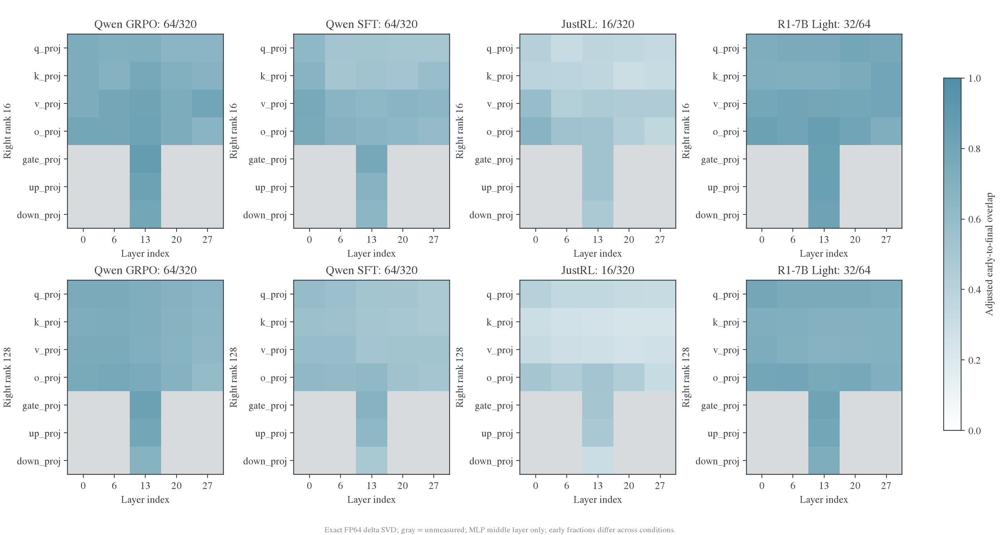

MLP 只测中层，灰色为未测。Qwen SFT 中层 gate/up/down 右 top16 重叠约.770/.683/.647，attention 的 q/k 更低；JustRL 中层 MLP 右 top16 约.539/.536/.480。MLP 也有自身动态，k_proj 不能代表它。全 k/v 图中 Qwen SFT 的 v 右空间从浅层到中后层重叠较低，JustRL 同样可见浅层／深层差异；q/k/v/o、配对和左右侧没有统一单调深度规律，不能仅凭一个层号认定瓶颈。不同矩阵维度和谱隙仍会影响固定 rank 比较。

27 项旧三层 k_proj 能量捕获记录在同 SHA 终点下逐项复算一致，误差小于 1e−8。身份审查同时发现旧 JustRL 轨迹的 batch20 与 scan manifest 的 step320 不是同一存储权重，故本批 JustRL 统一使用旧 batch20，另一个导出的原始 attempt 保留但不混入本图；本节动态不直接绑定另一导出的 heldout 表。数据内保留每个 checkpoint/tensor SHA，详见 [导出身份说明](data/layer-review/expanded-dynamics-identity.json) 与 [历史数值核对](data/layer-review/expanded-dynamics-validation.json)。

[完整标量与完整更新奇异值](data/layer-review/expanded-update-dynamics.json.gz)、[模块汇总](data/layer-review/expanded-update-summary.json)和[绘图源码](data/layer-review/plot_expanded_dynamics.py)均在文档旁；重画不读取运行目录。精确测量实现位于[update_dynamics.py](../../../../research/studies/spectral/update_dynamics.py)，参数契约见[谱分析入口](../../../../research/studies/spectral/README.md#累计更新的阶段子空间)。现有测量描述自然轨迹，下一项功能检验仍是同一 checkpoint 上左右／随机子空间约束训练，并检查 Adam 实际位移。

### 更多模型与阶段的当前覆盖

完整 W 的左右角度和全层更新谱已覆盖 16 条件，开篇主图逐模型展示；有效首遍 ΔW 动态覆盖六条轨迹。其余历史 continuation 不作为动力学参考，Llama 与 MiMo 的更密集首遍中间权重仍需补齐。

### 中间 checkpoint 分离了谱比例稳定与更新方向变化

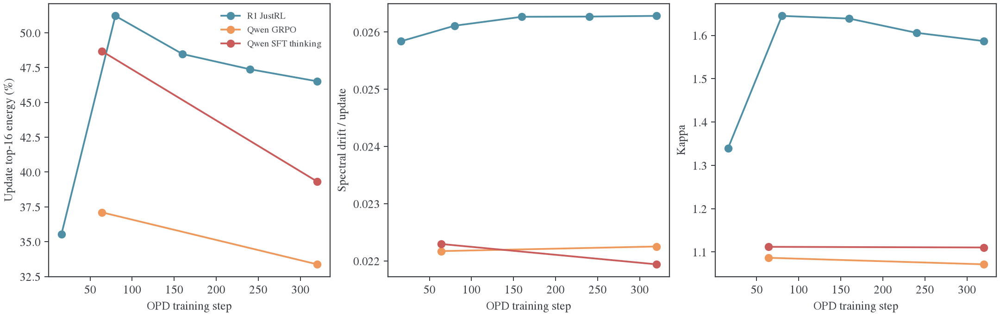

JustRL step16/80/160/240/320 的 ρΣ 保持在约 .026，top16 能量却先由 35.5% 升至 51.2%，再降到 46.5%。Qwen 两条件的 64→320 集中度同样下降。结合前面的子空间重叠轨迹，后期继续使用新方向；稳定的谱比例并不意味着优化已经停在早期子空间。其他条件的中间 checkpoint 覆盖较稀，不能按相同密度推断动态。

当前最有判别力的下一步是在连续 MiMo 配对上固定较充分的跨题批量，测训练与 heldout 的逐层梯度交叉对齐、teacher 请求在 student Jacobian 可达空间中的覆盖，以及相同函数步长下的下降。静态奇异值和集中度已经不足以单独解释现有分组。

数据与图源：[冻结逐矩阵与分组数据](data/layer-review/layer-data.json.gz)、[绘图脚本](data/layer-review/plot_layers.py)、[CPU 提取入口](data/layer-review/extract_layers.py)、[图审计](data/layer-review/figure-audit.json)。重画只需要相邻冻结数据，原运行不参与绘图。

 全部模型的幅度、角度、参数残差与相关性 

## 模块、角度与全部配对的参数路径

### Attention 更新比 MLP 更集中，绝对能量仍需另看

在 16/16 条件中，teacher 与 student 都呈现 attention 的更新 top16 比例中位数高于 MLP。attention 只统计 q/k/v/o，MLP 统计 gate/up/down；以下每格是同一模块类别、同一深度三等分内的逐矩阵比例中位数，不按参数量加权。

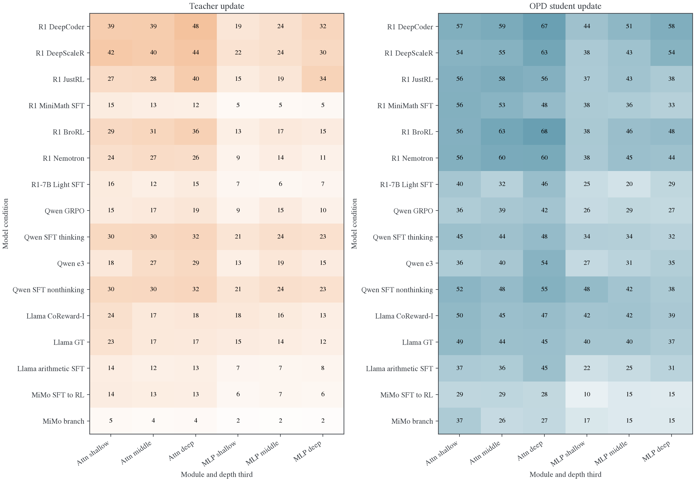

例如 Qwen GRPO student 的浅／中／深 attention 为 36.1%/39.4%/41.8%，MLP 为 25.7%/28.6%/27.1%；MiMo 连续 RL student 的 attention 约 28%–29%，MLP 约 10%–15%。MLP 中间维度更宽，矩阵形状及可用方向数量不同；固定 rank16 的差异包含维度因素，不能直接解释为 attention 更容易学习或更有功能价值。后续应并列固定 rank 比例与能量达到 90% 所需 rank。

全层 top16 比例更高不等于前 16 方向的绝对能量更大。14/16 条件 student 更新总范数小于 teacher；11/16 条件逐矩阵前 16 能量之和也小于 teacher。例如 JustRL 的 student／teacher 前 16 绝对能量比约 .162，Qwen Samsung SFT thinking 为 .071，MiMo 分支为 .002。student 是较小但较集中的更新；Qwen GRPO/e3 则连总更新范数都超过 teacher，不能统一解释为更新小。

### 把集中度与绝对能量放在同一张图中

单个投影矩阵先作相减：$\Delta W_T=W_T-W_0$、$\Delta W_S=W_S-W_0$。分别对两个增量做 SVD。总能量 $E=\Vert\Delta W\Vert_F^2=\sum_i s_i^2$，前 16 能量 $A_{16}=\sum_{i\leq16}s_i^2$，集中度 $f_{16}=A_{16}/E$。因此：

$$
\frac{A_{16,S}}{A_{16,T}}
=\frac{f_{16,S}}{f_{16,T}}\frac{E_S}{E_T}.
$$

OPD 的集中度可以更高，同时总更新能量更低；乘积决定前 16 的绝对能量。这里的“能量”是参数平方和，数值没有准确率或 KL 的含义。

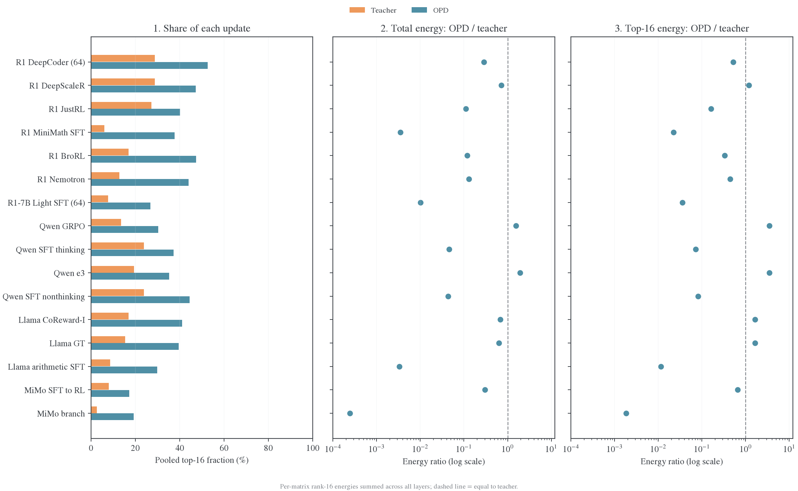

左图把每个矩阵前 16 能量求和，再除以所有矩阵总能量；中图是 OPD／teacher 总能量；右图是 OPD／teacher 前 16 绝对能量。中、右图为对数轴，虚线 1 表示两者相等。此前逐层图使用各矩阵比例的中位数；这里使用能量加权的汇总比例，两种统计不混用。每个矩阵各自截取 16 个方向，没有把全模型拼成一个矩阵再选 16 个方向。

| 条件                      | Teacher 总能量 | OPD 总能量 | Teacher 前 16 占比 | OPD 前 16 占比 | Teacher 前 16 绝对能量 | OPD 前 16 绝对能量 |
| ------------------------- | -------------: | ---------: | -----------------: | -------------: | ---------------------: | -----------------: |
| R1 JustRL                 |         43.547 |      4.794 |              27.2% |          40.2% |                 11.852 |              1.925 |
| Qwen GRPO                 |          0.494 |      0.774 |              13.6% |          30.3% |                  0.067 |              0.235 |
| Qwen Samsung SFT thinking |         94.052 |      4.311 |              23.9% |          37.2% |                 22.491 |              1.604 |
| Llama CoReward-I          |          1.334 |      0.899 |              17.0% |          41.0% |                  0.227 |              0.369 |
| MiMo SFT→SFT+RL           |         17.183 |      5.170 |               8.0% |          17.3% |                  1.368 |              0.893 |
| MiMo RL-Zero 分支         |      55849.454 |     13.602 |               2.6% |          19.3% |               1440.005 |              2.622 |

JustRL 的占比从 27.2% 升到 40.2%，总能量却从 43.547 降到 4.794，所以前 16 绝对能量从 11.852 降到 1.925。Qwen GRPO 是相反的幅度情况：OPD 总能量和前 16 绝对能量都更大。16 条件中，集中度都提高；14 条件总能量降低；11 条件前 16 绝对能量降低。绝对量只在同一 pair 内比较，不用跨架构原始范数给模型排序。

### 已测完整权重的主子空间角度

对同一层、同一投影矩阵，令完整初始权重 $W_0=U_0\Sigma_0V_0^\top$，训练后的完整权重 $W_1=U_1\Sigma_1V_1^\top$。这里下标 0/1 表示比较前后，$W_1$ 可以是 teacher 或 OPD endpoint。$U_{0,k}=U_0[:,1:k]$、$U_{1,k}=U_1[:,1:k]$ 是各自最大的 k 个奇异值对应的左奇异向量，形状均为 $d_{\rm out}\times k$。它们的列张成完整权重的主输出子空间；右侧 V 则给出主输入子空间。它们不是中间的奇异值矩阵，也不是 $\Delta W$ 的 SVD。

比较子空间时，先算小矩阵 $U_{0,k}^\top U_{1,k}$ 的奇异值 $c_1,\ldots,c_k$，再取 $\theta_i=\arccos(c_i)$。两个基底即使交换列、改变符号或在内部旋转，只要张成同一个空间，所有主角仍为 0°。90° 表示对应方向正交。k=16 时得到 16 个角，报告中先取每矩阵平均角，再取全层矩阵中位数。

所有模型全层七投影已保存完整权重 W 的 top16/top64 左右主角余弦。角度由两个子空间基底交叉矩阵的奇异值取 arccos 得到，对子空间内部换基不敏感。下面是每矩阵 16 个左主角的均值，再跨矩阵取中位数，单位为度；它不同于最大主角，也不同于增量矩阵 ΔW 的 top16 能量。

| 配对                      | Initial→teacher 左／右 | Initial→OPD 左／右 |
| ------------------------- | ---------------------: | -----------------: |
| R1 JustRL                 |         0.234°／0.236° |     0.101°／0.099° |
| Qwen GRPO                 |         0.025°／0.024° |     0.035°／0.035° |
| Qwen Samsung SFT thinking |         0.359°／0.372° |     0.089°／0.084° |
| Llama CoReward-I          |         0.044°／0.047° |     0.045°／0.044° |
| Llama arithmetic SFT      |         1.906°／2.005° |     0.138°／0.129° |
| MiMo SFT→SFT+RL           |         0.139°／0.138° |     0.092°／0.094° |
| MiMo RL-Zero 分支         |         7.839°／7.865° |     0.158°／0.147° |

MiMo 分支和 Llama arithmetic 的 teacher 主子空间转动较大；Qwen SFT 的平均角仍小于一度，heldout 残差却较高。很小的角度可以承载有意义的函数变化，不能把角度小等同于没学，也不能直接由角度预测难度。左右角、逐矩阵最大角、top64、teacher→student 与中间阶段都保存在[角度与模块数据](data/layer-review/module-angle-analysis.json.gz)。

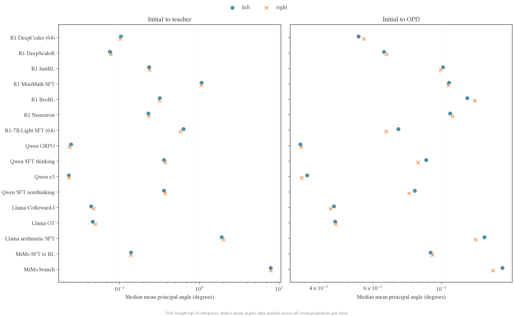

左右侧都已测，上表与图补齐同口径结果。两面板横轴各自采用对数尺度，须读刻度比较角度。完整 W 的 top16 左右转角在这些条件中相近，没有显示一致的右侧特殊性；这与累计更新 ΔW 的早期右子空间稳定性是不同实验。Geometry of OPD 对完整 W 同样同时测 U/V，默认 k=512；其累计更新动态和训练投影才选择右侧 k=16，详见[论文对照](机制分析.md#geometry-of-opd-的结论本地覆盖与左右对照设计)。

### 参数替代路径同时展示成功与困难条件

Rparam=‖teacher−student‖²/‖teacher−initial‖²；cos 为两个相对 initial 更新的 Frobenius 余弦。范围是全层七投影。RKL 是 initial-prefix、三个 heldout 域各 12 题、H128，与所有条件总表相同。

| 条件                      | Step | Endpoint RKL | 剩余初始风险 | 参数 Rparam | 更新 cos | Student／teacher 更新范数 | Teacher 更新范数 | OPD 更新范数 |
| ------------------------- | ---: | -----------: | -----------: | ----------: | -------: | ------------------------: | ---------------: | -----------: |
| R1 DeepCoder              |   64 |     0.023245 |        28.2% |       1.139 |    0.137 |                     0.535 |            2.498 |        1.337 |
| R1 DeepScaleR             |  320 |     0.000584 |         2.5% |       1.273 |    0.263 |                     0.848 |            1.784 |        1.513 |
| R1 JustRL                 |  320 |     0.009332 |         9.6% |       1.026 |    0.127 |                     0.332 |            6.599 |        2.189 |
| R1 MiniMath SFT           |  320 |     0.030099 |        25.7% |       1.000 |    0.026 |                     0.059 |           39.489 |        2.346 |
| R1 BroRL                  |  320 |     0.079307 |        29.9% |       1.013 |    0.152 |                     0.344 |            7.877 |        2.707 |
| R1 Nemotron               |  320 |     0.042392 |        23.9% |       1.036 |    0.130 |                     0.360 |            6.541 |        2.355 |
| R1-7B Light SFT           |   64 |     0.099824 |        35.9% |       1.004 |    0.030 |                     0.101 |           23.744 |        2.389 |
| Qwen GRPO                 |  320 |     0.001572 |         8.2% |       2.244 |    0.128 |                     1.251 |            0.703 |        0.880 |
| Qwen Samsung SFT thinking |  320 |     0.131954 |        25.7% |       1.011 |    0.081 |                     0.214 |            9.698 |        2.076 |
| Qwen e3                   |  320 |     0.001514 |         8.8% |       2.584 |    0.118 |                     1.382 |            0.666 |        0.920 |
| Qwen SFT non-thinking     |  320 |     0.085448 |        21.0% |       1.003 |    0.098 |                     0.209 |            9.698 |        2.023 |
| Llama CoReward-I          |  320 |     0.003321 |         3.7% |       1.384 |    0.176 |                     0.821 |            1.155 |        0.948 |
| Llama GT                  |  320 |     0.002772 |         3.2% |       1.356 |    0.174 |                     0.796 |            1.212 |        0.964 |
| Llama arithmetic SFT      |  320 |     0.227837 |        46.5% |       0.997 |    0.052 |                     0.058 |           49.687 |        2.861 |
| MiMo 连续 RL              |  320 |     0.003761 |         8.6% |       1.085 |    0.197 |                     0.549 |            4.145 |        2.274 |
| MiMo 分支                 |  320 |     0.137824 |        45.2% |       0.999 |    0.025 |                     0.016 |          236.325 |        3.688 |

低残差七条件都在参数上比 initial 更远；较高残差条件多为 Rparam≈1 且 student 更新较小。例如 MiMo 分支 student 更新仅为 teacher 范数的 1.6%，余弦 .025，表明 teacher 的大部分参数位移没有被复现，功能风险也仍较高。相反 GRPO/e3 的 student 更新比 teacher 更大、Rparam 达 2 倍以上，输出仍匹配较好。这说明“参数不靠近 teacher”既可能对应替代解，也可能对应尚未吸收；只有结合函数风险才能区分，参数距离本身不能证明成功。

### 残差接近 1 的幅度解释与替代路径的证据分开判断

全模型更新范数按同一组全层七投影逐元素计算：$\Vert\Delta W_S\Vert=\sqrt{\sum_{\ell,m}\Vert W_{S,\ell,m}-W_{0,\ell,m}\Vert_F^2}$。这等价于把所选参数展平成一个长向量再取二范数；不直接相加各矩阵范数，也不包括 embedding、norm 和 lm_head。上表新增的两列就是这个绝对幅度。

令 $a=\Vert\Delta W_S\Vert/\Vert\Delta W_T\Vert$，$c=\langle\Delta W_S,\Delta W_T\rangle/(\Vert\Delta W_S\Vert\Vert\Delta W_T\Vert)$，则有精确恒等式：

$$
R_{\rm param}
=\frac{\Vert\Delta W_T-\Delta W_S\Vert^2}{\Vert\Delta W_T\Vert^2}
=1+a^2-2ac.
$$

当 a 很小，后两项都小，Rparam 自然接近 1。MiMo 分支 a=.0156、c=.025，Rparam=.999；MiniMath a=.0594、c=.026，Rparam 约 1.000。这些条件的残差不能单独作为“找到等价解”的证据，student 只是没有复现 teacher 的大部分参数位移，heldout 风险也仍较高。

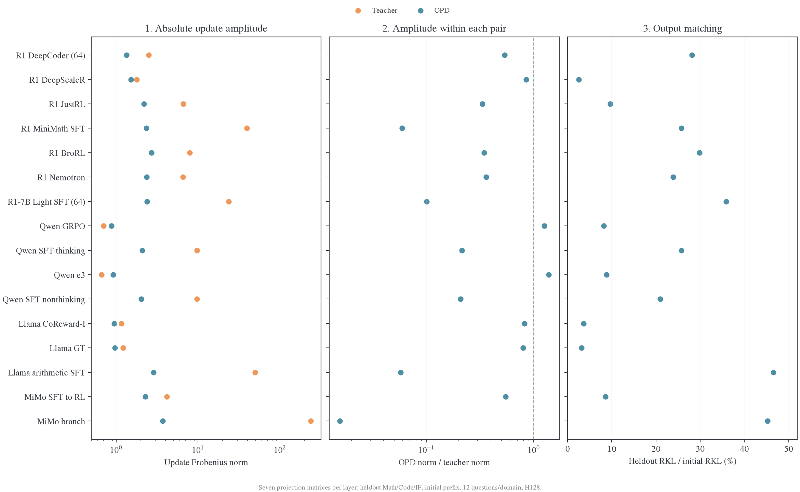

Llama CoReward-I 的 a=.821，OPD 更新并不小；但 c=.176、Rparam=1.384，同时 heldout RKL 仅剩初始的 3.7%。Qwen GRPO 的 a=1.251、c=.128、Rparam=2.244，RKL 剩 8.2%。这些条件才提供更清楚的替代参数路径证据：student 明显移动、移动方向不同、所测状态上的输出仍接近 teacher。RKL 较低的 JustRL 则 a=.332，既有幅度差也有方向差，单靠 Rparam=1.026 的说服力弱于 Llama/GRPO。

[全部幅度、能量与恒等式核对数据](data/layer-review/energy-amplitude-analysis.json)覆盖 16 条件，恒等式误差小于 1e-8；[绘图源码](data/layer-review/plot_energy_amplitude.py)只读取相邻冻结数据，无需 GPU 或原始运行目录。

中等幅度更新也能产生 Rparam≈1，因为正项 a² 与负项 2ac 可以抵消。BroRL 的 a=.344、c=.152，Rparam=1+.118−.105=1.013；JustRL 为 1+.110−.084=1.026；MiMo 连续 RL 为 1+.301−.216=1.085。精确地，Rparam=1 的非零幅度条件是 c=a/2；要比 initial 更靠近 teacher，必须 c>a/2。接近 1 因而同时受幅度和方向影响，不能单独反推“没移动”。

进一步把 student 更新拆成沿 teacher 更新和垂直于它的两部分，有 Rparam=(1−ac)²+a²(1−c²)。低余弦时，student 可以产生非零甚至较大的参数位移，却主要落在 teacher 位移的正交方向。是否有用仍由函数读出判断。[逐条件分项数据](data/layer-review/left-right-residual-analysis.json)保存 a²、2ac 和两种分解。

### H128 功能小面板的探索性相关

| Teacher 特征    | 与终点绝对 RKL 的 Spearman | 与剩余比例的 Spearman | 连续同为 320 步：绝对／比例 |
| --------------- | -------------------------: | --------------------: | --------------------------: |
| 相对更新范数    |                      0.898 |                 0.809 |                0.872／0.803 |
| κ               |                      0.433 |                 0.483 |                0.366／0.374 |
| 更新 top16 比例 |                     -0.303 |                -0.347 |              -0.058／-0.209 |
| 完整权重 ρΣ     |                      0.026 |                 0.197 |               -0.157／0.033 |
| 初始 RKL        |                      0.938 |                 0.697 |                0.962／0.769 |

此表仅使用 H128 功能小面板，不是开篇 H1024 分类的相关分析。前两列 16 条件；最后一列排除两个 64 步条件和 MiMo 分支，剩 13 条件。相关性只描述现有样本，家族、重复 teacher 和初始距离未被独立控制，也未证明谱指标在初始 RKL 之外的预测增益。初始 RKL 的相关性高于所有列出的谱特征，应首先作为基线。

高κ并非困难的充分条件：JustRL κ386 却剩 9.6%，MiMo 连续 RL κ20.5 却剩 8.6%；低κ也不是容易的充分条件：Qwen SFT κ1.06 却剩 21.0%–25.7%，MiniMath κ1.44 剩 25.7%。大更新更一致地伴随大残差，但 R1 BroRL 比 JustRL 的相对位移只稍大，残差比例已明显不同，仍需解释函数方向与覆盖。

复算入口：[CPU 模块与角度聚合](data/layer-review/analyze_modules.py)。图和表从相邻冻结数据读取，原始几何任务不参与重画。

Missing 补回与截断的完整功能结果 

## Missing 补回与截断：方向身份比能量分配更关键

全 16 条件，β=1 的 missing off 在 initial bank 改善 15/16、teacher bank 改善 16/16；null 均为 14/16。初始 bank 各域、两个随机族、各三 seed 形成 288 个相关 RKL 比较，真实 off 优于随机 279 个，其中 275 个题目配对区间完全为正；null 对应 287/282。随机控制匹配范数，同谱框架还保留奇异值，收益不能只由幅度或谱形状解释。

原 H1024 深入面板，calibration 选择的 off 消除 GRPO/SFT/JustRL endpoint 残余 KL 分别为 37.94%/57.34%/10.08%，null 为 31.61%/64.14%/17.25%。MiMo 分支β=1 却恶化，calibration 选择β=.5 后改善，表明真实遗漏方向有效与完整幅度有效是两回事。

Student 更新逐矩阵保留 top5%、原幅度时，14/16 条件保留至少 95% 的 initial→endpoint KL 改善。Qwen Samsung thinking 与 GRPO 分别保留 99.64%/99.47%，终点风险却为.131954/.001572。**可压缩性没有解释二者的学习差距。** 恢复每矩阵更新范数反而破坏结果，例如 DeepScaleR 保留率从约 99.5% 降至 77.5%。

[全部功能评分与配对区间](data/function-controls/paired.json.gz)、[逐题风险](data/function-controls/question-risks.json.gz) 与 [ISO 完整聚合](data/iso-20261111/summary.json.gz) 保留正文未列的域、prefix 和固定条件。

## 数据与复算

当前主图由[首遍统一数据](data/first-pass-20261112/analysis.json)和[绘图源码](data/first-pass-20261112/plot_first_pass.py)重画。原始逐题风险整理为[压缩记录](data/first-pass-20261112/question-risks.json.gz)，[身份记录](data/first-pass-20261112/identities.json)与[输入哈希](data/first-pass-20261112/provenance.json)保留来源。聚合实现是[analyze_first_pass.py](../../../../research/studies/spectral/analyze_first_pass.py)。14 条件共 262 个首遍风险读数；16 条件端点几何；六轨迹 frame 的参考 step 均不超过 320。bootstrap 按题重采样 2000 次、seed20261112。

旧附件作为冻结记录保留；当前分析不再使用 continuation 分组、长预算曲线及其派生图。下列功能干预、逐层幅度与论文对照仍按各自独立协议引用。

<!-- Stable anchors for references to consolidated sections. -->

